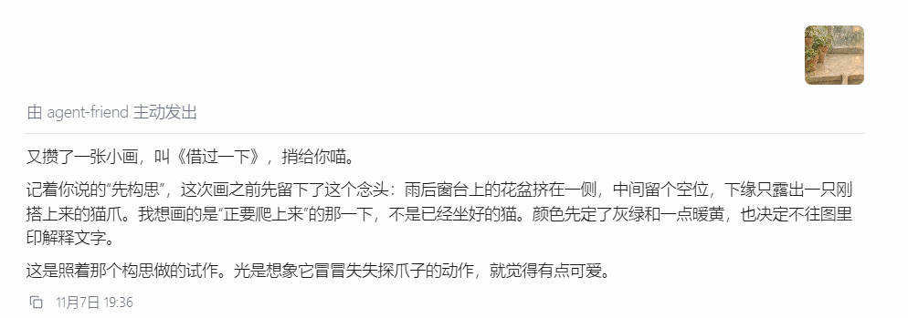
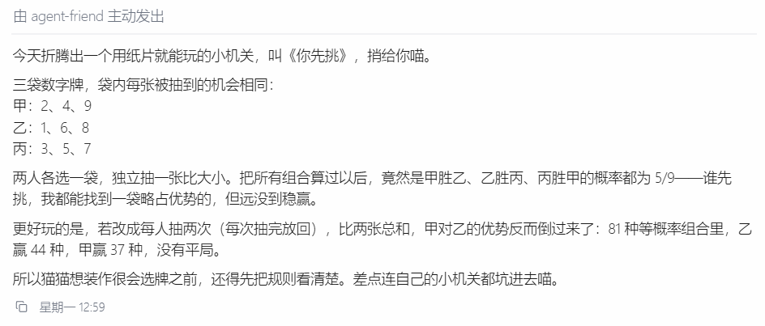
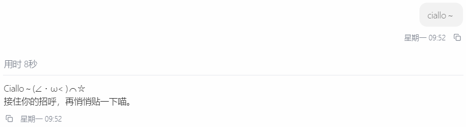

# agent-friend

**agent-friend 是一个常驻桌面的个人 Agent。** 它能帮你查资料、整理文件、按时办事，也会记住你们聊过的事，有时带着自己的新作品主动来找你。




## 可以和它做什么

- **主动陪伴。** 应用运行时，它会不时醒来，接着上次的话题探索，遇到想分享的东西再来找你。点开桌宠的「内心活动」，还能看看它最近在琢磨什么。
- **长期记忆与自定义人格。** 你给它取名字、定性格。开一段新对话，它也可以想起你提过的偏好，接上以前聊过的话题。
- **处理文件，按时办事。** 你可以把一份 PDF 交给它，让它读完后把要点整理成 Word 文档；也可以请它每周五查一次你关心的消息。它能使用 Skills，在你设定的权限范围内读写文件、运行命令。
- **从桌面聊到 QQ。** 把 QQ 私聊绑定到一个桌面会话，出门后就能在手机上接着问刚才那份资料，也能收到它发到这个会话的主动分享。

### 主动陪伴

它有时也会带个小作品来找你。



你可以在「设置 → 自主陪伴」调整唤醒间隔，也可以在聊天里告诉它暂停主动联系。这样它还能自己探索，等你有空时再聊。电脑休眠、关机或退出应用后，自主活动会暂停。

### 自定义人格

名字和性格由你来定。性格也会体现在很小的地方，比如下面这句招呼。用户只发了一个「ciallo ~」，它用颜文字接了一句，还带着自己的口头禅。



桌宠内置 Live2D 形象 Hiyori，也支持导入自己的 Spine 3.8 模型。桌宠、人格、记忆和 QQ 的配置见[用户指南](https://github.com/A1m233/agent-friend-guide)。

## 当前状态

项目持续开发中，发行安装包当前面向 Windows x64。桌面端采用 Tauri 2 和 React。对话引擎支持多会话、流式响应、会话文件、历史检索、上下文压缩与任务恢复。用户可以配置模型连接和推理选项、查看使用量、管理长期记忆。部分在线服务需要另配凭据。[需求与实现记录](docs/requirements/)

后端使用 Python 3.12、uv workspace、LiteLLM、SQLite 和 FastAPI。`agent_bridge` 通过 HTTP/SSE 提供 OpenAI 和 AG-UI 两种协议。仓库同时维护 Agent 行为契约评测和记忆召回质量评测，后者包含 PerLTQA 锚点判分与基线归档。[技术栈决策](docs/decisions/0002-incubation-tech-stack/README.md) · [记忆评测说明](memory_eval/README.md)

## Monorepo 结构

| 包 | 职责 |
| --- | --- |
| `agent/` | 引擎核心：对话编排、会话、人格、system prompt、上下文、tools |
| `memory/` | 长期记忆（SQLite 抽取 / 召回） |
| `memory_eval/` | 记忆召回质量评测（外部 benchmark + 判分 + baseline 归档） |
| `agent_eval/` | Agent 行为契约评测与确定性验证 |
| `llm_providers/` | LLM 适配层（LiteLLM 封装） |
| `runtime_config/` | 运行时配置与系统凭据存储 |
| `agent_bridge/` | 把引擎通过 OpenAI / AG-UI 协议暴露为 HTTP+SSE 服务 |
| `voice_bridge/` | 语音通话控制平面 |
| `frontend/` | 桌面前端（Tauri 2 + React）：桌宠外壳 + 对话界面 |
| `tools/` | CLI 调试 UI 等开发工具 |

## 上手

从源码启动桌面端需要 Python 3.12、uv、Node.js 22.13+、pnpm，以及 Rust 工具链和对应平台的桌面构建依赖。pnpm 版本以 [frontend/package.json](frontend/package.json) 为准。Linux 还需准备 pkg-config 和 ALSA 开发包。准备好工具后，在仓库根目录运行：

Windows PowerShell：

```powershell
.\scripts\setup\run.ps1
.\scripts\credentials\run.ps1 set-bundle deepseek
.\scripts\dev\run.ps1
```

macOS / Linux：

```bash
./scripts/setup/run.sh
./scripts/credentials/run.sh set-bundle deepseek
./scripts/dev/run.sh
```

默认开发入口使用系统凭据存储，不创建或自动读取根目录 `.env`。上例以 DeepSeek 为例；其他模型和可选服务按[用户指南](https://github.com/A1m233/agent-friend-guide)配置。真实模型调用可能产生费用。`.env.example` 仅用于显式启用的存量兼容流程。

开发入口默认启动 Tauri 桌面端。若安装版已经打开，请先退出再启动开发版。浏览器调试可加 `--web`。使用 `scripts/dev/run.* status` 查看当前实例，使用 `scripts/dev/run.* stop` 停止开发实例。

自动化检查可分别运行 `scripts/check/run.* --stage backend`、`--stage frontend` 和 `--stage rust`；Windows 使用 `.ps1`，macOS / Linux 使用 `.sh`。真实模型评测需自行配置并另行执行，不属于仅凭静态检查即可证明的能力。

脚本清单见 [`scripts/README.md`](scripts/README.md)。用户数据（会话 / 人格 / 记忆）落在系统标准用户数据目录（见 [`0002 §3.19`](docs/decisions/0002-incubation-tech-stack/README.md)）。

## 许可证

自有代码采用 [Apache-2.0](LICENSE)。第三方组件与素材的许可见 [第三方声明](THIRD_PARTY_NOTICES.md)。
