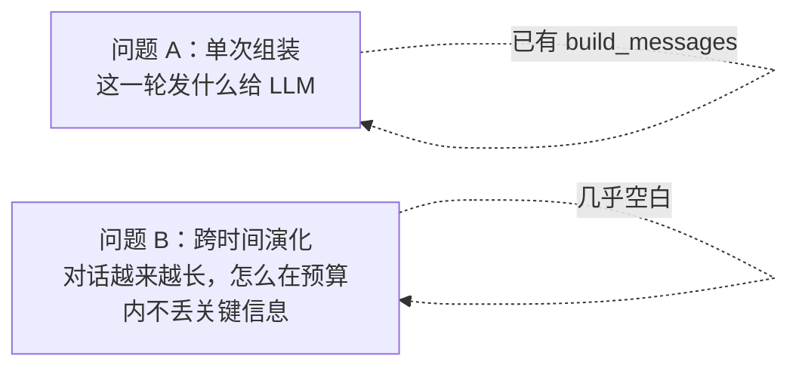
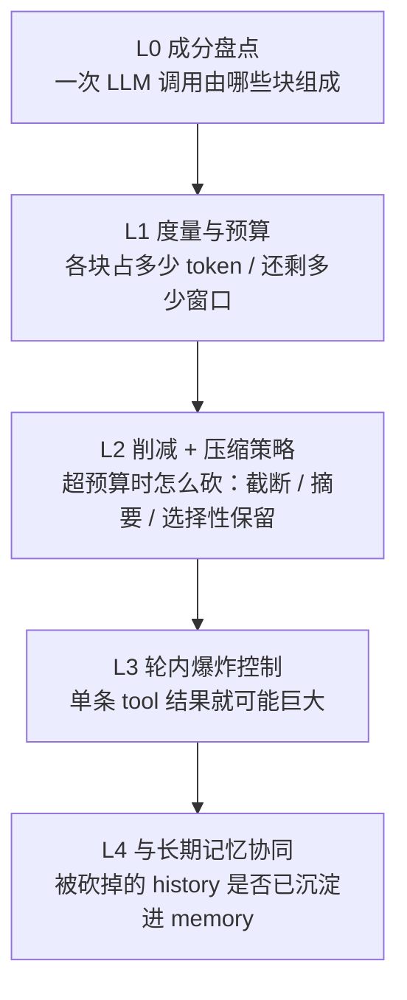
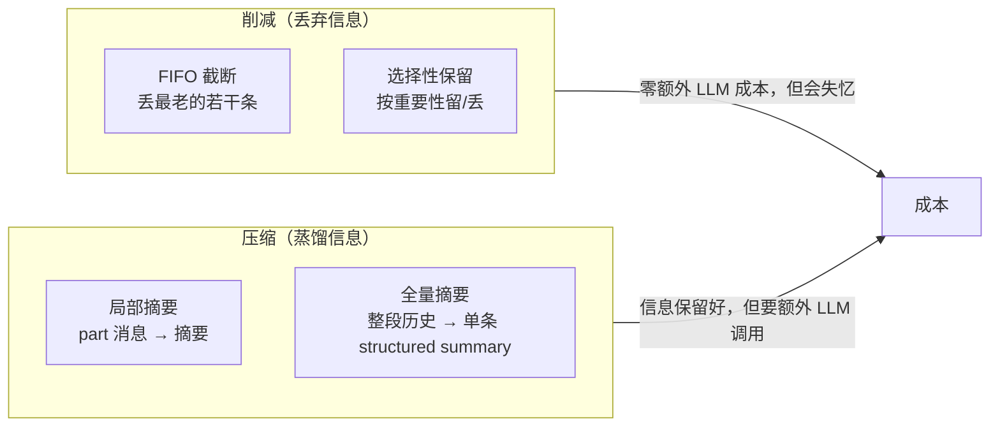
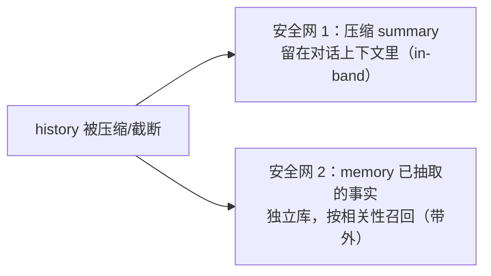
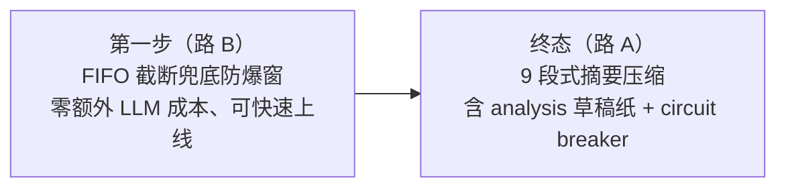

# 上下文管理（Context Management）探索

> **定位**：本篇是**过程笔记**，记录上下文管理的整体蓝图、关键判断与待决问题。
> 这里只记**思路与倾向**，不构成已锁定方案。具体落地时再到 `docs/requirements/<id>/`
> 写 `requirement.md` / `design.md`，权威以那里为准。

---

## 1. 心智模型：上下文管理其实是两个问题

容易被揉成一团，但拆开看更清楚：



- **问题 A（单次组装）**：`system + memory + history + new_input + tools` 怎么拼。已由
  `agent/src/agent/context.py` 的 `build_messages` 完成，是"静态快照"。
- **问题 B（跨时间演化）**：随轮数增长，`history` 单调膨胀，迟早撑爆 context window。
  这是当前真正的缺口。`NaiveContextManager`（全发不截断）就是把 B 当作"不存在"——
  撑爆时直接抛 `LLMBadRequestError`，由 CLI 给友好提示。

> 注意区分：项目里的 `memory` 模块（008 需求）做的是**跨会话长期记忆**（事实/情节蒸馏），
> 与"单会话内 history 怎么裁剪/压缩"是两回事。后者才是本篇讨论的对象。

---

## 2. 分层蓝图（L0 ~ L4）



### L0 成分盘点（现状：已具备）

一次 LLM 调用 = `system_prompt`（已结构化装配，见 004 的 `SystemPromptComposer`）
\+ `extra_context`（memory 召回，可选）+ `history` + `new_user_input` + `tools`
\[+ 轮内累积的 tool 结果\]。`build_messages` 即这层产物，不需改动。

### L1 度量与预算（现状：完全没有）

要回答"当前占了多少 token、还剩多少窗口"。现状刻意不做（注释里 YAGNI：算 token 要
跑 tokenizer，成本高）。但 L1 是 L2 的前置——不度量就无法判断"超没超"。

**token 计数怎么做**（借鉴 cc，详见 §4）：不跑本地 tokenizer，用 **hybrid 估计**——
以上一次 LLM 响应里 API 返回的真实 `usage` 为锚点，只对"上次调用之后新增的消息"
用字符数粗估并做保守 padding（偏上界）。

### L2 削减 + 压缩策略（现状：只有"不削减"）

真正的可插拔点。`ContextManager` 已是 Protocol，注释预告了 `Fifo` / `TokenBudget` /
`Summarizing` 三种。本质是一个谱系，见 §3。

### L3 轮内爆炸控制（现状：没有，本期纳入蓝图、暂不实现）

与 L2 不同：L2 管"跨轮 history 膨胀"，L3 管"单轮内工具调用循环瞬间顶满窗口"
（web search 返回一大坨、读文件读出几千行）。当前 `MAX_TOOL_TURNS` 只限了**轮数**，
没限**单条 tool 结果体积**。cc 的对应做法是清理/摘要老的 tool_result。

### L4 与长期记忆协同（现状：已被现有架构覆盖，判断为"不做强协同"）

详见 §5。结论：现有"每轮 observe"已是尽力而为的交接，无需"砍之前先确认已沉淀"
那种强耦合。

---

## 3. L2 谱系：削减 vs 压缩

两类策略都归在"上下文压缩"这件工作里，但取舍不同：



| 策略 | 本质 | 优点 | 代价 | cc 是否采用 |
| --- | --- | --- | --- | --- |
| FIFO 截断 | 丢最老的消息 | 实现最简、零 LLM 成本 | 直接失忆 | 基本不用（仅作兜底语义） |
| 选择性保留 | 按重要性留/丢 | 比 FIFO 聪明 | 需要打分逻辑，复杂 | 否 |
| 局部摘要（microcompact） | 部分消息 → 摘要 | 比全量便宜、延迟全量 | 多一条代码路径 | 是（轻量层） |
| 全量摘要（full compact） | 整段历史 → 单条结构化 summary | 信息保留最好，腾出 40~60% | 额外 LLM 调用 + prompt 工程 | 是（主策略） |

**关键观察**：cc 的"compaction"几乎全靠**压缩（摘要）**，很少做裸"削减"；
唯一明显的削减是针对体积大的 **tool_result**（对应 L3）。

---

## 4. token 预算与触发阈值（cc 参考）

cc 不跑本地 tokenizer，token 计数走 **hybrid**：

- **锚点**：上一次 LLM 响应里 API 返回的真实 `input_tokens`（`usage`）。
- **增量**：只对"上次调用之后新增的消息"用 `字符数 / 4` 粗估，再乘约 `4/3` 做保守
  padding（偏上界）。
- **最终** = 上次真实 `input_tokens` + 新增估算。

触发阈值（**cc 的公式与常量仅作参考锚点，不是我们的选型**）：

```
effectiveWindow      = contextWindow(model) - min(maxOutput, 20K)   # 给 summary 留生成空间
autoCompactThreshold = effectiveWindow - 13K                        # 200K 模型 → 167K 触发
```

> **重点（我们的约束）**：阈值**必须按所用 model 的 context window 动态推导**，
> **不能写成固定值**——不同 provider / model 的窗口上限差异很大（如 8K / 32K / 128K /
> 200K / 1M）。可借鉴 cc 的"窗口 − 输出预留 − 缓冲"这套**相对公式**，把缓冲量做成
> 可配置/可按比例计算，但绝对触发点随 model 而变。

cc 全量摘要的工程细节（落地时可借鉴）：

- **9 段式结构化 summary**，其中"所有 user 消息逐字保留"——转述会让用户意图漂移。
- **`<analysis>` 草稿纸 trick**：让模型先在 `<analysis>` 里梳理时间线，再写 `<summary>`，
  随后把 `<analysis>` strip 掉只留 summary 进 context——免费提升 summary 质量。
- 摘要调用用 `maxTurns=1` 且**禁用所有 tool**（只允许文本输出）。
- **circuit breaker**：连续失败 3 次就放弃，防止失败循环。

---

## 5. 与长期记忆（memory）的关系

**链路现状**：每轮成功结束 → `Conversation._observe_turn` → `memory.observe(fragment)`
非阻塞入队 → 单线程 FIFO worker **串行抽取**。即**每轮都自动交接**。

因此 L4 不需要"压缩前先确认已沉淀"的强协同。但要清楚交接是**尽力而为、非无损**：

- **异步时差**：真到压缩那一刻，最近几轮可能还在队列里没抽完。
- **有损**：抽取只留事实/情节摘要，不是逐字；LLM 可能 noop / 失败。
- **崩溃**：`kill -9` 丢队列里未处理的 fragment（008 design 已声明 v1 接受）。

**两张安全网**（互补，不竞争）：



结论：压缩历史时关键信息有两条退路，L4 从"要设计协调机制"降级为"接受现有
observe 的尽力而为即可"。

---

## 6. 落地节奏倾向



- **蓝图终态以"摘要压缩"为主策略**，但**实现先用 FIFO 截断兜底**，避免被"引入压缩用
  LLM 调用"这条新链路阻塞（也会触发 LLM-API-confirm 规则、需处理 circuit breaker 与
  prompt 模板）。
- L3（轮内 tool 爆炸）纳入蓝图，本期不实现。

---

## 7. 依赖与待决问题（Open Questions）

**依赖：`LLMClient` 透出 `usage`（token 计数的前置）**——当前完全没透出：

- **非流式 `complete`**：litellm 的 `response` 本身就带 `response.usage`，但 `_call_once`
  只取了 `content`、把 usage 丢了。补救成本低。
- **流式 `stream`（主对话路径）**：两处缺口——① litellm 流式默认不返回 usage，要传
  `stream_options={"include_usage": True}`；② `LLMTurnDone` 没有 usage 字段，需加上透出。
  `LLMTurnDone` 注释声明"仅内部 + conversation 消费"，改动面可控。

**待决问题**：

- 缓冲量（cc 的 13K / 20K 对应物）按**固定 token** 还是按**窗口比例**算？倾向比例化以
  适配不同 model 窗口，但需验证小窗口模型（如 8K）下比例是否仍合理。
- token 增量估计的字符系数（cc 用 `/4` + `4/3` padding）对中文/多语言是否需要调整。
- 路 B 的 FIFO 截断保留窗口大小怎么定（按条数还是按 token 预算）。
- L3 触发点与 L2 共享"预算"概念但触发时机不同，未来如何统一在一个预算账本里。
