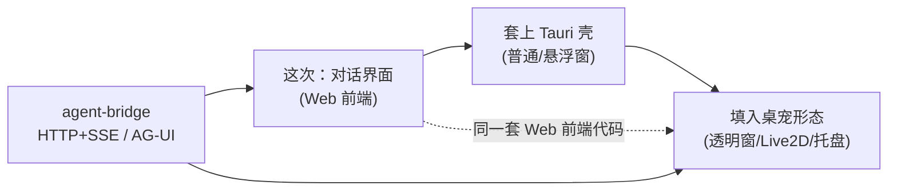
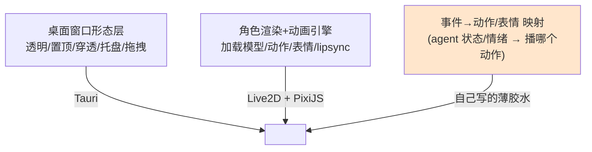

# 初期前端界面探索

> 探索记录（过程笔记），非决策、非需求。
>
> 本篇沉淀"初期前端界面该怎么做、做到什么程度"的讨论：前端定位、与桌宠形态的演进关系、桌宠渲染方案（Live2D）、桌宠接入成本评估，以及本次迭代的范围取舍。
> 文中所有"待拍"的点**留到正式需求阶段再定**，本篇不拍板。

- **创建时间**：2026-06-09
- **关联**：`decisions/0001`（路线图 Phase 1 形态期）、`decisions/0002`（§3.6 Tauri / §3.7 前端栈 / §3.12 HTTP+SSE）、`006-agent-bridge`、同目录探索 `desktop-pet-form-factor`

---

## 1. 前端定位

- 这次要做的是一个**正经的、面向使用的前端**，不是纯调试 UI（区别于 0001 M3"不投入设计资源"的调试入口、和 006 用 `agent-cli --bridge` 顶替的 web 调试）。
- 产品最终**一定要有桌宠形态**（实体），这是长期方向；但前期直接做桌宠不现实，需要先用传统对话界面验证可行性与调试。
- 因此核心命题是：**这次的前端，既要能快速验证对话体验，又要为将来的桌宠形态平滑留口子，避免推倒重来。** 呼应 0001"上层稳定"与 `coding-design`"稳定核心 + 易变策略拆边界"。

## 2. 关键前提：前端选型不会被桌宠推倒重来

一个容易忽略但决定性的事实：

- 0002 #6 已锁定**桌宠外壳 = Tauri 2**；
- 而 **Tauri 应用 = 一个 Web 前端（webview 跑 React/Vue/Svelte）+ 一层 Rust 壳**。

所以这次用 Web 栈做的对话界面，**本身就是未来桌宠的前端层**，演进是叠加而非替换：



通信层（0002 #12 HTTP+SSE / AG-UI）天生形态无关——bridge 不关心对面是浏览器、Tauri 还是桌宠。这个口子已经留好。

## 3. 为桌宠留口子的三个点

真正"被桌宠影响、需要现在考虑"的收敛为三点：

1. **Web 框架选型（React / Vue / Svelte）**：0002 §3.7 原本推迟到 Phase 1，做正经前端就被迫提前。Live2D 走 PixiJS（canvas/WebGL）**框架无关**，所以框架按开发效率（最顺手）选即可，不被桌宠绑死。**（具体选型待正式需求拍）**
2. **直接在 Tauri 壳里做 vs 先纯浏览器**：倾向直接 Tauri，留口子成本最低，避免"浏览器能跑、进 webview 踩坑"（文件系统/原生 API/SSE 差异）。
3. **前端内部架构：形态无关的 presentation 层**：对话/会话/记忆逻辑与状态，不假设自己长在"全屏聊天窗"还是"桌宠气泡"里；形象/形态做成可替换的皮。桌宠引入 = 新增一个形态视图，而非重写。桌宠动画走**独立 canvas 层**，不卷进框架重渲染。

## 4. 桌宠渲染方案：用 Live2D，不自研引擎

调研结论：Web 集成 Live2D 生态非常成熟，可以不自研"桌宠引擎"。

**三层分工**（用现成方案后，自己只写最薄一层）：



**现成库（分层）**：
- 开箱即用：`oh-my-live2d`、`live2d-widget`（看板娘）
- PixiJS 插件（主流落地）：`pixi-live2d-display`（v6/v7）、`untitled-pixi-live2d-engine` / `pixi-live2d5`（v8+Cubism5）、`easy-live2d`
- 官方底层：Live2D Cubism Core + Cubism Web Framework

**同构参考项目**：
- **Open-LLM-VTuber**（⭐10k）：Python FastAPI 后端 + 桌面客户端 + Live2D(Cubism5) + 可插拔 LLM/ASR/TTS + 桌宠模式 + 后端控制表情 + 持久化。与本项目 `bridge + 前端 + persona/情绪` 架构高度同构。
- **Copiwaifu**：Tauri 2 + Vue 3 + PixiJS + easy-live2d + Rust，并把 motion group 绑定到 runtime state。技术栈与 0002 方向几乎一致。
- **Live2DPet**：Electron + PixiJS + pixi-live2d-display + VOICEVOX。

**路线分叉**（顺带解决了 `desktop-pet-form-factor` 里纠结的"动画协议"问题）：

| 路线 | 美术风格 | 动画体系 | 协议 |
|---|---|---|---|
| Spritesheet（Codex pet 那种） | 像素 | 帧动画，固定状态槽 | 简陋，要自研扩展 |
| **Live2D（VTuber 那种）** | 矢量骨骼/2.5D | motion group + expression + 物理 | **成熟现成，表达力强，不用自己设计** |

**用现成引擎的代价（要提前评估）**：
- **授权**：Cubism SDK / Core 有 Live2D Inc. 许可，商用有门槛（营收规模/署名等）。法务点要提前看清。
- **模型资产成本**：像样的 Live2D 模型要委托画师（钱 + 以周计周期）或用免费模型（授权受限/撞脸）。省了工程，多了内容资产账。

## 5. 桌宠接入成本评估

**关键事实**：grep 确认 agent 代码**目前没有任何"情绪/状态"对外输出通道**——桌宠表情/动作要"反映 AI 状态"，这个通道得从零建（跨 agent+bridge+frontend 三层）。

**四块绕不开的成本**（"渲染引擎成本低" ≠ "桌宠形态成本低"）：

| 成本块 | 内容 | 性质 |
|---|---|---|
| ① Live2D 模型资产 | 委托画师/免费模型 + Cubism 商用授权 | 硬成本，长周期外部依赖 |
| ② Tauri 桌宠窗口 spike | 透明/无边框/置顶/穿透/hit-test/拖拽/托盘，Win/Mac 差异 | 不确定性成本（0002 §3.6 自己就要求 Phase 1 专门 spike） |
| ③ 多窗口悬浮交互 | 桌宠 + 操作栏 + 对话详情的窗口/层协同、穿透区域控制 | 桌宠交互里最繁琐处 |
| ④ 情绪/状态事件通道 | agent 产出状态 → bridge 透出 → 前端映射动作 | 跨三层新增能力 |

**成本阶梯**：

| 档位 | 内容 | 成本 | 碰哪些硬成本 |
|---|---|---|---|
| L0 | 窗口内对话界面，无形象 | 低 | 无 |
| L1 | 窗口内"形象+操作栏+对话详情"，形象占位 | 低–中 | ①可占位规避 |
| L2 | 桌面悬浮透明窗桌宠 + 操作栏 + 对话详情，形象占位 | 中–高 | ②③ |
| L3 | 完整 Live2D 桌宠 + 情绪驱动表情 | 高 | ①②③④ |

判断："顺手把桌宠做了" ≈ 从 L0 跳到 L2/L3 = 实质启动整个 Phase 1，scope 翻几倍并绑上美术资产/Tauri spike/新引擎能力三个高风险项，会拖垮"验证对话前端"这个本次主目标。

## 6. 本次迭代范围决定（L2 收窄版）

选定方向：**做桌宠形态骨架，但精准收窄到最低成本**。

**这次做**：
- Tauri **透明悬浮窗**（置顶/穿透）作为桌宠主窗
- **占位形象**（静态图/简单动画），预留未来 Live2D 的 PixiJS canvas 挂载点
- 桌宠上**悬浮出操作栏**（窗内浮层），本次**只做一个按钮：打开常规 chatbot 界面**
- **常规 chatbot 对话界面**（传统形态），接 bridge（AG-UI/SSE）跑通对话——本次核心价值

**这次不做（留口子）**：
- Live2D 实装（①）→ 留占位挂载点
- 情绪/状态事件通道（④）→ 占位形象只需"待机/说话"两态，说话态用现成对话事件驱动即可
- "直接弹输入框"那个按钮 → 操作栏可平滑扩展
- 复杂动作/表情

**省了什么、没省什么**：占位形象省掉 ①④；单按钮省掉多按钮交互；但选了透明悬浮窗，**②③ 省不掉**——这是本次真正的硬骨头。

## 7. 架构建议：2 窗口模型

降低 ③ 复杂度的关键：**操作栏不单独开窗**。

```mermaid
flowchart LR
    A["桌宠悬浮窗<br/>(透明/置顶/穿透)<br/>占位形象 + 操作栏浮层"] -->|点"打开对话"| B["对话窗<br/>(常规/不透明)<br/>传统 chatbot"]
    A --> C["agent-bridge<br/>HTTP+SSE / AG-UI"]
    B --> C
```

- 操作栏 = 桌宠透明窗内的 DOM 浮层（hover/click 显示），不单独开窗 → 省一个窗口和"操作栏跟随定位"
- 只有对话详情是第二个常规窗口
- 两窗口共用同一 bridge

**留口子清单（确认到位）**：
- 占位形象区域 = 未来 Live2D 的 PixiJS canvas 挂载点（presentation 可替换）
- 透明悬浮窗形态这次就立起来，未来换 Live2D 只是"往挂载点填渲染"
- 操作栏可加第二个按钮（直接弹输入框）
- 情绪通道④ 留到 Live2D 实装时三层一起加

## 8. 留给正式需求阶段的待拍点

以下本篇**不拍**，正式需求开始时再定：

- **待拍 1 · 前端框架**：React / Vue / Svelte（看开发效率，不被 Live2D 绑死）
- **待拍 2 · 对话详情形态**：独立常规窗口（2 窗口模型，易调）vs 桌宠窗内展开成对话（同窗切视图，体感连贯但透明窗塞完整 chatbot 更难调）

## 9. 决策纪律提醒

选了 L2，本次迭代**实质上是正式启动 Phase 1 形态期的第一步**，与 0002"前端 Phase 1 再做"、0001"Phase 0 先跑通地基"的节奏冲突。落地时应：

1. **正式立一个需求**（如 `010-desktop-shell-and-chat-ui` 之类），走 feature 分支（`dev-workflow`），不在 main 上堆实现。
2. **可能需要更新 0001 / 0002**：把"前端框架选型""桌宠窗口形态提前"这两个项目级决策落定（按 docs-discipline，项目级技术栈不在需求里偷定）。
