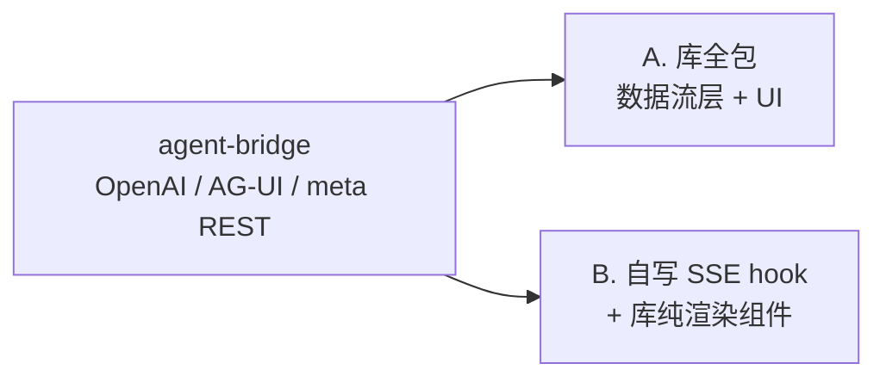

# 对话 UI 组件库选型探索

> 探索记录（过程笔记），非决策、非需求。
>
> 本篇沉淀"初期前端的常规 chatbot 对话界面，要不要用现成对话组件库、用哪个、用到什么程度"的讨论。
> 是 `initial-frontend` 主题第 6 节"做常规 chatbot 对话界面，接 bridge（AG-UI/SSE）"的子话题。
> 文中所有倾向**不拍板**，留到正式需求阶段定（前端框架未定前，库选型本就只能给方向）。

- **创建时间**：2026-06-09
- **关联**：同目录 `README.md`（§6 本次范围、§8 待拍点）、`006-agent-bridge`（OpenAI / AG-UI / meta REST）

---

## 1. 关键认知澄清：后端已经把"引擎"做完了

讨论一开始的纠结是"要不要干脆引擎自己写、UI 组件只做渲染"。核查代码后发现这是个**伪命题**：

`agent-bridge` 现在已经同时暴露三套 HTTP 接口：

| 接口 | 协议 | 现状 |
| --- | --- | --- |
| `POST /v1/chat/completions` | 标准 OpenAI（stream / 非 stream） | ✅ 已实现 |
| `POST /ag-ui/run` | 标准 AG-UI（官方 `ag_ui` 包编码，含 `TOOL_CALL_*`、思考、`RUN_ERROR`） | ✅ 已实现 |
| `GET /v1/sessions`、`/v1/personas`、persona/model/channel 切换 | bridge 自家 meta REST | ✅ 已实现 |

要点：**前端库里的"引擎/SDK"和后端引擎不是一回事**。

- 后端 `agent`（对话编排、tool calling、上下文、记忆）= 真·引擎，已经写完。
- Ant Design X 的 `x-sdk` / TDesign 的 `ChatEngine` / assistant-ui 的 runtime / `useChat` = **前端侧数据流层**，只干三件事：发 HTTP、解析 SSE、维护消息 state。

所以真正要决策的不是"引擎自己写不写"，而是 **"前端那层数据流，自己写还是用库"**。

## 2. 候选库横向对比

| 维度 | TDesign Chat（走 AG-UI 直连） | Ant Design X（走 OpenAI） | assistant-ui | Vercel AI Elements |
| --- | --- | --- | --- | --- |
| 和后端匹配度 | **最高**：`/ag-ui/run` 即标准 AG-UI，`useChat({protocol:'agui'})` 近乎直连 | 中：OpenAI 能接，但 tool call 在 OpenAI SSE 里表达不如 AG-UI 直观 | 主推 AI SDK / LangGraph，AG-UI 非母语 | 协议自定，靠 AI SDK |
| 包结构 | 一个包，相对整 | 拆 `x` + `x-sdk` + `x-markdown`，零件感重 | 一套 primitives + runtime | copy-in 源码，按需引 |
| 设计哲学 | 引擎 + 组件，组件也能独立吃 props | 同左 | **headless：交互能力绑 runtime context** | shadcn/ui，源码归你 |
| 框架 | React（另有 Vue 版） | React（另有 Vue 版 / Element Plus X） | **仅 React** | React |

一句话：**在"用库全包"这条路里，因为后端原生 AG-UI，TDesign Chat 比 Ant Design X 更顺；Ant Design X 既复杂又不是后端母语，最不划算。**

## 3. 能力归属边界：这些库不是"纯 UI"

纠正一个直觉误区——"组件只是纯 UI、滚动/重试/打字机/tool call 都它包了"。实际这些库把**视觉壳**和**行为逻辑**打包在一起卖，分界如下：

| 能力 | 组件能直接给 | 必须自己接（数据流/行为） |
| --- | --- | --- |
| 气泡 / markdown / 代码高亮 / 附件卡片 | 全部，吃 props 渲染 | 无（真·纯 UI） |
| tool call 展示 | 卡片样式、参数/结果区、loading 态 | **状态机推进**（pending→running→result，解析 SSE 后喂给组件） |
| 打字机效果 | 流式 markdown 渲染（delta 一来就重渲染，逐字天然出现） | **delta 拼接**（把 `TEXT_MESSAGE_CONTENT` 累加成完整 message） |
| 自动滚动 | 用它的"列表容器组件"时自动 | 只用单个气泡自己 `map` 就得自己滚 |
| 重试 | "重试按钮" + `onRetry` 回调壳 | **真正的重发**（重新打 `/ag-ui/run`）是行为逻辑 |
| 错误态 | 红气泡 / 错误提示样式 | **何时算错、错后怎么恢复**的判断 |

分界总结：**偏纯视觉的（打字机视觉、滚动、卡片样式）组件能包；偏行为的（重试重发、错误恢复、tool 状态推进、delta 拼接）组件只给"按钮 + 回调壳"，真实动作还得数据流接上。**

补充：打字机不用额外写动画——后端 AG-UI 推的就是 `TEXT_MESSAGE_CONTENT` 增量 delta，累加后交给支持流式渲染的 markdown 组件，逐字效果自然产生。

不同库在这条分界线上的位置差很多：

- **assistant-ui（headless）**：交互能力大量绑在自己的 runtime context 上。只拿 primitives 当纯 UI、不用它 runtime 会很别扭——本质是"要你用我的数据流"，不适合"数据流自己做"。
- **TDesign Chat / Ant Design X**：展示型组件（`ChatMessage` / `Bubble` / `ChatSender` / `Sender`）相对独立、吃 props，适合"数据流自己做"；代价是自动滚动、重试接线挂在 `ChatEngine` / `useChat` 上，单用展示组件时这部分壳后的逻辑要自己补。
- **Vercel AI Elements**：CLI 把组件源码拷进项目，代码归你，最适合"控数据流、UI 拿来改"，也契合 Tailwind/shadcn 倾向。

## 4. 倾向结论（不拍板）

两个事实决定方向：

1. **后端原生 AG-UI** → TDesign Chat / CopilotKit 的母语；Ant Design X（OpenAI + 多包）正是"觉得复杂"的来源。
2. **大量库永远不覆盖的自定义能力**（persona 列表/切换、会话列表、记忆，以及未来桌宠/语音通道）→ 不论选哪个库，这些数据流都得自己写。

按此：

- **求快、想最快跑起来对话界面** → TDesign Chat 走 AG-UI 直连，主流程（流式、tool call、思考）近乎零成本，只补 persona/会话的 meta REST 调用。
- **求长期可控**（桌宠/语音/记忆这些非标准形态迟早要自己掌控数据流）→ 自己写消费 SSE 的 hook + 纯渲染组件；事件流已规整（AG-UI 那套），自写成本可控，额外成本仅 streaming 拼接/滚动/重试。
- 若走"数据流自己做、组件只渲染"：首选 **TDesign Chat / Ant Design X 展示型组件** 或 **Vercel AI Elements**；**避开 assistant-ui 当纯 UI 用**。

## 5. 与"待拍 1·前端框架"的耦合

库选型和 `README.md` §8 的"待拍 1·前端框架"强耦合，框架未定前只能给方向：

- **React**：上面四个候选都可用，池子最大。
- **Vue**：可选 Ant Design X Vue、Element Plus X、TDesign 的 Vue 版聊天块；assistant-ui / Vercel AI Elements 不可用（仅 React）。

所以"库怎么选"应在正式需求阶段**和框架选型一起拍**，本篇不单独锁库。
