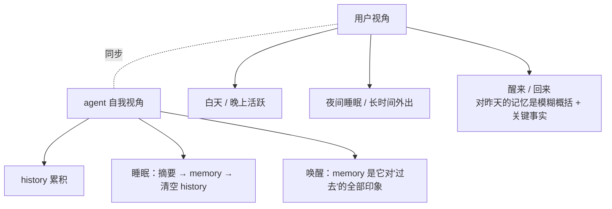
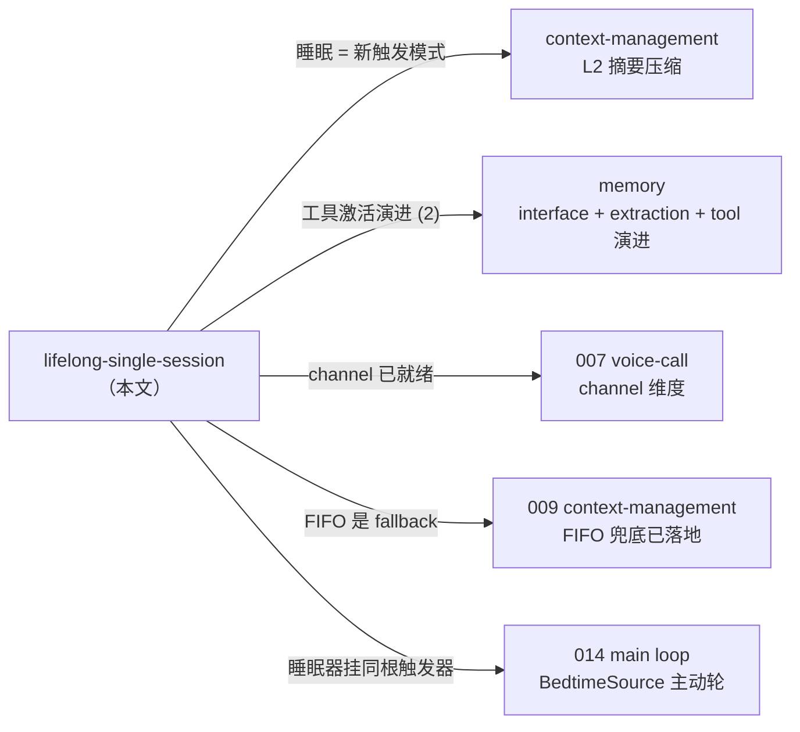

# Exploration · Lifelong Single Session

> 沉淀"终身单会话 + agent 自管 GC（睡眠隐喻）"方向的多轮讨论。
> 本文件是当前快照，会随讨论推进追加 / 修订。
>
> 当前快照：2026-06-16 · 首轮讨论沉淀

---

## 0. 定位与状态

**这是一个设想，不是已敲定的方案**。

- 这里**只记思路与倾向**，不构成已锁定决策。具体落地时再到 `docs/requirements/<id>/` 写 `requirement.md` / `design.md`，权威以那里为准。
- 后续即便真引入项目，**大概率是以"模式 / option"形态接入**，而不是把现有的多 session 能力直接砍掉。多 session（[002 session management](../../requirements/002-engine-session-management/)）作为底座保持完整，"终身单会话"是它之上的一种**用户体验形态**——可由配置 / persona / 用户偏好开关。
- 因此本文的"清空 history"、"睡眠摘要"等技术动作描述，都应理解为**该模式下的行为**，不应解读为"对所有 session 都这么干"。

---

## 1. 心智模型


核心主张：**记忆 GC 这件事不该由用户决定**。

- 现状多 session 形态下，"什么时候开新会话"实际上是用户在替 agent 做 history GC——用户感知到"对话太长了/换个话题更清爽"，自己开新会话，等于一次手动 GC。
- 这跟"agent 是个真人朋友"的产品语义对不上：真朋友之间不会主动说"我们换个新聊天框、忘掉上面所有"。
- 终身单会话模式 = 把 GC 决策从用户手里**收回 agent**：用户视角永远是同一段对话，agent 在合适时机自己整理 / 压缩 / 沉淀。

**这不是"协议层做单 session"的小修补**——[007 voice-call](../../requirements/007-voice-call/) 已经在协议层把"一个 session 同时承载文字 + 语音"的 channel 维度做好了。本探索是**比 007 更上层的产品哲学**：不只是"语音和文字共享 session"，而是"用户跟 agent 的整段关系 = 一个 session"。

> 重要的认知错位（讨论中纠正过）：**不是"单会话才有上下文爆炸"**。长对话本身就有上下文爆炸，多会话只是让用户替 agent 做了 GC。终身单会话不创造新问题，是把已经存在的问题主动接管过来解决。

---

## 2. 已成立的协议层底座

按现有蓝图，本探索的**协议层支撑已经齐备**，要做的事是其上的策略层：

| 已经齐备的能力 | 来源 |
| --- | --- |
| 一个 session 长期使用、channel 维度可切（voice / text） | [007 §4.3 + §4.4](../../requirements/007-voice-call/) |
| `session.events` JSONL 是 source of truth、永远不丢 | [001 design](../../requirements/001-foundation-chat-and-memory/design.md) |
| 主动轮事件（bedtime / idle reflection）和 user 触发事件落同一段 events | [015 §1.4](../../requirements/015-desktop-pet-bubble-and-conversation-owner/requirement.md) |
| `ContextManager` 是 Protocol、可插不同策略（FIFO / Summarizing / 未来 …） | [009](../../requirements/009-engine-context-management/) + [context-management 探索](../context-management/) |
| Memory 分层（pinned / episodic / semantic）+ extraction 管线 + interface 形态 | [memory 探索 §3](../memory/) + [008](../../requirements/008-engine-memory/) |
| 主动轮调度器（含 BedtimeSource）+ push 通道 | [014 §3](../../requirements/014-engine-main-loop-and-bridge-push/) |

本探索的"新东西"集中在三处：

- 一种**新的 ContextManager 策略**——"睡眠时一次性彻底清空 history"
- 一个**新的睡眠触发器**（可挂在 014 的主动轮调度器上）
- 一把**新的 tool**——agent 在 memory 不够用时翻原始 sessions

---

## 3. 三根支柱

### 3.1 支柱 A：睡眠隐喻

不是"找低代价 GC 时机"，是 **agent 和人共享睡眠语义**。



**关键产品收益**：用户察觉到"agent 对昨天的细节有点模糊" = **不显得突兀**，因为用户自己对昨天的回忆也是模糊的。两边的"模糊化"是同步的，所以"记忆有损"这件事不再是技术缺陷，是**人与 agent 共享的自然语义**。

附带收益：未来 persona 可以坦诚说"昨晚我睡的时候把咱们聊的整理了一下，有些细节记不太清" —— 这是朋友的话，不是 AI 客服的话。GC 视角下绝对不能说这种话；睡眠视角下完全自然。

#### 3.1.1 触发条件（结构倾向）

```
sleep_trigger =
    (深夜时段 ∧ idle ≥ X) ∨ (idle ≥ Y)
    ∧ history > min_threshold        # 例如 context window 的 1/4
```

- **A 条件**：深夜时段 ∧ idle ≥ X —— 经典低代价时机
- **B 条件**：单纯 idle ≥ Y —— **不只是"覆盖外出"，更核心的是用来推断"用户睡着了"**（午睡 / 轮班工作者白天睡）
  - Y 与"推断睡眠"挂钩：人最短主睡眠周期 4~6 小时；Y=6 之下大概率是开会/外出，Y=6~10 才真正进入"可能在睡"区间
  - Y 应该**拉到比直觉更大**（讨论中已确认）
- **阈值 guard**：history 不长（< 1/4 context window）就不睡——避免空跑 LLM 调用、避免"刚聊几句就被压缩"的错觉

补一条本节没列、但 §3.1.2 触发模式覆盖不到时的兜底：

- **Token 阈值兜底**：用户高频连续聊几小时永远不触发 A 也不触发 B，但 history 一直涨——撞 context window 接近上限时**降级走被动压缩**（类似 cc 的 auto-compact，[context-management §4](../context-management/) 已有蓝图）。这条不是"睡眠"的一部分，是"睡眠没及时发生时的 fallback"。

#### 3.1.2 触发模式：三选一

| 模式 | 时机 | 优点 | 风险 |
| --- | --- | --- | --- |
| **A：立即跑** | idle 达 Y 后台立即开始 | 用户回来就是 fresh state | 用户其实在开会、回来发现 history 没了；摘要中漂移的关键事实已 commit 不可逆 |
| **B：回来时跑** | 检测到用户刚结束 Y+ idle 才开始 | 基于真实 idle 长度判断，不会误判 | 用户一回来要等几秒到几十秒（摘要 LLM 调用） |
| **混合：投机摘要**（**倾向**） | idle 达 Y 后台跑**草稿摘要**（cc 的 `<analysis>` 阶段）→ 用户回来时才"提交"成最终摘要并 swap | 真实 idle 时长决定是否提交（避免开会误压）+ 用户回来不需要等（草稿已就绪） | 偶尔白跑一次草稿 = token 浪费有限 |

### 3.2 支柱 B：彻底清空 history、信息获取全部交给 memory

**不在摘要里保留"agent 段交叉引用 token"**（即不走 cc 9 段式的 "user 逐字 + agent 保住具体名词" 路线），直接清空。

理由：

- **只有一个真相源**：memory + 原始 jsonl。没有"摘要里又存了一份关键 token、和 memory 里那一份对不齐"的风险
- **摘要 prompt 大幅简化**：不用让 LLM 同时做"压缩"+ "标记需保留的具体 token"两件事
- **逻辑对称**：history → extract → memory；用户提问 → memory.retrieve；找不到 → 工具翻原文（见 §3.3）。三段接口都已经在已有 explorations 里画过
- **失败兜底自然落到 §3.3 工具**：memory 漏抽 → agent 翻原文。3.2 和 3.3 不只是兼容，**3.3 是 3.2 的必要前提**——没有翻原文工具，3.2 不敢做

唤醒后"连续感"不靠"留最近 K 轮 history"承载（讨论中已撤回该建议），改为：**摘要时给最近时段的细节更高保真度权重**——history 一次清空、零拼接断层，但摘要本身呈现自然的"远近梯度"（远期段更概括、最近段更细）。

### 3.3 支柱 C：给 agent 一把"翻聊天记录"的工具

memory `interface` 形态找不到时，agent 主动调 tool 翻原始 `sessions/*.jsonl`。

这条对应 [memory exploration §3.3](../memory/) 已经预告的演进路径：

> v1 走 interface → 撞墙时按 (1) interface 增强 → **(2) interface + 额外开 `memory_recall` 工具供深挖** → (3) interface + 子 agent 委托复杂查询

终身单会话 + 清空 history 这套设计，**正是在制造"撞墙"信号**——把 (2) 提前激活。

工具设计要敲三件事：

- **触发信号**：模型怎么知道"该翻"？人靠"对方提到了具体锚点 + 我自己无印象"。模型的等价信号：用户消息里有显式时间/事件锚点（"上周"、"你说过"）+ interface 注入的 memory 里没匹配。靠 system prompt 引导，不可完全控制。
- **查询面**：按关键词全文 grep `sessions/*.jsonl` 还是按 episodic id 反查、再 lazy load 那段范围的原文？**倾向后者**——episodic 本来就是 `session_id + range` 指针（[memory exploration §3.5](../memory/)），精度高，全文 grep 在长对话上会爆。
- **滥用风险**：模型可能"动不动就翻"绕过 interface（tool 路径比 interface 显眼，容易过度依赖）。需 prompt 约束 + persona 不被污染（"我有外挂"的认知不能渗透到表达方式）。

---

## 4. 纪律约束（不可妥协的工程红线）

睡眠流程必须满足以下顺序，否则会出 bug：

```
1. wait_for_extract_queue_drain()      # 所有 pending fragment 已 extract 完
2. run_sleep_summary()                 # 摘要 / reflection 产物写入 memory
3. clear_history()                     # 才清空 ContextManager 的 history
```

任一中间步骤失败 → 推迟睡眠 / 重试 / 进 error 状态告警。**绝不允许"已清 history 但 memory 没记下"** 的状态——一旦发生，那段记忆就真没了（jsonl 还在但没索引，retrieve 找不到，工具不知道翻哪段）。

这条与 [memory exploration §5](../memory/) "召回失败 memory 如实返回不编不藏" 对偶：

| 原则 | 含义 |
| --- | --- |
| 召回时如实返回 | 不知道 = 不知道，不编不藏 |
| **写入失败之前不允许丢上下文** | 没沉淀进 memory 之前，history 不能清；这条本探索新增 |

---

## 5. 风险与缺点（讨论中已盘过）

按从核心到边缘排：

1. **关键事实通过摘要漂移**——cc 9 段式设计动因正是这条。本方案选择"激进清空 + memory 兜底 + 工具兜底"路线，接受漂移代价，靠 §3.3 工具承接显性引用兜底。
2. **memory.retrieve 精度变成产品红线**——"显性引用要求高精准" 从"偶尔依赖"提升到"每天必经"（[memory §1.1](../memory/)）。memory 不达标时不应启用本模式。
3. **累积模糊化**——一次睡眠 = 一次有损压缩；连续 N 天 = N 次叠加。可由"周回顾/月回顾"再产出更高层 episodic（即 [memory §3.4](../memory/) 的 reflection）缓解，但远期段仍会逐步糊掉。**没有完美解，接受边界**。
4. **触发误判（白天 idle Y）**——开会 / 外出 / 看长电影都可能误触发。混合模式（§3.1.2）+ 拉大 Y 一定程度缓解，但不能消除。
5. **能耗**——一次深度睡眠 ≈ 多次 LLM 调用（草稿 → 总结 → reflection）。单租户/自用 OK，未来商业化时是显性成本。受 `llm-api-confirm.mdc` 规则约束。
6. **eval 困难**——"长期对话 + 多次睡眠的退化曲线"需要造合成长对话数据 + 在每次睡眠后 probe 一轮 → 看精度衰减。现有 `memory_eval/` 主要跑短任务、小 corpus，不直接覆盖这种 eval 形态。
7. **与语音通道的耦合**——voice 段 user_message 是 ASR 文本（错字 + 口语碎片），摘要这种段比键盘段更易抽错。可能需要在摘要 prompt 里区分 channel（"voice 段先脑补还原意图再摘要"）。细化项，不阻塞。

---

## 6. 仍开放（Still Open）

每条标注了"不收敛会卡到什么"。

1. **本模式是否成为"默认"还是"显式开关"**
   卡点：决定 onboarding 形态与多 session UI 是否保留入口
2. **Y（白天 idle 阈值）的具体数值**
   倾向：≥ 6 小时；最终值跟用户真实活跃 cadence eval 后定
3. **触发模式 A/B/混合 选哪个**
   倾向：混合（投机草稿）；但工程复杂度更高，落地时要重新评估
4. **唤醒后第一句要不要"打招呼"**
   倾向：自然不告知（朋友不会每天告诉你他做了什么梦）；但允许用户问"你刚才在干嘛"时如实答。这是 persona 而不是 sleep 机制的事
5. **摘要 prompt 设计细节**
   关键 token 是否真的"完全不在摘要里保留"还是"agent 段只保留结构性骨架"？激进 vs 折中
6. **`memory_recall` 工具的查询接口形态**
   keyword？时间范围？episodic id？多种组合？跟 [005 tool calling](../../requirements/005-engine-tool-calling-and-web-search/) 接入面对齐
7. **跟现有多 session 形态的共存**
   "终身单会话"作为 mode 时，用户如果显式说"开个新对话"，是另开 session 还是仅在当前 session 上打 marker？
8. **跨"睡眠"的语音 / 文字 channel 混杂处理**
   摘要 prompt 是否区分 voice / text 段？ASR 段是否要先清洗再摘要？

---

## 7. 与已有 explorations / requirements 的衔接



- **[context-management](../context-management/)**：本方案是其 L2 的**新触发模式**（主动 vs 被动），不替换 L2 已落地的 FIFO 兜底。`Summarizing` ContextManager 落地时本方案可作其一种触发策略接入。
- **[memory](../memory/)**：本方案是 §3.3 演进路径 (2) 的提前激活——v1 interface 不动，额外开 `memory_recall` 工具；§3.4 reflection 也由"睡眠"提供天然触发时机。
- **[007 voice-call](../../requirements/007-voice-call/)**：协议层 channel 维度（voice/text）已成立；本方案在其上一层，不与之冲突。voice session 同样按本方案在睡眠时压缩 / 清空。
- **[014 main loop](../../requirements/014-engine-main-loop-and-bridge-push/)**：已有 BedtimeSource，"睡眠摘要"可挂在同一根触发器上（先睡眠摘要 → 再 push bedtime 回顾）。
- **[memory_eval](../../../memory_eval/)**：需要扩展到"长期对话 + 多次睡眠" eval 形态（§5 第 6 条）。

---

## 8. 跟下游文档的衔接

- **当某条 Still Open 收敛到能拍板时**：评估是否进 `docs/decisions/`（涉及产品哲学层）或者直接立项 `docs/requirements/<id>/`（具体功能落地）
- **真要立项时**：新建 `docs/requirements/0XX-lifelong-session-mode/`（或类似命名），其 `requirement.md` 引用本 exploration 作为思考过程，但结论 single source of truth 必须在 requirement / design 里。**且必须在 requirement §1 明确写"这是一种 mode，不是替换多 session"**
- **本文件本身**：随讨论推进追加 / 修订；不强制"出栏台账"格式（参见 [`../README.md`](../README.md)）
