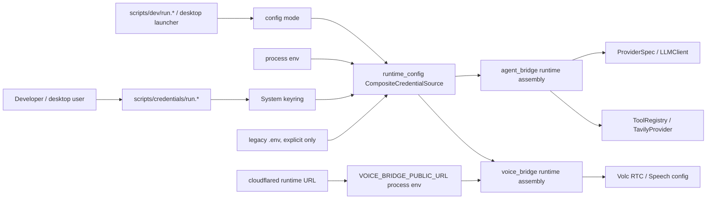

# 032 · 运行时环境与凭据配置 - 技术方案

## 状态

CONFIRMED

## 需求文档

→ [requirement.md](./requirement.md)

## 现状分析

当前配置入口分散在 Python bridge、LLM provider、工具注册、语音 bridge 和脚本层，缺少一个明确的“运行时配置装配”边界。

### 关键现状

| 位置 | 现状 | 问题 |
|------|------|------|
| `agent_bridge/src/agent_bridge/__main__.py` | 启动时无条件 `load_dotenv()` | 桌面主路径会隐式依赖仓库根 `.env`，也会把陈旧值灌进进程环境 |
| `agent_bridge/src/agent_bridge/settings.py` | `BridgeSettings` 使用 `env_file=".env"` | `.env` 读取藏在 settings 构造里，调用方无法按桌面 / legacy 明确选择 |
| `agent_bridge/src/agent_bridge/assembly.py` | `ProviderSpec.from_env(prefix="DEEPSEEK")` | LLM secret 只能从 process env 间接获得，错误提示仍指向 `.env` |
| `llm_providers/src/llm_providers/spec.py` | `ProviderSpec.from_env()` 直接读 `os.environ` | provider 配置和配置来源耦合，难以支持 keyring / managed source |
| `agent/src/agent/tools/factory.py` | `make_default_registry()` 直接读 `TAVILY_API_KEY` | Tavily 工具是否启用被绑死在 process env 上 |
| `voice_bridge/src/voice_bridge/settings.py` | `VOICE_BRIDGE_PUBLIC_URL` 已过滤 `.env`，但 `VOLC_*` 仍可从 `.env` 读取 | issue 027 的短期污染点已修，但长期 Volc 凭据仍没有桌面主路径 |
| `scripts/dev/run.*` | 已把 cloudflared URL 注入本次进程环境 | 运行态 tunnel 处理方向正确，但长期 secret 仍靠 bridge 自己找 `.env` |
| `scripts/bridge/run.*` / `scripts/voice/run.*` / `scripts/voice-smoke/run.ps1` | 注释和前置检查仍引导用户编辑 `.env` | Windows 实机语音 smoke 仍会卡在仓库 `.env` 配置路径上 |
| `.env.example` / `scripts/README.md` / setup 脚本 | `.env` 仍是新人默认配置入口 | 与“`.env` 只做存量，不新增”冲突 |

### 相关既有约束

- 决策 0002 §3.18 已把生产期方向定为“非敏感配置走用户级配置文件，敏感信息走系统安全存储”。本需求把这条方向提前落到桌面 / 开发主路径。
- 028 设置中心已经提供非敏感 settings facade，但 029 明确不做凭据管理 UI。本期因此不改前端 UI，也不要求 Tauri 暴露 secret command。
- issue 027 已证明旧 `.env` runtime 值会污染 Windows 实机语音路径。本期要把同类隐式读取收敛掉。

## 方案设计

### 设计原则

1. **配置来源显式化**：bridge 不再在业务装配深处自行找 `.env`。入口层决定使用桌面主路径还是 legacy fallback。
2. **长期 secret 走系统安全存储**：本期采用 Python `keyring` 接入系统凭据存储，覆盖 Windows Credential Manager、macOS Keychain、Linux Secret Service 等后端。
3. **`.env` 冻结为 legacy**：不新增 key，不作为桌面 / 开发主路径；仅在显式 legacy 模式下兼容 CLI、eval、CI 和存量脚本。
4. **未来前端只接 facade，不接明文读取**：本期不做前端实现，但 secret 命名、状态语义和无回读约束要为未来 Tauri Core command 预留。
5. **托管试用只预留来源，不下发长期秘钥**：未来如果做“用我们凭据的试用包”，必须是 managed source 或短期 token，不把 vendor long-lived secret 放进客户端包。

### 凭据来源模型

本期引入统一的 credential source 概念，消费者只关心“拿到某个用途的配置”，不关心它来自 env、keyring 还是 legacy `.env`。

优先级如下：

| 优先级 | 来源 | 作用 |
|--------|------|------|
| 1 | 当前 process env | CI、测试隔离、一次性覆盖、Tauri / 脚本注入运行态值 |
| 2 | system keyring | 桌面与日常开发主路径，存用户自己的长期 secret |
| 3 | legacy `.env` | 仅显式 legacy 模式启用，服务存量 CLI / eval / CI / 临时调试 |
| 未来 | managed trial source | 熟人试用包 / 我们托管凭据的短期能力，不在本期实现 |

`.env` 不再由 `pydantic-settings env_file` 隐式读取，而是由入口层显式选择 legacy source。这样可以做到：

- 桌面主路径默认不会读仓库根 `.env`。
- CLI / eval 的历史行为可以保留。
- `VOICE_BRIDGE_PUBLIC_URL` 这类 runtime-only key 即使在 legacy 模式也继续被忽略或告警，不允许从 `.env` 注入。

### 为什么本期选择 Python keyring

本期范围不包含前端凭据管理 UI，也不要求 Tauri secret command。因此最小且更贴合现状的实现是让 Python sidecar / bridge 自己通过 `keyring` 访问系统凭据存储：

- `agent_bridge` 和 `voice_bridge` 都是 Python 进程，实际消费 secret 的地方也在 Python。
- Windows 实机语音 smoke 可以直接通过脚本写入 / 检查 keyring，不必先做设置中心。
- 符合决策 0002 §3.18 的既定方向。
- 避免把 Tauri Stronghold 或前端 command 提前纳入本期实现范围。

未来如果前端要支持新增 / 修改凭据，Tauri Core 可以实现同一套 facade：

- `set_secret(name, value)`：只写入，不回显。
- `delete_secret(name)`：删除。
- `credential_status()`：返回是否配置、来源、缺失项，不返回明文。

Tauri facade 可以写入与 Python `keyring` 相同的 service/account，也可以改为由 Tauri Core 在启动 sidecar 时注入 secret。这个选择留给未来前端需求，本期只固定 credential name、状态语义和安全边界。

### 新增 Python 配置基础包

新增 workspace 包：`runtime_config`。

不把这部分放进 `shared/`，因为 `shared/README.md` 的定位更偏类型 / schema / 常量，不适合承载 keyring、dotenv、process env 等运行时行为。也不放进 `agent_bridge`，因为 `voice_bridge` 需要复用且不应反向依赖 `agent_bridge`。

建议结构：

| 文件 | 职责 |
|------|------|
| `runtime_config/pyproject.toml` | 声明包依赖，包含 `keyring`、`python-dotenv`、`pydantic` / `pydantic-settings` 如需要 |
| `runtime_config/src/runtime_config/credentials.py` | credential name registry、secret bundle 定义、状态对象 |
| `runtime_config/src/runtime_config/sources.py` | `EnvSource`、`KeyringSource`、`LegacyDotenvSource`、`CompositeCredentialSource` |
| `runtime_config/src/runtime_config/policy.py` | `ConfigMode` / source policy，例如 `desktop`、`legacy-dotenv`、`env-only` |
| `runtime_config/src/runtime_config/cli.py` | `status` / `set` / `delete` / `set-bundle` 命令实现 |
| `runtime_config/tests/` | keyring fake、source precedence、no-readback 状态测试 |

核心接口形态：

```python
@dataclass(frozen=True)
class CredentialValue:
    name: str
    value: str
    source: str


class CredentialSource(Protocol):
    def get(self, name: str) -> CredentialValue | None: ...
    def status(self, name: str) -> CredentialStatus: ...


@dataclass(frozen=True)
class CredentialPolicy:
    mode: Literal["desktop", "legacy-dotenv", "env-only"]
    allow_legacy_dotenv: bool
```

credential 名称沿用现有环境变量名，降低迁移成本：

| 名称 | 用途 | 本期主来源 |
|------|------|------------|
| `DEEPSEEK_API_KEY` | 主对话 / 记忆抽取 LLM | keyring / process env |
| `TAVILY_API_KEY` | web search 工具，可选 | keyring / process env |
| `VOLC_ACCESS_KEY` | 火山 RTC OpenAPI | keyring / process env |
| `VOLC_SECRET_KEY` | 火山 RTC OpenAPI | keyring / process env |
| `VOLC_RTC_APP_ID` | 火山 RTC 应用 | keyring / process env |
| `VOLC_RTC_APP_KEY` | 火山 RTC token 签名 | keyring / process env |
| `VOLC_SPEECH_APP_ID` | 火山语音应用 | keyring / process env |
| `VOLC_SPEECH_ACCESS_TOKEN` | 火山 ASR / TTS | keyring / process env |

`VOLC_ARK_*` 只属于历史 spike / demo，不进入桌面主路径 credential bundle。

### 开发与桌面入口

新增脚本入口：

| 文件 | 作用 |
|------|------|
| `scripts/credentials/run.sh` | macOS / Linux 凭据管理入口 |
| `scripts/credentials/run.ps1` | Windows 凭据管理入口 |

命令能力：

| 命令 | 行为 |
|------|------|
| `status` | 显示每个已知凭据 `set` / `missing` / `source`，不显示值或后缀 |
| `set NAME` | 使用隐藏输入写入单个 secret，默认写入 system keyring |
| `delete NAME` | 删除单个 secret |
| `set-bundle deepseek` | 交互式写入 DeepSeek 必需项 |
| `set-bundle tavily` | 交互式写入 Tavily 可选项 |
| `set-bundle volc-voice` | 交互式写入 Windows 实机语音所需 Volc bundle |

安全约束：

- 不提供 `get` / `print` / `export` 明文命令。
- 默认不接受 secret 作为命令行参数，避免 shell history 留痕。
- 如后续 CI 需要自动化写入，可单独加 `--value-stdin`，不在本期默认路径里宣传。

`scripts/dev/run.*`、`scripts/bridge/run.*`、`scripts/voice/run.*`、`scripts/voice-smoke/run.ps1` 的语义调整为：

- 默认使用 `desktop` mode：process env + keyring，不读仓库 `.env`。
- 提供显式 legacy 选项，例如 `--legacy-dotenv`，给存量本地流程临时过渡。
- 缺少必需凭据时，提示用户运行 `scripts/credentials/run.* set-bundle ...`。
- `VOICE_BRIDGE_PUBLIC_URL` 仍只由当前进程环境注入，不从 keyring 或 `.env` 读取。

### bridge 装配调整

#### `llm_providers`

为 `ProviderSpec` 增加显式配置构造能力，保留 `from_env()` 作为 legacy wrapper。

```python
@dataclass(frozen=True)
class ProviderConfig:
    api_key: str
    model: str | None = None
    api_base: str | None = None
    context_window: int | None = None


@classmethod
def from_config(cls, prefix: str, config: ProviderConfig, ...) -> ProviderSpec:
    ...
```

设计意图：

- `ProviderSpec` 仍是 LLM 调用层的配置对象。
- env / keyring / managed source 的选择上移到 runtime config 层。
- legacy CLI / eval 可以继续用 `from_env()`，但错误提示从“请在项目根 .env 中配置”改为更中性的“请配置 provider credential”。

#### `agent.tools`

`make_default_registry()` 增加显式 Tavily key 注入：

```python
def make_default_registry(
    session_store: SessionStore | None = None,
    *,
    tavily_api_key: str | None = None,
    stderr_warn: bool = True,
) -> ToolRegistry:
    ...
```

兼容策略：

- 新 bridge 主路径传入 `tavily_api_key`。
- 未传时可暂时保留现有 env fallback，服务 CLI / 测试 / legacy。
- 提示文案不再引导用户编辑 `.env`，改为指向 credential script 或 legacy dotenv。

#### `agent_bridge`

入口层负责构造 `RuntimeConfig`：

1. 解析 `--config-mode` 或脚本注入的 mode。
2. 根据 mode 创建 `CompositeCredentialSource`。
3. 构造 `BridgeSettings`，不让 settings 隐式读 `.env`。
4. 构造 LLM provider config、memory provider config、tool credential config。
5. 将显式配置传入 `build_runtime()`。

`build_runtime()` 改为接收扩展后的装配参数：

```python
def build_runtime(
    settings: BridgeSettings,
    *,
    llm_config: ProviderConfig,
    memory_llm_config: ProviderConfig,
    tool_credentials: ToolCredentials,
) -> BridgeRuntime:
    ...
```

这样 `agent_bridge/assembly.py` 不再直接调用 `ProviderSpec.from_env()` 或让 Tavily factory 自行找 env。

#### `voice_bridge`

`VoiceBridgeSettings` 保留 host / port / log level / default persona 等非敏感字段。Volc 凭据迁出为独立 `VoiceCredentialConfig`：

```python
@dataclass(frozen=True)
class VoiceCredentialConfig:
    volc_access_key: str
    volc_secret_key: str
    volc_rtc_app_id: str
    volc_rtc_app_key: str
    volc_speech_app_id: str
    volc_speech_access_token: str
```

入口层根据 credential source 构造 voice credential，再注入给 app / control plane。缺失凭据时：

- `voice_bridge` 进程可以启动，便于健康检查和本地 UI 开发。
- 创建真实通话前做 fail-fast，返回可行动错误，例如“缺少 VOLC_RTC_APP_KEY，请运行凭据配置脚本”。
- 错误响应和日志不得包含 secret 值、HTTP 鉴权头或底层签名内容。

`VOICE_BRIDGE_PUBLIC_URL` 保持 runtime-only：

- process env 可以覆盖。
- legacy dotenv source 必须过滤。
- keyring 不提供该字段。
- settings/status/API 不持久化该字段。

### 数据流



### future managed trial 预留

本期只预留接口，不实现服务端能力。

`runtime_config` 的 source 模型不要假设所有 secret 都来自本机 keyring。未来可以新增：

- `ManagedTrialSource`：从我们的服务端换取短期 token 或临时能力票据。
- `TokenBrokerSource`：客户端只持有登录态 / 设备态，真实 vendor secret 留在服务端。
- `RemoteProxyProviderConfig`：LLM / Tavily / Volc 调用改为打我们的代理服务。

边界：

- 不允许把我们的 DeepSeek / Tavily / Volc 长期 secret 写进客户端包、`.env.example`、测试 fixture 或 keyring 初始种子。
- 熟人试用包如果需要免配置，必须通过短期、可撤销、可限额的服务端路径实现。
- 本期实现时只保留 source interface 和错误文案扩展点，不写死 managed trial 逻辑。

### future frontend 预留

本期不实现设置页 UI，也不新增 Tauri command。只在设计上固定未来接入规则：

- 前端可以提交新 secret，但不能读取旧 secret。
- 前端可以删除 secret。
- 前端可以查看状态，例如 `configured: true/false`、缺失项、来源类别。
- 状态不包含明文、token 片段、请求签名、HTTP header 或错误堆栈。
- secret 不进入 `settings.json`、React store 持久层、`window.__AGENT_FRIEND_SETTINGS__`、localStorage、事件广播 payload 或日志。

如果未来使用 Tauri Core facade，Core 是秘密边界，WebView 仍是不可信 UI 层。

## 涉及文件

| 文件路径 | 改动类型 | 说明 |
|---------|---------|------|
| `runtime_config/` | 新增 | 新 Python workspace 包，承载 credential source、policy、CLI |
| `pyproject.toml` | 修改 | 增加 workspace member 和顶层依赖 |
| `uv.lock` | 修改 | 引入 `keyring` 及其传递依赖 |
| `agent_bridge/pyproject.toml` | 修改 | 依赖 `runtime-config` |
| `voice_bridge/pyproject.toml` | 修改 | 依赖 `runtime-config` |
| `llm_providers/src/llm_providers/spec.py` | 修改 | 增加 `ProviderConfig` / `from_config()`，保留 `from_env()` |
| `agent/src/agent/tools/factory.py` | 修改 | 支持显式注入 Tavily key，保留 legacy fallback |
| `agent_bridge/src/agent_bridge/__main__.py` | 修改 | 移除无条件 `load_dotenv()`，增加 config mode 装配 |
| `agent_bridge/src/agent_bridge/settings.py` | 修改 | 去掉隐式 `env_file=".env"`，让 legacy dotenv 由入口显式加载 |
| `agent_bridge/src/agent_bridge/assembly.py` | 修改 | 从显式 runtime config 构造 LLM、memory LLM、工具 registry |
| `voice_bridge/src/voice_bridge/settings.py` | 修改 | 保留非敏感 settings，Volc 凭据迁到显式 credential config |
| `voice_bridge/src/voice_bridge/app.py` 及通话创建路径 | 修改 | 注入 voice credential，并在真实通话前做缺失校验 |
| `scripts/credentials/run.sh` | 新增 | macOS / Linux credential CLI wrapper |
| `scripts/credentials/run.ps1` | 新增 | Windows credential CLI wrapper |
| `scripts/dev/run.sh` / `scripts/dev/run.ps1` | 修改 | 默认 desktop mode，缺 secret 时提示 credential script |
| `scripts/bridge/run.sh` / `scripts/bridge/run.ps1` | 修改 | 默认 desktop mode，提供 legacy dotenv 显式选项 |
| `scripts/voice/run.sh` / `scripts/voice/run.ps1` | 修改 | 默认 desktop mode，提供 legacy dotenv 显式选项 |
| `scripts/voice-smoke/run.ps1` | 修改 | Windows 实机 smoke 改为检查 keyring / process env，不要求 `.env` |
| `.env.example` | 修改 | 标注 legacy fallback，移除“默认复制编辑”的产品路径暗示 |
| `scripts/README.md` / setup 脚本文案 | 修改 | 新人引导改为 credential script；`.env` 只说明 legacy |
| 相关测试文件 | 修改 / 新增 | 覆盖 source precedence、no dotenv main path、注入式装配 |

## 影响分析

### 上下游影响

- `agent_bridge` 启动期会更早发现缺少 `DEEPSEEK_API_KEY`，错误文案从 `.env` 转向 credential script。
- `TAVILY_API_KEY` 仍是可选项，缺失只关闭 web search，不影响基础对话。
- `voice_bridge` 可在没有 Volc 凭据时启动，但创建真实通话会返回配置缺失错误。
- CLI / eval / memory-eval 仍可保留 legacy `.env`，但文案需要标注它们不是桌面主路径。
- Windows voice smoke 的第一步从“编辑 `.env`”变成“运行 credential script 配置 DeepSeek + Volc bundle”。

### 跨平台影响

- Windows：`keyring` 默认应落到 Credential Manager。本期必须在 Windows 实机上手动 smoke，确认 PowerShell wrapper、keyring backend、voice call 都可用。
- macOS：应落到 Keychain，首次访问可能触发系统授权弹窗，需要在文档中提示。
- Linux：Secret Service backend 依赖桌面 keyring 服务；headless CI 不应依赖它，使用 process env 或 legacy dotenv。

### 安全影响

- secret 从仓库 `.env` 迁到系统 keyring，降低误提交、路径污染和旧值污染风险。
- process env 仍可被同用户进程观察，不能视为强隔离；本期只把它作为运行态注入和测试机制。
- 错误、日志、status 输出必须只显示缺失项和来源，不输出明文 secret 或 masked 后缀。
- `.env` legacy mode 仍有明文文件风险，因此必须显式开启，且文档中不能把它作为推荐路径。

### 兼容风险

- 无条件移除 `.env` 读取会影响习惯直接 `uv run python -m agent_bridge` 的开发者。通过脚本默认 desktop、入口提供 `--legacy-dotenv` 过渡。
- `ProviderSpec.from_env()` 被很多 eval / replay / issue 脚本使用，不能一次性删除，只能保留并改文案。
- keyring 在某些 Linux / CI 环境可能没有可用 backend。CI 用 process env，单测用 fake source。
- `voice_bridge` 的 Volc 字段从 settings 迁出会影响现有 unit test 和控制平面构造，需要同步改测试 fixture。

## 测试策略

### 自动化测试

- `runtime_config`：
  - process env 优先于 keyring。
  - keyring 优先于 legacy `.env`。
  - `desktop` mode 不读取 `.env`。
  - legacy loader 过滤 `VOICE_BRIDGE_PUBLIC_URL`。
  - status 不返回 secret 明文。
- `llm_providers`：
  - `ProviderSpec.from_config()` 正确应用默认模型、memory model、api_base、context_window。
  - `from_env()` 仍兼容既有测试。
- `agent.tools`：
  - 显式 `tavily_api_key` 可注册 web search。
  - 未传 key 且 env/keyring 不存在时仍返回无 Tavily registry。
- `agent_bridge`：
  - desktop mode 在没有 `.env`、但 fake keyring 有 DeepSeek key 时可完成 runtime assembly。
  - legacy mode 在 `.env` 有 key 时保持兼容。
  - 缺 DeepSeek key 时错误文案不指向“项目根 `.env` 是唯一方式”。
- `voice_bridge`：
  - desktop mode 不从 `.env` 读取 Volc 凭据。
  - legacy mode 可读取 Volc 凭据，但仍忽略 `.env` 里的 `VOICE_BRIDGE_PUBLIC_URL`。
  - 缺 Volc 必填项时创建通话 fail-fast，错误不泄露 secret。

### 手动验证

- Windows：
  - `.\scripts\credentials\run.ps1 status`
  - `.\scripts\credentials\run.ps1 set-bundle deepseek`
  - `.\scripts\credentials\run.ps1 set-bundle volc-voice`
  - `.\scripts\dev\run.ps1 --tauri`
  - `.\scripts\voice-smoke\run.ps1`
- macOS：
  - `./scripts/credentials/run.sh status`
  - `./scripts/dev/run.sh --tauri --voice`
- legacy：
  - 使用 `.env` + `--legacy-dotenv` 跑 bridge / voice 启动 smoke。

任何真实 LLM、Tavily 或火山 RTC 调用仍需遵守 `llm-api-confirm`，运行前获得明确授权。

## 参考资料

- [Tauri Process Model](https://v2.tauri.app/concept/process-model/)：Core process 承担系统资源与敏感状态边界，WebView 不直接持有 secret。
- [Tauri Store Plugin](https://v2.tauri.app/plugin/store/)：适合持久化非敏感 settings，不适合 secret。
- [Tauri Stronghold Plugin](https://v2.tauri.app/plugin/stronghold/)：可作为未来 Tauri secret facade 的候选，但本期不引入前端 / Tauri secret command。
- [Python keyring](https://keyring.readthedocs.io/en/latest/)：Python 统一访问平台 keyring 的主路径。
- [OWASP Secrets Management Cheat Sheet](https://cheatsheetseries.owasp.org/cheatsheets/Secrets_Management_Cheat_Sheet.html)：secret 应集中管理、最小暴露、尽量短生命周期。
- [Microsoft Credential Locker](https://learn.microsoft.com/en-us/windows/apps/develop/security/credential-locker)：避免把凭据明文存入应用数据或 roaming settings。

## 变更记录

| 日期 | 变更内容 | 是否需要重新实现 |
|------|---------|------------------|
| 2026-06-26 | 初版确认：本期采用 Python `keyring` + 显式 config mode；前端 secret facade 和 managed trial 仅预留 | 是 |
