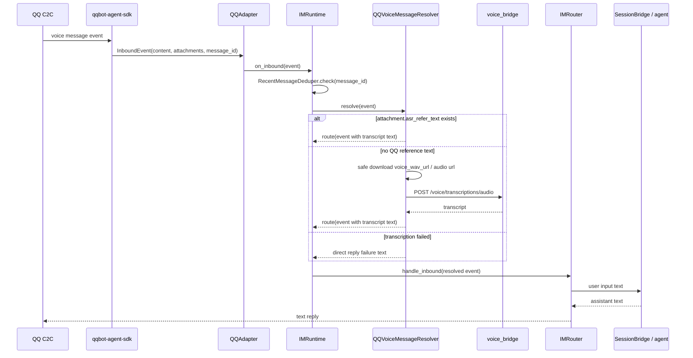

# QQ 语音消息输入 - 技术方案

## 状态

<!-- 草稿（Draft） | 已确认（Confirmed） -->
已确认（Confirmed）

## 需求文档

→ [requirement.md](./requirement.md)

## 外部调研结论

QQ 官方 C2C 消息事件同时暴露 `content` 和 `attachments`，其中语音附件字段包含 `content_type`、`url`、`voice_wav_url`、`asr_refer_text`。这说明常见客户端体验里“语音”和“文本”可能互斥，但协议层不能假设二者永远不会同时出现；实现应兼容混合消息，避免丢输入。

`qqbot-agent-sdk` 已经建模 `MessageAttachment.voice_wav_url` 和 `MessageAttachment.asr_refer_text`，也提供附件下载、音频转换、`STTPipeline` 等工具。但 SDK 的 `STTPipeline` 更像“接入一个外部 STT 后，把 QQ 的 `asr_refer_text` 当 fallback”；本需求的产品策略相反：优先相信 QQ 已给出的参考转写，缺失时才复用本项目 `voice_bridge` ASR。

QQ 官方文档提醒 C2C 消息可能重复推送，尤其被动回复链路应考虑 `msg_id` / `msg_seq` 幂等。因此本期应在 ASR 和 agent 主链路之前做入站去重，避免同一条语音被重复转写、重复写入会话历史。

附件下载属于外部 URL 拉取，应遵循 SSRF 防护基本原则：限制 scheme、处理跳转、超时、大小上限、避免访问本地网段和敏感地址。优先复用 SDK 的附件下载能力或封装等价的安全下载器，不在业务逻辑里裸写 `httpx.get(url)`。

参考：

- [QQ Bot 消息事件文档](https://bot.q.qq.com/wiki/develop/api-v2/server-inter/message/send-receive/event.html)
- [QQ Bot 消息发送文档](https://bot.q.qq.com/wiki/develop/api-v2/server-inter/message/send-receive/send.html)
- [`qqbot-agent-sdk` audio.py](https://github.com/tencent-connect/qqbot-agent-sdk/blob/main/src/qqbot_agent_sdk/audio.py)
- [`qqbot-agent-sdk` attachment.py](https://github.com/tencent-connect/qqbot-agent-sdk/blob/main/src/qqbot_agent_sdk/attachment.py)
- [OWASP SSRF Prevention Cheat Sheet](https://cheatsheetseries.owasp.org/cheatsheets/Server_Side_Request_Forgery_Prevention_Cheat_Sheet.html)

## 现状分析

### IM 链路

- `agent_bridge/src/agent_bridge/protocols/im/adapters/qq.py` 负责 QQ WebSocket、SDK 事件解析和文本回复发送。当前 `_on_message` 只把 SDK 解析出的 `InboundEvent` 交给 `_on_inbound`，没有处理语音附件。
- `agent_bridge/src/agent_bridge/protocols/im/event.py` 直接复用并导出 `qqbot_agent_sdk.event_parser.InboundEvent`。该事件已有 `content`、`attachments`、`msg_elements`、`message_id` 等字段。
- `agent_bridge/src/agent_bridge/protocols/im/runtime.py` 在 `_make_inbound_cb()` 中把所有入站消息直接交给 `IMRouter.handle_inbound()`。
- `agent_bridge/src/agent_bridge/protocols/im/router.py` 只读取 `event.content`，把它作为 `PersistentBootstrap.new_user_input` 进入 `SessionBridge` 和 agent 主链路。

结论：语音消息最适合在 `IMRuntime` 和 `IMRouter` 之间增加“入站解析 / 归一化”层。`QQAdapter` 继续保持平台传输职责，`IMRouter` 继续保持“文本 IM 入站 → agent → 文本出站”的职责。

### voice_bridge 链路

- `voice_bridge/src/voice_bridge/routes/transcription.py` 现有 `/voice/transcriptions/stream` WebSocket 面向桌面 Chat Composer，处理实时 PCM / WebM 音频流。
- `voice_bridge/src/voice_bridge/asr/provider.py` 和 `voice_bridge/src/voice_bridge/asr/volc.py` 已抽象 `AsrProvider` / `AsrSession`，可以接收 `AsrStartOptions` 并产出 partial / final 事件。
- 目前没有“给一段完整音频字节，返回一次性转写结果”的 HTTP 接口。QQ 语音 fallback 不应伪装成前端 WebSocket 客户端，而应补一个 one-shot 转写入口或共享 helper。

结论：`voice_bridge` 增加一次性音频转写能力，内部复用现有 `AsrProvider`，避免复制第二套 ASR vendor 逻辑。

## 方案设计

### 涉及文件

| 文件路径 | 改动类型 | 说明 |
|---------|---------|------|
| `agent_bridge/src/agent_bridge/settings.py` | 修改 | 增加 QQ 语音 fallback 所需配置：voice_bridge URL、音频下载大小上限、去重 TTL / 容量等 |
| `agent_bridge/src/agent_bridge/assembly.py` | 修改 | 装配入站 resolver、去重器、voice_bridge 客户端，并传给 `IMRuntime` |
| `agent_bridge/src/agent_bridge/protocols/im/runtime.py` | 修改 | 在 provider callback 中先执行入站预处理，再决定路由、直回失败提示或忽略重复消息 |
| `agent_bridge/src/agent_bridge/protocols/im/inbound_resolver.py` | 新增 | 定义 `InboundResolveResult`、resolver 协议和组合逻辑 |
| `agent_bridge/src/agent_bridge/protocols/im/dedupe.py` | 新增 | 基于 message id 的进程内 TTL/LRU 去重器 |
| `agent_bridge/src/agent_bridge/protocols/im/voice.py` | 新增 | QQ 语音附件识别、转写来源选择、文本拼接、失败提示生成 |
| `agent_bridge/src/agent_bridge/protocols/im/voice_bridge_client.py` | 新增 | agent_bridge 调 voice_bridge one-shot 接口的 HTTP client |
| `agent_bridge/pyproject.toml` | 可能修改 | 如 fallback 需要 SDK 音频转换，扩展 `qqbot-agent-sdk` extra；第一版优先依赖 `voice_wav_url`，不强制把 Silk 解码设为硬依赖 |
| `voice_bridge/src/voice_bridge/routes/transcription.py` | 修改 | 增加一次性音频转写 HTTP 入口 |
| `voice_bridge/src/voice_bridge/asr/transcribe_once.py` | 新增 | 抽出 one-shot ASR helper，供 HTTP 路由测试和复用 |
| `agent_bridge/tests/...` | 新增 / 修改 | 覆盖 resolver、去重、fallback、runtime 接入 |
| `voice_bridge/tests/...` | 新增 / 修改 | 覆盖 one-shot 转写 helper / route |

### 数据流



### 入站预处理层

新增 `InboundResolveResult`，让 `IMRuntime` 在调用 `IMRouter` 前做三类决策：

```python
@dataclass(frozen=True)
class InboundResolveResult:
    action: Literal["route", "reply", "ignore"]
    event: InboundEvent | None = None
    reply: OutboundContent | None = None
    reason: str = ""
```

- `route`：进入现有 `IMRouter.handle_inbound()`。对于语音消息，`event.content` 已被替换成最终喂给 agent 的文本。
- `reply`：不进入 agent 主链路，直接通过当前 provider `send_fn` 回复一条用户可理解的失败提示。
- `ignore`：不回复、不路由，主要用于重复消息。

`IMRuntime._make_inbound_cb()` 调整为：

1. 用 `(provider.type, event.chat_scope, event.chat_id, event.message_id)` 做入站去重；重复消息直接 `ignore`。
2. 调用 resolver。resolver 不处理的普通文本消息返回 `route(original_event)`。
3. `route` 继续调用 `IMRouter`；`reply` 调 provider `send()`；`ignore` 只打诊断日志。

这层设计保持三条边界：

- `QQAdapter` 不负责业务语义，只负责 QQ 连接、事件解析、发送。
- `IMRouter` 不感知语音，只接收文本化后的 `InboundEvent`。
- 语音解析逻辑可以在未来扩到其他 IM adapter，而不用重写 agent 主链路。

### QQ 语音附件识别

`QQVoiceMessageResolver` 只在以下条件下介入：

- `im_type == "qq"`。
- `event.chat_scope == "c2c"`。
- `event.attachments` 中存在语音附件。

语音附件判断顺序：

1. 优先用 SDK 工具函数判断 `content_type` 是否为语音类型。
2. 如果 SDK 工具不可用，使用字段兜底：`voice_wav_url` 非空、`asr_refer_text` 非空，或 `content_type` 以 `audio/` 开头。
3. 多个语音附件时按事件顺序逐个处理，最多处理配置上限内的前 N 个；首版建议 `N = 1`，多余附件记录日志并忽略，避免一次消息触发不可控的多次下载 / ASR。

### 转写优先级

每个语音附件按以下顺序产生 transcript：

1. **QQ 参考转写**：如果 `attachment.asr_refer_text.strip()` 非空，直接使用它，记录 `source=qq_asr_refer_text`。
2. **voice_bridge fallback**：如果 QQ 转写为空，优先下载 `attachment.voice_wav_url`。下载后把 WAV / PCM 音频交给 `voice_bridge` one-shot 接口，记录 `source=voice_bridge`。
3. **原始音频 URL fallback**：如果没有 `voice_wav_url`，再尝试 `attachment.url`。若 SDK 音频转换能力和本机依赖可用，转换为 WAV 后交给 `voice_bridge`；否则返回可恢复失败。

本期不使用 SDK 内建 `STTPipeline` 作为主路径，原因是它的策略和本需求优先级不同，并且会引入第二套 STT provider 配置。SDK 的下载 / 转换工具可以复用，但转写 vendor 仍归 `voice_bridge` 管。

### 文本拼接规则

最终进入 agent 的文本由原始 `content` 和语音 transcript 组成：

- 只有文本、无语音：保持原行为，直接 route 原事件。
- 只有语音、有 transcript：`event.content = transcript`。
- 同时有文本和语音、有 transcript：按顺序拼接：

```text
{原始文本}

[语音转写] {transcript}
```

- 同时有文本和语音、语音转写失败：仍 route 原始文本，不阻断用户已输入的文本；日志记录语音失败阶段。首版不额外给用户发第二条失败提示，避免同一条混合消息触发两次回复。
- 只有语音且转写失败：不进入 agent，直接回复固定失败提示，例如“这条语音我暂时没听清，可以再发一次或改发文字。”

拼接中的 `[语音转写]` 是给 agent 的上下文标注，不作为用户可见的单独消息发送。

### 入站去重

新增 `RecentMessageDeduper`：

- key：`(im_type, chat_scope, chat_id, message_id)`。
- `message_id` 为空时跳过去重，不拒绝消息。
- 进程内 TTL + 容量上限，默认建议 TTL 10 分钟、容量 4096。
- 在 ASR 和 agent 路由前执行，重复消息不转写、不进入 agent、不回复。

首版只做进程内去重，不落盘。理由是 QQ duplicate push 通常发生在短时间窗口；进程内去重足以避免最危险的重复 agent turn。跨进程重启后的完全幂等可作为后续增强，不放进本期。

### voice_bridge one-shot 转写接口

在 `voice_bridge` 新增：

```http
POST /voice/transcriptions/audio?trace_id=...&format=wav
Content-Type: audio/wav

<audio bytes>
```

请求约束：

- `format=wav`：解析 WAV container，要求 PCM16，读取 sample rate / channels 后传给 ASR provider。
- `format=pcm16`：直接接收 PCM16 bytes，必须带 `sample_rate` 和 `channels` query。
- body 大小限制使用配置上限，首版建议 15MB。
- 不持久化 body；只在内存中解析和分块送入 ASR。

响应：

```json
{
  "traceId": "qq-...",
  "text": "转写文本",
  "source": "voice_bridge",
  "elapsedMs": 1234
}
```

错误响应使用稳定 code：

- `asr_unavailable`：ASR provider 未配置或不可用。
- `invalid_audio`：音频格式不支持或解析失败。
- `transcription_failed`：provider 返回错误或没有 final / usable text。

内部实现抽出 `transcribe_pcm16_once(provider, audio, options)`：

1. `provider.start(AsrStartOptions(audio_format="pcm16", sample_rate=..., channels=..., trace_id=...))`。
2. 分块 `session.send_audio()`，最后 `session.finish()`。
3. drain `session.events()`，优先取 final 文本，若没有 final 但存在最后一个 partial，可作为低置信 fallback；完全没有文本则报错。

现有 `/voice/transcriptions/stream` 不改协议，桌面 Chat Composer 行为不受影响。

### agent_bridge 到 voice_bridge 的 client

新增轻量 HTTP client，职责只包括：

- 根据 `BridgeSettings.voice_bridge_base_url` 组装 `/voice/transcriptions/audio`。
- 设置短超时，建议 connect 2s、read 30s。
- 发送 `audio/wav` 或 `application/octet-stream` body。
- 把 voice_bridge 的稳定错误 code 映射为 resolver 可理解的失败阶段。

配置建议：

| 配置项 | 默认值 | 说明 |
|--------|--------|------|
| `AGENT_BRIDGE_VOICE_BRIDGE_BASE_URL` | `http://127.0.0.1:18900` | 本机 voice_bridge 地址 |
| `AGENT_BRIDGE_IM_VOICE_MAX_AUDIO_BYTES` | `15728640` | QQ 语音 fallback 下载 / 转写大小上限 |
| `AGENT_BRIDGE_IM_VOICE_DEDUPE_TTL_SECONDS` | `600` | 入站 message id 去重 TTL |
| `AGENT_BRIDGE_IM_VOICE_DEDUPE_MAX_ITEMS` | `4096` | 入站去重容量 |

如果 voice_bridge 未启动或 ASR 不可用，只影响 QQ 语音 fallback；已有 QQ 文本消息和已有 `asr_refer_text` 路径不受影响。

### 附件下载与临时音频

下载策略：

- 优先用 SDK 附件下载器；如果其接口不适合直接复用，再封装项目内下载器并保持同等安全约束。
- 仅允许 `https://` 和必要时的 `http://` QQ 官方资源 URL；拒绝本地地址、内网地址、文件协议和异常跳转。
- 设置超时、最大响应大小、有限重试。
- 下载日志只记录附件字段存在性、content type、字节长度、失败阶段，不记录完整 URL query、凭证、原始音频内容或完整 transcript。

临时音频策略：

- `voice_wav_url` 下载后的 bytes 优先内存处理。
- 只有 SDK 转换必须落临时文件时，写入系统临时目录或受控 cache 目录，处理完成后清理。
- 不把 QQ 原始音频作为长期用户资产持久化。

## 错误处理

| 失败位置 | 行为 |
|---------|------|
| 没有语音附件 | 不介入，普通 route |
| `asr_refer_text` 为空 | 进入 fallback |
| 附件 URL 缺失 | 语音-only 直回失败提示；混合消息 route 文本 |
| 下载失败 / 安全校验失败 | 语音-only 直回失败提示；混合消息 route 文本 |
| 音频格式不支持 / 转换失败 | 同上 |
| voice_bridge 不可用 / ASR 失败 | 同上 |
| agent 主链路失败 | 沿用 `IMRouter` 现有 fallback |

所有失败都应包含 `trace_id` / `message_id` / `chat_id` / `stage` 的结构化日志字段，便于串联排查。

## 影响分析

### 上下游影响

- QQ 文本消息：理论上不变，只多经过一次 no-op resolver 和去重检查。
- QQ 语音消息：新增转写路径，成功后表现为普通文本消息。
- 桌面 Chat Composer 语音输入：不改前端协议，不改 WebSocket stream 行为。
- agent session / memory：仍由 `IMRouter.session_id_for()` 决定 session id，不新增 channel，不改变长期记忆机制。
- 部署运行：如果需要 fallback，agent_bridge 和 voice_bridge 需要同时运行；但 QQ `asr_refer_text` 成功路径不依赖 voice_bridge。

### 风险点

- QQ `asr_refer_text` 质量和可用性不可控：通过 fallback 和手动 smoke 验证兜底。
- 音频格式差异：优先 `voice_wav_url`；原始 Silk / 非 WAV 格式只在 SDK 转换依赖可用时支持，失败可恢复。
- 重复消息：进程内去重能避免常见重复 push，但重启后的历史消息重复不在首版解决。
- 下载安全：必须避免裸拉外部 URL；实现和测试要覆盖非法 scheme、超限、下载失败。
- 真实 ASR / QQ smoke 需要外部服务和凭据：自动化测试使用 fake / mock；真实链路只在用户授权后手动执行。

## 测试方案

### agent_bridge 单元测试

- `asr_refer_text` 非空：resolver 不下载、不调 voice_bridge，直接把 transcript route 给 `IMRouter`。
- `asr_refer_text` 为空 + `voice_wav_url` 可用：fake downloader + fake voice_bridge client 返回文本，最终 route 文本正确。
- 语音-only fallback 失败：返回 `reply`，不调用 `IMRouter`。
- 混合文本 + 语音成功：最终 content 包含原文本和 `[语音转写]` 段。
- 混合文本 + 语音失败：仍 route 原文本，不直回第二条失败消息。
- 重复 message id：第二次入站返回 `ignore`，不触发下载、ASR 或 agent turn。
- 普通文本消息：resolver no-op，保持现有 route 行为。

### voice_bridge 单元测试

- one-shot WAV PCM16 请求可被解析并送入 fake ASR provider。
- one-shot PCM16 请求缺少 sample rate / channels 时返回 `invalid_audio`。
- ASR provider disabled 时返回 `asr_unavailable`。
- provider 没有 final 但有 partial 时按设计返回可用文本。
- provider 无任何文本或抛错时返回 `transcription_failed`。

### 集成 / smoke

- 扩展或新增本机 IM smoke，用 fake `InboundEvent` 验证 `IMRuntime -> resolver -> IMRouter` 链路。
- 真实 QQ 语音 smoke：用户授权后，在本机启动 agent_bridge、voice_bridge，向已绑定 QQ Bot 发送一条短语音，验证 Bot 文本回复语义正确，并把验证时间和结果记录到 `progress.md`。
- 合入前运行 `./scripts/check/run.sh`。

## 变更记录

| 日期 | 变更内容 | 是否需要重新实现 |
|------|---------|----------------|
| 2026-06-29 | 创建技术方案（CONFIRMED） | 是 |
