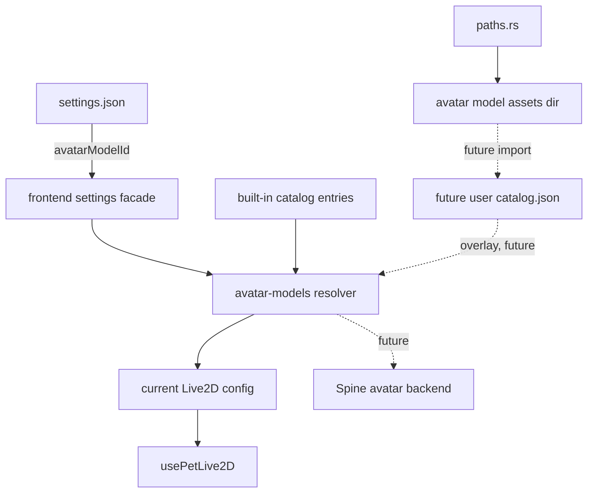

# 037 · Avatar Model Assets and Catalog - 技术方案

## 状态

CONFIRMED

## 需求文档

→ [requirement.md](./requirement.md)

## 现状分析

### 当前资源入口

| 资源 | 当前路径 | 现状 |
|------|----------|------|
| Live2D Hiyori | `frontend/public/live2d-models/hiyori/` | 当前正式桌宠默认模型；`PET_LIVE2D_CONFIG.modelPath` 直接指向 public URL |
| Spine Ark Amiya fixture | `frontend/public/spine-spike-fixtures/ark-amiya/` | 非商用探索 fixture；当前 `spine-spike` 页面默认加载它 |
| Spine 本地试验资源 | `frontend/public/spine-spike-local/` | 开发者本地试验目录，不应成为正式运行时路径 |

当前 `frontend/src/pet/live2dConfig.ts` 同时承担了“默认模型是谁”“资源 URL 是什么”“motion 默认值是什么”的职责。它适合单模型阶段，但后续 Live2D / Spine 并存时会把模型 catalog、runtime 配置和默认选择耦在一起。

`frontend/src/pages/spine-spike/petAvatarRuntime.ts` 已经有一份 runtime 能力草图与 Arknights action mapping，但它位于 spike 页面目录下，不能作为正式 catalog 的归属位置。本需求会把“模型资源描述”从 spike runtime 中抽出来，Spine runtime backend 仍留给兄弟需求。

### 当前路径与 settings

- `frontend/src-tauri/src/paths.rs` 已集中管理 settings store 与日志目录，但还没有用户数据目录和 avatar model assets 目录 helper。
- Python 侧 `agent.paths.user_data_dir()` 已定义用户数据默认位置与 `AGENT_FRIEND_DATA_DIR` override。
- `frontend/src-tauri/src/settings.rs` 和 `frontend/src/lib/settings/index.ts` 已形成一套轻量 settings schema、启动期注入、`set_setting` 与跨窗口广播路径。
- settings 当前只保存 theme、voice consent、DeepSeek 模型偏好，适合继续加入“当前 avatar model id”，但不适合保存模型文件或完整 catalog。

## 方案设计

### 涉及文件

| 文件路径 | 改动类型 | 说明 |
|---------|---------|------|
| `frontend/src-tauri/src/paths.rs` | 修改 | 增加 Tauri 侧用户数据目录、avatar model assets 目录、catalog path helper |
| `frontend/src-tauri/src/settings.rs` | 修改 | settings 增加 `avatar_model_id`，默认 `builtin:live2d:hiyori`，`set_setting` 支持该 key |
| `frontend/src/lib/settings/index.ts` | 修改 | 前端 settings 类型与默认值同步增加 `avatarModelId` |
| `frontend/src/avatar-models/catalog.ts` | 新增 | 定义 catalog schema、内置 entries、默认 ID、resolver |
| `frontend/src/avatar-models/catalog.test.ts` | 新增 | 覆盖默认 fallback、Live2D / Spine entry schema、不可用 backend fallback |
| `frontend/src/avatar-models/index.ts` | 新增 | 暴露 catalog 公共入口 |
| `frontend/src/pet/live2dConfig.ts` | 修改 | 从 Hiyori catalog entry 派生当前 `PET_LIVE2D_CONFIG`，减少默认模型信息双写 |
| `frontend/src/pet/live2dDebugger/catalog.test.ts` | 视情况修改 | 若 `PET_LIVE2D_CONFIG` 派生后 model id / path 保持不变，测试无需改；若 import 路径受影响则同步 |
| `frontend/src/pages/spine-spike/petAvatarRuntime.ts` | 轻微修改 | 复用正式 catalog 中的 Ark action mapping / capabilities，避免 spike 与 catalog 双写 |
| `frontend/src/pages/spine-spike/petAvatarRuntime.test.ts` | 视情况修改 | 保持现有 action mapping 断言，或迁到 catalog 测试 |

本需求不修改 `frontend/src/pages/pet/App.tsx`、`usePetLive2D.ts` 的渲染分派逻辑，不新增设置页 UI，不把 Spine 接入 pet 窗。

### 路径策略

`paths.rs` 增加 Tauri 壳可用的用户数据目录 helper，对齐 Python 侧 `agent.paths.user_data_dir()`：

| 平台 | 默认用户数据根 |
|------|----------------|
| macOS | `~/Library/Application Support/agent-friend/` |
| Windows | `%APPDATA%/agent-friend/` |
| Linux | `$XDG_DATA_HOME/agent-friend/` 或 `~/.local/share/agent-friend/` |

优先级：

1. `AGENT_FRIEND_DATA_DIR`
2. 平台默认用户数据根

新增 helper 语义：

```rust
pub fn user_data_dir() -> PathBuf
pub fn avatar_model_assets_dir() -> PathBuf
pub fn avatar_model_catalog_path() -> PathBuf
```

建议目录结构：

```text
<user-data-dir>/
└── avatar-models/
    ├── catalog.json
    ├── live2d/
    └── spine/
```

本期只定义并测试路径 helper，不要求创建导入 UI 或实际写入用户 catalog。后续导入器可以把用户模型放到 `avatar-models/live2d/<id>/` 或 `avatar-models/spine/<id>/`，并写入 `catalog.json`。

打包态内置资源继续作为 bundled / web asset fallback，不在首次启动强制 copy 到用户目录。后续如果要使用 Tauri bundle resources，应通过 Tauri 2 官方路径 resolver：`app.path().resolve(..., BaseDirectory::Resource)`；不要在业务模块手写打包路径。

### Catalog Schema

新增 `frontend/src/avatar-models/catalog.ts`，使用 discriminated union 表达不同 backend：

```ts
export type AvatarModelBackend = "live2d" | "spine";
export type AvatarModelSource = "builtin" | "user" | "dev-fixture";
export type AvatarModelDistribution =
  | "redistributable"
  | "user-local-only"
  | "non-commercial-exploration";

export interface AvatarModelBase {
  id: string;
  name: string;
  backend: AvatarModelBackend;
  source: AvatarModelSource;
  distribution: AvatarModelDistribution;
  enabled: boolean;
  licenseName?: string;
  noticePath?: string;
}

export interface Live2DAvatarModelEntry extends AvatarModelBase {
  backend: "live2d";
  resources: {
    model3: string;
  };
  live2d: {
    motionGroups: PetLive2DConfig["motionGroups"];
    motionNo: PetLive2DConfig["motionNo"];
    spriteWidth: number;
  };
}

export interface SpineAvatarModelEntry extends AvatarModelBase {
  backend: "spine";
  resources: {
    skeleton: string;
    atlas: string;
    textures?: string[];
  };
  spine: {
    format: "skel" | "json";
    runtime: "spine38-pixi7" | "spine43-pixi8" | "unknown";
    defaultAnimation?: string;
    actionMapping?: Partial<Record<PetAvatarAction, PetActionMapping>>;
  };
}
```

稳定 ID 约定：

| 类型 | ID 示例 | 说明 |
|------|---------|------|
| 内置正式模型 | `builtin:live2d:hiyori` | settings 默认值，稳定可读 |
| 开发 fixture | `dev-fixture:spine:ark-amiya` | 只能被开发 / spike 使用，不作为正式默认 |
| 用户导入模型 | `user:<backend>:<slug-or-hash>` | 后续导入器生成，本期只保留格式空间 |

本期内置 catalog entries：

- `builtin:live2d:hiyori`
  - `source: "builtin"`
  - `distribution: "redistributable"`
  - `enabled: true`
  - resource 仍指向当前可用 public URL `/live2d-models/hiyori/Hiyori.model3.json`
- `dev-fixture:spine:ark-amiya`
  - `source: "dev-fixture"`
  - `distribution: "non-commercial-exploration"`
  - `enabled: false` 或不参与默认 resolver
  - resource 仍指向当前 spike fixture URL，供 `spine-spike` 和兄弟需求复用 schema

### Resolver 与默认选择

提供纯函数：

```ts
export const DEFAULT_AVATAR_MODEL_ID = "builtin:live2d:hiyori";

export function findAvatarModelEntry(id: string): AvatarModelCatalogEntry | null;

export function resolveAvatarModelSelection(
  id: string,
  options?: { allowedBackends?: AvatarModelBackend[] },
): AvatarModelCatalogEntry;

export function getDefaultLive2DConfig(): PetLive2DConfig;
```

规则：

- `resolveAvatarModelSelection` 找不到 ID 时 fallback 到 Hiyori。
- 当前 pet Live2D 路径只允许 `allowedBackends: ["live2d"]`，因此 settings 若被手动改成 Spine ID，也 fallback 到 Hiyori。
- `dev-fixture` / `non-commercial-exploration` entry 不作为正式默认候选。
- `getDefaultLive2DConfig()` 从 `builtin:live2d:hiyori` entry 派生 `PET_LIVE2D_CONFIG`，保持 `modelName`、`modelPath`、motion 配置和 spriteWidth 与现状一致。

这样 settings 能先保存用户选择，pet 窗暂时仍稳定加载 Hiyori；后续 Spine runtime backend 接入时，只需放宽 resolver 的 allowed backend，并由 avatar runtime 层消费 entry。

### Settings 变更

Rust：

```rust
#[serde(default = "default_avatar_model_id")]
pub avatar_model_id: String,
```

默认：

```rust
fn default_avatar_model_id() -> String {
    "builtin:live2d:hiyori".to_string()
}
```

`set_setting` 增加 key：

```rust
"avatarModelId" => {
    let model_id: String = serde_json::from_value(payload.value.clone())
        .map_err(|e| format!("invalid avatarModelId: {e}"))?;
    s.avatar_model_id = model_id;
}
```

前端：

```ts
export type AvatarModelId = string;

export interface Settings {
  avatarModelId: AvatarModelId;
}

export const DEFAULT_SETTINGS = {
  avatarModelId: DEFAULT_AVATAR_MODEL_ID,
};
```

不在 settings 层校验 ID 是否存在，避免 settings 模块依赖前端 catalog 或 Tauri 资源扫描。ID 有效性由 avatar-models resolver 兜底。后续导入器如果需要删除用户模型，应在删除时处理 settings 指向失效 ID 的迁移或让 resolver fallback。

### Spine Spike 复用边界

`frontend/src/pages/spine-spike/petAvatarRuntime.ts` 当前定义了 `ARK_SPINE_CAPABILITIES`、`ARK_ACTION_MAPPING`、runtime options 与 action mapping helper。本需求只把“可复用模型 metadata”收敛到 `avatar-models`，不把 spike UI 改造成正式 runtime。

建议做法：

- `avatar-models/catalog.ts` 导出 Ark Amiya dev fixture entry 的 `spine.actionMapping` 与 capabilities。
- `petAvatarRuntime.ts` 从 `avatar-models` 取默认 action mapping，继续保留 spike 专用的动画 fallback helper 与 runtime mode UI。

如果实施时发现迁移会让 spike import 关系变别扭，可以保留 `petAvatarRuntime.ts` 的 runtime helper，只在 catalog 中复制一份最小 action mapping，并通过测试防止默认行为漂移。优先保持本需求边界清楚，不为了去重大改 spike。

## 数据流



本期实线是实际落地路径；虚线是为兄弟需求和后续导入能力预留的契约。

## 影响分析

### 上下游影响

- settings 新增字段通过 serde default 兼容旧 `settings.json`，旧用户启动后会得到默认 Hiyori ID。
- `set_setting` 新增 key 不影响已有 theme / voice / model 设置。
- `PET_LIVE2D_CONFIG` 对外 shape 保持不变，`usePetLive2D`、pet interaction、Live2D debugger 继续按现有调用。
- `spine-spike` 的默认资源 URL 仍可用；本需求只给它增加正式 catalog 参照，不改变渲染 runtime。
- 路径 helper 新增 `AGENT_FRIEND_DATA_DIR` 支持 Tauri 侧用户数据隔离，与 Python 侧保持一致。

### 跨平台影响

- macOS / Windows / Linux 用户数据目录按项目规则手算或通过 `dirs` helper 实现，测试覆盖路径尾部与 env override。
- Windows settings 仍保持 `%APPDATA%/com.agentfriend.desktop/settings.json`，不要把 avatar model assets 放进 settings bundle id 目录；它属于用户资产，走 `agent-friend` 用户数据根。
- 不新增重复运行脚本，因此不触发 `scripts/` 双端入口要求。

### 视觉影响

本需求不新增用户可见 UI，不修改设置页交互，不接 pet 窗模型切换；不需要正式桌面视觉验收。若实现过程中只改类型、路径、catalog 和默认配置，验收以自动化测试与现有 pet 路径不退化为主。

### 风险点

| 风险 | 处理 |
|------|------|
| catalog 与 `PET_LIVE2D_CONFIG` 形成新的双写 | 让 `PET_LIVE2D_CONFIG` 从 Hiyori catalog entry 派生，或至少用测试固定二者一致 |
| settings 被手动写成 Spine ID 后 pet 窗加载失败 | 当前 pet resolver 限制 `allowedBackends: ["live2d"]`，fallback 到 Hiyori |
| Ark Amiya dev fixture 被误认为正式默认资源 | entry 标记 `dev-fixture` + `non-commercial-exploration`，resolver 默认不选它 |
| 用户数据路径与 Python 侧不一致 | `paths.rs` 新增测试覆盖 env override 与平台尾部路径；文档明确对齐 `agent.paths` |
| 过早设计完整导入系统 | 本期只定义路径、catalog 文件位置与 schema，不实现导入 UI / 删除 / 下载 |

## 测试计划

### Rust 单测

在 `paths.rs` 中补：

- `avatar_model_assets_dir()` 以 `user_data_dir()/avatar-models` 结尾。
- `avatar_model_catalog_path()` 以 `user_data_dir()/avatar-models/catalog.json` 结尾。
- `AGENT_FRIEND_DATA_DIR` override 生效。由于 Rust 进程环境变量是全局状态，测试需串行安全地设置 / 恢复 env。

在 `settings.rs` 中补：

- `Settings::default().avatar_model_id == "builtin:live2d:hiyori"`。
- 旧 settings 文件缺少 `avatarModelId` 时能通过 serde default 补齐。

### 前端单测

新增 `frontend/src/avatar-models/catalog.test.ts`：

- 内置 Hiyori entry 是 Live2D、ID 稳定、resource 指向当前 public URL。
- Ark Amiya entry 是 Spine、标记为 `dev-fixture` / `non-commercial-exploration`，不作为默认。
- `resolveAvatarModelSelection("missing")` fallback Hiyori。
- `resolveAvatarModelSelection("dev-fixture:spine:ark-amiya", { allowedBackends: ["live2d"] })` fallback Hiyori。
- `getDefaultLive2DConfig()` 与现有 Hiyori motion / spriteWidth 保持一致。

必要时同步现有 `petAvatarRuntime.test.ts`，确保 Arknights action mapping 不因迁移丢失。

### 门禁

- 至少运行前端相关测试与 Rust 单测。
- 最终按项目需求交付要求运行 `./scripts/check`。

## 变更记录

| 日期 | 变更内容 | 是否需要重新实现 |
|------|---------|----------------|
| 2026-06-30 | 初版确认：用户数据目录下定义 avatar model assets；catalog 放 `frontend/src/avatar-models/`；settings 只保存 `avatarModelId`；本期采用内置 fallback + 用户目录 overlay，不把 Spine 设为正式默认 | 是 |
