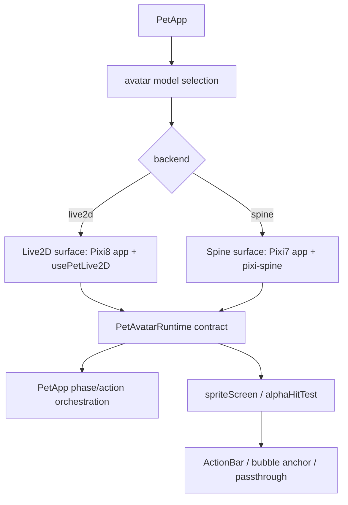
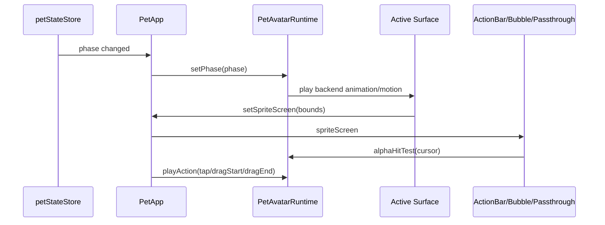

# 038 · Spine Avatar Backend Ark Models - 技术方案

## 状态

CONFIRMED

## 需求文档

→ [requirement.md](./requirement.md)

## 现状分析

### Pet 窗当前形态

当前正式 pet 窗以 Live2D 为唯一 avatar backend：

| 模块 | 当前职责 | 现状 |
|------|----------|------|
| `frontend/src/pages/pet/App.tsx` | pet 窗组合入口 | 直接持有 Live2D `spriteRef`，直接派发 Live2D motion / lip-sync / debug bridge |
| `frontend/src/pages/pet/usePixiAvatarSlot.ts` | Pixi8 app + `avatar-slot` + drag / bounds / anchor | 外层能力较通用，但实现与 Pixi8 `Application.init` / `app.canvas` 绑定 |
| `frontend/src/pet/usePetLive2D.ts` | 加载 Hiyori `Live2DSprite` | 依赖 Pixi8 renderer / ticker，替换 slot children |
| `frontend/src/pages/pet/usePetInteractions.ts` | Live2D gaze / tap / drag / mouth params | 以 `Live2DSprite` 和参数源为核心，不适合直接套到 Spine |
| `frontend/src/pages/pet/usePetPassthrough.ts` | Tauri 透明窗 cursor passthrough | 依赖 `spriteScreen` fast reject + `alphaHitTest(app, cursor)` |
| `frontend/src/pet/petAlphaHitTest.ts` | Pixi framebuffer alpha hit-test / visible bounds scan | 逻辑可复用，但类型和 canvas 获取偏 Pixi8 |

这说明外层语义可以复用：drag、spriteScreen、ActionBar/bubble anchor、passthrough、alpha scan；但 renderer 层不能假设所有 backend 都是 Pixi8 child。

### Spine spike 当前形态

`frontend/src/pages/spine-spike/App.tsx` 已验证两条路线：

| 路线 | 结论 |
|------|------|
| Pixi8 + `@esotericsoftware/spine-pixi-v8` | 对 Spine 4.3 生态更自然，但不是 Ark-Models Spine 3.8 主路径 |
| Pixi7 + `pixi-spine` | 已验证可加载 Ark Amiya `.skel/.atlas/.png`，适合 Ark-Models Spine 3.8 |

Spike 页面里已经有 action mapping、animation fallback、fit、Pixi7 app lifecycle、alpha hit-test 等可下沉逻辑，但这些还混在页面 UI 中。

### Pixi 统一降级 spike 结论

本需求设计前单独做过“统一降到 Pixi7”的 spike。结论是：

- Amiya Spine 3.8 在 Pixi7 app / avatar-slot 中验证通过。
- 当前 `easy-live2d@0.4.4` 对 Pixi8 Sprite / renderer 内部依赖较深。
- 即使补 `canvas/view`、`onRender`、`onViewUpdate`、`_setWidth/_setHeight`、bounds shape 等 shim，Hiyori 最终仍表现为 Live2D ready 但画面零像素。

因此，038 正式方案不采用“统一 Pixi7 renderer”。本需求采用：

- Live2D：继续使用 Pixi8 + `easy-live2d`。
- Spine：使用 Pixi7 + `pixi-spine`。
- 上层统一 pet 外层 contract，同一时间只激活一个 canvas/runtime，避免两个 renderer 同时抢交互。

### Avatar catalog 当前状态

037 已完成 `frontend/src/avatar-models/` 地基：

- `DEFAULT_AVATAR_MODEL_ID = "builtin:live2d:hiyori"`。
- Hiyori Live2D entry 作为正式默认。
- Ark Amiya dev fixture entry 已能表达 Spine 资源、runtime、action mapping、capabilities。
- settings 已有 `avatarModelId`，但本需求不做正式设置 UI。

本需求需要把首批 14 个 Ark-Models `models/` 目录配置成可被 Spine runtime 消费的内置模型 entry。

## 方案设计

### 涉及文件

| 文件路径 | 改动类型 | 说明 |
|---------|---------|------|
| `frontend/src/pet/avatarRuntime/types.ts` | 新增 | 定义正式 avatar runtime contract、runtime surface、capabilities、action result |
| `frontend/src/pet/avatarRuntime/actionMapping.ts` | 新增 | 下沉 action mapping 解析、animation fallback、phase/action 类型 helper |
| `frontend/src/pet/avatarRuntime/framebuffer.ts` | 新增或由 `petAlphaHitTest.ts` 改造 | 抽出 Pixi7 / Pixi8 共用的 canvas、resolution、alpha hit-test、visible bounds helper |
| `frontend/src/pet/avatarRuntime/live2d/useLive2DAvatarRuntime.ts` | 新增 | 包装现有 Pixi8 slot + `usePetLive2D`，暴露统一 runtime handle |
| `frontend/src/pet/avatarRuntime/spine38/useSpine38AvatarRuntime.ts` | 新增 | Pixi7 + `pixi-spine` 正式 runtime：加载、fit、动作映射、alpha scan、drag、cleanup |
| `frontend/src/pet/avatarRuntime/spine38/spine38Loader.ts` | 新增 | 从 catalog entry 加载 `.skel/.atlas/.png` 并创建 `Spine38` |
| `frontend/src/pet/avatarRuntime/spine38/spine38Fit.ts` | 新增 | Spine local bounds → slot scale / position / fit 参数计算 |
| `frontend/src/pet/avatarRuntime/useDevAvatarModelSelection.ts` | 新增 | dev-only 模型选择状态，默认 Hiyori，可切 14 个 Spine 模型 |
| `frontend/src/pages/pet/App.tsx` | 修改 | 从 Live2D 专用 orchestration 改为面向 runtime contract，保留 Live2D 专用 debug bridge gate |
| `frontend/src/pages/pet/usePixiAvatarSlot.ts` | 小改或迁移 | 保持 Pixi8 Live2D surface；可抽出通用 drag/bounds helper，避免被 Spine 复刻太多 |
| `frontend/src/pages/pet/usePetInteractions.ts` | 修改 | `PetInteractionCallbacks` 增加可选 `onSlotDragStart` / `onSlotDragEnd`，Live2D 维持旧行为，Spine 用于动作映射 |
| `frontend/src/pages/pet/usePetPassthrough.ts` | 修改 | 从“吃 Pixi8 app”改为吃 runtime `alphaHitTest(cursor)`，保持 `spriteScreen` fast reject |
| `frontend/src/pet/petAlphaHitTest.ts` | 修改或迁移 | 兼容 Pixi7 `app.view` 与 Pixi8 `app.canvas`；保留旧导出兼容测试 |
| `frontend/src/avatar-models/catalog.ts` | 修改 | 增加 14 个 Ark-Models Spine 内置 entry、runtime / resources / action mapping / fit metadata |
| `frontend/src/avatar-models/catalog.test.ts` | 修改 | 覆盖 14 个 Spine entry 的 ID、资源三件套、distribution、runtime mode |
| `frontend/src/pages/spine-spike/petAvatarRuntime.ts` | 修改 | 复用正式 action mapping / fallback helper，减少 spike 与 runtime 双写 |
| `frontend/src/pages/spine-spike/petAvatarRuntime.test.ts` | 修改 | 迁移到正式 helper 或保留对兼容导出的断言 |
| `frontend/public/spine-models/ark-models/` | 新增资源目录 | 放首批 14 个 Ark-Models `.atlas/.png/.skel` 与 NOTICE/source metadata |

### Runtime contract

新增正式 runtime contract，目标是统一 pet 外层语义，不统一 renderer 实现。

```ts
export type AvatarRuntimePhase = "idle" | "thinking" | "speaking" | "error" | "sleep";
export type AvatarRuntimeAction = AvatarRuntimePhase | "tap" | "dragStart" | "dragEnd";

export interface PetAvatarRuntime {
  kind: "live2d" | "spine";
  modelId: string;
  capabilities: AvatarModelCapabilities;
  ready: boolean;
  setPhase(phase: AvatarRuntimePhase): void;
  playAction(action: AvatarRuntimeAction): AvatarActionResult;
  alphaHitTest(cursor: { x: number; y: number }): boolean;
}
```

`PetApp` 不再直接写 `sprite.startMotion(...)`。状态机切 phase 时调用 `runtime.setPhase(phase)`：

- Live2D runtime 内部继续按 `PET_LIVE2D_CONFIG.motionGroups` 调 `startMotion`。
- Spine runtime 内部按 catalog entry 的 `actionMapping` 解析 animation 并 `spine.state.setAnimation(...)`。

`ready` 和 `capabilities` 用来 gate Live2D-only 能力：

- `mouthParams=true` 时才 attach `TextCadenceMouthDriver`。
- `gazeParams=true` / `expressionParams=true` 时才启用 Live2D 参数源。
- Spine 的 tap / dragStart / dragEnd 走 animation action，不进入 Live2D 参数 composer。

### Renderer 隔离与 surface 结构

本需求只在同一时间激活一个 runtime surface：



这样做有几个边界：

- Live2D 不降级，不为 Spine 改 easy-live2d 内部 shim。
- Spine 不强塞进 Pixi8 stage，避免 Spine 3.8 runtime 与 Pixi8 display tree 混挂风险。
- 切换模型时旧 surface 完整 cleanup：移除 canvas、destroy Pixi app、清空 `spriteScreen`、fail-open passthrough。
- 两个 renderer 不同时运行，避免两层 canvas 同时接 pointer 或 readPixels。

### Live2D runtime

Live2D runtime 以保守适配为主：

1. 保留 `usePixiAvatarSlot` 创建 Pixi8 app / slot / placeholder / drag / bounds sync。
2. 保留 `usePetLive2D` 加载 Hiyori。
3. 将 `spriteRef`、`spriteReady`、`debugControls` 只暴露给 Live2D-only 分支。
4. `setPhase` 替代 `PetApp` 中直接 `startMotion` 的 effect。
5. `playAction("tap")` 复用当前 tap feedback motion；`dragStart/dragEnd` 对 Live2D 可以先 no-op 或只影响 DragReactionSource。

Live2D path 的 AC 是现有行为不退化，而不是重写架构。

### Spine 3.8 runtime

Spine runtime 使用 Pixi7 + `pixi-spine`，从 spike 下沉：

1. 创建 Pixi7 `Application<HTMLCanvasElement>`，配置：
   - `backgroundAlpha: 0`
   - `resizeTo: stage`
   - `antialias: true`
   - `autoDensity: true`
   - `resolution: window.devicePixelRatio || 1`
   - `preserveDrawingBuffer: true`
2. 创建 Pixi7 `Container` 作为 spine slot。
3. 用 `PIXI7.Assets.add({ data: { spineAtlasFile, spineSkeletonScale } })` 加载 `.skel/.atlas`。
4. `new Spine38(resource.spineData)` 后作为 slot child。
5. 根据 local bounds 和 catalog fit 参数居中 / 缩放。
6. ticker 中计算 visible bounds，更新 `spriteScreen` 与 hitArea。
7. pointerdown / move / up 复用现有 click-vs-drag 语义：
   - click → `runtime.playAction("tap")`
   - drag 超阈值 → `playAction("dragStart")`
   - drag end → `playAction("dragEnd")`
8. phase 变化时调用 `setPhase(phase)`，按 mapping 切 loop animation。

Spine 不实现 mouth/gaze/expression params。本期 speaking 只是可配置 animation，不做口型。

### Action mapping 与 fallback

Action mapping 从 catalog entry 派生：

```ts
type AvatarActionMapping = {
  animation: string;
  loop: boolean;
  returnToPhase?: boolean;
};
```

解析顺序：

1. 精确匹配目标 animation。
2. 大小写不敏感匹配。
3. 使用当前模型 `defaultAnimation`。
4. 查找名称包含 `idle` 或等价默认关键词的 animation。
5. 使用模型 animation 列表第一个可播放项。
6. 若列表为空，返回 `skipped`，并在 dev log 中说明模型不可播放。

`tap` / `dragEnd` 这类一次性 action 若 `returnToPhase=true`：

- 先播放目标 animation。
- 结束后 add / restore 当前 phase animation。
- 如果恢复 phase animation 也缺失，继续走同一 fallback。

### Catalog 与首批模型

首批 14 个模型作为 Spine built-in entries 进入 catalog。资源放在：

```text
frontend/public/spine-models/ark-models/
├── NOTICE.md
├── SOURCE.json
├── 002_amiya/
│   ├── build_char_002_amiya.atlas
│   ├── build_char_002_amiya.png
│   └── build_char_002_amiya.skel
└── ...
```

`SOURCE.json` 记录来源仓库与确认过的 commit：

```json
{
  "repository": "https://github.com/isHarryh/Ark-Models",
  "basePath": "models",
  "checkedCommit": "2f3187f780108847d7327946e1906fc6b80bead3",
  "spineRuntime": "3.8"
}
```

每个 entry 使用稳定 ID：

| Ark-Models 目录 | 建议 ID | 资源前缀 |
|-----------------|---------|----------|
| `002_amiya` | `builtin:spine:ark-models:002_amiya` | `/spine-models/ark-models/002_amiya/build_char_002_amiya` |
| `4202_haruka` | `builtin:spine:ark-models:4202_haruka` | `/spine-models/ark-models/4202_haruka/build_char_4202_haruka` |
| `140_whitew` | `builtin:spine:ark-models:140_whitew` | `/spine-models/ark-models/140_whitew/build_char_140_whitew` |
| `103_angel` | `builtin:spine:ark-models:103_angel` | `/spine-models/ark-models/103_angel/build_char_103_angel` |
| `358_lisa` | `builtin:spine:ark-models:358_lisa` | `/spine-models/ark-models/358_lisa/build_char_358_lisa` |
| `102_texas` | `builtin:spine:ark-models:102_texas` | `/spine-models/ark-models/102_texas/build_char_102_texas` |
| `263_skadi` | `builtin:spine:ark-models:263_skadi` | `/spine-models/ark-models/263_skadi/build_char_263_skadi` |
| `003_kalts` | `builtin:spine:ark-models:003_kalts` | `/spine-models/ark-models/003_kalts/build_char_003_kalts` |
| `1035_wisdel` | `builtin:spine:ark-models:1035_wisdel` | `/spine-models/ark-models/1035_wisdel/build_char_1035_wisdel` |
| `4133_logos` | `builtin:spine:ark-models:4133_logos` | `/spine-models/ark-models/4133_logos/build_char_4133_logos` |
| `2027_wang` | `builtin:spine:ark-models:2027_wang` | `/spine-models/ark-models/2027_wang/build_char_2027_wang` |
| `2025_shu` | `builtin:spine:ark-models:2025_shu` | `/spine-models/ark-models/2025_shu/build_char_2025_shu` |
| `4179_monstr` | `builtin:spine:ark-models:4179_monstr` | `/spine-models/ark-models/4179_monstr/build_char_4179_monstr` |
| `010_chen` | `builtin:spine:ark-models:010_chen` | `/spine-models/ark-models/010_chen/build_char_010_chen` |

Catalog metadata：

- `backend: "spine"`
- `source: "builtin"`
- `distribution: "non-commercial-exploration"`
- `licenseName: "Arknights / Ark-Models non-commercial"`
- `noticePath: "/spine-models/ark-models/NOTICE.md"`
- `spine.runtime: "spine38-pixi7"`
- `spine.format: "skel"`
- `capabilities`: motions / alpha hit-test true，mouth / gaze / expression false
- `spine.fit`: 初始使用统一默认值；允许逐模型 override

展示名可先使用目录 ID 或简短别名，后续如果需要中文 / 英文正式名，可从 Ark-Models `models_data.json` 或用户确认的映射中补。

### Dev-only 模型切换入口

本需求不做正式设置中心模型切换。为了验收 Spine runtime，需要 dev-only 入口：

- 仅 `import.meta.env.DEV` 出现。
- 默认选择 `builtin:live2d:hiyori`。
- 可切换到 14 个 built-in Spine entry。
- 不写入正式 settings，不改变 release 行为。
- 切换时 unmount 当前 runtime，再 mount 新 runtime。

入口形式可以是 pet 窗角落的小型 dev selector，也可以复用现有 dev-only passthrough 工具区域；实现时以不遮挡桌宠和 ActionBar 为准。

### PetApp 数据流



## 影响分析

### 上下游影响

- Live2D 默认路径继续走 Pixi8，降低 Hiyori 回归风险。
- Spine 引入 Pixi7 runtime，但只在 Spine surface 激活时加载/运行。
- `usePetPassthrough` 从依赖 Pixi8 app 改为依赖 runtime alpha hit-test，调用方语义更稳定。
- `usePetInteractions` 不再是所有 backend 的统一交互层；Live2D 专用参数 feedback 和 Spine animation action 分开。
- `spine-spike` 后续可复用正式 helper，但不作为正式 pet runtime 的入口。

### 视觉与桌面影响

本需求会影响真实 pet 窗可见行为和透明窗口交互，因此实现后需要桌面端 smoke：

- Live2D Hiyori 默认启动正常。
- dev-only 切 Spine 后目标模型显示。
- 透明区 passthrough 不被整层 canvas 锁死。
- Drag 不中断，ActionBar 跟随 spriteScreen。
- Bubble anchor 仍跟随当前 avatar bounds。

验收不能只用 Vite web 页面冒充桌面结论。若因为环境原因无法做真实桌面截图 / DOM 检查，交付说明必须写清。

### 资源与授权影响

- 本需求会把用户指定的 Ark-Models 资源作为 built-in non-commercial exploration assets 放入 `frontend/public/spine-models/ark-models/`。
- `NOTICE.md` 必须说明素材版权归属和不得商用边界。
- Hiyori 仍是正式默认模型；Ark-Models Spine 只通过 dev-only 切换入口验收，不自动作为 release 默认选项。

### 风险点

| 风险 | 处理 |
|------|------|
| 两套 renderer 导致代码重复 | 只在 renderer lifecycle 分开；action mapping、framebuffer helper、runtime contract、catalog 共用 |
| Pixi7 alpha readPixels 与 Pixi8 坐标差异 | `framebuffer.ts` 统一 canvas/resolution 获取，补单测与桌面 smoke |
| Spine visible bounds 随 animation 抖动 | 沿用 Live2D one-shot lock 思路；模型加载后锁一次，必要时切模型或 refit 时 invalidate |
| dev-only selector 被误认为正式切换 UI | 用 `import.meta.env.DEV` gate，不写 settings，文档和交付说明明确边界 |
| 14 个资源体积增加 | 只纳入用户指定 models 目录；保留 source metadata，后续若体积不可接受再拆资源包 |
| 某模型 action mapping 不适配 | 默认 mapping + animation fallback；实现中根据实际 animation 列表补逐模型 override |

## 测试计划

### 自动化测试

- `avatarRuntime/actionMapping.test.ts`
  - 精确匹配、大小写匹配、default fallback、首个 animation fallback。
  - one-shot action `returnToPhase` 的恢复目标解析。
- `avatarRuntime/framebuffer.test.ts`
  - Pixi8 `renderer.canvas` / `app.canvas` 与 Pixi7 `renderer.view` / `app.view` canvas 获取。
  - resolution fallback。
- `avatar-models/catalog.test.ts`
  - 14 个 Spine entry 均存在。
  - 每个 entry 的 skeleton / atlas / texture URL 符合三件套规则。
  - runtime 为 `spine38-pixi7`，distribution 为 `non-commercial-exploration`。
  - 默认 Hiyori 仍不变。
- `usePetPassthrough` 相关测试
  - runtime alpha hit-test true / false 时 passthrough 行为不变。
  - app 缺失不再导致类型耦合。

### 定向运行

- 前端单测：`pnpm --dir frontend vitest run ...`
- 前端 typecheck：`pnpm --dir frontend typecheck`
- 最终门禁：`./scripts/check/run.sh`

### 桌面 smoke

实现阶段按 `desktop-visual-inspection` / `frontend-visual-verification` 路径验证真实桌面端：

- 默认 Hiyori：显示、idle、tap、drag、ActionBar。
- Spine Amiya 或任一目标模型：显示、idle、tap、dragStart、dragEnd、ActionBar。
- cursor 透明区穿透：至少验证 sprite 外部和 sprite 透明区不会长期锁死窗口。

## 变更记录

| 日期 | 变更内容 | 是否需要重新实现 |
|------|---------|----------------|
| 2026-06-30 | 初版确认：采用 Pixi8 Live2D + Pixi7 Spine 隔离 renderer；统一 runtime contract 与 pet 外层行为；通过 dev-only selector 验收 14 个 Ark-Models built-in Spine 模型 | 是 |
