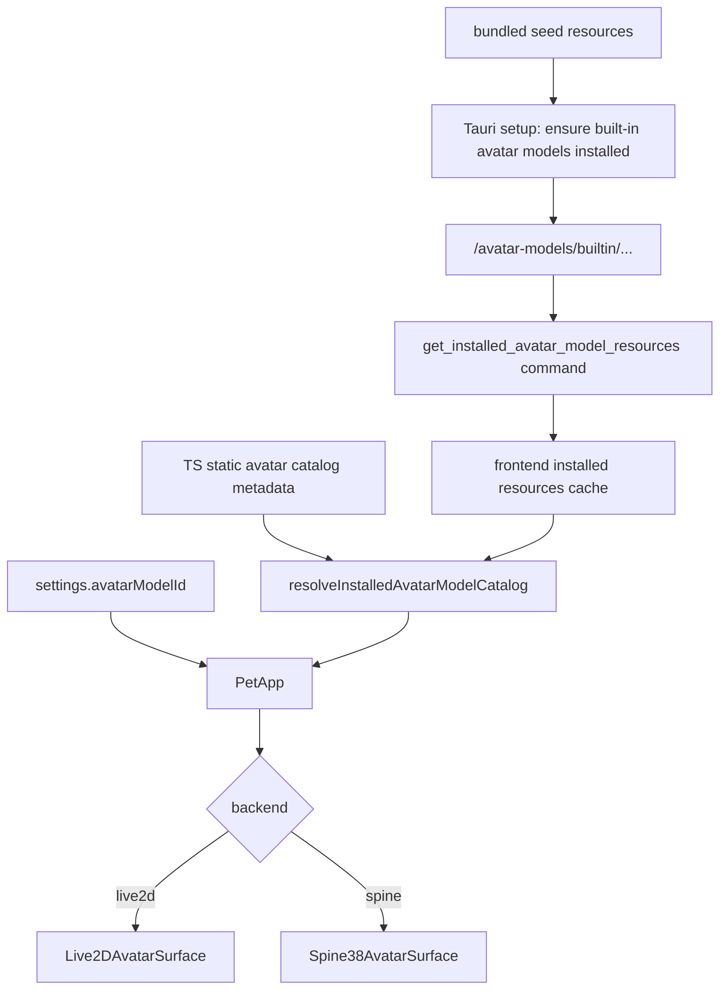

# 040 · Desktop Avatar Model Switching - 技术方案

## 状态

CONFIRMED

## 需求文档

→ [requirement.md](./requirement.md)

## 现状分析

### 已有地基

| 模块 | 现状 |
|------|------|
| `frontend/src-tauri/src/paths.rs` | 已有 `avatar_model_assets_dir()` / `avatar_model_catalog_path()`，路径落在用户数据目录 `<user_data_dir>/avatar-models` |
| `frontend/src-tauri/src/settings.rs` | settings 已有 `avatar_model_id`，前端对应 `avatarModelId` |
| `frontend/src/avatar-models/catalog.ts` | 已有 Hiyori + 14 个 Ark Spine built-in entry，包含 ID、backend、capabilities、action mapping、fit 等 runtime metadata |
| `frontend/src/pages/pet/App.tsx` | 通过 `useDevAvatarModelSelection()` 的本地 state 选择模型，默认 Hiyori，dev-only selector 实际隐藏 |
| `frontend/src/pages/settings/App.tsx` | 设置页已有 `general` / `voice` / `runtime` 三个分类，可自然新增 `pet` 分类 |
| `frontend/public/live2d-models/` / `frontend/public/spine-models/ark-models/` | 当前资源以 public URL 形式随前端产物进入运行环境，runtime 也直接引用这些 URL |

### 核心问题

当前“模型 metadata”和“运行时资源路径”混在同一个前端 catalog entry 里：

- 角色 ID、展示名、backend、capabilities、action mapping、fit 参数是稳定 metadata，适合继续留在 TS catalog。
- `.model3.json` / `.skel` / `.atlas` / `.png` 的实际读取位置应来自 installed assets，不能继续写成 public URL。

因此本期不把完整 catalog 迁到 Rust，也不让 Rust 重复维护 action mapping。Rust 只负责“内置资源安装 + 返回已安装资源路径”；TS 继续负责“模型语义 metadata + runtime resolve”。

## 方案设计

### 总体数据流



### 涉及文件

| 文件路径 | 改动类型 | 说明 |
|---------|---------|------|
| `frontend/src-tauri/tauri.conf.json` | 修改 | 把内置模型 seed 加入 `bundle.resources`；开启/配置本地模型资源访问通道 |
| `frontend/src-tauri/src/avatar_models.rs` | 新增 | 内置模型安装、manifest 读写、installed resource 查询、Tauri command |
| `frontend/src-tauri/src/lib.rs` | 修改 | `mod avatar_models`；setup 早期 ensure installed；注册 `get_installed_avatar_model_resources` |
| `frontend/src-tauri/src/paths.rs` | 小改 | 按需增加 builtin 目录 helper，例如 `builtin_avatar_models_dir()` |
| `frontend/src-tauri/src/settings.rs` | 小改 | 维持 `avatar_model_id` 默认值；必要时补无效 ID 日志，不做 catalog 依赖 |
| `frontend/src/avatar-models/catalog.ts` | 修改 | 将 static catalog 中的 resources 视为 seed-relative / dev fallback；新增 installed resource merge/resolve 入口 |
| `frontend/src/avatar-models/installed.ts` | 新增 | 前端调用 Tauri command、转换本地文件 URL、缓存 installed catalog |
| `frontend/src/avatar-models/catalog.test.ts` | 修改 | 覆盖 installed resources merge、无效 ID fallback、static metadata 不漂移 |
| `frontend/src/pages/settings/App.tsx` | 修改 | 新增 `pet` 分类 |
| `frontend/src/pages/settings/components/AvatarModelPanel.tsx` | 新增 | “桌宠 → 当前模型”设置面板 |
| `frontend/src/pages/pet/App.tsx` | 修改 | 用 `avatarModelId` + installed catalog 取代 `useDevAvatarModelSelection()` |
| `frontend/src/pet/avatarRuntime/useDevAvatarModelSelection.ts` | 删除或降级 | 不再作为正式当前模型来源 |
| `frontend/src/pages/pet/DevAvatarModelSelector.tsx` | 删除或隐藏保留 | 若保留，仅作 smoke 工具，不参与当前模型状态 |

### 内置资源安装

新增 Rust 模块 `avatar_models.rs`，职责是把随包 seed 安装到用户模型目录。

#### 目录布局

```text
<user_data_dir>/avatar-models/
├── builtin/
│   ├── manifest.json
│   ├── live2d/hiyori/
│   │   └── ...
│   └── spine/ark-models/
│       ├── 002_amiya/
│       └── ...
└── catalog.json
```

`builtin/` 由应用管理。未来用户导入模型走 `catalog.json` 和其它用户目录，本期不写、不覆盖。

#### seed 来源

- 打包态：通过 Tauri v2 `app.path().resolve(..., BaseDirectory::Resource)` 找 bundled resources。
- 开发态：同一安装函数允许 dev seed fallback 到 `frontend/public/...`，但 fallback 只作为复制源；runtime 仍读用户目录。

Tauri 官方资源定位方式见 `https://v2.tauri.app/develop/resources/`。

#### 安装时机

在 `lib.rs` 的 `.setup()` 早期执行：

```rust
avatar_models::ensure_builtin_avatar_models_installed(app.handle())?;
```

这一步阻塞到 built-in 模型可用。当前 Hiyori + 14 个 Ark 模型约 13 MB，启动期同步 copy 可接受；并且 setup 在窗口加载前执行，避免 pet 窗先启动再发现资源缺失。

#### 幂等策略

内置 manifest 放在 `builtin/manifest.json`。建议结构：

```json
{
  "schemaVersion": 1,
  "bundleVersion": "040-2026-06-30",
  "models": {
    "builtin:live2d:hiyori": {
      "version": "1",
      "files": {
        "live2d/hiyori/Hiyori.model3.json": "sha256:..."
      }
    },
    "builtin:spine:ark-models:002_amiya": {
      "version": "1",
      "files": {
        "spine/ark-models/002_amiya/build_char_002_amiya.skel": "sha256:..."
      }
    }
  }
}
```

实现期可以先用“文件大小 + mtime 不可信，hash 可信”的方式生成/校验；若实现成本需要控制，至少对 manifest 中声明的目标文件做存在性与大小校验，关键路径补 hash。设计目标是：内置资源变化时只 repair `builtin/`，不碰用户模型。

### installed resource 查询

Rust command 返回“已安装资源路径”，不返回 action mapping / fit 等 runtime metadata。

```rust
#[derive(Serialize)]
#[serde(rename_all = "camelCase")]
pub struct InstalledAvatarModelResources {
    pub id: String,
    pub backend: String,
    pub resources: serde_json::Value,
    pub available: bool,
    pub error: Option<String>,
}

#[tauri::command]
pub fn get_installed_avatar_model_resources() -> Result<Vec<InstalledAvatarModelResources>, String>
```

Live2D 示例：

```json
{
  "id": "builtin:live2d:hiyori",
  "backend": "live2d",
  "available": true,
  "resources": {
    "model3Path": "C:\\Users\\...\\avatar-models\\builtin\\live2d\\hiyori\\Hiyori.model3.json"
  }
}
```

Spine 示例：

```json
{
  "id": "builtin:spine:ark-models:002_amiya",
  "backend": "spine",
  "available": true,
  "resources": {
    "skeletonPath": ".../build_char_002_amiya.skel",
    "atlasPath": ".../build_char_002_amiya.atlas",
    "texturePaths": [".../build_char_002_amiya.png"]
  }
}
```

前端拿到本地绝对路径后，统一转换为 WebView 可加载 URL。优先用 Tauri 官方 `convertFileSrc(path)` + asset protocol；如果当前配置无法精确表达 `AGENT_FRIEND_DATA_DIR` override 或 avatar 目录 scope，再实现 `avatar://` 自定义 protocol 作为同等安全的收口通道。

### 本地文件访问安全边界

首选方案是 Tauri asset protocol：

- `tauri.conf.json` 开启 `app.security.assetProtocol.enable = true`。
- `scope` 只允许 avatar model assets 目录，或平台变量下的 `agent-friend/avatar-models/**`。
- 前端通过 `convertFileSrc(absPath)` 生成 URL。

Tauri 官方 asset protocol 用于 WebView 安全加载磁盘文件，scope 会拒绝未授权路径，见 `https://v2.tauri.app/security/asset-protocol/`。

若 asset protocol scope 无法满足动态用户数据目录（尤其是测试用 `AGENT_FRIEND_DATA_DIR`），改用 Rust 自定义 `avatar://` protocol：

- URL 只接受模型 ID + 相对资源路径。
- Rust 端把相对路径 normalize 后检查必须位于 `paths::avatar_model_assets_dir()` 下。
- 不允许 `..`、绝对路径、任意盘符路径。

无论使用哪条通道，前端都不直接拼本地文件系统路径。

### 前端 installed catalog

新增 `frontend/src/avatar-models/installed.ts`：

```ts
export interface InstalledAvatarModelResources {
  id: string;
  backend: AvatarModelBackend;
  resources: InstalledLive2DResources | InstalledSpineResources;
  available: boolean;
  error?: string | null;
}

export async function loadInstalledAvatarModelCatalog(): Promise<AvatarModelCatalogEntry[]>;
export function resolveInstalledAvatarModelSelection(
  entries: readonly AvatarModelCatalogEntry[],
  id: string,
): AvatarModelCatalogEntry;
```

处理流程：

1. 调 `get_installed_avatar_model_resources`。
2. 对每个 available entry，把本地路径转成 WebView URL。
3. 用 ID 与 `AVATAR_MODEL_CATALOG` 的 static metadata merge。
4. 输出 runtime 可消费的 `AvatarModelCatalogEntry[]`，其中 resources 已经是用户目录 URL。
5. 找不到、不可用、backend 不匹配时 fallback `builtin:live2d:hiyori`。

`catalog.ts` 保留 Hiyori 与 Ark 模型 metadata，不再让 public URL 成为正式 runtime source。static resources 可以保留为 dev fallback / seed reference，但 runtime 入口必须通过 installed catalog。

### 设置页交互

`SettingsSection` 增加 `"pet"`：

```ts
type SettingsSection = "general" | "runtime" | "voice" | "pet";
```

左侧新增“桌宠”。右侧新增 `AvatarModelPanel`：

- 使用 `useSetting("avatarModelId")` 读写当前模型 ID。
- 使用 installed catalog 展示可选模型。
- 控件优先用现有 `Select`，选项文案为模型 `name`，必要时展示 backend / distribution 小标签。
- 保存失败复用 `useSetting` 的 toast 回滚。
- installed catalog 加载失败时，禁用选择控件并显示简短错误状态。

这部分只承载持久偏好，不在设置页做 avatar 预览。

### pet 窗切换

`PetApp` 替换：

```ts
const {
  selectedModelId,
  selectedEntry,
  selectableEntries,
  setSelectedModelId,
} = useDevAvatarModelSelection();
```

改为：

```ts
const [avatarModelId] = useSetting("avatarModelId");
const { entries, loading, error } = useInstalledAvatarModelCatalog();
const selectedEntry = resolveInstalledAvatarModelSelection(entries, avatarModelId);
```

当 `selectedEntry.id` 变化：

- `setRuntime(null)`。
- 当前 surface unmount，旧 Pixi/Live2D/Spine runtime cleanup。
- 新 surface mount。
- 立即把当前 `petStateStore.phase` 下发给新 runtime。

`DevAvatarModelSelector` 不再渲染；如果保留 smoke 工具，必须改成写 `setSetting("avatarModelId", id)`，不能维护第二份当前模型 state。

### 错误与 fallback

| 场景 | 行为 |
|------|------|
| settings 缺失 `avatarModelId` | 使用 `DEFAULT_AVATAR_MODEL_ID` |
| ID 不在 static catalog | fallback Hiyori，console / Tauri log 记录 |
| ID 在 static catalog 但未安装 | 尝试 installed catalog repair；前端最终 fallback Hiyori |
| Hiyori 也不可用 | pet 窗显示安全空态或不挂 surface，并记录错误；不能崩溃 |
| asset protocol 拒绝读取 | 视为资源不可用，fallback Hiyori |

### 打包资源配置

`tauri.conf.json` 增加 bundle resources。路径按 `frontend/src-tauri/tauri.conf.json` 相对位置规划，示意：

```json
{
  "bundle": {
    "resources": [
      "../public/live2d-models/hiyori/**",
      "../public/spine-models/ark-models/**"
    ]
  }
}
```

实现时需要确认 Tauri 对 glob / 目录 preserve 的实际输出结构，并在 `avatar_models.rs` 中用同一相对结构 resolve。开发态可从 `../public/...` 复制，打包态从 `BaseDirectory::Resource` 复制。

## 影响分析

### 上下游影响

- 037 的 `avatarModelId` 字段正式开始被 pet 窗消费。
- 038 的 runtime contract 不变，但 resource URL 从 public URL 变成 installed local URL。
- 设置页新增分类，不影响现有通用 / 语音 / 模型与凭据设置。
- Tauri setup 增加启动期资源 ensure，启动时间会增加首次复制成本。
- `frontend/public/...` 中模型资源仍可作为 build seed，但不再是正式 runtime source。

### 跨平台影响

- 用户模型目录继续走 `paths::avatar_model_assets_dir()`，遵守 macOS / Windows / Linux 用户数据目录约定。
- Windows 下路径转 URL 必须通过 `convertFileSrc` 或 protocol，不能手写 `file://`。
- `AGENT_FRIEND_DATA_DIR` 只用于测试 / replay 隔离；如果 asset protocol 静态 scope 无法覆盖该 override，测试层走 Rust command 和 resolver 单测，不强行让 WebView scope 覆盖任意 override。

### 视觉与桌面影响

本需求会影响设置页 UI 与 pet 窗可见模型：

- 设置页需要检查新增“桌宠”分类布局不挤压。
- pet 窗需要真实桌面 smoke：Hiyori、至少一个 Ark Spine 模型、重启恢复、拖拽、ActionBar、bubble anchor。
- 不能用 Vite web 预览代替桌面结论。

### 风险点

| 风险 | 处理 |
|------|------|
| 启动期 copy 失败导致 pet 不可用 | setup 记录错误；前端 fallback Hiyori；Hiyori 也失败时安全空态 |
| TS catalog metadata 与 Rust installed file list 漂移 | 用 ID 对齐；Rust 只返回资源路径；前端测试覆盖每个 built-in static entry 有 installed resources |
| asset protocol scope 配置不够精确 | 优先官方 asset protocol；若无法表达项目用户目录，改自定义 `avatar://` protocol 并做 prefix 检查 |
| built-in repair 覆盖用户模型 | built-in 只写 `<avatar-models>/builtin/`；未来 user catalog 不在此目录下 |
| 首次启动 copy 阻塞感知明显 | 当前资源约 13 MB，可接受；如后续资源显著增大，再拆懒安装/后台安装需求 |
| Ark 模型授权边界误解 | settings 可展示内置 Ark 模型，但 metadata 继续保留 `non-commercial-exploration` / notice |

## 测试计划

### Rust 单测

- `avatar_models`：
  - 首次 ensure 创建 builtin 目录与 manifest。
  - 重复 ensure 不重复写入已匹配文件。
  - manifest 缺文件时 repair。
  - installed resources command 只返回 avatar assets 下路径。
  - 路径 normalize 拒绝越界相对路径（如果采用自定义 protocol）。
- `paths`：
  - builtin avatar 目录 helper 位于 `avatar_model_assets_dir()/builtin`。

### 前端单测

- `avatar-models/installed.test.ts`：
  - installed resources 与 static catalog merge 后 resources 被替换为本地 URL。
  - 缺 installed resources 的 entry 不作为可选项。
  - 无效 `avatarModelId` fallback Hiyori。
  - backend 不匹配时 fallback。
- `settings` / `AvatarModelPanel`：
  - 渲染 installed 模型选项。
  - 选择后调用 `setSetting("avatarModelId", id)`。
- `PetApp` 可抽出纯 resolver helper 测试，避免为了 JSX 引入额外测试基建。

### 定向验证

- `pnpm --dir frontend vitest run src/avatar-models/...`
- `pnpm --dir frontend typecheck`
- Rust 单测按项目现有脚本或 `cargo test` 覆盖 `src-tauri`。
- 最终 `./scripts/check`。

### 桌面 smoke

- 首次启动后确认用户目录出现 `avatar-models/builtin/...`。
- 设置页切 Hiyori，pet 显示 Live2D。
- 设置页切任一 Ark Spine 模型，pet 显示 Spine 小人。
- 重启应用后恢复上次选择。
- 验证拖拽、ActionBar 跟随、bubble anchor 基础行为不退化。

## 变更记录

| 日期 | 变更内容 | 是否需要重新实现 |
|------|---------|----------------|
| 2026-06-30 | 初版确认：启动期同步安装随包内置模型到用户模型目录；Rust 返回 installed resources，TS catalog 保留 metadata 并 merge 本地 URL；设置页新增“桌宠”模型选择；pet 窗以 `avatarModelId` + installed catalog 作为唯一当前模型来源 | 是 |
