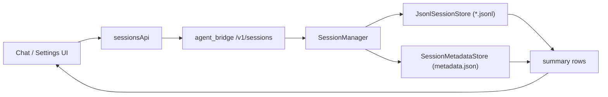
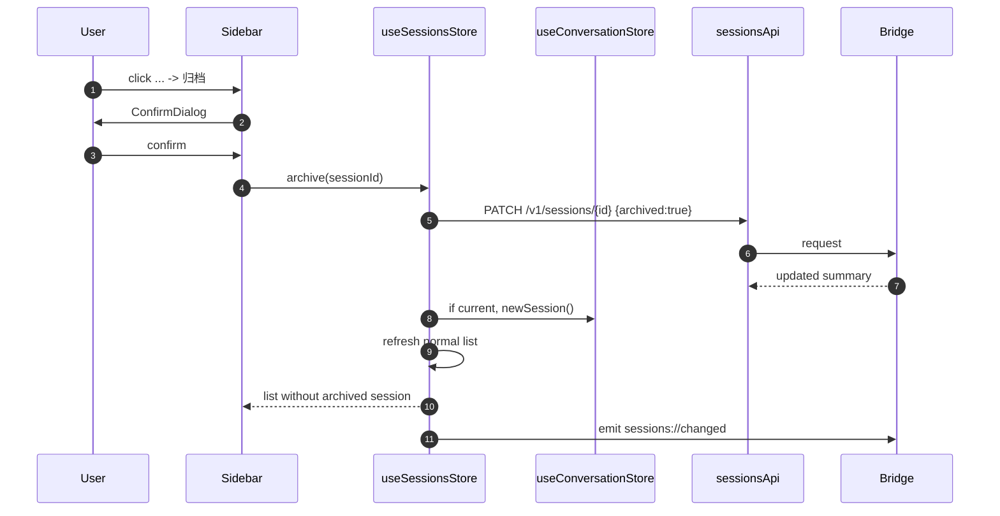
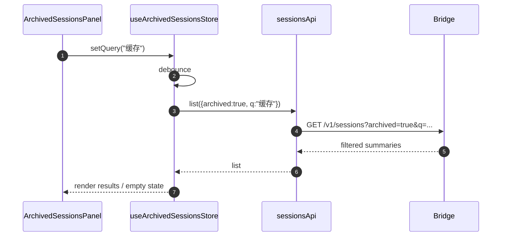

# 042 · 会话生命周期管理 - 技术方案

## 状态

CONFIRMED

## 需求文档

-> [requirement.md](./requirement.md)

## 0. 文档说明

本文档回答 042 需求中的“怎么做”：如何在不污染会话事件流的前提下，为桌面端补齐会话重命名、归档、已归档会话管理、永久删除与统一确认弹窗。

本文档不设计 project / workspace 概念，不设计会话删除与 memory 生命周期联动，也不设计已归档会话直接打开。

## 1. 现状分析

### 1.1 后端会话存储

当前持久化会话由 `JsonlSessionStore` 管理：

- 文件布局：`{sessions_dir}/{session_id}.jsonl`。
- 首行 `session_meta` 保存 `initial_title / initial_persona / initial_model`。
- `list()` 只读每个 JSONL 文件首行 + 文件 mtime，按 `updated_at` 倒序返回 `SessionSummary`。
- `delete(session_id)` hard delete JSONL 文件。

这个设计保证历史列表是每文件 O(1) 查询，不需要扫描完整事件流。重命名与归档如果追加成 session event，会让列表查询必须 replay 或至少读完整 JSONL，与现有性能设计冲突；如果直接重写首行，则会把“会话管理 UI 状态”混进对话事件流。

### 1.2 Bridge REST

`agent_bridge/src/agent_bridge/routes/meta.py` 目前提供：

- `GET /v1/sessions`
- `POST /v1/sessions`
- `GET /v1/sessions/{session_id}`
- `POST /v1/sessions/{session_id}/edit-resend-latest`
- `DELETE /v1/sessions/{session_id}`
- `POST /v1/sessions/{session_id}/persona`
- `POST /v1/sessions/{session_id}/model`
- `POST /v1/sessions/{session_id}/channel`

当前 `DELETE /v1/sessions/{id}` 是内部清理语义，voice_bridge 用它删除无内容临时 session。本需求会把删除扩展成用户可见能力，但不改变其“只处理 session 文件”的边界。

### 1.3 前端会话列表

聊天侧栏由 `HistorySidebar` 渲染：

- `useSessionsStore.refresh()` 调 `sessionsApi.list()`。
- `useConversationStore.openSession()` 打开指定历史会话。
- `newSession()` 已会清理 `lastChatSessionId` 并回到空态。
- 侧栏 item 当前没有操作菜单。

这意味着当前会话被归档 / 删除后的安全退回可以复用 `conversation.newSession()`，避免新增一条平行清理路径。

### 1.4 设置中心与语音确认

设置中心已有两栏 shell：

- `SettingsApp` 用 sidebar 切换通用 / 语音 / 桌宠 / 模型与凭据。
- `SettingsPageLayout` 支持页面标题和 actions。
- `SettingsGroup` 当前偏卡片式配置组，适合设置项，不适合归档会话列表这种管理视图；归档视图应在页面内自建列表结构，不嵌套卡片。

语音通话确认目前由 `VoiceTunnelConsentDialog` 直接组合 `Dialog / Button`。它需要迁移到统一确认弹窗，但视觉必须保持不变。

## 2. 总体方案

本期采用“JSONL 事件流 + 轻量会话 metadata read model”的方案。

核心设计：

1. JSONL 继续作为对话事件流，不写入重命名 / 归档 UI 状态。
2. 新增 `SessionMetadataStore`，落在 `{sessions_dir}/metadata.json`，保存每个 session 的展示标题与归档时间。
3. `SessionManager` 增加会话管理方法，合成 JSONL summary + metadata 后返回列表。
4. `GET /v1/sessions` 支持 `archived` 与 `q` 参数，搜索由后端完成。
5. 前端 `sessionsApi` 与 `useSessionsStore` 增加重命名、归档、取消归档、删除、删除全部归档会话 action。
6. 聊天侧栏通过点击三点按钮打开 dropdown-menu，不用 hover 触发菜单。
7. 设置中心新增“已归档对话”视图，查询后端归档列表，使用 `Spinner` 表示加载与操作中状态。
8. 新增纯 UI `ConfirmDialog`，语音通话确认保留业务 wrapper 并复用该组件；只有语音确认传入 3 秒等待。



### 外部资料参考

本方案借鉴 Event Sourcing / CQRS 中“事件流负责事实，列表查询走 read model / materialized view”的常见实践：

- [Microsoft Event Sourcing pattern](https://learn.microsoft.com/en-us/azure/architecture/patterns/event-sourcing)
- [Microsoft Materialized View pattern](https://learn.microsoft.com/en-us/azure/architecture/patterns/materialized-view)
- [Martin Fowler: Event Sourcing](https://martinfowler.com/eaaDev/EventSourcing.html)

这里不引入完整 CQRS 基础设施，只落一个本地 JSON read model，保持实现规模与当前项目阶段匹配。

## 3. 涉及文件

| 文件路径 | 改动类型 | 说明 |
| --- | --- | --- |
| `agent/src/agent/sessions/metadata.py` | 新增 | `SessionMetadataStore`、数据结构、文件锁与原子写入。 |
| `agent/src/agent/sessions/store.py` | 修改 | `SessionSummary` 增加 `archived_at` 可选字段；旧调用方默认不感知。 |
| `agent/src/agent/sessions/manager.py` | 修改 | 注入 metadata store，新增 list/search/rename/archive/unarchive/delete all archived 管理方法。 |
| `agent/src/agent/sessions/__init__.py` | 修改 | 导出 metadata store 类型。 |
| `agent_bridge/src/agent_bridge/assembly.py` | 修改 | 装配 metadata store，路径为 `settings.sessions_dir / "metadata.json"`。 |
| `agent_bridge/src/agent_bridge/routes/meta.py` | 修改 | 扩展 sessions REST：列表参数、PATCH、删除全部归档。 |
| `agent_bridge/tests/test_meta_channel_routes.py` 或新测试文件 | 修改/新增 | 覆盖列表过滤、搜索、重命名、归档、取消归档、删除与旧 session 兼容。 |
| `agent/tests/test_session_metadata.py` | 新增 | 覆盖 metadata store 锁、读写、清理孤儿记录等纯后端逻辑。 |
| `frontend/src/types/meta.ts` | 修改 | `SessionSummary` 增加 `archived_at?: string \| null`。 |
| `frontend/src/services/api/sessions.ts` | 修改 | 增加 list 参数与会话管理 API。 |
| `frontend/src/stores/sessions.ts` | 修改 | 增加普通列表 / 归档列表刷新与 mutation action。 |
| `frontend/src/stores/sessions.test.ts` | 修改 | 覆盖查询参数、状态更新、失败保留旧状态。 |
| `frontend/src/pages/chat/components/HistorySidebar.tsx` | 修改 | item 点击三点按钮打开 dropdown-menu，支持重命名 / 归档。 |
| `frontend/src/pages/settings/App.tsx` | 修改 | 新增设置中心“已归档对话”入口。 |
| `frontend/src/pages/settings/components/ArchivedSessionsPanel.tsx` | 新增 | 归档会话搜索、列表、加载态、操作态、空态。 |
| `frontend/src/components/ui/confirm-dialog/index.tsx` | 新增 | 纯 UI 确认弹窗。 |
| `frontend/src/components/ui/index.ts` | 修改 | re-export `ConfirmDialog` 与新增 dropdown-menu。 |
| `frontend/src/components/voice/VoiceTunnelConsentDialog.tsx` | 修改 | 复用 `ConfirmDialog`，传入 3 秒等待与原视觉 class。 |
| `frontend/src/components/ui/dropdown-menu/` | 新增 | 通过 shadcn CLI 引入，不手写。 |
| `docs/requirements/042-session-lifecycle-management/progress.md` | Phase 3 新增 | 实现进度追踪。 |

## 4. 后端设计

### 4.1 Metadata 文件格式

文件路径：

```text
{sessions_dir}/metadata.json
```

JSON schema：

```json
{
  "version": 1,
  "sessions": {
    "<session_id>": {
      "display_title": "用户重命名标题",
      "archived_at": "2026-07-02T12:34:56Z"
    }
  }
}
```

字段语义：

- `display_title`：可选。不存在或空白时回退到 JSONL summary 的 `title`。
- `archived_at`：可选。存在表示已归档；不存在或 `null` 表示未归档。
- `version`：用于后续 schema 迁移；本期仅支持 `1`，缺失时按空 metadata 处理。

兼容策略：

- 没有 metadata 文件：所有已有 session 默认未归档，标题使用 JSONL 首行标题。
- metadata 中有孤儿 session id：列表合成时忽略；删除 session 时主动清理对应 metadata。
- metadata 中未知字段：读入时忽略，写回时不保留未知字段。

### 4.2 Metadata store

新增 `agent.sessions.metadata`：

```py
@dataclass(frozen=True)
class SessionMetadata:
    display_title: str | None = None
    archived_at: datetime | None = None

class SessionMetadataStore:
    def __init__(self, path: Path | str) -> None: ...
    def load_all(self) -> dict[str, SessionMetadata]: ...
    def get(self, session_id: str) -> SessionMetadata: ...
    def update(self, session_id: str, patch: SessionMetadataPatch) -> SessionMetadata: ...
    def delete(self, session_id: str) -> None: ...
    def delete_many(self, session_ids: Iterable[str]) -> None: ...
```

写入要求：

- 用 `portalocker` 对 `metadata.json.lock` 加 exclusive lock。
- 在锁内重新读取当前文件，应用 patch，再写入临时文件并 `replace()` 原文件。
- 写入 JSON 使用 UTF-8、排序 key、缩进，便于人工排查。
- 读文件失败或 JSON 损坏时抛 `SessionPersistError`，不静默吞掉；否则用户可能误以为归档丢失。

标题归一化：

- `rename` 时 trim。
- 空白标题返回 400。
- 标题长度上限在 design 层建议为 80 个 Unicode code points；超出返回 400，避免 UI 被极端长标题撑坏。

### 4.3 SessionSummary 扩展

`SessionSummary` 增加：

```py
archived_at: datetime | None = None
```

列表合成时：

```py
summary.title = metadata.display_title or summary.title
summary.archived_at = metadata.archived_at
```

如果 metadata 没有当前 session id，则保留原 summary。

### 4.4 SessionManager 管理方法

`SessionManager` 注入可选 `metadata_store`。生产路径注入真实 store；测试 / `NullSessionStore` 场景可用内存或文件 store。

新增方法：

```py
def list(
    self,
    *,
    archived: bool = False,
    query: str | None = None,
) -> list[SessionSummary]: ...

def rename(self, session_id: str, title: str) -> SessionSummary: ...

def archive(self, session_id: str) -> SessionSummary: ...

def unarchive(self, session_id: str) -> SessionSummary: ...

def delete(self, session_id: str) -> None: ...

def delete_archived(self, *, query: str | None = None) -> list[str]: ...
```

说明：

- `list(archived=False)` 默认返回未归档，保持当前前端历史列表语义。
- `query` 后端执行，按合成后的展示标题做 case-insensitive substring 匹配。
- `rename / archive / unarchive` 先确认 JSONL session 存在，再写 metadata。
- `delete` 先删除 JSONL，再清 metadata；若 JSONL 不存在，返回 `SessionNotFoundError`。
- `delete_archived` 找出当前 archived list 后逐个删除 JSONL 与 metadata，返回删除成功的 session ids。若部分失败，抛 `SessionPersistError` 并在错误文案里保留失败数量；前端随后 refresh 列表。

### 4.5 REST 契约

#### `GET /v1/sessions`

Query params：

| 参数 | 类型 | 默认 | 说明 |
| --- | --- | --- | --- |
| `archived` | `bool` | `false` | `false` 返回普通列表；`true` 返回已归档列表 |
| `q` | `str \| None` | `None` | 后端按展示标题搜索 |

Response：`SessionSummary[]`，字段新增 `archived_at`。

#### `PATCH /v1/sessions/{session_id}`

Request：

```json
{
  "title": "新的标题",
  "archived": true
}
```

语义：

- `title` 可选；传入时执行重命名。
- `archived` 可选；`true` 归档，`false` 取消归档。
- 两者都缺失返回 400。
- 返回更新后的 `SessionSummary`。

本期允许一次 patch 同时改标题和归档状态，但前端只按单一动作调用。

#### `DELETE /v1/sessions/{session_id}`

沿用已有 endpoint，补充清理 metadata。

Response 仍保持：

```json
{ "session_id": "<id>", "deleted": true }
```

#### `DELETE /v1/sessions/archived`

新增 endpoint。注意在 FastAPI 中注册顺序要放在 `DELETE /sessions/{session_id}` 前面，避免被动态 path 捕获。

Query params：

| 参数 | 类型 | 默认 | 说明 |
| --- | --- | --- | --- |
| `q` | `str \| None` | `None` | 可选；只删除当前搜索命中的归档会话 |

本期前端“全部删除”默认不带 `q`，表示删除全部归档会话。保留 `q` 是为了后端能力完整，但 UI 不暴露“只删搜索结果”的特殊语义。

Response：

```json
{
  "deleted": 3,
  "session_ids": ["sid-a", "sid-b", "sid-c"]
}
```

### 4.6 错误模型

- session 不存在：404。
- title 空白 / 过长：400。
- metadata 文件损坏或 IO 失败：500。
- 批量删除部分失败：500，并返回可读 detail；前端展示统一友好文案并 refresh。

前端 HTTP 层仍把技术错误归一化成 `FriendlyError`，用户不看到 stack / status。

## 5. 前端设计

### 5.1 API 与类型

`SessionSummary`：

```ts
export interface SessionSummary {
  session_id: string;
  title: string;
  created_at: string;
  updated_at: string;
  persona: string;
  model: string;
  archived_at?: string | null;
}
```

`sessionsApi`：

```ts
list(options?: { archived?: boolean; q?: string }): Promise<SessionSummary[]>
rename(sessionId: string, title: string): Promise<SessionSummary>
archive(sessionId: string): Promise<SessionSummary>
unarchive(sessionId: string): Promise<SessionSummary>
delete(sessionId: string): Promise<{ session_id: string; deleted: true }>
deleteArchived(options?: { q?: string }): Promise<{ deleted: number; session_ids: string[] }>
```

Query 参数用 `URLSearchParams` 生成，不手拼字符串。

### 5.2 Sessions store

`useSessionsStore` 继续负责普通历史列表：

```ts
interface SessionsState {
  list: SessionSummary[];
  loading: boolean;
  loaded: boolean;
  refresh: () => Promise<void>;
  rename: (sessionId: string, title: string) => Promise<boolean>;
  archive: (sessionId: string) => Promise<boolean>;
  remove: (sessionId: string) => Promise<boolean>;
}
```

归档视图可以使用同一 store 的独立状态，也可以新建 `useArchivedSessionsStore`。本期倾向新增 `useArchivedSessionsStore`，避免普通列表 loading 与归档列表 loading 互相影响：

```ts
interface ArchivedSessionsState {
  list: SessionSummary[];
  query: string;
  loading: boolean;
  loaded: boolean;
  pendingIds: Set<string>;
  deletingAll: boolean;
  setQuery: (query: string) => void;
  refresh: () => Promise<void>;
  unarchive: (sessionId: string) => Promise<boolean>;
  remove: (sessionId: string) => Promise<boolean>;
  removeAll: () => Promise<boolean>;
}
```

搜索行为：

- 输入框受控。
- query 变化 debounce 约 250ms 后调用后端 `GET /v1/sessions?archived=true&q=...`。
- 初次加载、搜索刷新显示 `Spinner`。
- 搜索请求用序号防止慢请求覆盖新请求，沿用普通 sessions store 的 `refreshSeq` 思路。

### 5.3 当前会话被归档 / 删除

新增 helper：

```ts
function leaveSessionIfCurrent(sessionId: string): void {
  const current = useConversationStore.getState().currentSessionId;
  if (current === sessionId) {
    useConversationStore.getState().newSession();
  } else {
    const persisted = ...
  }
}
```

实现时不直接读 persisted state；更稳的是：

- 归档 / 删除成功后，如果 `currentSessionId === sessionId`，调用 `newSession()`。
- 无论是否当前会话，调用 `setLastChatSessionId(null)` 当目标可能是上次恢复指针时。这里无法同步知道 persisted id，清空是低成本安全策略；用户仍可从列表手动打开其它会话。

跨窗口：

- mutation 成功后调用 Tauri `emit` 或复用现有 `emitEverywhere(EVENT_SESSIONS_CHANGED, payload)` 模式。
- chat / settings 已监听 `sessions://changed` 时 refresh。
- web-only dev 下没有 Tauri event 时，当前窗口直接 refresh store。

### 5.4 聊天侧栏操作菜单

实现结构：

- `SidebarMenuItem` 内保留 `SidebarMenuButton` 作为打开会话按钮。
- 使用 `SidebarMenuAction asChild` 包一个 `DropdownMenuTrigger`。
- 三点按钮点击打开菜单；hover/focus 只控制按钮透明度或可见性，不触发菜单。
- trigger 点击需要 `event.stopPropagation()`，避免同时打开会话。

菜单项：

- `重命名`
- `归档`

重命名 UI：

- 优先用 `ConfirmDialog` 的自定义 children 或独立业务 dialog 承载 `Input`。
- title trim 后提交。
- pending 时按钮 loading，输入 disabled。
- 空白标题不提交，按钮 disabled 或显示轻量错误。

归档 UI：

- 点击归档菜单项后打开 `ConfirmDialog`。
- confirmLabel = `归档`
- variant = `default`
- 不传倒计时。

### 5.5 设置中心归档视图

`SettingsSection` 增加：

```ts
type SettingsSection = "general" | "runtime" | "voice" | "pet" | "archived-sessions";
```

侧栏新增“已归档对话”。

`ArchivedSessionsPanel` 布局：

- 页面 title：`已归档对话`。
- actions：destructive `全部删除` 按钮；无归档会话时 disabled。
- 顶部 `Input` 搜索框。
- 列表区域：
  - `loading && !loaded`：居中 `Spinner`。
  - `loading && loaded`：列表保留，右上或搜索框旁显示小 `Spinner`。
  - 空态：无归档会话 / 无搜索结果分别展示简短文案。
  - item：标题、最近活跃时间、hover/focus 显示取消归档和删除按钮。

单项操作：

- 取消归档：不确认，pending 时 item 操作 disabled，可显示局部 spinner。
- 删除：打开 destructive `ConfirmDialog`，不倒计时。
- 全部删除：打开 destructive `ConfirmDialog`，不倒计时；`deletingAll` 时按钮 loading，列表操作 disabled。

### 5.6 ConfirmDialog

路径：`frontend/src/components/ui/confirm-dialog/index.tsx`。

Props：

```ts
interface ConfirmDialogProps {
  open: boolean;
  title: ReactNode;
  description?: ReactNode;
  children?: ReactNode;
  confirmLabel?: string;
  cancelLabel?: string;
  variant?: "default" | "destructive";
  layout?: "inline" | "stacked";
  confirmDelaySeconds?: number;
  loading?: boolean;
  disabled?: boolean;
  showCloseButton?: boolean;
  contentClassName?: string;
  overlayClassName?: string;
  onConfirm: () => void;
  onCancel: () => void;
}
```

行为：

- `confirmDelaySeconds` 缺省为 `0`。
- 每次 `open` 从 false -> true 时重置倒计时。
- 倒计时期间 confirm disabled，label 可显示 `我已确认，继续拨号（3）` 或由业务传 `confirmLabel` 后统一追加剩余秒数。
- `variant="destructive"` 使用 `Button variant="destructive"`。
- `layout="stacked"` 时按钮竖排，confirm 在上，cancel 在下，以兼容语音通话现有视觉。

语音 wrapper：

- `VoiceTunnelConsentDialog` 继续存在，负责传文案、`confirmDelaySeconds={3}`、`layout="stacked"`、现有 `contentClassName`、`overlayClassName="bg-transparent"`。
- 迁移后不改变 `VoiceCallApp` 的调用方式。

### 5.7 shadcn dropdown-menu

当前项目没有 `dropdown-menu`，实现阶段必须按 `add-shadcn-component` skill 走 shadcn CLI 引入。

预期新增：

- `frontend/src/components/ui/dropdown-menu/index.tsx`
- `frontend/src/components/ui/index.ts` re-export

业务代码只从 `@/components/ui` 引入。

## 6. 数据流

### 6.1 归档当前会话



### 6.2 设置中心搜索归档会话



## 7. 测试策略

### 7.1 后端单测

新增覆盖：

- metadata 文件不存在时返回空 metadata。
- rename 写入 display title，list 合成标题。
- archive 写入 archived_at，默认 list 排除，archived list 包含。
- unarchive 清除 archived_at。
- query 按合成标题过滤，由后端完成。
- delete 同时删除 JSONL 与 metadata。
- delete archived 删除所有归档会话，不影响未归档会话。
- 旧 JSONL session 无 metadata 时兼容。
- metadata 孤儿记录不污染 list。

### 7.2 前端单测

新增 / 修改覆盖：

- `sessionsApi.list` 正确生成 `archived` / `q` query params。
- `useSessionsStore.archive` 成功后 refresh，当前会话时调用 `newSession`。
- `useArchivedSessionsStore` 搜索请求防慢响应覆盖。
- 单项 pending / 全部删除 loading 状态。
- `ConfirmDialog` 倒计时行为：默认不倒计时；传 3 秒时 confirm 初始 disabled。
- `VoiceTunnelConsentDialog` 传入 3 秒等待且保留 stacked layout。

### 7.3 真实桌面端验收

按 `desktop-visual-inspection` 路径观察：

- 语音通话确认迁移前后视觉一致。
- 语音确认按钮等待 3 秒后可点击。
- 聊天侧栏三点按钮点击打开菜单，不因 hover 抖动误开。
- 归档当前会话后聊天页回安全空态。
- 设置中心归档列表初次加载、搜索刷新、单项操作、全部删除均有合理 loading / disabled 状态。
- chat 与 settings 同时打开时跨窗口刷新生效。

## 8. 影响分析

### 8.1 上下游影响

- `agent.sessions` 增加 metadata store，但 JSONL event schema 不变，历史消息加载不受影响。
- `agent_bridge` 的 `GET /v1/sessions` 默认语义从“所有会话”变为“未归档会话”。当前前端只有普通历史列表调用该接口，符合需求；调试脚本如需要所有会话，后续可显式查 archived 两边。
- `DELETE /v1/sessions/{id}` 保持 response shape，不破坏 voice_bridge 空会话清理；只是额外清 metadata。
- 前端 settings 新增 section，不影响现有通用 / 语音 / 桌宠 / 模型与凭据。
- `VoiceTunnelConsentDialog` 调用 API 不变，降低迁移风险。

### 8.2 风险点

| # | 风险 | 缓解 |
| --- | --- | --- |
| 1 | metadata JSON 与 JSONL 文件不同步 | 列表以 JSONL 为主，孤儿 metadata 忽略；删除时清 metadata；测试覆盖 |
| 2 | 两个窗口同时修改 metadata 互相覆盖 | 文件锁内读改写，写临时文件后原子替换 |
| 3 | `DELETE /sessions/archived` 被 `{session_id}` 动态路由捕获 | 静态路由注册在动态 delete 前，并加 route 测试 |
| 4 | 语音确认视觉迁移漂移 | 保留业务 wrapper 传原 class，真实桌面截图验收 |
| 5 | dropdown-menu 点击冒泡导致打开会话 | trigger/menu item 处理 `stopPropagation`，补手测 |
| 6 | 搜索频繁请求导致旧结果覆盖 | store refresh seq 防慢响应覆盖，搜索 debounce |
| 7 | 全部删除部分失败状态复杂 | 后端返回错误，前端显示友好失败并强制 refresh 最新归档列表 |

## 9. 变更记录

| 日期 | 变更内容 | 是否需要重新实现 |
| --- | --- | --- |
| 2026-07-02 | 初版技术方案确认：采用 JSON metadata read model；dropdown-menu 点击触发；归档搜索后端执行；归档列表补 Spinner loading；语音确认迁移到统一 ConfirmDialog 并保留视觉。 | 是 |
