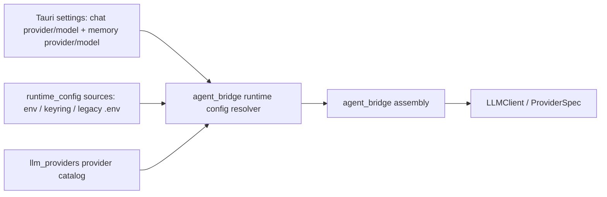

# 043 · Kimi Provider Integration - 技术方案

## 状态

CONFIRMED

## 需求文档

→ [requirement.md](./requirement.md)

## 现状分析

当前模型链路仍是 DeepSeek-only 形态，虽然 `llm_providers.ProviderSpec` 表面上接受
`prefix`，但上游配置、桌面设置和 bridge 装配都已经写死 DeepSeek 语义。

### 关键现状

| 位置 | 现状 | 问题 |
|------|------|------|
| `llm_providers/src/llm_providers/spec.py` | `PROVIDER_DEFAULTS` 只有 `DEEPSEEK` | 新 provider 只能继续往散落调用点补分支 |
| `agent_bridge/src/agent_bridge/assembly.py` | `_make_spec_with_thinking_off()` 直接从 DeepSeek 构造 spec，并注入 `thinking.disabled` | bridge 同时知道配置来源、provider 类型和 provider 特殊参数 |
| `agent_bridge/src/agent_bridge/runtime_config.py` | `_deepseek_provider_config()` 固定读取 `DEEPSEEK_*` | 无法按用户选择的 provider 解析主对话 / 记忆配置 |
| `runtime_config/src/runtime_config/credentials.py` | credential registry 只有 `DEEPSEEK_API_KEY` | 设置中心无法管理 Kimi API Key |
| `runtime_config/src/runtime_config/sources.py` | `SettingsFileSource` 只映射 `deepseekModel` / `deepseekMemoryModel` | settings 无 provider 维度，无法表达 Kimi |
| `frontend/src-tauri/src/settings.rs` | `Settings` 含 `DeepseekModel` enum | Tauri 初始化快照和设置写入只能接受两个 DeepSeek 模型 |
| `frontend/src-tauri/src/runtime_config.rs` | secret registry 中模型供应商组为 `Deepseek` | Kimi key 无法通过设置页安全写入 keyring |
| `frontend/src/lib/model-config/index.ts` | `DEEPSEEK_MODELS` + `resolveDefaultConversationModel()` | 前端模型 allowlist 和默认模型都是 DeepSeek-only |
| `agent_bridge/protocols/ag_ui/decoders.py` | `ALLOWED_DESKTOP_MODELS` 只允许两个 DeepSeek 模型 | 桌面新会话无法携带 Kimi 模型 |

### 边界判断

`Conversation`、`SessionManager` 和 session JSONL 本身是 model-string 驱动的，不直接绑定
DeepSeek。需要改的是“启动期 / 设置期如何把用户选择投影成 LLMClient spec”的装配边界。

CLI in-process 入口仍在 `tools/src/tools/cli/__main__.py`，但它不是桌面主路径，本需求不扩展到
CLI 支持或 CLI 清理。后续若要归档 CLI，应单独立项。

## 方案设计

### 总体设计

新增一个轻量 provider catalog，作为 Python 运行时装配的唯一 provider 知识源：

- provider id，例如 `deepseek` / `kimi`。
- 展示名，例如 `DeepSeek` / `Kimi`。
- credential name，例如 `DEEPSEEK_API_KEY` / `KIMI_API_KEY`。
- 主对话默认模型与记忆默认模型。
- 可选模型列表。
- LiteLLM 调用所需 `api_base` 与 provider-specific defaults。
- provider-specific spec transform，例如 DeepSeek 关闭 thinking。

`agent_bridge` 不再直接写 DeepSeek helper，而是通过 catalog 把“用户选择的 provider + model +
credential source”解析成 `ProviderSpec`。Kimi 的官方 base URL 固定在 catalog 中，不暴露给用户。



### Provider Catalog

在 `llm_providers` 中新增模块：

| 文件 | 责任 |
|------|------|
| `llm_providers/src/llm_providers/catalog.py` | provider / model catalog、查询、校验、spec 构造 |
| `llm_providers/tests/test_provider_catalog.py` | provider defaults、model allowlist、spec transform 单测 |

建议核心类型：

```python
@dataclass(frozen=True)
class ProviderModel:
    id: str
    label: str
    litellm_model: str
    context_window: int | None = None


@dataclass(frozen=True)
class ProviderDefinition:
    provider_id: str
    display_name: str
    prefix: str
    credential_name: str
    api_base: str | None
    models: tuple[ProviderModel, ...]
    default_model: str
    default_memory_model: str
    default_call_options: dict[str, Any]
```

Catalog 初始内容：

| provider | credential | 用户可选模型 | 默认主对话 | 默认记忆 | 底层说明 |
|----------|------------|--------------|------------|----------|----------|
| `deepseek` | `DEEPSEEK_API_KEY` | `deepseek/deepseek-v4-flash`, `deepseek/deepseek-v4-pro` | `deepseek/deepseek-v4-flash` | `deepseek/deepseek-v4-pro` | 保持现有行为；V4 默认关闭 thinking |
| `kimi` | `KIMI_API_KEY` | 技术实现时按官方当前模型表确认，第一版优先 `kimi-k2.6` / `kimi-k2.5` / `kimi-k2.7-code` 系列中适合对话的模型 | 选一个通用对话默认模型 | 同主对话或更稳模型 | 默认 `api_base=https://api.moonshot.cn/v1`，不暴露到 UI |

Kimi 模型清单必须在实现前再次核对官方文档。若 LiteLLM 原生 Moonshot provider prefix 与中国区 Kimi
endpoint 不完全一致，优先使用 OpenAI-compatible 方式构造 LiteLLM model / api_base，但这个细节仍留在 catalog
内，不进入设置页。

### ProviderSpec 构造

保留 `ProviderSpec` 和 `ProviderConfig`，但新增 provider-aware 构造入口，例如：

```python
def build_provider_spec(
    *,
    provider_id: str,
    model_id: str | None,
    api_key: str,
    default_model_key: Literal["model", "memory_model"] = "model",
    context_window: int | None = None,
) -> ProviderSpec:
    ...
```

职责：

- 根据 provider id 找 catalog。
- model 未指定时按主对话或记忆默认模型回落。
- 把用户层 model id 映射成 LiteLLM model 字符串。
- 注入 provider 默认 `api_base`、`defaults`、`context_window`。
- 应用 provider-specific transform。

`ProviderSpec.from_env(prefix=...)` 保留为 legacy wrapper，避免旧脚本立即断裂；但桌面主路径不再使用它。

### DeepSeek 特殊逻辑迁移

当前 `_disable_deepseek_thinking()` 从 `agent_bridge.assembly` 移出，作为 DeepSeek provider transform：

```python
def disable_deepseek_thinking(spec: ProviderSpec) -> ProviderSpec:
    ...
```

这样 bridge 只调用 `build_provider_spec(...)`，不再判断 `if "deepseek" in spec.model.lower()`。

### Runtime Config

#### Python registry

`runtime_config/src/runtime_config/credentials.py` 新增：

- `KIMI_API_KEY = "KIMI_API_KEY"`
- `ALL_CREDENTIAL_NAMES` 纳入 `KIMI_API_KEY`
- `CREDENTIAL_BUNDLES["kimi"] = (KIMI_API_KEY,)`

#### Settings source

`SettingsFileSource` 支持 provider-aware settings。建议新增 canonical settings key：

```json
{
  "chatModel": { "provider": "deepseek", "model": "deepseek/deepseek-v4-flash" },
  "memoryModel": { "provider": "deepseek", "model": "deepseek/deepseek-v4-pro" }
}
```

为了让 Python resolver 简单可靠，`SettingsFileSource` 可以暴露以下 runtime names：

- `LLM_CHAT_PROVIDER`
- `LLM_CHAT_MODEL`
- `LLM_MEMORY_PROVIDER`
- `LLM_MEMORY_MODEL`

这些是运行时配置投影名，不作为用户要手填的环境变量主路径。若 settings 没有新字段，则从旧
`deepseekModel` / `deepseekMemoryModel` 派生：

- `LLM_CHAT_PROVIDER=deepseek`
- `LLM_CHAT_MODEL=<deepseekModel or default>`
- `LLM_MEMORY_PROVIDER=deepseek`
- `LLM_MEMORY_MODEL=<deepseekMemoryModel or default>`

#### Bridge runtime config

`agent_bridge/src/agent_bridge/runtime_config.py` 改为 provider-aware resolver：

```python
@dataclass(frozen=True)
class ProviderSelection:
    provider_id: str
    model: str | None


@dataclass(frozen=True)
class BridgeRuntimeConfig:
    chat_selection: ProviderSelection
    memory_selection: ProviderSelection
    chat_api_key: str
    memory_api_key: str
    tool_credentials: ToolCredentials
```

也可以直接在 resolver 阶段产出 `ProviderSpec`。取舍：

- 产出 `ProviderSpec`：bridge assembly 最干净。
- 产出 selection + key：测试可更清楚地断言解析过程。

实现阶段优先选择让 `agent_bridge` 只拿 `ProviderSpec` / spec factory，减少 DeepSeek 语义回流。

解析规则：

1. 从 settings source 读主对话 provider/model；缺失则 DeepSeek 默认。
2. 从 settings source 读记忆 provider/model；缺失则 DeepSeek 记忆默认。
3. 按 provider catalog 找 credential name。
4. 从 composite source 读取对应 API key。
5. context window / api_base 默认走 catalog；暂不对用户开放 override。

### Tauri Settings

`frontend/src-tauri/src/settings.rs` 新增 provider-aware 类型：

```rust
#[derive(Serialize, Deserialize, Clone, Debug, PartialEq, Eq)]
#[serde(rename_all = "camelCase")]
pub struct ModelSelection {
    pub provider: ModelProvider,
    pub model: String,
}

#[derive(Serialize, Deserialize, Clone, Debug, PartialEq, Eq)]
#[serde(rename_all = "camelCase")]
pub enum ModelProvider {
    Deepseek,
    Kimi,
}
```

`Settings` 新增：

- `chat_model: ModelSelection`
- `memory_model: ModelSelection`

旧字段处理：

- 读盘时 `deepseekModel` / `deepseekMemoryModel` 仍可被解析为 legacy presence。
- 若新字段缺失，使用旧字段填充 `chat_model` / `memory_model`，provider 固定为 `deepseek`。
- 写回 settings 时只写新字段，不继续写旧字段。
- `window.__AGENT_FRIEND_SETTINGS__` 注入新字段；前端 `normalizeSettingsSnapshot` 也做旧字段 fallback，防止升级瞬间空值。

`set_setting` command 新增 key：

- `chatModel`
- `memoryModel`

保留旧 key 的写入兼容：

- `deepseekModel` 更新 `chat_model` 为 DeepSeek selection。
- `deepseekMemoryModel` 更新 `memory_model` 为 DeepSeek selection。

### Tauri Runtime Config Secret Registry

`frontend/src-tauri/src/runtime_config.rs`：

- `RuntimeConfigGroup::Deepseek` 可调整为更通用的 `ModelProvider`，或新增 `Kimi`。
- `SECRET_REGISTRY` 新增 `KIMI_API_KEY`，effect 为 `RestartBridge`。
- status / set / delete 逻辑不变，仍只写 keyring，不回显 secret。

前端类型同步：

- `RuntimeConfigGroup` 增加 `"kimi"` 或改为 `"modelProvider"`。为了 UI 分组清晰，建议增加 `"kimi"`。
- `RuntimeSecretName` 增加 `"KIMI_API_KEY"`。
- `SECRET_LABELS` 增加 `Kimi API Key`。

### Frontend Model Config

`frontend/src/lib/model-config/index.ts` 从 DeepSeek-only 常量改成 provider-aware catalog：

```ts
export type ModelProvider = "deepseek" | "kimi";

export interface ModelOption {
  id: string;
  label: string;
  provider: ModelProvider;
}

export interface ModelSelection {
  provider: ModelProvider;
  model: string;
}
```

导出：

- `MODEL_PROVIDERS`
- `MODEL_OPTIONS_BY_PROVIDER`
- `DEFAULT_CHAT_MODEL`
- `DEFAULT_MEMORY_MODEL`
- `isSupportedModelSelection(value)`
- `resolveDefaultConversationModel(settings)`

前端 catalog 只包含安全展示信息和 allowlist，不包含 API key、api_base、secret 来源等敏感或后端专属字段。

### Settings UI

`RuntimeConfigPanel` 改造：

- “对话模型”分组：
  - 供应商 select：DeepSeek / Kimi。
  - 模型 select：随供应商切换。
- “记忆模型”分组：
  - 同上，独立选择。
- “DeepSeek 凭据”保留。
- 新增 “Kimi 凭据”：
  - 显示 `KIMI_API_KEY` 状态。
  - password 输入保存 / 覆盖。
  - 删除 keyring 中的 Kimi key。

交互规则：

- 切换 provider 时，如果当前 model 不属于新 provider，自动落到该 provider 默认模型。
- 保存 secret 成功后清空输入。
- UI 文案不提 base URL。
- 当前 key 来源若是 env / legacy `.env`，删除按钮仍只删除 keyring；状态说明沿用现有逻辑。

### AG-UI 新会话默认模型

`frontend/src/services/stream.ts` 继续在 `forwardedProps.model` 里传模型字符串。为了让 bridge 知道 provider，
建议改为传结构：

```ts
forwardedProps: {
  model: resolveDefaultConversationModel(),
}
```

其中 `model` 可以是：

```ts
{ provider: "kimi", model: "kimi-k2.6" }
```

或为了最小变更继续传字符串。取舍：

- 传结构：语义清楚，不靠 model 字符串反推 provider。
- 传字符串：改动少，但 provider-aware 设计不完整。

本需求建议传结构，并在 AG-UI decoder 中集中解析：

```python
@dataclass(frozen=True)
class RequestedModel:
    provider_id: str
    model: str
```

`SessionBridge.PersistentBootstrap.default_model` 仍是 session meta 里的 model 字符串。这里建议继续落用户可读
model id，例如 `kimi/kimi-k2.6` 或 catalog 定义的 canonical model id。`llm_client_factory` 再通过 catalog
解析该 model id 所属 provider。

为了兼容既有 session，`llm_client_factory(model: str)` 需要支持：

- 旧 DeepSeek model 字符串。
- 新 Kimi model 字符串。
- 未来 provider-aware canonical model 字符串。

### Session Model String

已有 session meta 只保存 `model: str`。本期不改 session schema，避免历史会话迁移扩大范围。

Catalog 负责从 model string 反查 provider：

- `deepseek/deepseek-v4-flash` → DeepSeek。
- `deepseek/deepseek-v4-pro` → DeepSeek。
- Kimi canonical model id → Kimi。

若用户选择 Kimi 创建新 session，session meta 的 `model` 写入 Kimi canonical model id。后续打开该 session 时，
`llm_client_factory(session.current_model)` 通过 catalog 反查 provider，再读取对应 credential。

### agent_bridge Assembly

`agent_bridge/src/agent_bridge/assembly.py` 目标形态：

- 删除 `_make_spec_with_thinking_off()` / `_make_memory_spec_with_thinking_off()` 这类 DeepSeek 专名 helper。
- `build_runtime()` 从 `BridgeRuntimeConfig` 拿到 provider-aware resolver / factory。
- `default_model` 从 chat spec 或 selection 派生。
- `memory` 构造用 memory spec。
- `llm_client_factory(model)` 通过 catalog 反查 provider，并按 provider 读取 credential / defaults。

可能的接口：

```python
@dataclass(frozen=True)
class BridgeRuntimeConfig:
    chat_spec: ProviderSpec
    memory_spec: ProviderSpec
    llm_client_factory: Callable[[str], LLMClient]
    tool_credentials: ToolCredentials
```

如果 factory 需要 credential source，应该在 runtime_config resolver 阶段闭包捕获 source，而不是让 assembly 自己知道
`KIMI_API_KEY` / `DEEPSEEK_API_KEY`。

### `.env.example` 和脚本文案

`.env.example` 新增 Kimi legacy fallback 示例：

- `KIMI_API_KEY=...`
- Kimi 模型选择说明只作为 legacy / 调试参考。
- 明确桌面推荐路径仍是设置页或 `scripts/credentials/run.*`，不是编辑 `.env`。

`scripts/README.md` 的新人路径不需要改为 Kimi；可以在凭据说明中提到设置页可配置 Kimi。

## 涉及文件

| 文件路径 | 改动类型 | 说明 |
|----------|----------|------|
| `docs/requirements/043-kimi-provider-integration/design.md` | 新增 | 本技术方案 |
| `llm_providers/src/llm_providers/catalog.py` | 新增 | provider / model catalog 与 ProviderSpec 构造 |
| `llm_providers/src/llm_providers/spec.py` | 修改 | 逐步把 defaults 迁到 catalog；保留 legacy from_env |
| `llm_providers/src/llm_providers/__init__.py` | 修改 | 导出 catalog 需要的类型 / helper |
| `llm_providers/tests/test_provider_catalog.py` | 新增 | provider defaults、model 解析、DeepSeek transform、Kimi spec 单测 |
| `runtime_config/src/runtime_config/credentials.py` | 修改 | 新增 `KIMI_API_KEY` / bundle |
| `runtime_config/src/runtime_config/sources.py` | 修改 | provider-aware settings 投影与旧字段 fallback |
| `runtime_config/tests/test_sources.py` | 修改 | Kimi key、settings provider/model fallback 测试 |
| `agent_bridge/src/agent_bridge/runtime_config.py` | 修改 | provider-aware bridge runtime config resolver |
| `agent_bridge/src/agent_bridge/assembly.py` | 修改 | 移除 DeepSeek 专名 spec helper，消费 provider-aware spec / factory |
| `agent_bridge/src/agent_bridge/protocols/ag_ui/decoders.py` | 修改 | requested model 改为 provider-aware 解析 |
| `agent_bridge/src/agent_bridge/protocols/ag_ui/routes.py` | 修改 | 用 provider-aware requested model 生成新 session default model |
| `agent_bridge/tests/test_ag_ui_decoders.py` | 修改 | Kimi requested model 与非法 provider/model 测试 |
| `agent_bridge/tests/test_assembly.py` | 修改 / 新增 | bridge assembly 不依赖 DeepSeek helper，Kimi spec 装配测试 |
| `frontend/src-tauri/src/settings.rs` | 修改 | provider-aware settings schema、旧字段迁移、set_setting |
| `frontend/src-tauri/src/runtime_config.rs` | 修改 | 新增 Kimi secret registry |
| `frontend/src/lib/settings/index.ts` | 修改 | provider-aware Settings 类型与旧快照 fallback |
| `frontend/src/lib/model-config/index.ts` | 修改 | provider-aware 前端模型 catalog |
| `frontend/src/lib/model-config/index.test.ts` | 修改 | Kimi / DeepSeek allowlist、fallback、provider 切换测试 |
| `frontend/src/lib/runtime-config/index.ts` | 修改 | `KIMI_API_KEY` 类型与 group |
| `frontend/src/pages/settings/components/RuntimeConfigPanel.tsx` | 修改 | 供应商 select、Kimi 凭据分组 |
| `frontend/src/services/stream.ts` | 修改 | AG-UI forwardedProps 传 provider-aware model |
| `.env.example` | 修改 | 新增 Kimi legacy fallback 示例 |

## 影响分析

### 上下游影响

- 桌面新会话默认模型由 provider-aware settings 决定。
- 已有 session 仍按 session meta 中的 `current_model` 装配，不跟随全局默认自动变更。
- 记忆抽取 LLM 在 bridge 启动时装配；更改记忆 provider / model / API key 后仍需要重启 bridge。
- DeepSeek 用户不需要重新配置；旧 settings 会被兼容或迁移。
- CLI in-process 仍可能继续 DeepSeek-only；这是本需求明确的不包含范围。

### 安全影响

- `KIMI_API_KEY` 与现有 secret 一样只进入系统 keyring / env / legacy dotenv source。
- settings store 只保存 provider/model 这类非敏感选择。
- 前端初始化脚本不包含 API key。
- 状态查询不返回明文、长度、后缀或 hash。

### 兼容风险

- settings schema 迁移是最大风险。需要同时覆盖 Rust 读盘迁移、前端 snapshot fallback、Python
  `SettingsFileSource` fallback。
- 若 Kimi model string 与 LiteLLM provider prefix 不一致，必须在 catalog 中完成映射，不能把 LiteLLM 内部命名泄露给 UI。
- 若 session 中落的是 Kimi canonical model id，`llm_client_factory(model)` 必须能反查 provider，否则打开已有 Kimi session 会失败。

### 产品体验风险

- 用户保存 Kimi key 后，当前已启动 bridge 可能仍未读取新 key。设置页需要沿用“对话服务重启后生效”的提示。
- 主对话与记忆模型可独立选择，用户可能只配置了 Kimi key 但把记忆也切到 Kimi；缺 key 时需要明确提示缺少哪个 provider 的 key。

## 测试策略

### Python 单测

- `llm_providers`：
  - DeepSeek 默认主模型 / 记忆模型保持不变。
  - DeepSeek spec 自动包含 thinking disabled defaults。
  - Kimi spec 使用 Kimi credential、官方 api_base、Kimi 默认模型。
  - 从 model string 能反查 provider。
  - 非法 provider / model 抛明确错误。
- `runtime_config`：
  - `KIMI_API_KEY` status 不泄露明文。
  - 新 settings `chatModel` / `memoryModel` 能投影成 provider/model。
  - 旧 `deepseekModel` / `deepseekMemoryModel` fallback 仍有效。
- `agent_bridge`：
  - bridge runtime config 能生成 DeepSeek 和 Kimi spec。
  - assembly 不调用 DeepSeek 专名 helper。
  - AG-UI decoder 接受 Kimi requested model，拒绝未知 provider/model。

### Rust / Tauri 单测

- settings 默认值仍是 DeepSeek flash / DeepSeek pro。
- 旧 settings 只有 `deepseekModel` 时能迁移成 `chatModel.provider=deepseek`。
- `set_setting("chatModel")` / `set_setting("memoryModel")` 正常写入并广播。
- `runtime_config` registry 包含 `KIMI_API_KEY`，set/delete/status 不返回 value。

### 前端单测

- provider catalog 包含 DeepSeek / Kimi。
- 切换 provider 时 model fallback 到该 provider 默认值。
- `resolveDefaultConversationModel()` 返回 provider-aware payload。
- settings snapshot 缺新字段但有旧字段时能 fallback。

### 门禁

- 实现完成后跑 `./scripts/check`。
- 不把真实 Kimi / DeepSeek 调用放进自动化门禁。
- 若需要真实 Kimi smoke，按 `llm-api-confirm` 单独向用户说明大致调用量并获得授权。

## 实施顺序

1. 新增 `llm_providers` provider catalog 与单测，先把 DeepSeek 现有行为迁进去。
2. 扩展 runtime_config credential / settings source，补 Kimi key 和 provider-aware settings 投影。
3. 改造 agent_bridge runtime_config 与 assembly，让 bridge 消费 provider-aware spec / factory。
4. 改造 AG-UI requested model payload 与 decoder。
5. 扩展 Tauri settings schema / runtime secret registry。
6. 改造前端 model-config、settings 类型、设置页 UI 和 stream payload。
7. 更新 `.env.example` / 必要 README 文案。
8. 补齐测试并跑门禁。

## 变更记录

| 日期 | 变更内容 | 是否需要重新实现 |
|------|----------|------------------|
| 2026-07-06 | 初版确认：provider catalog 收口 DeepSeek/Kimi 差异；settings 迁到 provider-aware；bridge 去 DeepSeek 语义；CLI 不纳入范围 | 是 |
