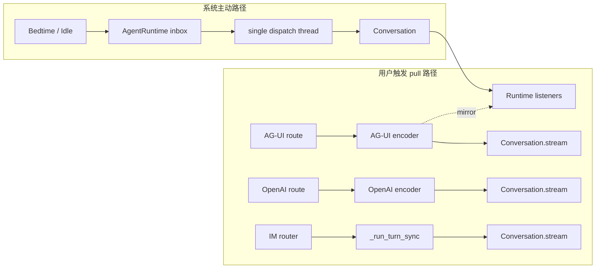
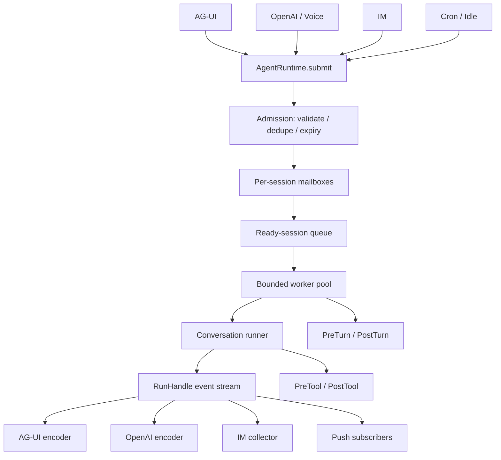

# 045 · AgentRuntime 统一执行入口与调度生命周期 · 技术方案

## 状态

已确认（Confirmed）

## 需求文档

→ [requirement.md](./requirement.md)

## 0. 设计摘要

本需求把 `AgentRuntime` 从单线程主动事件调度器升级为 bridge 进程内所有产品运行入口的统一执行控制面：AG-UI、OpenAI compatible（含 voice 持久会话）、IM 和系统主动事件统一提交 `RunRequest`，协议适配层通过 `RunHandle` 实时消费增量事件。

核心形态：

1. `RunRequest / RunHandle / RunOutcome` 定义运行身份、状态、取消与事件流。
2. Scheduler 采用“每 session mailbox + ready session 队列 + 有界 worker pool”，同 session 串行、跨 session 并发。
3. `CancellationToken` 在 LLM 流事件、下一次 LLM、下一项 tool 等安全边界协作退出，不强杀同步调用。
4. Runtime 用统一 `try / except / finally` 产生唯一 terminal outcome，并确保 PostTurn 与 listener 清理执行。
5. Bridge encoder 只编码 RunHandle 事件，不再直接驱动 Conversation 或镜像复制 user turn。
6. `agent-cli` 不迁移，继续作为 Conversation 的兼容开发入口；045 不为其增加能力。

## 1. 现状分析

### 1.1 当前执行路径

当前存在两类执行路径：



直接后果：

- Runtime Hook、PostTurn 和运行状态只天然覆盖主动路径。
- AG-UI 通过 `listeners.fan_out_event()` 镜像 user turn，形成第二套事件驱动逻辑。
- IM / AG-UI 使用 bridge 层 `SessionTurnCoordinator` 串行同 session，OpenAI 持久路径的协调位置不同。
- Runtime 只有一个全局消费线程，一个慢 session 会阻塞所有主动轮。
- listener 的 `run_coroutine_threadsafe(queue.put())` Future 未被保存或检查；队列满时 coroutine 会等待，和“满则丢弃”的注释语义不一致。
- `Conversation.stream()` 已有 partial 落盘和 generator 中断语义，但 Runtime 没有可区分的 cancelled / failed outcome。

### 1.2 最新主干必须保留的不变量

045 基于 `ed93257` 之后的主干设计，必须保留：

- 同一持久 session 的用户可见轮不能交错执行。
- Conversation generator 必须自然消费到终态，或由 Runtime 明确以取消语义关闭；encoder 不能因看到 `TurnDone` 提前 break。
- tool request/result 必须保持协议配对和当前 `event_tool_call_id` 投影。
- 已落盘 user event 后发生 provider 异常，run error 仍能挂到稳定的用户轮。
- Voice 的 short reply、`max_tokens`、tools enabled、TTFT trace 等运行参数继续有效。
- Session JSONL 是会话事实来源，不变成通用任务队列数据库。

### 1.3 边界

- Runtime 负责运行调度、取消、生命周期和事件分发。
- Conversation 负责 prompt、LLM/tool inner loop、会话事件与 partial 落盘。
- Bridge protocol encoder 负责 AG-UI / OpenAI wire 编码。
- IM router 负责 IM inbound/outbound 适配，不再自行调度 session 轮。
- `portalocker` 继续保护文件写完整性；Scheduler 保证业务轮不交错。
- `agent-cli` 继续直连 Conversation，不进入 Runtime。

## 2. 目标架构



### 2.1 不做通用 workflow engine

本期调度对象始终是“一次 Conversation 运行”，不引入任意图节点、任务依赖 DAG、持久工作流或 subagent。Runtime API 为未来增加运行类型保留 discriminator，但只实现 user turn 与 system trigger。

## 3. 运行模型

### 3.1 RunRequest

`agent/src/agent/runtime/models.py` 新增进程内不可变请求：

```python
@dataclass(frozen=True)
class RunRequest:
    run_id: str
    session_id: str
    kind: Literal["user", "system_trigger"]
    source_kind: str
    channel: PromptChannel | None
    priority: RunPriority
    created_at: datetime
    expires_at: datetime | None
    dedupe_key: str | None
    payload: UserRunPayload | SystemTriggerPayload
    conversation_factory: Callable[[], Conversation] | None = None
    conversation_runner: ConversationRunner | None = None
```

约束：

- `run_id` 由入口提供时沿用，否则 Runtime 生成 UUID；同一进程内唯一。
- `session_id` 同时是调度互斥键。OpenAI transient 请求使用 `transient:<run_id>` 合成键，不与持久 session 互斥。
- bridge 可给 transient 请求传 request-local `conversation_factory`；持久请求和 sources 使用 Runtime 默认 factory。
- `conversation_runner` 只用于 edit-resend 等已有 inner-loop 变体；默认 user runner 调 `Conversation.stream`，system runner 调 `dispatch_system_turn`。
- callable 只属于进程内执行装配，不序列化、不落 session。

### 3.2 RunPriority

优先级定义为稳定枚举，不允许入口传任意整数：

```text
INTERACTIVE = 0   # AG-UI / OpenAI / voice / IM user turn
PROACTIVE   = 10  # bedtime 等用户可见主动轮
BACKGROUND  = 20  # idle reflection / memory-only
```

同优先级按 mailbox 内单调递增 `enqueue_seq` 保持 FIFO。不同 session 的 ready 顺序采用“优先级 + ready_seq”，但 worker 取得一个 session 后只执行该 session 当前选中的一轮，结束后重新参与 ready 排序，避免单 session 长队列独占 worker。

### 3.3 RunStatus 与 RunOutcome

```python
class RunStatus(StrEnum):
    QUEUED = "queued"
    RUNNING = "running"
    TERMINAL = "terminal"

class RunOutcome(StrEnum):
    COMPLETED = "completed"
    FAILED = "failed"
    CANCELLED = "cancelled"
    SKIPPED = "skipped"
    EXPIRED = "expired"
    REJECTED = "rejected"
```

- `status` 表达生命周期阶段，`outcome` 只在 terminal 时存在。
- terminal transition 由 RunState 内同一把 lock 保护，compare-and-set 一次完成。
- 重复 finish/cancel/fail 不重复发 terminal event，只记录 debug 日志。
- `REJECTED` 用于 Runtime stopping、队列容量已满或请求非法；请求未进入 Conversation。

### 3.4 RunEvent

RunHandle 对外流转：

```text
RunStarted
ConversationEvent × N
RunTerminal(outcome, reason_code, timing)
```

`RunTerminal` 是 Runtime 事实，不直接写入 session。AG-UI 映射为 `RUN_FINISHED` / `RUN_ERROR`；OpenAI 映射为正常 `[DONE]` 或现有 error chunk；IM 根据 outcome 决定发送聚合文本或 fallback。

每个 `ConversationEvent` 在 RunHandle 内携带旁路 run context，不改其现有 discriminator 和协议字段。写 session event 时以加性 `meta.run_id` 关联；不要求旧 reader 理解该字段。

### 3.5 RunHandle

```python
class RunHandle:
    @property
    def run_id(self) -> str: ...

    @property
    def status(self) -> RunStatus: ...

    def cancel(self, reason: CancelReason) -> bool: ...

    def events(self) -> Iterator[RunEvent]: ...
```

- 每个 run 有一个 primary consumer：发起请求的 encoder/router。
- Push subscriber 由 Runtime event broadcaster fan-out，不与 primary consumer 争抢同一个 queue。
- primary queue 有界，但 worker 允许对主 consumer 施加有限背压；HTTP streaming 的正常消费速度应远快于模型输出。
- 客户端断开触发 generator `finally`，调用 `handle.cancel(CLIENT_DISCONNECTED)`，随后释放 primary consumer。
- 没有 primary consumer 的 source 主动轮仍由 broadcaster/push 消费；必要时使用内部 drain consumer，避免队列阻塞 worker。

## 4. Scheduler

### 4.1 数据结构

`agent/src/agent/runtime/scheduler.py`：

```text
mailboxes: session_id -> SessionMailbox
active_sessions: set[session_id]
ready_heap: (priority, ready_seq, session_id, generation)
handles: run_id -> RunState
workers: ThreadPoolExecutor(max_workers=N)
condition: threading.Condition
accepting: bool
```

`generation` 用于使旧 ready entry 失效，避免在 heap 中原地删除复杂度。取出 ready entry 时若 generation 或 mailbox head 已变化则跳过。

### 4.2 Submit / admission

提交顺序：

1. Runtime 是否 accepting；否则 `REJECTED(runtime_stopping)`。
2. 校验 `run_id` 唯一、payload 与 kind 匹配。
3. 检查全局/单 session queue 上限。
4. 若主动事件有 `dedupe_key`：
   - 同 session 已有同 key queued run → 老 run 终态 `SKIPPED(deduplicated)`，保留最新事件；
   - active run 不强行替换，由新 run正常排队或按用户优先规则取消。
5. 若已过 `expires_at` → `EXPIRED(before_enqueue)`。
6. 加入 mailbox，发布 queued 状态，刷新 ready heap。
7. interactive 到来时，取消同 session queued 的 proactive/background；若 active 是低优先级，设置其 token。

保留最新主动事件而不是最早事件，是因为 bedtime/idle payload 可能携带更新的 metadata；同 key 合并结果可观测。

### 4.3 Worker 取得运行

1. 从 ready heap 取有效 session。
2. 若 session 在 `active_sessions`，跳过旧 entry。
3. 从 mailbox 选择优先级最高、同优先级最早 run。
4. 开始前再次检查 cancelled / expiry。
5. 标记 session active 和 run running。
6. 将 `_execute_run` 提交给 worker。
7. worker finally 清除 active；mailbox 非空则重新入 ready heap。

Scheduler 不在持有 condition/registry lock 时调用 conversation、listener 或 hook，避免用户代码反向进入 Runtime 造成死锁。

### 4.4 容量

BridgeSettings 新增：

```text
AGENT_RUNTIME_MAX_WORKERS       默认 4
AGENT_RUNTIME_MAX_QUEUED_RUNS   默认 256
AGENT_RUNTIME_MAX_SESSION_QUEUE 默认 32
```

默认值服务单机桌面端，不按 CPU 数无限扩张。OpenAI transient 与持久请求共享 worker/global queue，防止兼容入口绕过资源上限；其合成 session key使多个 transient 请求可并发。

容量满时：

- interactive → `REJECTED(runtime_busy)`，协议层映射现有可恢复错误；
- proactive/background → 优先 dedupe，仍满则 `SKIPPED(queue_full)`；
- 不阻塞 HTTP handler 等待 queue 空位，避免入口线程池耗尽。

## 5. 执行与唯一终态

### 5.1 `_execute_run`

```python
def _execute_run(state: RunState) -> None:
    outcome = RunOutcome.FAILED
    error: BaseException | None = None
    ctx: PostTurnContext | None = None
    try:
        token.raise_if_cancelled()
        pre = hooks.run_pre_turn(request)
        if pre.skip:
            outcome = RunOutcome.SKIPPED
            return

        conv = resolve_conversation(request)
        ctx = make_post_turn_context(...)
        state.emit(RunStarted(...))
        for event in run_conversation(conv, request, token):
            token.raise_if_cancelled()
            state.emit(event)
        outcome = RunOutcome.COMPLETED
    except RunCancelled as exc:
        outcome = RunOutcome.CANCELLED
        error = exc
    except BaseException as exc:
        outcome = RunOutcome.FAILED
        error = exc
    finally:
        if ctx is not None:
            hooks.run_post_turn(ctx.with_outcome(outcome, error))
        state.finish_once(outcome, error)
        broadcaster.finish_run(...)
```

实际实现会避免吞掉 `KeyboardInterrupt/SystemExit` 对进程控制的语义：worker 内记录 terminal 后，进程级异常按现有边界处理。测试使用普通 Exception / RunCancelled。

### 5.2 PostTurnContext

扩展字段：

```text
run_id
outcome
error
cancel_reason
started_at / finished_at
```

默认 memory observe 策略：

- `COMPLETED`：沿用现有 observe。
- `FAILED`：若本轮已有可投影的完整 user/assistant 内容，沿用 `project_turn`；只有 user 或 partial 时跳过，避免把失败片段固化为长期记忆。
- `CANCELLED`：默认跳过 memory observe；系统 memory-only turn 仍由其自身完整成功路径 observe。
- `SKIPPED / EXPIRED / REJECTED`：未进 Conversation，不跑 PostTurn。

### 5.3 Conversation 运行上下文

`Conversation` 增加可选 `RunExecutionContext`：

```text
run_id
cancellation_token
channel
```

该上下文按单次 runner 调用传入，不长期存放在可复用 Conversation 实例，避免 session 间或连续轮泄露。

所有新写 session events 的 `meta` 加 `run_id`。既有 tool/provider meta 保留并合并，不覆盖。

## 6. Cooperative cancellation

### 6.1 Token

`CancellationToken` 是 thread-safe、只增不减状态：

```text
not_cancelled -> cancelled(reason, requested_at)
```

`cancel()` 幂等；首个原因获胜。原因枚举：

```text
client_disconnected
superseded_by_user
runtime_stopping
explicit_request
consumer_abandoned
```

### 6.2 安全检查点

Conversation 检查：

- 第一次组装上下文前；
- 每个 LLM stream event 到达后、对外 yield 前；
- LLM stream 自然结束后；
- 每个 tool_call_request 落盘前；
- 真 tool invoke 前；
- tool 返回并完成 request/result 配对后；
- 下一轮 LLM 前；
- tool-loop-limit 收尾调用前。

已落 `tool_call_request` 后不得因取消直接缺失 result。若取消发生在 request 落盘之后、tool 尚未调用，追加合成 `tool_call_result(is_error=True, cancelled=True)` 保持协议配对，然后终止。该结果只表达执行被取消，不伪装 tool 业务失败。

### 6.3 Provider/tool 正在同步阻塞

本期不改 `LLMClient.stream` / `Tool.invoke` 为强制 AbortSignal 接口：

- 阻塞中 cancel 只设置 token；
- provider 下一个 delta / completion 或 tool 返回后立即检测；
- 不启动后续步骤；
- shutdown 的 join 有明确超时，超时后 Runtime 报告仍有 worker 存活，不把 `_thread`/executor 状态清空伪装成已停止。

### 6.4 Partial 落盘

- 用户轮已向客户端流出文本后取消：沿用当前 Conversation partial assistant 语义，保证刷新后用户看到已收到内容。
- 主动轮取消：不继续向 push 发布取消点后的事件；已经发布的文本按 partial event 落盘，terminal 明确 cancelled，前端可保持已见内容，不另造“撤回历史”语义。
- 尚未产生任何文本且未接受 user event 的 queued/early cancellation：不落会话消息。
- Runtime 必须显式关闭 conversation generator 一次，让 finally 收尾；encoder 不再自行提前 break/close。

## 7. Event broadcaster 与背压

### 7.1 Primary consumer

RunHandle primary queue 默认容量按事件粒度设置为 128。Runtime worker 对 primary consumer 使用可取消的阻塞 put：

- 正常 HTTP/IM consumer持续读取，不形成固定延迟。
- consumer 断开时标记 abandoned + cancel token，唤醒阻塞 put。
- Runtime stopping 时同样唤醒。

这里允许主 consumer 产生有限背压，因为它是请求响应本身；不能像旁路 subscriber 一样静默丢文本 delta。

### 7.2 Push subscriber

`ListenerRegistry` 改为接收 RunEvent，不再按 `ConversationEvent TurnDone` 猜终态。

- `loop.call_soon_threadsafe(_put_nowait)` 跨线程调度。
- `_put_nowait` 捕获 `asyncio.QueueFull`。
- 满时将 subscriber 标记 overflow，尝试投递 disconnect sentinel，并 unregister。
- 不 drop 单个 envelope 后继续伪装连续订阅。
- run terminal 时清理 `(subscriber_id, run_id)` buffer。
- buffer key 从 `(subscriber_id, session_id)` 改为 `(subscriber_id, run_id)`，避免同 session 历史 run 串包。

### 7.3 PushEnvelope

加性字段：

```text
run_id
outcome
reason_code
```

保留 `kind / session_id / seq / source_kind / events`。现有前端忽略未知字段；主动 user/agent turn 仍按一轮 envelope 推送。失败/取消也 flush envelope，不遗留 buffer。

## 8. 各入口迁移

### 8.1 AG-UI

当前：encoder 构造 Conversation、持有 `SessionTurnCoordinator`、直接迭代 stream、镜像 listener。

改为：

1. route decode 后构造 `RunRequest(run_id=AG-UI run_id)`；
2. request 的 conversation factory 延迟执行 `bind_persistent`，使装配异常也进入统一 outcome；
3. `handle.events()` 映射：
   - RunStarted → `RUN_STARTED`
   - ConversationEvent → 现有 text/tool 映射
   - COMPLETED → `RUN_FINISHED`
   - FAILED/REJECTED → `RUN_ERROR`
   - CANCELLED（客户端仍在线时）→ 可恢复 `RUN_ERROR`；断开时无需 wire 输出
4. encoder finally 在 terminal 前断开时 cancel handle。

edit-resend 提供自定义 runner 调 `Conversation.edit_resend_latest`，其余 lifecycle 共用。

### 8.2 OpenAI compatible / voice

- 持久 session：session ID 为调度键，conversation factory 延迟 bind。
- transient：先生成 run_id，以 `transient:<run_id>` 为调度键；request-local factory 调 `start_transient`。
- Voice latency options 在 factory/runner 中继续调用 `set_voice_latency_context`，不进入全局可变状态。
- streaming encoder 逐个消费 RunEvent，不等 terminal 后整包返回。
- non-streaming 也消费同一 handle 到 terminal 后组装 payload，不另走直接 Conversation 路径。
- request disconnect watcher/finally 调 cancel；不改 RTC/provider 协议。

所有 OpenAI transient/persistent 请求共享 Runtime worker 和全局队列容量，防止兼容入口绕过资源保护；transient 之间不做 session 互斥。

### 8.3 IM

- IMRouter 不再 `asyncio.to_thread(_run_turn_sync)` + `session_turn`。
- 提交 interactive RunRequest 后，在 `asyncio.to_thread(_collect_handle, handle)` 聚合 TextDelta。
- completed 且文本非空 → markdown 回写。
- failed/rejected/cancelled 或空文本 → 保持现有拟人 fallback。
- IM provider stop 时取消尚未完成的 handles。

### 8.4 System sources

- EventSource 不再持有裸 `queue.Queue`；start 时注入 `submit(SystemTriggerRequest)` callable，或通过 Runtime 公共 `submit_system_trigger`。
- Bedtime 默认 `PROACTIVE`，带下一调度周期前有效的 expiry 与固定 dedupe key。
- Idle reflection 默认 `BACKGROUND`，expiry 取 idle threshold/poll 策略的合理窗口，固定 dedupe key。
- `fire_now` 仍可测试/开发触发，但返回 RunHandle 或 run_id，便于断言 outcome。

### 8.5 agent-cli

不迁移。继续直接构造/调用 Conversation，`post_turn_external=False` 保持现有 memory observe 路径。045 不修改 CLI 命令、渲染或生命周期。

## 9. Shutdown

Runtime 状态：

```text
NEW -> RUNNING -> DRAINING -> STOPPED
```

`stop(timeout)`：

1. `accepting=False`，新 submit 返回 rejected。
2. queued proactive/background → cancelled(runtime_stopping)。
3. queued interactive → cancelled(runtime_stopping)。
4. active run token 全部 cancel。
5. 唤醒 scheduler、primary queue put 与 subscriber loop。
6. `ThreadPoolExecutor.shutdown(wait=False, cancel_futures=True)` 后在 deadline 内轮询 active worker。
7. 全部结束才进入 STOPPED；超时返回 `ShutdownResult(clean=False, active_run_ids=...)` 并保留真实内部引用。

FastAPI lifespan 对非 clean shutdown 记录 error；进程仍可退出，但不能把 runtime 对象标记成可再次 start 的干净状态。

## 10. 配置与装配

### 10.1 BridgeSettings

新增三个仅后端环境配置字段：

```text
agent_runtime_max_workers: int = 4
agent_runtime_max_queued_runs: int = 256
agent_runtime_max_session_queue: int = 32
```

校验全部 > 0，session queue 不大于 global queue。沿用现有 runtime config 解析方式，不新增桌面设置 UI。

### 10.2 BridgeRuntime

- `agent_runtime` 从过渡期 `AgentRuntime | None` 收口为生产装配必有；测试 fixture 可显式注入 fake runtime。
- `turn_coordinator` 在所有产品入口迁完后从生产字段删除。若少量旧测试需要，可在测试局部构造，不保留双锁生产路径。
- Runtime factory 接收 persistent conversation factory、memory、scheduler settings 和 sources。

## 11. 文件改动

| 文件 | 改动 | 说明 |
|---|---|---|
| `agent/src/agent/runtime/models.py` | 新增 | RunRequest、RunHandle、RunEvent、RunOutcome、priority、reason 类型 |
| `agent/src/agent/runtime/cancellation.py` | 新增 | CancellationToken、RunCancelled、取消原因 |
| `agent/src/agent/runtime/scheduler.py` | 新增 | per-session mailbox、ready heap、worker pool、容量、dedupe/expiry |
| `agent/src/agent/runtime/__init__.py` | 重构 | Runtime façade、submit、execute、shutdown、默认 Hook 装配 |
| `agent/src/agent/runtime/inbox.py` | 重构/兼容 | 既有 AgentEvent 转为 RunRequest payload；删除裸 inbox 驱动职责 |
| `agent/src/agent/runtime/sources.py` | 修改 | source 改用 Runtime submit，补 priority/expiry/dedupe |
| `agent/src/agent/runtime/hooks.py` | 修改 | PostTurnContext 增加 run outcome；保证 finally 语义 |
| `agent/src/agent/runtime/listeners.py` | 重构 | 订阅 RunEvent、run_id buffer、put_nowait overflow 断开 |
| `agent/src/agent/conversation.py` | 修改 | RunExecutionContext、取消检查点、run_id event meta、partial 语义 |
| `agent/src/agent/conversation_events.py` | 小改 | 必要的 cancelled tool result /旁路关联字段，加性兼容 |
| `agent_bridge/src/agent_bridge/agent_runtime_factory.py` | 修改 | scheduler 配置、persistent resolver、source 装配 |
| `agent_bridge/src/agent_bridge/assembly.py` | 修改 | Runtime 必有；移除生产 turn coordinator |
| `agent_bridge/src/agent_bridge/settings.py` | 修改 | Runtime worker/queue 配置 |
| `agent_bridge/src/agent_bridge/protocols/ag_ui/routes.py` | 修改 | 构造并提交 RunRequest |
| `agent_bridge/src/agent_bridge/protocols/ag_ui/encoders.py` | 重构 | 消费 RunHandle；删除 direct stream/mirror/session lock |
| `agent_bridge/src/agent_bridge/protocols/openai/routes.py` | 修改 | transient/persistent/voice 统一 submit |
| `agent_bridge/src/agent_bridge/protocols/openai/encoders.py` | 重构 | streaming/nonstreaming 消费 RunHandle |
| `agent_bridge/src/agent_bridge/protocols/im/router.py` | 修改 | submit + 聚合 handle，不直接跑 Conversation |
| `agent_bridge/src/agent_bridge/session_turns.py` | 删除或退役 | Runtime scheduler 取代生产 per-session turn lock |
| `agent_bridge/src/agent_bridge/app.py` | 修改 | 处理 ShutdownResult 与非 clean shutdown 日志 |
| 对应 `agent/tests/`、`agent_bridge/tests/` | 修改/新增 | 调度、取消、入口、背压、shutdown、兼容回归 |

不修改 `tools/cli` / agent-cli 文件。

## 12. 实施里程碑

### M45.1 · Run model + Scheduler 地基

- 新增 models/cancellation/scheduler。
- fake runner 覆盖同 session 串行、跨 session 并发、priority、dedupe、expiry、capacity。
- 现有 Runtime source 路径适配新 submit，但 bridge pull 暂不迁移。

### M45.2 · Runtime execute + Conversation cancellation

- RunHandle event stream、唯一 terminal、PostTurn outcome。
- Conversation 安全取消点、run_id meta、tool 配对、partial 回归测试。
- listener 改为 RunEvent + overflow 断开。

### M45.3 · AG-UI 迁移

- AG-UI 普通发送与 edit-resend 走 Runtime。
- 删除 mirror 和生产 `SessionTurnCoordinator` 使用。
- 既有前端协议测试零退化。

### M45.4 · OpenAI / Voice / IM 迁移

- OpenAI streaming/nonstreaming、persistent/transient 全部走 handle。
- Voice latency 参数和 trace 保持。
- IM 聚合 handle；provider shutdown 取消。

### M45.5 · Shutdown、全量回归与验收

- clean/non-clean shutdown。
- 所有 AC 自动化验证。
- `scripts/check` 全绿。
- 经用户授权后再决定是否跑真实 voice/LLM 观察型验收。

## 13. 测试策略

### 13.1 Scheduler 单测

- barrier fake runner 证明同 session 最大 active=1。
- 两 session barrier 证明同时 active。
- interactive 抢 queued proactive；active proactive 收到 token。
- dedupe 保留最新、老 run skipped。
- fake clock 覆盖 before enqueue / before start expiry。
- global/session capacity 与 rejected/skipped 区分。
- ready heap stale generation 不重复执行。

### 13.2 生命周期与取消

- queued cancel 不构造 Conversation、不写事件。
- LLM delta 后取消，保留已见 partial，不启动 tool/下一 LLM。
- tool request 后取消生成配对 result。
- cancel/exception/normal 竞争只产生一个 terminal。
- PostTurn 在 completed/failed/cancelled 下各执行一次并收到正确 outcome。
- memory observe outcome policy。
- consumer abandon 唤醒阻塞 event put。

### 13.3 Listener

- 正常 run 以 terminal flush。
- failed/cancelled 同样清 buffer。
- queue full 将 subscriber overflow/unregister，不产生挂起 Future。
- 一个慢 subscriber 不影响正常 subscriber 和 worker。
- 同 session 两个 run 的 buffer 按 run_id 隔离。

### 13.4 协议集成

- AG-UI `RUN_STARTED → events → RUN_FINISHED/RUN_ERROR` 顺序不变。
- edit-resend 仍复用 encoder，旧轮 rewrite 行为不变。
- OpenAI streaming 逐 chunk、nonstreaming payload、error + `[DONE]` 兼容。
- OpenAI transient 请求参与资源上限但互不 session 阻塞。
- Voice headers 对应参数继续进入 Conversation；记录 queue wait 与 TTFT。
- IM completed 聚合、failed fallback、shutdown cancel。

### 13.5 Shutdown

- queued 全部 terminal。
- cooperative active run 在 deadline 内退出 → clean。
- 不可中断 fake tool 超过 deadline → non-clean，active 引用保留。
- stop 后 submit rejected；重复 stop 幂等。

## 14. 影响分析

### 14.1 上游与下游

| 影响方 | 影响 |
|---|---|
| Frontend AG-UI consumer | wire 契约保持；不需要配合改 UI |
| Voice bridge/provider | OpenAI stream 契约保持；新增 Runtime queue wait 可观测 |
| IM adapter | outbound 语义保持；内部改为 handle 聚合 |
| Session / store | event meta 加 run_id；旧 reader 忽略未知 meta |
| Memory | 对外接口不变；observe 时机由 outcome policy 管理 |
| Tools | invoke 接口不变；只在调用边界检查取消 |
| agent-cli | 不改，继续直连 Conversation |

### 14.2 跨平台

- 使用 Python `threading.Condition`、`ThreadPoolExecutor`、`queue.Queue`，Windows/macOS/Linux 语义一致。
- 不依赖 signal、fork 或平台线程强杀。
- PowerShell/bash 脚本本期无新增运行入口；如实施期新增可重复压测工具，必须按项目脚本双端约定落位。

### 14.3 性能

- submit/dispatch 只增加锁内短操作和一次有界队列转发，不进行 I/O。
- Voice 首 delta 多一次 worker handoff；通过 queue wait / runtime start / LLM start / first delta 时间点量化。
- 默认 4 workers 避免一个 session 全局阻塞，同时限制 LLM 并发资源占用。
- primary event queue 有界，防止断开客户端积累无限文本事件。

### 14.4 主要风险

| 风险 | 缓解 |
|---|---|
| 双重 session 锁导致死锁 | 产品入口迁移时移除 SessionTurnCoordinator，不长期双轨 |
| encoder 断开与 worker finish 竞态 | finish-once terminal + idempotent cancel |
| tool request/result 因取消失配 | request 后取消必须补合成 cancelled result |
| Runtime worker 中 Conversation 长阻塞 | 有界并发 + cooperative token + non-clean shutdown 如实报告 |
| Voice 引入固定排队延迟 | interactive priority、跨 session 并发、TTFT 对比门禁 |
| listener overflow 后客户端不知道缺事件 | 直接断开 subscriber，不静默 drop 后续装连续 |
| OpenAI transient 滥用资源 | 与持久请求共享全局 worker/queue 上限 |
| partial 被错误写进长期 memory | cancelled 默认不 observe；failed 仅完整可投影轮 observe |

## 15. 设计决议

| 议题 | 结论 |
|---|---|
| OpenAI transient 是否进统一并发上限 | 是；使用合成 session key，不做持久 session 互斥 |
| 主动轮取消后的 partial | 已发布文本按现有 partial 语义保留，terminal 标 cancelled；不做撤回模型 |
| 队列容量 | 全局 + per-session 双上限；interactive 明确 rejected，主动轮优先 dedupe/skip |
| CLI 是否迁移 | 否；不再重点维护，保留 Conversation 兼容直连 |
| 慢 push subscriber | overflow 后断开，不静默丢单个 envelope 后继续 |
| Run terminal 是否写 session event | 不单独持久化；会话事件 meta 加 run_id，terminal 走 runtime stream + 日志 |
| 是否强制改 async | 否；保留同步 Conversation generator，以有界 worker 承载 |

## 16. 变更记录

| 日期 | 变更内容 | 是否需要重新实现 |
|---|---|---|
| 2026-07-12 | 初版方案确认：RunRequest/RunHandle、per-session mailbox、有界 workers、cooperative cancellation、统一 terminal/Push 背压；明确 CLI 不迁移。 | 新方案 |
