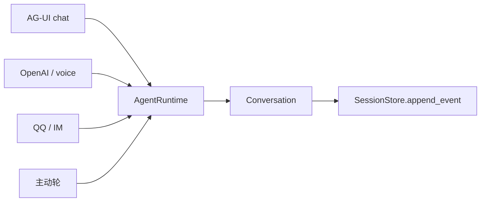
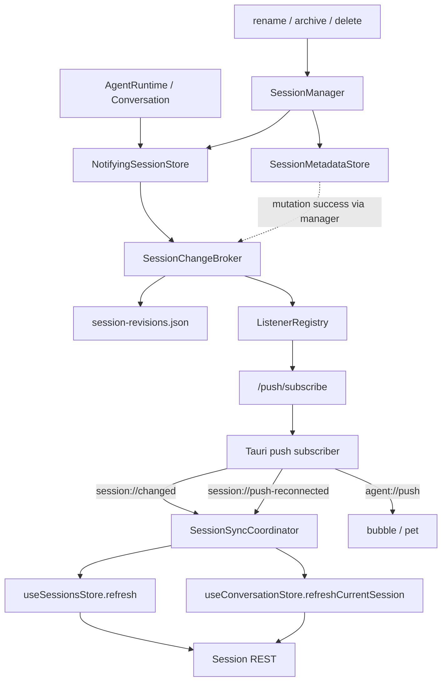
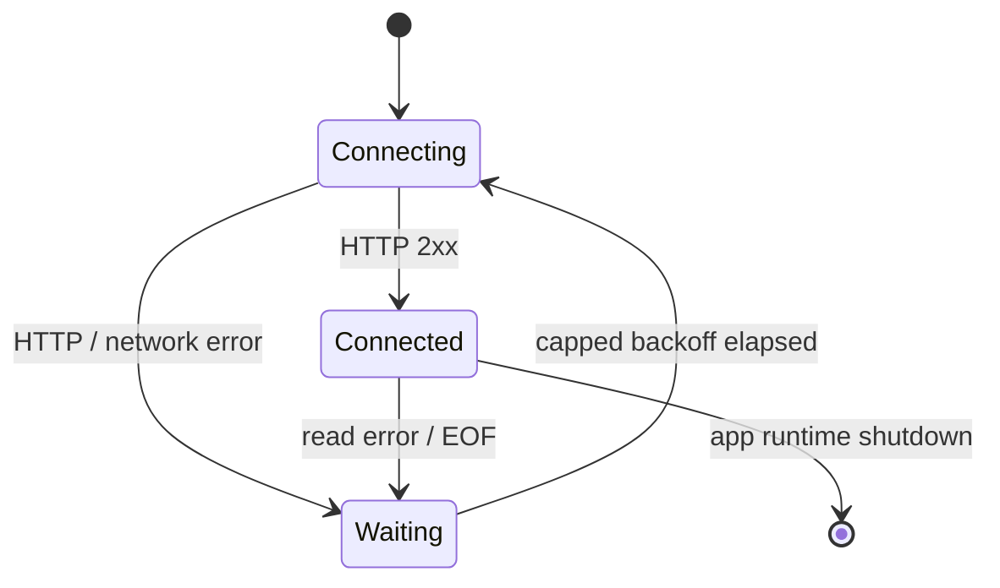

# 046 · 外部会话更新同步 · 技术方案

## 状态

已确认（Confirmed）

## 需求文档

→ [requirement.md](./requirement.md)

## 0. 设计摘要

本需求在现有持久化 session 与桌面 chat 之间增加一条“失效通知”链路：业务写入成功后，由持久化边界统一递增 session revision 并发布 `session_changed`；桌面端收到通知后不消费消息增量，只重新拉取 session list 或当前 session detail。

核心方案：

1. `SessionChangeBroker` 统一维护每个 session 的持久化 revision，并把最小失效事件投递到现有 push subscriber registry。
2. `NotifyingSessionStore` 包装持久 JSONL store，覆盖 create / append / delete；`SessionManager` 的 metadata mutation 在同一 broker 上记录变化。协议入口不自行发通知。
3. push SSE 增加 `session_changed` envelope kind；运行事件仍服务 pet/bubble，失效事件单独投递 chat。
4. Rust subscriber 增加局部、持续、有限退避的重连循环；断线后的成功恢复向 chat 发校准信号。
5. 前端 `SessionSyncCoordinator` 统一处理 revision 去重、debounce、list/detail 分流、streaming 延后、请求防乱序和生命周期失效。
6. 自动 detail refresh 不进入 open-session loading，不触发历史首次加载滚底；MessageList 按 sticky 状态和稳定消息锚点保护阅读位置。

本方案不引入完整事件同步、持久 SSE 游标、通用服务 supervisor 或配置保存自动重启。

## 1. 现状分析

### 1.1 写入链路

045 完成后，产品级对话入口已经基本统一进入 `AgentRuntime.submit()`：



但 Runtime listener 当前描述的是“一轮运行产生了哪些 ConversationEvent”，不是“持久化 session 的哪一版已经变化”：

- 正常运行结束时才 flush turn envelope；异常或取消前已经成功落盘的事件不适合作为前端 detail 增量来源。
- session create/delete、rename/archive/unarchive 不属于 ConversationEvent。
- 让 AG-UI、OpenAI、IM 等 adapter 分别补发通知，会再次产生入口遗漏。

现有持久化职责分为：

- `JsonlSessionStore`：session create、事件 append、hard delete。
- `SessionMetadataStore`：展示标题和归档状态。
- `SessionManager`：组合两种持久化能力，并向 bridge 各入口提供统一门面。

因此通知所有权应落在上述持久化边界，而不是某个协议入口或某次 Runtime terminal。

### 1.2 Push subscriber

`/push/subscribe` 当前直接注册到 `AgentRuntime.listeners`，支持 `user_turn / agent_turn / heartbeat`。Rust `push_subscriber` 只订阅 `agent_turn`，并把 envelope 投递给 bubble 和 pet。

当前恢复行为为空：

- 初次 HTTP 连接失败后 task 终止。
- SSE read error 后 task 终止。
- stream EOF 后正常返回，task 同样终止。
- chat webview 不订阅该 push 通道。

### 1.3 前端缓存与并发

`useSessionsStore.refresh()` 已有全局 request sequence，旧 list 请求不会覆盖新请求。`useConversationStore.openSession()` 也有 session-switch token，但它会：

- 清空 messages；
- 设置 `historyLoading`；
- 完成后递增 `historyLoadSeq`，触发 MessageList 的首次历史滚底 settle。

这套语义适合用户主动打开 session，不适合后台自动校准。

本地 `send / editResendLatest` 在 store 中维护乐观 user message、assistant streaming 占位和 AG-UI 增量。streaming 期间若直接以 pull detail 替换 `messages`，会覆盖尚未结束的本地状态。

### 1.4 必须保留的不变量

- Session JSONL 与 metadata 是持久化事实；通知和前端 store 都不是第二事实源。
- `AgentRuntime` 继续负责运行生命周期和同 session 串行；session sync 不复制运行调度。
- voice 仍通过 OpenAI compatible 协议流式返回；同步机制不改变 channel 参数和低延迟路径。
- push/list/detail 故障不得反向改变 Agent 运行结果或持久化成功语义。
- CLI 保持现状，不纳入新同步能力。

## 2. 总体数据流



## 3. 后端持久化变更模型

### 3.1 SessionChange

在 `agent/src/agent/sessions/changes.py` 定义领域内最小事件：

```python
@dataclass(frozen=True)
class SessionChange:
    session_id: str
    revision: int
    change_kind: Literal[
        "created",
        "content",
        "metadata",
        "archived",
        "unarchived",
        "deleted",
    ]
    origin: str | None
    channel: Literal["text", "voice"] | None
```

字段语义：

- `revision`：单个 session 的持久化单调版本，从 1 开始；只用于 freshness 比较。
- `change_kind`：用于日志和未来选择刷新范围，本期前端仍把它作为失效提示，不据此重建数据。
- `origin`：协议或操作入口，如 `ag_ui / openai / im / system_trigger / session_management`。
- `channel`：运行模态，与 origin 正交；voice 为 `origin=openai, channel=voice`。

同步正确性只依赖 `session_id + revision`；后三个字段仅用于诊断和保守调度。

### 3.2 Revision sidecar

新增 `SessionRevisionStore`，默认路径为 sessions 目录下的 `session-revisions.json`，结构为：

```json
{
  "version": 1,
  "sessions": {
    "session-a": { "revision": 12, "deleted": false },
    "session-b": { "revision": 8, "deleted": true }
  }
}
```

行为：

- 使用独立 lock 文件和与 `SessionMetadataStore` 相同的 lock → read-modify-write → temp replace 模式。
- `next_revision(session_id, deleted=...)` 在锁内递增并返回新 revision。
- delete 后保留 tombstone，使迟到或重复通知仍可比较，不出现 revision 回退。
- 本需求不做 tombstone GC；单设备 session 数量下该文件增长可控。未来如确有规模问题，再增加独立维护策略。

### 3.3 非原子窗口

业务 JSONL/metadata 与 revision sidecar 是不同文件，无法形成跨文件原子事务。采用以下明确语义：

1. 先完成业务持久化。
2. 业务写入成功后递增 revision。
3. revision 成功后发布失效事件。
4. revision 或发布失败只记录结构化错误，不回滚业务写入，也不把一次成功对话报告为失败。

该窗口可能造成一次即时通知缺失，但不会造成数据丢失。后续 session 写入或 subscriber 重连校准会重新 pull 真相源。引入 SQLite 事务或重构全部 session 存储只为消除这一窗口，超出本需求比例。

### 3.4 SessionChangeBroker

`SessionChangeBroker` 组合 revision store 与 publisher callback：

```python
class SessionChangeBroker:
    def record_change(
        self,
        session_id: str,
        *,
        change_kind: SessionChangeKind,
        origin: str | None = None,
        channel: Channel | None = None,
    ) -> SessionChange | None: ...
```

约束：

- `record_change` 仅在业务 mutation 成功后调用。
- revision/publish 异常被 broker 捕获并记录，返回 `None`，不向业务层抛出。
- publisher 未装配时允许 no-op，用于 CLI、纯 agent 测试和不需要 push 的调用方。
- broker 不知道 AG-UI、OpenAI 或 Tauri 协议，只发布领域事件。

### 3.5 NotifyingSessionStore

新增 `NotifyingSessionStore(SessionStore)` 装饰器，只包装 persistent `JsonlSessionStore`：

- `create` 成功后记录 `created`。
- `append_event` 成功后记录 `content`。
- `delete` 成功后记录 `deleted`。
- read/list/latest 原样委托。
- `NullSessionStore` 不包装，OpenAI 无状态请求不产生 session invalidation。

所有 Conversation 都已经持有 persistent store，因此 AG-UI、OpenAI/voice、IM、主动轮以及异常中已经完成的每次 append 会自然覆盖，不需要 adapter 手动发事件。

### 3.6 Metadata mutation

rename/archive/unarchive 由 `SessionManager` 在 `SessionMetadataStore` 成功返回后调用同一 broker：

- rename → `metadata`
- archive → `archived`
- unarchive → `unarchived`

hard delete 的内容删除由 `NotifyingSessionStore` 产生 `deleted`；随后 metadata cleanup 不再额外递增，避免一次 delete 产生两个 revision。

`SessionManager` 构造参数增加可选 `session_change_broker`。CLI 和旧测试不传时保持当前行为。

### 3.7 Origin 与 channel 上下文

origin/channel 不参与正确性，但应尽量准确：

- Runtime worker 执行 `RunRequest` 时，在调用 Conversation 前设置局部 `SessionMutationContext`，finally 恢复。
- `RunRequest.metadata.protocol` 映射 origin；`request.channel` 直接映射 channel。
- system trigger 使用 `origin=system_trigger`。
- session management REST 在调用 manager mutation 时显式使用 `origin=session_management`。
- 没有上下文时允许 `None`，不得为了填诊断字段阻止写入。

局部上下文使用线程局部或 `contextvars` 的同步 token API，并由测试证明不同 Runtime worker 不串值。本需求不把它扩展成通用 tracing context。

## 4. Push 协议与 bridge 装配

### 4.1 Envelope 扩展

现有 `PushEnvelope` 增加 kind `session_changed`，并增加可选字段：

```json
{
  "kind": "session_changed",
  "session_id": "session-a",
  "seq": 17,
  "revision": 42,
  "change_kind": "content",
  "origin": "openai",
  "channel": "voice",
  "events": []
}
```

兼容规则：

- `user_turn / agent_turn` 继续使用原字段和 `events`。
- `session_changed` 的 `events` 恒为空；chat 不读取它。
- `heartbeat` 维持当前形态。
- `seq` 仍是 subscriber 连接内序号，只用于投递诊断，不承担 freshness。
- 新字段在旧 kind 上为 `None`，Rust/TS 采用可选字段兼容。

### 4.2 ListenerRegistry

`ListenerRegistry` 增加直接发布方法：

```python
def publish_session_change(self, change: SessionChange) -> None: ...
```

它不进入 turn buffer：

- 对接受 `session_changed` 的 subscriber 立即创建 envelope。
- 沿用现有 per-subscriber seq 和 `_safe_push` 背压策略。
- 慢 subscriber overflow 仍断开该 subscriber，不阻塞持久化或 Runtime。

`SessionChangeBroker` 的 publisher callback 在 bridge assembly 中绑定到该方法。

### 4.3 Assembly 顺序

`build_runtime` 的装配顺序调整为：

1. 创建 `JsonlSessionStore`、`SessionRevisionStore`。
2. 创建尚未绑定 publisher 的 broker。
3. 用 broker 包装 persistent store，并注入 persistent SessionManager。
4. 创建 AgentRuntime。
5. 将 broker publisher 绑定到 `agent_runtime.listeners.publish_session_change`。
6. 继续装配 IM runtime。

这保证所有产品入口共享同一 store 和 broker，同时不让 agent sessions 模块反向依赖 bridge。

## 5. Tauri subscriber 重连与事件分流

### 5.1 订阅范围

Rust subscriber URL 改为：

```text
/push/subscribe?kinds=agent_turn,session_changed
```

分流规则：

- `agent_turn` → 保持 `agent://push` 投递 bubble 和 pet。
- `session_changed` → `emit_to("chat", "session://changed", payload)`。
- `heartbeat` → 只更新连接活性，不投递 webview。
- `user_turn` 本期仍不订阅，chat 的同步只依赖 session changed。

### 5.2 重连循环

将当前一次性 `run_loop` 拆为：

- `run_connection(...)`：完成一次 HTTP 建连并消费到 EOF/error。
- `run_reconnecting(...)`：应用生命周期内持续调用 `run_connection`。
- `ReconnectBackoff`：只负责计算下一次 delay。

默认策略在实现时选取保守值，例如初始数百毫秒、指数增长、上限数秒并带小比例 jitter；具体常量集中定义，不进入配置中心。

状态：



行为约束：

- 首次直接连接成功不发 recovery calibration。
- 连接前经历过一次或多次失败，首次成功后发一次 `session://push-reconnected`。
- 已连接后断流，再次成功时发一次 recovery event。
- 成功收到 heartbeat 或数据帧后重置 backoff。
- parse 单帧失败只记录并跳过，不主动断开整个健康连接；HTTP/read/EOF 才重连。
- 不启动第二个 subscriber task，不产生并行重连。

### 5.3 可测试性

重连测试不真实 sleep。将 sleeper、jitter 或 delay observer 作为私有可注入依赖，测试验证：

- delay 递增并达到上限后不再增长；
- 成功后重置；
- recovery event 每个恢复周期只发一次；
- EOF 与 error 都进入重连；
- 多次失败不会创建并行连接尝试。

## 6. 前端同步调度

### 6.1 SessionSyncCoordinator

新增 `frontend/src/stores/sessionSync.ts`。它是 chat 进程内单例协调器，不是持久 store，也不渲染 UI。

内部状态：

```ts
interface SessionSyncState {
  highestRevisionBySession: Map<string, number>;
  pendingDetailRevisionBySession: Map<string, number>;
  listDirty: boolean;
  listTimer: number | null;
  detailTimerBySession: Map<string, number>;
  lifecycleGeneration: number;
}
```

公开生命周期：

```ts
startSessionSyncSubscriber(): Promise<() => void>
notifyConversationStreamingSettled(sessionId: string): void
```

chat `App` 在 effect 中启动并在 cleanup 中停止。停止时：

- 解除 Tauri listeners；
- 清理 timers；
- 增加 lifecycle generation；
- 后续在途请求即使返回也不能提交。

### 6.2 Session changed 调度

收到事件后：

1. 校验 session_id 和正整数 revision。
2. 若 revision 不高于已知最高值，忽略。
3. 更新最高 revision。
4. 标记 list dirty，并以全局短 debounce 调度 list refresh。
5. 若该 session 是当前 session：
   - streaming=true：记录 pending detail revision，不发请求；
   - streaming=false：按 session debounce 调度 detail refresh。
6. 非当前 session 不拉 detail。

新 revision 到达在途 refresh 时，不需要强制 abort；旧请求因 captured revision/request generation 不满足提交条件而被丢弃，最新 revision 会再次调度。

### 6.3 重连校准

收到 `session://push-reconnected` 后：

- 不伪造 revision。
- 标记 list dirty，走同一 list scheduler。
- 如果存在 current session，标记其 detail dirty；streaming 时进入 pending，否则调度 refresh。
- 多个 recovery event 由已有 debounce 合并。

因为断线期间可能错过任意 revision，recovery refresh 的提交条件只使用 request/lifecycle generation；成功 pull 后仍保留已知最高 revision，不假设服务端返回 revision。

### 6.4 List refresh

继续复用 `useSessionsStore.refresh()` 全量拉取：

- 现有 `refreshSeq` 已阻止旧 list 结果覆盖新结果。
- coordinator 只负责合并触发，不复制 list 请求状态。
- 只有普通或 archived store 已加载时才刷新对应列表，沿用当前跨窗口 invalidation 行为。
- 本需求不新增单 session summary endpoint。

现有 `sessions://changed` 跨窗口管理事件保留，但其 handler 改为进入统一 coordinator/list scheduler，避免本地事件和 bridge push 形成两套刷新节流。

### 6.5 Current-session detail refresh

`useConversationStore` 新增：

```ts
refreshCurrentSession(options: {
  sessionId: string;
  expectedRevision?: number;
  lifecycleGeneration: number;
}): Promise<"applied" | "stale" | "failed">
```

它与 `openSession()` 分离：

- 不改变 `currentSessionId`。
- 不清空 messages。
- 不设置 `historyLoading`。
- 不调用 `stop()`。
- 不修改 composer。
- 使用独立 `detailRefreshSeq`。
- 请求完成时检查 sessionId、streaming、openSession token、detailRefreshSeq、lifecycle generation 和 coordinator 最新 revision。
- 失败时保留现有 messages。
- 成功时投影持久化 detail 并递增独立的 `syncRefreshSeq`，不递增 `historyLoadSeq`。

`openSession/newSession` 会递增 detail refresh generation，使旧自动请求失效。

### 6.6 Streaming 收尾

`send` 和 `editResendLatest` 的 finally 在 `streaming=false` 后通知 coordinator：

```text
notifyConversationStreamingSettled(sessionId)
```

coordinator 检查该 session 是否有 pending revision：

- 有且仍是 current session → 立即或按最短 debounce 调度一次 detail refresh。
- 已切换 session → 删除 pending detail，仅保留 list refresh。
- 多个通知只刷新一次最高 pending revision。

原先 send/edit finally 中直接调用 list refresh 的行为转为标记 list invalidation，避免和 session changed 重复请求。必要时保留安全 fallback，但必须经过统一 scheduler。

### 6.7 Revision 与请求 generation

两者职责不同：

- revision 判断通知新旧。
- request generation 判断异步请求是否仍属于当前 UI 生命周期和目标 session。

只有同时满足以下条件才提交 detail：

```text
目标仍是 current session
AND 当前不在 streaming
AND open-session generation 未变化
AND detail request generation 仍是最新
AND subscriber lifecycle generation 未变化
AND 请求对应 revision 不落后于当前已知最高 revision
```

## 7. 阅读位置保护

### 7.1 区分 open 与 sync

- `historyLoadSeq` 只代表用户主动打开历史，继续触发首次滚底 settle。
- `syncRefreshSeq` 只代表后台 detail 替换，不触发 history settle。

### 7.2 Sticky 模式

MessageList 已维护 `stickyRef`：

- sticky=true 时，messages 更新后沿用现有 `scheduleScrollToBottom()`。
- sticky=false 时，不自动滚底。

### 7.3 稳定锚点

为每个 message wrapper 增加稳定 `data-message-id`。MessageList 在非 sticky 状态持续记录第一个可见消息 id 及其相对 viewport top 偏移。

当 `syncRefreshSeq` 变化：

1. 在 DOM 更新前保留上次观察到的 anchor。
2. DOM 更新后查找同 id 元素。
3. 若存在，调整 scrollTop 恢复原相对偏移。
4. 若不存在，按原消息相邻顺序寻找仍存在的最近消息。
5. 都不存在时保留浏览器当前 scrollTop，不强制跳底。

该机制只服务后台 sync，不改变用户主动打开 session 的滚底行为。composer DOM 和焦点完全不参与刷新。

## 8. 文件改动

| 文件 | 改动类型 | 说明 |
|---|---|---|
| `agent/src/agent/sessions/changes.py` | 新增 | SessionChange、revision store、broker、mutation context |
| `agent/src/agent/sessions/store.py` | 修改 | 增加 NotifyingSessionStore 或同职责装饰器 |
| `agent/src/agent/sessions/manager.py` | 修改 | metadata mutation 接入 broker |
| `agent/src/agent/sessions/__init__.py`、`agent/src/agent/__init__.py` | 修改 | 导出新能力 |
| `agent/src/agent/runtime/listeners.py` | 修改 | `session_changed` envelope 与直接 publish |
| `agent/src/agent/runtime/__init__.py` | 修改 | Runtime worker 设置/恢复 mutation context |
| `agent_bridge/src/agent_bridge/assembly.py` | 修改 | revision/broker/store/listener 装配 |
| `agent_bridge/src/agent_bridge/push/__init__.py` | 修改 | kinds 描述与新 kind 订阅 |
| `frontend/src-tauri/src/push_subscriber.rs` | 修改 | schema 扩展、事件分流、重连循环、恢复事件 |
| `frontend/src/types/push.ts` | 修改 | session changed 可选字段类型 |
| `frontend/src/stores/sessionSync.ts` | 新增 | 统一 invalidation/refresh coordinator |
| `frontend/src/stores/sessions.ts` | 修改 | 跨窗口事件复用统一 list scheduler |
| `frontend/src/stores/conversation.ts` | 修改 | 无破坏 current detail refresh、stream settle hook |
| `frontend/src/stores/index.ts` | 修改 | 导出同步入口 |
| `frontend/src/pages/chat/App.tsx` | 修改 | subscriber 生命周期 |
| `frontend/src/pages/chat/main.tsx` | 修改 | 移除模块加载期旧 subscriber 启动 |
| `frontend/src/pages/chat/components/MessageList.tsx` | 修改 | sync refresh 锚点恢复 |
| 对应 `agent/tests`、`agent_bridge/tests`、Rust tests、Vitest | 新增/修改 | 机制性覆盖 |

具体实现时若邻近目录已有更合适的测试文件则就近扩展，不为表格机械新建重复测试模块。

## 9. 测试方案

### 9.1 Python sessions

- create、连续 append、rename、archive、unarchive、delete revision 严格递增。
- content 与 metadata 使用同一 revision 空间。
- delete 保留 tombstone；迟到 revision 不会倒退。
- JSONL/metadata mutation 失败时不记录 change。
- revision/publisher 失败时业务成功结果不被改写，并产生日志。
- NullSessionStore 不产生 change。
- 并发 `next_revision` 在文件锁下无重复 revision。
- mutation context 在不同 worker/session 间不串 origin/channel。

### 9.2 Runtime 与 bridge push

- `session_changed` 只进入接受该 kind 的 subscriber。
- envelope 不携带 conversation events，包含 revision/origin/channel。
- turn buffer 与 session change 直接投递互不干扰。
- queue overflow 仍不阻塞 publisher/Runtime。
- AG-UI、OpenAI voice、IM、system trigger 使用 fake Conversation 跑一轮时，持久 store change 自动产生，无 adapter 手动 publish。

### 9.3 Rust subscriber

- 新 envelope 可解析，旧 envelope round-trip 不变。
- agent_turn 只发 pet/bubble；session_changed 只发 chat。
- heartbeat 不发 webview。
- 首次成功不发 reconnected；失败后成功发一次。
- EOF、HTTP 非成功、network/read error 均重连。
- backoff 递增、有上限、成功后重置，并支持确定性 jitter 测试。
- 快速多次失败不产生并发连接或重复 recovery event。

### 9.4 Frontend stores

- 当前/非当前 session 的 list/detail 分流。
- 同 revision 重复通知和旧 revision 被忽略。
- 高频新 revision 合并为有限请求，最终应用最新数据。
- list 和 detail 响应反序时旧响应不覆盖。
- session 切换、new session、subscriber stop 后旧 detail 不提交。
- streaming 期间只记录 pending；终态后刷新一次。
- send error/abort 与 edit-resend error 后仍能安全 flush pending。
- reconnected 刷新 list + current detail，并复用 streaming 延后。
- refresh 失败保留旧 messages/list，下一次事件可恢复。

### 9.5 MessageList

- sticky=true 的 sync refresh 保持贴底。
- sticky=false 的 append refresh 不跳底。
- 稳定 message id 存在时恢复相对偏移。
- rewrite 删除 anchor 时回退邻近消息；无候选时不强制滚底。
- sync refresh 不触发 history settle。

所有 Agent 运行测试使用 fake/mock LLM、tool 和 provider，不调用真实 LLM API。

## 10. 影响与风险

### 10.1 上游影响

- `SessionStore` protocol 不强制新增方法，避免所有 store 实现被迫理解通知。
- 只在 bridge persistent store 外包一层装饰器，CLI 和 transient OpenAI 分支保持现状。
- Runtime 增加的 mutation context 仅是诊断信息传递，不改变 scheduler 或 Conversation API。

### 10.2 下游影响

- pet/bubble 继续消费原 `agent://push`，不会收到 session changed。
- chat 新增独立 Tauri events，不解析 agent turn payload。
- session list API 和 detail API wire schema不变。
- issue 031 后续可以依赖 subscriber 自动恢复，不需要再次实现断线重连；配置保存自动重启仍由其自身设计。

### 10.3 风险

- **revision 非原子窗口**：业务写成功、revision 失败会漏即时通知；通过错误日志和后续/重连校准兜底。
- **通知频率**：每次 JSONL append 都产生 invalidation；subscriber queue 有界，前端 debounce 合并，不阻塞 Runtime。
- **本地通知重复**：chat 自己写入也会收到 session changed；revision 去重与 streaming pending 避免重复覆盖。
- **重连风暴**：有上限退避、jitter、单 task 串行连接防止热循环。
- **滚动 rewrite**：稳定 anchor 被删除时无法像素级保持；按邻近消息回退，绝不强制跳底。
- **sidecar 增长**：delete tombstone 长期保留；本期规模可控，不提前建设 GC 框架。

## 11. 实施顺序

1. Session revision/broker/store 装饰器及 Python 单测。
2. Runtime mutation context、push envelope 与 bridge assembly/endpoint 测试。
3. Rust subscriber schema、分流、重连与测试。
4. 前端 SessionSyncCoordinator、sessions/conversation store 与测试。
5. MessageList 阅读位置保护与测试。
6. 跨层 fake 集成验证、`./scripts/check` 全量门禁。
7. 用户可见行为验收。
8. 用户确认验收后更新 issue 035 为 resolved 并记录需求/commit 指向；在此之前保持 open。

## 12. 明确不做

- 不让前端增量合并持久 conversation events。
- 不建立 SSE replay log、Last-Event-ID 或持久消费游标。
- 不引入 SQLite/消息队列只为通知原子性。
- 不新增单 session summary endpoint。
- 不建设通用服务生命周期框架。
- 不实现配置保存后的自动重启。
- 不处理 issue 032 的 legacy LLM 脚本凭证迁移。
- 不扩展或维护 CLI 同步能力。
- 不调用真实 LLM/provider API。

## 变更记录

| 日期 | 变更内容 | 是否需要重新实现 |
|---|---|---|
| 2026-07-12 | 初版方案确认：持久化边界统一递增 revision 并发布 session changed；现有 SSE 扩 kind；Rust 有限退避持续重连；前端统一 coordinator 做 pull refresh、streaming/乱序/生命周期保护。 | 新设计，待实现 |
| 2026-07-12 | 将诊断来源从互斥 `source` 拆为正交 `origin + channel`；voice 表达为 `origin=openai, channel=voice`。 | 新设计，待实现 |
