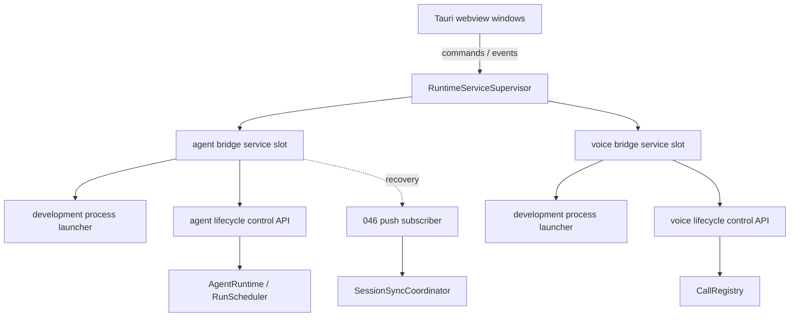
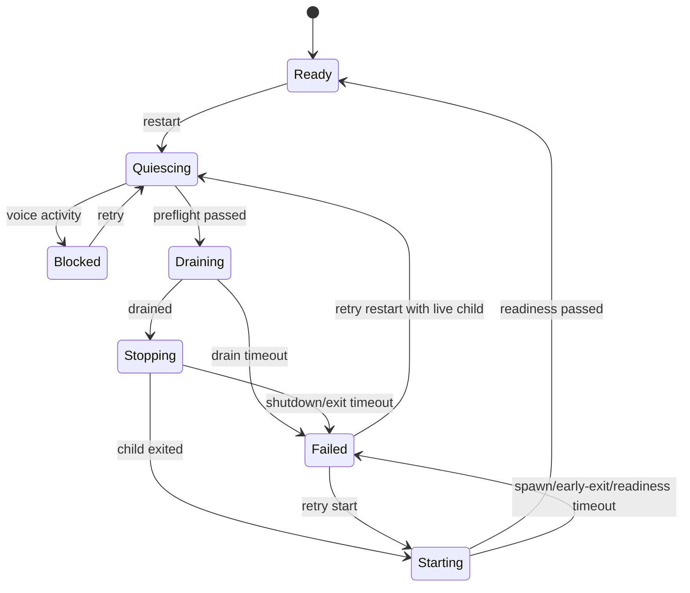

# 047 · 桌面运行时服务托管 - 技术方案

## 状态

CONFIRMED

## 需求文档

→ [requirement.md](./requirement.md)

## 现状分析

### 服务所有权

当前 Tauri Core 只消费 `agent_bridge` 和 `voice_bridge` 的 HTTP/SSE 接口，没有子进程句柄或生命周期状态。`bridge_base_url()` 默认返回 `127.0.0.1:18800`，push subscriber 在 Tauri setup 阶段立即开始重连。

`scripts/dev/run.*` 在 Tauri 启动前独立创建两个 Python 服务，脚本退出时再终止进程树。Tauri 无法区分这些进程与其他占用相同端口的进程，也没有可安全重启的 owner token。

### Python 服务生命周期

- 两个 bridge 都通过 `uvicorn.run()` 启动，应用层无法请求 server 受控退出。
- 两个 `/healthz` 都只返回 `{"status": "ok"}`，不能证明 AgentRuntime、provider、路由或语音能力已正确装配。
- 045 已经提供 `RunScheduler`、`RunHandle`、cancellation token 和 `AgentRuntime.stop()`，但 `submit()` 没有 accepting/draining 门，`stop()` 也没有向上层返回结构化 drain 结果。
- voice `CallRegistry` 持有 pending/active/stopped/error 状态，但只有面向测试的 `list_active()`，不能完整表达拨号与建连中活动。

### 046 边界

046 已经提供：

- 单一 Rust push subscriber 的持续重连；
- bridge 恢复后的 `session://push-reconnected` 事件；
- SessionSyncCoordinator 对 session list 和 current session 的合并 pull refresh；
- revision 与 request generation 防乱序。

本需求不向 supervisor 中加入任何 session 刷新逻辑。supervisor 只负责让 bridge 恢复到 ready，数据恢复由 046 自然触发。

## 方案设计

### 1. 责任分层



| 边界 | 责任 |
|------|------|
| RuntimeServiceSupervisor | 串行化生命周期命令，持有状态、generation、child 句柄和最近错误 |
| ServiceProcessLauncher | 启动/观察/终止 owner child；本期只实现 debug/source launcher |
| Lifecycle control API | 负责 readiness、drain、activity preflight 和受控 shutdown |
| AgentRuntime | 负责新 run 门禁、queued/running run 收敛 |
| CallRegistry | 负责语音活动快照，不让 supervisor 猜测通话状态 |
| React UI | 只读状态和请求操作；047 不新增正式设置 UI |

### 2. Tauri supervisor

新增 `frontend/src-tauri/src/runtime_services/`：

| 文件 | 责任 |
|------|------|
| `mod.rs` | 公开 command 和 app setup/shutdown 入口 |
| `model.rs` | service kind、phase、snapshot、operation result、error kind |
| `supervisor.rs` | 两个 service slot、命令串行化、generation 保护、事件广播 |
| `launcher.rs` | process launcher trait、debug/source 实现与 child 退出观察 |
| `client.rs` | lifecycle HTTP client、control token header、readiness polling |

状态模型：

```rust
enum RuntimeServiceKind {
    Bridge,
    Voice,
}

enum RuntimeServicePhase {
    Stopped,
    Starting,
    Ready,
    Quiescing,
    Draining,
    Stopping,
    Blocked,
    Unavailable,
    Failed,
}

struct RuntimeServiceSnapshot {
    service: RuntimeServiceKind,
    phase: RuntimeServicePhase,
    generation: u64,
    operation_id: Option<String>,
    error: Option<RuntimeServiceError>,
}
```

`RuntimeServiceSupervisor` 作为 Tauri managed state，内部每个 slot 有独立 async mutex。同一服务命令串行，bridge 与 voice 可并行。每次操作递增 generation；所有 poll、child exit observer 和 HTTP 结果只能在 captured generation 仍是当前值时提交。

状态通过：

- `get_runtime_service_snapshot`
- `start_runtime_service`
- `stop_runtime_service`
- `restart_runtime_service`
- `runtime-service://changed`

暴露给窗口。命令结果包含当前 snapshot，不只返回 bool。

### 3. 开发运行态所有权

`scripts/dev/run.*` 按模式分流：

- Tauri 模式：不再先启动 bridge/voice；设置 `AGENT_FRIEND_REPO_ROOT`、config mode 和 voice mode，由 Tauri supervisor 启动。
- web 模式：没有 Tauri Core，保留脚本现有托管。
- 脚本仍负责开发工具检查、Vite/Tauri 启动和 tunnel 准备；不再在 Tauri 模式持有 bridge child。

debug/source launcher 从 `AGENT_FRIEND_REPO_ROOT` 获取经 canonicalize 的仓库路径，只允许启动固定命令：

```text
uv run python -m agent_bridge
uv run python -m voice_bridge
```

命令使用参数列表和显式 cwd/env，不组装 shell 字符串。control token 使用每次 child start 新生成的随机值，仅通过 child env 传入，不进入日志、settings 或 webview payload。

release build 在打包需求完成前不尝试发现 workspace Python，返回 `Unavailable(sidecar_not_packaged)`。

### 4. Python lifecycle control

两个 bridge 新增仅供 owner 使用的内部端点：

| 端点 | 用途 |
|------|------|
| `GET /internal/lifecycle/readiness` | 返回核心装配和 accepting/activity 状态 |
| `POST /internal/lifecycle/quiesce` | 停止接收新工作，返回 preflight |
| `POST /internal/lifecycle/drain` | 对话服务执行 queued/running run 收敛；voice 执行 activity 检查 |
| `POST /internal/lifecycle/shutdown` | 在 precondition 满足后请求 uvicorn 受控退出 |

请求必须带 `X-Agent-Friend-Lifecycle-Token`，并与子进程环境中的 token 作 constant-time 比较。未配 token 时路由不注册，保持脚本独立启动时的最小攻击面。

两个 `__main__.py` 改用可控 `uvicorn.Server` 运行器。lifecycle controller 持有 server exit callback，`shutdown` 在返回响应后设置 `should_exit`。FastAPI lifespan 负责 runtime 最终清理。

### 5. AgentRuntime drain

`RunScheduler` 新增 accepting 门与结构化快照，`AgentRuntime` 对外提供：

```python
@dataclass(frozen=True)
class RuntimeDrainReport:
    queued_cancelled: int
    running_at_start: int
    completed_during_grace: int
    cancellation_requested: int
    still_running: int
    timed_out: bool

def quiesce(self) -> RuntimeActivitySnapshot: ...
def drain(self, *, grace_timeout: float, cancel_timeout: float) -> RuntimeDrainReport: ...
```

时序：

1. atomic 切换 `accepting=false`；之后 `submit()` 返回明确 rejected handle/error。
2. 从 session/global queue 移除尚未执行的 request，每个 handle 以 cancelled 终态完成。
3. 等待 running handles 在 grace timeout 内自然完成。
4. 对剩余 handle 调用现有 cancellation token。
5. 等待 cancel timeout，返回 report。

`still_running > 0` 时 lifecycle drain 失败。supervisor 可在明确记录 degraded/forced termination 后终止 owner child，但本次操作不标记 graceful success。

### 6. Voice activity preflight

`CallRegistry` 增加统一 activity snapshot：

```python
@dataclass(frozen=True)
class VoiceActivitySnapshot:
    pending_call_ids: tuple[str, ...]
    active_call_ids: tuple[str, ...]

    @property
    def blocks_restart(self) -> bool: ...
```

pending 和 active 都阻止普通 shutdown/restart。stopped/error 不阻止。lifecycle API 只返回 call id 和状态，不暴露 RTC token 或凭据。

本期不实现 force restart UI。内部 API 保留显式 `force=false` 字段，但 supervisor 始终传 false，避免未经用户确认中断通话。

### 7. Readiness

既有 `/healthz` 保持兼容性，内部 readiness 返回：

```json
{
  "status": "ready",
  "service": "bridge",
  "accepting": true,
  "checks": {
    "runtime": "ready",
    "routes": "ready",
    "credentials": "ready-or-optional"
  }
}
```

bridge 的 readiness 至少确认：

- app runtime 已完成 assembly；
- AgentRuntime/scheduler 已启动且 accepting；
- 核心路由已装配；
- 当前 provider 所需配置的可用性状态可判断。

voice 至少确认：

- runtime/call registry 已装配；
- control、LLM proxy 与 transcription 路由已装配；
- 语音凭据是 ready、missing 或 optional 的明确状态；
- 未处于 shutting down。

凭据缺失是否阻止整个服务 ready 沿用现有能力边界：可选能力缺失不应让整个 bridge 无法启动，但 readiness checks 必须准确报告。

### 8. Restart 与失败语义



错误类型至少包含：

- `launch_unavailable`
- `port_conflict`
- `control_request_failed`
- `voice_activity_blocked`
- `drain_timeout`
- `shutdown_timeout`
- `process_exited_early`
- `readiness_timeout`
- `readiness_rejected`

失败保留 child 是否仍存活、操作 id、generation 和可重试动作。旧 generation 的 exit/readiness 结果不得覆盖新操作。

### 9. 应用启动与退出

Tauri setup 创建 supervisor 后，在 debug/source 运行态启动 bridge；voice 是否启动由 `AGENT_FRIEND_DEV_VOICE_MODE` 决定。push subscriber 可保持当前一启动就连接的方式，它会在 bridge ready 前退避重连。

Tauri 收到真正应用退出时，对 owner children 执行有上限的 shutdown；如果超时，终止自己持有的 child 进程树并记录 degraded cleanup。窗口 CloseRequested 只隐藏窗口，不影响 supervisor。

### 10. 文件改动

| 路径 | 改动 |
|------|------|
| `frontend/src-tauri/src/runtime_services/*` | 新增 supervisor、model、launcher、client |
| `frontend/src-tauri/src/lib.rs` | 注册 state/commands，接入 setup 和 app exit |
| `frontend/src-tauri/Cargo.toml` | 补充进程、随机 token 和测试所需的最小依赖/特性 |
| `scripts/dev/run.sh` / `run.ps1` | Tauri 模式交出 bridge 所有权，web 模式保留脚本托管 |
| `scripts/README.md` | 更新 dev 脚本所有权语义 |
| `agent/src/agent/runtime/scheduler.py` | accepting、queued cancellation、running snapshot/drain |
| `agent/src/agent/runtime/__init__.py` | quiesce/drain 公开入口 |
| `agent_bridge/src/agent_bridge/lifecycle.py` | lifecycle controller/routes/readiness |
| `agent_bridge/src/agent_bridge/app.py` | lifespan 和 lifecycle route 装配 |
| `agent_bridge/src/agent_bridge/__main__.py` | 可控 uvicorn server |
| `voice_bridge/src/voice_bridge/lifecycle.py` | activity preflight/routes/readiness |
| `voice_bridge/src/voice_bridge/calls/registry.py` | 统一 activity snapshot |
| `voice_bridge/src/voice_bridge/app.py` | lifecycle route 装配 |
| `voice_bridge/src/voice_bridge/__main__.py` | 可控 uvicorn server |
| 对应 Rust/Python 测试 | fake launcher/client、状态机、drain、voice block、readiness |

## 测试方案

### Python runtime

- quiesce 后新 submit 被拒绝。
- queued handles 全部以 cancelled 终态完成。
- running run 在 grace 内完成时不取消。
- grace 超时后请求 cancellation。
- cancellation 后仍未退出时 report 标记 timed_out/still_running。
- stop/drain 并发调用保持幂等和单一终态。

### Python lifecycle API

- token 缺失/错误时拒绝，且不回显 token。
- readiness 区分 alive 和 ready。
- bridge drain report 准确投影。
- voice pending/active 都阻止 shutdown，stopped/error 不阻止。
- shutdown callback 只在 precondition 成功后触发。

### Rust supervisor

- bridge-only、voice-only 命令不互相影响。
- 同 service 的重叠命令串行，不创建重复 child。
- generation 阻止旧 readiness/exit 结果提交。
- port conflict 不杀不明进程。
- drain/shutdown/readiness 各阶段失败保留精确状态。
- voice activity conflict 进入 blocked，重试后可继续。
- app exit 只清理 supervisor 持有的 child。
- fake 时钟验证超时，测试不真实 sleep 或启动子进程。

### 跨层验收

- 使用 fake provider 启动源码桌面运行态，证明 Tauri 成为唯一 owner。
- 触发 bridge restart，观察 046 subscriber 重连与 session list/current session 校准。
- 使用 fake voice activity 验证 pending/active 阻止，不调用真实火山服务。
- 运行 `./scripts/check` 全量门禁。

## 影响分析

### 上游

- 045 的 scheduler/runtime 公共接口会扩展，既有正常 submit 语义保持，只在显式 quiesce 后拒绝。
- `scripts/dev` 的 Tauri 模式所有权改变，web 模式需保持旧行为。
- 独立 `scripts/bridge` / `scripts/voice` 仍可运行，没有 lifecycle token 时不暴露内部控制面。

### 下游

- issue 031 可直接调用 supervisor，不再关心子进程细节。
- 046 的 push/session sync 无协议变更。
- 对话、IM、语音 UI 在 quiescing/stopped 窗口期可收到暂时不可用错误；对应用户可见交互属于 issue 031 或后续产品需求。
- 打包运行态仍不完整，必须在后续 sidecar 交付需求完成前保持明确 unavailable。

### 风险

- Windows 子进程树退出与 Unix process group 不同；launcher 必须把平台差异局限在单一边界并分别测试。
- HTTP control response 与进程真正退出存在窗口；supervisor 必须等 child exit，不能以 shutdown 2xx 作为完成。
- 合作式 cancellation 依赖 provider/tool 定期检查 token；卡死的外部调用可能需要最终进程级终止。
- push subscriber 会在 bridge 尚未启动时持续重连；既有有上限退避已可控，本需求不再建立另一启动顺序协议。

## 实施顺序

1. 实现 AgentRuntime quiesce/drain 与单测。
2. 实现 voice activity snapshot 与单测。
3. 实现两个 bridge 的 token-protected lifecycle/readiness 控制面。
4. 实现 Rust supervisor model、fake launcher/client 和状态机测试。
5. 接入 debug/source process launcher、Tauri setup/exit 与 commands。
6. 调整 `scripts/dev` Tauri/web 所有权分流并更新文档。
7. 运行局部测试、`./scripts/check` 与 fake 跨层验收。
8. 用户确认验收后才完成 progress；本需求不关闭 issue 031。

## 明确不做

- 不打包 Python/uv/bridge sidecar，不解决安装后发现、签名和更新。
- 不实现配置 effect coordinator 和 issue 031 UI。
- 不修改 046 push/session sync 协议。
- 不默认强制中断语音通话。
- 不建设通用插件式服务编排框架；本期只有 bridge 和 voice 两个显式 service kind。
- 不调用真实 LLM/provider API。

## 变更记录

| 日期 | 变更内容 | 是否需要重新实现 |
|------|---------|----------------|
| 2026-07-13 | 初版方案确认：Tauri app-level supervisor + debug/source launcher；token-protected lifecycle API；045 quiesce/drain；voice activity block；generation 防乱序；复用 046 恢复校准；打包 sidecar 交付拆出 | 新设计，待实现 |
