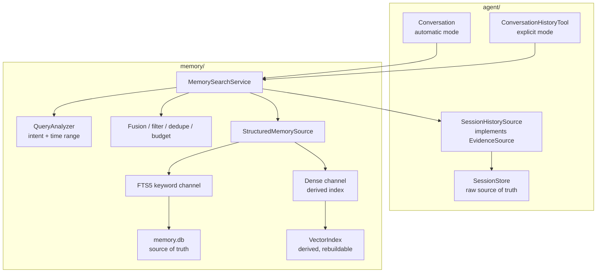
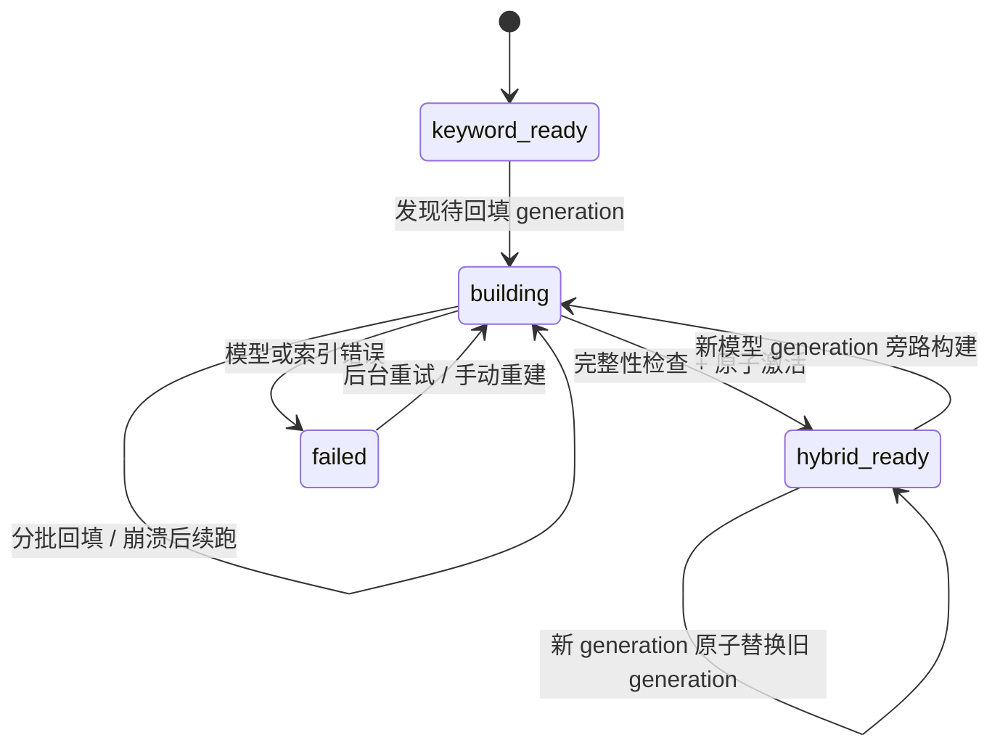

# 048 · 记忆召回质量第二轮升级 · 技术方案

## 状态

CONFIRMED

## 0. 文档说明

- 需求文档：[`requirement.md`](./requirement.md)
- 本文回答 048 的模块边界、统一检索数据流、核心身份策略、混合召回、时间/版本查询、索引迁移、评测与可观测方案。
- 本期不把结构化 memory 与 SessionStore 物理合库；统一的是查询、证据、排序和 trace 语义。
- 实施中若 M48.0 benchmark 证明预备向量栈不满足本方案门槛，须先回到本文更新最终选型，再进入混合召回实现。

---

## 1. 现状分析

### 1.1 当前两条召回路径

当前存在两套各自成立、但语义不统一的路径：

1. **自动结构化召回**
   - `agent.Conversation` 每轮把原始 `user_input` 传给 `Memory.retrieve`。
   - `memory` 从 SQLite 读取 core 尚未分层的 pinned、semantic 与 episodic。
   - semantic / episodic 走 jieba + FTS5，随后按相关性、重要性、时间衰减排序。
   - 结果由 `Renderer` 拼成一段 system context。

2. **显性历史回忆**
   - LLM 主动调用 `recall_past_chats`。
   - `ConversationHistoryTool` 独立解析 since / until / said_by。
   - 工具扫描 SessionStore 中的 user / assistant events，做 substring OR 匹配并自行排序、渲染。

这两条路径的数据所有权不同是合理的，但查询解释、时间语义、候选模型、排序和证据表达也全部分离，导致以下问题：

- 同一问法可能在自动召回中走 FTS，在显性工具中走 substring，命中结果缺少可比性。
- `recall_past_chats` 的时间解析不能复用于自动召回；自动召回又无法可靠理解“上周 / 上次 / 以前”。
- bridge 通过 `pinned_relevance_gate=False` 修复身份漏召回，CLI 仍使用 memory 默认值，入口行为漂移。
- SessionStore 原始证据无法参与自动召回的低置信 fallback；结构化事实也无法参与工具的统一排序。
- `RecallTrace` 只能看到 memory 内部阶段，无法解释历史数据源、查询意图和跨源融合。

### 1.2 当前数据边界

| 数据 | 事实来源 | 当前检索 | 本期定位 |
|---|---|---|---|
| semantic | `memory.db` | FTS5，仅活跃行 | 长期事实、核心身份、当前/历史版本 |
| episodic | `memory.db` | FTS5，按 persona | 经抽取的经历摘要 |
| 原始 user / assistant events | SessionStore JSONL | `recall_past_chats` 扫描 | 最终可回取的原始证据 |
| 当前会话 working context | `Conversation` | ContextManager | 不归长期记忆检索管理 |

本期维持这四类所有权，不把 SessionStore 降级成 memory 的内部表，也不让 `memory` 反向 import `agent.sessions`。

### 1.3 已有接口中可复用的扩展点

- `RetrievalStrategy` 已把召回实现从 `Memory.retrieve` 中抽离，可继续演进为结构化数据源内部的 keyword / dense 双通道。
- `MemoryContext.items` 与 `RecallTrace` 已提供结构化可观测出口，可向后兼容扩字段。
- semantic 已有 `valid_from` / `valid_until` / provenance，可在其上补轻量版本链，不需要完整图谱。
- `build_memory` 是组件装配集中点，适合接入 search service 与 derived vector index。
- `ConversationHistoryTool` 已有时间解析、说话人过滤和拟人化渲染，可迁移到统一查询与证据模型而不是推倒重写。

---

## 2. 总体设计

### 2.1 核心决策

本期引入 `MemorySearchService` 作为**统一检索编排层**。它不拥有数据，只负责：

1. 把入口参数归一化为统一 `SearchRequest`；
2. 分析记忆意图与时间范围；
3. 按 mode 选择数据源和候选预算；
4. 汇总各源 `EvidenceCandidate`；
5. 做有效性过滤、RRF 融合、规则加权、去重与层级配额；
6. 返回 `SearchResult` + `SearchTrace`。

自动召回与显性回忆只在 mode 和预算上不同，不再拥有自己的搜索语义。

### 2.2 模块依赖



依赖约束：

- `memory` 定义 `EvidenceSource` Protocol，但不知道 SessionStore 类型。
- `agent` 依赖 `memory` 的搜索契约，并在 agent 侧实现 `SessionHistorySource`。
- `agent_bridge` / CLI 只负责装配，不持有搜索规则。
- VectorIndex 是 SQLite 文本事实的派生索引；任何时候都能删除并重建，不能成为事实来源。

### 2.3 两种检索模式

| 维度 | automatic | explicit | probe |
|---|---|---|---|
| 入口 | `Memory.retrieve` | `recall_past_chats` | Memory Inspector |
| 默认数据源 | core + structured | core + structured + raw history | 调试者指定 |
| 原始历史 fallback | 仅显性历史/时间意图且结构化置信不足时，小预算启用 | 默认启用 | 可选 |
| 最终数量 | 小预算 | 较宽预算 | 调试参数 |
| 输出 | `MemoryContext` | `ToolResult` | API + trace |
| 语义 | 共享 analyzer / filter / fusion | 同左 | 同左 |

`explicit` 可以返回更多证据，但不能绕过失效过滤、时间范围和 owner / persona 边界。

---

## 3. 搜索契约

### 3.1 `SearchRequest`

在 `memory/src/memory/search/contracts.py` 新增：

```python
SearchMode = Literal["automatic", "explicit", "probe"]
SearchIntent = Literal[
    "general",
    "identity",
    "history",
    "temporal",
    "current_state",
    "historical_state",
    "last_interaction",
]

@dataclass(frozen=True)
class TimeRange:
    since: datetime | None = None
    until: datetime | None = None  # exclusive

@dataclass(frozen=True)
class SearchRequest:
    text: str
    owner_user_id: str
    persona_id: str
    mode: SearchMode
    session_id: str | None = None
    top_k: int | None = None
    said_by: Literal["user", "agent"] | None = None
    explicit_time_range: TimeRange | None = None
    source_scope: frozenset[str] | None = None
```

调用方只传原始条件，不自行决定 intent、token、dense query 或最终时间范围。

### 3.2 `AnalyzedQuery`

`QueryAnalyzer` 产出：

```python
@dataclass(frozen=True)
class AnalyzedQuery:
    raw_text: str
    retrieval_text: str
    intent: SearchIntent
    time_range: TimeRange | None
    identity_requested: bool
    include_historical: bool
    tokens: tuple[str, ...]
```

规则：

- 显式 `since` / `until` 优先于从自然语言推断的范围。
- 自动查询只解析项目明确支持的时间表达；无法确定的表达不生成虚假精确范围。
- 第一版使用确定性规则，不在每轮读路径新增 LLM 调用。
- 020 的 `time_parser` 迁移为 memory 搜索公共能力；tool 保留兼容 import 或薄 wrapper。
- “你还记得我吗 / 你能想起我吗 / 我们之前认识吗”归为 `identity` 或 `history`，不能依赖姓名词面命中。
- “上次什么时候聊”“上周聊过什么”归为 `temporal` / `last_interaction`。
- “我现在在哪里工作 / 以前在哪里工作”区分 `current_state` / `historical_state`。

### 3.3 `EvidenceCandidate`

所有数据源统一返回：

```python
EvidenceKind = Literal["core", "semantic", "episodic", "utterance"]

@dataclass(frozen=True)
class EvidenceCandidate:
    evidence_id: str
    source_name: str
    kind: EvidenceKind
    text: str
    owner_user_id: str
    persona_id: str | None
    occurred_at: datetime | None
    valid_from: datetime | None
    valid_until: datetime | None
    importance: float
    provenance: tuple[str, ...]
    keyword_rank: int | None = None
    dense_rank: int | None = None
```

约定：

- `evidence_id` 带 source namespace，例如 `semantic:<id>`、`episodic:<id>`、`session:<session>#<event>`。
- source 只返回候选，不决定最终注入。
- 原始 event 仍由 SessionStore 拥有；candidate 只携带搜索和渲染需要的只读投影。
- 失效 semantic 可以在 historical query 中成为候选，但 current query 必须过滤。

### 3.4 `EvidenceSource`

```python
class EvidenceSource(Protocol):
    name: str

    def search(
        self,
        query: AnalyzedQuery,
        *,
        request: SearchRequest,
        limit: int,
    ) -> list[EvidenceCandidate]: ...
```

本期两个实现：

- `StructuredMemorySource`：memory 包内，组合 FTS5 与 dense channel。
- `SessionHistorySource`：agent 包内，从 SessionStore 读取 raw user / assistant events。

---

## 4. 核心身份与轻量事实版本

### 4.1 不再让 `pinned` 同时承担两种语义

当前 `pinned` 同时表达“身份级始终记得”和“高重要性优先展示”，导致 gate 进退两难。本期在 semantic 上增加：

```text
memory_class  TEXT NOT NULL DEFAULT 'normal'
fact_key      TEXT NULL
supersedes_id TEXT NULL
```

- `memory_class='core'`：姓名、核心关系等小规模始终在场事实。
- `memory_class='priority'`：重要但仍应按相关性召回的事实，对应普通 pinned 语义。
- `memory_class='normal'`：普通 semantic。
- `fact_key`：可选的轻量事实槽位，例如 `user.name`、`user.employer`、`user.residence`；不是开放 ontology。
- `supersedes_id`：显式版本链，配合已有 `valid_from` / `valid_until`。

保留 `pinned` 列用于兼容旧库和旧 inspector；新逻辑以 `memory_class` 为准，待后续 schema 版本再考虑移除旧字段。

### 4.2 core 判定

- LLM 继续只输出 pass-1 的简洁事实契约，不承担 `memory_class` / `fact_key` 存储分类；配对实验已证明把这些字段加入 prompt 会提高合法空输出并降低 semantic 覆盖。
- parser / reconciler 根据 statement、pinned 与受限白名单确定性推导 `memory_class` / `fact_key`；即使兼容解析到新字段，也必须重新校验，LLM 不能任意把琐事升级为 core。
- 首版 core 白名单只覆盖：用户姓名、agent 名称、明确核心关系。
- 旧数据不把全部 `pinned=1` 粗暴迁成 core。
- 迁移时仅对高置信的旧 statement 规则匹配出 `user.name` 等已知槽位；其余旧 pinned 迁为 `priority`。

### 4.3 core 注入

- core 走独立小预算，不占普通 top-K。
- automatic / explicit 均采用同一 core policy。
- core 默认最多 8 条且另受字符/token 预算约束；最终数值在 M48.0 基线后锁定。
- 非身份问题可以带少量 core 作为关系底色，但 renderer 不把它渲染成当前问题的直接证据，避免回答被姓名等内容主导。
- 非 core 的 priority 重新开启统一 relevance gate；删除 bridge / CLI 的差异化 hot-fix。

### 4.4 当前/历史版本查询

- 写入新事实时，优先按 `fact_key` 找当前有效版本；无 `fact_key` 时才 fallback 到现有 target_hint 匹配。
- supersede 在同一事务语义内完成：旧行写 `valid_until`、新行写 `valid_from` 与 `supersedes_id`。
- current query 只返回查询时刻有效的版本。
- historical query 按时间范围选择 validity window 相交的版本。
- 原始发生时间与记忆写入时间分开：semantic validity 优先取对话中明确事件时间；无法确定时使用观察时间并在 trace 标明来源。
- 本期不建立任意实体关系图，不做多跳 traversal。

---

## 5. 混合召回与排序

### 5.1 keyword channel 保留

现有 jieba + FTS5 继续作为 keyword channel，负责：

- 人名、物件、数字、专有名词和原话片段；
- dense index 未就绪或失败时的完整降级路径；
- core / priority relevance gate 的词面证据。

调整点：

- source 返回 keyword rank，不在各 FTS 表之间直接比较原始 BM25 绝对值。
- current / historical query 使用不同有效性 SQL 条件。
- query intent 与 time range 先过滤搜索空间，再做排序。

### 5.2 dense channel

项目决策 0002 的预备默认是 Chroma + 本地 BGE-small-zh。本期遵循“默认先验证、失败再重评”：

1. M48.0 先用 Chroma `PersistentClient` + 本地 BGE-small-zh 做桌面环境 benchmark。
2. 同时保留 `VectorIndex` / `EmbeddingProvider` Protocol，不把 Chroma API 泄漏进 search service。
3. 若默认组合在质量、启动、内存、磁盘或 Win/Mac 可用性上不满足门槛，暂停后续实现，回到本文记录实测并在 sqlite-vec / BGE-m3 / multilingual-e5 等候选中重选。

M48.0a Windows 实测见 [`benchmark-report.md`](benchmark-report.md)：BGE 改写类 Recall@1 从 FTS 的 `0.625` 提升到 `0.875`，RRF Recall@3/5 为 `1.0`；但 Sentence Transformers + Chroma 的 dense 链路增量 RSS 为 `523.972MB`，超过 `200MB` 门槛，且依赖 import + 模型加载约 `23.6s`。因此：

- 保留 BGE-small-zh 作为质量基准；
- 否决 Sentence Transformers + Chroma 当前组合直接进入生产；
- M48.0b 改测 CPU ONNXRuntime + 量化 BGE-small-zh 与 sqlite-vec；Windows 10000 条实测为 `191.648MB` 增量 RSS、`37.750ms` warm p95、`23.179MB` 模型资产、`20.680MB` 索引，已通过门槛；
- 最终 `EmbeddingProvider` 锁定 CPU ONNXRuntime + `tokenizers`，最终 `VectorIndex` 锁定 sqlite-vec；
- 社区 ONNX 资产只用于 benchmark，生产资产从 BAAI 原模型可复现导出并锁 revision/hash；
- 用户 review M48.0b 结果前不得开始 M48.1。

接口：

```python
class EmbeddingProvider(Protocol):
    model_id: str
    dimension: int
    def embed(self, texts: list[str]) -> list[list[float]]: ...

class VectorIndex(Protocol):
    def upsert(self, records: list[VectorRecord]) -> None: ...
    def search(self, vector: list[float], *, filters: VectorFilters, limit: int) -> list[VectorHit]: ...
    def delete(self, ids: list[str]) -> None: ...
```

### 5.3 融合

第一版使用 Reciprocal Rank Fusion（RRF）合并 keyword / dense rank，避免把不同检索器的原始分数强行归一到同一量纲：

```text
rrf(candidate) = Σ 1 / (k + rank_channel(candidate))
```

随后叠加小幅 policy bonus：

- core / priority 层级；
- importance；
- episodic recency；
- 显式时间范围匹配；
- current-state 对当前有效版本的优先级。

本期不引入额外 cross-encoder reranker，避免第二套模型增加启动与内存成本。若 RRF 在新评测上仍无法满足相关性，再独立评估。

### 5.4 去重与配额

依次执行：

1. 按同一 `evidence_id` 去重；
2. 按 provenance / `supersedes_id` 合并同一事实的重复表示；
3. 对高度相似文本保留来源更直接、时间更明确的一条；
4. core 使用独立预算；
5. 普通候选按 semantic / episodic / utterance 配额截断；
6. 最后按总上下文预算裁剪。

原始 utterance 与其派生 semantic / episodic 同时命中时：

- automatic 默认保留结构化条目，原始证据只作为低置信 fallback；
- explicit 优先保留原始证据，并可附带结构化事实帮助概括；
- trace 记录被折叠的候选，不静默消失。

---

## 6. SessionHistorySource

### 6.1 所有权

新增 `agent/src/agent/memory_search/session_history_source.py`：

- 依赖 `SessionStore` Protocol；
- 实现 memory 定义的 `EvidenceSource`；
- 只投影 user / 完整 assistant 消息；
- 保留当前 turn boundary，避免把本轮用户输入误当历史证据；
- 返回标准 `EvidenceCandidate`，不在 source 内做人类话术渲染。

### 6.2 首版读取策略

- M48.1 先复用 020 的 session summary 粗筛 + event 扫描，确保统一行为先落地。
- source 必须接收 analyzer 产出的 tokens、time range、said_by，不再自行解析参数。
- automatic 仅在 history / temporal / last_interaction 意图且结构化结果不足时调用，限制扫描范围和候选数。
- explicit 默认启用，保持用户主动深挖历史的能力。

### 6.3 派生历史索引 gate

M48.0 同时记录真实 SessionStore 规模下的扫描 p50 / p95。若达到任一条件，M48.1 先建立派生索引再接自动 fallback：

- warm explicit 搜索 p95 超出设计锁定预算；
- session 数或 event 数使单次扫描出现明显线性卡顿；
- automatic fallback 无法在主对话读路径预算内完成。

M48.0a 在 Windows 上只读 31 个 session / 887117 bytes JSONL，full scan p50 / p95 为 `22.366ms / 39.533ms`。当前低于 `75ms` history 硬门槛，M48.1 继续复用直扫，不预建派生索引。后续若 session ≥ 100、JSONL ≥ 10MB、history p95 > 75ms，或完整 automatic fallback p95 > 50ms，再启用派生索引。

派生索引仍是可重建缓存，SessionStore 保持事实来源；session 编辑、删除和分支失效通过 revision/change broker 触发增量同步。

---

## 7. 向量索引迁移与生命周期

### 7.1 状态机



### 7.2 快速启动

- schema migration 只增加 manifest / generation 状态，不在启动事务中计算 embedding。
- 应用立即以 `keyword_ready` 提供 FTS 行为。
- runtime ready 后启动低优先级后台回填；模型加载不阻塞桌面窗口和 bridge ready。
- 回填未完成时不启用半份 dense index，避免未回填条目被不公平降权。

### 7.3 可恢复 manifest

SQLite 增加派生索引元数据：

```text
embedding_generation(
    generation_id, model_id, dimension, status,
    total_count, indexed_count, created_at, updated_at, last_error
)

embedding_manifest(
    generation_id, evidence_id, content_hash, indexed_at,
    PRIMARY KEY(generation_id, evidence_id)
)
```

- source row + model id + normalized text 生成 `content_hash`。
- sweeper 查找 active source rows 与 manifest 的差集，分批 upsert。
- Chroma / VectorIndex 成功后才写 manifest；崩溃时重复 upsert 由稳定 id 保证幂等。
- 新 semantic / episodic 先完成 SQLite + FTS 落库，再进入派生索引；dense 失败不回滚正文。
- supersede / soft-delete 后，即使 VectorIndex 清理延迟，最终候选仍必须回查 SQLite 有效性后才能注入。

### 7.4 generation 原子切换

- 每个 embedding 模型版本使用独立 generation / collection。
- 只有 active source rows 全部具有匹配 content hash，且抽样查询与维度检查通过，才更新 `active_generation`。
- retrieval 只读取 active generation。
- 新 generation 激活后再异步清理旧 generation；清理不是切换前置条件。

### 7.5 修复入口

新增跨平台脚本 `scripts/memory-retrieval-benchmark/run.sh` / `run.ps1`，主体逻辑下沉 Python，支持：

- 打印 keyword / dense readiness；
- 跑 embedding provider 与 VectorIndex benchmark；
- 校验 manifest 覆盖；
- 重建指定 generation；
- 输出性能与质量报告。

脚本不自动安装系统工具、不调用外部 LLM API。首次下载本地 embedding 模型属于网络下载，执行时按环境权限单独确认。

---

## 8. 装配改造

### 8.1 `build_memory`

扩展为接收可选 search service / embedding 组件：

```python
def build_memory(
    db_path: Path | str,
    llm_client: LLMClient,
    *,
    search_service: MemorySearchService | None = None,
    embedding_provider: EmbeddingProvider | None = None,
    vector_index: VectorIndex | None = None,
    ...,
) -> Memory: ...
```

- 未提供 search service 时构造只含 StructuredMemorySource 的默认实例，保持测试和独立 memory 用法。
- 未提供 dense 组件或 active generation 未 ready 时自然退化 keyword-only。
- `Memory.retrieve` 仍返回 `MemoryContext`，外部主接口不破坏。

### 8.2 bridge / CLI

装配顺序调整为：

1. 构造 SessionStore；
2. 构造 SessionHistorySource；
3. 构造 MemorySearchService 并注册 history source；
4. memory enabled 时调用 `build_memory(..., search_service=...)` 注册 structured source；
5. `make_default_registry(..., memory_search=...)` 注册 `recall_past_chats`；
6. Conversation 与 tool 使用同一个 service 实例。

memory disabled 时：

- 不启用自动结构化召回；
- search service 仍可只带 SessionHistorySource，`recall_past_chats` 不退化。

### 8.3 `ConversationHistoryTool`

- 构造参数从直接 `SessionStore` 演进为 `MemorySearchService`。
- `invoke` 只负责校验 LLM args、构造 explicit `SearchRequest`、调用 service、把标准 evidence 渲染成拟人文本。
- 现有 tool description 与结果表达边界保持。
- hidden current session / turn boundary 继续注入 request，防本轮自命中。

---

## 9. Renderer 与 trace

### 9.1 Renderer

统一 SearchResult 后，按三段渲染：

1. `core`：小型关系底色，不宣称与当前 query 直接相关；
2. `recalled`：本轮相关 semantic / episodic；
3. `evidence`：必要时附原始历史片段与可靠时间。

所有渲染内容继续作为 untrusted context 注入，正文没有指令权。

时间表达：

- 内部 item 保留 UTC datetime；
- system context 同时提供稳定日期与自然相对提示；
- 不把分钟级间隔渲染成“最近”后让模型自由推测“前几天”；
- `last_interaction` 使用 SessionStore 中最近的上一轮真实事件时间。

### 9.2 Trace

扩展 trace，保留现有字段向后兼容，并增加：

```text
intent
time_range
mode
source_runs[] { source, channel, candidate_count, elapsed_ms }
candidates[] {
  evidence_id, kind, source, keyword_rank, dense_rank,
  fused_score, decision, decision_reason
}
budget { core, semantic, episodic, utterance, total }
index_state { keyword_ready, dense_status, active_generation }
```

`decision` 至少区分 `injected / invalid / out_of_time / duplicate / quota / below_threshold`。

Memory Inspector 只做必要字段增量展示，不在本期重做 UI。Phase 3 若需要对桌面视觉下结论，先按 `frontend-visual-verification` 询问用户是否执行真实桌面端验收。

---

## 10. 评测设计

### 10.1 两层评测

1. **retrieval 层**：在 `memory_eval` 中直接断言 SearchResult，定位 query / source / fusion / filter。
2. **generation 层**：在 `agent_eval` 增加记忆证据使用切片，确认最终回复没有忽略、混淆或编造召回证据。

默认自动化使用 fake extractor / fake embedding，不触发真实 LLM。真实抽取与最终回答 smoke 每次单独按 `llm-api-confirm` 获授权。

### 10.2 评测切片

| 切片 | 重点指标 |
|---|---|
| identity | 多种“记得我吗”问法 core 命中率 100%；负向问题无普通 priority 污染 |
| paraphrase | Recall@K 相对 keyword-only 严格提升；精确词集合不退化 |
| temporal | 时间范围命中、last interaction、无证据不造时间 |
| update | current / historical 版本选择正确，旧值不作为当前值 |
| abstention | 无答案时无无关证据占位，最终回复不编 |
| consistency | 同 request + 同 source scope 的共有候选一致；explicit 仅合理扩集 |

### 10.3 三层验收口径

1. **检索硬门禁**：确定性六切片 fixture 锁定功能行为；PerLTQA 检索模式对照必须复用同一 workspace 的冻结 case DB 与相同问题集。hybrid 在同义改写集合上严格优于 keyword-only，精确关键词集合不得退化。
2. **抽取稳定性诊断**：固定 hash 选择 fragment，重复运行并逐次 checkpoint。报告 success / empty / error、稳定与不稳定 probe、empty/success 翻转，以及每轮 semantic / episodic 数量。该层暴露写入语料波动，不替检索算法判分。
3. **端到端终局硬门禁**：单次随机抽取仍只能作为观察证据；正式验收改用下面预注册的并发 2×2 协议建立 canonical extraction corpus，并以配对统计判定。不能因为抽取有随机性而取消“必须优于 baseline”的产品目标。

真实抽取与回答评测仅在用户当次授权后运行。报告必须记录 provider 参数、prompt / extraction fingerprint、数据集 hash 与 workspace；不同抽取语料之间不得宣称检索质量升降。

### 10.4 预注册的 2×2 终局协议

两个抽取条件与两个检索条件正交组合：

- `E0`：pass-1 抽取 prompt / 输出契约；使用当前向后兼容解析器和同一确定性后处理，避免把解析器版本、落库 schema 与 prompt 责任混在一起。
- `E1`：048 当前抽取 prompt / 输出契约。
- `R0`：pass-1 行为基线（legacy keyword retrieval）。
- `R1`：048 统一检索终态（unified hybrid retrieval）。

最终同时报告 `E0+R0`、`E0+R1`、`E1+R0`、`E1+R1`。E0 与 E1 对同一固定 fragment 使用相同 provider、model、temperature、timeout 和既有事实输入；调用顺序按 probe/repeat 奇偶做 AB/BA 交错，逐调用写 JSONL checkpoint。manifest 锁定 sample / fragment id、数据集 hash、两份 prompt SHA-256、provider 参数、抽取代码 fingerprint 与 git baseline commit；任一项变化都 fail closed，不能续写旧 workspace。

在全量运行前只允许一次诊断与一次根因修复：

1. 固定 30 个 fragment，每个条件重复 3 次，共 `30 × 2 × 3 = 180` 次 Flash 调用。
2. 分条件报告 success / empty / error、semantic / episodic 产出、source-specific token 保留率、empty/success 翻转、逐 fragment 回归与输出稳定性。诊断用 specific token 指 fragment 原文经确定性分词后，长度至少 2 的中文词、数字或拉丁字母数字串；最终 PerLTQA 仍以题目 anchor 为准。
3. 若 E1 相对 E0 的覆盖/产出退化，优先收回 LLM 的存储策略责任：恢复 pass-1 简洁抽取 schema，`memory_class`、受限 `fact_key`、pinned 等由确定性后处理推导；不做盲目 empty retry，不连续调 prompt。
4. 修复后只跑小样本确认；通过才冻结候选并进入一次全量终局。除基础设施故障/断点续跑外，终局 holdout 不重跑、不据结果继续调参。

终局硬门禁全部满足才算优化成立：

- `E1+R0 >= E0+R0`，证明抽取升级本身不拖后腿。
- `E0+R1 > E0+R0`，证明统一检索对 pass-1 语料有独立正贡献。
- `E1+R1 > E0+R0` 且 macro `> 0.3783`，证明完整架构堂堂正正优于并发和历史 baseline。
- `E1+R1` 零分率低于并发 baseline；核心身份、精确词、时间、知识更新关键切片不退化。
- 以 question 为配对单位做 bootstrap，总分差的 95% CI 下界 `> 0`。

未过任一硬门禁时，报告如实结论为“048 机制成立但质量优化未被证明”或“退化”，不得以局部涨分、随机波动或“只掉几个点”标记完成。

生产路径公平回放增加 `unified-keyword / unified-hybrid`：把同一 EvalCase 确定性投影为只读 SessionStore，复用真实 `SessionHistorySource`，再与 StructuredMemorySource 注册到同一个 service。automatic raw-history fallback 以有效 query token 对结构化候选的覆盖率判断“是否已有足够证据”，不再只看候选数量或少数 intent；中文 token 与结构化 FTS 共用 jieba 语义。结构化 top-8 保持不变，低置信时最多额外注入 4 条原始对话证据，防止修复漏召回时挤掉原本正确的结构化候选。原话命中用户消息时同时携带紧随其后的 assistant 回复，renderer 展开相邻对话 excerpt。

### 10.4 M48.0 benchmark gate

M48.0 先输出报告，不直接决定合入。报告至少包含：

- 当前 FTS-only warm p50 / p95；
- SessionHistorySource 在真实数量级下的 p50 / p95；
- 默认 Chroma + BGE-small-zh 的模型加载、单条/批量 embedding、向量查询 p50 / p95；
- 增量 RSS、模型与索引磁盘占用；
- paraphrase 小集合相对 FTS-only 的 Recall@K；
- Windows 实测与 macOS 可执行验证计划；
- 新旧库 migration / resume / generation switch smoke。

报告完成后在本文回填最终 provider、VectorIndex、core budget、候选预算和性能硬阈值，再进入 M48.1。若用户不确认回填结果，Phase 3 停在 M48.0。

---

## 11. 实施里程碑

### M48.0 · 基线与向量栈 gate

- M48.0a：建 benchmark 双端入口与 Python 主体；记录 FTS / history；验证 Chroma + Sentence Transformers + BGE-small-zh。
- M48.0a：默认组合因 `523.972MB` 增量 RSS 被否决，保留 BGE 质量方向。
- M48.0b：完成 ONNXRuntime + 量化 BGE-small-zh 与 sqlite-vec 的 10000 条 Windows benchmark，分段记录 provider / index 资源。
- M48.0b：最终选型、预算和性能 AC 已回填，并经用户 review 后进入 M48.1。

### M48.1 · 统一搜索契约与 history source

- 新增 search contracts / analyzer / service。
- 把 time parser 下沉到共享能力。
- 实现 SessionHistorySource。
- `recall_past_chats` 改走 service。
- 保持 memory disabled 下工具可用。

### M48.2 · core 与事实版本

- schema migration：memory_class / fact_key / supersedes_id。
- 更新抽取契约与 reconciler。
- 旧 pinned 安全迁移。
- current / historical query 与 last interaction。
- 统一 bridge / CLI 装配策略。

### M48.3 · hybrid retrieval 与后台索引

- 实现 EmbeddingProvider / VectorIndex。
- manifest / generation / background backfill。
- keyword + dense RRF。
- 有效性二次校验、去重、配额和 fallback。

### M48.4 · context 与 observability

- Renderer 适配 core / recalled / evidence。
- 扩展 trace 与 inspector 必要展示。
- 接入自动 history fallback 与各 mode 预算。

### M48.5 · 评测与验收

- memory_eval 六切片。
- agent_eval 证据使用切片。
- 非 LLM 全量门禁。
- 经授权后跑真实 LLM / PerLTQA 观察性 baseline 与固定 fragment 稳定性诊断。
- 在冻结 case DB 上复放 keyword-only / hybrid，把检索独立贡献与抽取波动分开。
- 逐项核对 requirement AC。

---

## 12. 影响分析

### 12.1 上游

- extraction 输出增加受限字段，但 `ConversationFragment` 不变。
- SessionStore 保持现有 Protocol；adapter 只读。
- session 编辑/重发失效需要同时让 derived history/vector index 最终收敛，但事实删除仍以现有 source invalidation 为准。

### 12.2 下游

- `Memory.retrieve` / `MemoryContext` 主契约保持。
- `ConversationHistoryTool` 外部 name / parameters / ToolResult 保持，内部依赖改变。
- RecallTrace API 增字段，现有字段保留；Inspector 前端需同步类型。
- bridge / CLI 装配顺序调整，必须覆盖 memory enabled / disabled 两条路径。

### 12.3 跨平台

- 本地 embedding 与 VectorIndex 必须覆盖 Windows + macOS。
- benchmark、重建与检查入口同时提供 `run.sh` / `run.ps1`，语义一致。
- PowerShell 脚本遵守 UTF-8 BOM 与 UTF-8 输出约定。
- 不引入需要独立数据库服务或系统级安装的组件。

### 12.4 数据兼容

- schema migration 只做加性列/表变更。
- FTS 始终可用，dense 是派生能力。
- 旧 pinned 不批量提升为 core。
- 旧 semantic 无 fact_key 时继续按现有逻辑工作，只是无法获得最强版本查询能力。
- active vector generation 可随时丢弃并重建，不影响 memory.db 正文。

---

## 13. 风险与缓解

| 风险 | 影响 | 缓解 |
|---|---|---|
| 统一 service 变成过度抽象 | 简单召回也要穿多层 | 只定义两个真实 source 与三种真实 mode，不做动态插件注册中心 |
| dense 模型拖慢启动 | 桌面端启动退化 | keyword_ready 立即可用，模型后台加载，dense 完整后原子启用 |
| 半份向量索引影响排序 | 老记忆被不公平降权 | building 阶段完全不启用该 generation |
| Chroma 与 SQLite 双写不一致 | 向量结果陈旧 | SQLite 为真源、manifest 可恢复、注入前回查有效性 |
| core 池不断增长 | prompt 污染 | 白名单、数量/字符预算、非 core priority 继续 gate |
| fact_key 由 LLM 生成不稳定 | 错误 supersede | 受限 key + reconciler 校验 + target_hint fallback + provenance |
| 自动 raw history 扫描过慢 | 每轮延迟增加 | 只在特定 intent + 低置信时启用；M48.0 gate 是否建派生索引 |
| explicit 与 automatic 预算不同被误解为不一致 | 调试困难 | trace 明示 mode/source_scope/budget；一致性 AC 比较共有候选 |
| 新评测提升但单次 PerLTQA 退化 | 无法判断是抽取还是检索回归 | 同一冻结 DB 复放检索模式；真实全量只作观察证据 |
| 真实评测成本高且有抖动 | 无法稳定验收 | deterministic fixture 锁机制；固定 fragment 报告分布；需要端到端硬门禁时建立 canonical corpus |

---

## 14. 测试策略

| 模块 | 测试重点 |
|---|---|
| QueryAnalyzer | intent、显式时间覆盖、模糊时间不伪精确、current/historical |
| MemorySearchService | mode/source policy、RRF、有效性过滤、去重、配额、trace reason |
| StructuredMemorySource | keyword/dense 两通道、current/historical SQL、dense 未 ready fallback |
| SessionHistorySource | 时间/说话人/turn boundary、raw evidence id、错误降级 |
| core / reconciler | 白名单、旧 pinned 迁移、fact_key 优先、supersedes chain |
| vector lifecycle | manifest 幂等、崩溃续跑、failed fallback、generation 原子切换 |
| assembly | bridge/CLI/IM 一致、memory disabled 工具不退化、同 service 实例 |
| renderer | core/related/evidence 分段、精确时间、预算裁剪 |
| inspector | 新 trace 字段兼容与必要展示 |
| memory_eval | 六切片与 keyword-only / hybrid 对照 |
| agent_eval | 有证据正确使用、无证据不编、当前/历史不混用 |

测试默认使用 fake embedding / fake extractor。任何会触发真实外部 LLM API 的命令执行前，必须按 `llm-api-confirm` 单次获得用户明确授权。

---

## 15. M48.0 回填项

以下项目已由 M48.0a 与用户 review 锁定；最终底座仍须等 M48.0b：

- 最终 `EmbeddingProvider`：CPU ONNXRuntime + `tokenizers`；禁止 Sentence Transformers / PyTorch 成为桌面常驻依赖。
- 最终 `VectorIndex`：sqlite-vec；稳定字符串 evidence id 由普通 SQLite 映射表拥有，`vec0` 使用整数 rowid；Chroma 当前组合不进入生产。
- embedding：`BAAI/bge-small-zh-v1.5`、512 维、query-only 中文 instruction；生产量化 ONNX 资产须可复现导出并锁上游 revision/hash，模型资产 ≤ 120MB。
- automatic 候选预算：keyword 24 + dense 24，RRF 后普通候选 12；history fallback 最多 8；renderer 最终普通证据最多 8。
- explicit 候选预算：keyword 64 + dense 64，RRF 后普通候选 30；history 最多 30；renderer 最终普通证据最多 20。
- core 独立预算：最多 6 条、最多 320 个中文字符或约 200 tokens，先到者为准。
- warm p95：FTS 在 1000 条 ≤ 5ms、10000 条 ≤ 15ms；history 当前规模 ≤ 75ms；hybrid end-to-end ≤ 50ms。
- dense 常驻增量 RSS ≤ 200MB；模型资产 ≤ 120MB；10000 条向量索引 ≤ 50MB。
- SessionStore 派生索引：当前不需要；session ≥ 100、JSONL ≥ 10MB、history p95 > 75ms 或完整 automatic fallback p95 > 50ms 时重新 gate。
- 平台：Windows 为当前唯一交付门禁；macOS 标记未验证，等项目进入 macOS 开发范围后补测，不阻塞 048。
- M48.1 门禁：最终 provider/index 与 Windows 数据已经用户 review，M48.1 已实现并通过全量门禁。

---

## 16. 变更记录

| 日期 | 变更内容 | 是否需要重新实现 |
|------|---------|----------------|
| 2026-07-13 | 创建技术方案（CONFIRMED）；锁定统一检索编排、双源 adapter、core 分层、轻量版本、hybrid retrieval 与后台 generation 回填 | — |
| 2026-07-14 | 回填 M48.0a Windows benchmark：保留 BGE 质量方向，因 RSS 否决 Sentence Transformers + Chroma，新增 ONNXRuntime + sqlite-vec 的 M48.0b gate；macOS 暂不纳入门禁 | 否，M48.1 尚未开始 |
| 2026-07-14 | 完成 M48.0b：锁定 CPU ONNXRuntime + tokenizers、sqlite-vec、量化 BGE 资产策略与 Windows 性能预算；等待用户最终 review | 否，M48.1 尚未开始 |
| 2026-07-14 | 根据真实抽取重复实验改为三层验收：确定性/冻结 DB 检索硬门禁、抽取稳定性分布诊断、PerLTQA 端到端观察证据 | 是，补充评测汇总字段与测试；不改生产检索实现 |
| 2026-07-14 | 补齐生产 unified replay 并修复 automatic history fallback：共享中文分词、按 query 覆盖判断低置信、结构化 top-8 + raw evidence 独立 4 条预算、展开相邻问答证据 | 是，改动统一 search policy、history source、renderer、evaluator 与回归测试 |
| 2026-07-14 | 预注册 E0/E1 × R0/R1 并发终局协议 | 是，新增 AB/BA 配对抽取、checkpoint/config lock、配对统计和“不过门禁不算优化”的终局报告 |
| 2026-07-14 | AB/BA 诊断确认新增存储字段 prompt 导致抽取退化 | 是，抽取 prompt 恢复 pass-1 简洁契约，memory_class / fact_key 只由确定性后处理推导 |
