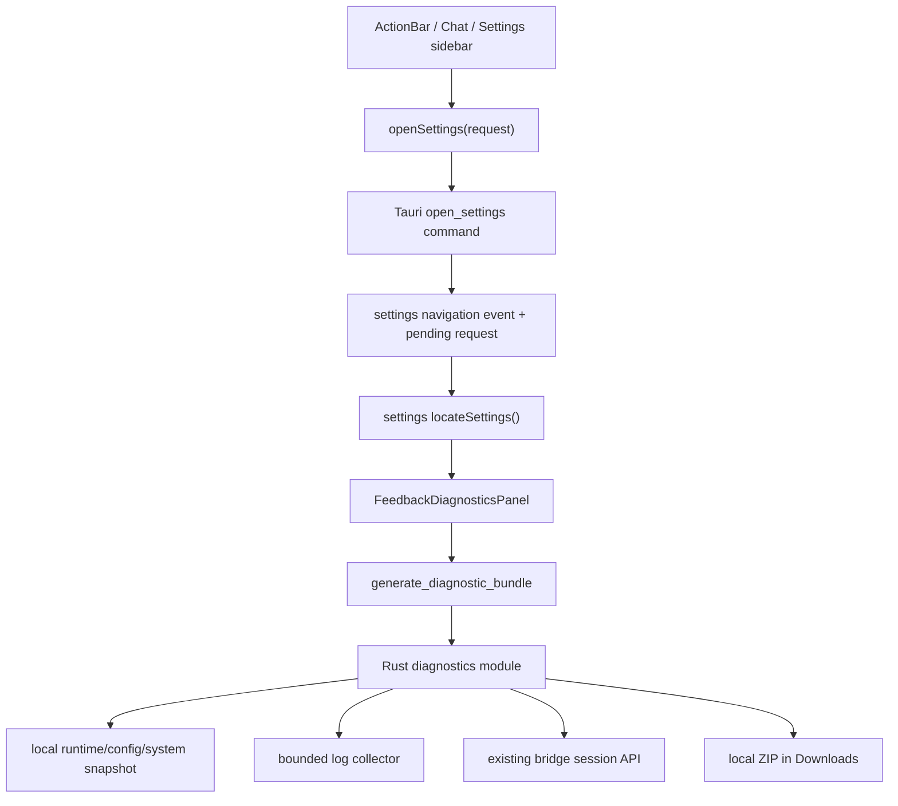

# 049 · 桌面反馈与本地诊断包导出 - 技术方案

## 状态

CONFIRMED

## 需求文档

→ [requirement.md](./requirement.md)

## 现状分析

### 设置与入口

设置窗口已经由 Tauri 预创建并通过 `open_settings` command 打开或聚焦，但 `frontend/src/pages/settings/App.tsx` 在组件内部直接维护分类 state，跨窗口调用方只能打开窗口，不能表达“打开后定位到哪个分类”。聊天页右上角目前只有连接状态，桌宠 ActionBar 当前有五个生产按钮，新增第六个按钮不会触发分页扩容。

设置页已有 Sidebar、页面布局、分组和 Sonner 等基础组件，但尚无 Checkbox 与 Textarea。普通会话和归档会话分别由已有 store 管理，均可通过现有 sessions API 获取；当前聊天页也已经持有 `currentSessionId`。

### 会话与日志

会话由 Python `JsonlSessionStore` 管理，session id 到磁盘文件名存在安全编码规则。bridge 已提供按 id 返回完整事件流的接口，因此 Tauri 不应再次实现 JSONL 寻址、解析或事件 schema。导出成功的会话使用接口返回的完整 `events`，不重复写入派生的 `active_events`。

日志已有统一目录与轮转规则：Tauri、agent bridge 和 memory 分别写入已知文件族，开发运行态还可能存在 dev bridge/voice 日志。诊断导出只能从这些已知文件族中限额选择，不能把日志目录整体复制进 ZIP。

### 运行状态与凭据

Tauri 已经持有应用设置、运行时服务快照和运行配置状态。运行配置状态只暴露配置项名称、来源、是否已配置和生效方式，不暴露值，适合直接形成诊断摘要。

凭据可能来自环境变量、系统 keyring 或兼容的 legacy dotenv。现有 runtime config 模块已经知道受管理凭据的规范名称、别名和读取顺序，可在 Rust 内部复用该注册表形成脱敏值集合；凭据值只在生成过程内存中存在，不写入 manifest、日志或前端 payload。

## 方案设计

### 1. 责任分层



| 边界 | 责任 |
|------|------|
| settings navigation | 定义稳定目标、打开/聚焦设置窗口、可靠投递定位请求 |
| `locateSettings()` | 设置内部把语义目标解析为当前分类；侧栏、跨窗口入口和未来搜索共同复用 |
| `FeedbackDiagnosticsPanel` | 表单、会话选择、生成状态和结果提示 |
| Rust diagnostics module | 收集、限额、凭据过滤、manifest 和 ZIP 原子写入 |
| existing bridge API | 根据用户选择返回规范化的完整会话事件，不向 Rust 泄漏磁盘编码规则 |
| opener plugin | ZIP 成功后打开所在目录；失败不改变生成结果 |

诊断包生成不依赖新增服务端能力，也不调用任何外部厂商 API。bridge 只负责已选择会话的本地读取；即使 bridge 已故障，Rust 仍能生成包含基础诊断和日志的部分诊断包。

### 2. 设置语义定位

前端新增设置内部模块 `frontend/src/lib/settings/navigation.ts`，集中定义：

```ts
export type SettingsTarget =
  | "general"
  | "pet"
  | "voice"
  | "runtime"
  | "archived"
  | "feedback";

export interface SettingsOpenRequest {
  target?: SettingsTarget;
  feedback?: {
    preselectSessionId?: string;
  };
}

export function locateSettings(
  request: SettingsOpenRequest,
): ResolvedSettingsLocation;
```

`locateSettings()` 是纯解析边界：已知 target 返回对应分类和可选页面上下文；缺失或未知 target 安全回落到 `general`。它不操作 DOM，也不包含窗口 API。设置页侧栏点击同样构造 target 并经过该函数更新页面 state，未来设置搜索只需把搜索结果映射为 `SettingsOpenRequest`，无需绕过设置页状态边界。

跨窗口使用统一 `openSettings(request?)` helper 调用 Tauri：

- ActionBar 传 `{ target: "feedback" }`；
- 聊天页传 `{ target: "feedback", feedback: { preselectSessionId } }`；
- 设置侧栏传 `{ target: "feedback" }`，不携带会话预选。

Tauri `open_settings` command 接收可选 request，先保存为一次性 pending navigation，再打开/聚焦窗口并向 settings window 定向发送 `settings://navigate`。设置页同时监听事件并在 mount/重新可见时调用 `take_pending_settings_navigation`，避免窗口加载时序造成事件丢失。每个 request 带内部递增 id；设置页只消费一次，重复事件不会反复覆盖用户已经修改的会话选择。

`preselectSessionId` 只是本次显式入口的页面上下文，不进入持久设置。只有该 id 能在普通或归档会话列表中找到时才默认勾选；临时未持久化会话保持未选。

### 3. 反馈与诊断页面

设置页新增 `FeedbackDiagnosticsPanel`，页面状态保持在组件内部：

- `description: string`；
- `selectedSessionIds: Set<string>`；
- `generationState: idle | generating | success | partial | error`；
- 最近一次成功结果的本地路径与收集摘要。

问题描述与会话均为选填。会话列表同时刷新普通与归档 store，以 session id 去重，展示标题、最近活跃时间和归档标识。会话选择区持续展示以下边界：选中后会完整导出聊天内容、工具调用参数和结果，应用不会识别或删除其中的私人内容，请只选择与问题相关的会话。

本期不扫描姓名、地址、私人聊天或其他泛化敏感内容，也不为此改写会话事件。应用管理的认证凭据仍按 §7 强制过滤。

生成期间禁用生成按钮，防止同一页面重复提交。成功或部分成功后：

- Sonner 显示 ZIP 已生成，action 为“打开所在目录”；
- 页面保留完整路径和复制按钮，Toast 消失后仍可操作；
- reveal 失败只追加错误提示，不把 `success/partial` 改成 `error`；
- 整体写盘失败才进入 `error`，且不显示成功 Toast。

缺失的通用 UI 组件通过 shadcn CLI 引入 Checkbox 与 Textarea，不手写伪 shadcn 组件。

### 4. 诊断 command 与结果模型

Rust 新增 `frontend/src-tauri/src/diagnostics/`：

| 文件 | 责任 |
|------|------|
| `mod.rs` | command、编排和公开结果类型 |
| `manifest.rs` | manifest schema、collection 状态和失败记录 |
| `logs.rs` | 已知日志发现、排序和限额读取 |
| `redaction.rs` | 凭据字段过滤、已配置凭据值替换和路径匿名化 |
| `archive.rs` | ZIP entry 写入、临时文件与最终 rename |

command 接口：

```rust
struct GenerateDiagnosticBundleRequest {
    description: Option<String>,
    session_ids: Vec<String>,
    locale: Option<String>,
    timezone: Option<String>,
}

struct GenerateDiagnosticBundleResult {
    path: String,
    outcome: DiagnosticOutcome, // complete | partial
    included_session_ids: Vec<String>,
    failures: Vec<CollectionFailure>,
}
```

输入先做大小和数量校验：description 去除首尾空白，空串视为未填写，并设置合理字符上限；session id 去重并设置数量上限，防止一次操作造成无界请求。限制只保护资源使用，不替用户静默增加会话或截断成功获取的会话内容。超限输入返回明确错误，由用户调整后重试。

会话通过 `reqwest::Url::path_segments_mut().push(session_id)` 构造本地 bridge URL，避免路径注入。每个会话独立获取、校验响应并加入结果：成功项包含完整 `events` 与必要元信息；失败项不生成伪造或截断文件，而是在 manifest 和 command result 中记录。

所有文件读取与 ZIP 压缩在 blocking task 中执行，避免阻塞 Tauri async runtime。command 只返回本地路径与摘要，不把日志或会话正文返回 webview。

### 5. ZIP 结构与 manifest

文件名采用 `agent-friend-diagnostics-YYYYMMDD-HHMMSS.zip`；同秒冲突时追加递增后缀。默认目录由 Tauri `app.path().download_dir()` 获取。下载目录不可用或不可写时整体失败，不静默改写到应用数据目录。

```text
agent-friend-diagnostics-*.zip
├── manifest.json
├── problem.txt                         # 仅非空时存在
├── diagnostics/
│   ├── application.json
│   ├── environment.json
│   ├── runtime-services.json
│   └── runtime-config.json
├── logs/
│   └── <sanitized-log-name>.log
└── sessions/
    ├── session-001.json
    └── session-002.json
```

session entry 使用序号命名，原 session id、标题和归档状态记录在该 JSON 与 manifest 中，不把不受信任 id 用作 ZIP 路径。

manifest 使用显式 `format_version: 1`，至少记录：

- 生成时间、应用版本和整体结果；
- 每类收集项的 `included | missing | failed | skipped` 状态；
- 实际包含的日志文件、原始文件末次修改时间、纳入的字节区间和过滤后大小；
- 用户请求的 session id、成功写入的 ZIP entry 和失败原因；
- 凭据过滤发生次数，只记录计数，不记录原文；
- 明确声明未包含的 memory、persona、原始 settings、环境变量全集和未选会话。

ZIP 先写入目标目录下不可见的临时 `.part` 文件，全部 entry 和 central directory 成功关闭后再 rename 为最终文件。任一步骤失败即清理 `.part`；只有最终路径存在才返回成功。

### 6. 基础诊断内容

采用允许字段清单逐项构造，不序列化完整系统对象或设置文件：

| 类别 | 包含 | 排除/匿名化 |
|------|------|-------------|
| application | 产品名、应用版本、构建模式、生成时间 | 安装绝对路径 |
| environment | OS 类型与版本、CPU 架构、locale、时区 | hostname、用户名、IP、MAC、完整环境变量 |
| runtime services | bridge/voice phase、generation、最近错误的脱敏文本 | lifecycle token、子进程环境 |
| runtime config | 配置项名称、group、configured、source、effect、脱敏错误 | 实际配置值、keyring 内容、dotenv 内容 |

locale 与时区由 webview 使用 `navigator.language` 和 `Intl.DateTimeFormat().resolvedOptions().timeZone` 传入，只作为环境提示；Rust 不信任其内容用于路径或控制流。健康信息只读取现有本地 snapshot，不主动请求 LLM、语音、搜索或其他外部 provider。

错误文本和日志中的用户主目录统一替换为 `<USER_HOME>`；不收集 hostname、用户名和 IP。其他绝对路径保留到能判断项目组件/文件类别的程度，路径中命中用户主目录时先匿名化。

### 7. 凭据保护边界

凭据保护采用“允许字段构造 + 窄规则兜底”，不建设通用内容审查系统：

1. 诊断 JSON 从允许字段逐项构造，永不读取并复制完整 settings、环境变量或 credential 文件。
2. 对结构化 JSON 递归检查字段名，命中已知凭据名、`authorization`、`cookie`、`access_token`、`refresh_token`、`api_key`、`credential` 等认证字段时，用 `<REDACTED:CREDENTIAL>` 替换值。
3. runtime config 模块提供仅 Rust crate 内可见的 credential redaction values 接口，按现有优先级读取应用管理的环境变量、keyring 与 legacy dotenv 值；所有非空值仅用于精确字符串替换，生命周期限于本次生成。
4. 文本日志、问题描述和序列化后的会话 entry 在写入 ZIP 前执行已配置凭据值的精确替换，并过滤常见 `Authorization`、Cookie 和 credential key-value 形式。
5. 不识别或删除一般私人内容，不基于模糊 PII 规则省略会话事件，不改变事件顺序。用户选择和页面风险提示是会话内容控制边界。

过滤函数返回替换次数供 manifest 记录。任何过滤日志只记录类别和计数，禁止打印匹配原文。测试 fixture 覆盖各凭据来源、字段大小写、header、query/key-value 形式及凭据出现在会话正文中的情况。

### 8. 日志选择与限额

日志 collector 只接受 `paths::log_dir()` 下的普通文件，并使用允许文件族：

- `tauri.log*`；
- `agent_bridge.log*`；
- `memory.log*`；
- 开发态的 `dev-bridge.log*`、`dev-voice.log*`。

拒绝符号链接和 canonicalize 后逃出日志目录的路径。候选文件按修改时间从新到旧排序，采用两级上限：

- 单文件最多读取尾部 5 MiB；
- 所有日志写入 ZIP 前合计最多 20 MiB。

先计算本轮尚余总预算，再从当前候选文件尾部读取 `min(5 MiB, remaining)`。预算用尽后其余文件标为 `skipped(limit_reached)`；文件不存在标为 `missing`，读取失败标为 `failed`，均不阻止其他内容生成。读取从文件尾部执行，不把整文件先加载进内存；非 UTF-8 字节使用有损 UTF-8 转换并在 manifest 标记。

### 9. 部分成功语义

只有 ZIP 无法创建、写入、关闭或最终 rename 时是整体失败。以下属于非关键收集失败：

- 某类日志不存在或不可读；
- 某项 runtime/config snapshot 获取失败；
- bridge 不可用；
- 某个选中会话读取或解析失败。

只要最终 ZIP 已安全生成，结果就是 `complete` 或 `partial`。`partial` 必须同时出现在 manifest、command result、页面结果区和 Sonner 文案中。特别是会话失败时，页面列出未包含的会话，不能只显示笼统警告。

### 10. 打开所在目录

前端使用现有 `@tauri-apps/plugin-opener` 的 `revealItemInDir(path)`，并在 Tauri capability 中新增最小权限 `opener:allow-reveal-item-in-dir`。不授予通用 shell 或任意命令执行权限。

reveal 只接受刚刚由 command 返回并保存在当前页面状态中的路径。失败时 Sonner 展示“诊断包已生成，但无法打开目录”，页面继续显示路径和复制按钮。

### 11. 文件改动

| 路径 | 改动 |
|------|------|
| `frontend/src/lib/settings/navigation.ts` | 设置 target、请求类型、纯定位函数和跨窗口 helper |
| `frontend/src/pages/settings/App.tsx` | 接入统一定位、feedback 分类和 pending/event 消费 |
| `frontend/src/pages/settings/components/FeedbackDiagnosticsPanel.tsx` | 表单、会话多选、生成结果与复制路径 |
| `frontend/src/pages/chat/App.tsx` | 新增直接反馈入口，传当前持久化 session id |
| `frontend/src/pages/pet/ActionBar.tsx` | 新增第六个直接反馈入口 |
| `frontend/src/components/ui/checkbox.tsx` / `textarea.tsx` | 通过 shadcn CLI 引入 |
| `frontend/src/services/diagnostics.ts` | command 类型与调用封装 |
| `frontend/src-tauri/src/diagnostics/*` | 收集、manifest、脱敏、日志限额和 ZIP 写入 |
| `frontend/src-tauri/src/runtime_config.rs` | crate 内部凭据脱敏值读取边界 |
| `frontend/src-tauri/src/lib.rs` | 设置定位 state/commands/events 与 diagnostics command 注册 |
| `frontend/src-tauri/Cargo.toml` | 新增 ZIP 所需最小 Rust 依赖 |
| `frontend/src-tauri/capabilities/default.json` | 增加 reveal item in dir 权限 |
| 对应前端/Rust 测试 | 设置定位、预选、限额、脱敏、ZIP 与失败降级 |

## 测试方案

### 设置定位与前端

- 所有已知 target 映射到正确分类，未知 target 回落 `general`。
- 设置窗口已打开时，新的 navigation request 仍切换分类。
- event 与 pending request 同时到达时按 request id 只消费一次。
- 聊天入口只对存在的当前持久化会话做一次预选；ActionBar/侧栏不预选。
- 普通与归档会话合并、去重并正确展示归档标识。
- 空描述、零会话可以提交；生成中禁止重复点击。
- complete、partial、fatal 和 reveal failure 显示不同结果，reveal failure 保留路径。

### Rust diagnostics

- allowlist 只收集已知日志族，拒绝 symlink 和目录逃逸。
- 单文件 5 MiB、日志总计 20 MiB 的边界和从尾部读取行为稳定。
- 缺失、读取失败、预算跳过均准确进入 manifest。
- ZIP entry 名称不受 session id 控制，无 zip-slip 路径。
- `.part` 只在完整关闭后 rename，失败不留下最终 ZIP。
- 同名文件使用冲突后缀，不覆盖已有文件。
- allowlist 诊断字段中不出现 hostname、用户名、IP、完整环境变量和原始设置。
- env、keyring、legacy dotenv fixture 的凭据值及认证字段不会出现在最终 ZIP；普通私人聊天内容保持不变。
- bridge 全部成功、部分 session 失败和 bridge 完全不可用分别得到 complete/partial 结果。
- command 不发起外部 provider 请求，也不上传 ZIP。

### 跨层验收

- 从三个入口进入同一设置页面；聊天入口默认选中当前会话，其他入口不选。
- 空表单生成基础 ZIP，检查结构、manifest 和日志上限。
- 选择普通与归档会话，确认只包含选中会话的完整 events。
- 注入凭据 fixture，解压并全文检索确认无明文凭据，同时私人会话文本不被泛化改写。
- 停止 bridge 后仍生成 partial ZIP，界面和 manifest 都说明会话失败。
- 验证 Sonner、打开所在目录、reveal 失败后的路径复制。
- 运行 `./scripts/check` 全量门禁；不调用真实 LLM 或语音服务。

## 影响分析

### 上游

- `open_settings` 从无参数 command 扩展为可选 request；既有无参数调用保持打开默认分类的语义。
- runtime config 增加 crate 内部读取脱敏值的能力，不改变 webview 可见 command，也不扩大凭据前端暴露面。
- sessions API 不改协议，只新增本地 Rust 消费方。

### 下游

- 设置侧栏统一经 `locateSettings()` 更新分类，为未来设置搜索提供稳定入口，但本期不实现搜索、项级滚动或高亮。
- ActionBar 从五个生产按钮增至六个，仍处于现有单页容量内。
- 诊断 ZIP 的 `format_version` 成为后续排查工具可依赖的格式边界；新增字段应保持向后兼容，破坏性调整需提升版本。

### 风险

- 用户选择的会话可能包含未被应用管理的私人数据或未知秘密；页面必须持续提示，本期不承诺通用内容审查。
- 精确凭据替换依赖应用能读取当前凭据来源；读取失败必须进入 manifest，并仍执行结构化字段/header 规则，不能把读取失败伪装成已完整过滤。
- 日志轮转可能在读取过程中发生；collector 以打开后的文件句柄和实际读取字节为准，不要求跨文件瞬时一致性。
- bridge 故障时无法取得会话正是常见排查场景；partial 语义必须足够醒目，避免用户误以为所选会话已包含。
- 下载目录权限、磁盘空间和杀毒软件占用可能使 rename 失败；临时文件清理和可行动错误信息必须覆盖这些路径。

## 实施顺序

1. 建立 settings navigation 类型、Tauri pending/event 投递和定位测试。
2. 接入设置侧栏、ActionBar 与聊天入口，完成当前会话预选边界。
3. 通过 shadcn CLI 引入 Checkbox/Textarea，完成反馈页面与会话选择。
4. 实现 diagnostics manifest、凭据过滤和日志 collector 及 Rust 单测。
5. 接入本地 session API、基础诊断 snapshot 和 ZIP 原子写入。
6. 接入前端生成状态、Sonner、reveal 与路径复制。
7. 运行局部测试和 `./scripts/check`，再按用户选择执行真实 Tauri 视觉验收或交由用户验收。

## 明确不做

- 不上传 ZIP，不新增上传 API、工单系统或反馈后台。
- 不实现复现录制、截图、录屏或 Session Replay。
- 不实现设置搜索、设置项滚动定位和高亮。
- 不扫描或删除会话中的一般私人内容，不建设 PII/内容分类器。
- 不导出 memory DB、persona 资产、原始 settings、环境变量全集或未选会话。
- 不新增长期 DEBUG 日志模式，不改变现有日志生产方内容。
- 不调用真实 LLM、语音、搜索或其他外部厂商 API。

## 变更记录

| 日期 | 变更内容 | 是否需要重新实现 |
|------|---------|----------------|
| 2026-07-15 | 初版方案确认：三个入口统一定位到设置；聊天入口携带一次性会话预选；Rust 本地收集与原子 ZIP；会话走现有 bridge API；日志单文件 5 MiB、总计 20 MiB；只强制过滤凭据，不审查一般会话隐私；部分失败仍生成并明确标记 | 新设计，待实现 |
