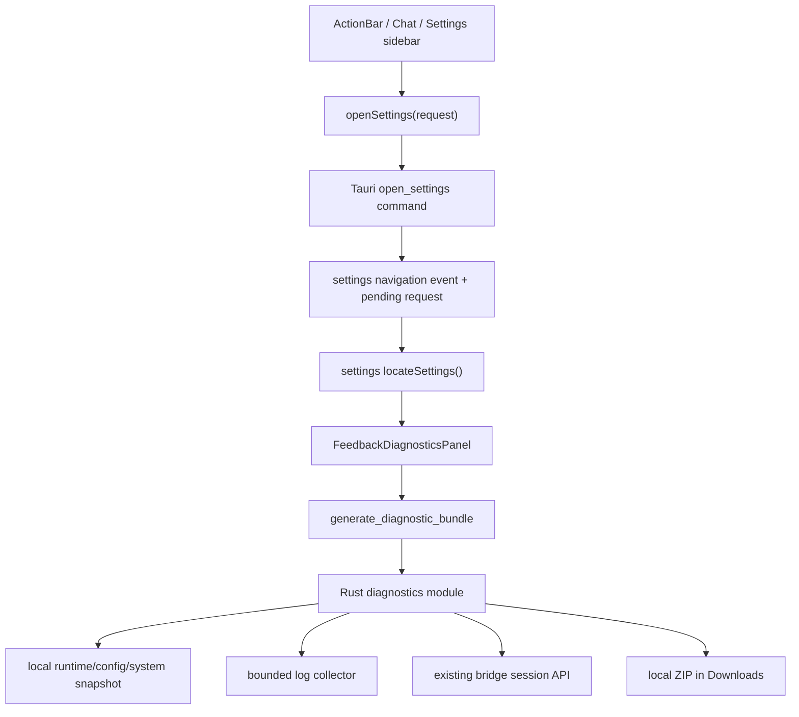
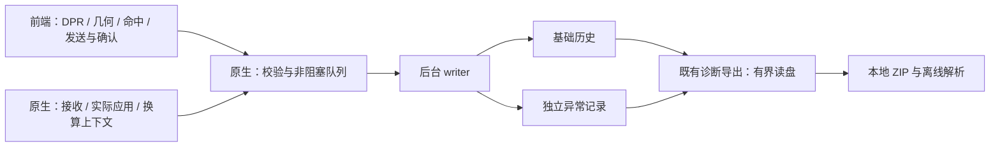

# 049 · 桌面反馈与本地诊断包导出 - 技术方案

## 状态

CONFIRMED

2026-09-05 修订：用户已确认“桌宠输入链离线证据”增量方案，包括原生统一持久化、基础历史与异常独立留存、后台有界写盘、原入口离线导出及容量/耐久性边界。增量方案见本文对应章节；确认方案不代表本增量已经实现或验收。

下方初版的现状、结构、测试与“不做”条款保留为 2026-07-15 的已交付历史；本次新增留证范围以增量章节为准。当前 ZIP 的字段与能力以 producer-owned machine contract 为事实源，不使用初版示意覆盖已经演进的实现。

## 需求文档

→ [requirement.md](./requirement.md)

## 现状分析

### 设置与入口

设置窗口已经由 Tauri 预创建并通过 `open_settings` command 打开或聚焦，但 `frontend/src/pages/settings/App.tsx` 在组件内部直接维护分类 state，跨窗口调用方只能打开窗口，不能表达“打开后定位到哪个分类”。聊天页右上角目前只有连接状态，桌宠 ActionBar 当前有五个生产按钮，新增第六个按钮不会触发分页扩容。

设置页已有 Sidebar、页面布局、分组和 Sonner 等基础组件，但尚无 Checkbox 与 Textarea。普通会话和归档会话分别由已有 store 管理，均可通过现有 sessions API 获取；当前聊天页也已经持有 `currentSessionId`。

### 会话与日志

会话由 Python `JsonlSessionStore` 管理，session id 到磁盘文件名存在安全编码规则。bridge 已提供按 id 返回完整事件流的接口，因此 Tauri 不应再次实现 JSONL 寻址、解析或事件 schema。导出成功的会话使用接口返回的完整 `events`，不重复写入派生的 `active_events`。

日志已有统一目录与轮转规则：Tauri、agent bridge 和 memory 分别写入已知文件族，开发运行态还可能存在 dev bridge/voice 日志。诊断导出只能从这些已知文件族中限额选择，不能把日志目录整体复制进 ZIP。

### 运行状态与凭据

Tauri 已经持有应用设置、运行时服务快照和运行配置状态。运行配置状态只暴露配置项名称、来源、是否已配置和生效方式，不暴露值，适合直接形成诊断摘要。

凭据可能来自环境变量、系统 keyring 或兼容的 legacy dotenv。现有 runtime config 模块已经知道受管理凭据的规范名称、别名和读取顺序，可在 Rust 内部复用该注册表形成脱敏值集合；凭据值只在生成过程内存中存在，不写入 manifest、日志或前端 payload。

## 方案设计

### 1. 责任分层



| 边界 | 责任 |
|------|------|
| settings navigation | 定义稳定目标、打开/聚焦设置窗口、可靠投递定位请求 |
| `locateSettings()` | 设置内部把语义目标解析为当前分类；侧栏、跨窗口入口和未来搜索共同复用 |
| `FeedbackDiagnosticsPanel` | 表单、会话选择、生成状态和结果提示 |
| Rust diagnostics module | 收集、限额、凭据过滤、manifest 和 ZIP 原子写入 |
| existing bridge API | 根据用户选择返回规范化的完整会话事件，不向 Rust 泄漏磁盘编码规则 |
| opener plugin | ZIP 成功后打开所在目录；失败不改变生成结果 |

诊断包生成不依赖新增服务端能力，也不调用任何外部厂商 API。bridge 只负责已选择会话的本地读取；即使 bridge 已故障，Rust 仍能生成包含基础诊断和日志的部分诊断包。

### 2. 设置语义定位

前端新增设置内部模块 `frontend/src/lib/settings/navigation.ts`，集中定义：

```ts
export type SettingsTarget =
  | "general"
  | "pet"
  | "voice"
  | "runtime"
  | "archived"
  | "feedback";

export interface SettingsOpenRequest {
  target?: SettingsTarget;
  feedback?: {
    preselectSessionId?: string;
  };
}

export function locateSettings(
  request: SettingsOpenRequest,
): ResolvedSettingsLocation;
```

`locateSettings()` 是纯解析边界：已知 target 返回对应分类和可选页面上下文；缺失或未知 target 安全回落到 `general`。它不操作 DOM，也不包含窗口 API。设置页侧栏点击同样构造 target 并经过该函数更新页面 state，未来设置搜索只需把搜索结果映射为 `SettingsOpenRequest`，无需绕过设置页状态边界。

跨窗口使用统一 `openSettings(request?)` helper 调用 Tauri：

- ActionBar 传 `{ target: "feedback" }`；
- 聊天页传 `{ target: "feedback", feedback: { preselectSessionId } }`；
- 设置侧栏传 `{ target: "feedback" }`，不携带会话预选。

Tauri `open_settings` command 接收可选 request，先保存为一次性 pending navigation，再打开/聚焦窗口并向 settings window 定向发送 `settings://navigate`。设置页同时监听事件并在 mount/重新可见时调用 `take_pending_settings_navigation`，避免窗口加载时序造成事件丢失。每个 request 带内部递增 id；设置页只消费一次，重复事件不会反复覆盖用户已经修改的会话选择。

`preselectSessionId` 只是本次显式入口的页面上下文，不进入持久设置。只有该 id 能在普通或归档会话列表中找到时才默认勾选；临时未持久化会话保持未选。

### 3. 反馈与诊断页面

设置页新增 `FeedbackDiagnosticsPanel`，页面状态保持在组件内部：

- `description: string`；
- `selectedSessionIds: Set<string>`；
- `generationState: idle | generating | success | partial | error`；
- 最近一次成功结果的本地路径与收集摘要。

问题描述与会话均为选填。会话列表同时刷新普通与归档 store，以 session id 去重，展示标题、最近活跃时间和归档标识。会话选择区持续展示以下边界：选中后会完整导出聊天内容、工具调用参数和结果，应用不会识别或删除其中的私人内容，请只选择与问题相关的会话。

本期不扫描姓名、地址、私人聊天或其他泛化敏感内容，也不为此改写会话事件。应用管理的认证凭据仍按 §7 强制过滤。

生成期间禁用生成按钮，防止同一页面重复提交。成功或部分成功后：

- Sonner 显示 ZIP 已生成，action 为“打开所在目录”；
- 页面保留完整路径和复制按钮，Toast 消失后仍可操作；
- reveal 失败只追加错误提示，不把 `success/partial` 改成 `error`；
- 整体写盘失败才进入 `error`，且不显示成功 Toast。

缺失的通用 UI 组件通过 shadcn CLI 引入 Checkbox 与 Textarea，不手写伪 shadcn 组件。

### 4. 诊断 command 与结果模型

Rust 新增 `frontend/src-tauri/src/diagnostics/`：

| 文件 | 责任 |
|------|------|
| `mod.rs` | command、编排和公开结果类型 |
| `manifest.rs` | manifest schema、collection 状态和失败记录 |
| `logs.rs` | 已知日志发现、排序和限额读取 |
| `redaction.rs` | 凭据字段过滤、已配置凭据值替换和路径匿名化 |
| `archive.rs` | ZIP entry 写入、临时文件与最终 rename |

command 接口：

```rust
struct GenerateDiagnosticBundleRequest {
    description: Option<String>,
    session_ids: Vec<String>,
    locale: Option<String>,
    timezone: Option<String>,
}

struct GenerateDiagnosticBundleResult {
    path: String,
    outcome: DiagnosticOutcome, // complete | partial
    included_session_ids: Vec<String>,
    failures: Vec<CollectionFailure>,
}
```

输入先做大小和数量校验：description 去除首尾空白，空串视为未填写，并设置合理字符上限；session id 去重并设置数量上限，防止一次操作造成无界请求。限制只保护资源使用，不替用户静默增加会话或截断成功获取的会话内容。超限输入返回明确错误，由用户调整后重试。

会话通过 `reqwest::Url::path_segments_mut().push(session_id)` 构造本地 bridge URL，避免路径注入。每个会话独立获取、校验响应并加入结果：成功项包含完整 `events` 与必要元信息；失败项不生成伪造或截断文件，而是在 manifest 和 command result 中记录。

所有文件读取与 ZIP 压缩在 blocking task 中执行，避免阻塞 Tauri async runtime。command 只返回本地路径与摘要，不把日志或会话正文返回 webview。

### 5. ZIP 结构与 manifest

文件名采用 `agent-friend-diagnostics-YYYYMMDD-HHMMSS.zip`；同秒冲突时追加递增后缀。默认目录由 Tauri `app.path().download_dir()` 获取。下载目录不可用或不可写时整体失败，不静默改写到应用数据目录。

```text
agent-friend-diagnostics-*.zip
├── manifest.json
├── problem.txt                         # 仅非空时存在
├── diagnostics/
│   ├── application.json
│   ├── environment.json
│   ├── runtime-services.json
│   └── runtime-config.json
├── logs/
│   └── <sanitized-log-name>.log
└── sessions/
    ├── session-001.json
    └── session-002.json
```

session entry 使用序号命名，原 session id、标题和归档状态记录在该 JSON 与 manifest 中，不把不受信任 id 用作 ZIP 路径。

manifest 使用显式 `format_version: 1`，至少记录：

- 生成时间、应用版本和整体结果；
- 每类收集项的 `included | missing | failed | skipped` 状态；
- 实际包含的日志文件、原始文件末次修改时间、纳入的字节区间和过滤后大小；
- 用户请求的 session id、成功写入的 ZIP entry 和失败原因；
- 凭据过滤发生次数，只记录计数，不记录原文；
- 明确声明未包含的 memory、persona、原始 settings、环境变量全集和未选会话。

ZIP 先写入目标目录下不可见的临时 `.part` 文件，全部 entry 和 central directory 成功关闭后再 rename 为最终文件。任一步骤失败即清理 `.part`；只有最终路径存在才返回成功。

### 6. 基础诊断内容

采用允许字段清单逐项构造，不序列化完整系统对象或设置文件：

| 类别 | 包含 | 排除/匿名化 |
|------|------|-------------|
| application | 产品名、应用版本、构建模式、生成时间 | 安装绝对路径 |
| environment | OS 类型与版本、CPU 架构、locale、时区 | hostname、用户名、IP、MAC、完整环境变量 |
| runtime services | bridge/voice phase、generation、最近错误的脱敏文本 | lifecycle token、子进程环境 |
| runtime config | 配置项名称、group、configured、source、effect、脱敏错误 | 实际配置值、keyring 内容、dotenv 内容 |

locale 与时区由 webview 使用 `navigator.language` 和 `Intl.DateTimeFormat().resolvedOptions().timeZone` 传入，只作为环境提示；Rust 不信任其内容用于路径或控制流。健康信息只读取现有本地 snapshot，不主动请求 LLM、语音、搜索或其他外部 provider。

错误文本和日志中的用户主目录统一替换为 `<USER_HOME>`；不收集 hostname、用户名和 IP。其他绝对路径保留到能判断项目组件/文件类别的程度，路径中命中用户主目录时先匿名化。

### 7. 凭据保护边界

凭据保护采用“允许字段构造 + 窄规则兜底”，不建设通用内容审查系统：

1. 诊断 JSON 从允许字段逐项构造，永不读取并复制完整 settings、环境变量或 credential 文件。
2. 对结构化 JSON 递归检查字段名，命中已知凭据名、`authorization`、`cookie`、`access_token`、`refresh_token`、`api_key`、`credential` 等认证字段时，用 `<REDACTED:CREDENTIAL>` 替换值。
3. runtime config 模块提供仅 Rust crate 内可见的 credential redaction values 接口，按现有优先级读取应用管理的环境变量、keyring 与 legacy dotenv 值；所有非空值仅用于精确字符串替换，生命周期限于本次生成。
4. 文本日志、问题描述和序列化后的会话 entry 在写入 ZIP 前执行已配置凭据值的精确替换，并过滤常见 `Authorization`、Cookie 和 credential key-value 形式。
5. 不识别或删除一般私人内容，不基于模糊 PII 规则省略会话事件，不改变事件顺序。用户选择和页面风险提示是会话内容控制边界。

过滤函数返回替换次数供 manifest 记录。任何过滤日志只记录类别和计数，禁止打印匹配原文。测试 fixture 覆盖各凭据来源、字段大小写、header、query/key-value 形式及凭据出现在会话正文中的情况。

### 8. 日志选择与限额

日志 collector 只接受 `paths::log_dir()` 下的普通文件，并使用允许文件族：

- `tauri.log*`；
- `agent_bridge.log*`；
- `memory.log*`；
- 开发态的 `dev-bridge.log*`、`dev-voice.log*`。

拒绝符号链接和 canonicalize 后逃出日志目录的路径。候选文件按修改时间从新到旧排序，采用两级上限：

- 单文件最多读取尾部 5 MiB；
- 所有日志写入 ZIP 前合计最多 20 MiB。

先计算本轮尚余总预算，再从当前候选文件尾部读取 `min(5 MiB, remaining)`。预算用尽后其余文件标为 `skipped(limit_reached)`；文件不存在标为 `missing`，读取失败标为 `failed`，均不阻止其他内容生成。读取从文件尾部执行，不把整文件先加载进内存；非 UTF-8 字节使用有损 UTF-8 转换并在 manifest 标记。

### 9. 部分成功语义

只有 ZIP 无法创建、写入、关闭或最终 rename 时是整体失败。以下属于非关键收集失败：

- 某类日志不存在或不可读；
- 某项 runtime/config snapshot 获取失败；
- bridge 不可用；
- 某个选中会话读取或解析失败。

只要最终 ZIP 已安全生成，结果就是 `complete` 或 `partial`。`partial` 必须同时出现在 manifest、command result、页面结果区和 Sonner 文案中。特别是会话失败时，页面列出未包含的会话，不能只显示笼统警告。

### 10. 打开所在目录

前端使用现有 `@tauri-apps/plugin-opener` 的 `revealItemInDir(path)`，并在 Tauri capability 中新增最小权限 `opener:allow-reveal-item-in-dir`。不授予通用 shell 或任意命令执行权限。

reveal 只接受刚刚由 command 返回并保存在当前页面状态中的路径。失败时 Sonner 展示“诊断包已生成，但无法打开目录”，页面继续显示路径和复制按钮。

### 11. 文件改动

| 路径 | 改动 |
|------|------|
| `frontend/src/lib/settings/navigation.ts` | 设置 target、请求类型、纯定位函数和跨窗口 helper |
| `frontend/src/pages/settings/App.tsx` | 接入统一定位、feedback 分类和 pending/event 消费 |
| `frontend/src/pages/settings/components/FeedbackDiagnosticsPanel.tsx` | 表单、会话多选、生成结果与复制路径 |
| `frontend/src/pages/chat/App.tsx` | 新增直接反馈入口，传当前持久化 session id |
| `frontend/src/pages/pet/ActionBar.tsx` | 新增第六个直接反馈入口 |
| `frontend/src/components/ui/checkbox.tsx` / `textarea.tsx` | 通过 shadcn CLI 引入 |
| `frontend/src/services/diagnostics.ts` | command 类型与调用封装 |
| `frontend/src-tauri/src/diagnostics/*` | 收集、manifest、脱敏、日志限额和 ZIP 写入 |
| `frontend/src-tauri/src/runtime_config.rs` | crate 内部凭据脱敏值读取边界 |
| `frontend/src-tauri/src/lib.rs` | 设置定位 state/commands/events 与 diagnostics command 注册 |
| `frontend/src-tauri/Cargo.toml` | 新增 ZIP 所需最小 Rust 依赖 |
| `frontend/src-tauri/capabilities/default.json` | 增加 reveal item in dir 权限 |
| 对应前端/Rust 测试 | 设置定位、预选、限额、脱敏、ZIP 与失败降级 |

## 测试方案

### 设置定位与前端

- 所有已知 target 映射到正确分类，未知 target 回落 `general`。
- 设置窗口已打开时，新的 navigation request 仍切换分类。
- event 与 pending request 同时到达时按 request id 只消费一次。
- 聊天入口只对存在的当前持久化会话做一次预选；ActionBar/侧栏不预选。
- 普通与归档会话合并、去重并正确展示归档标识。
- 空描述、零会话可以提交；生成中禁止重复点击。
- complete、partial、fatal 和 reveal failure 显示不同结果，reveal failure 保留路径。

### Rust diagnostics

- allowlist 只收集已知日志族，拒绝 symlink 和目录逃逸。
- 单文件 5 MiB、日志总计 20 MiB 的边界和从尾部读取行为稳定。
- 缺失、读取失败、预算跳过均准确进入 manifest。
- ZIP entry 名称不受 session id 控制，无 zip-slip 路径。
- `.part` 只在完整关闭后 rename，失败不留下最终 ZIP。
- 同名文件使用冲突后缀，不覆盖已有文件。
- allowlist 诊断字段中不出现 hostname、用户名、IP、完整环境变量和原始设置。
- env、keyring、legacy dotenv fixture 的凭据值及认证字段不会出现在最终 ZIP；普通私人聊天内容保持不变。
- bridge 全部成功、部分 session 失败和 bridge 完全不可用分别得到 complete/partial 结果。
- command 不发起外部 provider 请求，也不上传 ZIP。

### 跨层验收

- 从三个入口进入同一设置页面；聊天入口默认选中当前会话，其他入口不选。
- 空表单生成基础 ZIP，检查结构、manifest 和日志上限。
- 选择普通与归档会话，确认只包含选中会话的完整 events。
- 注入凭据 fixture，解压并全文检索确认无明文凭据，同时私人会话文本不被泛化改写。
- 停止 bridge 后仍生成 partial ZIP，界面和 manifest 都说明会话失败。
- 验证 Sonner、打开所在目录、reveal 失败后的路径复制。
- 运行 `./scripts/check` 全量门禁；不调用真实 LLM 或语音服务。

## 影响分析

### 上游

- `open_settings` 从无参数 command 扩展为可选 request；既有无参数调用保持打开默认分类的语义。
- runtime config 增加 crate 内部读取脱敏值的能力，不改变 webview 可见 command，也不扩大凭据前端暴露面。
- sessions API 不改协议，只新增本地 Rust 消费方。

### 下游

- 设置侧栏统一经 `locateSettings()` 更新分类，为未来设置搜索提供稳定入口，但本期不实现搜索、项级滚动或高亮。
- ActionBar 从五个生产按钮增至六个，仍处于现有单页容量内。
- 诊断 ZIP 的 `format_version` 成为后续排查工具可依赖的格式边界；新增字段应保持向后兼容，破坏性调整需提升版本。

### 风险

- 用户选择的会话可能包含未被应用管理的私人数据或未知秘密；页面必须持续提示，本期不承诺通用内容审查。
- 精确凭据替换依赖应用能读取当前凭据来源；读取失败必须进入 manifest，并仍执行结构化字段/header 规则，不能把读取失败伪装成已完整过滤。
- 日志轮转可能在读取过程中发生；collector 以打开后的文件句柄和实际读取字节为准，不要求跨文件瞬时一致性。
- bridge 故障时无法取得会话正是常见排查场景；partial 语义必须足够醒目，避免用户误以为所选会话已包含。
- 下载目录权限、磁盘空间和杀毒软件占用可能使 rename 失败；临时文件清理和可行动错误信息必须覆盖这些路径。

## 实施顺序

1. 建立 settings navigation 类型、Tauri pending/event 投递和定位测试。
2. 接入设置侧栏、ActionBar 与聊天入口，完成当前会话预选边界。
3. 通过 shadcn CLI 引入 Checkbox/Textarea，完成反馈页面与会话选择。
4. 实现 diagnostics manifest、凭据过滤和日志 collector 及 Rust 单测。
5. 接入本地 session API、基础诊断 snapshot 和 ZIP 原子写入。
6. 接入前端生成状态、Sonner、reveal 与路径复制。
7. 运行局部测试和 `./scripts/check`，再按用户选择执行真实 Tauri 视觉验收或交由用户验收。

## 明确不做

- 不上传 ZIP，不新增上传 API、工单系统或反馈后台。
- 不实现复现录制、截图、录屏或 Session Replay。
- 不实现设置搜索、设置项滚动定位和高亮。
- 不扫描或删除会话中的一般私人内容，不建设 PII/内容分类器。
- 不导出 memory DB、persona 资产、原始 settings、环境变量全集或未选会话。
- 不新增长期 DEBUG 日志模式，不改变现有日志生产方内容。
- 不调用真实 LLM、语音、搜索或其他外部厂商 API。

## 增量方案：桌宠输入链离线证据（2026-09-05）

### 1. 现状与边界

依据源码基线 `c863ac793717f3b2335993a17471b5531d1326e4`：DPR 上报由 pet `App.tsx` 的 display context effect 发起；`PetWebviewState` 保存最后到达的值；cursor feed 使用它换算物理坐标；`usePetPassthrough.ts` 计算命中并在 ignore 状态改变时调用原生穿透命令。Windows 穿透实际在主线程应用并校验样式，异步 command 完成顺序不等于应用顺序。

现有 runtime journal 有进程身份和持久化，但同步持锁写盘；Shell journal 有非阻塞队列及轮转，但缺少完整输入关联，并可能被正常事件淘汰。两者不直接承接新输入热路径。历史观察、反证及身份缺口统一见 [evidence-index.md](./evidence-index.md)，本节不另建诊断结论账本。

本增量仅观测，不改变 DPR 接收策略、换算公式、hit-test、ignore 去重、主线程调度或 cleanup fail-open，不串行化/重试业务调用，不自动更正 DPR 或重启。也不把现有 dev-only 两秒内存探针直接当成生产留证实现。

### 2. 责任与数据流

新增 `pet_input_evidence` 能力目录，由原生端统一拥有持久化、留存和导出；前端仅拥有自己观察到的事实及有界发送缓冲。复用现有进程 session ID 和路径入口，不新增服务、数据库、全局遥测框架或设置开关。



业务命令不等待证据发送或写盘。新 collector 的失败只能产生覆盖缺口，不能改变业务返回值。导出读取已持久化文件，不等待 pet 页面、collector worker 或 bridge 提供这类历史；其他既有收集项仍沿用自身的超时和 partial 处理，不为本增量重写整包流程。

### 3. 事实模型与关联

事件采用类型化 allowlist；字段缺失与未知明确表达，禁止把任意 `details`、DOM 对象、错误全文或完整平台对象透传落盘。原生分配持久化记录编号，前端编号只在所声明的页面生命周期内有意义。

| 范围 | 必要字段与语义 |
|---|---|
| 原生 envelope | `schemaVersion`、`processSessionId`、`recordSeq`、`recordedAt`（UTC）、进程单调时间、source、kind；记录编号描述入队/写入关联，不冒充跨线程实际应用顺序 |
| 前端关联 | `pageInstanceId`、页面内 `frontendSeq`、`requestId`、页面单调时间；同一页面 StrictMode effect 可多次执行，但不得生成伪页面重启 |
| DPR 写入 | 发送值、发送时实际 `window.devicePixelRatio` 与 display context 值、接收、旧值、新值、`applied/unchanged/not-applied`、写入 revision；业务值与诊断值分开 |
| cursor 上下文 | `sampleId`、所用 DPR revision、scale 值与来源（webview / fallback）、原生窗口原点、选中的有限物理/CSS 坐标样本 |
| 命中决定 | 既有 reason 枚举、sprite bounds、alpha 是否参与及已有结果、dragging、期望 ignore、关联 sample；没有运行 alpha 时不得填“alpha 未命中” |
| 穿透应用 | 关联 request、主线程 `applySeq`、执行阶段、请求 ignore、可得的 before/expected/actual 样式位和校验结果；前端 ack 单列 |
| 环境身份 | 发生时 build/source/dirty、运行模式、平台与 WebView 版本（可获取时）、有限显示几何/缩放、页面/进程身份；身份不可取得时声明缺口 |

关键插点：

- DPR：在原业务锁内捕获值与 revision，随后锁外 `try_send`；等值早退也留下 `unchanged` 结果，但不增长有效写入 revision。锁失败仍维持原业务返回语义。不得让诊断序列修改最后到达值覆盖策略。
- cursor：同一次锁读取 DPR 与 revision，避免拼出从未存在的组合。现有 `x/y` 保持不变，附加诊断关联上下文；不得为了日志增加原生鼠标轮询或逐帧写盘。各原生几何 API 并非原子桌面快照，需要保留采样边界而非声明同时性。
- 前端：在已有初始读取、viewport/DPR 变化和上报点取值；在既有命中结果产生后采集，不额外执行 `elementFromPoint`、alpha readback 或改变业务事件监听顺序。reason 改变但 ignore 不变时仍可记录“决定、未发命令”，不能伪造原生请求。
- Windows：在真正的主线程 closure 内标识 apply 顺序并捕获已有操作结果，不把 command 入站或 Promise 完成当作 apply。若样式写入后刷新失败，记录“可能部分执行、验证未知”，而非“未发生写入”。不新增为了遥测而执行的样式写操作。
- 现有命令附加可选诊断 metadata；采用宽入口、内部容错的解析方式，metadata 缺失/畸形只使诊断降级，不能让此前有效的 `dpr` / `ignore` 命令被框架反序列化拒绝。原窗口权限检查保持不变。新诊断专用命令仅允许 pet 来源，严格限制批次、字符串和数值。
- 诊断 report、业务 command、原生结果与前端 ack 允许丢失或乱序到达；解析器按 ID 连接事实，不补造缺失阶段，不按跨进程/页面的 wall clock 推断唯一总顺序。

持久化的每个历史段和独立异常文件都带最小发生时身份头，不能只引用可能已淘汰的启动记录。前端摘要带当时 display revision；跨页面关联失败保留为未知。完整版本/身份快照不是每条事件重复一份。

### 4. 默认采集、频率与异常识别

基础采集从原生启动与页面初始化开始，覆盖 display/DPR、命令生命周期、命中 reason 与 ignore 状态变化。稳定时每 60 秒写覆盖心跳，注明页面最后上报及最新证据时间；心跳不证明每个中间动作都被记录，不能将页面沉默判为健康。

高频 hover/drag 不逐帧持久化：reason/状态变化最多保留 4 条代表记录/秒，重复原因按秒汇总次数和首末序号；普通坐标仅在选中的状态转换上下文中保留，最多 1 组/秒，不为达到频率而定时采集。稳定 hover/拖动只记录无坐标摘要及起止变化，不形成连续低频轨迹；状态记录其余部分只保留 reason/计数。DPR、页面生命周期及真实命令结果使用独立控制事件配额，保留启动短时突发，不受普通命中采样先行耗尽；控制事件限速 32 条/秒、允许 64 条突发，超出也只丢诊断且累计缺口。限额作用于观测记录，绝不限流业务命令。

前端诊断批量发送最多 4 次/秒，每批最多 16 条且不超过 64 KiB；本地缓冲最多 64 条/256 KiB。flush 不成为业务调用的前置条件；发送失败不无限重试，记录丢失计数并在下一次成功时携带缺口。原生对批次再次校验和限流，不能信任前端限额。

首批识别范围仅是“值得保留现场的信号”，不是根因分类器：

- 同一页面、display 状态已稳定的连续样本中，前端实际 DPR 与原生 sample 所用 scale 持续不一致（至少 3 个有效样本、持续至少 500 ms）；瞬时变化仍进入基础历史，不直接断言故障。
- DPR/穿透命令明确失败、Windows 样式校验失败或部分应用；无 ack 只能记为确认缺失，不等同于原生失败。
- 观测器队列/记录丢失、写入失败等属于 coverage 问题，单独计数；不能伪装成桌宠业务故障。

同一页面同一信号持续发生时合并首末时间与次数，不按每帧新建异常。对应成功结果或连续 2 秒有效一致样本可标记观察到恢复；页面/进程结束但无恢复证据时以“结束、恢复未知”封口。恢复后再次发生建立新 ID。旧页面迟到事件不能修改新页面的当前异常状态。

每个异常立即保留已有有界前文，并追加最多 10 秒后文；前文来自最多 30 秒/256 KiB 的共享内存环，不承诺完整帧流。异常超过单个预算时保留身份、首个信号、最终摘要与截断说明；持续信号更新最多一次/秒，避免制造新日志风暴。无任何自动识别命中时，基础历史仍照常保存。

### 5. 留存、资源与耐久性

在 `paths::log_dir()` 下新增专用 `pet-input-evidence/` 目录，由 `paths.rs` helper 定位；不写用户资产目录、settings 或 localStorage，也不混进普通日志的 20 MiB 尾部选择预算。

| 资源 | 固定上限或节奏 | 达到边界时 |
|---|---|---|
| 基础历史 | 最大年龄 7 天，总量 16 MiB，单段最多 2 MiB | 按段淘汰最旧历史，记录原因及可确定的时间/序号范围 |
| 异常文件 | 最大年龄 30 天、最多 32 个、总量 8 MiB；单个最多 256 KiB | 时间、数量、字节先到者生效；仅异常自身配额/期限触发淘汰，不被普通历史替换 |
| 诊断事件 | 单条序列化后最多 4 KiB | 拒绝超限 payload，只计原因/数量；不任意截断 JSON 后当作完整事件 |
| 原生待写队列 | 最多 256 条且最多 1 MiB | `try_send` 失败累计丢失区间，不等待空间 |
| 新采集缓冲 | 前端缓冲、原生队列、批次与共享上下文合计 payload 预算不超过 2 MiB | 测试逐项核算，任何额外缓存纳入预算；不是整个进程 RSS 上限 |
| 索引、覆盖摘要及临时文件 | 合计最多 1 MiB，包含不超过 256 条淘汰摘要 | 更旧摘要折叠成计数和未知范围；达到元数据边界也必须可见 |
| 新证据磁盘与导出读取 | 合计最多 25 MiB（16 + 8 + 1）；导出不先读取整个日志目录 | 所有读取和扫描都有文件数/单条/总字节边界；超限明确停止该类读取 |
| 写入/同步 | 正常每 1 秒 flush、每 5 秒请求文件同步；新异常立即请求同步 | 慢盘仍在后台排队，不承诺绝对时间内持久化 |

这些是最大窗口而非最低保留承诺：高频状态变化可能先耗尽容量。实施压力数据若要求扩大限额或改变上述对外边界，回到方案确认，不静默调大。段头、JSON 换行、异常摘要和临时写入都计入预算。

后台 writer 使用独立非阻塞入口；不复用同步 `RuntimeObserver::record` 承载输入事件，只复用其进程身份。启动保留旧数据，不清空目录；复用现有桌面实例所有权边界，按 process session 隔离文件名，不新增另一套实例抢占。重叠退出/启动时不得覆盖旧进程文件；无法确认写入安全时降级留证，不阻止应用启动。

文件按完整 JSONL 行追加，异常与覆盖摘要使用同目录临时文件写入后原子替换，并预留临时文件额度。超额时先执行受限范围内的既定淘汰，不能短时无界增长；无法安全回收时停止新证据写入。只管理专用目录内可识别的自有文件，不递归清理其他日志，不跟随 symlink/reparse 逃逸。

正常退出在有界等待后尝试写结束记录并同步；不能为日志延迟退出。突然终止时只读取完整行，损坏/不完整尾行计入缺口。没有正常结束标记时，保留“最后已知写入/同步位置与未知尾部”，不能宣称仅损失恰好 5 秒；操作系统、存储缓存、满盘及慢盘可能扩大范围。磁盘全满后立即崩溃可能连失败原因都无法保存，该边界必须诚实说明。

时间排序优先使用进程内单调序号；UTC 用于跨启动定位和年龄判断。时钟回拨/跳变标明不确定性，不能仅因矛盾 wall clock 把记录解释为先后倒置；容量规则仍可执行，不能无限保留。恢复后的 writer 将内存中仍存在的失败/丢弃摘要落盘，不补造已丢失内容。

### 6. 导出、覆盖与机器契约

新 collector 直接从专用磁盘目录生成 artifact；不依赖 pet、事件队列 flush、异常检测线程或当前截图。可得的原生当前快照仅作附加、显式标为 export-time，缺失不会阻止历史导出。设置和聊天反馈入口继续可用；无需选择会话，也不新增独立救援导出工具。

拟新增的 entry family：

```text
diagnostics/pet-input/coverage.json
diagnostics/pet-input/current.json              # 可选，导出时状态
diagnostics/pet-input/history-*.jsonl            # 有界历史段
diagnostics/pet-input/incident-*.json            # 独立异常
```

entry 名由生产者分配的序号生成，不使用前端 page/request ID 或磁盘绝对路径。`coverage.json` 总是输出，即使目录不存在或全类读取失败；manifest 增加 `petInputEvidence` 摘要并引用实际 entry、能力支持、覆盖区间和失败计数，不在多处复制完整事件。

覆盖说明包含实际时间/序号范围、发生时身份、规则上限、聚合/丢失/淘汰计数、最后持久化信息和逐类状态。分别表达 `not-collected`、`unsupported`、`not-covered`、`expired`、`evicted`、`truncated`、`write-failed`、`read-failed`、`corrupt-tail` 及可用记录；无法确定原因时记 unknown，不能仅凭文件不存在断言从未发生异常。计数只在确有证据时填写精确数字。

正常的有限保留/平台不支持必须在 coverage 中可见，不等同于整包损坏；实际采集或读取失败进入既有 `CollectionFailure` 并使结果 partial，其余内容继续导出。ZIP 写盘失败仍是整体失败。complete 仅表示本次收集流程成功，不能被解释成历史无缺口。

导出与轮转并发时按已打开文件句柄、冻结的读边界和实际完整行取证；记录文件内身份及最终读取字节，不能先记旧文件清单再读被同名替换的新文件。扫描/打开失败单列；当前 append 尾部变化不要求跨文件一致性锁。导出不会为等待 writer 恢复而卡住，也不改变持久化文件。

以现有 formatVersion 1 / schemaRevision 9 为基线，兼容新增提升 revision（当前下一版为 10；落地前核对主干是否已占用），新增 capability `pet-input-evidence-v1`。在同一 changeset 更新 producer contract、manifest builder、entry 白名单、真实 `inspect_bundle.py` handler 和 `bundle-format-v1.md` 语义。生产者声明此能力时要求 coverage entry；旧 v1 无此能力/字段不报损坏，未知能力继续报告 `unhandledCapabilities`。解析器默认只输出身份、覆盖和异常摘要，不打印历史坐标序列或其他原文。

### 7. 隐私与跨平台

持久化前按字段 allowlist 构造并校验有限数值、枚举和受限 ID；错误保存阶段/错误类别/可用原生错误码，不保存任意错误字符串。DOM 命中只记固定 reason，不复用现有 debug 的 tag/id 描述。显示信息只保留必要几何、缩放和进程内编号，不保存显示器名称、设备序列号、用户名、桌面标题、IP、URL query 或路径全集。

不得新增聊天、按键、剪贴板、鼠标轨迹、DOM 内容、模型资源、截图/录屏采集；现有会话、附件原件和 render evidence 的显式选项保持不变。新 artifact 在生产端就满足隐私边界，不能依赖普通日志 collector 的事后脱敏。新证据不发外部请求，不上传。

前端 observation、进程身份、几何、命令结果、留存和离线导出使用跨平台实现。Windows 记录已有样式应用/校验事实和可获取的 WebView2 版本；其他平台仅报告实际 API 返回与可读信息，不填写 Windows 样式结果，也不把 API 成功等同于操作系统命中行为已证实。未在目标平台跑过的行为明确 not verified。

### 8. 涉及文件与实现分层

| 路径 | 变更责任 |
|---|---|
| `frontend/src/pages/pet/inputEvidence/` | 页面身份、类型化采集、有限缓冲/批次、去重/计数及单测，不新建业务 state 真相源 |
| `frontend/src/pages/pet/App.tsx` | 接入既有 display 观察与 DPR 上报生命周期，不修改 state 更新和上报调度策略 |
| `frontend/src/pages/pet/usePetPassthrough.ts` | 复用已有命中结果，关联 sample/request 与 ack，保留 ignore 去重及 cleanup |
| `frontend/src-tauri/src/pet_input_evidence/` | 按 model、manager、journal/export 职责就近拆分；固定预算、检测/归并、持久化、离线读取和单测 |
| `frontend/src-tauri/src/lib.rs` | manager 生命周期、诊断 command 注册、DPR 结果与 cursor 上下文关联 |
| `frontend/src-tauri/src/pet_cursor_passthrough.rs` | 实际应用阶段观测，不改变原平台适配或权限 |
| `frontend/src-tauri/src/paths.rs` | 新增专用证据目录 helper，沿用现有日志路径策略 |
| `frontend/src-tauri/src/diagnostics/mod.rs`、`contract.rs`、`bundle-contract-v1.json` | 新 collector/摘要、失败聚合、25 MiB 预算和 capability/entry 合同 |
| `.cursor/skills/inspect-agent-friend-diagnostics/scripts/inspect_bundle.py`、`references/bundle-format-v1.md` | 真实解析 handler、缺口及身份语义；SKILL 路由仅在确有必要时改 |
| `scripts/check/test_diagnostic_bundle_contract.py` 及前端/Rust 对应测试 | 真实 producer ZIP、消费者契约、旧包、队列/磁盘故障、预算与业务无干扰验证 |

不引入新第三方依赖作为默认前提；如现有能力不足必须新增依赖或改变模块边界，先说明必要性并确认。可重复验证优先复用项目双端 scripts，确需新入口时同时提供 `run.sh/run.ps1` 并登记；修改消费 Skill 时执行对应维护 skill 及项目 adapter sync/doctor，不手改生成副本。

### 9. 验证路径与影响控制

以下是对 requirement 中既有 OFF 条目的验证映射，不新增另一份验收标准：

| 需求条目 | 验证方法 |
|---|---|
| OFF-01、OFF-04 | fake clock/transport 固定初始化、DPR 变化、等值写入、命令失败/乱序/丢失/旧页面迟到；确认未触发 detector 仍有基础历史，实际 apply 与 ack 可分别关联 |
| OFF-02、OFF-03 | 临时目录跨 writer 实例重启、残缺尾行/无结束标记、正常活动洪泛、多异常恢复与再发、按年龄/数量/字节淘汰；不能以同一内存对象复用代替跨进程持久化 |
| OFF-05、OFF-06 | pet producer 永不响应或已结束时直接导出磁盘；目录缺失、读取失败、损坏、write failure、metadata 丢失、轮转并发均检查 coverage/partial 与其余 entries |
| OFF-07 | 确定性注入 60 Hz hover/drag 与 1,000 条/秒诊断洪泛，模拟 24 小时与跨保留期；断言所有条目/队列/字节/临时文件预算，慢盘/满队列不改变业务调用参数、次数、返回或调度依赖 |
| OFF-08 | 以 DOM id/正文、URL、路径、credential、非有限数值和超长错误字符串作隐私/输入 fixture，解压实际 ZIP 检查；原命令诊断 metadata 缺失/畸形时保持业务语义 |
| OFF-09 | Rust 真实 manifest/ZIP producer 与机器契约测试；Python 用真实 ZIP 验证新增 handler、旧 v1 无能力与未知能力；不只手拼理想 JSON |
| OFF-10 | 获得实现授权后，在来源新鲜的真实 Tauri 开发运行态产生证据、退出/重启、从现有入口导出，再独立离线解析。2026-09-05用户明确豁免本轮电脑重启实测，未执行，不列为本轮合入门槛；产品跨重启留存设计不变 |

压力测试使用 fake/mock，不调用真实 LLM 或其他外部厂商 API。机制测试之外记录真实桌面高频 hover/drag 的响应观察；不得仅用平均吞吐证明“没有交互阻塞”。项目全量 `scripts/check`、前端相关检查、Rust 检查以及消费者/adapter 门禁在实现后执行，本轮方案落盘不冒充已执行。

真实桌面链路验证不要求原自然故障再现；若使用受控诊断 fixture，标明注入层，不能把它当作原 DPR 触发根因证据。旧 fd7c fix dev 属于此前取证工作区，不可验收新分支代码；按用户要求保留，不自动停止或启动安装版。新分支运行态切换须核对并取得必要的生命周期授权；本增量不自动构建安装包。

实施顺序为：先固化事实模型、预算及无干扰测试，再实现原生持久化与前端关联，随后接入 ZIP/消费者，最后完成故障压力、重启导出和用户验收。各步在 Phase 3 的 progress 中追踪；尚未获得本增量产品代码实现授权时不开始这些动作。

## 变更记录

| 日期 | 变更内容 | 是否需要重新实现 |
|------|---------|----------------|
| 2026-07-15 | 初版方案确认：三个入口统一定位到设置；聊天入口携带一次性会话预选；Rust 本地收集与原子 ZIP；会话走现有 bridge API；日志单文件 5 MiB、总计 20 MiB；只强制过滤凭据，不审查一般会话隐私；部分失败仍生成并明确标记 | 新设计，待实现 |
| 2026-09-05 | 用户确认桌宠输入链离线证据增量：原生统一持久化、独立历史/异常预算、后台写盘与耐久性缺口、实际应用关联、磁盘离线导出及 producer/consumer 同步；保留初版历史 | 新增范围待实现；旧功能不重做；本次确认不包含产品代码实现或验收 |
| 2026-09-05 | 用户明确豁免本轮电脑重启实测，按已有验证验收并合入推送；同步OFF-02/10验证边界 | 不需重新实现，不改变留存/隐私/耐久性策略；电脑重启实测仍是未执行事实 |
