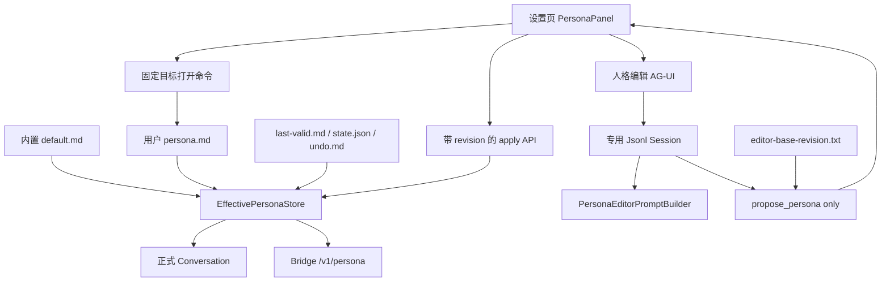

# 050 · 单一人格自定义 · 技术方案

## 状态

CONFIRMED

## 需求文档

→ [requirement.md](./requirement.md)

## 0. 设计摘要

本需求不把现有 persona 基础设施扩成产品级多人格系统，而是在默认 persona 的稳定 ID 上增加唯一用户文件。项目内置 `default.md` 是随包发布的出厂基线；操作系统用户数据目录中的 `persona.md` 是正式对话、自然语言编辑和外部文件编辑共同读取的公开真相源。

核心方案：

1. Agent 层用 `EffectivePersonaStore` 管理出厂基线、用户文件、最后有效副本、revision、撤销和恢复。
2. Bridge 启动时即创建 `persona.md`，产品不区分“默认/已自定义”；正文第一处一级标题投影为朋友展示名。
3. 自然语言调整使用完整 Agent tool-call loop：专用人格编辑 session、专用 system prompt、唯一的 `propose_persona` 工具，通过 AG-UI 与前端多轮对话。
4. 编辑 session 和最初正式人格 revision 持久化在 persona 内部目录；前端只投影服务端事件，不拼装 Agent 历史。
5. 设置页复用正式聊天抽出的 `MessageTimeline`、`ChatSenderBox`、AG-UI reducer 和 Markdown 渲染，同时提供当前、候选、diff 三个正文视图。
6. 候选应用使用编辑工作区固定 revision 做乐观并发控制；外部修改发生后，旧工作区生成的任何后续候选都不能覆盖新文件。
7. 正式用户回合开始时冻结有效人格快照，同一 tool loop 始终使用同一内容；下一用户回合重新读取。
8. 高级入口由 Tauri 固定目标命令打开已知的 `persona.md` 或目录，不向前端开放任意本地路径。

## 1. 边界

- 产品层只编辑默认 persona 的内容，不新增 persona ID，也不修改 session 的 persona 归属字段。
- 底层旧 persona catalog/list/switch 能力暂不删除，但新 UI 与新 API 不暴露它们。
- 用户正文只能替换 `PersonaSection`；项目身份、工具、记忆、不可信内容和输出协议仍由公共 section 装配。
- 不引入文件 watcher、数据库、人格模板库、多人格切换、候选试聊沙盒或应用内 Markdown 编辑器。
- 编辑 Agent 不挂长期记忆、正式 session store、通用工具或 AgentRuntime listener。

## 2. 总体架构



| 层 | 职责 |
|---|---|
| Agent | 人格解析、有效版本、回退、revision、编辑 prompt、工作区 revision、提案工具、回合快照 |
| Bridge | 单一人格 HTTP/AG-UI 契约、专用编辑 session、校验和错误映射 |
| React | 编辑事件投影、当前/候选/diff、应用、冲突和高级入口 |
| Tauri | 打开固定人格文件或目录，不读写正文业务 |

## 3. 人格真相源与落盘

```text
<user_data_dir>/
└── personas/
    ├── default/
    │   └── persona.md
    └── .internal/
        └── default/
            ├── last-valid.md
            ├── state.json
            ├── undo.md
            ├── editor-base-revision.txt
            └── editor-sessions/
```

- `persona.md` 只包含正文，不含 frontmatter、UUID、revision 或 UI 状态。
- 默认 persona UUID 继续是 `00000000-0000-4000-8000-000000000001`。
- Bridge 启动时调用 `materialize()`；文件缺失时以内置基线原子创建。
- 有效用户文件优先；空文件、非法 UTF-8、超长或不可读时使用 `last-valid.md`，没有有效副本时回退内置基线并返回诊断。
- 写入采用同目录临时文件、flush、`os.replace`，避免正式回合读到半份内容。
- `display_name` 从第一处代码围栏外的一级标题派生；没有标题时回退“你的朋友”。它只是正文投影，不是第二真相源。

`revision` 是包含源状态与原始字节的 SHA-256 令牌。外部编辑、删除或写坏文件都会改变 revision；apply 在同一临界区重新读取并比较，旧 revision 返回 409。

## 4. 多轮人格编辑 Agent

### 4.1 专用会话

人格编辑使用固定内部 thread ID 和独立 `JsonlSessionStore`。`SessionManager` 配置：

- `PersonaEditorPromptBuilder`：每个回合注入当前正式人格；编辑历史中最近一次提案是工作草稿。
- `NaiveContextManager`：保留多轮编辑历史，不与正式上下文压缩状态混用。
- `ToolRegistry([ProposePersonaTool])`：唯一工具；不开放搜索、历史、文件或外部动作。
- `memory=None`，不注册正式 runtime listener，也不进入正式会话列表。

信息不足时，模型用普通 assistant 消息提出一个具体问题。准备好候选时必须调用 `propose_persona`，提交完整 Markdown 和 1–5 条摘要；工具负责正文校验、展示名投影和结构化 tool result。

### 4.2 编辑工作区 revision

创建编辑 session 时，把当前正式人格 revision 原子写入 `editor-base-revision.txt`。所有后续提案都读取该固定值，而不是在工具执行时重新读取当前文件。

因此：

1. 编辑工作区从 revision A 开始。
2. 外部编辑把正式文件改成 revision B。
3. 用户继续多轮编辑，后续候选仍携带 A。
4. apply 比较 A 与 B，稳定返回 409，不会静默覆盖外部修改。

应用、放弃、撤销已应用修改或恢复初始人格时，清理编辑 session 和基准文件。若旧开发版本留下 session 但没有基准文件，服务 fail closed：丢弃未应用工作区并从当前正式人格重新开始。

## 5. 对话 UI 复用与候选审阅

正式聊天的 `MessageList` 保持为 conversation store adapter；其内部导出受控 `MessageTimeline`。人格页组合：

- `MessageTimeline`：共享 TDesign 消息、Markdown、滚动、流式和错误展示。
- `ChatSenderBox`：共享 placeholder、padding、发送/停止状态和输入事件。
- `runAgentStreamAtPath` + `applyAguiEvent`：共享 AG-UI 解析和消息投影。
- `visiblePersonaEditorMessages`：隐藏 `propose_persona` 工具卡，保留普通编辑对话。

人格约束区始终渲染当前正文。产生候选后提供：

- 当前版本；
- 候选版本和变化摘要；
- 行级 LCS diff，超出矩阵预算时退化为整段删除/新增。

正文使用 `react-markdown` 与 `remark-gfm`，不维护自定义 Markdown parser。当前、候选和 diff 区域设置统一最大高度并独立滚动。本期不再提供独立候选人格试聊。

## 6. Bridge API

新接口使用单数 `/v1/persona`，与保留的底层 `/v1/personas` 区分。

### 6.1 正式人格

- `GET /v1/persona`：返回 `content`、`displayName`、source/status、revision、文件状态、诊断和是否可撤销。
- `PUT /v1/persona`：接受完整候选和 `expectedRevision`；成功后清理编辑工作区。
- `POST /v1/persona/materialize`：幂等准备公开文件。
- `POST /v1/persona/undo`：消费最近一次 guided apply 的单次撤销点，并清理编辑工作区。
- `DELETE /v1/persona/customization`：以出厂基线覆盖公开文件，清理 undo 和编辑工作区。

### 6.2 编辑工作区

- `GET /v1/persona/editor`：返回固定 thread ID、独立 session events 和最近候选。
- `DELETE /v1/persona/editor`：删除编辑 session 与基准 revision。
- `POST /ag-ui/persona-editor/run`：只接受固定 thread ID，通过通用 encoder 流式执行编辑 Agent。

候选正文只存在于未应用编辑 session；apply 前不写 `persona.md`。稳定错误码覆盖内容无效、revision 冲突、读写失败和撤销不可用；AG-UI 运行错误使用通用 terminal event。

## 7. Tauri 本地文件操作

前端先调用 materialize，再 invoke：

```rust
fn open_persona_target(target: PersonaOpenTarget) -> Result<(), String>
```

命令只从 `paths::editable_persona_path()` 计算目标；canonical file 必须位于预期目录内。`File` 用系统默认应用打开，`Folder` 打开固定目录。前端不传任意 path，也不获得通用文件打开权限。

存在编辑对话或候选时，高级入口先弹窗说明外部编辑不会自动合并。只有服务端成功清空工作区后才打开目标；清空失败时保留当前页面并提示错误。

## 8. 正式对话回合快照

`Conversation.stream()` 和 edit-resend 在新用户回合第一次组装 prompt 前冻结 `EffectivePersonaStore.load()` 的内容。同一回合的后续 LLM/tool loop 复用静态 persona source；下一回合重新读取。

`MarkdownPromptBuilder.with_session()` 保留注入的 persona source，公共 section 顺序与内容不变。文字聊天、桌宠、语音和 IM 共享同一有效人格文件，但当前通道 voice section 仍按原逻辑覆盖表达细节。

## 9. 外部变化与页面同步

- 正式对话每个新用户回合读取一次。
- 设置页进入、窗口 focus 和可见期间低频刷新 `GET /v1/persona`。
- 有候选时发现 revision 改变，只标记 conflict，不替换编辑历史；固定基准与后端 409 是最终防线。
- 外部文件错误展示诊断；修复后下一次刷新自动恢复。
- 外部删除会在下一次读取时重新 materialize 出厂基线。

## 10. 测试策略

### Agent

- materialize、有效/无效/last-valid、原子写、revision、undo、reset。
- 一级标题展示名投影与完整默认人格维度。
- 编辑 prompt 回合快照、提案工具 schema/校验。
- 编辑工作区跨多轮保持最初 revision；外部变化后新候选仍携带旧基准。
- 正式 tool loop 内人格不变，下一回合更新。

### Bridge

- 状态、apply、409、undo、reset 和错误映射。
- 编辑 AG-UI 使用独立持久化 session，不写正式 session 或 memory。
- 工具提案可从 session 恢复；apply/discard 后工作区清空。
- 外部编辑后继续生成候选仍不能绕过 revision 冲突。

### Frontend

- 设置导航、候选 tool result 投影、提案工具卡隐藏。
- 当前/候选行级 diff、冲突禁用和放弃清空。
- 通用 HTTP/AG-UI 路径和错误映射。
- lint、颜色、UI 来源、设计 token、TypeScript 与 Vitest 门禁。

### Tauri

- Python/Rust persona 路径及 `AGENT_FRIEND_DATA_DIR` override 对齐。
- command 只接受 File/Folder，canonical path 越界时拒绝。

真实 LLM 编辑属于观察型验收，执行前遵守项目授权规则。设置页视觉需要真实 Tauri 桌面端另行确认，不能用 web 预览代替。

## 11. 风险与缓解

| 风险 | 缓解 |
|---|---|
| 多轮编辑逐步漂移 | 最近完整提案作为工作草稿；prompt 要求保留未被否定的内容；正文和 diff 可见 |
| 外部编辑与候选互相覆盖 | 固定 base revision + apply 原子 compare-and-write + 409 |
| 外部文件写到一半 | 应用内原子写；外部无效期间使用 last-valid |
| 同一 tool loop 人格变化 | 回合开始冻结静态 snapshot |
| 编辑对话污染正式数据 | 独立 store、专用 prompt/工具，memory/runtime 隔离 |
| UI 复用误接正式 store | 只复用受控时间线、sender、reducer 和 stream；PersonaPanel 自有 state |
| Tauri 文件权限过宽 | 固定目标 command，不暴露 `openPath(path)` |
| 内置默认人格升级覆盖用户 | 已存在公开文件永不自动覆盖；新基线仅用于首次创建和用户确认后的恢复 |

## 12. 变更记录

| 日期 | 变更内容 | 影响范围 |
|---|---|---|
| 2026-07-15 | 初版：单一有效人格覆盖、前端草稿栈、非工具改写、隔离单轮试聊 | Phase 2 |
| 2026-07-16 | 按交互验证重构为持久化多轮编辑 Agent + AG-UI；直接展示当前/候选/diff，移除独立试聊和逐步草稿撤销；展示名由一级标题派生；工作区固定 revision | Phase 2 修订 |
