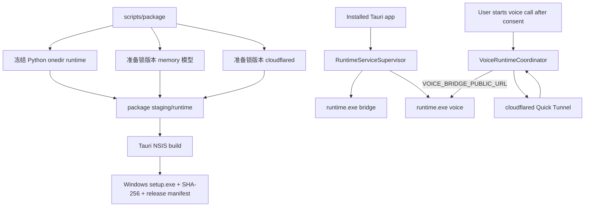

# 051 · Windows 完整运行时打包与可升级安装 - 技术方案

## 状态

CONFIRMED

## 需求文档

→ [requirement.md](./requirement.md)

## 结论

本需求把当前“源码仓库 + uv + Tauri dev”运行态收敛成一个 Windows x64 产品安装单元：

1. 用 PyInstaller `onedir` 冻结一份共享 Python 运行时，由一个 launcher 通过 `bridge` / `voice` 子命令启动两个服务，避免重复打包 Python 和 native 依赖。
2. Tauri 将冻结运行时、memory 生产模型、cloudflared 和现有头像资源作为安装资源随 NSIS `.exe` 交付。
3. 047 的 `RuntimeServiceSupervisor` 保留生命周期、readiness、端口保护和退出清理，新增 source / packaged 两种 launcher；release build 不再跳过后端启动。
4. 完整语音通话新增显式 `VoiceRuntimeCoordinator`：只有用户已同意公网穿透并发起通话时，才启动 cloudflared、取得临时 URL、以该 URL 启动或重启 voice bridge。
5. 第一版更新只走人工分发新版 NSIS 安装程序后的覆盖升级，不接 updater plugin、更新 endpoint 或发布服务器。

选择 `onedir` 而不是 `onefile`，是因为本项目包含 ONNX Runtime、sqlite-vec、tokenizers、keyring 和多个动态导入路径。安装器本来就是多文件交付单元，`onedir` 能避免每个服务进程启动时重复解压到临时目录，也更利于 native DLL 发现、问题诊断和构建产物盘点。

## 现状分析

### 现有桌面构建只覆盖 Tauri 壳

- `scripts/frontend/build.*` 只执行 `pnpm tauri build`。
- `frontend/src-tauri/tauri.conf.json` 已启用 bundle，并包含 Live2D / Spine seed 资源，但没有 Python 运行时或 cloudflared。
- bundle target 当前是 `all`，没有为首个 Windows beta 收敛到 NSIS `.exe`。
- 产品版本在 `tauri.conf.json`、`Cargo.toml` 和前端 package 中都还是 `0.1.0`，缺少发布前一致性校验。

### 047 只实现了源码开发态 launcher

`frontend/src-tauri/src/runtime_services/supervisor.rs` 当前：

- 从 `AGENT_FRIEND_REPO_ROOT` 得到源码根。
- 固定执行 `uv run python -m agent_bridge|voice_bridge`。
- 没有源码根时返回 `source_runtime_unavailable`。
- Tauri setup 只在 `debug_assertions` 下启动 bridge / voice，release build 不启动后端。

readiness、lifecycle token、端口冲突保护、受控 shutdown、generation 防旧结果覆盖和 app exit 清理已经具备，应复用而不是另建一套打包态 supervisor。

### Python 生产运行闭包不等于 workspace 全集

运行时入口的真实依赖闭包是：

```text
agent-friend-runtime
├── agent_bridge
│   ├── agent
│   │   ├── memory
│   │   └── llm_providers
│   └── runtime_config
└── voice_bridge
    └── runtime_config
```

还包含 FastAPI / uvicorn、Pydantic、Tavily、QQ SDK、cryptography、keyring、ONNX Runtime、sqlite-vec、tokenizers、numpy 等第三方依赖。`agent_eval`、`memory_eval`、benchmark、tools、experiments 和 tests 不是生产闭包。

PyInstaller 的 import 分析不能自动保证收齐以下内容：

- `agent/personas/default.md`。
- `agent/prompt_sections/*.md`。
- `memory/extraction/prompts/*.md`。
- QQ SDK、keyring backend、uvicorn 等条件或动态导入模块。
- ONNX Runtime provider DLL、sqlite-vec 扩展、tokenizers 等 native binary。

因此必须有显式 spec、hook 和构建后 smoke，不能只跑一条无配置的 PyInstaller CLI 后直接发布。

### memory 生产模型当前位于用户数据目录

048 已把生产 dense 检索收敛为量化 BGE-small-zh ONNX + tokenizers + sqlite-vec。当前 `memory.build_memory()` 默认从 memory DB 同级的 `models/bge-small-zh-v1.5/` 发现模型，适合开发安装脚本，但安装包不应在首次运行时再联网下载模型，也不应把同一只读模型复制到每个用户数据目录。

### 完整语音通话还有 tunnel 运行时

当前完整语音模式由 `scripts/dev --voice`：

1. 启动 `cloudflared tunnel --url http://127.0.0.1:18900`。
2. 等待并解析随机 `trycloudflare.com` URL。
3. 把 URL 注入 `VOICE_BRIDGE_PUBLIC_URL`。
4. 再启动或重启 voice bridge。

029 和决策 0005 已锁定“公网穿透必须由用户显式同意”，不能因为打包自动化而改成静默启动。Cloudflare 官方把 Quick Tunnel 定位为测试用途，适合本期可信用户 beta，但不作为生产 SLA 承诺。

### 用户数据已经与安装目录分离

sessions、memory DB、personas、IM 数据、settings、keyring 和日志已经走系统标准目录。只要 installer identity 与这些路径约定保持稳定，覆盖升级无需迁移或复制用户数据。

## 外部依据

- Tauri v2 sidecar 文档：外部运行时应作为 bundle 资产交付，并由 Core process 受控启动。
- Tauri v2 Windows installer 文档：NSIS 可生成 `.exe` 安装程序，WebView2 可由 bootstrapper 自动处理；安装资源可随 bundle 交付。
- PyInstaller stable 文档：冻结应用通过 `sys._MEIPASS` / bundle 路径解析随包数据；复杂应用应使用可复现 spec 明确 datas、binaries、hidden imports 和排除项。
- Cloudflare Tunnel 文档：`cloudflared tunnel --url http://localhost:<port>` 会生成 Quick Tunnel；Quick Tunnel 主要用于测试，并存在并发限制和无生产 SLA 的边界。

## 方案设计

### 1. 总体数据流



### 2. 共享 Python runtime launcher

新增一个最小 launcher：

```text
agent-friend-runtime.exe bridge [bridge args]
agent-friend-runtime.exe voice [voice args]
agent-friend-runtime.exe doctor
```

- `bridge` 调 `agent_bridge.__main__.main()`。
- `voice` 调 `voice_bridge.__main__.main()`。
- `doctor` 只做离线 import、资源路径、native library 和生产闭包检查，不启动外部 API 请求。
- 未知子命令立即失败，不提供任意 Python module / script 执行入口。
- launcher 不接受 shell 命令字符串，所有参数由 Rust 以参数列表传递。

使用一个 launcher 的原因：

- bridge 与 voice 共享 Python 3.12、uvicorn、Pydantic、runtime_config 等依赖。
- ONNX Runtime 等大体积依赖只交付一份。
- 两个服务仍是独立进程，047 的隔离、端口和生命周期语义不变。
- 后续新增显式 service kind 时只扩展受控子命令，不把 launcher 做成通用执行器。

### 3. PyInstaller `onedir` spec

`scripts/package/windows/agent_friend_runtime.spec` 作为冻结配置真相源：

- 入口：`scripts/package/runtime_entry.py`。
- 模式：`onedir`、无控制台窗口、禁用 UPX。
- 显式 packages：`agent_bridge`、`voice_bridge`、`agent`、`memory`、`llm_providers`、`runtime_config`。
- 显式 datas：persona、prompt sections、memory extraction prompts。
- 显式 collect：uvicorn、keyring Windows backend、qqbot SDK 及实际 spike 发现的动态导入。
- 显式 binaries：ONNX Runtime DLL、sqlite-vec、tokenizers、cryptography 等冻结分析得到的 native binary。
- 显式 excludes：eval、benchmark、tools、tests、experiments、dev-only bridge 子包和不在生产路径的重量级可选依赖。
- spec 文件和 hook 入库；`build/`、`dist/`、staging 产物继续忽略。

PyInstaller 作为 `package` dependency group 进入根 `pyproject.toml`，具体兼容版本由 `uv.lock` 固定。实现前先做最小 spike：`doctor`、bridge readiness、voice readiness、dense memory 查询全部通过后才把 PyInstaller 方案视为成立。只有出现有证据的 native 兼容阻塞时才重评 Nuitka，不同时维护两套冻结链路。

### 4. 安装资源布局

构建 staging 形成单一版本目录：

```text
package-staging/
└── runtime/
    ├── agent-friend-runtime.exe
    ├── _internal/                       # PyInstaller onedir companion files
    ├── assets/
    │   └── memory/bge-small-zh-v1.5/
    │       ├── manifest.json
    │       ├── tokenizer.json
    │       └── onnx/
    └── vendor/
        └── cloudflared.exe
```

整个 `runtime/` 目录作为 Tauri resource 保持相对结构安装。Rust 只从 `AppHandle.path().resource_dir()` 下的固定相对路径解析 executable，不从 PATH、当前目录、注册表或用户可写目录发现 sidecar。

这里不直接使用只登记单一 exe 的 `externalBin` 布局：PyInstaller `onedir` 需要 companion directory 与 executable 保持稳定相对位置，而 supervisor 已经在 Rust Core 内用固定参数启动进程。把整个 onedir 作为 resource 能保持布局原子性，同时仍符合“受控 sidecar”边界。未来如改成真正单文件 native runtime，可再收敛到 `externalBin`，不影响 supervisor 接口。

安装资源目录只读；所有用户可变数据仍走既有系统标准目录。

### 5. memory 模型路径

为 `memory.build_memory()` 增加可选的显式 dense model directory：

```python
def build_memory(..., dense_model_dir: Path | None = None) -> Memory:
    ...
```

发现优先级：

1. packaged supervisor 通过受控环境变量传入的安装资源目录。
2. 调用方显式参数。
3. 现有用户数据目录相邻的 legacy / development 发现路径。
4. 都不存在时保持当前 keyword-only 降级语义。

实际实现避免让 memory 直接理解 Tauri 路径：`BridgeSettings` 接收 `AGENT_FRIEND_MEMORY_MODEL_DIR`，assembly 将 `Path` 显式传给 `build_memory()`。模型文件保持只读；memory DB 和向量索引仍在用户数据目录。

package 流程复用 048 已锁 revision / manifest / hash 的生产资产安装逻辑，把模型安装到 staging，而不是在用户首次启动时下载。

### 6. source / packaged launcher 边界

把 supervisor 的 `repo_root: Option<PathBuf>` 收敛为显式 launch context：

```rust
enum RuntimeLaunchContext {
    Source { repo_root: PathBuf },
    Packaged { runtime_root: PathBuf },
}
```

选择规则：

- debug build 且存在合法 `AGENT_FRIEND_REPO_ROOT`：Source。
- release build：只允许 Packaged，并校验 runtime manifest、launcher 和必要目录存在。
- debug build 可通过测试专用显式开关验证 Packaged；不按“PATH 上碰巧有某 exe”自动回退。

启动命令：

| mode | bridge | voice |
|------|--------|-------|
| Source | `uv run python -m agent_bridge` | `uv run python -m voice_bridge` |
| Packaged | `agent-friend-runtime.exe bridge` | `agent-friend-runtime.exe voice` |

Packaged 环境：

- `AGENT_FRIEND_CONFIG_MODE=desktop`。
- `AGENT_FRIEND_LIFECYCLE_TOKEN=<随机值>`。
- `AGENT_FRIEND_MEMORY_MODEL_DIR=<resource path>`。
- 完整通话时 voice 额外得到当次 `VOICE_BRIDGE_PUBLIC_URL`。
- 不设置 `AGENT_FRIEND_REPO_ROOT`、`AGENT_BRIDGE_DEV_MODE`，不继承 `.env` 模式。
- stdin/stdout/stderr 设为 null；正式日志由现有文件日志入口承载，避免弹出控制台窗口或把 secret 写到宿主输出。

`lib.rs` setup 在 debug 和 release 都启动 bridge 与本地 voice bridge。现有 chat 连接点已经通过 `/healthz` 呈现“连接中 / 已连接 / 未连接”，本期复用，不新增启动页。

### 7. cloudflared vendor 与 VoiceRuntimeCoordinator

#### 构建期

- 维护一个入库的 cloudflared lock manifest：版本、官方 Windows x64 下载 URL、SHA-256、license/source URL。
- package 构建只接受 lock 中的版本和 hash；缓存命中仍重新校验。
- 下载失败或 hash 不匹配时 fail closed，不从 PATH 或未知镜像取替代 binary。
- `cloudflared.exe` 只进入安装资源，不加入系统 PATH，不安装 Windows service。

#### 运行期

新增 `VoiceRuntimeCoordinator`，明确编排 tunnel 与 voice：

1. 前端现有 voice flow 在用户通过公网穿透 consent 后、创建 RTC call 前调用 `prepare_voice_runtime`。
2. coordinator 确认 consent snapshot 为 true；前端传 bool 不作为授权真相源。
3. 若已有健康 tunnel + 对应 URL + voice ready，幂等返回 ready。
4. 否则先让 voice supervisor 安全停止当前 local-mode voice bridge；活动通话仍按 047 返回 blocked，不能强杀。
5. 启动固定 resource path 下的 `cloudflared.exe tunnel --url http://127.0.0.1:18900`。
6. 从独立 pipe 逐行解析唯一 `https://*.trycloudflare.com` URL，设有启动超时、进程早退和格式校验；日志不打印完整 URL 查询或任何凭据。
7. 以临时 URL 启动 voice bridge，等待 readiness 后返回成功。
8. 前端再继续现有 `POST /voice/calls` 流程。

tunnel 一旦为当前 app session 建立，可以复用于后续通话，避免每次拨号都换 URL 和重启 voice。应用退出时 supervisor 先停止 voice，再终止自己持有的 cloudflared child。临时 URL 只保存在 Rust 内存中，不写 settings / keyring / 文件。

失败语义至少区分：

- `tunnel_binary_missing`
- `tunnel_hash_or_manifest_invalid`
- `tunnel_start_failed`
- `tunnel_url_timeout`
- `tunnel_exited_early`
- `voice_restart_blocked`
- `voice_readiness_failed`

Quick Tunnel 不可用只阻断完整语音通话。bridge 和 local-mode voice bridge 继续服务文字对话、语音输入和 QQ 语音转写。

### 8. package 脚本

新增：

```text
scripts/package/
├── run.ps1
├── run.sh
├── run.py
├── runtime_entry.py
├── windows/
│   ├── agent_friend_runtime.spec
│   ├── tauri.package.conf.json
│   └── hooks/
└── vendor/
    └── cloudflared.lock.json
```

`run.ps1` / `run.sh` 都只切到项目根并调用 `run.py`；Python 主体检查 `sys.platform == "win32"` 和 x86_64，非 Windows 明确说明本需求不支持交叉构建。

主流程：

1. 检查 uv、Node 22+、pnpm、Rust、Windows target 和必要构建工具。
2. 校验 product version 一致、工作目录和输出目录安全。
3. 创建隔离 staging；不复用上次未验证产物。
4. 用锁定资产逻辑准备 memory 模型和 cloudflared。
5. 用 PyInstaller spec 构建 onedir runtime。
6. 运行 `runtime.exe doctor`，再用隔离用户数据目录启动 bridge / voice 做 readiness 与 native smoke。
7. 生成 runtime inventory：文件相对路径、大小、SHA-256、组件版本；检查禁止目录和高风险 secret 文件模式。
8. 以 package 专用 Tauri config 运行 `pnpm tauri build --bundles nsis`。
9. 把安装程序复制到稳定 release 目录，生成 `.sha256` 与 `release.json`。

脚本必须从子进程环境移除 runtime credential registry 中的 API secret 环境变量，不读取系统 keyring，不把本机 secret 作为构建输入。package smoke 使用 fake / 缺失凭据路径，不调用真实 LLM、Tavily、火山或 QQ API。

现有 `scripts/frontend/build.*` 保留作为普通 Tauri 壳构建入口；对外正式安装包统一走 `scripts/package/run.*`，避免开发者误把壳产物当完整产品。

### 9. Tauri Windows package config

package 专用 config 在 build 时叠加基础 `tauri.conf.json`：

- target 只设 NSIS，产出 `.exe`。
- bundle resources 增加 staging `runtime/`，保留现有 avatar seed。
- WebView2 采用 download bootstrapper；安装程序较小，且产品使用 API 本身需要网络。用户不需要手工安装 WebView2。
- `identifier = com.agentfriend.desktop` 保持不变。
- product name 与安装身份保持不变。
- 不启用 `createUpdaterArtifacts`，不配置 updater plugin。

package script 以 `tauri.conf.json` 的 product version 为发布版本，并校验 `Cargo.toml` / package metadata 中需要一致的版本。版本不是合法 SemVer、低于或等于待升级基线、或多处不一致时 fail closed。

产物命名：

```text
agent-friend_<version>_windows_x64-setup.exe
agent-friend_<version>_windows_x64-setup.exe.sha256
agent-friend_<version>_windows_x64-release.json
```

### 10. 手动覆盖升级

第一版升级流程：

1. 用户退出 agent-friend。
2. 人工获得更高版本 setup `.exe` 和 SHA-256。
3. 运行新版 installer；相同 identifier / product identity 识别已有安装并覆盖程序文件。
4. 用户数据目录、settings、keyring 和日志目录不参与 installer 覆盖。
5. 新版本首次启动读取原数据，并启动同版本 runtime 资源。

不增加安装目录中的可变状态。内置 avatar seed 已有 bundle version/manifest 更新逻辑；memory 模型直接从只读安装资源使用。若 installer 无法覆盖正在运行的进程，文档和验收要求用户先退出，不在第一版实现强制结束任意进程。

NSIS 对安装失败的完整事务回滚能力有限，因此本期硬保证是：用户资产和系统凭据不由 installer 删除；失败信息可见；正常覆盖升级经过真实验证。不承诺任意中断点都自动回滚旧程序文件。

手工运行更高版本 NSIS 时，Tauri 的 reinstall 页可能先调用旧版 uninstaller，再进入新版 install section。因此不能假设“同一安装身份覆盖安装”会天然保留所有 per-user 系统集成。对开机自启采用显式迁移：新版 installer 在 reinstall 页之前读取 `HKCU\Software\Microsoft\Windows\CurrentVersion\Run` 的固定 `agent-friend` 值，安装结束后仅在升级前确实存在该值时恢复为当前 `$INSTDIR\agent-friend.exe --autostart`。快照函数幂等，GUI / passive 路径在 MUI 初始化时执行，silent 路径在 preinstall 兜底执行，因此也兼容旧版 uninstaller 曾无条件删除启动项的安装实例。

### 11. Windows 登录后自动启动

使用 Tauri 2 官方 `tauri-plugin-autostart` 作为系统集成层，固定启动项名称为 `agent-friend`，并为自动启动注册 `--autostart` 参数。Windows 登录时仍启动安装目录中的同一个 `agent-friend.exe`；现有 Tauri setup 继续显示桌宠并启动随包 runtime，不建立独立 service、计划任务或第二套后端入口。

系统启动项是唯一真相源，不在 `settings.json` 的 `Settings` schema 中增加 `autostartEnabled`。新增 `autostart` Rust 模块封装插件的 `AutoLaunchManager`，对设置窗口提供：

```rust
struct AutostartStatus {
    supported: bool,
    enabled: bool,
    reason: Option<String>,
}

get_autostart_status() -> Result<AutostartStatus, String>
set_autostart_enabled(enabled: bool) -> Result<AutostartStatus, String>
```

两条 command 校验调用窗口为 `settings`。release Windows build 调用插件 `is_enabled` / `enable` / `disable`；写入后立即重新读取系统状态并返回，实际状态与请求不一致时按失败处理。普通 debug build 返回 `supported=false` 和明确原因，拒绝写入，避免把 worktree 下的 `target/debug/agent-friend.exe` 注册为登录启动项。

插件负责 Windows 启用 / 禁用状态，包括 Windows 自身在任务管理器中记录的禁用状态；项目代码不直接解释或修改未公开的 `StartupApproved` 二进制结构。由于当前插件底层 `auto-launch 0.5` 写入的 `Run` 命令没有为 executable path 加引号，release facade 在插件启用成功后只规范化公开 `Run` 值为 `"<absolute executable path>" --autostart`。这样安装目录含空格时仍满足 Windows 命令行解析约束；规范化失败则回滚插件启用，避免半成功状态。

前端新增独立 autostart service/hook，不复用 `useSetting`。设置页进入“通用”、设置窗口重新获得焦点和切换完成后刷新系统状态；加载或写入时禁用开关；失败后重新读取实际状态并使用现有 toast 呈现可行动错误。状态不注入所有 webview，也不产生跨窗口 settings 广播，因为只有设置窗口拥有该操作入口。

package 专用 NSIS hooks 只负责升级前快照与安装后恢复公开 `Run` 值；显式卸载继续复用 Tauri 2.11.2 模板自带的、仅在非 update 模式执行的固定启动项清理。为避免 hooks 与上游模板生命周期发生无审查漂移，前端 Tauri CLI 固定为已验证的 `2.11.2`。整个流程不触碰用户数据、settings、keyring、日志或 `StartupApproved` 私有结构。

### 12. secret 与供应链边界

- runtime API key、RTC key、Tavily key、IM credential 和临时 tunnel URL 均不是打包输入。
- package script 用显式 allowlist 收集生产目录，不递归复制仓库。
- `.env`、key/pem/p12、用户数据目录、缓存和日志全部排除。
- cloudflared 和 memory 模型使用锁定来源、revision/hash 与 manifest。
- runtime inventory 和 installer SHA-256 随产物提供，但不把 SHA-256 描述成代码签名。
- 有 Authenticode 证书时在 installer 和需要签名的 executable 上接入；没有证书时允许可信 beta 发布，并明确 SmartScreen 提示。

### 13. 涉及文件

| 路径 | 改动 | 说明 |
|------|------|------|
| `scripts/package/*` | 新增 | Windows package orchestrator、runtime entry、PyInstaller spec/hooks、vendor lock |
| `scripts/README.md` | 修改 | 登记正式 package 入口、Windows-only 边界与产物 |
| `pyproject.toml` / `uv.lock` | 修改 | 增加冻结构建 dependency group 并锁版本 |
| `.gitignore` | 修改 | 忽略 package staging、cache 和 release 产物 |
| `frontend/src-tauri/tauri.conf.json` | 小改 | 保持基础配置与稳定 product identity；不混入生成 staging 路径 |
| `scripts/package/windows/tauri.package.conf.json` | 新增 | NSIS、WebView2、package runtime resources 覆盖配置 |
| `frontend/src-tauri/src/runtime_services/model.rs` | 修改 | packaged launch / tunnel 状态与结构化错误 |
| `frontend/src-tauri/src/runtime_services/supervisor.rs` | 修改 | source / packaged launcher、release 启动、受控 env |
| `frontend/src-tauri/src/runtime_services/tunnel.rs` | 新增 | cloudflared child、URL 解析、超时和退出清理 |
| `frontend/src-tauri/src/runtime_services/mod.rs` | 修改 | prepare voice runtime command / coordinator 暴露 |
| `frontend/src-tauri/src/lib.rs` | 修改 | release supervisor setup、resource layout 解析、退出顺序 |
| `frontend/src-tauri/src/autostart.rs` | 新增 | 官方插件 facade、settings-window 权限、debug 保护与结构化状态 |
| `frontend/src-tauri/Cargo.toml` / `Cargo.lock` | 修改 | 锁定 Tauri 2 autostart 插件 |
| `frontend/src/pages/settings/App.tsx` 及 autostart service/hook | 修改 | 通用设置开关、focus refresh、失败回滚 |
| `scripts/package/windows/tauri.package.conf.json` 及 NSIS hook | 修改/新增 | 卸载时清理固定 Windows 启动项 |
| `frontend/src/stores/voice.ts` 及 typed client | 修改 | consent 后、创建 call 前 prepare packaged voice runtime |
| `agent_bridge/src/agent_bridge/settings.py` | 修改 | 显式 packaged memory model path |
| `agent_bridge/src/agent_bridge/assembly.py` | 修改 | 把 model path 传给 memory factory |
| `memory/src/memory/factory.py` | 修改 | 可注入只读 dense model dir，保留旧发现 fallback |
| 对应 Rust / Python / frontend tests | 新增/修改 | launcher、资源路径、tunnel、memory、voice flow、失败隔离 |

### 14. 测试与验收

#### Python / frozen runtime

- launcher 只接受 bridge / voice / doctor。
- doctor 覆盖生产 packages、prompt/persona datas、keyring backend 和 native modules。
- bridge frozen process readiness 通过，退出受 lifecycle token 控制。
- voice frozen process在无公网 URL时 local-mode readiness 通过。
- packaged model path 完成真实 ONNX embedding + sqlite-vec 查询，不调用 LLM。
- 缺失 prompt、DLL、model manifest 或 cloudflared 时 build fail closed。
- inventory 中不出现 eval、tests、experiments、`.env` 或 secret 文件。

#### Rust supervisor / tunnel

- source 与 packaged launcher 生成固定、可审计的命令和环境。
- release 缺 runtime resource 时明确 unavailable，不回退 PATH / uv。
- packaged bridge / voice 保留 generation、端口冲突、readiness、shutdown 语义。
- consent false 时 prepare voice runtime 不启动 cloudflared。
- 重复 prepare 幂等复用同一 tunnel。
- cloudflared URL 解析拒绝非 HTTPS / 非 trycloudflare host / 多义输出。
- tunnel timeout、早退、voice restart blocked 和 readiness failure 状态准确。
- app exit 顺序停止 voice、bridge、cloudflared，且只清理自己持有的 child。

#### Frontend

- 未同意 tunnel 时保持现有阻塞语义。
- 同意后先 prepare runtime，成功才创建 call。
- prepare 失败时不请求 RTC、不破坏文字对话和语音输入。
- 复用现有连接态与语音错误呈现，不新增最终视觉结构。
- 开机自启状态以系统查询结果为准，不进入 `Settings` 快照或 store。
- 首次加载、窗口重新聚焦和切换后刷新状态；操作中防重复写，失败后回到实际状态。
- debug unsupported 状态禁用开关并展示安装版说明。

#### Windows autostart

- Rust fake backend 覆盖 enabled / disabled 查询、幂等启停、插件错误和写后复核不一致。
- 非 settings 窗口不能调用 autostart facade；debug build 不能注册调试 executable。
- 安装版启动项使用带引号的绝对 executable path 并携带 `--autostart`，不单独启动 bridge/voice；路径含空格有独立回归测试。
- NSIS 静态测试锁定 GUI 前置快照、silent 兜底、postinstall 恢复、禁止项目 hook 直接修改 `StartupApproved`，并固定已验证的 Tauri CLI 版本。
- hooks 必须通过真实 Tauri release + makensis 编译；正式发布前再用更高版本完整运行时包验证“旧版启用 → 覆盖升级 → 重新登录仍启动”以及显式卸载清理。

#### 安装态

- 干净 Windows x64：无 Python / uv / Node / Rust 仍可安装和启动。
- WebView2 缺失时 installer 自动处理。
- bridge、voice local mode、memory dense、IM imports、avatar assets、settings/keyring/log/diagnostics 全部 smoke。
- 用户同意后实际 tunnel 启动和 URL 注入成功；完整外部 RTC / LLM 真链路验收另受 `llm-api-confirm` 授权约束。
- 应用退出无 backend / cloudflared 孤儿进程。
- 旧版写入测试 sessions / memory / persona / settings / keyring 状态，安装新版后全部保留且只有一个安装实例。

### 15. 影响分析

#### 上游

- 047 supervisor 从 source-only 变为双 launcher，但 lifecycle 协议不变。
- 048 memory 增加显式模型资源路径，现有用户数据模型发现继续兼容。
- 029 voice flow 在拨号前增加 runtime prepare，但用户 consent 语义不变。
- scripts/dev 的 source 流程继续可用，不改成依赖 package staging。
- 设置中心新增系统态设置，但不扩张 `Settings` 持久化 schema；Windows 启动注册由 autostart facade 独占。

#### 下游

- 后续可信用户 API 授权需求可以直接基于完整安装包交付，不再同时承担依赖安装问题。
- 后续自动更新只需生成/托管同一完整安装单元和签名元数据，不重做 sidecar 架构。
- 后续稳定 tunnel / 自有服务只替换 VoiceRuntimeCoordinator 的 tunnel provider，不改前端 RTC 主流程。

#### 风险

- PyInstaller 对 native/dynamic import 收集不完整：用 spec + hook + frozen smoke，不靠人工猜测。
- onedir 相对路径被 installer 改写：package config 固定 resource tree，构建后和安装后都验证 manifest/path。
- 安装包体积较大：第一版以完整可靠为先，记录各组件体积，不引入首次启动下载器。
- cloudflared Quick Tunnel 无生产 SLA且可能受网络环境影响：明确 beta 定位，失败隔离到完整语音通话。
- 用户已在通话时重建 tunnel 会破坏回调：普通 prepare/restart 必须服从 047 active-call block。
- Windows Defender / SmartScreen 可能影响未知 executable：无证书 beta 明示风险，保留 Authenticode 接入点。
- 安装过程中应用仍运行可能锁文件：第一版要求退出应用，installer 失败不得删除用户资产。
- Tauri NSIS 模板生命周期变化可能破坏升级快照时机：CLI 固定为 2.11.2，静态断言与真实 makensis 编译共同作为升级门禁；升级模板前必须重新审查 generated `installer.nsi`。

## 实施顺序

1. 建 package harness、版本/环境/secret guard 和 staging layout。
2. 做 PyInstaller onedir spike，先通过 doctor、bridge / voice readiness 和 memory native smoke。
3. 接入 packaged memory model path 与模型 staging。
4. refactor supervisor 为 source / packaged launcher，release 启动冻结 runtime。
5. 锁定并打包 cloudflared，实现 tunnel child 与 VoiceRuntimeCoordinator。
6. 前端 voice flow 接入 prepare command，补 failure isolation 测试。
7. 接 Tauri NSIS package config、WebView2 bootstrapper、产物命名/SHA/inventory。
8. 跑自动化门禁、frozen smoke、真实安装态 smoke。
9. 接入 Windows autostart plugin/facade、设置页开关与 NSIS 卸载清理。
10. 构造旧版 → 新版覆盖升级，验证用户数据、settings、keyring、autostart 和单实例安装身份。
11. 需要真实 RTC / LLM 验收时按 `llm-api-confirm` 另行获得用户授权。

## 明确不做

- 不建设 updater plugin、更新 endpoint、发布服务器或 CI release pipeline。
- 不做 macOS/Linux/Windows ARM64/portable。
- 不把 API secret、IM secret 或 tunnel URL写入安装包。
- 不把 Quick Tunnel 描述为生产稳定服务，不引入 Named Tunnel/固定域名账号配置。
- 不为潜在未来服务建立通用插件式进程编排框架；本期只处理 bridge、voice 和 tunnel 三个显式角色。
- 不在用户首次启动时下载 Python runtime、memory 模型或 cloudflared。
- 不默认执行真实 LLM、Tavily、火山 RTC 或 QQ smoke。
- 不实现登录前 Windows Service、计划任务或全局系统级后台启动。

## 变更记录

| 日期 | 变更内容 | 是否需要重新实现 |
|------|---------|----------------|
| 2026-07-16 | 初版确认：Windows x64 PyInstaller onedir 共享 runtime、Tauri NSIS、packaged supervisor、只读 memory 模型、人工覆盖升级 | 新设计，待实现 |
| 2026-07-16 | 补齐完整语音闭包：锁版本 cloudflared + 用户 consent 后按需 Quick Tunnel + VoiceRuntimeCoordinator；明确可信 beta 边界 | 新设计，待实现 |
| 2026-07-16 | Phase 1 回溯：把 Windows 登录后自动启动纳入 051；官方 autostart plugin + Rust facade，以系统状态为真相源，debug 禁止注册，覆盖升级保留、卸载清理 | 增量实现 |
| 2026-07-17 | 修正“覆盖安装天然保留 autostart”的错误假设：在官方 NSIS hooks 中升级前快照 / 安装后恢复公开 Run 值；应用侧写入带引号命令并失败回滚；显式卸载仍由固定版本 Tauri 模板清理，不直接维护 StartupApproved | 回归修复 |
