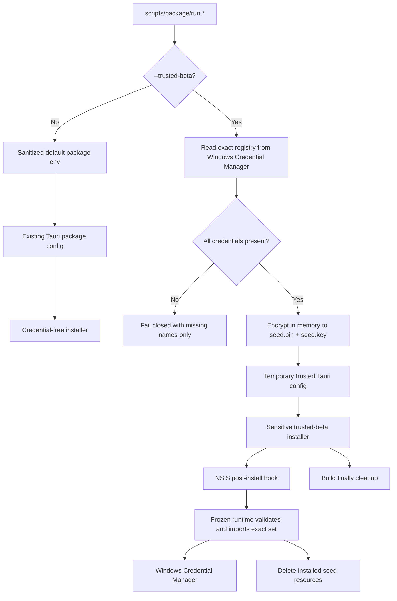

# 052 · 可信用户内测包凭据预置 - 技术方案

## 状态

CONFIRMED

## 需求文档

→ [requirement.md](./requirement.md)

## 现状分析

### 现有打包链路

051 已建立 Windows x64 完整安装包链路：

1. `scripts/package/run.*` 调用 `scripts/package/run.py`。
2. package harness 用 PyInstaller onedir 生成 `agent-friend-runtime.exe`，并把 Python runtime、memory 模型和 cloudflared staging 到 `frontend/src-tauri/package-runtime/runtime/`。
3. frozen runtime 使用 `scripts/package/runtime_entry.py` 统一暴露 `bridge`、`voice` 和 `doctor` 子命令。
4. Tauri 通过 `scripts/package/windows/tauri.package.conf.json` 把 runtime 和 avatar seed 放入 NSIS 安装包。
5. `scripts/package/windows/nsis-hooks.nsh` 已接管安装 / 卸载前置 hook，用于阻止应用运行时覆盖安装和清理 autostart。Tauri 2 同时支持 `NSIS_HOOK_POSTINSTALL`，且该阶段可运行已安装的随包程序、处理资源后删除资源。

### 现有凭据边界

`runtime_config` 已提供统一凭据注册表和系统凭据库 facade：

- `ALL_CREDENTIAL_NAMES` 包含 DeepSeek、Kimi、Tavily 和火山语音完整凭据集。
- `KeyringSource` 以 `agent-friend` 为 service，支持 `get` / `status` / `set` / `delete`。
- Windows 上 Python 和 Rust 已对齐 Windows Credential Manager target，Tauri 设置页和 Python sidecar 能看到同一份凭据。
- 设置页仅能写入、删除和查看状态，不回读明文。
- 诊断包在导出前会读取所有已知凭据做精确替换，无法可靠读取时 fail closed。

现有 package harness 则有意与上述凭据库隔离：

- `_sanitized_env()` 删除已知凭据和名称以 `_API_KEY` / `_SECRET_KEY` 结尾的环境变量。
- 构建过程不读取 keyring。
- frozen smoke 仅给 bridge 注入固定假值，不调用外部 API。
- runtime inventory 覆盖 `package-runtime/runtime/` 全部文件并记录 SHA-256，不适合把凭据 seed 放进 runtime tree。

### 问题本质

本需求不能直接取消现有 secret guard，否则只要构建机已配置凭据，普通打包也可能意外变成敏感包。需要增加一条必须显式进入、独立标识、失败即关闭、构建后可定点清理的敏感分发路径，而不改变默认路径。

## 方案设计

### 1. 打包模式与安全默认值

`scripts/package/run.py` 增加显式开关：

```text
--trusted-beta
```

模式语义：

| 模式 | 触发方式 | 凭据输入 | 产物定位 |
|------|----------|----------|----------|
| 普通包 | 默认，无额外参数 | 不读 keyring；保留 `_sanitized_env()` | 可普通保存 / 分发的无凭据包 |
| 可信内测包 | 显式 `--trusted-beta` | 仅读当前用户 Windows Credential Manager | 敏感产物，仅可定向内测分发 |

两条路径共用 runtime 构建、资产 staging、doctor 和无外部 API smoke。可信模式只改变 installer 资源、post-install 行为和输出标识，不让真实凭据进入 PyInstaller doctor / readiness smoke 环境。

`runtime_config.credentials.ALL_CREDENTIAL_NAMES` 仍是可信包凭据注册表的唯一真相源；`OPTIONAL_CREDENTIAL_NAMES` 只标记其中允许为空的兼容鉴权字段。package 不再单独维护平行名单，避免新增 provider 后多处漂移。当前仅 `VOLC_SPEECH_API_KEY` 可选：为空时火山语音继续使用现有 App ID + Access Token 鉴权。

### 2. 构建机凭据采集

可信模式通过 `KeyringSource` 逐项读取 `ALL_CREDENTIAL_NAMES`：

```python
def collect_trusted_credentials(source: KeyringSource) -> dict[str, str | None]:
    ...
```

约束：

- 只读 keyring，不使用 process env、`.env` 或命令行明文参数作为可信包凭据输入。
- 任一必需名称读取不到非空值时，收集全部缺失名称后 fail closed。
- 可选名称读取不到值时以 `null` 保留在 seed 中，不伪造空字符串，也不把“未配置”误判成构建失败。
- 错误和日志只允许输出凭据名称与数量，不输出值、前缀、后缀或 hash。
- package harness 不提供“显示 / 导出凭据”的调试参数。

为避免 `run.py` 继续膨胀，seed schema、加解密、完整性验证和 keyring 导入放到 `runtime_config/src/runtime_config/seed.py`。这部分属于运行时凭据域，并且构建器与 frozen runtime 都要复用，不应只藏在 package script 内。

### 3. 凭据 seed envelope

构建过程在内存中生成 schema：

```json
{
  "schema_version": 1,
  "distribution": "trusted-beta",
  "credentials": {
    "<required-canonical-name>": "<secret-value>",
    "<optional-canonical-name>": null
  }
}
```

明文 JSON 不落盘。使用 `cryptography` 已有的 AES-GCM 生成：

- `trusted-credential-seed.bin`：版本头 + nonce + ciphertext / tag。
- `trusted-credential-seed.key`：当次打包随机生成的 256-bit key。

两个文件会同时进入安装包，因此这不是针对受信任用户或反向工程的保密边界。它只有三个目的：

1. 不让凭据值以可直接文本搜索的形式出现在 Tauri / NSIS 中间资源。
2. 通过 AES-GCM tag 发现资源损坏或密钥不匹配。
3. 确保安装阶段只有 frozen runtime 的受限入口会把内容解析为凭据。

AAD 固定包含 schema 和产品标识，避免把其他密文误当成 agent-friend credential seed。

seed 和 key 位于已被 `.gitignore` 覆盖的 `frontend/src-tauri/package-runtime/`，但仍由 package harness 在 `try/finally` 中定点清理，不把 `.gitignore` 当成唯一保护。

### 4. Tauri 可信资源配置

默认 `tauri.package.conf.json` 不增加 seed 资源，继续用于普通包。

可信模式从默认 package config 生成一份临时合并配置，仅追加：

```json
{
  "bundle": {
    "resources": {
      "package-runtime/trusted-credential-seed.bin": "trusted-credential-seed.bin",
      "package-runtime/trusted-credential-seed.key": "trusted-credential-seed.key"
    }
  }
}
```

临时配置同样放在 `package-runtime/` 并在成功 / 失败后清理。普通包始终把静态 package config 传给 Tauri，不会因上次中断的可信构建而隐式选中临时配置。每次可信构建前先清理同名旧 seed，再生成新 seed。

seed 不放进 `package-runtime/runtime/`，因此不会进入面向非敏感 runtime 的 `runtime-inventory.json`。

### 5. frozen runtime 导入入口

`scripts/package/runtime_entry.py` 增加内部子命令：

```text
agent-friend-runtime.exe seed-credentials \
  --payload <path> \
  --key-file <path>
```

入口流程：

1. 检查 payload 与 key file 是普通文件且大小在小型固定上限内。
2. 用 AES-GCM 解密并验证 schema / distribution / AAD。
3. 要求 `credentials.keys()` 与 `ALL_CREDENTIAL_NAMES` 精确相等，不允许缺失或额外名称；必需凭据必须为非空字符串，可选凭据允许为 `null`，但不允许空字符串。
4. 读取当前 keyring 值作为内存回滚快照。
5. 逐项同步 canonical Windows Credential Manager target：非空值覆盖写入，`null` 可选项删除，保证覆盖升级不会遗留构建者已取消使用的可选鉴权值。
6. 任一写入失败时，尽力将已写项恢复为安装前值；原本不存在的项删除。回滚失败也只报告名称。
7. 成功输出只包含导入数量，不包含值、source 详情或可用片段。

同时提供一个安全的状态验证入口，供安装态 smoke 使用：

```text
agent-friend-runtime.exe credential-status --require-operational
```

它只输出必需 / 可选缺失名称、配置数量和总体成功状态，不回读明文；只有必需项缺失或读取失败时返回失败。

### 6. NSIS post-install 导入

`nsis-hooks.nsh` 新增 `NSIS_HOOK_POSTINSTALL`，其行为完全由 seed 文件是否存在驱动：

```text
普通包：seed 不存在 → 直接跳过
可信包：seed + key 均存在 → 执行 frozen runtime 导入
不完整：仅存在其中一个 → 失败并终止安装
```

导入子进程路径固定为已安装的：

```text
$INSTDIR\runtime\python\agent-friend-runtime.exe
```

NSIS 仅把 payload 与 key file 路径作为命令行参数，不把凭据值或 AES key 直接放进进程参数。

无论导入成功还是失败，hook 都删除安装目录中的 seed 和 key 文件。导入返回非零时，NSIS 设置失败退出码并中止安装，不把“应用装好了但凭据没装好”当成成功。

NSIS 安装模式是 `currentUser`，post-install 子进程因此写入与后续 Tauri / Python sidecar 相同 Windows 用户的 Credential Manager。

### 7. 安装、升级与用户覆盖语义

本期不引入 seed receipt、来源标记或按凭据增量合并，固定为以下简单语义：

| 操作 | 凭据结果 |
|------|----------|
| 首次安装可信包 | 写入全部预置凭据 |
| 普通启动 / 重启 | 不读 seed，不改凭据 |
| 用户在设置页覆盖 | 立即以用户新值为准，重启保留 |
| 用户在设置页删除 | 保持缺失，重启不恢复 |
| 安装 / 升级普通无凭据包 | 不写入也不删除已有凭据 |
| 重新安装 / 覆盖升级可信包 | 用新包的完整集覆盖全部托管凭据 |

因此，用户主动填写的值会在下一次可信包安装时被替换。这是用“重新打包 + 安装”完成共享凭据轮换的明确产品语义，不作为隐藏副作用。

### 8. 敏感产物标识与清理

普通包保持现有产物名称：

```text
agent-friend_<version>_windows_x64-setup.exe
```

可信包改为：

```text
agent-friend_<version>_windows_x64-trusted-beta-SENSITIVE-setup.exe
```

可信 release 目录同样带 `trusted-beta-sensitive`，并包含 `SENSITIVE-DO-NOT-PUBLISH.txt`。`release.json` 新增非凭据元数据：

```json
{
  "distribution": "trusted-beta",
  "sensitive": true
}
```

不写凭据名单、凭据 hash、seed hash 或任何可用片段。installer 自身 SHA-256 仍用于传输校验，但校验文件的命名同样带敏感标识。

可信构建收尾和异常路径都要删除：

- staging seed / key。
- 临时 Tauri config。
- Tauri 资源中间目录里的同名 seed / key 副本。
- 已复制到敏感 release 目录后，Tauri `bundle/nsis` 中新生成的未重命名 installer 副本。

清理仅针对 package harness 已知、专用的精确路径，不做递归清空 `target/` 或其他用户构建产物的操作。

### 9. 日志、诊断与错误边界

- package harness 不对凭据 dict / seed plaintext 使用 `print`、`repr` 或异常插值。
- 加密 / 导入异常统一收敛成结构化错误，最多包含阶段、凭据名称和原始异常类型，不带原始 payload。
- NSIS `DetailPrint` 只记录“正在导入 / 导入成功 / 导入失败”。
- 现有 Tauri 诊断脱敏从导入完成后直接读取同一 keyring，不需要新的 secret 来源。
- seed 文件名是敏感分发标识，诊断包不应收集安装资源；即使 post-install 中断，诊断逻辑也不扫描该文件。

### 10. 测试与验收

#### `runtime_config` 单测

- exact credential registry 校验：完整 key 集、缺失、额外名称、必需项为空、可选项 `null` / 非空两种合法状态。
- AES-GCM round trip、错 key、损坏 ciphertext、错 AAD 和超限 payload。
- 断言 seed blob / key file 中不出现 fake secret 明文。
- fake keyring 成功全量覆盖。
- 中途写入失败时恢复原值并删除新建项。
- 回滚也失败时错误不含任何值。

#### package 单测

- 默认参数不选中 trusted mode，且 `_sanitized_env()` 行为不变。
- 普通构建不构造 `KeyringSource`、不生成 seed resource。
- 可信构建缺少任意必需凭据时失败，错误中只有名称；仅缺少可选 `VOLC_SPEECH_API_KEY` 时成功。
- 可信临时 Tauri config 只比普通 config 多 seed / key 资源。
- 成功和异常路径都清理临时资源。
- 可信产物名称、release 目录、manifest 和 warning 标识清晰；普通产物命名不变。
- NSIS hook 覆盖 seed 不存在、成功导入、资源不完整、子进程失败和资源删除。

#### 无外部 API 的构建 / 安装态验证

- 重跑默认 package，扫描产物不包含构建机已知凭据。
- 用专用 fake keyring / 临时用户边界生成可信包，验证 installer 资源和错误路径，不调用 provider。
- 在可控 Windows 用户下安装可信包，`credential-status --require-operational` 通过，安装目录不存在 seed / key。
- 用户删除一项后重启，该项不恢复；重新运行可信 installer 后完整集恢复。
- 安装普通包不删除已有 keyring 凭据。
- 现有 doctor、memory native、bridge / voice readiness 和退出 smoke 继续不调用真实 API。

#### 真实外部能力验收

只在实现、自动化门禁和无外部 API 安装态验证全部通过后执行：

- 一次真实 LLM 文字对话。
- 一次触发 Tavily 的搜索请求。
- 一次火山 RTC / ASR / TTS 语音链路。

这些步骤会产生外部 provider 请求和计费，执行前必须另行说明粗估调用量并获得用户明确授权。

### 11. 版本与发布产物

本需求改变 installer 行为并需要真实覆盖安装验收，因此实现阶段把当前 `0.1.5` 统一提升到下一个 patch 版本，同步：

- `frontend/src-tauri/tauri.conf.json`
- `frontend/src-tauri/Cargo.toml`
- `frontend/package.json`
- 对应 lock / package version 测试

最终 stable release 与可信包仍可来自同一份已验收代码；stable release 使用显式项目版本，日常可分发可信包按 055 / 077 的渠道治理派生 `<target>-beta.<UTC date>.<sequence>` 版本。凭据是否注入仍只由显式 distribution 区分，版本渠道不参与凭据选择。

## 数据流



## 涉及文件

| 路径 | 改动类型 | 说明 |
|------|----------|------|
| `runtime_config/src/runtime_config/seed.py` | 新增 | seed schema、AES-GCM、exact-set 验证、keyring 原子导入 / 回滚 |
| `runtime_config/src/runtime_config/__init__.py` | 修改 | 按需暴露 seed 构建 / 导入 API |
| `runtime_config/pyproject.toml` / `uv.lock` | 修改 | 显式声明 `cryptography` 依赖，避免仅依赖传递引入 |
| `runtime_config/tests/test_seed.py` | 新增 | 密文、schema、完整性、写入与回滚测试 |
| `scripts/package/run.py` | 修改 | `--trusted-beta`、keyring 收集、临时资源 / config、敏感产物标识和清理 |
| `scripts/package/runtime_entry.py` | 修改 | `seed-credentials` 与安全 credential status 子命令 |
| `scripts/package/windows/nsis-hooks.nsh` | 修改 | post-install 导入、资源删除和失败中止 |
| `scripts/package/test_package.py` | 修改 | 打包模式、配置、命名、清理和 NSIS hook 测试 |
| `scripts/README.md` | 修改 | 记录默认无凭据和敏感内测打包用法、泄露处置 |
| `frontend/src-tauri/tauri.conf.json` | 修改 | patch 版本提升 |
| `frontend/src-tauri/Cargo.toml` / `Cargo.lock` | 修改 | patch 版本对齐 |
| `frontend/package.json` / lockfile | 修改 | patch 版本对齐 |
| `docs/requirements/052-trusted-user-bundled-api-credentials/progress.md` | 新增 | Phase 3 任务和验收记录 |

不改动设置页 UI、React store、bridge 装配或 voice 业务逻辑。它们继续从现有 keyring 主路径消费凭据。

## 影响分析

### 上游影响

- 032 / 036 的 runtime credential registry 成为可信包完整集的唯一来源；新增 provider secret 后，可信构建会自动要求补齐。
- 051 的默认无凭据边界不变；可信包是额外、显式的 installer profile。
- 现有 keyring target 与设置页 command 不改 schema，只增加一个安装阶段写入方。

### 下游影响

- bridge / voice 在可信包安装后会按现有 desktop config mode 直接读到凭据，不需要新的 source priority。
- 用户后续从设置页覆盖 / 删除的行为保持不变。
- 自动更新、账号、设备授权或远程凭据服务如果未来引入，可以替换 installer seed 通道，不需要修改 provider 消费方。

### 跨平台影响

- 实现仅在现有 Windows x64 package harness 启用。
- `runtime_config.seed` 中的密文 schema 和 fake-store 测试可跨平台，但 package CLI 继续在非 Windows x64 上明确失败，不宣称支持其他平台。
- shell / PowerShell 入口只做参数透传，`--trusted-beta` 在两端命令形状一致，但实际构建仍是 Windows-only。

### 风险点

1. **安装包泄露**：加密 seed 和 key 同包，获取 installer 的人可提取凭据。通过敏感命名、独立目录、warning 和人工分发边界降低误传，不宣称技术防提取。
2. **普通包误带 seed**：默认静态 config 不引用 seed；可信临时 config 只在显式 mode 中传给 Tauri；前后清理且加自动化断言。
3. **部分凭据写入**：导入前做 exact-set 验证并保留内存快照；中途失败回滚，NSIS 按失败处理。
4. **覆盖用户自定义值**：仅在用户主动运行可信 installer 时发生，是已确认的轮换语义；普通启动和普通包不覆盖。
5. **日志 / 异常泄露**：所有新 API 用凭据名称和数量表达错误，测试对 fake secret 做负向搜索。
6. **NSIS 失败时残留**：hook 先记录退出码、后删除 seed / key、再中止安装；残留的 installer 本身仍按敏感产物管理。
7. **凭据注册表扩展**：exact-set 会让新增凭据后旧 seed 不能被新 runtime 默默忽略，而是在构建 / 导入阶段明确失败并要求重新打包。

## 实施顺序

1. 在 `runtime_config` 实现 seed schema、AES-GCM、exact-set 验证、keyring 写入和回滚，先用 fake store 锁定核心行为。
2. 给 frozen runtime 增加 seed / status 子命令，补 parser 和无明文输出测试。
3. 扩展 package harness 的显式 trusted mode、keyring 收集、临时资源 / config 和 `finally` 清理。
4. 在 NSIS post-install hook 接入 frozen runtime 导入并实现资源删除 / 失败中止。
5. 增加敏感产物命名、manifest marker、warning 和 Tauri bundle 副本清理。
6. 同步 patch 版本和脚本文档，跑局部测试与 `scripts/check`。
7. 分别构建普通包和可信包，完成无外部 API 的安装态验证。
8. 另行获得真实 API 授权后，验收文字对话、搜索和语音链路。

## 明确不做

- 不建设服务端凭据代理、账号授权、设备白名单或短期 token。
- 不为每个用户生成独立 installer / 凭据。
- 不宣称 AES-GCM seed 能防止拥有 installer 的人提取凭据。
- 不在应用每次启动时检查或恢复预置凭据。
- 不增加前端设置 UI、新的 React 持久化状态或跨窗口事件。
- 不把普通包安装解释为“清除本机凭据”。
- 不把真实 LLM、Tavily 或火山请求藏进 package smoke、doctor 或项目门禁。
- 不扩展到非 Windows x64 产物。

## 变更记录

| 日期 | 变更内容 | 是否需要重新实现 |
|------|---------|------------------|
| 2026-07-17 | 初版确认：默认无凭据包；显式 trusted-beta 模式；keyring-only 构建输入；AES-GCM 临时 seed；NSIS post-install 一次性导入；每次可信包安装全量覆盖托管凭据 | 新设计，待实现 |
| 2026-07-17 | 修正凭据完整性语义：注册表 key 仍 exact-set；必需项必须非空，可选 `VOLC_SPEECH_API_KEY` 可为 `null`，安装时删除该可选旧值；状态 smoke 改按 operational 必需项判断 | 需要增量调整 seed、runtime status 与测试 |
| 2026-08-08 | 对齐 055 / 077 的版本渠道治理：可信分发使用自动派生的单调 prerelease 版本，stable release 保持显式项目版本；凭据注入边界不变 | 只需调整 package harness 与治理文档，不重做凭据 seed |

