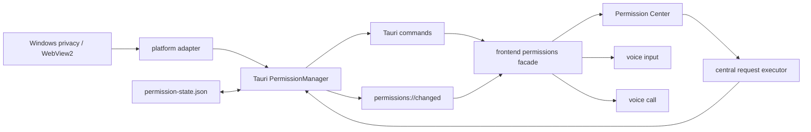
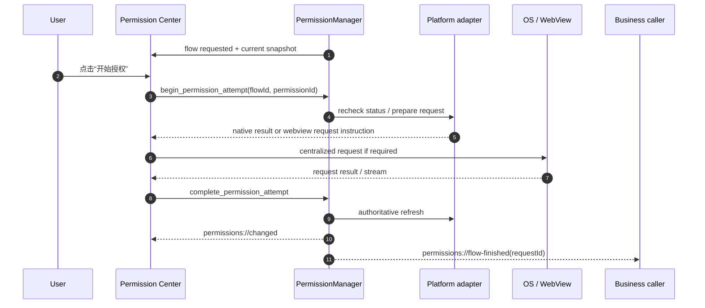
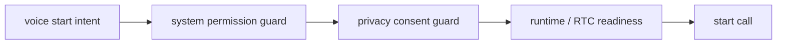

# 053 · 桌面端统一系统权限管理与申请交互 - 技术方案

## 状态

CONFIRMED

## 需求文档

→ [requirement.md](./requirement.md)

## 0. 文档说明

本文档回答 053 需求中的“怎么做”：如何在桌面壳内建立系统权限注册、状态检测、集中申请、设置恢复、生命周期刷新和跨窗口分发能力，并以麦克风为首个权限类型迁移语音通话与语音输入。

本方案的主流程不是“业务功能用到时才申请”。应用在启动或升级后发现本版本有尚未处理的权限时，先通过统一权限中心解释；用户点击“开始授权”后，由权限模块一次性计算并串行申请本次全部待处理权限。功能调用时发现权限缺失只作为兜底，仍回到同一个统一流程。

Quick Tunnel 是产品隐私确认，不是操作系统权限；API 凭证、开机自启和普通设置也不进入本模块。

## 1. 现状分析

### 1.1 当前权限申请点

仓库内直接或间接触发麦克风访问的生产代码主要有两处：

- `frontend/src/services/voiceInput/recorder.ts` 直接调用 `navigator.mediaDevices.getUserMedia()`，用于语音输入录音。
- `frontend/src/services/voice/rtcClient.ts` 调用火山 RTC SDK 的 `enableDevices()` / `startAudioCapture()`，用于语音通话采集；当权限尚未处理时，该 SDK 路径可能间接触发平台授权。

`voiceInput` store 目前自己维护 `requesting_microphone` 状态，并把 `NotAllowedError` 映射为麦克风权限错误。语音通话 store 则在真正启动 RTC capture 时才面对权限结果。两条链路没有统一状态，也无法在系统设置修改后通知另一条链路。

两条链路已有较完整的资源清理：语音输入会停止所有 tracks 并关闭 `AudioContext`，语音通话会停止采集、退房和销毁 RTC client。这些清理仍需保留，但“申请权限”要从业务链路中移出。

### 1.2 现有跨窗口基础设施

项目已有可借鉴但不直接复用的模式：

- Rust `Settings` managed state 是设置快照的权威来源，通过 command 修改并广播 `settings://changed`。
- `frontend/src/lib/settings/` 在每个 HTML 入口注册监听，向 React 消费方提供 snapshot/hook。
- `SettingsNavigationState` 可以暂存一次导航请求，打开或聚焦现有 settings 窗口后继续定位目标页面。
- 语音通话已有跨窗口 owner 与 Tauri event 协作模式。

权限状态不是普通用户设置，不能塞入 `settings.json`，但可以沿用“Rust 权威快照 + 全量事件广播 + 前端 facade”的同步方式。

### 1.3 生命周期缺口

当前 Tauri 应用只在退出事件中做清理，没有统一监听窗口重新聚焦并刷新权限状态。前端也没有应用级权限订阅，因此用户在系统设置里撤销权限后，已打开的窗口仍可能持有过期判断。

### 1.4 平台事实

#### Windows / WebView2

- WebView2 同时存在网页来源层的媒体权限决定和 Windows 系统隐私限制。
- WebView2 profile 可查询非默认权限设置，也可把指定 origin/permission 的状态改为 default/allow/deny。
- 当前 Tauri runtime 按 `data_directory` 复用 `WebContext`；现有窗口没有配置独立 data directory，因此默认共享同一个 WebView2 profile。
- 当前 Wry 只为 clipboard 主动接管 `PermissionRequested`；麦克风仍走 WebView2 默认媒体权限流程。
- 当前 Windows 安装产物是 NSIS/unpackaged Win32。`AppCapability.CheckAccess()` 对 packaged app 的行为明确，但对当前安装形态能否完整反映“桌面应用麦克风总开关”需要实机 spike，不在设计里先验假定。

#### macOS / WKWebView（调研结论，不在本期交付）

- 应用已有 `NSMicrophoneUsageDescription`。
- 当前 Wry 的 `WKUIDelegate` 对 WebView media capture origin 层直接返回 grant，因此不会再出现一层独立网页权限弹窗。
- 真正控制麦克风访问的是应用级 TCC；状态可由 AVFoundation 的 `authorizationStatus(for: .audio)` 查询，首次申请可由 `requestAccess(for: .audio)` 发起。
- 本期不实现、编译验证或验收 macOS adapter；上述事实仅用于保留后续扩展边界。

#### Web Permissions API

`navigator.permissions.query({ name: "microphone" })` 在不同 WebView 中的支持和语义并不稳定，不能作为统一状态真相源。它最多作为诊断信息，不进入核心判定。

## 2. 设计原则

1. **单一权威**：Tauri `PermissionManager` 持有当前权限快照和应用处理历史；业务 store 不复制一份可独立演进的权限状态。
2. **集中申请**：只有统一权限中心可以发起系统申请；业务模块不得直接调用 `getUserMedia` 或平台权限 request API。
3. **状态检测无副作用**：启动、恢复、聚焦刷新只能使用查询 API，不能为了探测权限而打开麦克风。
4. **显式动作才触发系统 UI**：只有用户点击统一入口中的授权/恢复动作后才请求系统权限或跳转系统设置。
5. **系统事实与产品历史分离**：当前系统状态、是否曾授权、是否处理过当前定义版本分别保存，避免把首次拒绝、撤销和暂缓混为一谈。
6. **注册表驱动扩展**：未来新增相机、屏幕录制等权限时，主要增加 definition 和平台 adapter，不修改语音业务或重写主流程。
7. **串行和单飞**：全应用同一时间至多有一个权限 flow、一个系统申请动作；相同请求加入当前 flow，不同请求排队。
8. **资源及时释放**：如果平台限制导致申请时必须短暂获取媒体 stream，成功、失败、超时、取消和迟到返回都必须释放。

## 3. 总体架构



责任边界：

| 模块 | 责任 |
|------|------|
| Permission registry | 声明权限 ID、definition revision、用途文案、启用策略和平台 adapter |
| Platform adapter | 查询系统状态、执行原生申请、准备 WebView2 重试、跳转系统设置 |
| PermissionManager | 合并平台事实与处理历史、生成快照、持久化、刷新、协调 flow、广播事件 |
| Frontend permissions facade | 封装 command/event、缓存最新全量快照、提供 hook 和业务 guard |
| Permission Center | 集中说明、用户点击后串行执行 flow、展示恢复动作 |
| Business modules | 声明依赖、读取状态、在缺失时请求打开统一 flow、根据结果决定是否恢复原动作 |

`PermissionManager` 放在 Tauri 主进程，是因为它必须跨窗口唯一、接收应用生命周期事件，并访问原生平台 API。Windows 首次 WebView2 媒体授权需要 WebView user gesture 和 `getUserMedia` 时，由权限中心内的 central request executor 完成，但调用仍属于 `permissions` 域，不能下放回业务模块。

## 4. 权限领域模型

### 4.1 权限定义

```rust
enum PermissionId {
    Microphone,
}

struct PermissionDefinition {
    id: PermissionId,
    revision: u32,
    enabled: bool,
    startup_policy: StartupPromptPolicy,
    title_key: &'static str,
    description_key: &'static str,
}

enum StartupPromptPolicy {
    Proactive,
    OnDemandOnly,
}
```

首期只注册 `Microphone`，`revision = 1`，`startup_policy = Proactive`。`enabled` 表示当前版本是否实际需要管理该权限；不为尚不存在的能力预注册空权限。

definition revision 的用途是判断“应用是否处理过当前版本的该项权限”。新增权限直接新增 definition；若某项权限的用途或处理语义发生需要用户重新确认的变化，显式递增该项 revision。普通文案修正不递增。

### 4.2 平台原始状态

```rust
enum SystemPermissionState {
    NotDetermined,
    Granted,
    Denied,
    Restricted,
    Unsupported,
    Unknown,
}
```

语义：

| 状态 | 含义 |
|------|------|
| `NotDetermined` | 平台尚未形成允许/拒绝决定，可以发起首次申请 |
| `Granted` | 平台查询确认当前允许 |
| `Denied` | 用户或权限存储明确拒绝，可能允许再次申请或需要设置恢复 |
| `Restricted` | 系统策略、家长控制、企业策略或全局开关限制，应用不能直接恢复 |
| `Unsupported` | 当前 OS/WebView 不支持该权限能力 |
| `Unknown` | adapter 无法可靠判断；不得把它乐观当成 granted |

Windows adapter 内部可以保留更细的诊断分量，例如 `webview_profile_state` 与 `os_access_state`，但公共业务契约只消费归一化状态和可执行动作。

### 4.3 应用处理历史

```rust
struct PermissionHistoryEntry {
    handled_revision: u32,
    deferred_revision: Option<u32>,
    ever_granted: bool,
    last_observed_system_state: Option<SystemPermissionState>,
    last_observed_at_ms: Option<u64>,
}
```

- `handled_revision`：用户已完成、拒绝或明确暂缓该 definition revision 的集中流程。
- `deferred_revision`：用户明确“暂不处理”的可选权限；用于阻止启动反复打扰，不代表系统拒绝。
- `ever_granted`：仅在权威查询返回 `Granted` 后置 true；用于区分首次拒绝与后来撤销。
- `last_observed_*`：用于状态变化判断和诊断，不替代实时查询。

### 4.4 对外快照

```rust
enum PermissionPresentationState {
    NotRequested,
    Granted,
    Denied,
    Revoked,
    Restricted,
    Unsupported,
    Unknown,
}

enum PermissionRecoveryAction {
    Request,
    RetryRequest,
    OpenSystemSettings,
    None,
}

struct PermissionItemSnapshot {
    id: PermissionId,
    definition_revision: u32,
    system_state: SystemPermissionState,
    presentation_state: PermissionPresentationState,
    recovery_action: PermissionRecoveryAction,
    handled_for_current_revision: bool,
    deferred_for_current_revision: bool,
    changed_at_ms: Option<u64>,
}

struct PermissionSnapshot {
    snapshot_revision: u64,
    refreshing: bool,
    active_flow: Option<PermissionFlowSnapshot>,
    items: Vec<PermissionItemSnapshot>,
}
```

核心推导规则：

- `system = Granted` → `presentation = Granted`。
- `system = Denied && ever_granted` → `presentation = Revoked`。
- `system = Denied && !ever_granted` → `presentation = Denied`。
- `system = NotDetermined` → `presentation = NotRequested`，不因曾暂缓而伪装成 denied。
- `Unknown` 不允许业务启动受保护能力；统一入口可解释当前无法确认并提供重试或设置指引。

每次实际内容变化递增 `snapshot_revision`。跨窗口事件发送完整 snapshot，不发送需要前端自行归并的 patch，避免窗口错过事件后状态分叉。

## 5. 持久化

新增独立的 Tauri 内部状态文件：

```text
<app-config-dir>/permission-state.json
```

路径由 `frontend/src-tauri/src/paths.rs` 统一提供，禁止在权限模块内拼 bundle id 或 `%APPDATA%` / `Library` 字面量。

文件只保存 schema version 和 `PermissionHistoryEntry`，不保存当前系统状态作为真相：

```json
{
  "schemaVersion": 1,
  "permissions": {
    "microphone": {
      "handledRevision": 1,
      "deferredRevision": null,
      "everGranted": true,
      "lastObservedSystemState": "granted",
      "lastObservedAtMs": 0
    }
  }
}
```

加载失败时记录结构化错误并以空历史继续启动；损坏文件不能让应用无法启动，也不能把权限误判为 granted。写入采用临时文件 + replace 的原子策略，避免退出中断留下半截 JSON。

## 6. 状态刷新与分发

### 6.1 刷新触发点

以下事件调用同一个 `refresh_permissions(reason)`：

- Tauri setup 完成、平台 adapter 可用后；
- 应用 `RunEvent::Resumed`；
- 任一应用窗口从 unfocused 变为 focused；
- 一项申请动作完成或失败后；
- 从系统设置返回应用后；
- 前端显式点击“重新检测”。

聚焦事件可能在多个窗口间密集发生，manager 使用 debounce + single-flight：

- 短时间内多个 refresh reason 合并为一次平台查询；
- 查询进行中再触发刷新，只记录 `refresh_requested = true`，当前轮完成后最多补一轮；
- 旧 generation 的异步结果不得覆盖新 generation。

### 6.2 分发契约

Tauri commands：

```text
get_permission_snapshot
refresh_permissions
request_permission_flow
begin_permission_attempt
complete_permission_attempt
defer_permission_flow
open_permission_system_settings
```

Tauri events：

```text
permissions://changed
permissions://flow-requested
permissions://flow-finished
```

`frontend/src/lib/permissions/` 在每个 HTML entry 初始化时：

1. 注册 `permissions://changed` 监听；
2. 拉取一次当前 snapshot，解决“监听注册前已广播”的竞态；
3. 按 `snapshot_revision` 丢弃旧事件；
4. 通过 `useSyncExternalStore` 或项目等价模式向 React 暴露一致快照。

业务消费接口保持窄：

```ts
getPermissionSnapshot(): PermissionSnapshot
usePermission(id: PermissionId): PermissionItemSnapshot
hasPermissions(ids: PermissionId[]): boolean
requestPermissionFlow(input: PermissionFlowRequest): Promise<PermissionFlowTicket>
```

业务不能调用 `begin_permission_attempt` / `complete_permission_attempt`；这两个低层 command 只由权限中心 executor 使用。

## 7. 集中申请与单飞

### 7.1 Flow 模型

```rust
enum PermissionFlowReason {
    Startup,
    Upgrade,
    Revoked,
    FeatureFallback,
    Manual,
}

struct PermissionFlowRequest {
    request_id: String,
    reason: PermissionFlowReason,
    permission_ids: Vec<PermissionId>,
    source_window: Option<String>,
}

struct PermissionFlowSnapshot {
    flow_id: String,
    phase: PermissionFlowPhase,
    permission_ids: Vec<PermissionId>,
    current_permission_id: Option<PermissionId>,
    joined_request_ids: Vec<String>,
}
```

flow target 的计算规则：

- startup/upgrade：注册表中 `Proactive`、enabled、尚未处理当前 revision 且未 granted 的权限。
- revoked：曾 granted、当前变为 denied/restricted 的权限。
- feature fallback：调用方声明的权限集合中当前未 granted 的权限。
- manual：权限中心中用户显式选择重试的权限。

已 granted 的权限在 flow 开始前和每项 attempt 开始前都重新跳过，避免状态在等待期间变化后重复请求。

### 7.2 并发规则

- 全应用只有一个 active flow。
- 新请求的权限集合完全包含在 active flow 时，`request_id` 加入 `joined_request_ids`。
- 新请求包含 active flow 没有的权限时，进入 FIFO pending queue；当前 flow 结束后重新按最新状态计算，不直接照搬旧 target。
- 同一 permission attempt 未结束前不能开始下一项。
- 关闭权限中心窗口不取消已经出现的系统 prompt；manager 保留 flow，窗口再次打开后从 snapshot 恢复 UI。
- 未开始的 flow 可以被用户暂缓；正在等待系统 prompt 的 attempt 只能等待平台回调或 timeout，不伪造取消成功。

### 7.3 用户点击后的执行时序



UI 不以 `getUserMedia` resolve 当作最终 granted；`complete_permission_attempt` 后必须由 adapter 重新查询并提交权威 snapshot。

### 7.4 暂缓与拒绝

- 用户在系统 prompt 前点击“暂不处理”，记录 `handled_revision` 和 `deferred_revision`，本 revision 不再启动提醒。
- 用户在系统 prompt 中拒绝，记录 handled，但不写 deferred；权限中心显示 denied/recovery action。
- 用户以后从功能入口或权限中心手动重试时，不受 deferred 阻止。
- definition revision 增加后，旧 revision 的 deferred 不阻止新一轮说明。

## 8. 权限中心交互承载

在现有 settings 窗口新增 `permissions` navigation target 和权限页面，作为唯一长期管理入口，不新建第二个权限专用窗口。

页面区域：

1. 本次 flow 的集中说明和权限列表；
2. “开始授权”主按钮；
3. 当前正在处理的权限及系统交互提示；
4. 每项当前状态与恢复动作；
5. “暂不处理”与“重新检测”；
6. 无 active flow 时展示全部已注册权限的管理状态。

启动策略：

- 首次发现尚未处理的 proactive 权限或升级新增权限时，打开/聚焦 settings 的权限页，但不触发系统 prompt。
- 用户暂缓后，本 revision 的后续启动不再自动打开。
- 已授权权限被撤销时刷新全局状态；不在每次 focus 时重复抢占窗口。当前若有明确 feature intent，则打开权限页；否则通过现有壳可承载的非阻塞提醒和权限页状态提示恢复。

页面使用现有 shadcn 项目组件和设计 token；Phase 3 如需新增通用 UI 组件，必须通过项目 `add-shadcn-component` 流程引入。

## 9. 平台适配器

### 9.1 统一接口

```rust
trait PermissionPlatformAdapter {
    fn supports(&self, id: PermissionId) -> bool;
    async fn query(&self, id: PermissionId) -> Result<PlatformPermissionStatus>;
    async fn prepare_request(&self, id: PermissionId) -> Result<RequestInstruction>;
    async fn request_native(&self, id: PermissionId) -> Result<Option<RequestOutcome>>;
    async fn open_system_settings(&self, id: PermissionId) -> Result<()>;
}

enum RequestInstruction {
    Native,
    WebMedia { constraints: MediaConstraints },
    OpenSettings,
    NotAvailable,
}
```

首期只实现 Windows microphone adapter，不建设动态插件系统。trait 用于隔离测试、明确 macOS `unsupported` 行为和未来增加 permission definition。

### 9.2 非 Windows 平台

本期统一返回 `Unsupported` / `NotAvailable`，不接入 AVFoundation/TCC，不发起原生申请，也不保留语音业务直接申请权限的旁路。后续 macOS 需求应复用本设计的 registry、manager、flow 和业务 guard，只新增并验证平台 adapter。

### 9.3 Windows microphone

查询由两个分量组成：

1. 从任一现存 WebView2 获取 shared profile，查询当前 app origin 的 microphone permission setting；
2. 查询 Windows 对当前 unpackaged desktop process 的麦克风访问状态。

组合原则：

- 任一权威分量明确 restricted/denied 时不得返回 granted。
- WebView2 profile = allow 且 OS access = allowed 时返回 granted。
- WebView2 profile = default 且 OS 未限制时返回 notDetermined。
- 无法可靠查询 OS access 时返回带诊断分量的 unknown，而不是假定 allowed。

申请：

- profile = default：权限中心 executor 在用户点击后调用一次 `getUserMedia({ audio: true })`，让 WebView2 显示系统媒体授权流程。
- profile = deny 且平台允许应用内重试：显式重试时先把该 origin 的 WebView2 permission state 恢复为 default，再由同一 executor 申请。
- OS privacy 明确关闭：不调用 `getUserMedia` 制造必然失败的设备访问，直接提供 `ms-settings:privacy-microphone` 恢复动作。

Web media executor 必须实现：

```ts
async function requestMicrophoneAccess(signal: AbortSignal): Promise<RequestOutcome>
```

- resolve 后立即 `stream.getTracks().forEach(track => track.stop())`；
- timeout/cancel 后如果 Promise 晚到，仍在 late-resolution handler 中停止 tracks；
- 不创建长期 recorder，不启动 ASR，不保留 `MediaStream`；
- `NotAllowedError`、`NotFoundError`、`NotReadableError` 和 timeout 分开上报，最终状态仍由 Rust refresh 决定。

### 9.4 Windows 实施前 spike 门槛

Phase 3 第一个里程碑必须在当前 NSIS/unpackaged 运行态验证：

- 多窗口确实共享 microphone profile decision；
- WebView2 profile 查询能区分 default/allow/deny；
- Windows 麦克风全局开关、“允许桌面应用访问”开关和企业策略下，哪种 WinRT 查询能无副作用反映状态；
- 系统设置修改后，focus refresh 能检测变化；
- profile deny 的显式重试能否由 host 重置为 default 并再次出现合理系统交互。

候选查询依次验证 `AppCapability.CheckAccess`、`DeviceAccessInformation.CurrentStatus` 及 WebView2 profile。禁止读取未文档化 registry 值作为唯一产品真相，也禁止用后台 `getUserMedia` 轮询代替查询。

若当前安装形态无法满足“无副作用检测 Windows 系统撤销”，Phase 3 必须暂停并回到设计 review：明确是调整 Windows 打包/身份方案、补充受支持的原生检测方式，还是修订该平台 AC。不能静默降级。

## 10. 业务迁移

### 10.1 语音输入

`voiceInputStore.start()` 调整为：

1. 读取统一 `microphone` snapshot；
2. granted 才进入 recorder 创建；
3. 非 granted 时创建 `FeatureFallback` flow ticket，并保持一个可取消的 pending intent；
4. 收到对应 request ID 的 flow finished 后，重新检查 intent 与权限状态；
5. intent 仍有效且 granted 时重新执行 start；否则保持 idle/明确错误。

`recorder.ts` 不再承担申请权限。它接收“权限已确认”的前置条件后创建真实录音 stream；设备仍可能因拔出、占用或系统竞态失败，这类错误属于 capture error，返回 store 并触发权限 refresh，但不在 recorder 内发起授权 UI。

现有 `requesting_microphone` phase 移除或改为 `waiting_permission_flow`，不再表示业务正在直接 request `getUserMedia`。

### 10.2 语音通话

在创建通话/入房和 `startAudioCapture()` 之前增加统一 permission guard：

- microphone granted 才继续当前 call start pipeline；
- 缺失时创建 feature fallback flow，并保存最小 pending voice start intent；
- flow 完成后复用现有 pending start/owner 机制，重新检查通话未取消、窗口 owner 仍有效、Quick Tunnel consent 已满足，再继续；
- RTC SDK 的 `enableDevices()` 仍用于真正启用设备，但不再承担产品权限申请职责。

如果平台状态在 guard 后、RTC capture 前变化，RTC 错误映射为统一 refresh + permission recovery，而不是在通话 store 中新增另一套权限状态。

### 10.3 动作恢复边界

权限模块只管理：

- `request_id`
- `source_window`
- `permission_ids`
- flow result

它不保存业务 callback、录音对象、call token 或消息正文。业务模块自己保存短生命周期 intent，并在以下任一条件下丢弃：

- 用户取消原动作；
- 来源窗口/owner 已失效；
- flow 超时或被暂缓；
- 恢复前业务前置条件不再成立。

同一权限 flow 可以通知多个 request ID；各业务调用方独立决定是否恢复。

## 11. Quick Tunnel 与能力准备

Quick Tunnel 继续由现有 voice privacy consent 状态管理，不写入 permission registry、permission history 或 `permissions://changed`。

语音通话的上层启动流程可以顺序组合：



具体顺序应避免在用户最终不会继续通话时无谓申请权限。首期沿用现有 Quick Tunnel 确认语义，但 UI 和代码类型必须始终使用 `privacy consent`，不得把它描述为“系统权限”。未来如果建设统一“能力准备”页面，它只能组合两类子流程，不能合并状态模型。

## 12. 文件改动规划

| 路径 | 改动 |
|------|------|
| `frontend/src-tauri/src/permissions/mod.rs` | 新增 commands、setup、refresh 和事件入口 |
| `frontend/src-tauri/src/permissions/model.rs` | 权限 ID、系统/展示状态、snapshot、flow 类型 |
| `frontend/src-tauri/src/permissions/registry.rs` | 首期 microphone definition 与 revision |
| `frontend/src-tauri/src/permissions/manager.rs` | 权威状态、持久化、刷新 single-flight、flow queue |
| `frontend/src-tauri/src/permissions/platform/mod.rs` | adapter 接口与平台选择 |
| `frontend/src-tauri/src/permissions/platform/windows.rs` | WebView2/Windows microphone 查询、准备重试、设置跳转 |
| `frontend/src-tauri/src/paths.rs` | `permission_state_path()` |
| `frontend/src-tauri/src/lib.rs` | managed state、commands、setup/resume/focus refresh |
| `frontend/src-tauri/Cargo.toml` | 平台 API 所需最小 target-specific features/dependencies |
| `frontend/src/lib/permissions/*` | snapshot facade、event listener、hook、flow client |
| `frontend/src/services/permissions/microphone.ts` | 权限中心专用 Web media executor 与 late cleanup |
| `frontend/src/pages/settings/App.tsx` | permissions navigation 与页面装配 |
| `frontend/src/pages/settings/permissions/*` | 权限中心页面和纯展示组件 |
| `frontend/src/lib/settings/navigation.ts` | 新增 `permissions` target |
| `frontend/src/stores/voiceInput.ts` | 统一 guard、pending intent、授权后恢复 |
| `frontend/src/services/voiceInput/recorder.ts` | 移除产品权限申请职责，保留真实采集和清理 |
| `frontend/src/stores/voice.ts` | 通话 permission guard、pending intent、恢复与 refresh |
| `frontend/src/services/voice/rtcClient.ts` | 明确 capture error，不维护权限状态 |
| 对应 Rust/TypeScript tests | 状态推导、持久化、single-flight、executor cleanup、业务迁移 |
| `docs/requirements/053-desktop-unified-permission-management/progress.md` | Phase 3 创建，跟踪 spike、实现和验收 |

具体文件可以在实现中按邻近模块风格小幅调整；权限核心必须保留专用目录，不能继续平铺到 `lib.rs` 或 settings 模块。

## 13. 测试策略

### 13.1 Rust 纯逻辑与 manager

- 系统状态 + history 正确推导 not requested/denied/revoked/restricted/unsupported/unknown。
- granted 后 `ever_granted` 只增不减；撤销可被识别。
- handled/deferred 只作用于对应 definition revision。
- 新增或递增 revision 后重新进入 startup target，已 granted 项仍跳过。
- refresh single-flight、补一轮 refresh、generation 防旧结果覆盖。
- snapshot revision 单调，内容未变不重复广播。
- 同 target 请求 join active flow；不同 target 排队；完成后按最新状态重算。
- flow 中途窗口关闭后状态可恢复。
- 持久化 round-trip、schema 不兼容、损坏 JSON 和原子写失败。
- fake platform adapter 覆盖 request/open settings/unsupported/error，不访问真实设备。

### 13.2 平台单元与集成测试

- Windows WebView2 permission setting 映射 default/allow/deny。
- Windows OS state 与 WebView2 state 的组合矩阵。
- denied/restricted 不重复触发 native request。
- 设置跳转失败返回结构化错误，不把状态改成 granted。

平台 API 难以在 CI 真实执行的部分封装在窄 adapter 后，用 fake 做自动化；真实行为进入 Windows 手动 smoke。

### 13.3 前端

- listener 注册后拉 snapshot，旧 revision 事件不覆盖新状态。
- 权限中心只在用户点击后开始 attempt，按顺序处理多项权限。
- 已 granted 项在 flow 期间被跳过。
- 暂缓记录后启动不再反复打开。
- Web media executor 在成功、失败、timeout、cancel 和 late resolve 下都停止 tracks。
- 权限中心关闭重开后恢复 active flow 展示。
- feature flow 完成后只唤醒匹配 request ID 的业务 intent。

### 13.4 语音回归

- 语音输入/通话在 microphone 非 granted 时不创建 recorder、不启动 RTC capture。
- granted 时原有录音/通话链路正常。
- 授权完成且 intent 有效时恢复；用户取消后不恢复。
- 系统撤销后 refresh 会同时通知语音输入和语音通话。
- 真实 capture 因设备不可用失败时不会伪装成权限 denied。
- 仓库中业务目录不再出现新的 `getUserMedia` 或平台 request API；现有直接点已收拢。

### 13.5 手动平台 smoke

Windows：

- 首次 default → 集中说明 → 点击开始 → WebView2/系统授权 → stream 立即释放。
- 拒绝、再次申请、打开 `ms-settings:privacy-microphone`、返回应用刷新。
- 修改“允许桌面应用访问麦克风”后，focus refresh 的状态变化。
- 多窗口同时请求不会出现叠加 prompt。
- 语音输入与语音通话复用统一状态，分别能在授权后恢复。

### 13.6 门禁与视觉验收

- 运行局部 Rust/TypeScript tests。
- 运行 `./scripts/check` 全量门禁。
- 权限中心属于新桌面 UI。Phase 3 在实现完成后按 `frontend-visual-verification` 询问用户是否由 agent 执行真实桌面端视觉验收；未获授权前不启动截图/DOM/CDP 流程。

## 14. 实施顺序

Phase 3 创建 `progress.md` 后按以下里程碑推进：

1. **M53.0 平台 spike**：验证 Windows unpackaged 被动状态检测、shared WebView2 profile、deny 重试。未通过时回到设计 review。
2. **M53.1 领域核心**：model、registry、history persistence、状态推导、fake adapter 和 Rust 单测。
3. **M53.2 生命周期与分发**：refresh single-flight、focus/resume 接入、snapshot commands/events、前端 facade。
4. **M53.3 Flow coordinator**：active/join/queue、handled/deferred、settings navigation、request ID result。
5. **M53.4 权限中心**：集中说明、批量顺序、恢复动作、Web media executor 和资源清理测试。
6. **M53.5 平台 adapter**：Windows WebView2/OS 正式接入；其他平台明确返回 unsupported。
7. **M53.6 业务迁移**：语音输入、语音通话、授权后恢复、Quick Tunnel 边界整理。
8. **M53.7 回归与验收**：散落申请点排查、平台 smoke、局部测试、`scripts/check`、按授权决定视觉验收。

实现中先用 fake adapter 固定 manager 行为，再接真实平台 API，避免把平台不可测副作用带入核心状态机测试。

## 15. 风险与处理

| 风险 | 处理 |
|------|------|
| Windows unpackaged app 缺少可靠的被动 OS 隐私状态 API | M53.0 实机验证；失败时暂停并回到设计 review，不用后台设备访问伪造检测 |
| WebView2 SDK/profile API 与 Tauri 暴露的 platform handle 版本变化 | 当前 Tauri 精确 pin 2.11.2；platform code 收口单文件，编译测试覆盖接口变化 |
| 用户忽略系统 prompt，Promise 长时间不返回 | attempt timeout 只结束产品等待；late resolution 仍强制停止 stream 并 refresh |
| 权限中心窗口关闭导致 flow 丢失 | flow 归 Rust manager 所有，UI 从 snapshot 恢复 |
| 授权后业务 intent 已过期却自动开始录音/通话 | request ID + 业务二次校验；权限模块不保存 callback |
| focus 事件过多造成平台 API 高频调用 | debounce、single-flight、内容不变不广播 |
| OS 状态与 WebView profile 状态组合错误 | 保留平台诊断分量，建立组合矩阵测试，unknown 不乐观放行 |
| 权限历史损坏导致反复提示 | 容错加载、原子写、schema version；绝不因历史文件把系统状态写成 granted |
| RTC SDK 仍可能在竞态下触发权限错误 | capture 前 guard，SDK 错误后统一 refresh；不在 SDK adapter 内建立第二状态机 |

## 16. 明确不做

- 不实现相机、屏幕录制、通知、辅助功能等尚未接入的权限。
- 不建设动态插件系统或运行期第三方 permission provider。
- 不把 Quick Tunnel、API 凭证、开机自启或普通设置混入系统权限模型。
- 不做后台持续权限轮询，不为刷新状态打开麦克风。
- 不把权限授权等同于设备可用；无设备、设备忙、驱动错误继续作为 capture error。
- 不在本需求内改变 Windows 整体发布/安装形态；如果 M53.0 证明 package identity 是满足 AC 的必要条件，先回到需求/设计 review 再决定后续交付。
- 不实现、编译验证或实机验收 macOS AVFoundation/TCC adapter；macOS 语音权限可用性由后续独立需求恢复。
- 不提前实现通用“能力准备”框架；首期只保持系统权限与隐私确认可组合但分域。

## 变更记录

| 日期 | 变更内容 | 是否需要重新实现 |
|------|----------|------------------|
| 2026-07-17 | 初版方案确认：Tauri 权威 PermissionManager、definition revision + 系统事实/处理历史分层、集中批量申请、跨窗口全量快照、生命周期刷新、Windows WebView2/系统双层与 macOS TCC adapter、麦克风业务迁移、Quick Tunnel 分域 | 新设计，待实现 |
| 2026-07-17 | 平台范围调整：本期只保证 Windows；移除 macOS adapter、编译和 smoke 门槛，非 Windows 明确返回 unsupported 并保留后续扩展边界 | M53.0 可按 Windows spike 结论关闭，后续里程碑按新范围实施 |
