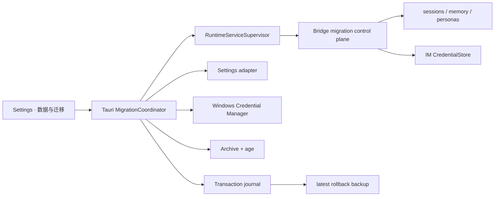
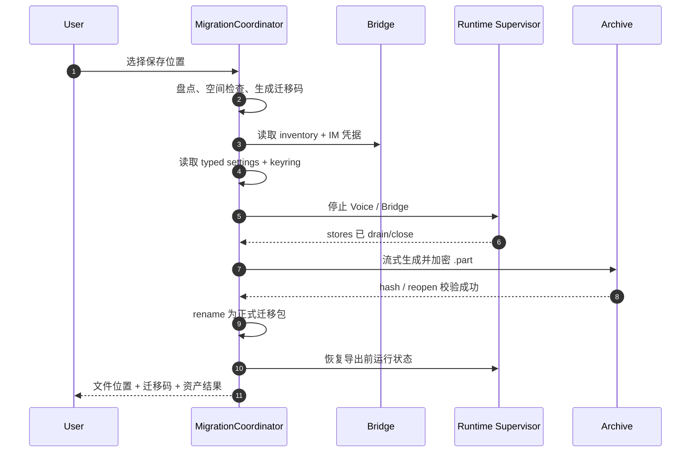

# 054 · Windows 设备一次性迁移 - 技术方案

## 状态

CONFIRMED

## 需求文档

→ [requirement.md](./requirement.md)

## 0. 文档说明

本文回答 054 需求中的“怎么做”：如何在没有账号和云服务的前提下，把分散在 Python 用户数据区、Tauri 设置文件、Windows 系统凭证管理器和 IM 本机密文中的用户资产收拢成一份加密迁移包，并在新 Windows 设备上以可回滚事务完成整体替换。

本期只实现 Windows → Windows。迁移只处理 agent-friend 正常产品界面管理的数据；开发环境变量、`.env`、`legacy-dotenv`、日志、权限、窗口位置和短生命周期连接状态均不进入迁移域。

## 1. 现状与约束

### 1.1 持久化位置

| 资产 | 当前权威位置 | 迁移策略 |
|------|--------------|----------|
| 会话、metadata、revision | `%APPDATA%/agent-friend/sessions/` | 保留稳定 ID，完整迁移 |
| 长期记忆源数据 | `%APPDATA%/agent-friend/memory/memory.db` | 完整迁移 |
| 记忆向量索引 | `memory-vectors-512.db` | 不搬运，在暂存区重建 |
| Persona 与内部关系状态 | `%APPDATA%/agent-friend/personas/` | 完整迁移，包括 `.internal` 和编辑状态 |
| 桌面设置 | `%APPDATA%/com.agentfriend.desktop/settings.json` | 类型化快照与恢复 |
| UI 状态 | `ui-state.json` | 仅迁移仍存在的最后会话 ID；排除窗口和桌宠坐标 |
| API / 搜索 /语音凭据 | Windows Credential Manager | 后端读取并写入新机 Credential Manager |
| QQ 凭据 | `%APPDATA%/agent-friend/im_credentials/` | 旧机解密为内存对象，新机重新加密 |
| 用户形象模型 | `%APPDATA%/agent-friend/avatar-models/` | 只迁移 user namespace/catalog，排除 builtin |
| CLI history | `%APPDATA%/agent-friend/.cli_history` | 存在时作为可选用户资产迁移 |

日志走 `%LOCALAPPDATA%/agent-friend/Logs/`，权限历史、开机启动、窗口布局和 IM resume/provider lock 均属于设备或运行状态，不迁移。

### 1.2 不能直接复制目录

用户资产跨越两个 Roaming 目录和 Windows Credential Manager，不能通过压缩单一目录完成。QQ `CredentialStore` 的 AES-GCM 密钥还由 `username + hostname + salt` 派生，旧机密文在新主机上必然无法正常解密。因此迁移必须同时包含：

- 文件资产的安全快照；
- Tauri 设置的类型化投影；
- Windows Credential Manager 凭据的后端导入导出；
- QQ 凭据在源、目标设备分别解密和重新加密的桥接流程。

### 1.3 运行时一致性

会话、memory SQLite/WAL、Persona 和 IM 凭据由 Bridge 持有并可能持续写入。现有 `RuntimeServiceSupervisor` 已能通过 owner-only lifecycle token 让 Bridge quiesce、drain、关闭数据库并退出；Voice 有活动或连接中通话时会拒绝停止。迁移必须复用这一边界，不能边运行边复制数据库。

## 2. 设计原则

1. **源数据优先**：只搬运不可重建的权威数据；向量索引、内置模型和 builtin 形象在新机重建。
2. **秘密不经过前端**：API Key、QQ secret 和备份密钥只存在于 Rust/Python 后端内存、加密流或系统安全存储。
3. **写入前完成预检**：密码、格式、兼容性、完整性、路径安全、磁盘空间和暂存数据均通过后才触碰现有状态。
4. **统一维护态**：迁移期间全应用只有一个 operation；设置、凭据、运行时启停和用户数据写入均被阻止。
5. **多资源可恢复事务**：文件目录、设置和系统凭据无法形成单个 OS 原子事务，使用持久化 journal + 逆操作栈保证失败和崩溃后恢复。
6. **最近备份单槽**：本机只保留一份最近有效回滚备份；新备份验证完成前绝不删除旧备份，且不按时间自动清理。
7. **版本显式演进**：容器、manifest 和各资产 schema 独立版本化；旧应用不猜测性读取新格式。

## 3. 总体架构



### 3.1 Tauri `MigrationCoordinator`

Tauri 主进程是总协调者，因为它同时拥有：

- Runtime Supervisor 和生命周期 token；
- Tauri settings managed state/plugin-store；
- Windows Credential Manager；
- 原生文件对话框、应用事件和重启能力；
- Windows DPAPI 和本地路径入口。

协调器持有全局 operation mutex、当前阶段、进度、取消边界和恢复 journal。长任务不归 React 组件所有；设置窗口关闭后操作仍保持一致。

### 3.2 Bridge migration control plane

在现有 `/internal/lifecycle` 同级增加仅供 supervisor 调用的 `/internal/migration` 路由，复用随机 lifecycle token 和常量时间比较鉴权，不进入 OpenAPI，不允许 WebView CORS 调用。

接口责任保持窄：

```text
GET  /internal/migration/inventory
GET  /internal/migration/im-credentials
POST /internal/migration/im-credentials/replace
POST /internal/migration/validate
```

- `inventory` 返回会话/记忆/Persona 的数量和“是否有用户修改”，不返回正文或秘密。
- `im-credentials` 在源机将当前可解密凭据序列化给 Tauri 内存；响应体和 HTTP body 禁止 debug logging。
- `replace` 在目标机使用当前设备派生密钥重新加密并原子写入。
- `validate` 在导入后验证核心 store 可打开、引用和 schema 可读，不触发 LLM 请求。

## 4. 资产清单与有意义数据判断

### 4.1 Manifest 资产组

```rust
enum AssetGroup {
    Sessions,
    Memory,
    Persona,
    Settings,
    UiContinuity,
    RuntimeCredentials,
    ImCredentials,
    UserAvatarModels,
    CliHistory,
}
```

Manifest 对每个条目记录规范化相对路径、组、字节数和 SHA-256。归档器只接受注册表允许的资产组和路径策略，不把任意用户数据根直接递归打包。

### 4.2 默认安装不触发危险覆盖

只按“文件存在”会把默认 Persona、空 SQLite 和 builtin 模型误判成用户数据。目标盘点采用领域判断：

- 存在至少一个真实 session；
- semantic/episodic 中存在有效记忆；
- Persona 与随包默认版本不同，或存在内部关系/编辑状态；
- settings 与产品默认值不同；
- Credential Manager 中存在应用托管凭据；
- 存在可解密的 IM 凭据；
- 存在 user avatar namespace/catalog；
- 存在 CLI history。

任一成立才进入“已有数据整体替换”；否则走空数据区恢复。

## 5. 迁移包格式与密码

### 5.1 外层格式

文件扩展名为 `.agentfriend-transfer`。外层只暴露固定 magic、容器版本和加密方案标识，不包含资产数量、用户名、Persona、模型名等私人 metadata。

有效载荷为流式 ZIP，整体再使用 `age` passphrase 模式加密：

```text
AFM magic + container version
└── age encrypted stream
    └── zip
        ├── manifest.json
        ├── assets/...
        └── secrets/...
```

`age` 版本精确 pin，writer 必须显式 finish；归档输出先写同目录 `.part`，flush/sync、重新打开完成校验后再原子 rename。大体积用户模型逐块流式读写，不整文件加载到内存。

### 5.2 迁移码

应用用系统随机数生成 12 个词的迁移码，词表固定版本并记录在容器方案中；按 2048 词计算提供约 132 bit 随机性。迁移码：

- 仅在导出结果页显示和按用户动作复制；
- 不进入包、同目录 sidecar、日志、诊断包或设置；
- 不提供“找回密码”后门；
- 导入错误只返回统一解密失败，不泄露 manifest 是否有效。

## 6. 归档安全

导入解密后仍必须防御恶意或损坏 ZIP：

- 拒绝绝对路径、盘符、UNC、`..`、NUL 和非规范分隔符；
- 拒绝 symlink、junction/reparse point、hard link 与特殊设备文件；
- 拒绝重复路径和大小写折叠后冲突的 Windows 路径；
- 每个 entry 必须出现在 manifest 和资产路径白名单；
- 校验逐文件 SHA-256、entry size、总解压大小和实际写入字节数；
- 对 entry 数、单文件大小、总大小和压缩比设置上限；
- 暂存目录使用不可预测 operation ID，所有 canonicalized 路径必须仍位于暂存根内。

任何错误发生在 commit 前，直接删除暂存区并保持当前数据不变。

## 7. 凭据迁移

### 7.1 应用托管 API Key

只导出 `SECRET_REGISTRY` 中、由 agent-friend 正常设置界面写入 Windows Credential Manager 的 canonical 凭据，包括 DeepSeek、Kimi、Tavily 和火山语音相关项。

以下来源完全不支持，也不盘点或提示：

- process environment；
- `.env`；
- `legacy-dotenv`；
- 非 agent-friend registry 的其他系统凭据。

导入时先读取目标机当前 canonical 值作为事务逆操作，再写入迁移包值。删除迁移包中不存在的应用托管凭据，确保“整体替换”不是叠加。测试通过注入 fake keyring backend，不操作开发机真实凭据。

### 7.2 QQ / IM 凭据

导出时 Bridge 在停止前读取 `CredentialStore.list_all()`，将成功解密的 `ImCredential` 返回 Tauri 内存；不可解密的存量文件在导出结果中标为失败，不能把损坏密文原样搬走。

导入时：

1. 文件和设置 commit 后启动 Bridge；
2. Tauri 通过带 lifecycle token 的内部接口提交内存中的 IM 凭据；
3. Bridge 在新机以当前 `username + hostname` 密钥原子写入；
4. 再次读取并比对非 secret identity 字段；
5. 本地重加密失败触发整笔事务回滚。

第三方 QQ 是否继续接受授权属于导入后的运行结果。若平台要求扫码，报告为 `needsUserAction`，不回滚已成功恢复的本地核心资产。

## 8. 导出流程



若存在活动/连接中通话，预检直接阻止导出并要求结束通话。无论导出成功或失败，都按快照恢复导出前的服务运行状态；恢复失败要在结果页单独报告。

## 9. 导入与整体替换

### 9.1 只读预检

选择文件和输入迁移码后，先完成：

1. 外层 magic、版本和 age 解密；
2. 安全解压到 staging；
3. manifest、hash、路径与 schema 校验；
4. 当前应用与源版本兼容判断；
5. 源/目标资产摘要；
6. 空间预算：staging + 新备份 + commit 临时副本；
7. 使用安装包内置 Embedding 模型在 staging 重建向量索引；
8. 对 staging 中会话、memory、Persona 和用户模型做离线可读性验证。

向量索引重建失败视为预检失败，因此不会丢记忆，也不会在导入成功后留下等待重建的检索空窗。

### 9.2 用户确认

目标不存在有意义数据时可直接进入 commit。存在数据时展示源/目标摘要和不可合并风险，复用：

```tsx
<ConfirmDialog
  variant="destructive"
  confirmDelaySeconds={5}
  ...
/>
```

确认后才申请维护锁和创建回滚备份；关闭、取消或倒计时未结束不产生破坏性写入。

### 9.3 Commit

```text
Acquire maintenance lock
→ stop Voice / Bridge
→ create and verify pending rollback backup
→ persist journal(BackupVerified)
→ rotate pending backup to latest slot
→ move current managed file assets to transaction old-area
→ move staging assets into active paths
→ replace typed settings and managed keyring credentials
→ start Bridge and re-encrypt IM credentials
→ validate all core asset groups
→ journal(Completed)
→ remove transaction old-area
→ app.restart()
```

文件交换只发生在同一 volume 的 managed child paths，不 rename 整个 user data root；`migration-backups/`、journal 和 work 目录始终被排除，避免把恢复基础设施一起换走。

## 10. 回滚备份

### 10.1 单槽布局

```text
%APPDATA%/agent-friend/migration-backups/
├── latest.afrollback
├── latest.key.dpapi
└── latest.meta.json
```

备份使用和迁移包相同的 canonical snapshot serializer，但不需要用户口令。协调器生成随机高熵 secret 加密归档，再用 Windows DPAPI `CryptProtectData` 保护该 secret；因此备份只服务当前 Windows 用户和当前机器。

### 10.2 安全轮换

每次破坏性操作使用：

```text
write pending archive + pending wrapped key
→ reopen/decrypt/hash verify
→ atomically replace latest files
→ continue destructive operation
```

如果 pending 创建或验证失败，保留旧 `latest`，终止操作。`latest` 不按时间删除。设置页允许用户查看、恢复或经危险确认后删除。

恢复 `latest` 也属于破坏性操作：先为恢复前状态生成新的 pending 并验证，再完成单槽轮换，然后执行恢复。这样恢复完成后，`latest` 指向“恢复前的状态”，允许用户反向撤销一次。

## 11. 事务 journal 与崩溃恢复

```rust
enum MigrationTransactionPhase {
    Prepared,
    BackupVerified,
    FilesSwapping,
    SettingsApplied,
    CredentialsApplied,
    Validating,
    Completed,
    RollingBack,
}
```

Journal 位于不参与替换的 migration work 根，记录 operation ID、已完成动作和恢复所需路径；不记录秘密、迁移码或凭据值。每次 phase/动作变化使用临时文件 + replace + sync。

运行中失败时按逆序恢复 keyring、settings 和 managed file paths。应用启动发现非 Completed journal 时，在启动 Bridge 前执行恢复；恢复未成功前进入 migration recovery UI，不允许正常运行时继续写入。

## 12. 设置与 UI 连续性

Settings 使用 Rust `Settings` 类型序列化，不直接复制 plugin-store JSON：

- 迁移主题、聊天/记忆模型、当前 Persona/形象、桌宠尺寸及产品级持久偏好；
- 不迁移系统权限、开机启动和 Windows 集成；
- `ui-state.json` 只投影 `last_chat_session_id`，且导入后验证该 session 确实存在；
- 排除窗口位置、尺寸、显示器和桌宠 anchor。

成功后调用 Tauri `AppHandle::restart()`，让所有窗口、Zustand store、plugin-store 和运行时从新状态初始化，不实现复杂的跨窗口热替换。

## 13. 设置页交互

新增“数据与迁移”导航，包含：

1. **迁移到新电脑**：资产摘要、原生保存对话框、进度、迁移码结果。
2. **从旧电脑恢复**：原生打开对话框、迁移码输入、预检摘要、危险确认、结果。
3. **最近回滚备份**：创建时间、来源、大小、恢复、删除。

使用官方 Tauri Dialog Plugin 提供文件 picker/filter；插件只授权 settings 窗口所需的 open/save capability。前端 command payload 只包含文件选择结果、用户输入的迁移码和非秘密操作 ID；API/QQ secret 永不返回 WebView。

进度阶段统一为 `preflight / quiescing / backingUp / staging / rebuildingIndex / committing / validating / restarting / rollingBack`。取消只允许发生在 commit 前；进入 `backingUp` 后 UI 明确显示不可取消。

## 14. 对外模型与结果

```ts
type MigrationAssetStatus =
  | "success"
  | "notPresent"
  | "needsUserAction"
  | "failed";

interface MigrationAssetResult {
  group: MigrationAssetGroup;
  status: MigrationAssetStatus;
  itemCount?: number;
  message: string;
}
```

核心本地组（sessions/memory/persona/settings）任一失败会让整笔导入失败并回滚。QQ 第三方在线认证和个别不兼容用户模型可以在本地数据已安全恢复后报告 `needsUserAction`，不得把它们隐藏在单一“成功”状态下。

错误模型分层：

- `package_*`：格式、口令、损坏、版本；
- `preflight_*`：空间、路径、活跃操作、staging 校验；
- `backup_*`：创建、DPAPI、验证、轮换；
- `commit_*`：文件、设置、keyring、IM 重加密；
- `rollback_*`：自动恢复或启动恢复；
- `third_party_*`：QQ 等需用户处理。

所有日志只记录 operation ID、阶段、资产组和错误码；路径按现有日志脱敏策略处理，禁止记录迁移码和 secret payload。

## 15. 文件改动规划

| 路径 | 改动 |
|------|------|
| `frontend/src-tauri/src/data_migration/` | model、inventory、archive、crypto、transaction、backup、commands |
| `frontend/src-tauri/src/paths.rs` | migration work/backup 路径入口 |
| `frontend/src-tauri/src/runtime_services/` | 维护锁、原状态快照、Bridge migration 请求 |
| `frontend/src-tauri/src/runtime_config.rs` | canonical keyring snapshot/replace/rollback 内部接口 |
| `frontend/src-tauri/src/settings.rs` | 类型化 export/replace 与事件边界 |
| `frontend/src-tauri/src/lib.rs` | managed coordinator、commands、启动恢复、dialog plugin |
| `frontend/src-tauri/Cargo.toml` | `age`、hash、Dialog Plugin、Windows DPAPI feature |
| `frontend/src-tauri/capabilities/default.json` | settings 窗口最小 dialog 权限 |
| `frontend/package.json` | `@tauri-apps/plugin-dialog` |
| `agent_bridge/src/agent_bridge/migration.py` | owner-only inventory、IM snapshot/replace、validation |
| `agent_bridge/src/agent_bridge/app.py` | 注册内部 migration routes |
| `agent_bridge/src/agent_bridge/protocols/im/credentials.py` | 原子 replace/验证 helper |
| `frontend/src/lib/dataMigration/` | command/event facade 和类型 |
| `frontend/src/pages/settings/data-migration/` | 三块设置 UI 与进度/结果 |
| `frontend/src/pages/settings/App.tsx` | 新增导航与页面装配 |
| 对应 Rust/Python/TypeScript tests | 安全、事务、凭据和 UI 状态覆盖 |

不增加独立开发者命令。若 Phase 3 需要可重复 Windows 断点恢复 smoke，按项目脚本规则增加 Windows 专用 `scripts/device-migration-smoke/run.ps1` 并在 `scripts/README.md` 说明单端原因。

## 16. 测试策略

### 16.1 归档与安全

- 正确迁移码 round-trip、错误码、篡改和截断。
- 大文件流式处理，不随模型体积线性增长内存。
- 路径穿越、盘符/UNC、大小写冲突、重复 entry、symlink/junction、zip bomb 上限。
- Manifest hash、entry size、未知资产组和 schema 版本。

### 16.2 资产与凭据

- 默认安装不被判为有效用户数据，真实 session/memory/persona/settings 任一可触发。
- 稳定 session ID、memory 引用和 Persona internal 状态 round-trip。
- 向量索引从 staging memory 重建，失败不 commit。
- fake keyring 覆盖全量替换和逆操作；明确证明 Env/`.env` 不被读取。
- QQ 在模拟 hostname 变化后重加密可读，损坏旧凭据被准确报告且不复制。

### 16.3 事务与备份

- commit 每个动作点注入失败并断言旧状态完整恢复。
- 每个 journal phase 模拟进程退出，下一次启动恢复。
- pending 未验证时旧 latest 保留；验证成功才轮换。
- 只存在一份 latest，不按时间自动删除。
- 恢复 latest 后生成的 latest 指向恢复前状态。
- DPAPI 测试 Windows gated；核心逻辑用 fake protector 覆盖 CI。

### 16.4 前端

- operation phase/event 丢失后可重新拉快照。
- 已有数据使用 `ConfirmDialog` destructive + 5 秒倒计时。
- commit 前可取消、commit 后不可取消。
- 结果按资产组展示，secret 不进入前端模型。
- 最近备份只展示一份，删除和恢复均有危险确认。

### 16.5 门禁与验收

- Python、Rust、TypeScript 局部测试。
- `./scripts/check` 全量门禁。
- 不调用真实 LLM API；记忆索引使用本地内置 Embedding 模型或测试 fake。
- Phase 3 完成设置 UI 后，按 `frontend-visual-verification` 询问用户是否执行真实 Tauri 桌面端视觉验收。

## 17. 实施顺序

1. **M54.0 格式与安全 spike**：age 流式容器、错误口令、Windows 安全解压、DPAPI fake/real 窄适配。
2. **M54.1 资产 inventory**：领域盘点、默认数据判断、typed settings/UI projection。
3. **M54.2 Bridge control plane**：inventory、QQ 内存快照/重加密、核心 store validation。
4. **M54.3 导出**：维护锁、优雅停服、keyring、stream archive、运行状态恢复。
5. **M54.4 暂存导入**：解密、安全解压、版本/hash/schema 校验、向量索引重建。
6. **M54.5 单槽备份与事务**：DPAPI backup、journal、故障注入、启动恢复。
7. **M54.6 Commit 与 app restart**：文件/settings/keyring/IM replace、逆操作、验证与重启。
8. **M54.7 设置 UI**：导出、导入、危险确认、进度、最近备份、结果。
9. **M54.8 回归与验收**：Windows smoke、全量门禁、按授权决定视觉验收。

M54.0 必须证明容器能在大文件下稳定流式工作、错误码/篡改在写入前失败、DPAPI 仅封装本机备份密钥；结论不满足时先回到设计 review，不能边实现边自创替代加密协议。

## 18. 风险与处理

| 风险 | 处理 |
|------|------|
| 多个存储系统没有统一原子事务 | journal + 逆操作 + 启动恢复；每个动作点做故障注入测试 |
| QQ 原始密文绑定旧主机 | 旧机内存解密、新机 Bridge 重加密；禁止复制旧密文 |
| 迁移包包含大体积用户模型 | ZIP/age 全链路流式处理，磁盘空间按 staging + backup + temp 预算 |
| 恶意迁移包覆盖任意文件 | manifest allowlist、Windows 路径折叠检查、拒绝 link/reparse、canonical containment |
| 向量索引与新机模型不兼容 | 不搬运索引；在 staging 使用新机内置模型重建并验证后 commit |
| 创建新备份时旧备份过早丢失 | pending 完整写入、解密/hash 验证成功后才轮换 latest |
| 用户误以为 QQ 本地恢复等于平台授权成功 | 本地凭据恢复和第三方在线状态分开报告 |
| App 内存仍引用旧设置/DB | 成功后 `AppHandle::restart()`，启动前处理未完成 journal |
| `age` crate 尚未 1.0 | 精确 pin 版本、容器封装隔离、known-answer/round-trip 测试固定行为 |

## 19. 明确不做

- 不做账号、云存储、云备份、同步或设备发现。
- 不合并两套用户数据。
- 不支持 Windows 之外的导出或导入。
- 不迁移或提示 process Env、`.env`、`legacy-dotenv`。
- 不迁移日志、诊断、缓存、权限历史、开机启动、显示器坐标、IM resume token 和运行中操作。
- 不搬运安装包内置形象、Embedding 模型或可重建向量索引。
- 不实现用户模型导入向导或模型市场，只确立其迁移资产边界。
- 不绕过 QQ 等第三方平台的强制重新认证。
- 不保留多代回滚历史；只保留最近一份有效备份，且不按时间自动删除。

## 变更记录

| 日期 | 变更内容 | 是否需要重新实现 |
|------|----------|------------------|
| 2026-07-19 | 初版方案确认：Windows 单文件 age 加密迁移包、应用生成迁移码、Tauri 总协调、Bridge QQ 重加密、staging 向量重建、单槽 DPAPI 本机备份、journal 回滚与整体替换 | 新设计，待实现 |
| 2026-07-19 | 明确仅迁移正常 UI 管理的系统凭证；process Env、`.env`、`legacy-dotenv` 完全不进入迁移能力 | 边界收敛，无兼容负担 |
