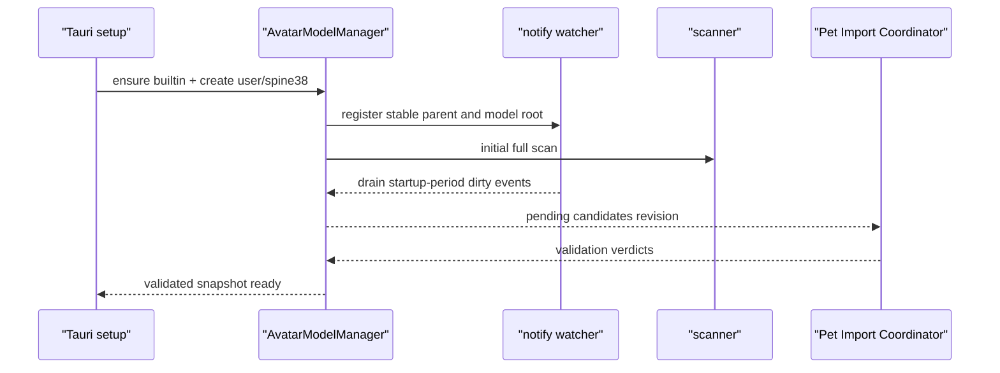

# 056 · Desktop Avatar Model Import and Scaling · 技术方案

## 状态

CONFIRMED

## 对应需求

→ [requirement.md](./requirement.md)

## 设计结论摘要

本需求沿用现有 avatar catalog、Spine 3.8 runtime、settings facade 与“桌宠”设置页，不建立新的模型管理产品面。

核心方案是：

1. Rust 常驻 `AvatarModelManager` 监听受管理目录，将文件事件收敛为稳定的候选模型快照。
2. pet WebView 中只有一个 Import Coordinator；它通过 Web Worker 复用正式 Spine 3.8 `SkeletonBinary` 完成 runtime 级校验，其他窗口不重复导入。
3. 模型目录内的 `agent-friend.model.json` sidecar 保存稳定 ID；根目录 `catalog.json` 只保存可重建的导入索引、校验缓存与 last-known-good 状态。
4. 只有通过完整导入校验的 entry 才进入 validated catalog；设置页和 pet renderer 只消费 validated catalog。
5. 缩放偏好以整数百分比保存：每模型 `50%–200%`，全局 mini 比例 `25%–75%`，步长均为 `1%`。

最终渲染比例统一为：

```text
normal = runtime normalization × per-model scale
mini   = runtime normalization × per-model scale × global mini ratio
```

## 现状分析

### 已有能力

| 模块 | 现状 |
|------|------|
| `frontend/src-tauri/src/paths.rs` | 已有 `<user_data_dir>/avatar-models`、`builtin/` 与根 `catalog.json` 路径 helper |
| `frontend/src-tauri/src/avatar_models.rs` | 安装 built-in seed，并通过固定 ID 返回 Hiyori 与 14 个 Ark Spine 模型的本地路径 |
| `frontend/src/avatar-models/catalog.ts` | 静态声明 built-in metadata；类型已预留 `source: "user"` 与 Spine runtime / format 字段 |
| `frontend/src/avatar-models/installed.ts` | Rust installed paths 与 TS 静态 catalog 按 ID 合并；hook 目前只在 mount 时加载一次 |
| `frontend/src/pet/avatarRuntime/spine38/` | 正式使用 `@pixi-spine/runtime-3.8` 的 `SkeletonBinary` 加载 `.skel` |
| `frontend/src/pages/settings/components/AvatarModelPanel.tsx` | 已是“桌宠”设置页的模型选择入口 |
| `frontend/src-tauri/src/settings.rs` / `frontend/src/lib/settings/` | 已支持启动期同步快照、跨窗口广播与单 key 持久化 |
| `frontend/src/pages/pet/petDisplayProfile.ts` | normal / mini 当前分别使用固定 `1.0 / 0.5` |
| `Spine38AvatarSurface` | 已有 `normalizationScale × userScale × displayModeScale` 的组合函数，但 `userScale` 仍固定为 `1` |

### 当前架构不能直接完成的部分

- Rust installed catalog 只认识硬编码 built-in ID，不能生成动态用户 entry。
- TS static catalog 是用户模型进入列表的前置条件，目录里新增文件不会自然成为 catalog entry。
- catalog hook 没有监听 revision，设置页和 pet 窗不会随目录变化更新。
- Rust 后台不能直接调用现有 TypeScript Spine parser；只检查扩展名或版本头不足以满足“runtime 可读”。
- 如果每个窗口自行完整解析用户模型，会重复读取 skeleton、atlas 与贴图，并让导入行为依赖设置页是否打开。
- `spine38Loader` 的 cache alias 只含 model ID；同 ID 原地更新后会继续命中旧资源。
- settings 没有每模型缩放映射，mini 比例也是代码常量。

## 设计原则

### 源资产、身份 metadata 与导入索引分离

本需求采用成熟资产管线常见的三层结构：

| 层 | 权威性 | 内容 |
|----|--------|------|
| 源模型目录 | 用户资产真相 | `.skel`、`.atlas`、atlas page textures |
| 模型 sidecar | 模型身份真相 | schema version、稳定 model ID |
| 中央 catalog | 可重建派生状态 | 相对路径、content revision、校验结果、validated metadata、诊断 |

sidecar 随模型目录移动，解决离线重命名后的身份延续；中央 catalog 可以在损坏或版本升级时删除并重建，不承担不可恢复的身份职责。

这一分工与 Unity 的 asset `.meta + Asset Database`、Godot 的 import metadata + imported cache，以及 VTube Studio 在模型目录旁保存模型配置的方向一致。

### 文件事件只触发重评估

watcher event 不直接增删 UI entry。任何创建、修改、重命名和移除事件都只把目录标记为 dirty；可见状态只能来自完整扫描、稳定性判断和导入校验完成后的快照。

### 导入只执行一次，消费方只读结果

完整 Spine 校验由单一 Import Coordinator 执行。设置页、pet 选择 resolver 和其他窗口不各自运行 importer，只订阅 validated catalog revision。

### last-known-good 不被半成品覆盖

同一稳定 ID 原地更新时，旧 validated entry 在新 content revision 完成校验前继续有效。只有明确删除模型目录时才移除旧 entry；更新失败只增加诊断，不用失败候选覆盖旧 revision。

## 目录布局

```text
<user_data_dir>/avatar-models/
├── builtin/
│   └── ...                         # 040 已有，应用管理
├── user/
│   └── spine38/
│       ├── my-amiya/
│       │   ├── agent-friend.model.json
│       │   ├── build_char_002_amiya.skel
│       │   ├── build_char_002_amiya.atlas
│       │   └── build_char_002_amiya.png
│       └── another-model/
│           └── ...
└── catalog.json                    # 应用生成，可重建
```

新增路径 helper：

```rust
pub fn user_avatar_models_dir() -> PathBuf
pub fn user_spine38_models_dir() -> PathBuf
```

设置页的“打开 Spine 3.8 模型目录”只调用无路径参数的 Rust command。command 先创建目录，再通过 `tauri-plugin-opener` 打开 `paths::user_spine38_models_dir()`；前端不能提交任意路径。

## 模型目录识别规则

### 目录边界

- `spine38/` 的每个第一层普通目录代表一个模型。
- 不递归把第二层目录识别成独立模型；第二层目录只可作为当前模型的贴图等资源目录。
- 忽略普通文件、临时文件以及应用自己的 catalog 文件。
- 模型根、skeleton、atlas 与每张 atlas page texture 都需 canonicalize。
- canonical 后的所有资源必须仍位于该模型第一层目录内；符号链接、junction、`..` 或其他等价逃逸一律拒绝。
- 不跟随指向模型根之外的目录链接。

### skeleton / atlas 配对

本期只接受能够唯一确定的同 stem 二进制组合：

1. 收集模型目录内第一层的 `.skel` 与 `.atlas`。
2. 按不区分扩展名大小写的 stem 配对。
3. 恰好存在一个同 stem pair 时接受该组合。
4. 没有同 stem pair，或存在多个 pair 时标记 `ambiguous-resources`，不猜测。
5. `.json` skeleton 不参与候选。

atlas 可以引用当前模型目录内一张或多张 page texture；page 可以位于模型子目录，但不能越过模型根。

### Rust 预检

Rust scanner 在进入 runtime importer 前完成：

- skeleton / atlas 唯一配对。
- 所有文件可读且是普通文件。
- atlas 文本可解析出 page 与 region，且至少有一个 page。
- 每个 atlas page 对应文件存在、可读、路径未逃逸。
- 按 Spine 3.8 binary string 编码读取 skeleton 头部的 hash 与 version。
- version 必须属于 `3.8.x`，且拒绝 Spine 3.8 runtime 明确不支持的 `3.8.75`。
- 文件大小、mtime 与内容 digest 能生成稳定 content revision。

Rust 预检通过只代表“可以送入 importer”，不代表模型已经进入可选 catalog。

## 稳定 ID 与 sidecar

### sidecar schema

文件名固定为 `agent-friend.model.json`：

```json
{
  "schemaVersion": 1,
  "id": "user:spine38:018f3d7a0f6b4df39c8a2e6214d1a4fb"
}
```

约束：

- ID 由应用生成的随机 128-bit 标识组成，不从绝对路径或文件夹名称派生。
- sidecar 不保存绝对路径、贴图列表、缩放偏好或完整 runtime metadata。
- 只有目录达到“资源可唯一识别、Spine 3.8 头部可读”的基础稳定状态后才生成 sidecar，避免在复制初期写入半成品目录。
- sidecar 使用同目录临时文件写入并原子 rename；写入失败时模型进入 `metadata-unwritable` 诊断，不发布为候选。
- 已存在 sidecar 时严格校验 schema 与 ID namespace；格式错误不自动覆盖，以免破坏可恢复身份。

### ID 冲突

用户复制一个已经带 sidecar 的模型目录时可能产生重复 ID。处理规则：

1. 中央 catalog 中此前已绑定且仍存在的目录优先保留原 ID。
2. 新出现的冲突副本生成新 ID，并原子改写其 sidecar。
3. 如果多个冲突目录都没有历史记录，按规范化相对路径排序，第一个保留，其他目录生成新 ID。
4. 任一需要改写的目录不可写时，该副本不发布，并给出 `duplicate-id-unwritable` 诊断。

目录重命名或移动整个第一层模型文件夹时，sidecar 会随目录移动，因此不依赖 watcher 是否在场，也不依赖内容指纹猜测身份。

## 中央 catalog 与导入缓存

`catalog.json` 是应用生成的派生文件，schema 示意如下：

```json
{
  "schemaVersion": 1,
  "importerVersion": "spine38-importer-v1",
  "runtimeVersion": "pixi-spine-3.8@4.0.6",
  "models": {
    "user:spine38:...": {
      "relativeDirectory": "my-amiya",
      "contentRevision": "sha256:...",
      "status": "valid",
      "validated": {
        "skeleton": "build_char_002_amiya.skel",
        "atlas": "build_char_002_amiya.atlas",
        "textures": ["build_char_002_amiya.png"],
        "defaultAnimation": "Relax"
      }
    }
  }
}
```

实现字段可以按 Rust 类型调整，但必须保持以下语义：

- 所有路径均相对 `user/spine38/<model>/` 保存。
- cache key 至少包含 model ID、content revision、importer version 与 Spine runtime version。
- importer 或 runtime 版本改变时，旧 validation cache 自动失效并重新导入。
- `catalog.json` 使用 build-then-swap 原子发布；解析失败时记录日志并从目录重建，不能阻止 built-in 模型启动。
- invalid 结果也可按 content revision 缓存，避免未变化的坏模型在每次打开设置页时重复解析。
- runtime error 只保存可理解的错误码与截断后的信息，不写入文件内容或绝对路径。

## 文件监听服务

### 模块边界

现有 `avatar_models.rs` 已同时承担 built-in 安装和 installed 查询。本需求自然将其整理为目录模块：

```text
frontend/src-tauri/src/avatar_models/
├── mod.rs              # facade、commands、公开 DTO
├── builtin.rs          # 现有 seed 安装与 built-in resources
├── manager.rs          # snapshot、revision、single-flight 协调
├── scanner.rs          # 纯目录扫描、预检、content revision
├── watcher.rs          # notify 生命周期、debounce、恢复
└── catalog_store.rs    # sidecar / catalog 原子读写
```

这次拆分服务于已经出现的独立职责，不引入通用插件框架。

### watcher 选择

Rust 侧新增与当前 toolchain 兼容的 `notify-debouncer-full`：

- 它负责合并重复事件、rename stitching 与 full debounce。
- callback 中只向内部 channel 投递 dirty signal，不扫描目录、不持锁、不调用 WebView。
- watcher 同时观察稳定存在的 `user_data_dir()` 父级和当前 `user/spine38` 子树：父级用于发现模型根被删除或重建，子树用于正常递归变化。
- 事件进入后先做路径过滤，只接受受管理模型子树。

### 启动顺序



先注册 watcher、再做初始扫描，可以避免扫描期间发生的复制变化落在空档中。

### single-flight 与 dirty-again

manager 只允许一个扫描任务运行：

- idle 收到 dirty → 启动 scan。
- scanning 收到 dirty → 设置 `dirty_again = true`。
- scan 完成后若 `dirty_again` 为 true → 清标记并立即再扫描一次。
- scan 结果先在内存完整构建，再与当前候选/诊断做语义比较。
- 没有语义变化时不递增 revision、不写 catalog、不 emit。

### 复制稳定窗口

`notify-debouncer-full` 完成 full debounce 后才扫描，默认 settle window 设计为 `750 ms`。此外：

- 新目录或新 content revision 首次扫描结果记为 `settling`。
- 相同结构签名在下一次稳定扫描仍一致，才进入 `pending-validation`。
- 后续任何相关事件都会使其重新 settling。
- 缺文件或暂时不可读在 settling 阶段显示“正在等待模型文件复制完成”，不立刻报成永久损坏。
- runtime importer 对稳定 revision 给出失败后，才显示明确 invalid 诊断；文件再次变化会自动重试。

### 监听恢复

- `user/spine38` 被删除：保留 built-in catalog，移除已不存在的 user entries，持久化当前模型 fallback；后台重建目录并重新注册 watcher。
- watcher backend 报错：记录诊断并按有上限的退避重建 watcher；重建后执行全量扫描。
- 父目录事件只用于恢复模型根，不把其他用户数据变化送入 scanner。
- watcher shutdown 句柄由 Tauri managed state 持有，应用退出时自然停止。

## 单一 Spine Import Coordinator

### 为什么不在每个窗口校验

完整校验必须使用与正式 renderer 相同的 Spine 3.8 binary parser，但不应让设置页、pet 窗与未来窗口各自加载一次。成熟资产管线通常由单一 importer 生成带版本的导入结果，消费方只读取结果。

本项目的正式 parser 位于 TypeScript runtime，因此 importer 分为：

- Rust：扫描、路径安全、atlas page 文件关系、版本头、缓存与最终 catalog owner。
- pet WebView：承载唯一 Import Coordinator，因为 pet WebView 是当前正式 avatar runtime owner，且应用运行期间持续存在。
- Web Worker：执行 CPU 密集的 skeleton binary parse 与图片解码，避免阻塞 pet 动画和指针交互。

设置窗口完全不参与 importer 生命周期，满足“设置页关闭时仍自动发现”。

### Coordinator 协议

Rust snapshot command 返回：

```ts
interface AvatarModelCatalogSnapshot {
  revision: number;
  entries: InstalledAvatarModelResources[];
  pendingImports: PendingSpine38Import[];
  diagnostics: AvatarModelDiagnostic[];
}
```

`entries` 只包含 built-in 与 validated user models。`pendingImports` 只包含需要当前 importer/runtime 版本重新验证的稳定候选。

Coordinator 对每个 candidate：

1. 通过 `convertFileSrc` 和现有 asset protocol 获取 skeleton、atlas 与 textures。
2. 主线程只负责读取资源并把 `ArrayBuffer` 作为 transferable 交给 Web Worker。
3. Worker 使用 `@pixi-spine/runtime-3.8` 的 `SkeletonBinary` 完整读取 skeleton。
4. Worker 使用专用 validating `AttachmentLoader` 创建必要 attachment 类型，并检查 region / mesh attachment 引用能在已解析 atlas region 集合中找到。
5. Worker 对每张 atlas page texture 做图片解码校验，完成后立即释放，不建立长期 GPU texture cache。
6. Worker 返回 animation names、选定 default animation 与结构化错误。
7. Coordinator 调用 Rust `complete_avatar_model_import`，带上 scan generation、model ID 和 content revision。

Rust 只接受仍与当前 pending candidate 完全匹配的 verdict；旧 generation 或旧 content revision 的迟到结果直接丢弃。

### Worker 降级

目标 WebView 不支持 Worker 图片解码 API 时，Coordinator 可以在 pet WebView 主线程以异步图片元素完成贴图解码，但：

- Spine binary parse 仍优先留在 Worker。
- 降级路径仍只有一个 Coordinator，不回退成每窗口校验。
- 单个模型串行导入，避免多个大贴图同时占用内存。
- 导入期间不创建 PIXI stage，也不影响当前 renderer。

### default animation

用户模型不提供动作映射编辑。本期 importer 从解析结果选择初始 animation：

1. 精确或忽略大小写匹配 `Relax`。
2. 使用现有 `chooseInitialAnimation` 的 idle/default-like 规则。
3. 使用第一条 animation。
4. 没有任何 animation 时校验失败，不进入可选 catalog。

用户 entry 不写 Ark 专属动作映射。现有 `resolveSpineActionMapping` 会对各 phase/action 使用 default animation 和安全 fallback，因此模型至少保持可显示、可循环，不承诺拥有特定互动动作。

## catalog 发布与模型更新

### revision 事件

Rust 对 validated snapshot 做语义比较，实际变化后：

1. 原子写入 `catalog.json`。
2. 更新 managed in-memory snapshot。
3. 广播 `avatar-models://catalog-changed`，payload 只含 revision。

前端 `useInstalledAvatarModelCatalog`：

- mount 时读取 snapshot。
- 监听 revision 事件后重新读取。
- 多个连续事件以 in-flight request ID 丢弃旧响应。
- 新请求失败时保留当前 entries，并单独暴露 error；不把整个列表清空。

### 原地更新

动态 Spine entry 增加 `contentRevision`。resource cache alias 和 React renderer key 都使用：

```text
<model-id>@<content-revision>
```

更新流程：

- 候选 revision 变化但尚未验证：旧 validated entry 保持不变。
- 新 revision 验证成功：原子替换 entry，pet 以新 key 重建 renderer。
- 新 revision 验证失败：旧 renderer 与旧 cached resource 继续使用，设置页显示“模型更新失败，仍在使用上一可用版本”。
- 应用在磁盘处于失败更新状态时重新启动：若旧资源无法从磁盘重建，则该模型不发布，并按当前模型失效流程回退；本期不复制一份模型资产作为历史备份。

### 删除与回退

模型第一层目录消失被视为明确删除，不适用 last-known-good 保留：

- validated catalog 移除 entry。
- 如果 settings 当前 `avatarModelId` 指向该 ID，由 Rust catalog manager 调用 settings owner 的内部 reconcile helper，持久化改为 `builtin:live2d:hiyori` 并发送既有 `settings://changed`。
- catalog revision 随后广播；即使事件到达顺序交错，前端 resolver 仍能即时 fallback Hiyori。
- 保留一条不含绝对路径的最近删除诊断，供设置页说明为什么发生回退。
- `avatarModelScalePercents` 不删除该 ID 的历史值；用户将带同一 sidecar 的模型放回时可恢复原大小。

## 动态 catalog entry

Rust validated user model需要向前端提供足够 metadata，使其不依赖 TS 静态清单：

```ts
interface InstalledSpine38ModelResources {
  id: string;
  name: string;
  backend: "spine";
  source: "user";
  distribution: "user-local-only";
  contentRevision: string;
  resources: {
    skeletonPath: string;
    atlasPath: string;
    texturePaths: string[];
  };
  spine: {
    format: "skel";
    runtime: "spine38-pixi7";
    defaultAnimation: string;
  };
}
```

`name` 默认取第一层文件夹名称。路径仍由前端统一经 `convertFileSrc` 变成 runtime URL；绝对路径不进入 settings。

`mergeInstalledAvatarModelResources` 调整为：

- built-in：继续用 ID 合并 TS static metadata 与 Rust installed paths。
- user：由 validated Rust DTO 构造完整 dynamic entry，并套用通用 user Spine 3.8 capabilities / fit defaults。
- dev fixture：继续排除在正式 installed catalog 外。

## settings schema

### 持久化字段

Rust：

```rust
pub struct Settings {
    // existing fields...
    #[serde(default)]
    pub avatar_model_scale_percents: BTreeMap<String, u16>,
    #[serde(default = "default_pet_mini_scale_percent")]
    pub pet_mini_scale_percent: u16,
}
```

前端：

```ts
interface Settings {
  // existing fields...
  avatarModelScalePercents: Record<string, number>;
  petMiniScalePercent: number;
}
```

默认：

- map 中缺少某个 model ID → `100%`。
- `petMiniScalePercent` → `50%`，保持升级前视觉行为。

使用整数百分比可以从持久化层排除 `NaN`、`Infinity` 与浮点序列化漂移。

### 验证范围

| 设置 | 最小 | 最大 | 步长 | 默认 |
|------|------|------|------|------|
| 当前模型大小 | 50% | 200% | 1% | 100% |
| mini 模式比例 | 25% | 75% | 1% | 50% |

Rust `set_setting` 是最终验证边界：必须是整数且位于范围内。前端 slider 和 selector helper 同样 clamp，但不能替代后端校验。

旧 settings 文件通过 serde default 无迁移写放大；下次正常设置保存时自然带上新字段。

### 实时预览与持久化

Slider 高频拖动不应每帧 `store.save()`：

- `onValueChange` 更新设置窗口局部值，并按 animation frame 节流发送 `avatar-models://display-scale-preview`。
- pet 窗监听 preview，重新计算当前 display profile，立即显示效果。
- `onValueCommit` 才调用 `setSetting` 持久化完整 map 或 mini percent。
- commit 成功后既有 `settings://changed` 成为最终真相，并清除 preview override。
- 写入失败、pointer cancel 或面板卸载时，设置页发送 persisted value 作为回滚 preview。
- pet 窗对 preview payload 再次执行范围归一化，不接受非有限或越界数值。

## 缩放数据流

### PetDisplayProfile

`PetDisplayProfile` 从单一 `scale` 调整为显式分量：

```ts
interface PetDisplayProfile {
  avatarSize: PetAvatarSize;
  placementKey: string;
  modelScale: number;
  modeScale: number;
  renderScale: number;
  placementPoint: PetPoint | null;
  edge: PetEdge | null;
}
```

其中：

```text
modelScale = avatarModelScalePercents[currentModelId] / 100
modeScale  = avatarSize === "mini" ? petMiniScalePercent / 100 : 1
renderScale = modelScale × modeScale
```

### renderer 应用

- Live2D：`usePixiAvatarSlot` 把 `renderScale` 应用于 runtime 已有基础尺寸。
- Spine：`composeSpine38DisplayScale` 使用 `normalizationScale × modelScale × modeScale`，移除硬编码 `DEFAULT_USER_SCALE`。
- 两个 backend 在 scale 改变时都围绕当前可见中心调整 slot position，避免滑杆拖动时模型向一侧漂移。
- scale 改变后重新计算 sprite bounds、hit area、alpha scan offset、ActionBar anchor 与 bubble anchor。

### normal / mini 位置计算

`spriteScreen` 是当前实际渲染尺寸，因此模式切换时 placement 计算使用相对模式比例，不能再次乘 model scale：

- normal → mini：目标尺寸为当前 normal rect × `miniRatio`。
- mini → normal：目标尺寸为当前 mini rect ÷ `miniRatio`。
- 仅调整模型大小或 mini 比例：围绕当前中心缩放，不自动重新触发贴边；已处于 mini 且贴边时保持当前 edge anchor 的可召回语义。

现有 `computeEdgeDockPlacement` 调整为接收明确 target size 或 relative ratio，避免把 absolute render scale 与 mode transition scale 混用。

## 设置页 UI

继续修改 `AvatarModelPanel`，不新增设置导航项。

建议布局：

```text
桌宠
└── 形象
    ├── 当前模型                 [Select]
    ├── 模型大小      [Slider] 100% [恢复默认]
    ├── 缩小模式比例  [Slider]  50%
    ├── 用户 Spine 3.8 模型      [打开模型目录]
    ├── 运行时                   [Live2D / Spine]
    └── 导入状态 / 最近诊断
```

项目当前没有 Slider。实现期必须使用 `add-shadcn-component` skill，通过 shadcn CLI 引入通用 Slider 到 `frontend/src/components/ui/`，并从 barrel 导出；不手写后声称为 shadcn 组件。

UI 行为：

- “模型大小”始终作用于当前 Select 对应模型，built-in 与 user 一致。
- 当前值不是 100% 时显示可用的“恢复默认”；恢复动作删除 map 中该 ID，而不是写冗余 `100`。
- mini ratio 是全局项，不随模型切换。
- 打开目录按钮旁说明“一层文件夹一个模型；支持 Spine 3.8 `.skel + .atlas + textures`”。
- pending 状态展示“正在等待复制完成”或“正在校验”。
- invalid 状态展示模型文件夹名、稳定错误摘要；不把内部堆栈或绝对路径直接暴露给用户。
- watcher 全局错误与单模型错误分开呈现，避免一个坏模型看起来像整个模型系统失效。

桌宠模型区域使用 Tauri 原生 Context Menu 提供“桌宠设置”快捷项；该项必须复用全局 `openSettings({ target: "pet" })` 导航，不自行实现窗口打开协议。原生菜单负责跨窗口失焦、点击外部、Esc、键盘导航与系统级定位，避免把 WebView 内 Radix modal / pointer lifecycle 强行扩展到透明桌宠窗口。菜单弹出期间仅保活 ActionBar 的可见状态，背景 ActionBar 不参与菜单交互。

## Rust commands 与事件

建议 facade：

```rust
#[tauri::command]
fn open_user_spine38_models_dir(app: AppHandle) -> Result<(), String>

#[tauri::command]
fn get_avatar_model_catalog_snapshot(
    state: State<AvatarModelManagerState>,
) -> Result<AvatarModelCatalogSnapshot, String>

#[tauri::command]
fn complete_avatar_model_import(
    state: State<AvatarModelManagerState>,
    payload: CompleteAvatarModelImportPayload,
) -> Result<(), String>
```

事件：

| 事件 | 发送方 | 消费方 | payload |
|------|--------|--------|---------|
| `avatar-models://candidates-changed` | Rust manager | pet Import Coordinator | candidate revision |
| `avatar-models://catalog-changed` | Rust manager | 所有 catalog hooks | validated revision |
| `avatar-models://display-scale-preview` | settings WebView | pet WebView | model ID / scale percent / mini percent |
| `settings://changed` | 既有 settings owner | 所有 settings hooks | 最终持久化值 |

现有 `get_installed_avatar_model_resources` 可由新 snapshot command 取代；这是仓库内部 Tauri contract，没有对外兼容要求。迁移必须一次性更新所有调用方和测试，不保留两套 catalog 真相。

## 错误模型

结构化诊断至少包含：

```ts
type AvatarModelDiagnosticCode =
  | "waiting-for-files"
  | "ambiguous-resources"
  | "unsupported-spine-version"
  | "missing-atlas-page"
  | "path-outside-model-root"
  | "metadata-invalid"
  | "metadata-unwritable"
  | "duplicate-id-unwritable"
  | "runtime-parse-failed"
  | "texture-decode-failed"
  | "no-animation"
  | "watcher-unavailable";
```

每条诊断保存 model folder display name、code、用户可理解 message、最近观察时间和可选 model ID。日志可以附带受控路径用于排查，但设置页 payload 不返回绝对路径。

单模型异常不使 command 整体失败；只有 snapshot state 本身不可读或 manager 未初始化时 command 才返回顶层 error。

## 安全与资源限制

- 只允许受管理目录，不开放任意路径导入。
- scanner 对每个第一层目录设置合理文件数、单文件大小和总大小上限；超过上限给出诊断，避免异常目录耗尽内存。
- atlas 文本和 sidecar JSON 读取设置上限；不无界读取任意文本。
- Worker 每次只导入一个模型，贴图逐张解码并及时释放。
- 前端只 fetch Rust 已 canonicalize 且位于模型根内的资源路径。
- sidecar 和 catalog 写入使用临时文件 + 原子替换，不在 watcher callback 内直接写。
- 应用写 sidecar/catalog 产生的 watcher 事件仍经过语义 diff；自身写入不能形成无限重扫循环。

具体字节上限在实现期以现有内置 Ark 模型规模为基线设置常量并配单测，不作为用户可配置项。

## 涉及文件

### Rust / Tauri

| 文件 | 改动 |
|------|------|
| `frontend/src-tauri/Cargo.toml` | 增加兼容当前 Rust toolchain 的 `notify-debouncer-full` |
| `frontend/src-tauri/src/paths.rs` | 增加 user / spine38 路径 helper |
| `frontend/src-tauri/src/avatar_models.rs` | 迁移为目录模块 |
| `frontend/src-tauri/src/avatar_models/*` | built-in、scanner、watcher、manager、catalog store 与 DTO |
| `frontend/src-tauri/src/settings.rs` | 新增缩放字段、范围验证和失效模型 reconcile helper |
| `frontend/src-tauri/src/lib.rs` | manage manager、启动 watcher/coordinator contract、注册 commands |
| `frontend/src-tauri/tauri.conf.json` | 核对 asset protocol scope 继续精确覆盖用户模型目录；不扩大到任意文件系统 |

### Frontend

| 文件 | 改动 |
|------|------|
| `frontend/src/avatar-models/catalog.ts` | dynamic user metadata defaults、contentRevision |
| `frontend/src/avatar-models/installed.ts` | snapshot + revision 订阅、built-in/user merge、保留旧快照错误策略 |
| `frontend/src/avatar-models/importCoordinator.ts` | pet 侧单一 importer 协调器 |
| `frontend/src/avatar-models/spine38ImportWorker.ts` | Spine 3.8 binary / attachment / image decode 校验 |
| `frontend/src/pet/avatarRuntime/spine38/spine38Loader.ts` | cache alias 纳入 contentRevision，复用可测试的 atlas 解析逻辑 |
| `frontend/src/pages/pet/App.tsx` | 启动 coordinator；读取按模型 scale 与 mini ratio；弹出 Tauri 原生桌宠菜单并保活 ActionBar 可见状态 |
| `frontend/src/pages/pet/nativeContextMenuLifecycle.ts` | 将原生菜单 popup 生命周期投影为可测试的 React open 状态 |
| `frontend/src/pages/pet/petDisplayProfile.ts` | model/mode/render scale 与相对模式切换几何 |
| `frontend/src/pages/pet/usePixiAvatarSlot.ts` | Live2D 使用 renderScale，缩放保持中心与 anchor 同步 |
| `frontend/src/pet/avatarRuntime/spine38/Spine38AvatarSurface.tsx` | 使用真实 modelScale / modeScale，revision 更新安全重建 |
| `frontend/src/lib/settings/index.ts` | 新 settings 类型、默认值与 selector helpers |
| `frontend/src/pages/settings/components/AvatarModelPanel.tsx` | 两个 Slider、恢复默认、打开目录、导入状态 |
| `frontend/src/components/ui/slider/` | 通过 shadcn CLI 新增 Slider |

## 测试计划

### Rust 单测

`paths`：

- user Spine 3.8 路径落在统一 avatar model assets 目录内。
- `AGENT_FRIEND_DATA_DIR` 测试 override 仍有效。

`scanner`：

- 唯一同 stem `.skel/.atlas` 被识别。
- 多 pair、无 pair、JSON-only、缺 atlas page 分别给出稳定错误码。
- 多 atlas page 与子目录 texture 正常解析。
- Spine 3.8 版本头接受；3.8.75、4.x、截断 binary 拒绝。
- symlink / junction / relative traversal 不越过模型根。
- content revision 对内容变化敏感，对无关 watcher event 稳定。

`catalog_store`：

- sidecar 首次生成与重复读取 ID 稳定。
- 文件夹重命名后 sidecar ID 不变。
- 重复 sidecar ID 按历史绑定规则拆分。
- sidecar / catalog 临时写失败不破坏上一文件。
- importer/runtime version 变化使 validation cache 失效。
- catalog 损坏时可以从目录重建。

`manager`：

- single-flight + dirty-again 不并发扫描且不会漏最终状态。
- settling 模型不发布 pending import。
- stale importer verdict 被 generation/content revision 拒绝。
- 相同语义快照不递增 revision。
- invalid update 保留 last-known-good；明确删除移除 entry。
- 删除当前模型持久化回退 Hiyori。
- watcher error / root deletion 后执行恢复扫描。

`settings`：

- 旧文件默认 scale map 为空、mini 为 50%。
- 模型 scale 只接受 50–200 的整数百分比。
- mini 只接受 25–75 的整数百分比。
- 非整数、负数、越界和错误类型拒绝。
- 启动注入包含新字段。

### Frontend 单测

`installed`：

- built-in 继续合并静态 metadata。
- validated user DTO 生成 `source: user` dynamic entry。
- pending / invalid 模型不进入 entries。
- revision 变化重新加载；旧请求迟到不覆盖新请求。
- reload 失败保留上一 entries。
- 删除选中项 resolver fallback Hiyori。

`spine38ImportWorker`：

- 有效 3.8 fixture 返回 animation names 与 default animation。
- 截断 binary、missing atlas region、坏贴图、无 animation 返回结构化错误。
- verdict 带回原 scan generation 与 content revision。

`petDisplayProfile`：

- normal renderScale = modelScale。
- mini renderScale = modelScale × mini ratio。
- normal → mini placement 只乘 mini ratio，不重复乘 modelScale。
- mini → normal 使用 mini ratio 的倒数恢复 target size。
- 调模型 scale 保持中心，不误触发 edge docking。
- 非有限 preview 被忽略或归一化。

`settings UI`：

- 切模型读到各自百分比。
- 恢复默认删除当前 ID map entry。
- slider change 发 preview，commit 才持久化。
- 打开目录 command 不携带路径。
- pending、invalid、watcher error 文案区分。

### 集成与回归

- mock watcher 连续写入事件只产生一次稳定 candidate revision。
- candidate → worker verdict → validated catalog 端到端 contract。
- 原地有效更新触发 contentRevision 和 renderer key 变化。
- 原地失败更新不替换 last-known-good。
- 删除当前模型的 catalog / settings 两条事件最终一致。
- 运行现有 avatar catalog、Spine fit、pet geometry、settings migration 测试，确保 built-in 行为不退化。
- `./scripts/check` 全绿。

### 真实 Tauri desktop smoke

按 requirement AC 执行：

1. 从设置页打开受管理目录。
2. 缓慢复制一个完整 Ark Spine 3.8 文件夹，确认复制中不出现在 Select，稳定校验后自动出现。
3. 选择用户模型，确认能显示并播放安全初始 animation。
4. 分别验证模型大小 50%、100%、200%，以及 mini 25%、50%、75%。
5. 在 mini 模式拖动比例，确认实时缩放、贴边召回区、ActionBar 与 bubble anchor 可用。
6. 给模型文件夹重命名，确认 ID 与模型大小不变。
7. 原地写入坏 `.skel`，确认旧实例保持、设置页报告更新失败；恢复有效文件后自动切到新 revision。
8. 删除当前模型目录，确认自动回退 Hiyori。
9. 设置页关闭时复制/删除模型，重新打开后 catalog 已是最新。
10. 删除并重建 `spine38` 根，确认 watcher 自愈。

## 跨平台影响

- Windows、macOS、Linux 都由 `notify` backend 提供文件事件，业务层不依赖平台特有 event kind。
- 路径比较使用 canonical `PathBuf`，前端 URL 统一经 `convertFileSrc`，不手写 `file://`。
- Windows rename / antivirus / Explorer 批量复制可能产生重复事件，由 full debounce、single-flight 和语义 diff 吸收。
- macOS / Linux symlink 与 Windows junction 都按“canonical 后不得越界”处理。
- Worker 与图片解码能力需要在真实 WebView2 / WKWebView / WebKitGTK 下验证；不以普通浏览器 smoke 代替桌面结论。
- 本需求不新增开发者操作脚本；既有 `scripts/check` 与桌面视觉脚本继续作为统一入口。

## 风险与处理

| 风险 | 处理 |
|------|------|
| 监听事件风暴或 rename 事件平台差异 | full debounce；事件只做 dirty signal；最终以全量扫描为准 |
| 复制中途短暂文件齐全 | 两次稳定结构签名 + exact runtime validation；pending 不发布 |
| 每个窗口重复解析大模型 | 单一 pet Import Coordinator；validated catalog 作为共享结果 |
| 完整 parser 阻塞桌宠交互 | Web Worker 串行 CPU parse；贴图解码后释放 |
| sidecar 污染用户原始模型目录 | sidecar 是可读、最小、模型随附 metadata；只在基础稳定后生成；UI 说明其用途 |
| 复制带 sidecar 导致 ID 冲突 | 历史绑定优先；新副本自动换 ID；不可写则隔离副本 |
| 原地坏更新破坏当前模型 | 新 revision 校验前不换 catalog；运行中保留旧 cache；重启无法恢复时 fallback |
| 旧 scale map 累积已删除 ID | 有意保留以支持带 sidecar 的模型回归；数据量仅每模型一个整数 |
| mini 与 model scale 在几何中重复相乘 | profile 显式拆分 model/mode/render scale；模式 placement 使用相对比例 |
| catalog 自写触发 watcher 循环 | catalog 位于监听模型子树之外；sidecar 自写事件再经过 content/语义 diff |

## 外部参考

- Tauri filesystem watch：<https://v2.tauri.app/plugin/file-system/>
- Tauri native menu：<https://v2.tauri.app/reference/javascript/api/namespacemenu/>
- notify：<https://github.com/notify-rs/notify>
- notify-debouncer-full：<https://docs.rs/notify-debouncer-full/latest/notify_debouncer_full/>
- Spine runtime versioning：<https://esotericsoftware.com/spine-versioning>
- Spine loading skeleton data：<https://en.esotericsoftware.com/spine-loading-skeleton-data>
- Spine 3.8 `SkeletonBinary`：<https://github.com/EsotericSoftware/spine-runtimes/blob/3.8/spine-ts/core/src/SkeletonBinary.ts>
- Unity Asset Metadata：<https://docs.unity.cn/Manual/AssetMetadata.html>
- Unity Asset Database Refresh：<https://docs.unity.cn/Manual/AssetDatabaseRefreshing.html>
- Godot Import Process：<https://docs.godotengine.org/en/latest/tutorials/assets_pipeline/import_process.html>
- VTube Studio Model File：<https://github.com/DenchiSoft/VTubeStudio/wiki/VTube-Studio-Model-File>

## 变更记录

| 日期 | 变更内容 | 是否需要重新实现 |
|------|----------|------------------|
| 2026-07-19 | 初版确认：Rust watcher + 稳定扫描；pet 单一 Import Coordinator + Web Worker 复用正式 Spine 3.8 parser；模型 sidecar 保存稳定 ID，中央 catalog 保存可重建导入缓存；每模型 50%–200% 与全局 mini 25%–75% 缩放；复用现有桌宠设置页 | 是 |
| 2026-07-20 | 用户确认两个 Slider 改为 1% 步长；桌宠模型区域增加 shadcn Context Menu，并通过全局 settings navigation 直达桌宠设置 | 是 |
| 2026-07-20 | 桌宠右键菜单改为 Tauri 原生 Context Menu：由系统管理跨窗口失焦与关闭语义，菜单期间仅保活 ActionBar 可见状态；继续复用全局 settings navigation | 是 |
