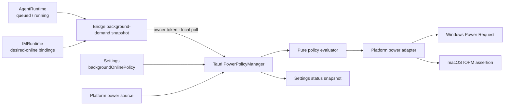

# 057 · 桌面后台在线与防休眠策略 - 技术方案

## 状态

CONFIRMED

## 需求文档

[requirement.md](./requirement.md)

## 0. 设计摘要

本需求在 Tauri Core 内新增唯一的 `PowerPolicyManager`，把用户策略、设备供电、业务原因和平台 inhibitor 收口到同一状态机。Agent 与 IM 仍由 `agent_bridge` 持有业务事实；bridge 通过现有 owner-only lifecycle 控制面提供聚合快照，Tauri 定期拉取并在关键生命周期点立即重同步。

平台 inhibitor 只阻止用户空闲导致的系统自动休眠，不请求显示器常亮。Windows 使用 Power Request API，macOS 使用 IOKit power assertion，Linux 首期明确返回不支持。设置页只提供一个三值策略和一个独立的系统设置入口，不再制造语义重叠的高级开关。



## 1. 现状与约束

### 1.1 已有权威边界

- `AgentRuntime.activity_snapshot()` 已提供线程安全的 `accepting / queued / running`，不需要由 React 的 loading 状态反推任务活动。
- `IMRuntime` 同时持有凭据存储和已装载 provider；绑定、解绑和迁移替换都经过它，适合提供“用户仍期望该绑定在线”的事实。
- `RuntimeServiceSupervisor` 是桌面运行态内 bridge 的 owner，持有 owner-only lifecycle token；无需新增另一份跨进程密钥或公开控制接口。
- `frontend/src-tauri/src/settings.rs` 是桌面设置唯一持久化真相源；新策略继续走现有 facade、同步启动快照与跨窗口事件。
- Tauri 应用在所有受管理窗口关闭后仍留在托盘，真正退出时统一清理 owner child；电源资源也必须跟随 app-level 生命周期，而不是某个 WebView。

### 1.2 本期约束

- 只阻止 idle system sleep，不阻止 display sleep。
- 不模拟输入，不修改电源计划、合盖动作、注册表或 `pmset` 持久设置。
- 不承诺阻止手动睡眠、合盖强制睡眠、低电量或热保护。
- Windows 与 macOS 实现正式 adapter；Linux 返回结构化 unsupported。
- 当前构建与真机门禁只要求 Windows。macOS 保留兼容 adapter，不作为本次开发或验收环境。

## 2. 领域模型

### 2.1 用户策略

在 Rust 与 TypeScript 两端增加同名枚举：

```text
BackgroundOnlinePolicy
├── followSystem
├── pluggedIn
└── always
```

`Settings.background_online_policy` 使用 `#[serde(default)]`，默认 `FollowSystem`。这样存量 `settings.json` 缺字段时自然迁移，且不会未经同意改变用户电源行为。

### 2.2 业务原因

首期原因是稳定枚举，不用自由字符串作为逻辑键：

```text
PowerDemandReason
├── AgentTask
└── ImOnline
```

- `AgentTask`：`queued + running > 0`。排队任务也计入，避免机器在等待 worker/session mailbox 时休眠，使任务永远无法开始。
- `ImOnline`：至少存在一个可被 `IMRuntime` 加载的持久绑定。它表达用户期望在线，不依赖 provider 某一时刻的 connected/reconnecting/error 状态。

Tauri 使用集合而不是单个布尔值。只要集合中仍有一个原因，某一原因结束就不会提前释放 inhibitor。未来语音、迁移等能力只需新增枚举值与 bridge/本地事实源，不改变策略计算器。

### 2.3 供电、能力与运行状态

```rust
enum PowerSource { Ac, Battery, Unknown }
enum PlatformCapability { Supported, Unsupported }
enum InhibitorState { Inactive, Active, Error }

struct PowerPolicySnapshot {
    policy: BackgroundOnlinePolicy,
    power_source: PowerSource,
    reasons: BTreeSet<PowerDemandReason>,
    capability: PlatformCapability,
    inhibitor_state: InhibitorState,
    bridge_state: BridgeDemandState,
    last_error: Option<PowerPolicyError>,
}
```

`Unknown` 与 `Unsupported` 都是正式状态，不能折叠成 `Battery` 或 `Inactive`。UI 根据完整快照解释“为什么没有生效”。错误只返回稳定 code 和用户可理解 message，不透出 token、URL 或底层句柄。

### 2.4 纯策略计算

计算器输入为策略、供电、原因集合和平台能力，输出 `should_inhibit` 与解释 code：

| 策略 | 原因 | 供电 | 结果 |
|---|---:|---|---|
| followSystem | 任意 | 任意 | 不申请 |
| pluggedIn | 无 | 任意 | 不申请 |
| pluggedIn | 有 | AC | 申请 |
| pluggedIn | 有 | Battery | 不申请 |
| pluggedIn | 有 | Unknown | 不申请，状态注明无法确认供电 |
| always | 无 | 任意 | 不申请 |
| always | 有 | AC / Battery / Unknown | 申请 |

平台不支持时一律不申请并报告 unsupported。计算器无 Tauri、HTTP 或 FFI 依赖，策略矩阵全部用 Rust 单测固定。

## 3. Bridge 后台需求快照

### 3.1 接口位置

扩展现有 `BridgeLifecycleController`，新增 owner-only 路由：

```http
GET /internal/lifecycle/background-demand
X-Agent-Friend-Lifecycle-Token: <owner token>
```

响应：

```json
{
  "agentTask": {
    "active": true,
    "queued": 1,
    "running": 1
  },
  "imOnline": {
    "active": true,
    "bindingCount": 1
  }
}
```

接口沿用 047 的 loopback、owner token 与 constant-time authorization。无 token 时路由不注册，不新增公共 HTTP 能力。`queued/running/bindingCount` 用于诊断和测试，Tauri 的产品逻辑只投影成两个稳定原因。

### 3.2 Agent 事实源

`AgentRuntime.activity_snapshot()` 是唯一来源：

```python
activity = runtime.agent_runtime.activity_snapshot()
agent_active = activity.queued + activity.running > 0
```

不新增 scheduler observer，不修改 `Conversation` 或协议 encoder。这样 AG-UI、OpenAI compatible、IM 和系统主动轮仍因 045 的统一入口自然被覆盖。

### 3.3 IM 事实源

`IMRuntime.desired_online_snapshot()` 返回持久绑定数。实现使用凭据真相而非 `provider.status()`：

- 启动时加载凭据后计入；
- onboard 保存成功后计入；
- unbind 删除成功后移除；
- migration replace 后按新凭据重算；
- provider 暂时断线、重连或报错不改变期望在线事实。

为避免 lifecycle controller 直接读取私有字段，快照方法定义在 `IMRuntime` 公共 API。测试 fixture 没有 IM runtime 时返回 `active=false, bindingCount=0`，不把“不装配可选 IM”当成整个 bridge 错误。

### 3.4 轮询而非扩展 push 协议

`PowerPolicyManager` 每 2 秒通过 supervisor 拉取一次快照。选择轮询的原因：

- 数据只有两个低频布尔事实，本地 loopback 成本很低；
- bridge 重启、SSE 断线或事件丢失后，下一轮会自动恢复真相；
- 不需要把 scheduler 内部活动变化改造成新的跨协议事件。

任务开始到 inhibitor 建立最多有约 2 秒延迟。用户发起任务时系统已有真实输入活动，不会在这两秒内因为空闲计时器正常到期；排队任务随后持续维持原因。任务结束后最多延迟约 2 秒释放，属于有界、可接受的保守释放。

## 4. Tauri PowerPolicyManager

### 4.1 模块边界

新增 `frontend/src-tauri/src/power_policy/`：

| 文件 | 职责 |
|---|---|
| `mod.rs` | Tauri commands、manager 初始化、事件名与公开类型 |
| `model.rs` | 策略输入、原因、快照、错误模型 |
| `evaluator.rs` | 纯策略矩阵 |
| `manager.rs` | reconcile loop、状态锁、幂等申请/释放、事件广播 |
| `platform/mod.rs` | `PowerPlatformAdapter` trait 与平台选择 |
| `platform/windows.rs` | Windows 供电查询、Power Request、设置入口 |
| `platform/macos.rs` | macOS 供电查询、IOPM assertion、设置入口 |

Linux 由 `platform/mod.rs` 的 unsupported adapter 覆盖，不为尚未验证的桌面环境提前建设 D-Bus/portal 抽象。

### 4.2 平台 adapter 契约

```rust
trait PowerPlatformAdapter: Send + Sync {
    fn capability(&self) -> PlatformCapability;
    fn power_source(&self) -> Result<PowerSource, PowerPolicyError>;
    fn acquire(&self, reason: &str) -> Result<Box<dyn PowerInhibitor>, PowerPolicyError>;
    fn open_power_settings(&self) -> Result<(), PowerPolicyError>;
}

trait PowerInhibitor: Send {
    fn release(&mut self) -> Result<(), PowerPolicyError>;
}
```

manager 最多持有一个 inhibitor handle。`acquire` 成功才把状态设为 Active；`release` 幂等，且 handle 的 `Drop` 做最终兜底。业务原因的引用语义停留在 manager 的集合里，不把同一平台请求重复 set 多次。

### 4.3 Reconcile 触发

以下事件都进入同一个 `reconcile()`，不各写一套副作用：

- app setup 后 manager 启动；
- 2 秒 bridge demand poll；
- 用户修改 `backgroundOnlinePolicy`；
- 供电状态轮询发现变化；
- Tauri `RunEvent::Resumed`；
- 设置窗口请求刷新当前快照。

供电每 2 秒与 bridge demand 同轮查询，避免再建第二条定时任务。`reconcile()` 先采集输入，再调用纯 evaluator，最后只在 desired 与 actual 不一致时 acquire/release。系统调用失败保留上一次真实 handle 状态并记录错误，下一轮自动重试；不得只改 UI 状态假装成功。

manager task 使用 Tauri async runtime，应用退出时先取消 loop 并 release，再清理 bridge child。即使显式 release 失败，Windows handle / macOS assertion wrapper 的 Drop 仍做进程内兜底；进程退出后 OS 也会回收进程拥有的请求。

### 4.4 设置变更接线

`Settings` 新增 `background_online_policy`。`set_setting` 在完成校验与持久化后通知 manager 立即 reconcile，并继续广播现有 `settings://changed`。为避免 `settings.rs` 反向持有 manager，使用 app managed state 获取 `PowerPolicyManager`；如果 manager 尚未初始化，设置仍成功持久化，setup 后按最终快照计算。

迁移导入整体替换 settings 后也要触发一次 reconcile，避免导入的新策略只写盘、不生效。

## 5. 平台实现

### 5.1 Windows

在现有 `windows = 0.61.3` 增加最小 features：`Win32_System_Power` 与 `Win32_System_Threading`；沿用已有 `Win32_Foundation`。

- `GetSystemPowerStatus`：`ACLineStatus=1` → AC，`0` → Battery，其他值 → Unknown。
- `PowerCreateRequest(REASON_CONTEXT)` 创建带可诊断原因的请求对象。
- `PowerSetRequest(handle, PowerRequestSystemRequired)` 阻止因空闲进入系统睡眠。
- 不请求 `PowerRequestDisplayRequired`，所以显示器仍按系统设置关闭。
- release 顺序为 `PowerClearRequest` 后 `CloseHandle`；RAII wrapper 防止早退泄漏。

Windows 官方限制属于产品边界：用户主动睡眠、合盖或 Modern Standby 在 DC 下的系统限制仍可能终止请求，UI 不作保证。

系统设置入口使用现有 `tauri-plugin-opener` 打开 `ms-settings:powersleep`。UI 同时给出“控制面板 → 电源选项 → 选择关闭盖子的功能”的人工路径，因为没有跨 Windows 版本稳定直达合盖动作的设置 URI。

### 5.2 macOS

macOS adapter 通过最小 IOKit/CoreFoundation FFI：

- 供电查询使用 IOPS power source API，映射 AC / Battery / Unknown。
- acquire 使用 `IOPMAssertionCreateWithName` 创建 `PreventUserIdleSystemSleep` 断言。
- release 使用 `IOPMAssertionRelease`。
- 不使用 `PreventUserIdleDisplaySleep`，不保持屏幕常亮。

采用进程内 assertion 而不是长期修改 `pmset`，也不请求管理员权限。Apple 明确区分 idle sleep 与用户合盖/菜单睡眠等 forced sleep，因此 macOS 同样不承诺合盖可运行。

设置入口优先尝试系统设置 Battery/Energy Saver deep link；打开失败时回退打开 System Settings 根页，并在 UI 给出“系统设置 → 电池 → 选项/锁定屏幕”的人工路径。由于本期无 macOS 真机，deep link 失败回退必须由代码路径与 fake adapter 测试覆盖，真机表现不作为本次完成门槛。

### 5.3 Linux

首期 adapter 返回：

- `capability=unsupported`
- `power_source=unknown`
- acquire 返回稳定错误 `power_inhibit_unsupported`
- 设置入口返回 `power_settings_unsupported`

UI 显示“当前 Linux 桌面环境暂不支持由应用保持唤醒”，不把选中的策略显示成生效。未来确认 portal 或 logind inhibitor 的兼容矩阵后，在同一 trait 下新增实现。

## 6. 前端交互

### 6.1 设置位置与组件

在 `SettingsApp` 的“通用”页新增 `SettingsGroup title="后台运行"`，业务组件放在：

```text
frontend/src/pages/settings/components/BackgroundOnlineSetting.tsx
```

复用现有 `Select`、`Button`、`Badge/StatusDot`、`SettingsRow` 和 `Tooltip`。不新增另一设置页，不直接写原生交互元素，不新增通用组件。样式沿用现有 token；若确实缺少语义状态 token，再同步补齐 light/dark theme。

### 6.2 策略选择

Select 三项文案：

- 跟随系统
- 仅接通电源时保持在线（推荐）
- 始终保持在线

“推荐”只是展示信息，不改变默认值。选择 `always` 时在组件内直接展示持续可见的风险说明，不增加一次性确认弹窗：用户之后仍能看见电池、发热与合盖收纳风险，也避免每次切换制造阻断。

### 6.3 当前状态

前端通过 `get_power_policy_snapshot` command 读取初值，监听 `power-policy://changed` 更新。展示文案由稳定状态组合决定：

- Active：`正在保持系统唤醒 · Agent 正在执行任务、QQ 保持在线`
- 无原因：`当前无需保持唤醒`
- pluggedIn + Battery：`当前使用电池，按策略跟随系统`
- pluggedIn + Unknown：`无法确认供电状态，未主动阻止休眠`
- followSystem：`当前跟随系统电源设置`
- Unsupported：`当前平台暂不支持应用防休眠`
- Error：展示可重试说明，不显示“已生效”
- Bridge unavailable：`后台服务状态未知`；保留已知平台状态，但不把旧业务原因继续宣称为当前事实。

原因数组全部展示，不只显示首个原因。跨窗口状态由 Rust event 广播，前端不自行合并缓存。

### 6.4 系统设置与边界说明

“打开系统电源设置”调用 Rust command `open_power_settings`，由平台 adapter 执行。失败时 toast 给出错误，同时页面常驻人工路径，因此入口失败不阻断用户操作。

组件常驻说明：应用只防止因空闲自动休眠；手动睡眠、低电量保护和按系统配置合盖仍会暂停 Agent 与 IM。Windows 下额外展示合盖设置人工路径。

## 7. Commands 与事件

新增 Tauri commands：

| Command | 返回 | 用途 |
|---|---|---|
| `get_power_policy_snapshot` | `PowerPolicySnapshot` | 设置页初始与手动刷新 |
| `refresh_power_policy` | `PowerPolicySnapshot` | 从系统设置返回/用户手动重试 |
| `open_power_settings` | `()` | 打开平台电源设置 |

事件：

```text
power-policy://changed
```

只有公开快照实际变化时广播，避免 2 秒轮询造成无意义 React 重渲染。策略写入仍走既有 `set_setting`，不新增第二条设置写接口。

## 8. 错误与恢复

稳定错误 code 至少包括：

```text
bridge_demand_unavailable
power_source_unavailable
power_inhibit_unsupported
power_inhibit_acquire_failed
power_inhibit_release_failed
power_settings_open_failed
```

- bridge 查询失败：标记 demand unknown，下一轮重试；不因一次网络错误崩溃 manager。
- acquire 失败：actual 保持 Inactive/Error，不伪报 Active；下一轮重试。
- release 失败：actual 保持 Error，并继续持有 wrapper 以便下轮重试或 Drop 清理。
- bridge 重启：supervisor generation 变化期间允许显示 unknown；ready 后自动恢复。
- resume：立即重新读取供电、bridge demand 和实际 manager 状态。

日志记录策略、供电、原因集合、desired/actual、稳定错误 code，但不记录 lifecycle token、IM 原始 bind id 或凭据。

## 9. 文件改动

### 新增

| 路径 | 用途 |
|---|---|
| `frontend/src-tauri/src/power_policy/*` | 统一策略 manager、模型、平台 adapters |
| `frontend/src/pages/settings/components/BackgroundOnlineSetting.tsx` | 策略、状态、系统设置入口 |
| `frontend/src/lib/power-policy/index.ts` | command/event 类型与订阅 |
| 对应 Rust、Python、前端测试文件 | 策略与投影回归 |

### 修改

| 路径 | 改动 |
|---|---|
| `agent_bridge/src/agent_bridge/lifecycle.py` | owner-only background-demand endpoint |
| `agent_bridge/src/agent_bridge/protocols/im/runtime.py` | desired-online snapshot |
| `frontend/src-tauri/src/runtime_services/supervisor.rs` | 复用 owner token 查询 bridge demand |
| `frontend/src-tauri/src/settings.rs` | 新策略字段、默认值、写入与 reconcile |
| `frontend/src-tauri/src/lib.rs` | manager state、commands、setup/resume/exit 接线 |
| `frontend/src-tauri/Cargo.toml` | Windows power features、macOS 最小 FFI 依赖（如需要） |
| `frontend/src/lib/settings/index.ts` | TypeScript 策略类型与默认值 |
| `frontend/src/pages/settings/App.tsx` | 挂载后台运行分组 |

不修改 Agent conversation、协议 encoder、IM provider 连接状态机或现有 push envelope。

## 10. 测试与验收

### 10.1 Python

- lifecycle background-demand 鉴权与响应 shape；
- queued、running 任一大于零即 `agentTask.active=true`；
- IM 无绑定、绑定、断线状态、解绑、migration replace 的 desired-online 语义；
- 无可选 IM runtime 的 fixture 正常返回 inactive。

### 10.2 Rust

- 完整策略矩阵；
- 多原因聚合与单原因结束不提前 release；
- acquire/release 幂等和失败重试；
- pluggedIn 在 Unknown 时 fail-safe 不申请，always 仍申请；
- bridge unavailable、unsupported、settings open failure 的快照；
- 存量 settings 缺字段默认 followSystem；
- migration replace 与设置写入触发 reconcile；
- Windows API wrapper 的构造/清理边界用 adapter fake 固定，避免普通单测真实改变开发机电源行为。

### 10.3 前端

- 三值策略写入与 recommended 展示；
- active、无原因、电池、unknown、unsupported、error 文案；
- 多原因同时展示；
- always 风险说明与系统设置失败 toast；
- event 后跨窗口快照更新。

### 10.4 构建与真机

- `./scripts/check` 全绿；
- Windows 构建门禁覆盖正式交付 adapter；
- Windows 真桌面 smoke：用 `powercfg /requests` 或等价系统观察验证 acquire/release；验证显示器请求未被持有；验证窗口隐藏/托盘不释放；验证策略、电池/接电变化和应用退出；
- Windows 锁屏、手动睡眠与合盖只记录实际结果，不把结果扩大成跨设备保证；
- macOS 不设置构建或真机 smoke 门槛。

本需求的自动化与 smoke 都不调用真实 LLM、IM 厂商或其他外部 provider API。Agent 原因通过 fake runtime snapshot，IM 原因通过 fake credential/provider 状态触发。

由于设置页会新增可见交互，实施完成后是否启动真实 Tauri 桌面端做视觉验收，按项目视觉规则在 Phase 3 单独征得用户确认。Windows 电源 smoke 属于功能验收，不自动等同于视觉验收授权。

## 11. 实施顺序

1. Bridge 增加 desired-online 与 background-demand 快照及 Python tests。
2. Rust 增加领域模型、纯 evaluator、fake adapter 与 manager tests。
3. 实现 Windows/macOS/Linux adapters 和 settings schema。
4. 接入 supervisor poll、Tauri setup/resume/exit 与 commands/events。
5. 实现设置页业务组件与前端测试。
6. 跑局部测试、`./scripts/check` 与 Windows 构建门禁。
7. 执行 Windows 真机电源 smoke；视觉验收按用户授权单独执行。

## 12. 风险与取舍

| 风险/取舍 | 处理 |
|---|---|
| 2 秒轮询有短暂延迟 | 有界且本地成本低；换取 bridge 重启后天然自愈，不扩展 push 协议 |
| Windows Modern Standby/合盖有平台限制 | 使用官方 Power Request，UI 明示边界，真机只记录事实 |
| macOS 非当前开发与使用环境 | 保留兼容 adapter 与 deep link 回退，但不设置构建或真机验收门槛 |
| bridge 暂时不可达 | 显示 unknown 并自动重试，不沿用陈旧原因伪报生效 |
| release 系统调用失败 | 保留 wrapper 重试，Drop/进程退出兜底，日志可诊断 |
| 新原因逐渐增加 | 通过稳定 reason enum 和集合扩展，不引入通用插件注册中心 |

## 13. 设计决议

1. 防休眠唯一 owner 是 Tauri Core 的 `PowerPolicyManager`。
2. Agent 排队与运行任务都形成 `AgentTask` 原因。
3. IM 原因以持久绑定的期望在线语义为准，不依赖瞬时连接健康。
4. Bridge 通过 owner-only pull snapshot 提供事实，首版不扩展 push 协议。
5. `pluggedIn + Unknown` 不申请；`always + Unknown` 仍申请。
6. 平台请求只防 idle system sleep，不防 display sleep，不改持久系统设置。
7. Windows/macOS 正式实现，Linux 明确 unsupported；本期真机只验 Windows。
8. 设置页使用一个三值 Select；系统设置入口是独立辅助动作，不是第二项策略。

## 14. 变更记录

| 日期 | 变更内容 | 影响范围 |
|---|---|---|
| 2026-07-22 | 初版方案确认：Tauri 单一 PowerPolicyManager；bridge owner-only demand snapshot；2 秒自愈轮询；Windows Power Request、macOS IOPM assertion、Linux unsupported；设置页单策略 + 系统设置入口；真机只验 Windows | Phase 2 |
| 2026-07-22 | 验收范围调整：当前开发、使用与构建门禁统一为 Windows；macOS adapter 保留兼容实现，但不纳入本次构建或真机验收 | Phase 3 |
