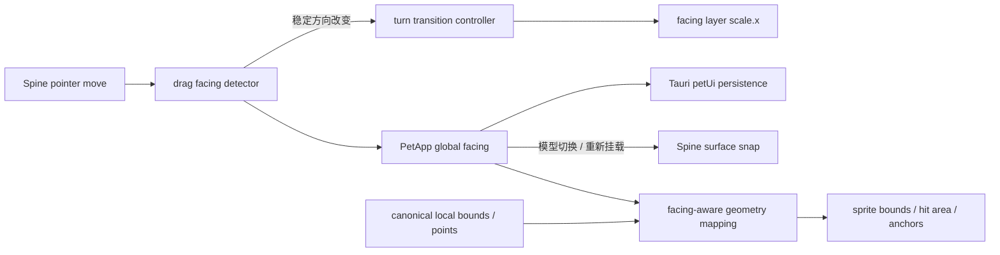

# 058 · Spine 桌宠拖拽朝向与转身过渡 - 技术方案

## 状态

CONFIRMED

## 需求文档

→ [requirement.md](./requirement.md)

## 现状分析

### Spine 拖拽只区分开始与结束

`frontend/src/pet/avatarRuntime/spine38/Spine38AvatarSurface.tsx` 在 `pointerdown` 后记录起点，移动距离超过 `5px` 时进入拖拽，随后用相对起点的 `dx / dy` 更新 `slot.x / slot.y`：

- 拖拽开始调用 `playMappedAction("dragStart")`。
- 拖拽结束调用 `playMappedAction("dragEnd")`。
- `dragStart` 在 catalog 中统一映射到 `Move`。
- 拖拽过程没有朝向状态，也没有根据水平位移改变任何 display object 的水平缩放。

当前 `AvatarModelAction` 只包含 phase、`tap`、`dragStart` 与 `dragEnd`。首批 14 个 Ark Spine 模型的资源动画均不包含独立转身动作，因此朝向不应扩展为新的 Spine action mapping；它是 runtime transform 状态。

### 外层 slot 同时承担布局与交互语义

当前 Spine display tree 是：

```text
app.stage
└── slot
    └── spine
```

`slot` 当前同时承担：

- 模型归一化、用户缩放与 normal / mini 缩放。
- 拖拽位置。
- pointer hit area。
- sprite screen bounds 上报。
- ActionBar / bubble anchor 计算。
- alpha scan 后的可见区域归一化。

如果直接把 `slot.scale.x` 改为负数，现有 `toScreenRegion`、`toSpineLocalRegion`、hit region、offset 与 placement 计算会收到负尺度，宽度、锚点和反算坐标都可能失效。因此朝向变换必须进入 slot 内部，不能污染外层稳定几何。

### 桌宠 UI 状态只保存位置

当前 `PetUiPersistence` 只有 `anchor`。`set_pet_monitor_anchor` 会用新 anchor 重新构造整份 `PetUiPersistence` 后保存。增加朝向后，如果继续这样写，保存位置会清掉朝向，保存朝向也可能覆盖位置。

前端的 UI 状态读写目前放在 `petMonitorViewport.ts` 中。该文件已经同时承担显示器几何、位置恢复和 store invoke；朝向不是显示器概念，继续把朝向读写塞入该文件会扩大职责混杂。

## 方案设计

### 总体数据流



职责划分：

- 方向检测只回答“是否形成新的稳定朝向”。
- `PetApp` 持有全局朝向并负责持久化。
- 转身控制器只回答“这一帧的视觉水平比例是多少”。
- 几何转换只使用稳定朝向，不使用转身过程中的临时压缩比例。
- Spine surface 负责把上述结果接入 Pixi display tree 与 pointer lifecycle。

### 涉及文件

| 文件路径 | 改动类型 | 说明 |
|---------|---------|------|
| `frontend/src/pet/avatarRuntime/facing.ts` | 新增 | 共享 `PetFacing`、默认值与前端归一化 helper |
| `frontend/src/pet/avatarRuntime/spine38/spine38Facing.ts` | 新增 | Spine 拖拽方向检测、稳定朝向对应符号、region / point 镜像转换 |
| `frontend/src/pet/avatarRuntime/spine38/spine38Facing.test.ts` | 新增 | 覆盖方向阈值、垂直移动、抖动、同次反向与几何正宽高 |
| `frontend/src/pet/avatarRuntime/spine38/spine38TurnTransition.ts` | 新增 | 独立的平滑水平翻转控制器 |
| `frontend/src/pet/avatarRuntime/spine38/spine38TurnTransition.test.ts` | 新增 | 覆盖 snap、同向 no-op、完成与中途反向收敛 |
| `frontend/src/pet/avatarRuntime/spine38/Spine38AvatarSurface.tsx` | 修改 | 增加 facing layer、方向 detector、ticker 过渡和朝向感知几何 |
| `frontend/src/pages/pet/petUiPersistence.ts` | 新增 | 统一前端 `petUi` 快照读取、位置与朝向的独立保存入口 |
| `frontend/src/pages/pet/petMonitorViewport.ts` | 修改 | 移出 store invoke，继续负责 monitor / anchor 几何与初始位置解析 |
| `frontend/src/pages/pet/petInitialPlacement.test.ts` | 修改 | 适配 UI 状态读取边界调整，保持位置恢复行为 |
| `frontend/src/pages/pet/petMonitorViewport.test.ts` | 修改 | 保持 monitor-relative anchor 回归覆盖 |
| `frontend/src/pages/pet/App.tsx` | 修改 | 加载、持有、保存全局朝向，并传给 Spine surface |
| `frontend/src-tauri/src/ui_state.rs` | 修改 | 增加持久化朝向、非法值归一化和不互相覆盖的更新逻辑 |
| `frontend/src-tauri/src/lib.rs` | 修改 | 注册 `set_pet_facing` command |

### 朝向领域类型与状态归属

前端共享类型放在 avatar runtime 公共层，而不是 Spine surface 或页面私有文件中：

```ts
export type PetFacing = "left" | "right";
export const DEFAULT_PET_FACING: PetFacing = "right";

export function normalizePetFacing(value: unknown): PetFacing {
  return value === "left" ? "left" : "right";
}
```

`PetApp` 持有：

```ts
const [petFacing, setPetFacing] = useState<PetFacing | null>(
  () => (isTauri() ? null : DEFAULT_PET_FACING),
);
```

- Tauri 中先读取 `petUi`，成功后归一化 `facing`，失败时记录日志并回退到 `right`。
- `petFacing === null` 时只暂缓挂载 Spine surface；Live2D 不依赖该状态。
- 这样持久化为 `left` 时不会先渲染一帧朝右再跳变。
- Spine surface 收到 `facing` 与 `onFacingChange`。
- 用户拖拽形成新方向时，surface 先启动视觉过渡，再通知 `PetApp` 更新并保存。
- 模型切换导致 surface 重建时，新 surface 对当前全局方向执行 `snap`，不播放转身。

朝向只在实际变化时写入。相同方向的重复事件在 detector、surface 与 `PetApp` 三层均去重，避免无意义 store save。

### 拖拽方向检测

新增纯状态机 `Spine38DragFacingDetector`。它不依赖 Pixi event，只接收连续的全局 pointer point：

```ts
interface DragFacingDetectorState {
  currentFacing: PetFacing;
  lastPoint: PixelPoint | null;
  candidateFacing: PetFacing | null;
  candidateDistance: number;
}
```

首版参数：

```ts
const FACING_SWITCH_DISTANCE_PX = 8;
const HORIZONTAL_INTENT_RATIO = 0.5;
```

每次 move：

1. 计算相邻事件的 `stepX / stepY`，不使用相对 pointerdown 的累计 `dx` 判朝向。
2. `abs(stepX) < abs(stepY) * 0.5` 时认为本步缺少水平意图，不累计方向距离。
3. 有水平意图时，根据 `stepX` 符号得到候选方向。
4. 候选方向改变时，从当前步重新累计；候选方向相同时累计 `abs(stepX)`。
5. 候选方向与当前朝向相同，不触发转身并清空反向候选。
6. 候选方向与当前朝向相反且累计达到 `8px` 时，提交新朝向并清空累计。

该策略的结果：

- 小幅左右交替抖动无法跨过阈值。
- 近乎垂直的拖拽不会慢慢积累成误转身。
- 向一个方向移动后立刻反向，只需新的反向移动达到阈值，不必拖回最初 pointerdown 位置。
- detector 在 pointerdown 时 `begin`，pointerup / pointerupoutside 时 `end`，不跨拖拽手势保留候选距离。

原有 `5px` click / drag 判定保持不变。方向 detector 可以从 pointerdown 开始观察，但只有进入 drag 后才允许向外提交朝向，避免普通点击造成翻转。

### 独立转身控制器

新增 `Spine38TurnTransition`，内部只维护一维视觉比例：

```ts
interface Spine38TurnFrame {
  scaleX: number;
  settled: boolean;
  completedFacing?: PetFacing;
}
```

首版行为：

- `right` 的目标比例为 `+1`，`left` 为 `-1`。
- 动画时长基线为 `160ms`。
- 使用平滑的 ease-in-out 曲线，从当前比例插值到目标比例。
- `snap(facing)` 立即设置目标比例，用于持久化恢复、首次加载和模型切换。
- `turnTo(facing)` 仅在目标方向改变时启动。
- 动画中再次反向时，以当前比例作为新起点重定向，不排队等待旧动画完成。
- `update(deltaMs)` 由现有 Pixi application ticker 每帧调用；未播放时是常量时间 no-op。

过渡控制器不调用 Pixi API，不读取 pointer，不写持久化，因此以后替换时长、缓动或表现形式时不影响另外两层。

### Spine display tree 与变换边界

display tree 调整为：

```text
app.stage
└── slot                     # 正向统一缩放 + 拖拽位置 + hit area
    └── facingLayer          # 只承载转身 scale.x
        └── spine            # Spine animation
```

约束：

- `slot.scale.x / y` 始终是相同的正数，继续表示 normalization × user scale × mode scale。
- `facingLayer.scale.y` 恒为 `1`。
- `facingLayer.scale.x` 由转身控制器驱动，可在 `+1` 与 `-1` 之间过渡。
- `fitSpine38ToStage` 继续把 canonical layout bounds 的水平中心放在 slot 原点，因此 facing layer 绕该稳定中心翻转。
- `spine` 保持现有 animation state、position 与 loader 生命周期。
- cleanup 随 Pixi app destroy 一并释放 facing layer，不新增独立 RAF 或 timer。

### 稳定几何与临时视觉比例分离

转身中间帧会经过接近 `scaleX = 0` 的状态。如果 bounds、hit area 或 anchor 直接使用该瞬时比例，会出现宽度快速缩小、拖拽命中丢失和 ActionBar 抽动。

因此 surface 维护两种状态：

- `visualScaleX`：转身控制器的逐帧比例，只用于 `facingLayer.scale.x`。
- `geometryFacing`：最近一次已稳定的朝向，只用于 bounds、hit area、anchor 和局部坐标反算。

行为：

- 转身开始时，几何仍使用上一稳定朝向。
- 转身完成时，`geometryFacing` 一次性切到最终方向并执行 `syncBounds()`。
- 快速反向未完成时不切换几何；最终只提交最后稳定方向。
- `snap` 同时更新视觉比例和 `geometryFacing`。

这使拖拽期间外层交互区域保持稳定，同时最终 bounds 与真实稳定画面一致。

### 朝向感知的 region / point 转换

`spine38Facing.ts` 提供纯转换 helper，围绕 slot 的稳定水平原点镜像：

- Spine local region → slot local facing region。
- slot local facing region → 正宽高 screen region。
- screen region → canonical Spine local region。
- canonical point / relative offset → 当前朝向的 screen point。

所有 region 转换都分别变换左右端点，再以 `min / abs` 生成 `{ x, w }`，保证 `w > 0`。不得把负宽度传入：

- `isFiniteRect`。
- `PIXI.Rectangle` hit area。
- Rust `update_sprite_pos`。
- monitor-relative placement。

alpha framebuffer 本身会渲染真实镜像，因此 `alphaHitTestFromApp` 无需改变。初始可见区域扫描需要使用当前稳定朝向做逆变换，保存的 `layoutBoundsRef` 继续是 canonical Spine-local region。

`actionBarAnchorOffsetRef` 与 `visualAnchorOffsetRef` 继续保存 canonical offset；应用到镜像结果时：

- region 横向偏移变为 `baseWidth - oldX - regionWidth`。
- point 横向偏移变为 `baseWidth - oldX`。
- y、宽、高及外层正向 scale 语义不变。

这样武器、披风等左右不对称内容翻面后，visible bounds 与 edge placement anchor 可以得到对应镜像结果，而不是沿用旧侧偏移。

### 前端 petUi 持久化边界

新增 `petUiPersistence.ts`，集中封装：

```ts
export interface PetUiPersistence {
  anchor?: PetMonitorRelativeAnchor | null;
  facing?: PetFacing;
}

export function loadPetUiPersistence(): Promise<PetUiPersistence>;
export function savePetMonitorAnchor(anchor: PetMonitorRelativeAnchor | null): Promise<void>;
export function savePetFacing(facing: PetFacing): Promise<void>;
```

- `petMonitorViewport.ts` 继续负责 monitor snapshot、anchor 计算和初始位置恢复，但通过 `loadPetUiPersistence` 获取持久化 anchor。
- `App.tsx` 从同一入口加载朝向。
- 两次读取在启动期允许独立发生；Tauri store 是权威来源。方向读取失败不改变位置恢复的错误边界，位置 fallback 失败也不阻止方向恢复。
- Web / 非 Tauri 环境返回空快照，前端归一为默认朝右。

### Tauri 持久化模型

Rust 增加：

```rust
#[derive(Serialize, Clone, Copy, Debug, Default, PartialEq, Eq)]
#[serde(rename_all = "lowercase")]
pub enum PetFacingPersistence {
    Left,
    #[default]
    Right,
}
```

`PetUiPersistence` 增加 `facing`，并使用带 default 的宽容反序列化：

- 字段缺失 → `Right`。
- `"left"` → `Left`。
- `"right"` → `Right`。
- 其他字符串、数字、对象或 `null` → `Right`，不让整份 `petUi` 解析失败。

增加 `set_pet_facing` command。两个更新 command 都改为：

1. 从 store 读取并归一化当前 `PetUiPersistence`。
2. 只修改自己负责的字段。
3. 写回完整新状态并 `save()`。

因此：

- `set_pet_monitor_anchor` 保留已有 facing。
- `set_pet_facing` 保留已有 anchor。
- 前端不提交整份可能过期的 `petUi` 快照。

command 在 `frontend/src-tauri/src/lib.rs` 的正式与测试 builder handler 中同步注册。

## 测试与验收

### TypeScript 自动化测试

`spine38Facing.test.ts` 覆盖：

- 默认朝右，累计向左超过阈值后只提交一次 left。
- 同方向继续移动不重复提交。
- 同次拖拽明显反向后提交 right。
- 小幅左右抖动不跨阈值。
- 近乎垂直移动不累计。
- 新拖拽不会继承上次未完成候选距离。
- left / right region 映射宽高始终为正。
- region 正向与逆向转换 round-trip。
- point / region offset 在镜像后落到对侧。

`spine38TurnTransition.test.ts` 覆盖：

- `snap(left/right)` 立即到 `-1/+1`。
- `turnTo` 相同目标 no-op。
- 160ms 内单调收敛并在完成时报告最终 facing。
- 动画中反向从当前比例重定向，不先完成旧目标。
- 超大 ticker delta 安全 clamp 到最终状态。

既有 placement / fit tests 保持通过，必要时补充 facing-aware helper 的接入断言。

### Rust 自动化测试

`ui_state.rs` 覆盖：

- 缺失 `petUi` 默认 anchor 为空、facing 为 right。
- 旧版只有 anchor 的 JSON 正常恢复并默认 right。
- left / right 正确解析与序列化。
- 非法 facing 值回退 right，不丢 anchor。
- 更新 anchor 保留 facing。
- 更新 facing 保留 anchor。

### 真实 Tauri 桌面端 smoke

用户已经确认由 agent 执行真实桌面端验收。实现和自动化门禁通过后，按 `desktop-visual-inspection` 流程验证：

1. 朝右模型向左拖，观察一次平滑转身、`Move` 持续和跟手位置。
2. 朝左模型向右拖，观察反向结果。
3. 同一次拖拽内左右反转。
4. 垂直拖拽与小幅抖动不翻面。
5. 快速连续反向最终收敛到最后方向，无动画排队。
6. 松手后 idle / tap 保持当前方向。
7. 切换至少两个内置 Ark 模型，方向保持且不播放无意图转身。
8. 重启应用，恢复最后方向。
9. 检查 alpha hit-test、透明区域穿透、ActionBar、bubble anchor、normal / mini 与贴边恢复。

最终执行 `./scripts/check` 对应 Windows 入口，确保 lint、typecheck、前后端测试与项目门禁全绿。

## 影响分析

### 上游输入

- Pixi pointer event 仍是唯一自动改变朝向的来源。
- click / drag 阈值不变；方向 detector 只消费已存在的 pointer move 数据。
- 持久化读取增加 facing，但旧数据和非 Tauri 环境有明确默认值。

### 下游调用方

- `spriteScreen`、Rust sprite position、ActionBar、bubble 与 placement 继续收到正宽高矩形。
- `PetAvatarRuntime` contract 不增加 facing；Live2D 与状态 phase/action 调用方无需感知。
- avatar model catalog 和 action mapping 不增加伪造的 turn animation。
- 位置与朝向写入同一 `petUi` key，但通过后端字段级更新避免覆盖。

### 跨平台影响

- 方向判定与 Pixi 变换是前端跨平台逻辑。
- Tauri plugin-store JSON 结构在 Windows、macOS、Linux 一致。
- 不新增平台专用原生依赖或系统权限。
- 真实桌面验收以当前 Windows 开发环境为准；自动化测试覆盖跨平台纯逻辑。

### 性能影响

- 转身仅在短时过渡中每帧更新一个 container 的 `scale.x`。
- detector 每个 pointer move 只做常数次算术。
- 不新增独立 RAF、DOM 重排、纹理加载或额外 framebuffer readback。
- 稳定朝向时 ticker 中的 transition update 为常量时间 no-op。

## 风险与缓解

| 风险 | 缓解 |
|------|------|
| 负缩放泄漏到 outer slot，产生负宽度或 anchor 错位 | 只缩放内层 facing layer；所有对外 region 由纯 helper 生成正宽高 |
| 转身中 scale 接近 0 导致拖拽命中丢失 | 临时视觉比例与稳定交互几何分离；drag 期间现有 passthrough 锁继续生效 |
| 快速反向产生动画排队或最终方向错误 | transition 从当前比例重定向，只保留一个最新目标 |
| 垂直拖动或鼠标噪声频繁翻面 | 水平意图过滤 + 同向距离累计 + 8px hysteresis |
| 保存位置覆盖朝向，或反之 | Rust command 读取当前状态后只改自己的字段 |
| 旧版或损坏 facing 导致整份 petUi 无法读取 | 宽容反序列化，任何非法值回退 right 并保留合法 anchor |
| 模型切换或启动时播放无意图转身 | 外部 facing 使用 snap；用户 drag 才调用 turnTo |
| 镜像后 alpha bounds / visual centroid 位于错误一侧 | canonical local 数据 + facing-aware region / point / offset 转换单测 |

## 变更记录

| 日期 | 变更内容 | 是否需要重新实现 |
|------|---------|----------------|
| 2026-07-22 | 初版确认：全局 facing 由 PetApp + petUi 持有；纯方向 detector 使用水平意图与 8px hysteresis；转身控制器独立、160ms 平滑翻转并支持中途重定向；内层 facing layer 隔离负缩放；稳定几何与临时视觉比例分离 | 否，进入 Phase 3 前尚未实现 |
