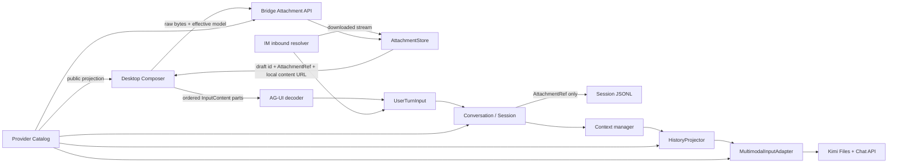

# 059 · 多模态消息附件 - 技术方案

## 状态

CONFIRMED

## 需求文档

[requirement.md](./requirement.md)

## 0. 文档说明

本方案为桌面对话、AG-UI、Agent 会话、LLM Provider 与 IM 入站建立统一的附件消息语义。核心目标不是把文件临时塞进一次模型请求，而是让附件成为可迁移、可诊断、可重新处理的用户资产，同时避免原始载荷污染会话 JSONL 和长上下文。

本期正式保证图片、PDF 与 TXT；其他文档格式由模型能力目录声明后复用同一条通路。本期不实现“用户在很久以后再次提到旧附件时，Agent 自动识别并重新载入”的完整工具，但会保留稳定资产引用和内部重新物化接口，使后续能力不需要迁移历史数据。

## 1. 现状与约束

### 1.1 纯文本假设分布在整条链路

- 前端 `RunStreamInput` 只有 `text`，AG-UI 最后一条 user message 只发送字符串正文。
- Bridge `DecodedRequest.new_user_input`、`PersistentBootstrap.new_user_input` 和 IM Router 都是字符串。
- `Conversation.stream()`、`Message.content`、`Session.messages`、编辑重发与上下文管理均假设用户消息是文本。
- `user_message` 事件目前只写 `payload.content`。
- Token 估算、摘要转录与 LiteLLM 消息转换只计算或输出文本。

因此不能只在前端补附件组件；必须先建立跨层统一输入类型，再逐层消除纯文本假设。

### 1.2 模型目录已经重复

`llm_providers.catalog` 已声明自己持有 provider 专有知识，但前端 `model-config` 又维护了一份 provider、model 与默认值。继续在前端增加模态判断会形成第三类漂移：模型存在，但不同入口对其能力判断不一致。

本方案以 Python Provider Catalog 为唯一可编辑事实源，通过 Bridge 投影安全的公开字段。前端不内置附件能力兜底表。

### 1.3 Kimi 的图片与文档不是同一种输入

- 图片走视觉内容块，可通过 Kimi Files API 以 `purpose=image` 上传并在消息中引用。
- PDF、TXT 等文件走 `purpose=file-extract`，取得抽取内容后再加入聊天上下文。
- Kimi 远端 file ID 和抽取服务是 provider 处理手段，不是 agent-friend 的附件主键。
- Kimi 单文件上限为 100MB，视觉请求体也受 100MB 限制；产品限制必须取更严格值。

所以 Provider 层需要“附件处理策略”，不能把所有附件统一转换成 base64，也不能让会话层保存 Kimi file ID。

### 1.4 模型是每轮有效状态

现有 Session 已能从事件流派生当前模型，模型不应被理解成创建会话后不可变化的静态属性。附件能力判断必须基于本轮 effective model：

- 新会话：使用桌面持久设置请求的默认模型。
- 已有会话：使用 Session 当前生效模型。
- 未来同一会话切换模型：追加既有模型切换事件，后续轮次使用新模型。

历史附件的存在性与模型无关；切换模型只影响新草稿是否可发送、下一轮如何物化附件以及远端处理缓存选择。

模型选择的冻结边界是一次完整 Agent run，而不是单次底层 LLM call。一个 run 从用户输入开始，可能经历首轮模型调用、工具调用、工具结果和后续模型调用；这些步骤必须共享同一个 `ModelRouteSnapshot`。用户切换模型只在 run 之间生效，不能在流式输出或工具循环中途替换。

### 1.5 标准协议已经具备多模态输入

当前 Python `ag-ui-protocol` 已支持 `UserMessage.content: str | list[InputContent]`，其中包含有序的 text、image、audio、video 和 document part。附件不应再通过自定义 `forwarded_props.attachments` 传递；AG-UI content parts 承载用户内容，`forwarded_props` 只承载模型选择等运行参数。

AG-UI 的标准 multimodal capability 只表达 image/pdf/file 等粗粒度能力。详细 MIME、扩展名、大小和数量仍由 Provider Catalog 提供；两种响应均从同一 Catalog 投影，不能分别维护。

## 2. 设计原则

1. **本地资产是真相源**：厂商远端文件、临时 URL 和抽取结果均可失效、可重建。
2. **会话只存引用**：JSONL 不内嵌原件、base64、绝对路径或 provider file ID。
3. **能力按 model route 查询**：模型、provider transport 与产品策略共同决定有效能力，不持久化“某会话支持图片”这类派生状态。
4. **先托管再运行**：进入 Agent 前附件已经完成本地校验和原子落盘。
5. **前端拦截不是安全边界**：Bridge、Agent 与 IM 使用同源能力再次校验。
6. **历史可读优先**：附件丢失或 provider 失败不阻断整个会话投影。
7. **原始内容不提升权限**：文件正文、OCR、元数据和抽取结果均为不可信用户数据。
8. **可重建数据不迁移**：设备迁移包含 canonical asset，不包含草稿 lease 和 provider cache。
9. **消息内容使用标准 part**：公共领域保存厂商无关的有序内容块，Provider 原生 block 只存在于单次调用装配阶段。
10. **一次 run 固定一个 route**：模型切换只在 run 边界生效，自动 fallback 也必须通过能力与隐私策略。

## 3. 总体架构



责任划分：

| 模块 | 责任 | 不负责 |
|---|---|---|
| Frontend | 文件选择、拖拽、草稿状态、展示、交互提示 | MIME 真伪、最终能力授权 |
| Bridge Attachment API | 流式接收、模型能力预检、调用 AttachmentStore | Provider 内容块构造 |
| AttachmentStore | 原子托管、哈希、元数据、draft lease、完整性与 GC | 当前模型选择 |
| Agent | 统一 `UserTurnInput`、事件引用、上下文选择 | Kimi file ID |
| Provider Catalog | ModelRoute、整体能力、类型、限制、处理 profile | 用户当前选择 |
| HistoryProjector | 按目标 route 把标准历史投影为可发送历史 | Provider 上传与用户资产生命周期 |
| Multimodal adapter | 远端上传、抽取、缓存、Provider 内容块装配 | 会话资产生命周期 |
| IM resolver | 临时 URL 下载、托管、错误直回 | Agent outbound 文件 |
| Tauri diagnostics/migration | 原件导出选项、资产迁移 | 日常附件写入 |

## 4. 统一领域模型

### 4.1 AttachmentKind 与 AttachmentRef

```python
AttachmentKind = Literal["image", "document"]

@dataclass(frozen=True)
class AttachmentRef:
    asset_id: str
    display_name: str
    media_type: str
    kind: AttachmentKind
    size_bytes: int
```

- `asset_id` 是 canonical blob 的稳定 ID，形如 `sha256:<64-hex>`。
- `display_name` 属于消息引用，不属于 blob；同一内容可以在不同消息中保留不同文件名。
- 列表顺序即展示和发送顺序，不额外维护 `position`。
- `media_type` 是服务端识别并确认的类型，不直接相信浏览器或 IM 声明。
- 引用不包含本地路径、远端 file ID、抽取文本和可变处理状态。

### 4.2 UserTurnInput

```python
@dataclass(frozen=True)
class UserTurnInput:
    text: str
    attachments: tuple[AttachmentRef, ...] = ()
```

`UserTurnInput` 是当前产品输入表单的便利类型；进入 Agent 公共消息层后投影成有序标准 part：

```python
@dataclass(frozen=True)
class TextPart:
    text: str

@dataclass(frozen=True)
class AttachmentPart:
    attachment: AttachmentRef

UserContentPart = TextPart | AttachmentPart
```

当前 UI 只支持“一段文字 + 若干附件”，因此 part 顺序确定为附件列表顺序在前、非空文本在后，与消息展示一致。领域接口保留有序 part，未来增加音频、视频、多段文本或多模态工具结果时无需再次推翻 Message 主干。

统一约束：

- `text.strip()` 非空或 `attachments` 非空，至少满足一项。
- 所有引用必须能在 AttachmentStore 中解析；缺失资产返回明确错误。
- 当前 effective model 必须支持所有附件。
- 文本仍使用现有内部 prompt marker 转义；附件派生文本使用相同不可信边界。

`Conversation.stream()`、`edit_resend_latest()`、Bridge bootstrap 与 IM Router 改为接收 `UserTurnInput`。为减少一次性破坏，可保留接收 `str` 的内部兼容归一化 helper，但正式跨层接口只传 `UserTurnInput`。

### 4.3 会话事件

无附件旧事件保持不变：

```json
{
  "type": "user_message",
  "payload": {"content": "你好"}
}
```

新事件采用可选附加字段：

```json
{
  "type": "user_message",
  "payload": {
    "content": "请看这份材料",
    "attachments": [
      {
        "asset_id": "sha256:...",
        "display_name": "report.pdf",
        "media_type": "application/pdf",
        "kind": "document",
        "size_bytes": 48213
      }
    ]
  },
  "meta": {
    "model": "kimi/kimi-k2.6",
    "model_route": "kimi-direct/kimi-k2.6",
    "catalog_revision": "sha256:..."
  }
}
```

- `attachments` 缺失等价于空列表，不提升 Session schema version。
- 用户事件记录本轮实际使用的 model route 快照和 catalog revision，便于历史解释、诊断和未来会话内切换模型。
- 当前模型仍由 model change 事件派生；不得通过最后一条 user message 的快照反推 Session 当前模型。
- `Session.messages` 将附件引用投影到 `Message.attachments`，其余 role 默认为空。

### 4.4 Message 与 Provider 消息分离

`Message.content` 继续是文本，新增 `attachments` 字段和只读 `content_parts` 投影，而不是把公共领域类型直接改成任意 Provider content block：

```python
@dataclass
class Message:
    role: Role
    content: str
    attachments: tuple[AttachmentRef, ...] = ()

    @property
    def content_parts(self) -> tuple[UserContentPart, ...]: ...
    ...
```

原因：

- Session、memory、摘要和 UI 需要稳定领域语义，不应依赖 OpenAI/Kimi block 名称。
- `to_openai()` 不读取磁盘，也不执行网络上传。
- `content_parts` 提供类似成熟 Agent 框架 standard content blocks 的兼容层；Provider-native escape hatch 不持久化。
- 只有经过上下文选择和目标 route 历史投影的消息才交给 Multimodal adapter 转换。

## 5. AttachmentStore 与本地生命周期

### 5.1 目录布局

新增 `agent.paths.attachments_dir()`，返回 `<user_data_dir>/attachments`：

```text
attachments/
├── blobs/
│   └── sha256/<前两位>/<digest>
├── metadata/
│   └── sha256/<前两位>/<digest>.json
├── drafts/
│   └── <draft-id>.json
├── provider-cache/
│   └── <provider>/<profile-version>/<digest>.json
└── tmp/
    └── <upload-id>.part
```

Canonical 用户资产是 `blobs/` 与 `metadata/`。以下均为可丢弃派生数据：

- `drafts/`：尚未提交到消息的短期 lease。
- `provider-cache/`：远端 file ID、抽取缓存和错误重试信息。
- `tmp/`：未完成上传。

### 5.2 流式导入与类型识别

桌面与 IM 共用 `AttachmentStore.import_stream()`：

1. 以 `.part` 文件接收流并同时计算 SHA-256、字节数。
2. 超过本轮 capability limit 时立即停止并删除 `.part`。
3. 使用文件签名、容器结构、文本解码和扩展名交叉识别 MIME。
4. 浏览器/IM 声明、扩展名和检测结果明显冲突时拒绝。
5. `fsync` 后原子移动到 content-addressed blob；已存在相同 digest 时复用 blob。
6. 原子写 metadata，再签发 draft lease。

类型识别放在独立、可单测的 `AttachmentTypeDetector` 中。实现不得依赖系统级 `libmagic`，避免 Windows/macOS/Linux 安装差异；图片、PDF、纯文本和常见 ZIP 容器文档按明确签名识别，无法安全确认的类型拒绝。

### 5.3 Draft lease

上传成功返回：

```json
{
  "draftId": "draft-uuid",
  "attachment": {"assetId": "sha256:...", "displayName": "...", "...": "..."},
  "expiresAt": "..."
}
```

- 草稿 lease 绑定 `asset_id`、创建时间和过期时间，不绑定 Session。
- 从输入框移除时调用 release；关闭窗口或异常退出则等待过期清理。
- 发送时 Bridge 校验 content URL/draft 与服务端 AttachmentRef 一致，再以 AG-UI user message ID 执行可恢复提交：先确保同 UUID 的 user event 已落盘，再移除 lease。
- 同一 blob 可同时存在多个 draft lease 或正式会话引用。
- lease 与 user event 跨文件无法形成真实事务，因此依靠稳定 message UUID 和 reconciliation 达到逻辑原子：事件失败时 lease 保持；事件成功但 lease 未清时，重试识别已有事件并只补消费 lease；后续 lease 清理不影响正式引用。

### 5.4 正式引用与 GC

会话 JSONL 是正式引用的唯一事实源，不另建引用计数数据库。GC 使用 mark-and-sweep：

1. 扫描所有 Session active/raw events 中的附件引用；被 rewrite 失活的事件仍保留资产，直到会话整体删除或后续专门实现事件级清理，避免 append-only 历史不可恢复。
2. 加入未过期 draft lease 所引用的资产。
3. 标记集合以外、且超过安全宽限期的 blob 与 metadata 才可删除。
4. 清理对应 provider cache，并对远端文件做 best-effort 删除；远端删除失败只记录状态，不阻塞本地 GC。

删除单个会话后触发一次受限 GC；应用启动与正常维护周期再执行全量 reconciliation。GC 需要进程级锁、路径 containment 检查和宽限期，避免与正在上传/发送的附件竞争。

## 6. 模型能力唯一事实源

### 6.1 Catalog 数据结构

Catalog 的可选择单位扩展为 `ModelRoute`。同一模型经不同 provider transport/deployment 调用时，文件 API、工具和内容块能力可能不同，因此不能只按裸 model ID 判断。

```python
@dataclass(frozen=True)
class AttachmentCapability:
    accepted_media_types: tuple[str, ...]
    accepted_extensions: tuple[str, ...]
    max_files_per_turn: int
    max_file_bytes: int
    max_total_bytes_per_turn: int

@dataclass(frozen=True)
class ModelRouteCapabilities:
    modalities: frozenset[Literal["text", "image", "document"]]
    attachments: AttachmentCapability | None
    tool_calling: bool
    parallel_tool_calls: bool
    structured_output: bool
    system_roles: frozenset[str]
    multimodal_tool_results: bool
    reasoning_replay: Literal["none", "portable", "provider_only"]

@dataclass(frozen=True)
class ModelRoute:
    route_id: str
    provider_id: str
    model_id: str
    transport_profile: str
    processing_profile: str
    capabilities: ModelRouteCapabilities
```

`processing_profile` 指向 Provider 内部策略，例如：

- `text-only-v1`
- `kimi-files-k2-v1`

它不是前端分支条件。前端只看到公开能力；HistoryProjector 与 Multimodal adapter 使用 route/profile 选择实现。有效能力是“模型原生能力 ∩ transport/deployment 能力 ∩ agent-friend 产品限制”。

本期产品上限：

| 限制 | 数值 |
|---|---:|
| 每条消息附件数 | 10 |
| 单文件大小 | 100MB |
| 单条消息附件总大小 | 100MB |
| 诊断包原件总大小 | 200MB |

模型厂商限制更小时，公开与实际限制取 `min(产品限制, 厂商限制)`。

### 6.2 公开模型目录

Bridge 新增 `GET /v1/models/catalog`，只返回安全字段：

```json
{
  "schemaVersion": 1,
  "catalogRevision": "sha256-of-public-catalog",
  "providers": [
    {
      "id": "kimi",
      "label": "Kimi",
      "defaultChatModel": "kimi/kimi-k2.6",
      "defaultMemoryModel": "kimi/kimi-k2.6",
      "models": [
        {
          "id": "kimi/kimi-k2.6",
          "label": "kimi-k2.6",
          "routeId": "kimi-direct/kimi-k2.6",
          "capabilities": {
            "modalities": ["text", "image", "document"],
            "attachments": {"acceptedMediaTypes": [], "acceptedExtensions": [], "...": "..."},
            "toolCalling": true,
            "structuredOutput": true
          }
        }
      ]
    }
  ]
}
```

不公开 credential name、api_base、LiteLLM model、远端 file ID 或内部 call options。

前端 `model-config` 改为目录类型、查询 helper 和运行时 store，不再导出手写 `MODEL_PROVIDERS`。目录不可用时：

- 保留 settings 中已经持久化的 model ID，避免篡改用户选择。
- 将附件能力视为 unknown，禁用新增与发送附件。
- 纯文本发送继续按现有运行时健康状态处理。
- 不用本地能力表“猜测可用”。

### 6.3 Effective model 与会话内切换

前端维护的是 `effectiveModelRoute`，而不是布尔量 `sessionSupportsAttachments`：

```text
new session      -> catalog.resolve(settings.chatModel)
existing session -> session projection current_model_route
future switch    -> model_change event acknowledged by Bridge
```

所有 capability selector 都采用 `(catalog, effectiveModelRoute)` 即时派生。模型切换时：

- 已发送历史附件不改变、不重新验证、不删除。
- 草稿保留，按新模型重新计算 compatible / incompatible。
- 存在不兼容草稿时禁止发送，但允许删除附件或切回模型。
- user event 与 assistant event 都保留本轮 route snapshot。
- Provider cache 按 `asset + provider account scope + transport + processing profile` 定位，不能按 Session ID 或“当前模型”覆盖。

这使未来增加同会话模型切换 UI 时，只需接通已有模型切换事件和 effective model 状态，不改变附件协议与存储。

### 6.4 模型切换与 fallback 策略

一次完整 Agent run 固定一个 `ModelRouteSnapshot`。模型切换规则：

| 场景 | 策略 |
|---|---|
| Session 空闲、无运行中 turn | 允许切换，Bridge 确认后追加 model change 事件 |
| 正在流式输出或工具循环 | 不立即切换；UI 禁用或排队到 run 结束 |
| 历史中有目标 route 不支持的附件 | 允许切换；历史 UI 不变，模型侧投影为 marker/已有摘要，不注入不支持原件 |
| 草稿含不兼容附件 | 允许切换并保留草稿，但禁止发送 |
| 编辑重发附件与当前 route 不兼容 | 阻止重发，提示切回兼容模型 |
| run 被中断且存在未闭合 tool call | 先生成可复用的干净历史投影，再允许下一 run |

自动 fallback 仅允许落到工具、结构化输出、输入模态和隐私策略均兼容的 route。携带附件时默认禁止自动跨 Provider fallback，避免用户选择 Kimi 后文件因故障被静默发送给另一厂商；用户手动切换 Provider 后再次发送属于明确选择。

## 7. 桌面上传与消息协议

### 7.1 Attachment API

采用原始 request body，而非在 AG-UI JSON 中放 base64：

```http
POST /v1/attachments?filename=<encoded>&route=<model-route-id>
Content-Type: <browser-declared-mime>
Content-Length: ...

<raw bytes>
```

Bridge 以当前公开 capability 做预检，AttachmentStore 再按实际检测类型做最终校验。响应返回 draft lease 与 AttachmentRef。

配套接口：

- `DELETE /v1/attachments/drafts/{draft_id}`：移除草稿 lease，幂等。
- `GET /v1/attachments/{asset_id}/metadata`：历史展示和完整性状态，不返回绝对路径。
- 图片缩略图/本地展示使用受限读取端点或 Tauri asset scope 的专用附件入口；不得开放整个用户数据目录。

### 7.2 AG-UI 标准多模态输入

使用 AG-UI 标准的有序 `InputContent[]`，不新增 `forwarded_props.attachments`。Attachment API 返回仅能访问该托管资产的本地 HTTP(S) content URL；它不暴露绝对路径，并与 draft/asset 身份绑定。

```json
{
  "messages": [
    {
      "id": "user-message-uuid",
      "role": "user",
      "content": [
        {
          "type": "document",
          "source": {
            "type": "url",
            "value": "http://127.0.0.1:<bridge-port>/v1/attachments/drafts/draft-uuid/content",
            "mimeType": "application/pdf"
          },
          "metadata": {
            "draftId": "draft-uuid",
            "assetId": "sha256:...",
            "displayName": "report.pdf"
          }
        },
        {"type": "text", "text": "请看附件"}
      ]
    }
  ],
  "forwardedProps": {
    "model": {"provider": "kimi", "model": "kimi/kimi-k2.6"}
  }
}
```

Bridge 只接受自己签发的 attachment content URL，不替客户端抓取任意 URL；也不相信 metadata 中的完整 AttachmentRef，而是用 URL/draft identity 从 AttachmentStore 恢复服务端元数据。`data` source 和外部 URL 在本期拒绝，避免把 base64 放进 AG-UI JSON 或绕过本地托管。解码结果为：

```python
DecodedRequest(
    thread_id=...,
    run_id=...,
    user_turn=UserTurnInput(...),
    requested_model=...,
)
```

AG-UI user message `id` 作为 user event UUID 与发送幂等键；相同 ID、相同内容的重试只补齐未完成阶段，相同 ID、不同内容视为冲突。存在 image/document part 时允许没有 text part。part 顺序保留到 `Message.content_parts`。若请求模型与已有 Session 当前模型不一致，沿用现有 Session 模型规则：默认模型只能初始化新 Session；已有 Session 必须通过正式模型切换路径改变，不能靠单轮 forwarded props 偷换。

实现前核对前端 `@ag-ui/core` 的实际类型版本；若当前 `0.0.39` 不包含 modality-specific `InputContent`，升级到与 Python `ag-ui-protocol` 兼容的版本，并增加前后端序列化契约测试。

### 7.3 编辑重发

- 编辑态从最新 active user event 读取原始 AttachmentRef。
- UI 不显示新增/删除附件入口，只允许修改文本。
- `expected_user_content` 之外增加预期附件 ID 列表，用于并发保护。
- rewrite 后的新 user event 复制原 AttachmentRef，并记录本轮 effective route。
- 若当前模型已经切换且不兼容原附件，编辑重发被阻止并提示切回兼容模型；不静默丢附件。

## 8. Provider 附件处理

### 8.1 MultimodalInputAdapter

在 `llm_providers.multimodal` 中增加 provider-aware adapter。适配粒度是 `processing_profile`，不是每个 model 一个类；具有相同协议和文件处理语义的模型共用 adapter。

```python
class MultimodalInputAdapter(Protocol):
    def prepare(
        self,
        route: ModelRouteSnapshot,
        attachments: Sequence[LocalAttachment],
    ) -> PreparedAttachments: ...

    def render(
        self,
        prepared: PreparedAttachments,
        parts: Sequence[UserContentPart],
    ) -> list[dict[str, Any]]: ...

    def release(self, cache_entry: ProviderCacheEntry) -> None: ...
```

`prepare` 负责上传、抽取、缓存和成本观测；`render` 只把标准 part 转成 Provider/LiteLLM 内容块；`release` 在本地资产释放后 best-effort 清理远端对象。Agent 领域对象不持有 Provider client，runtime assembly 根据 route 的 processing profile 注入 adapter。

建议模块布局：

```text
llm_providers/multimodal/
├── protocol.py
├── planner.py
├── cache.py
└── adapters/
    └── kimi_files.py
```

未来接入新模型时，若已有 profile 兼容只增加 Catalog route；只有上传、引用或内容块语义变化时才增加 adapter。

### 8.2 Kimi 图片

1. 以 `purpose=image` 上传 canonical blob。
2. 缓存 file ID、provider、profile version、上传时间、内容 hash 与状态。
3. 生成 Kimi/OpenAI-compatible `image_url` 内容块，引用 `ms://<file_id>`。
4. 远端引用失效时，从本地 blob 重新上传并替换缓存。

不在 Session JSONL 保存 base64。只有对应 Multimodal adapter 可读取原件并构造线上请求。

### 8.3 Kimi 文档

1. 以 `purpose=file-extract` 上传。
2. 获取抽取结果并缓存在 `provider-cache` 的独立派生文件中。
3. 以明确附件边界包装后加入当前 user 内容：文件名、类型、asset ID 和抽取正文。
4. 抽取正文按不可信用户数据处理，不允许模拟 system/tool 消息。
5. 抽取结果超出上下文预算时，在进入 LLM 前给出可恢复错误；本期不静默截掉文件尾部并假装读取完整。

远端 API 当前不支持把 `file-extract` 的 file ID 直接作为聊天上下文引用，因此抽取正文必须进入消息；这也是文档必须纳入 token 预算的原因。

### 8.4 远端缓存与删除

Cache key：

```text
(asset_id, provider_id, provider_account_scope, transport_profile,
 processing_profile_version, purpose)
```

- 不按 Session ID 建缓存，同一资产可跨消息复用。
- 不只按 model ID 建缓存，兼容同 Provider 的多个模型共享同一上传策略。
- 切换 provider 时建立新的 provider cache，不覆盖旧条目。
- `provider_account_scope` 是不泄漏凭据的本地配置身份；API key/账号改变后不能复用旧账号 file ID。
- 认证变更、404、失效状态、transport 或 profile 版本变化触发重建。
- 同一 cache key 使用 single-flight 锁，避免并发 run 重复上传；状态区分 upload / extract / ready / failed，重试必须幂等。
- 本地资产 GC 时 best-effort 调厂商删除接口；失败进入清理重试，不阻止本地用户数据删除。
- provider cache 与远端 ID不进入设备迁移或默认诊断包。

## 9. 上下文与长会话

### 9.1 装配顺序

首轮顺序调整为：

1. 根据 Session 当前状态解析并冻结本轮 `ModelRouteSnapshot`。
2. 校验 `UserTurnInput`、draft、目标能力和粗粒度上下文预算。
3. 以 AG-UI user message ID 作为幂等 identity，原子地持久化 user event 并消费 draft lease。
4. `ContextManager` 先用文本、附件 marker 和缓存成本选择需要保留的历史消息。
5. `HistoryProjector` 按目标 route 处理不兼容历史和未闭合运行状态。
6. `MultimodalInputAdapter` 只为当前消息和最终保留的兼容历史准备 Provider 派生内容。
7. 以实际文档抽取长度/图片成本复核精确预算并生成 Provider content blocks。
8. 调用 LLM；整个工具循环继续使用同一个 route snapshot。

不得先把全部历史附件物化为 base64/抽取正文，再执行 FIFO 或摘要，否则已决定丢弃的历史也会产生 IO、网络和 token 开销。

本地接受与 Provider 处理是两个故障域。步骤 3 完成后，上传、抽取、预算复核或模型调用失败都追加 `run_error`，但不删除用户消息和附件。相同 user message ID 的重试/重连不得重复追加 user event；它重新执行未完成的 Provider 阶段并复用幂等 cache。

### 9.2 Token 估算

`estimate_tokens()` 增加附件成本：

- 文档使用已抽取文本长度的保守 token 估算。
- 图片使用 Multimodal adapter 返回的 token estimate；无法获得精确值时采用 provider profile 的保守固定/分辨率估算。
- 附件 marker、文件名与结构化边界计入字符成本。

Provider 的实际 usage 仍按现有机制回填下一轮预算锚点。

### 9.3 FIFO 与摘要

- 近期被保留的附件消息继续物化，使模型可原生理解。
- `render_transcript()` 为附件加入稳定 marker，例如 `[附件 report.pdf | document | sha256:…]`，但不把原始二进制写入摘要输入。
- 文档抽取正文只在该消息进入本轮摘要范围且预算允许时作为不可信材料参与摘要。
- 摘要结果保留附件存在、来源消息及对话中已经确认的语义；compaction event 不保存原件。
- 资产本身不会因上下文折叠被 GC，因为 Session 事件仍引用它。

### 9.4 本期延后：主动重取旧附件

AttachmentStore 和 Multimodal adapter 均支持按 `asset_id` 重新打开/物化，Session 也保留稳定引用；但本期不增加以下能力：

- 自动从自然语言判断用户指的是哪一个历史附件。
- 新增 Agent 附件检索/读取 tool。
- 在工具循环中动态插入历史图片内容块。

后续实现时可在稳定引用上增加工具，不需要改变事件 schema 或迁移 blob。

### 9.5 跨模型历史投影

`HistoryProjector` 在每次 run 前把厂商无关历史投影给目标 route：

- 目标 route 支持且仍在 Context 保留范围内的附件，交给对应 adapter 重新物化。
- 目标 route 不支持的历史附件不阻止切换，替换为稳定 marker 和已有摘要，例如 `[此前用户附带图片 screenshot.png；当前模型无法直接读取]`。
- 当前新消息或编辑重发中的附件不兼容时直接拒绝，不能采用 marker 假装模型读取了原件。
- 标准文本、assistant 最终文本和闭合的工具调用/结果可以复用。
- Provider-native reasoning、加密 continuity 数据、远端 file ID 和缓存 handle 不跨 Provider 重放；本项目当前不持久化原始 reasoning，继续保持该边界。
- 被取消或中断的 run 若存在未闭合 tool call，不直接交给下一模型；投影层排除不完整事务并保留可诊断的 interrupted marker。

HistoryProjector 只改变单次模型请求，不改写 Session 原始事件和桌面历史展示。

## 10. 前端交互与投影

### 10.1 Composer 状态

Composer 维护独立于文本的附件草稿：

```ts
type DraftAttachmentState =
  | { status: "uploading"; localId: string; file: File; progress?: number }
  | { status: "ready"; localId: string; draftId: string; attachment: AttachmentRef }
  | { status: "failed"; localId: string; fileName: string; message: string }
  | { status: "incompatible"; localId: string; draftId: string; attachment: AttachmentRef; reason: string };
```

- 拖拽与加号选择共用 `addFiles(files)`。
- 加号使用 native file input 唤起系统选择器；展示仍由 TDesign Chat 附件组件负责。
- 先用 public catalog 做即时筛选，再上传 Bridge 最终确认。
- 上传中或存在 failed/incompatible 项时禁止发送。
- 文字为空但至少一个 ready 附件时允许发送。
- 发送成功后清空正文和已消费附件；失败时保留可重试草稿。

### 10.2 禁止态与拖放

- effective model 不支持任何附件：加号 disabled，并提供原因。
- 拖入不支持类型：drag-over 显示 `not-allowed`，drop 不加入列表，Sonner 指明模型和不支持类型。
- capability unknown：不尝试上传，提示模型能力尚未就绪。
- 模型切换后重新派生兼容性，不删除现有草稿。
- run 正在流式输出或工具循环时不立即切换模型；UI 禁用切换或把选择排队到 `RUN_FINISHED` / `RUN_ERROR` 后提交，不能只改本地 effective state。

### 10.3 TDesign Chat 展示边界

- `ChatSender` 的附件区域或对应 slot 负责待发送列表、缩略图和移除动作。
- `ChatMessage` 的用户附件 content block 放在正文上方。
- 前端领域 `ChatMessage` 增加 attachment block；TDesign block 在 projection 层生成，避免 store 直接持有组件专有类型。
- 历史图片 URL 由受限本地读取入口生成；PDF/TXT 展示文件卡片，不在本期实现预览器。
- 资产缺失时仍显示文件名和不可用状态，不让整个 Session projection 抛错。

## 11. IM 入站

### 11.1 Resolver 组合

现有单一 `InboundResolver` 扩展为有序组合：

1. QQ voice resolver：保持语音识别与正文拼接语义。
2. General attachment resolver：识别非语音图片/文档，下载并托管。
3. Capability validator：按目标 Session effective model 校验。

语音附件在第一步被标记为已消费，不再被通用附件 resolver 当作不支持音频处理。

### 11.2 临时 URL 下载

- 复用现有安全下载思路：HTTPS、跳转限制、超时、流式大小上限、临时文件和最终 MIME 检测。
- SDK 提供的 resolved URL 只用于当次导入，不进入 Session 事件。
- 多附件按平台顺序导入；任一失败时本期整条 inbound 不进入 Agent，直接回复具体可操作提示，避免模型只看到半份材料却被误认为完整。
- 附件-only IM 消息在托管成功后合法。

### 11.3 模型与错误

- Router 在托管前取得已有 Session current model；新 IM Session 使用配置的 default model。
- 不支持、超限、下载失败、类型冲突或本地写入失败时直接文本回复。
- Agent outbound 保持文本/Markdown，不扩展发送文件协议。

## 12. 诊断包

### 12.1 默认 manifest

选中会话后，Tauri 从 Session 事件收集相关 asset ID，并为每项记录：

- display name、kind、media type、size。
- blob/metadata 是否存在、hash/size 是否匹配。
- user event 引用位置和 model snapshot。
- draft/provider 处理阶段的脱敏状态码与最近错误类别。
- 原件是否 included / excluded / skipped / failed。

默认不写抽取正文、缩略图、provider file ID、临时 URL 或原件。

### 12.2 原件选项

`GenerateDiagnosticBundleInput` 增加：

```ts
includeAttachmentOriginals: boolean; // default false
```

设置页在已选择会话存在附件时显示复选框和预计总大小。勾选后展示明确隐私提示；生成时：

- 只包含 selected session 引用的 canonical blobs。
- 同一 asset ID 去重。
- 总大小最多 200MB；按会话选择顺序稳定收集，超过上限的项目标记 skipped，不偷偷扩大限制。
- ZIP 路径使用 `attachments/<stable-index>-<sanitized-name>`，不暴露用户本地路径。
- 归档写入改为逐项流式复制，不能把所有原件读入 `Vec<u8>`。

诊断 manifest 明确列出预计、实际包含、跳过与失败字节数。

## 13. 设备迁移

### 13.1 新资产组

`AssetGroup` 新增 `Attachments`，迁移包包含：

```text
assets/attachments/blobs/**
assets/attachments/metadata/**
```

排除：

```text
attachments/tmp/**
attachments/drafts/**
attachments/provider-cache/**
```

### 13.2 导入与恢复

- 迁移 preflight 校验 attachment 路径 containment、manifest hash 和大小。
- Sessions 与 Attachments 作为同一次事务替换，不能只恢复 Session 引用而漏掉资产。
- 导入成功后运行 attachment reconciliation，报告缺失或孤立资产，但单个损坏附件不阻止其他会话读取。
- Provider cache 在新设备首次使用附件时按当前凭据重建。

## 14. 错误模型与安全

### 14.1 稳定错误码

至少覆盖：

- `attachment_capability_unknown`
- `attachment_model_unsupported`
- `attachment_type_unsupported`
- `attachment_type_mismatch`
- `attachment_file_too_large`
- `attachment_turn_limit_exceeded`
- `attachment_upload_incomplete`
- `attachment_draft_expired`
- `attachment_asset_missing`
- `attachment_integrity_failed`
- `attachment_provider_upload_failed`
- `attachment_provider_extract_failed`
- `attachment_context_too_large`

Bridge 返回稳定 code + 用户可读 message；日志可带 trace/state，但不得记录正文、绝对路径、远端 ID 或凭据。

### 14.2 不可信内容边界

- 抽取正文以结构化不可信数据块进入 user 内容，不拼入 system prompt。
- 文件名先做控制字符清理，不能构造消息边界。
- MIME 与扩展名不作为执行依据；本期不执行宏、脚本或文件内代码。
- ZIP/Office 容器只做有限结构识别，不递归解压任意内容。
- 本地读取端点按 asset ID 定位并限制在 attachments root，不接受调用方传绝对路径。

## 15. 主要文件改动规划

### Agent / Provider

- `agent/src/agent/attachments/`：AttachmentRef、AttachmentStore、类型检测、GC。
- `agent/src/agent/paths.py`：`attachments_dir()`。
- `agent/src/agent/messages.py`：Message attachments 与安全投影。
- `agent/src/agent/conversation.py`：UserTurnInput、事件写入、编辑重发、上下文装配。
- `agent/src/agent/sessions/session.py`：附件事件投影。
- `agent/src/agent/context/`：附件预算、FIFO、摘要 marker 与 HistoryProjector。
- `llm_providers/src/llm_providers/catalog.py`：ModelRoute 整体能力与 public projection。
- `llm_providers/src/llm_providers/multimodal/`：标准 adapter contract、planner、provider-account-scoped cache 与 Kimi adapter。

### Bridge / IM

- `agent_bridge/src/agent_bridge/routes/attachments.py`：上传、release、metadata。
- `agent_bridge/src/agent_bridge/routes/models.py`：public catalog。
- `agent_bridge/src/agent_bridge/protocols/ag_ui/decoders.py`：附件 forwarded props。
- `agent_bridge/src/agent_bridge/protocols/im/`：resolver chain 与通用附件导入。
- `agent_bridge/src/agent_bridge/assembly.py`：AttachmentStore、HistoryProjector 与 Multimodal adapter 装配。

### Frontend / Tauri

- `frontend/src/lib/model-config/`：运行时 catalog store 与 selector，移除手写目录。
- `frontend/src/services/attachments.ts`：raw upload、draft release、metadata。
- `frontend/src/types/chat.ts`、`projection.ts`、`sessionProjection.ts`：附件领域投影。
- `frontend/src/pages/chat/components/Composer.tsx`：拖拽、加号、草稿、TDesign attachments。
- `frontend/src/pages/chat/components/MessageList.tsx`：用户附件展示。
- `frontend/src/services/stream.ts`：AG-UI 标准 InputContent parts 与附件-only。
- `frontend/src/pages/settings/components/FeedbackDiagnosticsPanel.tsx`：原件选项与体积提示。
- `frontend/src/services/diagnostics.ts`：`includeAttachmentOriginals`。
- `frontend/src-tauri/src/diagnostics/mod.rs`：附件 manifest 与流式 ZIP。
- `frontend/src-tauri/src/data_migration/`：Attachments 资产组。
- `frontend/src-tauri/src/paths.rs`：仅为 diagnostics/migration 提供统一路径镜像，不承担日常附件业务写入。

具体实现允许按既有邻近模块调整文件拆分，但上述责任边界不得改变。

## 16. 测试策略

### 16.1 AttachmentStore

- 流式导入、hash 去重、原子写入与中断清理。
- MIME/扩展名一致、冲突、未知、损坏文件。
- 10 个/100MB 限制和跨 chunk 超限。
- draft consume/release/expire 与失败恢复。
- 多 Session 引用、删除单 Session、宽限期 GC、并发锁。
- blob 缺失或 hash 不一致时的降级读取。

### 16.2 Catalog 与协议

- Python catalog 是 public projection 的唯一来源。
- DeepSeek text-only 与 Kimi multimodal 能力准确。
- Frontend 不存在第二份能力常量；catalog schema/selector 单测覆盖 unknown model。
- AG-UI 标准 text/image/document content parts、part 顺序、attachment-only、过期 draft、外部 URL 拒绝、模型不兼容。
- AG-UI coarse multimodal capability 与详细 catalog projection 均来自同一 route capability。
- 已有 Session 不允许用 forwarded props 偷换模型。

### 16.3 Conversation 与上下文

- user event 增量字段兼容旧会话。
- user/assistant model snapshot 与 model change chronology。
- 一次 run 内首轮、工具调用和续轮固定同一 ModelRouteSnapshot；运行中模型切换被拒绝或排队。
- 编辑重发复制附件并校验并发状态。
- token 估算计入文档和图片成本。
- FIFO 丢弃附件历史时不物化原件。
- summary transcript 保留 marker、不包含 base64。
- Provider 失败后 user event/附件引用保持可恢复。
- 相同 AG-UI user message ID 的重试不重复追加事件；中断 tool call 经干净历史投影后才允许下一 run。
- 跨模型历史：兼容附件重新物化，不兼容历史转 marker，当前不兼容附件仍被拒绝。

### 16.4 Provider

- 使用 fake HTTP/Kimi client 验证 image upload、file extract、cache hit、失效重传和远端删除失败。
- 验证 provider account scope 隔离、single-flight 并发、transport/profile 变化失效与幂等重试。
- 用 adapter contract/golden payload 固定标准 content part 到 Kimi/LiteLLM payload 的转换。
- 文档抽取内容按不可信边界包装。
- 不在单测中调用真实 LLM；真模型验收另行授权。

### 16.5 Frontend

- 加号多选、拖放、移除、上传失败不清文本。
- attachment-only 可发送。
- 不支持/unknown/incompatible 模型的禁止态与 Sonner。
- 模型切换保留草稿并重新派生兼容性。
- 模型切换只在 run 边界提交；历史附件不兼容不锁死 Session。
- 用户附件位于正文上方，历史缺失资产仍可渲染。
- 编辑态保留附件且不能增删。

### 16.6 IM、诊断与迁移

- QQ 图片/PDF/TXT、附件-only、下载失败、超限与不支持直回。
- 语音 resolver 不回归且不被通用 resolver 重复消费。
- 诊断默认只有 manifest；开启原件后去重、200MB 上限、流式 ZIP 和隐私字段排除。
- 迁移包含 canonical attachment，排除 draft/cache，恢复后引用完整。

### 16.7 验收与门禁

- 运行 `./scripts/check` / `run.ps1` 全量门禁。
- 按 requirement 在真实 Tauri 桌面端完成拖拽、系统选择器、TDesign 附件、模型禁止态和历史展示验收。
- Kimi 图片、PDF、TXT 真模型步骤在执行前按 `llm-api-confirm` 单独获取授权并说明调用量级。

## 17. 实施顺序

1. 扩展 Provider Catalog 为 ModelRoute/整体 capability 与 public catalog endpoint，前端消除重复目录。
2. 建立 AttachmentStore、类型检测、raw upload API 和生命周期测试。
3. 引入 `AttachmentRef` / `UserTurnInput` / 标准 content parts，使用 AG-UI InputContent 打通 Session。
4. 实现 HistoryProjector、run route 冻结和模型切换/fallback 策略。
5. 实现 Kimi image/file-extract adapter、provider-account-scoped cache 与上下文预算。
6. 接入 Composer、TDesign 草稿展示、历史投影和编辑重发。
7. 接入 IM resolver chain，保护既有 QQ voice。
8. 扩展 diagnostics 与 migration。
9. 跑自动化门禁、真实桌面验收；获授权后执行少量真 Kimi 验收。

每一步先完成对应自动化测试再进入下一层，避免 UI 已可选文件但后端资产语义尚未稳定。

## 18. 风险与处理

| 风险 | 处理 |
|---|---|
| 大文件占满内存 | 前端 raw body + Bridge 流式落盘；诊断 ZIP 流式复制 |
| 会话与引用双写不一致 | Session JSONL 作为正式引用事实源，GC 扫描重建 |
| 模型切换造成能力漂移 | 每轮 effective route + catalog revision；一次 run 冻结 route，不缓存 Session capability |
| 历史附件让 Session 无法切到文本模型 | 允许切换，HistoryProjector 用 marker/摘要替代不兼容历史；当前输入仍严格拒绝 |
| 工具循环中途换模型破坏协议 | 流式/工具 run 内禁止切换；中断 tool call 先生成干净投影 |
| 自动 fallback 把附件传给未选择厂商 | 携带附件时默认禁止跨 Provider 自动 fallback |
| Provider file ID 失效 | canonical blob 保留，按 profile 重传 |
| 更换 API key 后误用旧 file ID | cache 纳入 provider account scope；凭据变化触发失效 |
| 文档抽取撑爆上下文 | 抽取后进入预算，超限明确失败，不假装完整读取 |
| 历史附件拖慢每一轮 | Context 先选择消息，再物化保留附件 |
| IM 临时 URL 过期 | resolver 收到后立即下载托管 |
| 诊断包泄露隐私 | 默认不含原件，显式复选、范围限制、manifest 与体积上限 |
| 目录不可用导致前端猜能力 | capability unknown 时禁用附件，不维护前端兜底表 |
| 旧 Session 无 attachments 字段 | 缺失按空列表处理，无需迁移 |

## 19. 明确不做

- 不支持视频或通用音频附件。
- 不做本地 OCR、Office 转换器或复杂预览器。
- 不让 Agent 主动生成或回传附件。
- 不在编辑态增删附件。
- 不在本期实现历史附件自然语言识别与主动重取工具。
- 不默认迁移/诊断 provider cache、远端 ID 或抽取正文。
- 不为 Bridge 暂时不可用在前端复制模型能力表。

## 变更记录

| 日期 | 变更内容 | 影响范围 |
|---|---|---|
| 2026-07-23 | 初版确认：独立附件资产、每轮 effective model、Python catalog 唯一事实源、Kimi 图片/文档双策略、桌面与 IM 统一输入、诊断原件默认关闭；主动重取历史附件延后 | Phase 2 |
| 2026-07-23 | 外部实践复核后修订：采用 AG-UI 标准 InputContent、标准内容块投影与 ModelRoute 整体能力；run 内冻结 route；增加跨模型历史投影、fallback 隐私边界、幂等接受与账号作用域缓存 | Phase 2 |
