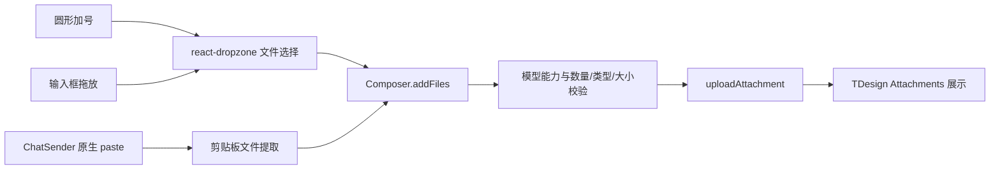

# 060 · 对话附件输入交互增强 - 技术方案

## 状态

CONFIRMED

## 需求文档

→ [requirement.md](./requirement.md)

## 现状分析

### 当前组件与数据流

- `Composer.tsx` 已经持有附件草稿状态，并由 `addFiles(files)` 统一执行模型能力、数量、媒体类型、单文件大小和总大小校验，再调用 `uploadAttachment` 进入上传、成功或失败状态。
- TDesign `ChatSender` 通过 `attachmentsProps` 展示附件，并承接删除、图片预览和发送可用状态；这部分已经覆盖附件展示生命周期，不应再引入第二套文件列表。
- 当前加号通过一个隐藏的 shadcn `Input[type=file]` 选择文件；拖放由 Composer 上的 React drag 事件手工处理，仅有 `dragging` 布尔值，没有稳定的嵌套元素边界处理和可见反馈。
- `ChatSenderBox` 已经在 TDesign Web Component host 上桥接原生 `input`、`change`、IME composition 等事件。剪贴板粘贴也应沿用这一边界，避免依赖 React 合成事件穿透 Shadow DOM 的细节。

### 组件调研结论

- TDesign `Upload` 虽然支持文件选择、拖放、粘贴和自定义请求，但会维护自己的文件列表、上传进度与交互容器；其 custom 拖拽区域还会把容器点击变成打开文件选择器。把它包在 ChatSender 外会与现有附件草稿和输入框点击语义冲突。
- FilePond 与 Uppy 面向完整上传生命周期，会接管文件状态、列表或上传管线，超过本需求的职责范围。
- React Aria DropZone 适合独立、可聚焦的拖放区域，但不处理剪贴板文件，且不适合再包裹一个已经可交互的 ChatSender。
- `react-dropzone` 是无样式的文件获取层，不承担上传。它提供隐藏 input、命令式 `open()`、拖拽 target 跟踪、默认页面 drop 防护、accepted/rejected 状态，并允许通过 `noClick`、`noKeyboard` 保留 ChatSender 原有点击与键盘语义，最符合现有边界。

## 方案设计

### 组件职责

| 组件 / 模块 | 职责 |
|---|---|
| TDesign `ChatSender` / `Attachments` | 文本输入、附件展示、移除、预览与发送状态 |
| `react-dropzone` | 系统文件选择器、输入框范围内的拖放获取、拖拽可接受状态 |
| `ChatSenderBox` | TDesign host 原生事件桥接，包括附件剪贴板粘贴 |
| `Composer.addFiles` | 三种入口共享的最终校验、上传和附件草稿状态 |
| shadcn `TooltipButton` | 带无障碍提示的圆形附件加号按钮 |

### 涉及文件

| 文件路径 | 改动类型 | 说明 |
|---|---|---|
| `frontend/package.json` | 修改 | 增加 `react-dropzone` 依赖 |
| `frontend/pnpm-lock.yaml` | 修改 | 锁定新增依赖及其传递依赖 |
| `frontend/src/pages/chat/components/Composer.tsx` | 修改 | 接入 dropzone、统一入口、渲染拖拽反馈、圆形加号 |
| `frontend/src/pages/chat/components/ChatSenderBox.tsx` | 修改 | 桥接 Web Component host 的原生 paste 事件 |
| `frontend/src/pages/chat/components/attachmentInput.ts` | 新增 | 放置剪贴板文件提取、dropzone accept 生成等纯逻辑 |
| `frontend/src/pages/chat/components/attachmentInput.test.ts` | 新增 | 固定剪贴板与附件输入适配行为 |
| `frontend/src/styles/vendor/tdesign-chat.css` | 修改 | 如需穿透或协调 ChatSender 拖拽态，只在 vendor override 层落样式 |

若实现后确认拖拽覆盖层可以完全由 Composer 的 token 化 Tailwind 类表达，则不修改 `tdesign-chat.css`，避免无必要的 vendor override。

### 数据流

### 文件选择与拖放

Composer 使用 `useDropzone`，核心配置如下：

- `noClick: true`、`noKeyboard: true`：dropzone 根节点只承接拖放，不劫持 ChatSender 的点击、焦点和键盘行为。
- `multiple: true`：保持现有多附件选择能力和用户提供的顺序。
- `disabled` 与输入框/流式状态同步；模型不支持附件时仍保留可识别的禁止反馈，最终由现有说明函数给出明确原因。
- `accept`、`maxSize`、`maxFiles` 根据当前模型能力和剩余附件槽位生成，用于 drop 时的早期分类及拖拽视觉提示。
- `onDrop` 把原始文件按顺序交给 `addFiles`。`addFiles` 仍是最终权威，因为它还需要结合已有附件计算总数量和总大小，并维护上传状态。
- 加号按钮调用 dropzone 的 `open()`，不再自行维护第二个文件 input ref。隐藏 input 由 `getInputProps()` 提供。

根属性只挂在 ChatSender 所在的可交互 Composer 容器，不挂在聊天页面或消息列表。dropzone 对嵌套 drag target 的跟踪用于避免指针跨越输入框内部子元素时反复触发离开状态。

### 拖拽反馈

- 仅当拖入内容包含文件时显示覆盖反馈，不响应普通文本或浏览器内部选择拖动。
- 可接收状态在输入区表面显示高亮边框和“松开以添加附件”提示；不可接收或当前不可用时显示禁止态与对应提示。
- 覆盖层设置为非命中层，不遮挡底部操作区；退出热区、完成 drop 或取消拖拽后立即清理。
- 样式优先复用项目语义 token、Tailwind 间距和圆角 token，不写硬编码颜色、阴影或任意值。
- dropzone 的 accept/reject 只负责预反馈；实际 drop 后的错误 toast 统一复用 Composer 现有中文校验结果，避免出现两套不一致文案。

### 剪贴板附件

`ChatSenderBox` 新增 `onNativePasteFiles?: (files: File[]) => void`，在 ChatSender host 的 capture 阶段监听 `paste`：

1. 按 `clipboardData.items` 顺序读取 `kind === "file"` 的项目，并用 `getAsFile()` 获取文件；当 items 不可用时回退到 `clipboardData.files`。
2. 没有文件时不阻止事件，普通文本继续由 TDesign textarea 按原行为粘贴。
3. 存在文件时调用 `preventDefault()`，避免剪贴板同时携带的 HTML、文件路径或图片占位文本进入文本草稿，再把文件按原顺序交给 Composer。
4. 输入框禁用、流式输出或模型能力不可用时仍消费附件型 paste，并调用统一入口给出禁止原因，不能退化成向文本框插入附件的文本表示。

监听器只挂在当前 ChatSender host，不使用 document 全局监听，也不引入 Tauri 原生剪贴板绕路。

### 圆形加号

- 使用项目现有 `TooltipButton`，tooltip 与 `aria-label` 均为“添加附件”。
- 保持 `variant="ghost"`、`size="icon-sm"`，仅用 `rounded-full` 覆盖默认圆角；不创建新的按钮组件。
- 模型不支持附件时继续保留现有禁止光标与说明 toast；真正的输入框禁用和流式状态使用 button `disabled`。

### 测试策略

- 为 `attachmentInput.ts` 增加单元测试，覆盖：按顺序读取剪贴板文件、忽略空 file item、files 回退、纯文本返回空、由模型媒体类型生成 dropzone accept。
- 对 Composer 保留 `addFiles` 作为唯一权威入口，通过类型检查和既有/新增纯逻辑测试避免三条路径产生不同校验规则。
- 运行项目标准门禁 `scripts/check`。
- 按需求确认过的真实桌面端验收，使用 `desktop-visual-inspection` 在 Tauri Windows 运行态覆盖系统截图粘贴、复制图片粘贴、多文件拖入、接受/禁止反馈、普通文本粘贴及圆形加号。

## 影响分析

### 上下游影响

- 后端上传 API、附件草稿结构、消息协议、会话持久化和历史展示均不变。
- `ChatSenderBox` 新增的 paste 回调是可选接口，编辑重发等其他调用方不传时行为不变。
- 语音输入、文本草稿和发送逻辑不改；附件失败只追加失败状态或提示，不清空其他草稿。
- 新依赖只位于前端获取层，不向 store、service 或公共数据结构泄漏其类型，未来可局部替换。

### 跨平台影响

- 文件选择与拖放继续使用 Web 标准 `File` / `DataTransfer`，适用于 Windows WebView2 以及 macOS/Linux WebView。
- 剪贴板只处理 WebView 已暴露的 file item；平台不暴露的文件不尝试绕过权限读取。
- 不启用 File System Access API，使用 dropzone 默认隐藏 input 路径，降低不同 WebView 支持差异。

### 风险与应对

- **Shadow DOM paste 传播差异**：在 ChatSender host 的 capture 阶段监听，并在真实 Tauri 环境验证截图与第三方应用复制图片。
- **拖拽限制状态与最终校验偏差**：dropzone 只做预分类，最终一律经过 `addFiles`；动态参数与同一 capabilities 数据源生成。
- **重复错误提示**：dropzone 拒绝文件时只转换为现有语义提示，不再把同一拒绝项送入 `addFiles`；可接收文件才进入上传路径。
- **新增依赖变更面**：仅使用 headless hook，不采用其样式或上传状态；版本由 lockfile 固定，并由项目门禁验证 React 19 类型兼容。
- **拖拽覆盖层影响点击**：覆盖层使用 `pointer-events-none`，根节点配置 `noClick` / `noKeyboard`。

## 变更记录

| 日期 | 变更内容 | 是否需要重新实现 |
|---|---|---|
| 2026-07-24 | 初版确认：采用 react-dropzone 获取选择与拖拽文件，原生桥接 paste，复用现有上传状态和 TDesign/shadcn UI | 是 |
