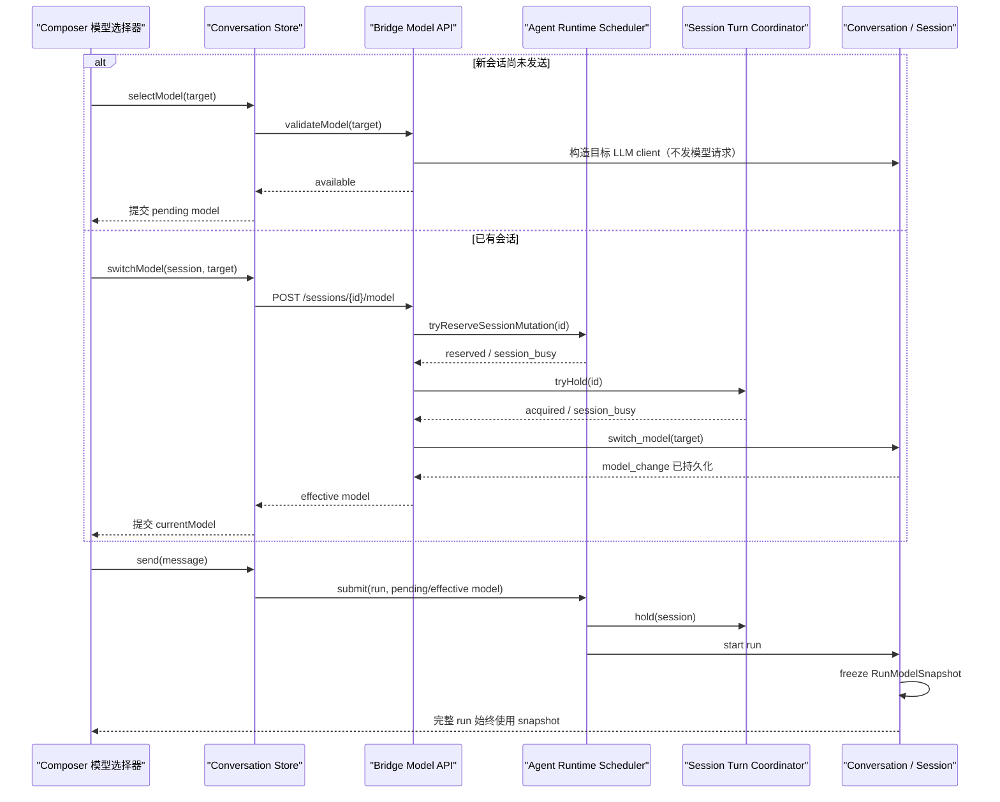

# 061 · 会话内模型切换 - 技术方案

## 状态

CONFIRMED

## 需求文档

→ [requirement.md](./requirement.md)

## 现状分析

### 会话事件已经能够表达模型切换

- `Conversation.switch_model(name)` 已实现“同模型 no-op → 构造新 client → 追加 `model_change` → 替换 client”的原子顺序。目标 client 构造或事件持久化失败时，有效模型和当前 client 都不会被错误替换。
- `Session.current_model` 从 active event projection 反向寻找最新 `model_change`，不存在时回退 `session_meta.initial_model`。
- assistant event 已记录 `meta.model`，run 内事件可通过 `meta.run_id` 关联；诊断包导出原始 session events，具备追踪实际模型的基础。
- `POST /v1/sessions/{session_id}/model` 已存在并校验统一模型目录，但错误仍以不稳定字符串为主，也没有桌面端调用方。

### run 调度与模型切换还没有共享完整临界区

- `AgentRuntime` 的 scheduler 能保证同一 session 的 runtime run 串行，但它不知道 Bridge 的 `SessionTurnCoordinator`。
- AG-UI、OpenAI 和 IM 的主要运行路径已经通过 `AgentRuntime.submit()` 调度；编码器收到 `run_handle` 后不会再持有 `SessionTurnCoordinator`。
- 模型切换 endpoint 只持有 `SessionTurnCoordinator`。因此 runtime run 与模型切换当前可能同时操作同一 session。
- scheduler 还允许同 session 存在 queued run。只检查“当前是否 streaming”无法保证模型切换不会越过更早入队的 IM 或外部消息。

### Conversation 只冻结了模型名称，没有冻结实际 client

- `stream()`、`edit_resend_latest()` 和系统触发轮会把 `session.current_model` 保存为 `model_snapshot`，assistant event 因而可以记录本轮模型名称。
- 实际模型调用、消息渲染、context window、摘要 client 和部分日志仍在后续步骤读取可变的 `self._llm_client`。
- 如果模型切换与工具循环交错，后续调用可能使用新 client，但事件仍标记旧模型；这不满足完整 run 冻结。

### 编辑重发和工具历史存在跨模型风险

- `_latest_active_user_rewrite_plan()` 当前把最后一条 active user event 之后的所有 active events 都标为 inactive。若用户在上一轮之后切过模型，编辑重发会把 `model_change` 一并失活，run 完成后有效模型可能回退。
- `Session.messages` 会把 `tool_call_request` 附着到上一条 assistant message。run 在 tool result 落盘前取消或异常时，历史可能留下没有对应 result 的工具调用；部分目标 provider 会拒绝这种上下文。
- 已闭合的工具事务、附件降级和纯文本 compaction summary 可以跨 provider 复用，缺失的是对不完整工具事务的统一安全投影。

### 前端已有模型状态和附件兼容性，但缺少切换事务

- conversation store 已有 `currentModel`；打开历史会话时从 `SessionDetail.model` 恢复，首次发送时从 `currentModel` 或全局默认值初始化。
- `buildRunAgentInput()` 仍固定把全局默认模型写入 `forwardedProps.model`，所以新会话 UI 即使产生 pending model，也不会真正传给首次 run。
- `refreshCurrentSession()` 只更新 messages，不同步 `detail.model`。
- Composer 已根据当前模型能力重新计算草稿附件兼容性，会保留不兼容草稿、标记失败并阻止发送；本需求只需让模型切换正确驱动这条现有链路。
- 设置页 `ModelSelectionRows` 与 `SettingsRow`、双层 provider/model 表单和设置持久化耦合，不适合作为 composer 内的紧凑选择器直接复用。

## 方案设计

### 总体数据流



### 1. Session mutation reservation 与共享 turn guard

#### Runtime reservation

在 `RunScheduler` 增加 `_mutating_sessions: set[str]`，并由 `AgentRuntime` 暴露非阻塞 context manager：

```python
with agent_runtime.try_reserve_session_mutation(session_id):
    ...
```

获取 reservation 时在 scheduler condition 内原子检查：

- session 已在 `_active`：抛 `SessionBusyError`；
- session mailbox 已有未完成 queued run：抛 `SessionBusyError`；
- session 已在 `_mutating_sessions`：抛 `SessionBusyError`；
- 否则把 session 加入 `_mutating_sessions` 并返回。

`_refresh_ready_locked()` 遇到 mutating session 时不把 mailbox head 放入 ready queue。reservation 持有期间新提交的 run 仍可正常进入 mailbox，但不会开始；释放 reservation 后重新 refresh ready。这样可以得到稳定顺序：

- 模型切换之前已经提交的 run 优先，切换返回 busy，不越过旧消息；
- 模型切换占位之后到达的 IM 或外部消息排在切换之后，启动时读取新模型；
- 模型切换请求本身不排队，符合首版 409 语义。

新增 `agent.runtime.SessionBusyError`，只表达 runtime/session mutation 竞争，不复用普通 `AgentError` 字符串。

#### 共享 turn guard

`AgentRuntime` 接收可选的 `session_turn_guard(session_id)` 依赖。Bridge assembly 把现有 `runtime.turn_coordinator.hold` 注入 Runtime；`_execute_request()` 从 conversation 构造开始到 post-turn hooks 和 listener finish 完成为止持有 guard。

`SessionTurnCoordinator` 增加非阻塞 `try_hold(session_id)`：拿不到锁直接抛 `SessionBusyError`，不能阻塞 REST 请求等待当前 run 完成。

模型切换 endpoint 的锁顺序固定为：

1. `AgentRuntime.try_reserve_session_mutation(session_id)`；
2. `SessionTurnCoordinator.try_hold(session_id)`；
3. 打开 session、装配 conversation、执行 `switch_model()`；
4. 逆序释放。

reservation 防住 runtime active/queued run；turn guard 防住仍走 legacy direct conversation 的路径。两个入口都不做阻塞式双锁等待，避免死锁。

### 2. RunModelSnapshot 冻结完整执行依赖

在 `conversation.py` 增加仅限 run 生命周期使用的内部快照：

```python
@dataclass(frozen=True)
class _RunModelSnapshot:
    model_id: str
    llm_client: LLMClient
```

`stream()`、`edit_resend_latest()` 和 `dispatch_system_turn()` 在执行任何上下文装配前，从当前 session/client 捕获快照，并在 `finally` 恢复之前的 override。Conversation 内增加 `_active_llm_client()` / `_active_model_id()`，run 期间以下路径统一读取快照：

- 首轮和工具循环后续 `stream()` / `complete()`；
- provider message renderer 与附件物化；
- `RuntimeContext.llm_client`；
- context window、预算和 summarizing compaction；
- assistant event `meta.model` 与 context debug 日志；
- tool-loop-limit 和中断收尾事件。

`switch_model()` 继续只替换持久的 current client；即使未来某个调用方漏掉 session guard，已经开始的 run 仍不会改用新 client。

本需求不新增 route snapshot 或 catalog revision 持久字段。现有稳定 model id + run id 已能满足每轮诊断，避免为暂时没有消费方的诊断维度扩张事件 schema。

### 3. 模型 API 与稳定错误模型

#### 新会话模型校验

新增：

```http
POST /v1/models/validate
Content-Type: application/json

{"model":"kimi/kimi-k2.6"}
```

成功：

```json
{"model":"kimi/kimi-k2.6","available":true}
```

该 endpoint 执行：统一目录校验 → `llm_client_factory(model)` 构造预检 → 丢弃临时 client。构造过程只读取配置并建立本地 client，不向外部 LLM 发请求，因此不触发真 LLM 授权。

#### 已有会话切换

保留现有 endpoint：

```http
POST /v1/sessions/{session_id}/model
Content-Type: application/json

{"model":"kimi/kimi-k2.6"}
```

成功继续返回 `{session_id, model}`；切换相同模型仍是幂等成功。前端不依赖额外 `changed` 字段。

#### 错误 envelope

两个 endpoint 统一使用现有前端已经识别的结构：

```json
{"error":{"code":"credential_missing","message":"模型凭据尚未配置，请先在设置中完成配置。"}}
```

稳定映射：

| HTTP | code | 场景 |
|---|---|---|
| 400 | `unsupported_model` | model 不在统一目录 |
| 404 | `session_not_found` | session 不存在或已删除 |
| 409 | `session_busy` | active、queued、mutating 或 legacy turn 正占用 session |
| 503 | `credential_missing` | provider 凭据未配置 |
| 500 | `session_io_error` | 会话读取或 `model_change` 持久化失败 |
| 500 | `internal_error` | 其他未识别错误 |

路由复用 `map_exception()` 的清洗文案；为 `unsupported_model` 和 `session_busy` 增加明确映射，禁止把凭据名称、堆栈或厂商响应直接返回前端。

### 4. 编辑重发与跨 provider 工具历史

#### 会话控制事件不随 turn rewrite 失活

`_latest_active_user_rewrite_plan()` 仍从最后一条 active user event 构造 replacement branch，但 `inactive_event_uuids` 排除会话控制事件：

- `persona_change`
- `model_change`
- `channel_change`

assistant、tool request/result、run_error、compaction 和其他由被替换 turn 派生的事件继续失活。这样既保留当前会话配置，也不会让旧回复、旧摘要或旧错误进入新分支。

重发 run 从 `session.current_model` 捕获新快照；marker 追加后 `current_model` 仍保持该模型。

#### 不完整工具事务安全投影

`Session.llm_messages` 在现有 failed-model-call sanitization 之前增加 incomplete tool normalization：

1. 在 active events 中按 `tool_call_id` 匹配 request/result；
2. 找出没有 result 的 request；
3. 仅在 LLM history 投影中移除这些 unmatched request，原始 events、UI 和诊断保持不变；
4. 如果关联 assistant 没有文本且移除后也没有其他有效 tool call，把它替换为中性 synthetic assistant 文本，避免产生空 assistant message；
5. 已闭合的其他 tool call/result 保持原顺序和内容。

占位文本只说明上一轮工具调用未完成，不复述工具参数或敏感结果。该规范对所有 provider 生效，切换模型不需要 provider 特判。

### 5. 前端状态与竞态控制

#### Store 状态

conversation store 增加：

```ts
modelSwitching: boolean;
modelSwitchTarget: string | null;
editingMessageId: string | null;
selectModel: (modelId: string) => Promise<ModelSelectionOutcome>;
setEditingMessage: (messageId: string | null) => void;
```

模块级 `modelMutationSeq` 与既有 `openSessionToken`、`detailRefreshSeq` 配合使用。

新会话选择流程：

1. 记录当前 `openSessionToken` 和 mutation seq；
2. 设置 `modelSwitching/modelSwitchTarget`；
3. 调 `modelsApi.validate(modelId)`；
4. 只有 seq 未过期、仍处于同一个空白新会话时，才把 `currentModel` 设为 pending model；
5. 失败或 stale response 不改变 pending/effective model。

已有会话选择流程：

1. 捕获 session id，递增 mutation seq 和 detail refresh seq；
2. 调 `sessionsApi.switchModel(sessionId, modelId)`；
3. 只有 mutation seq、open token 和 current session 都匹配时，提交 response model；
4. 用户已经离开该 session 时不更新当前 UI，但后端成功切换仍保留；重新进入时由 detail 恢复；
5. 失败保留旧 `currentModel`。

`newSession()`、`openSession()`、删除/归档后的导航都会使旧 mutation seq 失效。`refreshCurrentSession()` 成功应用 detail 时同时更新 messages 和 `detail.model`；model mutation in-flight 期间的旧 refresh 因 seq 不匹配而丢弃。

#### send 与首次模型传递

`RunStreamInput` 增加必需的 `model`。conversation store 在接受 send 前一次性计算：

```ts
const runModel = currentModel ?? resolveDefaultConversationModel();
```

随后把同一 `runModel` 同时用于：

- 新 session 的 store `currentModel`；
- `buildRunAgentInput().forwardedProps.model`；
- 当前附件能力和 run 发起前校验。

`send()` 在 `modelSwitching`、`historyLoading`、`streaming` 或 editing 状态下拒绝。已有 session 的 forwarded model 不覆盖后端 session state；auto-create 新 session 使用它作为 `initial_model`。

### 6. Composer 模型选择器

新增 chat-specific `ConversationModelSelector`，放在 `Composer` 的 `footer-prefix` 左侧动作组：附件按钮之后、语音按钮之前。footer 调整为“左侧附件 + 模型，右侧语音”，不改变发送按钮和附件区域。

选择器使用现有 shadcn `DropdownMenu`：

- trigger 展示当前 model label + 下拉指示，不默认重复展示 provider；
- menu 使用 provider label 分组，每个 model item 展示用户 label，当前项有选中标记；
- 现有模型数量较少，不新增 command/search 依赖；组件边界允许目录增长后替换为可搜索 picker；
- catalog loading/error、history loading、streaming、editing 和 model switching 分别提供 disabled reason；
- `modelSwitchTarget` 只显示提交中状态，trigger 仍保留已确认模型，避免乐观状态与后端不一致；
- 成功后用 Sonner toast 和 `aria-live` 提示“下一条回复将使用 …”，不写聊天事件；
- `credential_missing` toast 提供 action，调用 `openSettings({target: "runtime"})`；
- `session_busy` 提示等待当前回复结束后重试，其他错误使用 `FriendlyError.friendly`。

设置页 `ModelSelectionRows` 保持不动。两处共享 `modelProvidersFromCatalog()`、model/provider option 查询等纯数据 helper，但不把设置持久化与会话事务塞进同一个 UI 组件。

### 7. 附件兼容性

模型切换成功更新 `currentModel` 后，Composer 现有 `capabilities`、`evaluateAttachmentCompatibility()` 和 `readyToSend` 会自然重新计算：

- draft state 不清空；
- 不兼容附件显示 fail；
- send 保持禁止；
- 切回兼容模型后恢复 success/ready。

本需求不新增附件状态类型，也不重新上传草稿。历史附件继续由 059 的 provider renderer 和降级 marker 处理；run model snapshot 确保同一 run 的附件物化不会中途换 provider。

## 涉及文件

| 文件路径 | 改动类型 | 说明 |
|---|---|---|
| `agent/src/agent/runtime/errors.py` | 新增 | 定义稳定的 `SessionBusyError` |
| `agent/src/agent/runtime/scheduler.py` | 修改 | 增加 mutating session reservation、ready 阻塞与释放唤醒 |
| `agent/src/agent/runtime/__init__.py` | 修改 | 暴露 reservation，接收并执行 session turn guard |
| `agent/src/agent/conversation.py` | 修改 | 冻结 `_RunModelSnapshot`，所有 run 内调用读取快照；修正 edit-resend 控制事件边界 |
| `agent/src/agent/sessions/session.py` | 修改 | 对不完整工具事务生成安全 LLM history 投影 |
| `agent_bridge/src/agent_bridge/session_turns.py` | 修改 | 增加非阻塞 `try_hold()` |
| `agent_bridge/src/agent_bridge/assembly.py` | 修改 | 把 Bridge turn coordinator 注入 AgentRuntime |
| `agent_bridge/src/agent_bridge/errors.py` | 修改 | 增加 `session_busy` 等稳定错误映射 |
| `agent_bridge/src/agent_bridge/routes/models.py` | 修改 | 增加模型 validate endpoint |
| `agent_bridge/src/agent_bridge/routes/meta.py` | 修改 | 重做 switch endpoint reservation 与错误 envelope |
| `frontend/src/services/api/models.ts` | 新增 | 封装模型可用性校验 |
| `frontend/src/services/api/sessions.ts` | 修改 | 封装会话模型切换 |
| `frontend/src/services/stream.ts` | 修改 | `RunStreamInput` 显式接收并发送 run model |
| `frontend/src/stores/conversation.ts` | 修改 | pending/effective model transaction、stale guard、refresh 同步和 editing 状态 |
| `frontend/src/pages/chat/components/ConversationModelSelector.tsx` | 新增 | composer 内紧凑 provider/model picker 与反馈 |
| `frontend/src/pages/chat/components/Composer.tsx` | 修改 | 挂载选择器，复用附件兼容性，调整 footer 动作组 |
| `frontend/src/pages/chat/components/MessageList.tsx` | 修改 | 把 edit mode 同步到 conversation store |
| 对应 `agent/tests/`、`agent_bridge/tests/`、`frontend/src/**/*.test.*` | 修改/新增 | 覆盖核心逻辑、API、store、组件与竞态 |

文件表是职责边界，不要求为了机械拆分创建额外 wrapper。若实现时发现已有相邻测试文件足以承载场景，优先追加到相邻文件。

## 测试设计

### Agent / session 单元测试

- `switch_model()` 同模型 no-op、factory 失败、persist 失败和成功事件顺序。
- tool loop 首轮之后触发外部 client 替换，后续模型调用、context window、renderer 和 assistant meta 仍使用 run snapshot。
- 普通 stream、edit resend、system trigger 和 compaction 都读取同一快照。
- model_change 位于最后 user turn 之后时，edit resend 不使其失活；assistant/tool/run_error/compaction 仍正确失活。
- 一个或多个 unmatched tool request 的 LLM 投影有效；已闭合 sibling transaction 不受影响；原始 events/messages 诊断投影不变。

### Runtime / Bridge 测试

- active run、queued run 和已有 mutation 时 reservation 返回 busy。
- mutation 期间新 submit 入队但不启动，释放后使用切换后的 session model。
- 不同 session 的 run 与切换互不阻塞。
- runtime run 与 legacy direct run 都持有同一 coordinator；switch endpoint 不会在 run 中途成功。
- validate/switch 的成功、幂等、unsupported、credential missing、session missing、busy 和 persist failure envelope。
- AG-UI auto-create 使用 forwarded pending model；已有 session 忽略请求方覆盖并使用 effective model。
- IM run 与 switch 的并发顺序固定。

### 前端自动化测试

- 新会话默认模型、validate 后 pending model、validate 失败保持原值、首次 run payload 使用 pending model。
- 已有会话成功后提交、失败保持旧值、连续选择乱序、离开 session、删除/归档及 refresh stale response。
- `refreshCurrentSession()` 同步 `detail.model`，但不覆盖更新的 mutation。
- switching/editing/streaming/history loading 时 selector 和 send 禁用。
- credential missing toast action 打开 `runtime` 设置；session busy 和通用错误文案正确。
- selector 的 provider 分组、当前值、键盘选择、长 label 和 aria 状态。
- 切到不兼容模型保留 draft attachment、标记 fail 并禁止发送；切回后恢复。

### 验证命令与桌面验收

- 实现阶段先跑受影响模块测试，再运行 `scripts/check` 全量门禁。
- 按已获得的视觉验收授权，使用真实 Tauri 桌面端执行选择器布局、菜单、键盘、禁用态、toast、设置跳转、附件不兼容和 session 切换验收。
- 不用 Vite/Web 预览替代桌面端结论。
- 自动化测试使用 fake/mock client；只有确需确认真实跨 provider 行为时，另按 `llm-api-confirm` 获得授权后执行。

## 影响分析

### 上游输入

- 桌面首次 run 多传一个显式 model；Bridge 仍通过统一目录校验，不能信任客户端字符串。
- CLI、IM、AG-UI 和 OpenAI 已有 session 不获得“请求级强制覆盖”能力，仍以 session effective model 为真相源。
- model validate 只预检配置，不创建 session、不追加事件、不发真实 LLM 请求。

### 下游调用与持久化

- 继续使用已有 `model_change` 事件，不修改 session schema version，不迁移旧会话。
- assistant `meta.model` 和 run id 语义变得更可靠，但字段形态不变。
- tool history normalization 只影响喂给 LLM 的派生投影；原始事件、UI 历史和诊断包不丢信息。
- model switch 不修改全局 settings，也不写新的桌面持久设置。

### 并发与性能

- reservation 和 coordinator 都按 session 隔离，不同会话仍可并行。
- model switch/validate 只构造本地 client，临界区很短；REST 不等待长 run。
- scheduler mutating set 只保存正在执行的短生命周期 mutation，释放时必须在 `finally` 中完成并唤醒 condition。
- `SessionTurnCoordinator` 现有 lock map 不在本需求扩张清理策略；session 数量带来的既有锁对象生命周期问题不顺带处理。

### 跨平台与视觉

- 前端新增组件只使用现有 React、Radix/shadcn、Sonner 和 Tailwind token，不增加平台专属 API。
- 设置跳转复用现有 Tauri settings navigation；Web 测试 mock 该边界。
- Windows 真实桌面验收是本需求验收项；实现本身不引入 Windows-only 行为。

## 风险与防护

| 风险 | 防护 |
|---|---|
| scheduler reservation 与 coordinator 锁顺序造成死锁 | endpoint 固定 reservation → 非阻塞 try_hold；失败立即释放，不做双锁阻塞等待 |
| run meta 与实际 client 再次漂移 | run snapshot 同时持有 model id 和 client，所有调用通过 active snapshot helper |
| 切换响应覆盖其他 session | mutation seq + open token + session id 三重校验 |
| refresh 覆盖刚切换模型 | 切换开始时失效旧 detail refresh；应用 detail 时复核 seq |
| 新会话选择缺凭据模型后首发失败 | 选择阶段调用无副作用 validate endpoint，失败不提交 pending model |
| 编辑重发保留旧回复或撤销配置 | turn events 失活、session control events 保留，并增加组合回归测试 |
| 未闭合工具调用被目标 provider 拒绝 | LLM-only 投影移除 unmatched request，必要时生成中性占位；原始诊断不变 |
| UI 为复用设置页组件而耦合全局设置 | 只复用 catalog helper，chat selector 独立持有会话事务语义 |
| 需求借机扩张 provider 架构 | 不改 LiteLLM transport、不增加 provider abstraction、不迁移 SDK |

## 变更记录

| 日期 | 变更内容 | 是否需要重新实现 |
|---|---|---|
| 2026-07-24 | 初版确认：runtime reservation + Bridge turn guard 统一会话临界区；run model/client 快照；新会话 validate 与已有会话原子切换；composer picker；edit-resend 和不完整工具历史修复 | 否，尚未进入实现 |
