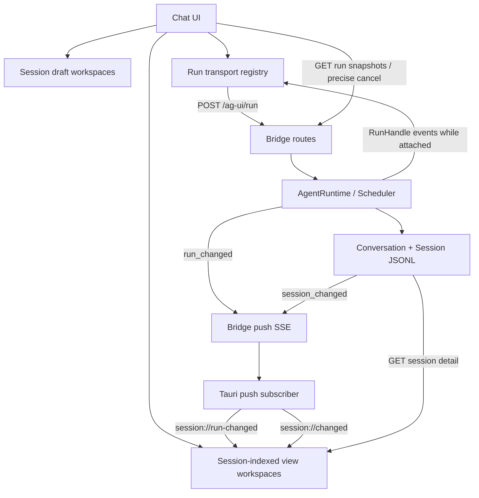
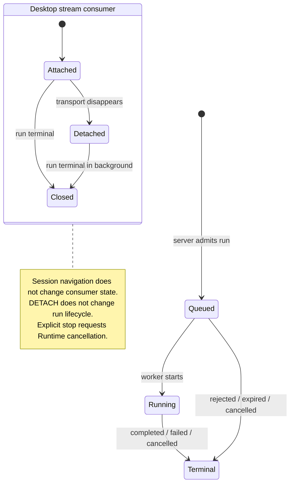
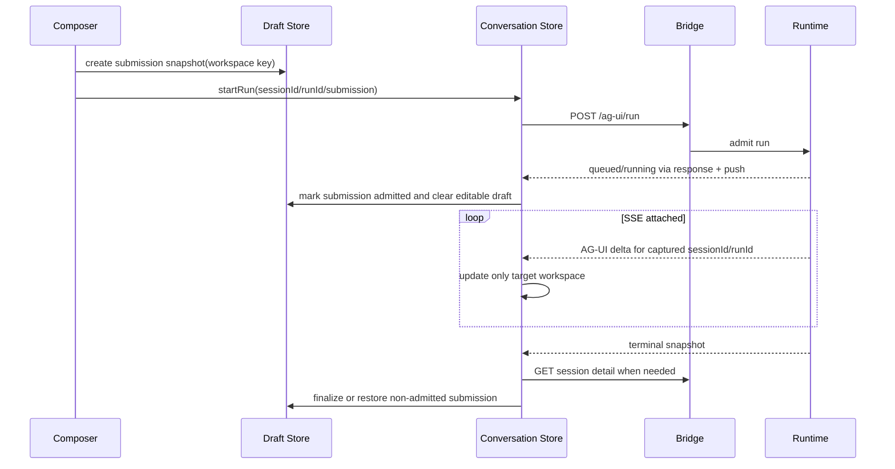

# 062 · 桌面多会话并发运行 · 技术方案

## 状态

已确认（Confirmed）

## 需求文档

→ [requirement.md](./requirement.md)

## 0. 设计摘要

本需求不新增第二套桌面调度器，而是补齐现有 `AgentRuntime` 到桌面的运行控制面，并把前端从“一个当前会话拥有全部状态”改为“导航指针 + session-indexed 工作区”。

核心设计如下：

1. Scheduler 继续拥有 run 的权威生命周期，并新增可查询的 `RunSnapshot`、精确取消、运行状态通知和有界 terminal 留存。
2. `RunHandle` 明确区分 consumer 断开策略。桌面 AG-UI 使用 `DETACH`：流断开后停止投递实时增量，但 run 继续执行与持久化；其他入口默认保持现有取消语义。
3. Bridge 新增运行快照与精确停止 REST API，并通过 `run_changed` push envelope 发布 queued、running、terminal 状态。
4. 前端 conversation store 归一化为按 session 索引的工作区；SSE、push、detail refresh 和 terminal 都使用显式 session/run 身份提交，不再依赖“此刻当前页面是谁”。
5. Composer 草稿迁入独立的 draft workspace store，以 `home` 或 `sessionId` 为 key，统一管理文本、临时附件、准备任务、失败和兼容性。
6. 归档、删除、模型切换等影响执行语义的 mutation 统一通过 Runtime session reservation 做后端权威校验；重命名保持可用。

本期只保证同一 Bridge 进程存活期间的运行连续性。SSE 断开期间不补播逐 token 增量，恢复以 Runtime 快照和 Session JSONL 投影为准。

## 1. 现状与约束

### 1.1 当前前端把导航和运行绑在一起

`frontend/src/stores/conversation.ts` 当前只有一份：

- `currentSessionId`
- `messages`
- `streaming`
- `activeController`
- `historyLoading`
- `currentModel`

`newSession()` 和 `openSession()` 在 `streaming` 时调用 `stop()`；每条流的 `finally` 又无条件写 `streaming=false`。因此即使只移除导航处的 stop，A run 的迟到事件和 finally 仍可能写进 B 的消息或清掉 B 的 busy。

Composer 的文本、附件上传状态和语音草稿也都在组件本地。组件随会话视图切换时没有稳定的 session 所有权，异步上传完成后只能写回当时挂载的组件状态。

### 1.2 Runtime 已有正确的调度骨架，但缺控制面

045 已经实现：

- 每 session mailbox；
- 同 session 串行；
- 跨 session 有界 worker pool；
- `RunHandle`、取消 token 和唯一 terminal；
- user/agent turn listener fan-out。

当前缺口是：

- `_handles` / `_requests` 没有面向产品的查询、精确控制和 terminal 清理语义；
- 只有全局 queued/running 数量，没有按 session/run 快照；
- queued → running → terminal 没有实时 push；
- `RunHandle.events()` 的 primary consumer 提前退出会触发 `CONSUMER_ABANDONED` 取消；
- primary queue 满时 worker 会等待，流断开后若不取消也不 drain 会形成背压；
- 桌面 Tauri push 当前只订阅 `agent_turn,session_changed`。

### 1.3 必须保持的不变量

- Session JSONL 继续是会话内容事实源，运行状态不写成普通对话消息。
- `AgentRuntime` 继续拥有调度、取消和 terminal；前端不复制 scheduler。
- 同一 session 的 Conversation 写入不能交错。
- 不同 session 才允许并发；Runtime 全局容量仍统一约束 AG-UI、OpenAI、voice、IM 和系统事件。
- 外部 channel 的停止与资源收尾由其入口负责，桌面文字页不能越权取消。
- 现有 listener 和 session revision 都是 best-effort 通知；断线恢复必须有 pull 校准路径。
- 本需求不修改 context compaction、memory observe、provider 或 tool 领域语义。

## 2. 目标架构



### 2.1 三类事实分离

| 事实 | 所有者 | 生命周期 |
|---|---|---|
| run queued/running/terminal、outcome、取消权限 | Runtime/Scheduler | Bridge 进程内；terminal 有界留存 |
| user/assistant/tool/partial 内容、模型等会话事件 | Session JSONL | 持久化 |
| 当前导航、缓存视图、草稿、未查看反馈 | 桌面前端 | 当前应用生命周期 |

三者通过稳定的 `session_id` 和 `run_id` 关联，但互不替代。

### 2.2 导航、订阅、停止是三个动作



正常会话切换只改变 `activeSessionId`。SSE consumer 继续运行并把增量写入原 session workspace。只有 WebView、fetch 或网络真正中断时才进入 detached；detached 后不再保留实时事件，run 本身继续。

## 3. Runtime 运行快照与控制

### 3.1 `RunSnapshot`

`agent/src/agent/runtime/models.py` 增加只读快照：

```python
@dataclass(frozen=True)
class RunSnapshot:
    run_id: str
    session_id: str
    status: RunStatus
    outcome: RunOutcome | None
    reason_code: str
    channel: PromptChannel | None
    origin: str | None
    control_scope: str | None
    created_at: datetime
    started_at: datetime | None
    finished_at: datetime | None
    version: int
```

约束：

- `version` 是单个 run 内从 1 开始递增的状态版本；前端只接受更大的版本。
- `origin` 使用稳定入口值，如 `ag_ui`、`openai`、`im`、`system_trigger`，不暴露任意 metadata。
- `control_scope` 只表达允许哪个产品控制面发起停止。桌面文字入口使用 `desktop_text`；外部 channel 不使用该 scope。
- queued 时 `outcome/started_at/finished_at` 为空；terminal 时 `outcome/finished_at` 必须存在。
- error 对象和堆栈不进入快照；对外只暴露稳定的 `reason_code`。

### 3.2 生命周期发布

Scheduler 在以下转换后生成不可变 snapshot：

1. admission 成功 → `QUEUED(version=1)`；
2. worker 取得 run → `RUNNING(version=2)`；
3. finish-once → `TERMINAL(version=3)`。

立即拒绝、过期等没有 queued 阶段的请求直接产生 terminal snapshot，version 仍从 1 开始。Scheduler 在自身 condition 内完成状态转换和 snapshot 捕获，释放锁后再调用 lifecycle listener，避免外部通知代码在 scheduler 锁内反向进入 Runtime。

`AgentRuntime` 暴露：

```python
def list_run_snapshots(
    self,
    *,
    session_ids: Collection[str] | None = None,
    include_recent_terminal: bool = True,
) -> list[RunSnapshot]: ...

def get_run_snapshot(self, run_id: str) -> RunSnapshot | None: ...

def cancel_run(
    self,
    run_id: str,
    *,
    expected_session_id: str,
    required_control_scope: str,
) -> RunSnapshot: ...
```

`cancel_run()` 只设置 cooperative token，不把“请求已接受”伪装成 terminal。调用方继续等待 push、SSE 或后续 query 看见 terminal。

### 3.3 admission 策略

`RunRequest` 增加两个明确字段，不用松散 metadata 承载核心语义：

```python
consumer_abandon_policy: ConsumerAbandonPolicy = CANCEL
interactive_busy_policy: InteractiveBusyPolicy = QUEUE
```

桌面文字 run 使用：

```text
consumer_abandon_policy = DETACH
interactive_busy_policy = REJECT_IF_INTERACTIVE_BUSY
control_scope = desktop_text
```

`REJECT_IF_INTERACTIVE_BUSY` 的含义是：同 session 已有 queued/running interactive run 时拒绝新的桌面 run；已有低优先级 proactive/background 时继续沿用 Runtime 的“用户输入优先”策略，取消低优先级 run，并让新 run 排队等待其协作退出。

这样既防止桌面绕过 UI 后堆叠同 session 用户轮，也不破坏现有主动事件让路行为。不同 session 因 worker 已满而等待时仍正常显示 queued。

### 3.4 活跃句柄与 terminal 留存

Scheduler 内部分离：

- active/queued handle：用于调度、取消和 primary consumer；
- recent terminal snapshot：只用于短期 query/reconnect，不保留事件队列或异常对象。

清理规则：

- terminal handle 从调度索引移除后，已返回给 encoder 的 Python 对象仍可独立读取 terminal；
- recent terminal 默认保留 15 分钟，最多 512 条；
- 每次插入和查询时按时间、再按最大条数清理；
- active/queued 永不因 TTL 被驱逐；
- Bridge shutdown 时不持久化 recent terminal。

15 分钟/512 条服务于桌面短暂断线校准，不成为历史 run API。实现时作为 Runtime 构造参数保留测试可控性，不新增首期用户配置。

### 3.5 精确取消结果

取消内部结果区分：

```text
accepted              token 首次成功设置
already_requested     同一 run 已有取消请求
already_terminal      run 已终止
not_found             不在 active/recent terminal
session_mismatch      run 不属于路径中的 session
scope_mismatch        不是 desktop_text 可控 run
```

REST 层把它们映射为稳定响应，不泄漏其他 session 是否存在的额外信息。重复停止是幂等的；`already_requested/already_terminal` 返回当前 snapshot。

## 4. Primary consumer 断开策略

### 4.1 `CANCEL` 与 `DETACH`

`RunHandle` 增加明确的 consumer 状态：

```text
ATTACHED -> DETACHED
ATTACHED -> CLOSED
DETACHED -> CLOSED
```

- `CANCEL`：保持 045 的默认语义，consumer 在 terminal 前退出时请求 `CONSUMER_ABANDONED`。
- `DETACH`：consumer 退出时不 cancel；原子地标记 detached，清空 primary queue，之后 `emit()` 直接返回。
- 没有 primary consumer 的 system/source run 继续使用既有 detached 模式，不创建无意义事件队列。

`emit()` 在等待满队列时每次 timeout 后重新检查 consumer state 与 cancellation token。因此 detach 最多在一个短 timeout 后解除 worker 背压，不需要后台 drain 线程，也不创建完整 replay buffer。

`finish_once()` 在 detached 状态不再尝试塞 terminal sentinel；terminal 仍写入 RunHandle、lifecycle snapshot 和 push。

### 4.2 AG-UI 兼容边界

只有桌面正式 `/ag-ui/run`、edit-resend 和 continue-tool-result 使用 `DETACH + desktop_text`。Persona editor、OpenAI compatible、voice、IM 和未来入口必须显式选择自己的 policy，默认仍是 `CANCEL`。

这对 045 的调整是局部覆盖，不把“HTTP 断开后继续”外推成所有协议的统一语义。

### 4.3 为什么不做 reattach/replay

正常导航时原 fetch 仍在消费，因此切回可继续看到实时增量。真正断线后：

- 断线前已写入前端 workspace 的 partial 保留；
- 断线后的实时 delta 不缓存；
- Conversation 继续按现有 partial/final 规则写 Session JSONL；
- 重连通过 run snapshot 判断仍在运行或已 terminal，再拉 session detail 校准。

首期不定义 event cursor、subscriber offset、增量日志或“从第 N 个 token 续播”。

## 5. Bridge API 与 push 协议

### 5.1 运行快照 API

新增：

```http
GET /v1/runs?includeRecentTerminal=true
GET /v1/runs/{run_id}
POST /v1/sessions/{session_id}/runs/{run_id}/cancel
```

列表默认返回所有 active/queued，加 recent terminal；桌面重连和启动时一次请求即可校准侧栏。返回结果按 `created_at, run_id` 稳定排序。

单 run query 用于停止请求超时或 push 丢失后的精确复核。cancel endpoint 不接收任意 reason/scope，固定以桌面文字控制面发起 `EXPLICIT_REQUEST`，后端校验 `session_id + control_scope`。

错误约定：

| HTTP | code | 含义 |
|---|---|---|
| 404 | `run_not_found` | run 不存在或已超出 recent terminal 窗口 |
| 409 | `run_session_mismatch` | run 与目标 session 不匹配 |
| 409 | `run_not_desktop_controllable` | run 不属于桌面文字控制域 |
| 503 | `runtime_unavailable` | Runtime 未装配或正在关闭 |

成功返回当前 `RunSnapshot`。accepted snapshot 可能仍是 queued/running；前端必须等 terminal。

### 5.2 `run_changed` envelope

`PushEnvelope.kind` 增加 `run_changed`，使用独立嵌套字段，避免继续扩大 user/agent turn 的扁平字段语义：

```json
{
  "kind": "run_changed",
  "session_id": "s1",
  "seq": 18,
  "source_kind": null,
  "events": [],
  "run": {
    "run_id": "r1",
    "session_id": "s1",
    "status": "running",
    "outcome": null,
    "reason_code": "",
    "channel": "text",
    "origin": "ag_ui",
    "control_scope": "desktop_text",
    "created_at": "...",
    "started_at": "...",
    "finished_at": null,
    "version": 2
  }
}
```

现有 `user_turn` terminal envelope 继续用于完整 turn 事件 fan-out，不再承担桌面运行状态恢复。`session_changed` 继续只表达持久化失效。三种 envelope 可以乱序，前端按各自版本/用途合并。

### 5.3 Tauri 转发

`frontend/src-tauri/src/push_subscriber.rs`：

- 订阅 kinds 改为 `agent_turn,session_changed,run_changed`；
- `run_changed` 发给 chat WebView 的 `session://run-changed`；
- chat WebView 恢复连接后仍发 `session://push-reconnected`；
- Rust schema 对新增 `run` 使用 optional 字段，保持旧 envelope 可解析；
- pet 对 `agent_turn` 的现有处理不变。

桌面不订阅完整 `user_turn` 事件来拼实时消息。实时文本仍来自该 run 的 AG-UI fetch；状态与内容通道保持分工。

### 5.4 Session detail revision

`SessionRevisionStore` 增加只读 `current_revision(session_id)`；`GET /v1/sessions/{id}` 返回 `revision`。读取 detail 后返回的 revision 必须与读取窗口一致：实现采用“读取前 revision → 读取 session → 读取后 revision”，若发生变化则重读一次；连续变化时返回后一次读取及对应 revision，由后续 push 再校准。

前端只应用不低于 workspace 已知 revision 的 detail，且仍使用 request sequence 防止同 revision 的旧请求后到。revision 只做失效/乱序保护，不改变 JSONL schema。

## 6. 前端 session-indexed 会话状态

### 6.1 Store 形态

`conversation.ts` 从单视图改为：

```ts
interface SessionViewWorkspace {
  sessionId: string;
  messages: ChatMessage[];
  model: string | null;
  historyLoading: boolean;
  historyLoadSeq: number;
  syncRefreshSeq: number;
  detailRequestSeq: number;
  appliedRevision: number;
  activeRunId: string | null;
  error: FriendlyError | null;
  lastAccessedAt: number;
}

interface RunViewState {
  snapshot: RunSnapshot;
  localPhase: "starting" | "streaming" | "detached" | "terminal";
  assistantMessageId?: string;
  unreadTerminal: boolean;
}

interface ConversationState {
  activeSessionId: string | null;
  viewsBySession: Record<string, SessionViewWorkspace>;
  runsById: Record<string, RunViewState>;
  runIdBySession: Record<string, string>;
}
```

组件可通过 selector 获得当前 session 的派生 `messages/streaming/historyLoading/currentModel`，减少 UI 一次性大改；但写操作必须显式接收或捕获 session/run，不再通过 getter 临时读取当前页面。

### 6.2 非序列化 transport registry

`AbortController`、stream scheduler 和 completion promise 不进入 Zustand：

```ts
Map<runId, {
  sessionId: string;
  controller: AbortController;
  dispose: () => void;
}>
```

该 registry 只管理本 WebView 内仍连接的 transport：

- 导航不删除、不 abort；
- SSE 正常结束或异常时按 runId 清理；
- 显式 stop 不直接 abort，而是调用 cancel API；
- 观察到目标 terminal 后才允许关闭仍残留的 transport；
- WebView 卸载时 transport 自然关闭，后端按 DETACH 继续运行。

### 6.3 send 数据流



runId 在前端构建请求前生成并沿用到 `RunAgentInput`。本地 `starting` 只是反馈状态；服务端 queued/running snapshot 才表示接纳。HTTP admission 失败时移除乐观 user/assistant 占位并恢复 submission；运行已接纳后的 provider failure 不恢复草稿，而是保留会话失败轮和重试入口。

Bridge 必须在消费 attachment drafts 前完成可判定的 admission。实现采用延迟 runner 准备：route 先校验 draft metadata并提交 run，worker 真正开始 Conversation 前一次性 `consume_drafts`。若 queued 时 draft 到期，run 以稳定 `attachment_draft_expired` 失败，前端保留原文本并把附件标为失效；不把未接纳附件变成孤立正式资产。

### 6.4 增量和 detail 合并

每条流回调闭包固定：

```text
targetSessionId
targetRunId
assistantMessageId
```

提交前依次验证：

1. `runsById[targetRunId]` 仍属于 `targetSessionId`；
2. workspace 的 `activeRunId` 仍等于 target run；
3. terminal version 未经 push 提前超过当前增量；
4. assistant placeholder 仍存在且属于该 run。

detail refresh 使用 `(sessionId, requestSeq, requestedRevision)`。应用 detail 时：

- session 不必是当前页面；后台 workspace 也可以校准；
- response revision 低于 `appliedRevision` 时丢弃；
- active attached run 尚在流式时，不用 detail 覆盖该 run 的当前 partial，先记录 pending revision；
- detached 或 terminal run 可直接用持久化投影替换；
- terminal 后执行最终 detail refresh，完成后清理该 run 的 placeholder/本地错误漂移。

### 6.5 启动与重连校准

chat 初始化、push 重连和 WebView 恢复走同一动作：

1. 拉 run snapshots；
2. 按 run version 合并 active/recent terminal；
3. 列表中此前 active 但快照已 terminal 的后台 session 标记完成未查看或失败；
4. 刷新 session list；
5. 刷新当前 session，以及已加载且状态发生变化的后台 session；
6. recent terminal 已过期但 session revision 前进时，内容仍能恢复，只是不承诺补出已经错过的瞬时失败 badge。

push 是低延迟路径，query 是完整性路径；两者共用同一个 snapshot reducer。

### 6.6 缓存清理

- active/queued run 对应 workspace 始终 pinned；
- 当前 session 始终 pinned；
- 其余空闲、无 draft 的 view workspace 按 LRU 保留最多 20 个；
- 驱逐只删除前端投影，重新进入时从 Session JSONL 恢复；
- recent terminal run view 在已完成最终 detail refresh、已处理 unread 且超过 15 分钟后清理；
- 非空 draft workspace 不随 view LRU 静默丢弃。

## 7. 统一草稿工作区

### 7.1 所有权与 key

草稿使用稳定 key：

```ts
type DraftWorkspaceKey = { kind: "home" } | { kind: "session"; sessionId: string };
```

Store 内部编码为常量 `HOME_DRAFT_KEY` 或 session id，但业务接口使用类型化 helper，避免真实 session id 与保留 key 碰撞。

只存在一个 home workspace。首次发送同步生成 sessionId 后，在启动网络请求前执行 `claimHomeDraft(sessionId)`；迁移文本、资产、准备任务归属和 submission，home 立即回到空状态。

### 7.2 可扩展数据模型

```ts
interface DraftWorkspace {
  key: DraftWorkspaceKey;
  text: string;
  assets: DraftAsset[];
  preparation: DraftPreparationState;
  validation: DraftValidationState;
  revision: number;
  updatedAt: number;
}

type DraftAsset =
  | {
      kind: "attachment";
      localId: string;
      file: File;
      status: "uploading" | "ready" | "failed" | "expired";
      remoteDraft?: AttachmentDraft;
      error?: FriendlyError;
    };

interface DraftPreparationState {
  phase: "idle" | "preparing" | "ready" | "blocked";
  pendingTaskIds: string[];
}

interface DraftValidationState {
  modelId: string;
  compatible: boolean;
  reasons: DraftValidationIssue[];
}
```

未来新增录音片段、结构化引用或其他输入资产时向 `DraftAsset` 增加 discriminator，不让各 Composer 子组件再建立互相不可见的 local state。

`validation` 是当前模型下的缓存结果，每次 workspace revision 或 model 变化后由纯函数重算；发送前仍重新校验，不能把缓存结果当授权。

### 7.3 异步任务必须绑定 workspace

上传动作创建：

```text
taskId + workspaceKey + workspaceRevisionAtStart + localAssetId
```

完成时按 `workspaceKey/localAssetId` 写回。用户已经切换会话不影响写回目标；资产已删除或 workspace 已迁移时，通过 migration table 找到新 key，找不到则释放刚上传的 remote draft。

移除 ready attachment 时先从 UI 状态删除，再 best-effort 调 release API；release 失败记诊断日志，不把已移除资产重新插回草稿。应用关闭由服务端 draft TTL 做最终兜底。

### 7.4 submission snapshot

发送不是直接清空 workspace，而是创建不可变快照：

```ts
interface DraftSubmission {
  runId: string;
  sessionId: string;
  sourceWorkspaceRevision: number;
  text: string;
  attachments: AttachmentDraft[];
  phase: "starting" | "admitted" | "consumed" | "rejected";
}
```

规则：

- 创建 submission 后，editable workspace 清空，用户可以去其他 session 输入；
- HTTP/admission 失败时，只有 workspace 自清空后没有产生更新才原样恢复；若用户已经输入新内容，则把旧 submission 合并回前方文本并恢复未重复的附件；
- admitted 后不因 provider failure 恢复，避免重复发送；
- worker 消费 attachment drafts 后标记 consumed；前端不再主动 release；
- 同一 workspace 同时只允许一个 starting/admitted submission，因为同 session interactive busy 会被拒绝。

### 7.5 语音输入边界

语音输入仍由现有 voice input store 驱动，但 Composer 开始一次转写时记录 `workspaceKey + traceId`。转写 delta 只合并到该 workspace：

- 切换会话不改变目标；
- 原 workspace 已提交时，停止该 trace，避免语音继续写入已发送内容；
- 用户在另一 session 开始新语音输入前，先结束现有 trace；
- voice prewarm 是全局资源状态，不进入 draft workspace。

### 7.6 生命周期与清理

- 空 workspace 在离开后可立即删除；
- 非空 workspace 在当前应用生命周期内保留，不被 view LRU 驱逐；
- session 删除时先显式 discard draft，并 release ready attachments；
- session 归档不自动丢草稿，但归档 UI 需要提示存在未发送内容；首期可阻止带非空草稿的归档，避免草稿失去可导航入口；
- 应用重启不恢复文本、File、object URL 或 attachment draft；服务端 TTL 清理遗留临时文件；
- preview object URL 在资产删除、workspace discard 或应用卸载时 revoke。

## 8. 侧栏状态与用户反馈

### 8.1 派生状态

侧栏不把运行标记写回 `SessionSummary`，而是按 session id 合并：

```text
session summary + active run snapshot + unread terminal state
```

优先级：

```text
failed unread > running > queued > completed unread > ordinary
```

当前正在查看且流连接正常的 session 不显示 completed unread。terminal 到达时如果该 session 不是当前 active session，或当前 WebView 对其处于 detached，则标记 unread；进入并完成一次 detail 校准后清除。

### 8.2 呈现原则

- running/queued 使用侧栏行内小状态，不用持续 toast；
- completed unread 使用低干扰标记；
- failed unread 使用错误色标记，但不展开技术错误；
- 多个后台 run 同时完成不逐个弹 toast；
- 当前 session 的停止按钮只在 `control_scope=desktop_text` 且 queued/running 时出现；外部 busy 显示“正在通过语音/其他入口处理中”，不展示停止按钮；
- hover action 不能覆盖状态标记，窄宽度下优先保留状态语义。

具体图标、间距和窄窗口效果在真实 Tauri 桌面验收中确认，不在方案中固定像素。

## 9. Mutation 安全

### 9.1 后端矩阵

| 操作 | active/queued 时 | 后端保护 |
|---|---|---|
| rename | 允许 | 不占 session mutation reservation |
| archive/unarchive | 拒绝 | `try_reserve_session_mutation` |
| delete / bulk delete archived | 拒绝相关 session | 单 session reservation；bulk 先筛选 busy 并整体拒绝 |
| model switch | 拒绝 | 沿用 061 reservation |
| persona/channel switch | 拒绝 | 补齐 reservation + turn coordinator |
| edit resend / continue tool result | 拒绝 interactive busy | Runtime admission policy |

`PATCH title + archived` 组合请求先取得归档 reservation，再执行两个 mutation，避免先 rename 后因 busy 形成部分成功。纯 title 请求不进入 reservation。

### 9.2 前端保护

前端依据最新 run snapshot禁用操作并给出原因；但任何按钮状态都不是安全边界。请求与 push 竞态时以后端 `session_busy` 为准，前端刷新 snapshot/detail 后恢复。

带非空草稿的归档由前端阻止并提示先发送或清空；后端不知道应用内草稿，因此这条只属于桌面数据保护，不伪装成跨客户端约束。

## 10. 失败与竞态处理

### 10.1 关键竞态

| 竞态 | 防护 |
|---|---|
| A 流 finally 晚于 B 启动 | cleanup 按 runId；不写全局 streaming |
| A delta 在用户切到 B 后到达 | 闭包固定 sessionId/runId，写 A workspace |
| terminal push 早于最后 SSE delta | run version 标 terminal；最终 detail 校准，迟到 delta 不越过 terminal |
| session detail 早请求晚返回 | requestSeq + durable revision 双校验 |
| session_changed 与 run_changed 乱序 | 两个 reducer 独立；terminal 触发最终 detail refresh |
| 停止请求与自然完成同时发生 | Runtime finish-once；返回当前 snapshot，前端接受唯一 terminal |
| push 断线期间 run 完成 | reconnect 拉 recent terminal + session detail |
| attachment upload 完成时 workspace 已迁移 | task 按 workspace/local asset 定位；无法定位则 release |
| home 首发同时导航 | claimHomeDraft 和 activeSessionId 更新在同一 store action 中完成 |
| 外部 run 与桌面 send 同时提交 | Runtime interactive busy admission 权威拒绝其中后到者 |

### 10.2 错误隔离

所有前端错误归属于 session/run/workspace：

- transport error 只把目标 run 标 detached/待校准；不能直接推断 failed；
- provider `RUN_ERROR` 与 Runtime terminal failed 对齐后写目标 session；
- detail refresh 失败保留现有 workspace，不清空消息；
- draft upload failure 只更新目标 asset；
- 一个 run 的 terminal cleanup 不遍历并重置其他 session 状态。

## 11. 涉及文件与模块边界

| 路径 | 改动 | 职责 |
|---|---|---|
| `agent/src/agent/runtime/models.py` | 修改 | snapshot、consumer/admission policy、consumer detach |
| `agent/src/agent/runtime/scheduler.py` | 修改 | 生命周期查询、精确取消、busy admission、terminal 留存与清理 |
| `agent/src/agent/runtime/__init__.py` | 修改 | 暴露控制 API并发布 lifecycle |
| `agent/src/agent/runtime/listeners.py` | 修改 | 新增 `run_changed` envelope |
| `agent/src/agent/sessions/changes.py` | 修改 | 只读 current revision |
| `agent_bridge/src/agent_bridge/protocols/ag_ui/routes.py` | 修改 | desktop policy、延迟附件消费、admission 错误 |
| `agent_bridge/src/agent_bridge/protocols/ag_ui/encoders.py` | 修改 | detach 兼容和 terminal 编码 |
| `agent_bridge/src/agent_bridge/routes/meta.py` | 修改 | run query/cancel、detail revision、mutation guards |
| `frontend/src-tauri/src/push_subscriber.rs` | 修改 | 订阅并转发 run_changed |
| `frontend/src/types/push.ts` | 修改 | run snapshot/envelope 类型 |
| `frontend/src/services/api/runs.ts` | 新增 | run query 与 cancel API |
| `frontend/src/services/stream.ts` | 修改 | 调用方生成并沿用 runId，明确 transport 错误 |
| `frontend/src/stores/conversation.ts` | 重构 | session-indexed view/run 状态和精确 action |
| `frontend/src/stores/sessionSync.ts` | 重构 | run/session 双通道校准与后台 detail refresh |
| `frontend/src/stores/drafts.ts` | 新增 | 统一草稿、资产、任务、submission 和 cleanup |
| `frontend/src/pages/chat/components/Composer.tsx` | 修改 | 使用 draft selectors/actions，不再本地拥有文本附件 |
| `frontend/src/pages/chat/components/HistorySidebar.tsx` | 修改 | 合并侧栏运行/unread 状态和 mutation guard |
| 对应 Agent、Bridge、Rust、Frontend 测试 | 修改/新增 | 状态机、API、竞态、草稿与交互覆盖 |

实现时允许把 transport registry、snapshot reducer、draft selectors 拆成相邻小文件，避免继续放大 `conversation.ts`；不为本需求引入通用状态机框架或事件总线库。

## 12. 分阶段实现顺序

### M1 · Runtime 控制面

- RunSnapshot、version 和 bounded terminal history；
- 生命周期 callback；
- exact cancel 与 interactive busy admission；
- consumer `DETACH`；
- Runtime 单元测试。

### M2 · Bridge 与 Tauri 状态通道

- run REST API；
- `run_changed` push；
- AG-UI desktop policy 与附件延迟消费；
- session detail revision；
- Rust 订阅转发；
- Bridge/Rust 集成测试。

### M3 · 前端 session-indexed 运行

- run API 与 snapshot reducer；
- conversation view normalization；
- transport registry；
- 导航不中断、跨 session 并发、精确停止；
- session sync 重连校准。

### M4 · 统一草稿与侧栏反馈

- draft workspace 和 submission；
- Composer 文本、附件、语音绑定迁移；
- sidebar running/unread/failed；
- archive/delete/model 等操作保护。

### M5 · 验证与收口

- 受影响模块测试；
- 全量 `scripts/check`；
- 真实 Tauri 桌面验收；
- 回填 `progress.md` 与 issue 037 关联，但在用户验收前不把 issue 标为 resolved。

顺序保证每个里程碑都有可独立测试的底层能力，避免先在 UI 用临时全局状态模拟后端尚未提供的事实。

## 13. 测试设计

### 13.1 Runtime

- 不同 session 在 worker 限额内并发，同 session 仍串行。
- queued/running/terminal snapshot 的字段、version 和发布顺序。
- global worker 满时新 session queued；interactive queue 满时稳定 rejected。
- 同 session interactive busy 时桌面 run rejected；低优先级 run 仍让路。
- cancel 精确校验 session/scope；重复 cancel 和自然完成竞态只有一个 terminal。
- DETACH 前正常事件消费；detach 后 worker 不阻塞、不取消、最终完成。
- CANCEL policy 保持 consumer abandoned 取消。
- terminal TTL/容量清理不影响 active handle；异常对象不进入 history。
- drain/stop 时 queued、running、detached run 都有明确终态。

### 13.2 Bridge / push / Rust

- run list/get/cancel 的成功、not found、session mismatch、scope mismatch、runtime unavailable。
- queued/running/terminal `run_changed` wire schema和 version。
- push subscriber 断线重连后 query 能恢复 active/recent terminal。
- AG-UI SSE 客户端断开后 Conversation 继续，最终 Session JSONL 完整。
- 断线后事件数超过 primary queue 容量也不阻塞 worker。
- desktop cancel A 不影响 B，不允许取消 voice/IM run。
- edit-resend、continue-tool-result 也采用同一 desktop policy。
- queued attachment run 在开始时消费 draft；admission rejection 不消费；过期给稳定错误。
- detail revision 与 session_changed revision 一致，不返回明显旧投影。
- Tauri 正确解析 run_changed、转发 chat event，既有 agent_turn/session_changed 测试不退化。

### 13.3 前端 store

- A streaming 时打开 B/new home 不 abort A；A/B 增量分别进入目标 workspace。
- A finally 晚到不清 B busy；同 run 旧 version 不覆盖新 version。
- A/B 并发、其中一个失败/取消、另一个继续。
- current 与 background detail refresh 的 requestSeq/revision 乱序。
- transport 断开只标 detached，query 显示仍 running 后不误报失败。
- reconnect recent terminal 后生成 completed/failed unread，进入并校准后清除。
- exact stop 先显示 stopping，只有 terminal 后清 busy。
- external run 显示 busy、禁止 send/model/edit，但没有桌面 stop。
- view LRU 不驱逐 active/current/draft session。

### 13.4 草稿

- home、A、B 文本和附件完全隔离。
- upload 在切换 session 后仍写回原 workspace。
- attachment remove、upload-late-after-remove、release failure 和 preview URL cleanup。
- 模型切换使 validation 变化但不清草稿；切回后恢复 ready。
- home claim 后所有 upload task 跟随新 session。
- admission reject 恢复 submission；用户已输入新草稿时正确合并且附件不重复。
- admitted provider failure 不恢复已发送 draft。
- 语音 trace 固定目标 workspace，切换不会串写。
- session delete/discard 清理 ready drafts；应用重启不尝试恢复 File。

### 13.5 真实桌面验收

- A 生成时进入 B 并发送，两个会话均推进。
- 快速来回切换不会闪空、串消息或错误停止。
- 分别停止 A/B，只影响目标 run。
- 侧栏 running、queued、completed unread、failed 在窄窗口和 hover 下可辨认。
- A/B/home 草稿文本、附件上传中/失败/不兼容状态可恢复。
- 模拟 chat WebView/push 短暂重连后，活动状态和最终消息恢复。
- voice/IM 占用 session 时桌面 busy 文案和按钮边界正确。

桌面验收必须走真实 Tauri，不用 Vite 页面代替。自动化使用 fake/mock LLM；如后续确需真实模型观察多 run 行为，另按 `llm-api-confirm` 取得单次授权。

## 14. 影响分析

### 上游入口

- AG-UI runId 由前端预生成并贯穿 UI、transport、Runtime 和 Session event meta。
- 其他入口新增 policy 字段有默认值，不要求一次性修改其产品语义。
- Runtime admission 更严格地拒绝同 session 重复 interactive，可能让此前“静默排队的重复桌面请求”变成稳定 busy；这是预期修正。

### 下游与持久化

- Session JSONL schema 不迁移；只复用已有 run_id 和 partial/error 事件。
- Session revision sidecar只增加读取，不改变递增写入格式。
- run recent terminal 不落盘，Bridge 重启后为空；内容仍从 JSONL 恢复。
- attachment drafts 仍由 AttachmentStore 管理，统一草稿不复制文件存储。

### 性能与容量

- 后台 session SSE 仍有一个 fetch reader，但数量受 Runtime 并发/排队和桌面操作约束；terminal 后立即清理。
- detached run 不缓存事件，避免随 token 数增长。
- run snapshot 上限 512，前端 view LRU 20；非空草稿不静默驱逐。
- run snapshot list 是小型进程内读取，不扫描 Session JSONL。

### 与上下文压缩需求的关系

- 本需求不修改 compaction 策略、阈值、checkpoint 或恢复算法。
- 交集只在“run 产生 session revision 后前端校准”的通用边界；062 依赖最终 Session JSONL 投影，不假设具体 compaction event 形态。
- 如果并行需求调整 Session detail 投影或 revision 发布位置，合并时只需核对 revision 仍覆盖 compaction 写入，不需要共享前端运行状态实现。

## 15. 风险与防护

| 风险 | 防护 |
|---|---|
| detach 后 worker 仍卡在满 queue | consumer state 原子切换、清空 queue、emit timeout 后复核 |
| Runtime snapshot 与 handle 状态漂移 | snapshot 只由 Scheduler 状态转换生成，不由 Bridge 二次推断 |
| recent terminal 变成无界历史 API | TTL + 最大条数，且不持久化事件/异常 |
| push 丢失导致 UI 永久 busy | 启动/重连拉完整 active + recent terminal snapshot |
| detail 覆盖实时 partial | attached run 延后 detail apply；terminal/detached 后再校准 |
| 用户 stop 实际只是断 fetch | stop 只调 exact cancel，等待 Runtime terminal；AbortController 不是业务停止接口 |
| 外部 run 被桌面误停 | session + run + control_scope 三重后端校验 |
| 草稿异步任务串 session | 每个任务固定 workspaceKey/localAssetId，迁移显式转移 |
| admission 失败丢附件 | attachment consume 推迟到 worker admitted/start；submission 可恢复 |
| 非空草稿被缓存驱逐 | draft store 与 view LRU 分离，非空 draft 只显式 discard |
| 状态层重构范围过大 | 先落 Runtime/Bridge contract，再用兼容 selectors 分步迁移组件 |
| 与 compaction 并行改动冲突 | 不触碰 context 算法；仅在 session revision/detail seam 做窄接口修改 |

## 变更记录

| 日期 | 变更内容 | 是否需要重新实现 |
|---|---|---|
| 2026-07-25 | 初版确认：Runtime 权威快照与精确停止；桌面 AG-UI detach-on-disconnect；session-indexed 前端工作区；统一 draft workspace/submission；run_changed push；短断线 pull 校准；mutation guard 与有界缓存 | 否，尚未进入实现 |
