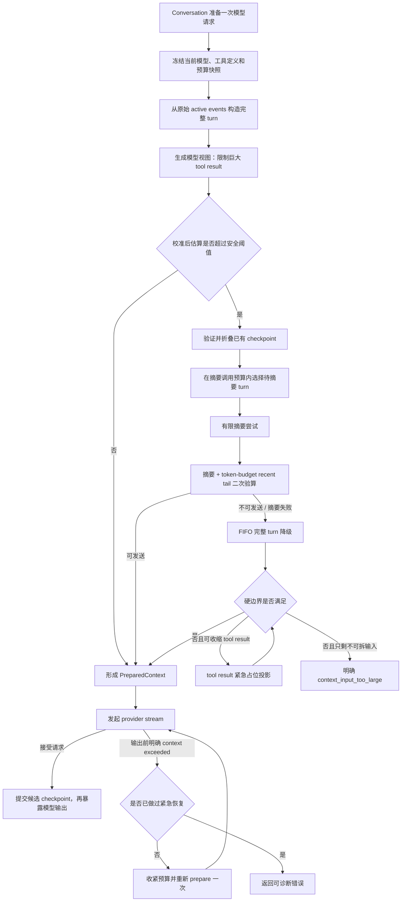

# 063 · 上下文压缩可靠性 - 技术方案

## 状态

CONFIRMED

## 需求文档

→ [requirement.md](./requirement.md)

## 现状分析

### 预算快照有真实 usage，但没有形成校准闭环

- `context/budget.py` 以消息字符数、附件固定成本和 tool call 元数据估算 token，当前安全阈值为 context window 扣除 10% 输出预留和 10% 估算缓冲。
- `Conversation._consume_usage()` 能取得上一轮 `usage.prompt_tokens`，但该值只进入 `BudgetSnapshot` 和日志，不影响下一轮估算结果。
- tool schema 在 `_assemble()` 完成后才生成，因此当前预算看不到实际请求携带的工具定义成本。
- `_last_input_tokens` 只存在于 `Conversation` 内存；关闭应用并重新创建实例后会丢失。

### 摘要输入与摘要结果都可能越过预算

- `SummarizingContextManager` 用固定两轮 recent tail 切分历史，没有根据单轮实际大小自适应。
- 首次压缩没有 prior summary 时，`_summary_input()` 可能把全部超长旧历史直接交给摘要调用。
- 摘要调用成功后，当前实现直接拼接摘要与 tail，不再验证最终主请求是否落入安全预算。
- 摘要失败统一计入同一类失败，没有区分上下文超限、鉴权、参数错误和 provider 临时错误；因此不能只对可恢复情形做有界收缩。

### FIFO 与摘要策略分别维护轮边界

- `fifo.py` 和 `summarizing.py` 分别通过 user message 位置推导完整轮，存在边界语义漂移风险。
- FIFO 固定保护最近两轮；当其中一轮本身很大时，即使返回 `over_budget_after_truncation=True`，调用方仍可能继续发送已知超预算的请求。
- tool request 附着在 assistant message，tool result 是独立消息；任何按消息条数裁剪的实现都可能制造孤立调用或结果。

### 原始 tool result 与模型输入尚未分层

- tool result 作为 append-only 事件完整落盘，这一事实来源应继续保持。
- 当前 `Session.llm_messages` 会把完整结果直接投影给模型。单个极大结果可能同时挤爆摘要请求和工具续轮主请求。
- 现有架构没有表达“持久化原文完整，但本次模型视图已截断”的结构化元数据。

### checkpoint 可落盘，但恢复语义不足

- `compaction` 事件保存摘要、覆盖终点、压缩前后估算和模型；新进程可以读取它，但无法验证摘要来源起点、近期原文起点和策略版本。
- `covered_through_uuid` 在 active history 中不存在时，折叠逻辑会退回完整历史，但没有把 checkpoint 失效作为结构化原因暴露。
- 当前自动化测试没有真正销毁 `Conversation`、context manager 和 store 后重新加载同一 JSONL 会话，因此尚未证明重启不会重复摘要。

### provider 错误模型无法识别上下文超限

- `litellm.ContextWindowExceededError` 与普通 `openai.BadRequestError` 都被映射为 `LLMBadRequestError`。
- `LLMClient` 已对网络错误和临时 provider 错误做有限重试；上层不应再重复实现同类重试。
- 主模型请求一旦产生文本或 tool call 增量，再自动重放可能造成重复输出或副作用；只有 provider 在任何模型输出前拒绝请求时，才适合进行一次上下文恢复重试。

## 设计原则

1. **原始事实不变，模型视图可收缩**：user、assistant、tool 原始事件继续完整 append-only 保存；摘要、FIFO 和 tool result 截断只影响模型输入投影。
2. **发送前必须证明可发送**：摘要请求和主请求都在本地进行预算检查；provider 的明确超窗响应作为校准不足后的最后反馈信号。
3. **协议组优先于消息条数**：所有历史选择都以完整 user turn 为单位；tool request/result 不拆对。
4. **恢复有界且可解释**：每类失败只走定义明确的有限路径；最终策略、丢弃范围和失败原因全部可观察。
5. **checkpoint 只提交已采用结果**：摘要候选只有在对应主请求被 provider 接受后才成为有效持久化 checkpoint。
6. **不引入第二份历史真相源**：checkpoint 保存恢复边界和策略元数据，不复制完整 replacement history。

## 总体方案



## 1. 统一请求预算账本

### 1.1 `RequestBudget`

保留 `BudgetSnapshot` 名称，并扩展为一次模型请求的完整预算快照：

```python
@dataclass(frozen=True)
class BudgetSnapshot:
    effective_window: int
    output_reserve: int
    buffer: int
    raw_message_tokens: int
    attachment_tokens: int
    tool_schema_tokens: int
    calibration_factor: float
    calibrated_input_tokens: int
    trigger_reason: str

    @property
    def trigger_threshold(self) -> int: ...
```

预算分成四类：

- **固定输入**：system prompt、memory extra context、临时 trailing message。
- **历史输入**：active history、当前 user input 和 tool call/result。
- **请求开销**：本轮实际携带的 tool schema；没有工具的系统触发轮为 0。
- **安全预留**：输出预留和估算缓冲，继续沿用当前各占 context window 10% 的策略。

`estimate_tokens()` 保持纯函数，但返回结构化 `TokenEstimate`，避免附件与文本成本在日志里不可区分。工具定义以稳定 JSON 序列化后的字符成本计入。

### 1.2 usage 校准

真实 usage 用于修正本地估算低估，不用于取消现有安全缓冲：

```text
observed_ratio = actual_prompt_tokens / sent_raw_estimate
candidate = 0.75 * previous_factor + 0.25 * observed_ratio
calibration_factor = clamp(candidate, 1.0, 4.0)
calibrated_estimate = ceil(raw_estimate * calibration_factor)
```

- 初始 factor 为 `1.0`，因此没有 usage 时维持当前保守估算。
- 下限为 `1.0`，真实 usage 不会让系统比原始估算更激进。
- 上限为 `4.0`，防止某轮异常附加开销永久放大后续估算。
- 校准按 model id 隔离。切换到未校准模型时回到 `1.0`；切回曾使用模型时可以读取该模型最近一次有效校准。

每次成功主请求把以下字段写进对应 assistant event 的 `meta.context_usage`：

```json
{
  "model": "provider/model",
  "prompt_tokens": 12345,
  "raw_estimate": 10800,
  "calibration_factor": 1.07
}
```

`Conversation` 初始化时从 active assistant events 反向查找当前模型最近的有效记录。该字段是 additive event metadata，不改变 session schema，也不进入 `Message.to_openai()`。

### 1.3 请求依赖冻结

tool specs 必须在上下文组装前生成，并与当前 run 的 LLM client 一起冻结。`_assemble()` 不再事后读取可变 registry，而是接收本次实际 `tool_specs` 的估算成本。系统触发轮、工具上限收尾等 `tools=None` 的入口显式传 0。

这样模型切换、工具开关和附件渲染不会出现“按 A 预算、实际按 B 请求”的窗口。

## 2. 完整 turn 投影

### 2.1 `ContextTurn`

新增 `context/turns.py`，作为 FIFO、摘要输入和 recent tail 的唯一边界实现：

```python
@dataclass(frozen=True)
class ContextTurn:
    messages: tuple[Message, ...]
    first_uuid: str | None
    last_uuid: str | None
    estimated_tokens: int
    is_current: bool = False
```

边界规则：

- 一个普通 turn 从 user message 开始，到下一条 user message 之前结束。
- assistant tool call、其后一个或多个 tool result、最终 assistant 回复都属于同一 turn。
- user 之前的历史 system/assistant 异常前缀作为不可独立保留的 prefix 处理，不制造伪 turn。
- 本轮尚未落盘的 `new_user_input`、`trailing_user` 或 `trailing_system` 作为 current turn 的组成部分参与预算，但不伪造持久化 UUID。
- 选择器只返回连续的最新 turn 后缀，不在中间打洞。

`select_recent_turns(turns, token_budget)` 从新到旧累加完整 turn；一旦下一 turn 放不下即停止。current turn 在普通收缩中不可丢弃，但其 tool result 可以经过第 3 节的模型视图截断。

### 2.2 固定上下文与可收缩历史分离

预算选择前先计算：

```text
history_budget = trigger_threshold
               - fixed_system_and_extra
               - current_ephemeral_input
               - tool_schema_tokens
               - planned_summary_tokens
```

若固定上下文本身已经超过预算，不进入历史压缩循环，直接返回 `context_fixed_input_too_large`。这样不会通过删除所有对话历史掩盖 system prompt、附件或用户当前输入本身不可发送的问题。

## 3. tool result 模型视图安全阀

### 3.1 两份形态、一个事实来源

`Session.events` 和 `Session.messages` 继续保留完整 tool result。context manager 在构造请求时克隆 `Message`，只修改克隆后的模型视图，并附加内部投影元数据：

```python
meta["context_projection"] = {
    "kind": "tool_result_truncated",
    "original_estimated_tokens": 42000,
    "projected_estimated_tokens": 8000,
    "stage": "per_result_cap"
}
```

这些元数据只用于诊断，不序列化给 provider。UI、诊断包和长期记忆仍能读取原始事件内容。

### 3.2 第一阶段：单结果上限

每个 tool result 的模型视图上限按当前请求预算派生：

```text
per_result_cap = max(512, min(16_000, trigger_threshold / 4))
```

超过上限时使用中间截断：保留开头和结尾，中间插入稳定标记，标记包含原始 token 估算与被省略事实。默认把可用正文预算的 60% 给开头、40% 给结尾，以同时保留命令上下文、错误结论和尾部汇总。

示例模型视图：

```text
[tool result truncated for model context; original_estimated_tokens=42000]
<前部内容>
... omitted ...
<尾部内容>
```

### 3.3 第二阶段：紧急占位

若所有结果都经过单项上限后，整体上下文仍超过硬边界，预算器可以把已经截断的 tool result 进一步替换成短占位：

```text
[tool result omitted from model context; original_estimated_tokens=42000;
reason=context_window_budget; raw_result_is_preserved]
```

选择顺序按“当前模型视图占用从大到小、同大小时从旧到新”，用最少的占位替换释放足够预算。替换只作用于 output，关联的 assistant tool call 与 tool result message 均保留，因此协议仍闭合。

如果完成占位后仍超预算，说明主要成本来自不可拆的当前 user/system/attachment 输入；此时返回明确错误，不静默裁剪用户语义。

### 3.4 与完整 L3 治理的边界

本需求不引入按工具类型定制的摘要器、分页游标、外部 artifact store 或让模型主动回读原结果的协议。安全截断只保证请求可发送、原始事实可恢复、截断行为可诊断，不保证模型仍掌握被省略的全部细节。

## 4. 安全摘要流程

### 4.1 有效 prior checkpoint 投影

开始新压缩前先验证最近 checkpoint：

- `checkpoint_version` 和 `summary_prompt_version` 是当前实现可识别版本。
- `summary_source_from_uuid`、`covered_through_uuid`、`retained_from_uuid` 在 active message 顺序中存在且单调。
- `retained_from_uuid` 之后的消息仍构成连续完整 turn 后缀。
- checkpoint 没有被 `turn_rewrite` 等 active projection 改写越过。

验证通过时，模型视图为“summary message + retained suffix”；验证失败时忽略 checkpoint、记录 `checkpoint_invalid_reason`，从原始 active history 重新计算。

### 4.2 摘要调用预算

摘要调用不携带对话工具定义，预算包括：

- 摘要 system/prompt 模板。
- 已选中的完整历史 turn。
- 摘要输出预留。
- 与主请求相同的估算缓冲和当前模型校准系数。

摘要输出预算为：

```text
summary_output_budget = max(512, min(4096, effective_window * 0.05))
```

并通过 `complete(..., max_tokens=summary_output_budget)` 传给 provider。摘要输入只选择能放入剩余预算的连续最新旧 turn。首次历史已经过大时，较早且未进入摘要的原始 turn 不删除，但 checkpoint 通过 `omitted_before_count` 明确记录其未被摘要覆盖，不能把它们伪装成摘要已覆盖内容。

### 4.3 有界尝试

摘要阶段只对新增的 `LLMContextWindowError` 做输入收缩重试：

1. 首次按本地预算发送。
2. 若 provider 明确返回 context exceeded，把可用历史预算缩为上次的 75%，重新选择完整 turn。
3. 最多再缩一次；仍失败则放弃摘要，进入 FIFO。

网络错误和临时 provider 错误继续由 `LLMClient` 自身有限重试。鉴权、内容策略、普通 bad request 等错误不作为上下文问题重试，直接记录分类并降级或上抛既有错误。

每次尝试只生成内存候选，不写 `compaction` 事件。

### 4.4 摘要输出后二次验算

摘要返回后重新构造完整主请求，按剩余 token 预算选择 recent tail。recent tail 不再尽量贴近触发阈值，而以以下稳定水位为目标：

```text
post_compaction_target = trigger_threshold * 0.70
```

该目标给后续 turn、真实 usage 向上校准和小幅固定上下文变化留出余量，避免一次压缩刚成功，下一轮立即再次压缩。`trigger_threshold` 仍是最终硬边界；当最小完整 recent turn 已超过目标但仍低于硬边界时允许保留该 turn，不为满足目标拆断语义。

只有同时满足以下条件才形成 `CompactionRecord` 候选：

- summary 非空。
- summary + fixed context + tool specs + current input + recent tail 不超过安全阈值。
- 正常可裁剪时，summary 占位预算 + recent tail 目标不超过 `post_compaction_target`。
- recent tail 是连续完整 turn 后缀。
- 所有 tool call/result 对保持闭合。

provider 即使忽略 `max_tokens` 返回异常长摘要，也不对结构化摘要做字符串硬截断；该候选作废并进入 FIFO，避免得到半截、语义不完整的 checkpoint。

## 5. FIFO 与硬边界

`FIFOContextManager` 改用共享 `ContextTurn` 选择器：

1. 先应用 tool result 单项截断。
2. 从最新 turn 开始，在可用 history budget 内保留连续后缀。
3. 若 current turn 仍让请求超预算，应用 tool result 紧急占位。
4. 再次验证完整 rendered request。
5. 仍超预算则返回结构化 `ContextInputTooLargeError`，不再以 notes 标记后继续发送。

这条硬边界同时用于摘要失败降级和 naive/fifo 显式配置。`NaiveContextManager` 在没有 runtime 时继续保持原兼容行为；只要提供 runtime，就必须执行最终硬边界检查。

## 6. provider 错误与一次性恢复

### 6.1 精细错误类型

在 `llm_providers.errors` 增加：

```python
class LLMContextWindowError(LLMBadRequestError):
    """请求输入超过 provider/model context window。"""
```

映射优先级：

1. LiteLLM 明确的 `ContextWindowExceededError`。
2. OpenAI bad request 中明确且稳定的 context length/error code。
3. 其余 `BadRequestError` 仍映射为 `LLMBadRequestError`。

不根据任意包含“token”的模糊消息做分类，避免把参数错误误判为可恢复超窗。

### 6.2 `PreparedContext` 与 checkpoint 提交时机

`_assemble()` 改为内部返回：

```python
@dataclass
class PreparedContext:
    openai_messages: list[dict[str, Any]]
    build: BuildResult
    runtime: RuntimeContext
    compaction_candidate: CompactionRecord | None
    committed: bool = False
```

Conversation 的统一请求 helper 负责：

1. 使用 `PreparedContext.openai_messages` 发起 stream。
2. 在收到第一个非 retry 的 provider event，或 stream 正常结束时，幂等提交 compaction candidate。
3. 提交完成后才把首个文本/tool delta 暴露给上游。
4. provider 在输出前拒绝请求时丢弃 candidate，不产生 compaction event。

这样第一次本地摘要虽然生成成功，但如果主请求实际不接受它，也不会留下一个随后又被紧急摘要覆盖的重复 checkpoint。

### 6.3 主请求紧急恢复

当且仅当满足以下条件时自动恢复一次：

- 异常是 `LLMContextWindowError`。
- 尚未收到 `LLMTextDelta` 或 `LLMToolCallDelta`。
- 当前模型请求还没有执行过 provider-overflow recovery。

恢复时把本轮安全阈值额外收紧到原阈值的 80%，触发强制重新 prepare；可用时重新摘要，否则走 FIFO/tool result 占位。第二次仍超窗则返回错误。

已经产生模型文本或 tool call 增量后绝不自动重放。既有中断持久化逻辑继续负责保存 partial assistant/run error，避免重复输出和工具副作用。

普通首轮、编辑重发、工具续轮、系统触发和工具上限收尾统一调用该 helper；各入口只传入自己的 current/trailing 消息和是否启用 tools，不再自行实现恢复循环。

## 7. compaction checkpoint v2

`compaction` 事件保持原类型，payload additive 扩展：

```json
{
  "checkpoint_version": 2,
  "summary_prompt_version": 1,
  "summary": "...",
  "summary_source_from_uuid": "...",
  "covered_through_uuid": "...",
  "retained_from_uuid": "...",
  "omitted_before_count": 0,
  "tokens_before": 70000,
  "tokens_after": 24000,
  "model": "provider/model",
  "effective_window": 128000,
  "calibration_factor": 1.08,
  "trigger_reason": "budget|model_downshift|provider_context_exceeded",
  "summary_attempts": 1,
  "tool_results_truncated": 2,
  "tool_results_omitted": 0
}
```

字段语义：

- `summary_source_from_uuid..covered_through_uuid` 是真正进入摘要来源的连续区间。
- `retained_from_uuid` 是摘要后原文后缀的第一条消息。
- `omitted_before_count` 明确说明首次超长历史中有多少更旧 turn 未进入摘要；原始事件仍在，只是不在当前模型视图。
- `effective_window` 和 `calibration_factor` 是生成时证据，不是恢复后的永久预算；恢复后仍按当前模型重新验算。

旧 checkpoint 没有 v2 字段时不再作为“已证明可确定恢复”的 checkpoint，但可按当前兼容逻辑读取 summary 后立即重新验算。若能够安全使用，notes 标记 `checkpoint_legacy_revalidated`；否则忽略并重建。无需迁移或重写旧 JSONL。

## 8. 应用重启后的恢复

关闭应用不会清除任何压缩状态，因为恢复只依赖 session JSONL：

1. `SessionStore.load()` 重建完整 event stream 和 active projection。
2. `Conversation` 从当前模型最近的 assistant usage metadata 恢复校准 factor。
3. `_derive_prior_summary()` 读取最近 active compaction v2 并验证三段边界。
4. 下一轮 `_assemble()` 先复用 summary + retained suffix，再按当前模型窗口重新验算。
5. 只要 checkpoint 有效且最终请求仍在预算内，不调用摘要 LLM。

因此“关闭再打开”本身不会触发重新压缩。只有以下事实变化才可能重建摘要：

- checkpoint 损坏或边界不再属于 active history。
- 编辑重发使覆盖范围失效。
- 切换到更小窗口后，原 checkpoint 投影仍超预算。
- 新增历史让会话再次达到压缩阈值。

进程内连续三次摘要失败的 circuit breaker 保持当前生命周期；应用重启后归零。checkpoint 和失败观测足以解释上次状态，不把临时 provider 故障永久写进会话控制面。

## 9. 可观测性

`BuildResult.notes` 与 `[ContextCompactionDbg]` 使用同一组稳定字段：

| 字段 | 含义 |
|---|---|
| `trigger_reason` | `budget`、`model_downshift`、`provider_context_exceeded` 等 |
| `raw_message_tokens` | 未校准的消息估算 |
| `tool_schema_tokens` | 本轮工具定义成本 |
| `calibration_factor` | 当前模型校准系数 |
| `calibrated_input_tokens` | 最终用于判断的输入估算 |
| `summary_input_tokens` / `summary_input_budget` | 摘要请求输入与上限 |
| `summary_attempts` | 摘要尝试次数 |
| `retained_turns` / `dropped_turns` | recent/FIFO 选择结果 |
| `tool_results_truncated` / `tool_results_omitted` | 两阶段工具结果投影数量 |
| `checkpoint_status` | `none`、`valid`、`legacy_revalidated`、`invalid`、`candidate`、`committed` |
| `checkpoint_invalid_reason` | 边界、版本或 active projection 失效原因 |
| `final_strategy` | `full`、`summary`、`fifo`、`hard_error` |
| `provider_overflow_recovery` | 是否执行一次紧急恢复 |
| `final_estimated_tokens` | 最终请求估算 |

日志只记录规模、UUID 边界和分类，不记录摘要正文、用户输入或原始 tool result。

## 10. 模块与接口调整

### `agent.context`

- `budget.py`：结构化 token 估算、tool schema 成本、usage 校准与紧急阈值。
- 新增 `turns.py`：完整 turn 分组、连续后缀选择和协议配对检查。
- 新增 `tool_projection.py`：单项中间截断、紧急占位与投影统计。
- `protocol.py`：扩展 `BudgetSnapshot`、`PriorSummary`、`CompactionRecord`、`RuntimeContext`、`BuildResult`，增加 `PreparedContext` 或等价内部类型。
- `fifo.py`：改用 turn selector，并把已知超预算升级为硬错误。
- `summarizing.py`：摘要输入预算、有界收缩、输出二次验算和 checkpoint v2 候选。

### `agent.conversation`

- 在组装前冻结 client、model 和 tool specs。
- 从事件恢复/持久化模型级 usage 校准。
- 统一提交 `PreparedContext`、主请求 context-overflow 恢复和 checkpoint commit。
- 扩展 compaction event payload 与上下文诊断 notes。
- 保持 user 事件、turn rewrite、partial assistant 和 tool 执行的既有持久化时序。

### `llm_providers`

- 新增并导出 `LLMContextWindowError`。
- 精确映射 LiteLLM/OpenAI 上下文窗口错误。
- 保持网络和 transient provider 重试策略不变。

不新增第三方依赖，不改变 session JSONL 顶层 schema version，不改前端协议。

## 11. 测试设计

### 11.1 预算与校准

- 字符、附件、tool call 和 tool schema 分项计入预算。
- 有 usage 时校准 factor 实际改变下一轮触发结果；无 usage 时回到 factor 1.0。
- factor 上下限、平滑更新和 model 隔离。
- 切换到更小窗口后立即按新边界重新验算。
- 销毁并重建 Conversation 后从 assistant metadata 恢复当前模型校准。

### 11.2 turn 与 tool result 投影

- 多工具调用、多 tool result 和最终 assistant 保持同一完整 turn。
- recent/FIFO 只保留连续完整 turn 后缀。
- 巨大 tool result 原始事件内容不变，模型视图保留头尾与截断标记。
- 整体仍超预算时使用紧急占位，call/result 配对仍有效。
- 非 tool 的当前单项独自超窗时返回硬错误，不进入无限裁剪。

### 11.3 摘要与失败恢复

- 无 prior summary 的首次超长历史只发送预算内摘要输入。
- 摘要 context exceeded 后按 75% 完整 turn 预算最多收缩两次。
- 普通 bad request、auth 和 content policy 不作为 context error 重试。
- 摘要为空、过长或最终二次验算失败时进入 FIFO。
- provider 主请求在任何输出前 context exceeded 时只紧急恢复一次。
- 已收到文本/tool delta 后的 context error 不自动重放。
- 失败尝试不落 compaction；被 provider 接受的 candidate 只提交一次。

### 11.4 checkpoint 与进程级恢复

建立真实临时 session 文件：

1. 用 fake summarizer 触发一次 compaction。
2. 关闭并丢弃 Conversation、ContextManager、SessionStore 实例。
3. 从同一 JSONL 创建全新实例并加载会话。
4. 继续发送一轮未达到新阈值的消息。
5. 断言 fake summarizer 调用次数不增加，模型视图与 checkpoint 边界一致，原始事件逐条仍在。

另覆盖 checkpoint 缺字段、UUID 不存在、顺序倒置、turn rewrite 越界、legacy checkpoint 重新验算和模型 downshift 后重新压缩。

### 11.5 回归范围

- `test_context_budget.py`
- `test_context_fifo.py`
- `test_context_summarizing.py`
- `test_context_unified_entry.py`
- `test_conversation_edit_resend.py`
- `test_conversation_dispatch_system_turn.py`
- `test_tool_calling_integration.py`
- `test_context_window_and_usage.py`
- 模型切换、附件与 session event roundtrip 相关测试
- 最终运行项目统一 `scripts/check` 门禁

真实 LLM 的 usage、长会话压缩和应用重启观察按 requirement AC-15/AC-16 单独授权，不作为机制正确性的唯一证据。

## 12. 影响分析

### 上游输入

- tool registry 需在组装前提供最终 model-visible specs；不改变工具注册接口和实际执行语义。
- provider usage 缺失时继续工作，不要求所有 provider 同时补齐。
- 用户输入、附件和 system trigger 的外部接口不变。

### 下游行为

- 模型可能不再看到巨大 tool result 的完整正文，但会明确知道发生过截断；原始结果仍在事件流和诊断数据中。
- checkpoint v2 是 additive payload，旧会话无需批量迁移。
- 日志字段增加，但不写入敏感正文。

### 性能

- 每轮增加一次线性的 message/tool schema 估算和 turn 分组，复杂度为 `O(n)`。
- 不新增后台任务；摘要仍只在预算触发时调用。
- 重启复用有效 checkpoint，避免额外摘要调用。

### 兼容性

- 不改变前端、Bridge 和 IM 协议。
- 不改变用户数据默认路径与 JSONL 存储方式。
- 不新增平台相关实现，Windows/macOS/Linux 行为一致。

## 13. 风险与防护

| 风险 | 防护 |
|---|---|
| 字符估算仍与 provider tokenizer 有误差 | 真实 usage 只向上校准、保留 20% 预留、provider overflow 再收紧一次 |
| tool result 截断丢失关键细节 | 原始事件完整保存、保留头尾、明确标记；完整 L3 回读能力留后续需求 |
| checkpoint 边界因编辑重发失效 | 恢复前验证 active UUID 顺序，失效后从原始事件重建 |
| 摘要成功但主请求拒绝，产生错误落点 | candidate 延迟到 provider 接受请求后幂等提交 |
| 自动重试重复输出或工具副作用 | 只允许在任何 text/tool delta 之前恢复一次 |
| 首次超长历史无法全部进入摘要 | 明确记录 `omitted_before_count`，不虚报摘要覆盖范围，原文仍保留 |
| 过多兼容分支使策略难以维护 | turn selector、tool projection、预算账本各自单一职责，所有入口共享统一 request helper |

## 变更记录

| 日期 | 变更内容 |
|---|---|
| 2026-07-25 | 初稿；定义预算校准、tool result 模型视图安全阀、安全摘要、checkpoint v2 与重启恢复 |
