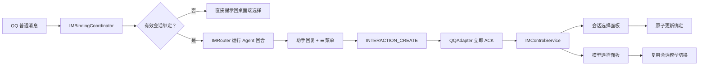

# 064 · IM 会话与模型控制入口 - 技术方案

## 状态

CONFIRMED

## 需求文档

→ [requirement.md](./requirement.md)

## 1. 现状分析

### 1.1 QQ 会话路由仍是硬编码算法

`IMRouter.session_id_for()` 当前直接返回 `im:{im_type}:{event.chat_id}`。该 ID 同时是 `PersistentBootstrap.thread_id`，不存在时由 `SessionBridge.bind_persistent()` 自动创建会话。

这一现状有三个结果：

- QQ 聊天与 Agent 会话的关系无法被用户改变。
- 只在前端增加选择器不足以改变真实路由。
- 若目标会话已被删除，直接把旧 ID 继续交给 `bind_persistent()` 会静默重建同名会话，不符合用户预期。

### 1.2 IM 运行时只区分普通入站消息

`QQAdapter` 只向 `WSCallbacks.on_message_event` 注册回调，`IMRuntime` 把解析后的普通消息交给 inbound resolver，最终进入 `IMRouter.handle_inbound()`。目前没有交互事件的内部类型、路由和 ACK 逻辑。

`OutboundContent` 只能表达文本与 Markdown。`QQAdapter.send()` 调用 `post_c2c_message()` 时也没有传入 keyboard，且当前会把所有非零平台错误码记录后吞掉，上层无法分辨“按钮不可用”与其他发送失败。

### 1.3 当前 SDK 已具备所需底层能力

项目锁定的 `qqbot-agent-sdk==1.2.2` 已提供：

- `QQApiClient.post_c2c_message(..., keyboard=InlineKeyboard)`；
- `WSCallbacks.on_interaction_event`；
- `parse_interaction_event()`；
- `QQApiClient.acknowledge_interaction()`。

因此无需为按钮自建 QQ OpenAPI client，但需在现有 adapter 与 IM 内部协议中补齐这些能力。SDK 没有提供可靠的“发送前查询按钮权限”接口，能力判断必须依赖真实发送结果。

### 1.4 会话和模型基础能力已经存在

- `SessionManager.list()` 已按最近活动时间倒序返回会话摘要。
- `SessionManager.create()` 可以显式创建独立会话。
- `Session.current_model` 是会话当前模型的事实来源。
- `Conversation.switch_model()` 以 `model_change` 事件持久化模型变更。
- `AgentRuntime.try_reserve_session_mutation()` 和 `SessionTurnCoordinator.try_hold()` 已用于 REST 模型切换，能够在会话忙时立即拒绝变更。

QQ 控制面不应再建一套会话或模型状态，而应复用这些已有能力。

### 1.5 IM 接入窗口缺少当前桌面会话上下文

`IMConnectPanel` 当前只展示 provider 状态、扫码和解绑。聊天窗口会通过 `voice://active-chat-session` 向语音窗口同步当前会话，但该事件的命名与实现均隶属语音 store，不适合直接扩展为 IM 依赖。

## 2. 方案概览

引入一个持久化的 IM 状态层和一个不进入 Agent 事件流的控制层：



稳定核心是 Agent 会话与现有 `SessionManager`；易变策略是平台按钮渲染、交互回调和菜单分页。两者通过 IM 内部控制类型隔离，不把 QQ SDK DTO 泄漏到 Router 或 Agent 层。

## 3. 持久化 IM 状态

### 3.1 `IMStateStore`

新增 `agent_bridge/src/agent_bridge/protocols/im/state.py`，持久化两类非机密状态：

```python
@dataclass(frozen=True)
class IMBindingKey:
    im_type: str
    provider_bind_id: str
    chat_scope: str
    chat_id: str

@dataclass(frozen=True)
class IMSessionBinding:
    key: IMBindingKey
    session_id: str
    updated_at: datetime

ControlCapability = Literal["unknown", "supported", "unsupported"]

@dataclass(frozen=True)
class IMControlCapabilityState:
    im_type: str
    provider_bind_id: str
    status: ControlCapability
    checked_at: datetime | None
```

存储文件默认为 `<user_data_dir>/im_state.json`，路径由 `BridgeSettings.im_state_path` 统一注入，测试可使用临时路径。文件带 `schema_version: 1`，使用临时文件 + replace 原子写入，进程内使用 `RLock` 保护。

QQ 创建者专属 Bot 当前只支持 C2C，其 `provider_bind_id` 与主聊天 `chat_id` 均为创建者 openid。数据模型仍保留 `chat_scope` 和 `chat_id`，避免未来新增群聊或其他 IM 时破坏持久化格式。

### 3.2 旧会话兼容

`IMRuntime.start()` 加载已有 QQ 凭据时执行一次有界 reconciliation：

1. 若已存在显式绑定，不改动。
2. 若绑定不存在，且 `SessionManager.open(f"im:qq:{bind_id}")` 成功，写入指向该旧会话的绑定。
3. 若绑定和旧会话都不存在，保持 `unbound`，不自动创建会话。

该步骤只新增绑定元数据，不迁移、复制或改写 `im:qq:*` 会话事件。

### 3.3 绑定有效性

每次普通 QQ 消息进入 Router 前都从 `IMStateStore` 取当前绑定，并核对目标 session 仍存在。

- 无绑定：直接回复“请先在 agent-friend 的接入 IM 窗口选择会话”。
- session 被删除：将绑定视为 `invalid`，不把 ID 交给 `bind_persistent()` 重建。
- session 被归档：已有绑定仍可继续对话；新的最近会话选择列表不包含归档会话。

## 4. 绑定与运行一致性

### 4.1 `IMBindingCoordinator`

新增按 `IMBindingKey` 隔离的进程内 coordinator。普通 QQ 回合从取得绑定快照开始，到 Agent 回复发送完成为止，持有该 binding 的运行标记。

会话切换和 QQ 内模型切换都使用非阻塞方式尝试取得同一 binding 的变更权：

- 当前 QQ 回合未完成时立即拒绝，不等待长回复结束。
- 会话切换只在取得变更权后原子写入 `IMStateStore`。
- 模型切换在 binding 变更权内，再按现有顺序取得 `AgentRuntime` session mutation reservation 和 `SessionTurnCoordinator.try_hold()`。

这样可以防止“Router 读到旧绑定，但在真正提交 run 前被交互回调切到新绑定”的竞态。不同 QQ 绑定之间仍可并行。

### 4.2 Router 接口调整

`IMRuntime` 在调用 Router 前解析有效 `session_id`，`IMRouter.handle_inbound()` 改为显式接收已解析的 session ID，不再自己调用硬编码 `session_id_for()`。

Router 仍只负责：

- 组装 `PersistentBootstrap`；
- 运行 Agent 回合；
- 聚合正常助手文本；
- 在正常回复的 `OutboundContent` 中附加菜单控制。

fallback、附件不支持、未绑定、切换确认和错误等通道级消息都不附加菜单。

## 5. IM 控制协议

### 5.1 平台无关的 outbound controls

`content.py` 增加最小控制抽象：

```python
@dataclass(frozen=True)
class OutboundAction:
    id: str
    label: str
    visited_label: str
    payload: str
    style: Literal["default", "primary"] = "default"
    click_limit: int = 1

@dataclass(frozen=True)
class OutboundControls:
    rows: tuple[tuple[OutboundAction, ...], ...]

@dataclass(frozen=True)
class OutboundContent:
    # 既有字段保留
    controls: OutboundControls | None = None
```

该类型只表达“消息附带可点击动作”，不尝试抽象 QQ 所有富消息能力。`QQAdapter` 负责把它转换成 SDK `InlineKeyboard`。

每次正常助手回复只附带一个按钮：

```text
☰ 菜单
```

其 payload 为版本化的无状态值 `af:menu:v1`，因此用户点击任意一条尚可操作的历史回复时，都会打开基于当前真实状态的新菜单。

### 5.2 入站 interaction

`event.py` 增加平台无关的 `InboundInteraction`，字段仅包含：

- interaction ID；
- chat scope / chat ID / operator ID；
- button payload；
- 平台事件类型。

`IMProvider.start()` 增加 `on_interaction` 回调。`QQAdapter` 在 `WSCallbacks` 中注册 SDK interaction callback，解析为内部类型后执行以下顺序：

1. 尽快调用 `acknowledge_interaction(interaction_id, code=0)` 停止 QQ 客户端 loading。
2. 校验 C2C operator/chat 与当前 provider 的创建者 openid 一致。
3. 把已校验 interaction 交给 `IMControlService`。

未知、畸形或不属于当前用户的 payload 在 ACK 后忽略并记录结构化 warning，不进入普通 inbound resolver。

### 5.3 临时动作 token

除 `af:menu:v1` 外，会话、模型、分页和返回等临时按钮均使用进程内 `ControlTokenRegistry`：

- token 使用加密随机数，payload 仅包含短 token；
- registry 记录 provider、chat、动作、目标 ID 和生成时间；
- TTL 默认 10 分钟，容量上限 4096，超限按最旧项清理；
- token 一次性消费，已过期或进程重启后点击会收到“菜单已过期，请从最新回复重新打开”。

这避免在 QQ payload 中长期暴露完整 session ID，也防止用户在会话状态已经变化后误触旧选择器。

## 6. 控制面板与切换行为

### 6.1 主菜单

点击 `☰ 菜单` 后，`IMControlService` 每次都重新读取当前绑定 session，发送一条不进入 Agent 会话的控制消息：

```text
当前会话：<标题>
当前模型：<模型展示名>

[切换会话] [切换模型]
```

主菜单不缓存标题和模型，确保桌面端改名或切换模型后，新打开的 QQ 菜单立即反映最新状态。

### 6.2 会话选择

- 使用 `SessionManager.list(archived=False)` 获取最近会话。
- 每页最多 4 个会话，保留一行给上一页 / 下一页 / 返回。
- 按钮标签使用截断后的会话标题，当前绑定会话附加“当前”语义。
- 点击当前会话视为幂等成功，不另外创建绑定事件。
- 目标会话在 token 生成后被删除时，操作失败并引导重新打开菜单。

切换成功后读取目标 session 的 active 消息投影，生成不超过 80 个 Unicode 字符的最近助手回复预览，展示：

- 会话标题；
- 当前模型；
- 最近活动时间；
- 最近助手回复短预览（无回复时显示明确空状态）。

QQ 已有消息不做任何改动，切换只更新后续路由。

### 6.3 模型选择

- 模型列表使用 `public_model_catalog()` 的统一展示名与 ID。
- 每页最多 4 个模型，按 provider 目录顺序展开，并保留分页 / 返回操作。
- 目标 ID 必须再次经过 `all_model_ids()` allowlist 校验。
- 实际切换复用与 REST endpoint 相同的会话变更临界区和 `Conversation.switch_model()`。
- 缺少目标 provider 凭据时不改变 session，QQ 只提示需要回桌面端“模型与凭据”完成配置。

为避免 REST route 和 IM control 复制锁顺序，从 `routes/meta.py` 提取小型 `SessionModelService`，封装 allowlist 校验、mutation reservation、turn coordinator 和 `switch_model()`。REST 与 IM 共用该 service，不引入全局 service registry。

## 7. Inline Keyboard 能力与发送降级

### 7.1 渐进能力状态

QQ 没有可靠的发送前查询接口，因此不伪造一个必然准确的 capability probe。按 provider 持久化：

- `unknown`：尚无可用的真实发送证据；
- `supported`：平台成功接受带 keyboard 的消息，或收到有效 interaction callback；
- `unsupported`：带 keyboard 的消息被平台明确拒绝，但去掉 keyboard 后的同正文重发成功。

`unsupported` 不是永久封禁。超过 24 小时后，下一条正常助手回复会把状态重新视为 `unknown` 并做一次乐观尝试，使平台权限变化能够自动恢复，不需要用户手工配置。

### 7.2 发送策略

`QQAdapter.send()` 内部负责保证正文可达：

1. `supported` / `unknown` 且 `OutboundContent.controls` 存在时，首先发送带 keyboard 的消息。
2. 平台成功接受时标记 `supported`。
3. 若收到确定的平台拒绝，去掉 keyboard 后使用新 `msg_seq` 重发相同正文。只有纯文本重发成功时才标记 `unsupported`。
4. `unsupported` 且未到重试时间时，直接发送不带 keyboard 的正文。
5. 网络超时、断线等结果不明的错误不改变 capability，也不自动重发，避免在原消息可能已送达时制造重复。

`IMProvider.send()` 仍可保持“平台发送错误不击穿 IM 长连”的总语义，但 adapter 内部必须保留结构化发送结果以完成上述分类，不再只记录一条 warning。

### 7.3 桌面状态

`GET /v1/im/providers` 的每个 provider 增加：

```json
{
  "binding_status": "unbound | bound | invalid",
  "session_id": "... | null",
  "controls_capability": "unknown | supported | unsupported"
}
```

当 capability 为 `unsupported` 时，接入窗口显示“QQ 可正常聊天，会话和模型需在桌面端管理”，不展示申请权限、配置快捷菜单或命令降级教程。

## 8. 桌面端首次绑定

### 8.1 API

新增：

```http
PUT /v1/im/providers/{im_type}/{bind_id}/session-binding
Content-Type: application/json

{
  "session_id": "target-session-id"
}
```

后端校验 provider 存在、session 存在且未被删除，在 binding coordinator 变更权内原子写入。返回最新 provider 绑定状态。

“创建独立会话”不在 IM route 里复制 session create 逻辑。前端按顺序调用：

1. 已有 `POST /v1/sessions` 创建默认文本会话；
2. 使用返回的 session ID 调用上述 binding endpoint。

前端保留已创建的 ID，第二步失败时重试绑定而不重复创建会话。`frontend/src/services/api/sessions.ts` 补充已有 create endpoint 的 typed client。

onboard success response 补充 raw `bind_id`，仅在 owner-only 本机 WebView 与 loopback bridge 之间使用；现有 provider list 本就已向该界面暴露 raw bind ID 以便解绑。

### 8.2 跨窗口当前会话

新建 `frontend/src/lib/active-chat-session/`，提供中性命名的跨窗口事件和订阅 API。

- chat 窗口在 `currentSessionId` 变化时发布。
- voice 和 IM 窗口均订阅同一中性事件。
- 保留现有 voice store 的 `noteActiveChatSession()` 语义，仅替换事件所有权，不改变语音行为。
- IM 窗口在隐藏时仍持有最后一次发布值，再次打开时即可用作默认选择。

### 8.3 `IMConnectPanel`

扫码成功后不直接只显示“完成”，而是进入会话绑定步骤：

1. 两个一级选择：“创建独立会话” / “使用最近会话”。
2. 选择“使用最近会话”时复用现有 `Select` 展示会话，不新增手写交互基础件。
3. 当前桌面 session 存在于最近列表时默认选中，并复用 `Badge` 显示“当前”。
4. 当前桌面处于未落盘的空白首页时，不伪造可绑定 session，改用最近会话第一项或等待用户明确选择。
5. 已接入但 `unbound` / `invalid` 的 provider 在“已绑定”列表中持续显示“选择会话”操作，因此应用重启后也可恢复。

组件继续使用现有 Button / Select / Badge / Spinner 和项目 Tailwind token，不引入新 UI 库或手写原生交互件。

## 9. 数据迁移与解绑

IM session binding 是用户数据，且引用会话迁移包中的 session ID。因此它需与 IM 凭据一起参与现有设备迁移事务。

为了不新建一套 Rust 迁移管道，扩展现有 owner-only `/internal/migration/im-credentials` 快照与 replace payload，在 `credentials` 旁边增加 `bindings` 和 capability state。Tauri 继续把整个 JSON 视为不透明的加密秘密 payload 参与导出、导入和回滚。

导入后：

- 先恢复会话数据，再恢复凭据和 binding；
- binding 目标在新机不存在时保留为 `invalid`，不创建空会话；
- migration rollback 同时恢复原凭据和原 binding state。

解绑 provider 时删除其 credential、resume token 与 IM state 中对应 binding/capability，但不删除其曾经绑定过的 Agent 会话。

## 10. 涉及文件

| 文件 | 改动 | 说明 |
|---|---|---|
| `agent_bridge/src/agent_bridge/settings.py` | 修改 | 增加 `im_state_path` |
| `agent_bridge/src/agent_bridge/assembly.py` | 修改 | 装配 state store、binding coordinator、model service 和 control service |
| `agent_bridge/src/agent_bridge/protocols/im/state.py` | 新增 | 持久化 session binding 与 control capability |
| `agent_bridge/src/agent_bridge/protocols/im/coordinator.py` | 新增 | 按 binding 隔离的回合 / 变更一致性 |
| `agent_bridge/src/agent_bridge/protocols/im/control.py` | 新增 | 菜单、token、分页、会话/模型切换与确认文案 |
| `agent_bridge/src/agent_bridge/protocols/im/content.py` | 修改 | 增加平台无关 outbound controls |
| `agent_bridge/src/agent_bridge/protocols/im/event.py` | 修改 | 增加平台无关 inbound interaction |
| `agent_bridge/src/agent_bridge/protocols/im/provider.py` | 修改 | 扩展 interaction callback 契约 |
| `agent_bridge/src/agent_bridge/protocols/im/adapters/qq.py` | 修改 | keyboard 转换、interaction ACK/转译、能力降级和正文补发 |
| `agent_bridge/src/agent_bridge/protocols/im/runtime.py` | 修改 | 绑定解析、旧会话 reconciliation、控制事件路由 |
| `agent_bridge/src/agent_bridge/protocols/im/router.py` | 修改 | 接收显式 session ID，正常回复附带 `☰ 菜单` |
| `agent_bridge/src/agent_bridge/protocols/im/routes.py` | 修改 | provider 绑定状态与 session-binding endpoint |
| `agent_bridge/src/agent_bridge/protocols/im/onboard.py` | 修改 | success state 返回 bind ID，保留未选会话状态 |
| `agent_bridge/src/agent_bridge/session_models.py` | 新增 | REST 与 IM 共用的小型 session model mutation service |
| `agent_bridge/src/agent_bridge/routes/meta.py` | 修改 | 模型 endpoint 调用共享 service |
| `agent_bridge/src/agent_bridge/migration.py` | 修改 | IM migration payload 包含 binding/capability |
| `frontend/src/lib/active-chat-session/` | 新增 | 中性的跨窗口当前会话发布 / 订阅 |
| `frontend/src/pages/chat/App.tsx` | 修改 | 使用中性 active-session publisher |
| `frontend/src/stores/voice.ts` | 修改 | 订阅中性事件，保持既有语音语义 |
| `frontend/src/services/api/im.ts` | 修改 | provider binding/capability 类型与绑定 API |
| `frontend/src/services/api/sessions.ts` | 修改 | 补充现有 create-session API client |
| `frontend/src/components/im/IMConnectPanel.tsx` | 修改 | 首次绑定两路径、最近会话、当前 tag 与 capability 状态 |
| `agent_bridge/tests/test_im_*.py` | 修改/新增 | 覆盖 state、coordinator、control、router、runtime、adapter、routes 与 migration |
| `frontend/src/**/*.test.ts(x)` | 修改/新增 | 覆盖 API、跨窗口 active session 和绑定交互 |

## 11. 测试与验收

### 11.1 Python 自动化

- `IMStateStore` 空文件、原子写、损坏文件、版本校验和并发读写。
- 旧 `im:qq:*` 会话自动建立 binding，无旧会话的新 provider 保持 unbound。
- unbound / invalid 消息不进入 Agent Router，也不静默创建 session。
- binding 回合运行时会话与模型切换均立即拒绝。
- 菜单、分页、token 过期/一次性消费、跨 provider 伪造、已删除目标和幂等切换。
- 模型切换的 allowlist、缺凭据、session busy 和成功持久化。
- 正常助手回复带且只带一个 `☰ 菜单`，fallback 和控制消息不带。
- QQ keyboard DTO 转换、interaction ACK 先于业务处理、operator 校验和未知 payload 忽略。
- keyboard 成功、确定失败 + 纯文本补发、纯文本也失败、网络结果不明和 24 小时后重试。
- migration snapshot / replace / rollback 保留凭据与 binding 关系。

### 11.2 前端自动化

- 扫码成功后显示两条绑定路径。
- 当前桌面会话在最近会话中默认选中并显示“当前”。
- 创建独立会话时，create 成功但 bind 失败后重试不会重复创建 session。
- unbound / invalid provider 重启后仍可重新选择。
- unsupported capability 显示桌面管理提示，不出现命令或手工开通教程。
- active session 通用事件同时驱动 voice 和 IM，既有语音行为不回归。

### 11.3 真实运行验收

- 使用真实 QQ 创建者专属 Bot 执行一次不调用真实 LLM 的 keyboard / interaction smoke，确认按钮展示、ACK、菜单回发和切换回调。若当前外部 Bot 权限本身不支持 keyboard，验证降级路径而不引导用户手工配置。
- 按用户已确认的授权，使用 `desktop-visual-inspection` 和 `scripts/desktop-visual/` 启动真实 Tauri 桌面端，验收 IM 窗口的两条路径、默认选中、“当前” tag、状态切换和窗口尺寸下的滚动行为。
- 运行项目规定的 `scripts/check` 全量门禁。

真实 QQ smoke 不依赖真实 LLM；若后续确有必要发起真实 LLM 对话，仍必须在实际执行前按 `llm-api-confirm` 单独取得当次授权。

## 12. 影响与风险

| 风险 | 防护 |
|---|---|
| QQ 无法在发送前确定 keyboard 权限 | 三态能力 + 真实发送证据 + 纯文本补发 + 24h 有界重试 |
| keyboard 失败导致助手正文丢失 | 确定平台拒绝时使用新 `msg_seq` 去按钮补发 |
| 网络超时后重发造成重复助手消息 | 结果不明时不自动重发、不改 capability |
| 旧菜单操作了已过时目标 | 只有主菜单入口无状态；其他动作用一次性 TTL token |
| 按钮 payload 被伪造或跨用户重放 | 随机 token + provider/chat/operator 三重校验 + 目标再校验 |
| 回复运行期间切换导致落错会话 | binding coordinator 从路由快照到发送完成持有运行标记，变更非阻塞拒绝 |
| REST 与 QQ 模型切换锁顺序漂移 | 提取小型 `SessionModelService`，两个入口复用同一临界区 |
| 目标 session 被删除后静默重建 | Router 前强制 existence check，invalid binding 不进 `bind_persistent()` |
| 设备迁移后 credential 与 binding 分离 | 快照、replace 和 rollback 将两者作为同一 IM 迁移 payload |
| 抽象为了未来 IM 过度设计 | 只抽象 action rows 和 interaction 最小字段，不建 rich-card 框架或 provider registry |

## 13. 变更记录

| 日期 | 变更内容 | 是否需要重新实现 |
|---|---|---|
| 2026-07-25 | 初版确认：持久化 IM binding、旧 `im:qq:*` 兼容、每次回复的 `☰ 菜单`、interaction 控制层、三态 keyboard 能力、会话/模型切换一致性与真实桌面视觉验收 | 否，尚未进入实现 |
