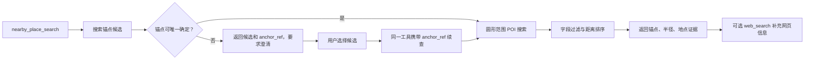

# 066 · 附近地点搜索 - 技术方案

## 状态

CONFIRMED

## 需求文档

→ [requirement.md](./requirement.md)

## 1. 现状分析

### 1.1 当前工具无法建立附近性事实

`web_search` 能检索网页，但网页结果不提供稳定的地标候选解析、圆形范围 POI 检索和可比较的距离字段。让模型从网页摘要推断“最近”会越过证据边界。

现有工具框架已经具备本需求需要复用的基础设施：

- `Tool` / `ToolResult` 协议和通用工具事件；
- `ToolRegistry` 与 `make_default_registry()`；
- provider adapter 风格的 `web_search`；
- runtime credentials 从 keyring、环境变量和历史配置解析后注入工具工厂；
- 通用工具使用契约对失败、证据和最终回复诚信的约束。

因此本需求只新增一项地点领域能力，不修改 `Conversation`、工具循环或会话事件协议。

### 1.2 现成实现与项目边界不完全匹配

现成地图 Skill / MCP 通常分别暴露地理编码、地点搜索、详情和路线工具，由模型自行串联；部分实现还自带配置文件、进程、遥测或地图链接输出。直接接入会带来第二套工具运行时与凭据入口，也无法保证锚点歧义先澄清。

本项目只借鉴这些实现对 Web Service Key、POI 请求参数和搜索范围表达的处理，实际代码继续使用现有 Python 工具和 provider adapter 边界。

### 1.3 高德 V5 能覆盖首版数据需求

首版使用高德 Web 服务 V5：

- `place/text` 搜索锚点候选；
- `place/detail` 在用户选定候选后恢复锚点详情；
- `place/around` 按锚点坐标、关键词和半径查询附近 POI；
- `show_fields=business` 请求可选电话和营业信息。

高德附近搜索会返回 POI 到中心点的距离，但服务端距离排序在部分仅关键词请求中不生效。因此“最近”不能只依赖 `sortrule`，工具必须对有效距离做确定性的客户端排序。

## 2. 方案概览

新增一个面向用户意图的 `nearby_place_search` 工具，内部编排锚点解析、歧义处理和附近查询：



稳定核心是工具的输入、统一结果和澄清语义；易变部分是 provider 请求、错误码和响应解析。首版只有高德实现，不提前建设全局 provider registry。

## 3. 工具契约

### 3.1 输入

```python
nearby_place_search(
    query: str,
    near: str,
    city: str | None = None,
    anchor_ref: str | None = None,
    radius_meters: int = 5000,
    sort: Literal["distance", "relevance"] = "relevance",
    limit: int = 5,
)
```

字段语义：

- `query`：目标地点名称或类别，如“照相馆”“药店”。
- `near`：用户给出的锚点名称、地标或地址。即使续查时提供 `anchor_ref`，也保留原始 `near` 以支持错误提示和事件可读性。
- `city`：可选城市约束；只缩小候选范围，不代表锚点已经唯一。
- `anchor_ref`：歧义澄清结果中返回的不透明候选引用。模型只能原样复用，不解释或自行构造。
- `radius_meters`：圆形搜索半径，默认 5000 米，允许范围 100–50000 米。
- `sort`：用户明确说“最近”时传 `distance`；普通“附近”传 `relevance`。
- `limit`：最终结果数，默认 5，允许范围 1–10。

工具 description 明确：

- 适用于以用户给出的地点为锚点查询附近 POI；
- 不用于设备当前位置、路线、天气、普通网页事实或没有锚点的城市推荐；
- 多候选时必须把候选交给用户选择；
- 地点失败时不得用 `web_search` 声称完成距离查询；
- 地点成功后可以继续调用 `web_search` 补充官网、预约或近期网页信息；
- 最终回答必须说明确认后的锚点和实际搜索半径。

### 3.2 参数校验

工具在发出网络请求前完成：

- `query`、`near` 去除首尾空白后不能为空；
- `city` 空字符串归一化为 `None`；
- `radius_meters`、`limit` 越界返回可理解的参数错误，不静默截断；
- `sort` 只接受公开枚举；
- 任意用户文本按 HTTP client 参数编码传递，不拼接未转义 URL；
- Key 只来自注入的 credentials，不能由工具参数或对话文本提供。

## 4. Provider 边界

### 4.1 领域类型

在 `agent.tools.builtin.nearby_place_search` 内定义局部领域类型：

```python
@dataclass(frozen=True)
class AnchorCandidate:
    ref: str
    name: str
    address: str
    city: str | None
    district: str | None
    longitude: float
    latitude: float

@dataclass(frozen=True)
class NearbyPlace:
    name: str
    distance_meters: int
    address: str
    telephone: str | None = None
    opening_hours: str | None = None

class NearbyPlaceProvider(Protocol):
    async def search_anchors(
        self, *, near: str, city: str | None
    ) -> tuple[AnchorCandidate, ...]: ...

    async def get_anchor(self, *, ref: str) -> AnchorCandidate | None: ...

    async def search_nearby(
        self,
        *,
        query: str,
        anchor: AnchorCandidate,
        radius_meters: int,
        sort: Literal["distance", "relevance"],
        limit: int,
    ) -> tuple[NearbyPlace, ...]: ...
```

该协议只表达本工具需要的数据，不暴露高德参数对象，也不建设跨所有地图能力的通用接口。未来替换 provider 时保持工具输入和统一结果不变。

### 4.2 高德 adapter

`AmapNearbyPlaceProvider` 使用一个注入的异步 HTTP client，并统一设置连接/读取超时。请求约定：

1. 锚点搜索调用 V5 `place/text`，传 `keywords=near`；有 `city` 时同时传 `region=city` 和 `city_limit=true`。
2. 候选最多读取前 10 条，解析 POI ID、名称、行政区、地址和坐标；缺少 ID、坐标、名称或可区分地址的条目不进入候选。
3. `anchor_ref` 使用 provider 返回的稳定 POI ID，但在工具表面只称为不透明引用。
4. 续查调用 `place/detail` 验证引用仍有效，并重新取得坐标和地址；无效或过期时不使用旧坐标静默继续。
5. 附近查询调用 V5 `place/around`，传关键词、锚点坐标、半径、页大小及 `show_fields=business`。
6. `distance` 查询请求服务端距离排序，同时仍由本地按解析后的距离升序重排；`relevance` 查询保留 provider 顺序。
7. 最多向 provider 请求 25 条，再过滤缺少名称、地址或有效距离的结果，最后截取 `limit`，避免为了凑数量编造字段。

HTTP 日志不得记录 Key 或包含 Key 的完整 URL。provider 原始响应不直接返回给模型。

## 5. 锚点唯一性与澄清

### 5.1 自动选择规则

锚点判断采取保守策略。只有以下情况之一成立时自动继续：

- provider 只返回一个有效候选；
- 多个候选中只有一个候选的规范化名称或完整地址与 `near` 精确匹配，其他候选均不精确匹配。

名称规范化只处理空白和常见全半角差异，不做基于热度、列表顺序、城市中心距离或模型常识的猜测。用户提供 `city` 后，城市内多个同名分店仍返回澄清。

### 5.2 澄清结果

无法唯一确定时，工具返回：

```json
{
  "status": "needs_clarification",
  "query": "照相馆",
  "near": "福民银行",
  "city": "深圳",
  "candidates": [
    {
      "anchor_ref": "opaque-ref",
      "name": "福民银行…",
      "address": "…",
      "city": "深圳市",
      "district": "…"
    }
  ],
  "next_action": "请让用户选择一个锚点，再原样传回对应 anchor_ref。"
}
```

候选不包含经纬度，避免让模型绕过引用自行调用或解释坐标。候选过多时最多展示 5 个；其余数量只作提示，建议用户补充行政区、道路或分店信息。

当 `anchor_ref` 失效时返回新的候选或明确要求重新确认，不把失效引用当成 provider 故障。

## 6. 成功结果与证据边界

### 6.1 统一结果

成功结果序列化为结构化、标记为外部非可信内容的 JSON：

```json
{
  "status": "success",
  "query": "照相馆",
  "sort": "distance",
  "search_area": {
    "center_name": "福民银行…",
    "center_address": "…",
    "radius_meters": 5000,
    "description": "以福民银行…为中心 5 公里内"
  },
  "places": [
    {
      "name": "…",
      "distance_meters": 320,
      "address": "…"
    }
  ],
  "evidence_note": "距离和地址来自本次地点查询；电话和营业信息仅在字段存在时可引用。"
}
```

`telephone`、`opening_hours` 仅在 provider 返回非空、可解析值时出现。营业时间文本不是实时“正在营业”的证明；首版不根据当前时间自行推断开门状态。

### 6.2 排序

- `distance`：只保留有效非负距离，按 `distance_meters` 升序稳定排序，同距时保留 provider 原顺序。
- `relevance`：保留 provider 顺序，但每条结果仍包含实际距离。
- 不计算道路距离、步行时间或导航距离；所有距离均明确为地点服务的直线附近距离语义。

### 6.3 与 `web_search` 协作

地点工具成功后，模型可选取一个或多个结果再调用 `web_search`：

- 地点工具拥有锚点、搜索范围、附近性、距离和地理排序事实；
- 网页搜索可补充官网、预约入口、近期公告或网页来源中的其他信息；
- 网页结果不得改写距离、声称未由地点工具验证的“最近”，也不得把同名网页商户静默映射为某个 POI；
- 两类结果冲突时，最终回答分别说明证据边界，不自行融合成更强结论。

无需修改通用 system prompt；现有工具使用契约继续承担通用红线，新工具 description 和 `evidence_note` 承担地点领域约束。

## 7. 失败模型

Provider 将高德状态码和网络异常归一化为局部异常：

```python
class NearbyPlaceProviderError(Exception): ...
class NearbyPlaceAuthenticationError(NearbyPlaceProviderError): ...
class NearbyPlaceQuotaError(NearbyPlaceProviderError): ...
class NearbyPlaceRateLimitError(NearbyPlaceProviderError): ...
class NearbyPlaceInvalidRequestError(NearbyPlaceProviderError): ...
class NearbyPlaceTemporaryError(NearbyPlaceProviderError): ...
```

工具输出区分：

- `no_anchor_results`：没有可用锚点候选；建议用户补充城市或完整地址。
- `needs_clarification`：存在多个合理候选；要求选择。
- `no_place_results`：锚点已确认，但指定半径内没有满足最小字段要求的结果；可建议扩大半径或换关键词。
- `configuration_required`：未配置 `AMAP_WEBSERVICE_KEY`；提示到现有设置页配置并重启 Bridge。
- `quota_exhausted` / `rate_limited`：说明地点服务暂时无法完成查询，不建议网页搜索替代距离事实。
- `temporary_failure`：网络或服务暂时失败；允许稍后重试。
- `invalid_request`：参数或 provider 拒绝请求；不给出伪结果。

错误结果不包含 Key、原始 URL、完整 provider payload 或内部堆栈。技术细节进入受控日志和 `ToolResult.meta`，给模型的文本只保留自然恢复建议。

## 8. 工具注册与凭据

### 8.1 始终注册工具

`nearby_place_search` 始终进入默认 registry：

- 有 Key 时注入 `AmapNearbyPlaceProvider`；
- 无 Key 时注入显式 unavailable provider，调用返回 `configuration_required`。

这与当前无 Tavily 时不注册 `web_search` 的行为不同，是本需求的有意选择。若完全隐藏地点工具，模型无法区分“能力未配置”和“应该尝试网页搜索”，容易重新出现用网页搜索伪装附近查询的问题。

### 8.2 现有 runtime credentials 链路

新增可选 secret `AMAP_WEBSERVICE_KEY`：

```text
Tauri RuntimeConfig secret registry
  → keyring / env / legacy config resolution
  → runtime_config.credentials.ToolCredentials
  → agent_bridge runtime assembly
  → make_default_registry(amap_webservice_key=...)
```

具体改动保持现有结构：

- `runtime_config.credentials` 登记常量、可选凭据和 `ToolCredentials` 字段；
- `agent_bridge.runtime_config` 解析并注入；
- Tauri `SECRET_REGISTRY` 增加 `Amap` 分组、`RestartBridge` 生效语义；
- TypeScript runtime config union 和设置面板增加“地图与地点 / 高德 Web Service Key”；
- 不新增 `.env` 文件、provider 专属 JSON 或对话内索要 Key 流程。

Key 只存在于现有 secret 管理和 provider 请求层，不进入工具参数、工具结果、session event、诊断包或普通日志。

### 8.3 统一执行运行时配置 effect

设置页不再把 `RuntimeConfigEffect` 仅作为说明文字，而是在配置持久化成功后通过一个集中 helper 执行：

- `RestartBridge` 调用既有 `restart_runtime_service("bridge")`；
- `RestartVoiceBridge` 调用既有 `restart_runtime_service("voice_bridge")`；
- `None` 不触发运行服务刷新。

所有 secret 保存与删除共用该 helper，不在 DeepSeek、Kimi、Tavily、高德或火山凭据控件中分写 provider 条件。对话模型和记忆模型虽然不是 secret，但 Bridge 会在启动时读取默认模型和记忆 client 配置，因此它们持久化后也复用 `RestartBridge` effect。这样 UI 层只声明“这项配置影响哪个服务”，不复制 supervisor 细节。

操作顺序固定为“持久化 → 刷新 → 重新读取状态”。同一时刻只允许一个配置变更流程，避免多个重启互相覆盖。若持久化成功而刷新失败，保留新配置，返回独立的“已保存但尚未应用”状态；不把它回滚，也不把它描述为保存失败。supervisor 拒绝中断活动生成或语音通话时沿用同一语义，由用户在交互结束后重试应用。若 secret 状态表明环境变量仍具有更高优先级，则不执行无意义的重启，并明确说明 keyring 已保存但仍被环境变量覆盖。

## 9. 会话、隐私与可观测性

- `tool_call` / `tool_result` 沿用现有通用事件，无新增事件类型或序列化 schema。
- `query`、`near`、`city` 和已选择的候选会像其他工具参数一样进入会话事件；不引入设备位置或后台位置采集。
- 工具结果只返回完成用户请求所需的 POI 字段，不返回原始响应、坐标、评分、图片等未纳入需求的数据。
- `ToolResult.meta` 可记录 provider、稳定错误类别、返回/过滤数量和耗时，不记录 Key、完整请求 URL或原始响应正文。
- 锚点与地点结果都视为外部非可信数据；名称和地址中的文本不能被解释为工具指令。

## 10. 依赖与 065 集成

本需求在 065 合入后 rebase 最新 `main`，再修改共享接入点：

- 复用 065 已确定的异步 HTTP client / `httpx` 依赖和测试方式；
- 在最新 `factory.py` 上增加地点工具，不覆盖 065 的新工具注册；
- 在最新 `ToolCredentials` 和 runtime config registry 上追加高德 Key；
- 保留 065 对调用预算、超时、重复检测和安全并行的实现，不为地点工具增加另一套全局策略。

如果 065 最终没有把 HTTP client 依赖放入 `agent` 包，则只在 rebase 后按实际包边界补充一次依赖与 lockfile，不预先复制其分支代码。

## 11. 涉及文件

| 路径 | 改动 | 说明 |
|---|---|---|
| `agent/src/agent/tools/builtin/nearby_place_search/__init__.py` | 新增 | 导出工具与领域类型 |
| `agent/src/agent/tools/builtin/nearby_place_search/tool.py` | 新增 | 参数校验、锚点选择、结果归一化和 description |
| `agent/src/agent/tools/builtin/nearby_place_search/models.py` | 新增 | 候选、地点、provider protocol 和错误类型 |
| `agent/src/agent/tools/builtin/nearby_place_search/providers/amap.py` | 新增 | 高德 V5 HTTP adapter |
| `agent/src/agent/tools/factory.py` | 修改 | 始终注册地点工具并注入可用/不可用 provider |
| `agent/tests/test_nearby_place_search_tool.py` | 新增 | 工具契约、澄清、排序、范围和错误测试 |
| `agent/tests/test_amap_nearby_place_provider.py` | 新增 | 请求参数、响应解析和错误码测试 |
| `agent/tests/test_tool_factory.py` | 修改 | 有/无 Key 的工厂装配与既有工具组合 |
| `runtime_config/src/runtime_config/credentials.py` | 修改 | 登记 `AMAP_WEBSERVICE_KEY` 与 ToolCredentials 字段 |
| `runtime_config/tests/` | 修改 | secret registry、来源优先级和 seed 覆盖 |
| `agent_bridge/src/agent_bridge/runtime_config.py` | 修改 | 解析地点凭据 |
| `agent_bridge/src/agent_bridge/assembly.py` | 修改 | 向工具工厂注入 Key |
| `agent_bridge/tests/test_assembly.py` | 修改 | Bridge 装配覆盖 |
| `frontend/src-tauri/src/runtime_config.rs` | 修改 | secret 规范、Amap 分组和 Rust 测试 |
| `frontend/src/lib/runtime-config/index.ts` | 修改 | secret/group 类型 |
| `frontend/src/lib/runtime-config/apply-effect.ts` | 新增 | 集中映射配置 effect 到 Bridge / Voice Bridge 重启，并保留部分成功语义 |
| `frontend/src/pages/settings/components/RuntimeConfigPanel.tsx` | 修改 | 地图与地点凭据设置项 |
| `frontend/src/pages/settings/hooks/useRuntimeConfig.ts` | 修改 | secret 保存/删除后统一执行 effect，串行化变更并呈现尚未应用状态 |
| `frontend/src/lib/settings/` | 修改 | 对话/记忆模型持久化后复用 Bridge refresh 语义 |
| `agent/pyproject.toml` / `uv.lock` | 按 rebase 后实际情况修改 | 仅在 065 未提供所需 HTTP 依赖时补充 |

实现时允许按相邻模块现状微调测试文件名，但不把 provider、凭据或工具编排塞回单一巨型文件。

## 12. 测试设计

### 12.1 工具单元测试

- 空 query/near、半径和 limit 越界在请求前失败。
- 单一锚点自动执行附近查询。
- 跨城市同名、同城多分店返回 `needs_clarification`。
- 城市参数不会自动消除城市内歧义。
- 选定 `anchor_ref` 后使用详情恢复锚点并完成续查。
- 失效 ref 重新澄清，不使用旧数据。
- `distance` 对 provider 返回结果做稳定数值排序。
- `relevance` 保持 provider 顺序，同时保留距离。
- 缺少名称、距离或地址的结果被过滤；电话和营业时间缺失时字段不出现。
- 成功结果始终包含锚点、`radius_meters` 和自然语言范围说明。
- 无锚点、无附近结果、缺 Key、鉴权、额度、限流和临时失败均返回对应稳定状态。
- description 和结果提醒覆盖与 `web_search` 的合作与边界。

### 12.2 Provider 测试

全部使用 mock transport，不发真实高德请求：

- V5 text/detail/around endpoint 与参数编码正确；
- city 与 city_limit 仅在城市存在时发送；
- 经纬度顺序、距离整数、空地址和 business 字段解析正确；
- 原始结果数大于 limit 时先过滤再截取；
- 高德成功、鉴权失败、配额/限流、非法参数、服务繁忙、非 JSON、超时和网络异常正确分类；
- 日志与错误文本不泄漏 Key。

### 12.3 工厂、凭据和集成测试

- 无 Key 时 registry 仍包含 `nearby_place_search`，调用得到配置提示。
- 有 Key 时注入真实 adapter；与 `web_search`、065 新工具同时存在。
- runtime credentials 的 keyring/env/legacy 优先级不退化。
- Tauri/TypeScript secret registry 能保存、删除并触发 Bridge 重启。
- 所有 registry secret 的保存和删除均按 effect 刷新对应服务；Bridge 与 Voice Bridge 路径分别有前端测试。
- 对话模型和记忆模型保存后刷新 Bridge；持久化成功但刷新失败时保留设置并呈现“尚未应用”。
- 活动交互导致 supervisor 拒绝重启时不强制停止服务，也不把配置持久化误报为失败。
- 通用 tool event 能记录新工具调用和结果，不需要事件特判。
- fake model 集成场景验证：地点成功后可继续网页搜索；地点失败后最终回答不声称找到最近地点。

不运行真实地图 API；若后续需要观察真实 POI 质量，使用单独 Key 和最小请求量作为人工验收，不替代自动化测试。

## 13. 实现顺序

### M1 · 065 对齐与 provider 核心

- 065 合入后 rebase 最新 `main`；
- 落局部领域类型、错误模型和高德 adapter；
- 完成 provider mock 测试。

### M2 · 意图工具

- 实现参数校验、锚点唯一性、澄清续查；
- 实现附近查询、距离排序、范围说明和证据提醒；
- 完成工具单元测试。

### M3 · 工厂与凭据

- 接入默认 registry；
- 贯通 runtime config、Bridge、Tauri 和设置页；
- 补工厂、凭据与前端/Rust 测试。

### M4 · 集成验证与收口

- fake model 覆盖工具选择和多工具协作；
- 运行受影响测试和项目 `scripts/check`；
- 回填 `progress.md` 与 AC 证据；
- 由用户验收真实使用体验后进入 feature-delivery 收口。

## 14. 影响与风险

| 风险 | 防护 |
|---|---|
| 同名锚点被静默选错 | 保守唯一性规则；合理多候选一律澄清 |
| 高德服务端未真正按距离排序 | 本地按有效 `distance` 稳定重排 |
| 模型把网页结果当地理事实 | description、结果证据提醒和集成测试共同约束 |
| 默认“附近”范围不透明 | 结果结构固定返回锚点和半径，最终回答必须说明 |
| provider 返回脏数据 | 解析到领域类型，缺最小字段的结果过滤 |
| Key 泄漏 | 只从 credentials 注入，不进入参数、结果和日志 |
| 缺 Key 后模型重回 web_search | 始终注册工具并返回显式配置状态 |
| provider 替换牵动模型接口 | 统一工具契约与局部 provider protocol 隔离 |
| 与 065 共享文件冲突 | 065 先合入，rebase 后按最新结构做窄集成 |
| 为单点能力过度抽象 | 只建附近地点局部 protocol，不建全局地图框架或 MCP runtime |

## 变更记录

| 日期 | 变更内容 | 是否需要重新实现 |
|---|---|---|
| 2026-07-26 | 初版确认：高德 V5 provider；单一意图工具内部编排；保守锚点澄清；默认 5 公里并披露范围；客户端距离排序；与 web_search 分步协作；复用 runtime credentials；基于 065 最新 main 集成 | 否，尚未进入实现 |
| 2026-07-27 | 补充统一配置生效方案：registry effect 集中驱动 Bridge / Voice Bridge 自动刷新；模型设置同样自动刷新 Bridge；持久化成功与刷新失败分开表达 | 是，补充设置页 effect 执行与测试 |
