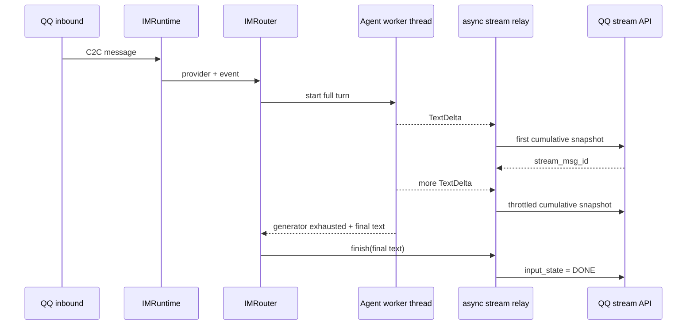

# 067 · QQ 私聊原生流式回复 - 技术方案

## 状态

<!-- DRAFT | CONFIRMED -->

CONFIRMED

## 需求文档

→ [requirement.md](./requirement.md)

## 1. 现状分析

### 1.1 Agent 到 IM 的输出链路

`IMRuntime` 收到 QQ inbound 后，通过绑定状态确定 Agent 会话，再调用 `IMRouter.handle_inbound()`。Router 当前使用 `asyncio.to_thread()` 在线程池中完整消费同步的 `Conversation.stream()` 或 `RunHandle.events()`，只收集 `TextDelta`，等 generator 自然结束后组装成一条 `OutboundContent`，最后调用一次 `provider.send()`。

这条链路保证了同步 Agent generator 不阻塞 asyncio 主循环，也保证 generator 自然耗尽后正确完成会话持久化，但中间 `TextDelta` 不会传给 IM Provider，因此 QQ 只能看到一次性最终回复。

### 1.2 IM Provider 与 QQ Adapter

`IMProvider` 当前只有普通 `send()` 契约。`QQAdapter.send()` 使用 `qqbot-agent-sdk` 的 `QQApiClient.post_c2c_message()` 发送普通 C2C 消息，并在 adapter 内维护同一 inbound message 对应的 `msg_seq`，处理 Markdown、inline keyboard、平台非零 code 和 HTTP 异常。

当前锁定的 `qqbot-agent-sdk 1.2.2` 没有专用 `stream_messages` 方法，但其公开 `QQApiClient.request()` 已统一处理 token 获取与刷新、QQBot Authorization header、HTTP client、超时和响应解析，允许使用 method + path + body 调用 SDK 尚未包装的公开 QQ API。

### 1.3 统一日志与诊断包

`agent_bridge.app._configure_logging()` 已为 root logger 配置 `RotatingFileHandler`，所有 `agent_bridge.*` 子 logger 默认进入统一日志目录下的 `agent_bridge.log`。桌面端诊断包会从同一日志目录收集 `agent_bridge.log` 及其滚动文件，并执行凭据和用户目录脱敏。

因此本需求只需在流式生命周期中输出无正文、无凭据的结构化 key-value 日志，不新增日志文件，不修改诊断 ZIP 格式或收集 allowlist。

### 1.4 菜单约束

现有正常助手回复把 `menu_controls()` 直接附在最终 `OutboundContent` 上。QQ 原生流式请求没有项目当前可验证的 inline keyboard 字段。如果流式完成后再按现有方式发送“完整正文 + 菜单”，会造成正文重复。

本需求将流式正文与菜单承载拆开：正文由原生流式消息完成，随后发送一条简短的通道控制消息承载 `☰ 菜单`。普通非流式路径保持现状。

## 2. 设计原则

1. **Provider 抽象承载能力，Router 不感知 QQ 字段**：通用层只认识流式会话生命周期，不认识 `stream_msg_id`、`input_state` 或 `index`。
2. **一个流式会话只有一个异步写入者**：所有平台更新串行执行，避免旧快照覆盖新快照。
3. **生成与网络解耦**：Agent 工作线程只生产 delta，不等待 QQ HTTP；网络变慢不能阻塞模型继续生成或撑满 Runtime 的事件队列。
4. **首次成功决定发送路径**：首次流式更新成功前可以降级；成功后本轮不再发送普通完整正文。
5. **保留 generator 自然耗尽语义**：不能在 `TurnDone` 或最终文本出现时提前关闭事件源。
6. **默认留下可排查证据**：每次状态迁移、平台请求和降级都有同一关联标识，但不记录对话正文与秘密。

## 3. 方案设计

### 3.1 模块与文件

| 文件 | 改动类型 | 说明 |
|---|---|---|
| `agent_bridge/src/agent_bridge/protocols/im/streaming.py` | 新增 | 平台无关的流式上下文、会话 Protocol、结果类型和节流协调器 |
| `agent_bridge/src/agent_bridge/protocols/im/adapters/qq_streaming.py` | 新增 | QQ C2C `stream_messages` 请求、状态机、序号和日志 |
| `agent_bridge/src/agent_bridge/protocols/im/provider.py` | 修改 | 在 Provider 契约增加创建文本流式会话的能力 |
| `agent_bridge/src/agent_bridge/protocols/im/router.py` | 修改 | 把同步 TextDelta 桥接到异步流式协调器，并处理完成、异常与降级 |
| `agent_bridge/src/agent_bridge/protocols/im/runtime.py` | 修改 | 把 Provider 而非单一 send callback 交给 Router，使 Router 可选择普通或流式路径 |
| `agent_bridge/src/agent_bridge/protocols/im/adapters/qq.py` | 修改 | 装配 QQ 流式会话，复用当前 API client 和 msg_seq 分配逻辑 |
| `agent_bridge/tests/test_im_streaming.py` | 新增 | 平台无关节流、顺序、完成、异常和降级测试 |
| `agent_bridge/tests/test_im_router.py` | 修改 | 覆盖 Agent delta 到流式会话、自然耗尽、普通路径和菜单分流 |
| `agent_bridge/tests/test_im_qq_adapter.py` | 修改 | 覆盖 QQ payload、stream id、index、DONE、HTTP/平台错误和日志 |
| `agent_bridge/tests/test_im_runtime_inbound.py` | 修改 | 覆盖 Runtime 向 Router 传递正确 Provider |
| `scripts/im-smoke/smoke.py` | 修改 | 在 fake Agent 场景验证流式生命周期，不调用真实 LLM |

不修改 frontend、Tauri diagnostics、Agent session 格式和 LLM Provider。

### 3.2 平台无关流式契约

`streaming.py` 定义以下核心类型：

```python
@dataclass(frozen=True)
class OutboundStreamContext:
    chat_id: str
    chat_scope: str
    reply_to_message_id: str
    text_format: OutboundTextFormat
    stream_trace: str
    run_id: str | None


class IMStreamSession(Protocol):
    @property
    def has_started(self) -> bool: ...

    async def update(self, full_text: str) -> None: ...
    async def finish(self, full_text: str) -> None: ...
    async def abort(self, full_text: str, reason: str) -> None: ...
```

`IMProvider` 增加同步工厂方法：

```python
def open_text_stream(
    self,
    context: OutboundStreamContext,
) -> IMStreamSession | None:
    ...
```

工厂只创建本地会话对象，不发网络请求。Provider 不支持当前 scope、格式或运行状态时返回 `None`，Router 直接走原普通发送链路。

QQ 第一版的准入条件为：

- `chat_scope == "c2c"`
- 有 inbound `reply_to_message_id`
- Agent 正常文本回复
- 本轮没有附件
- QQ API client 已完成本地装配

### 3.3 同步 Agent 事件到异步流式发送

Router 在开始 Agent 回合前创建 `stream_trace`，并尝试从 Provider 获取流式会话。获取成功后：

1. 在原 `asyncio.to_thread()` 工作线程中继续消费完整 generator。
2. `_run_turn_sync()` 每收到一个 `TextDelta`，既追加到最终 buffer，也通过线程安全入口把 delta 投递到 asyncio 队列。
3. 主事件循环中的单个流式协调器消费队列，累积完整文本。
4. 首个非空 delta 立即调用 `session.update(full_text)`。
5. 后续 delta 先合并，距离上次成功发送达到约 500ms 后再更新。
6. 若队列中已有多段 delta，单次唤醒先全部 drain，只发送最新累计快照。
7. Agent generator 自然结束后，Router 等队列消费完毕；若节流窗口中还有尚未发送的累计正文，先补发最新 `GENERATING` 快照，再调用 `session.finish(final_text)`，避免首个短片段与 DONE 紧邻时客户端只停留在首字。



队列只传递 delta，不传递工具事件。流式协调器只有一个消费者，QQ HTTP 请求不会并发。`_run_turn_sync()` 仍返回完整最终文本，供普通降级、空输出判断和会话语义复用。

### 3.4 QQ C2C 流式状态机

QQ 会话内部状态：

```python
phase: Literal["idle", "streaming", "completed", "failed"]
stream_msg_id: str | None
msg_seq: int
next_index: int
last_accepted_text: str
successful_update_count: int
```

首次和后续请求统一使用：

```json
{
  "input_mode": "replace",
  "input_state": 1,
  "content_type": "markdown",
  "content_raw": "截至当前的完整正文",
  "event_id": "inbound message id",
  "msg_id": "inbound message id",
  "msg_seq": 2,
  "index": 0
}
```

首次请求不带 `stream_msg_id`；成功响应的 `id` 保存为 `stream_msg_id`。后续请求复用相同的 `msg_seq` 和 `stream_msg_id`，`index` 只在请求成功后递增。完成请求把 `input_state` 改为 `10`，并携带最终完整正文。

`content_raw` 始终为累计快照。Agent 的 `TextDelta` 在当前链路中是 append-only delta，因此协调器自然产生前缀只增不减的内容，不允许旧快照覆盖新快照。

QQ 请求通过 SDK 的公开接口完成：

```python
await api.request(
    "POST",
    f"/v2/users/{quoted_openid}/stream_messages",
    payload,
)
```

路径参数必须安全编码；不读取 `_access_token`、`_http_client` 等 SDK 私有字段，不复制认证逻辑。

### 3.5 普通发送、失败与取消

#### 尚未成功开始流式

- `open_text_stream()` 返回 `None`：完整使用现有普通发送。
- 第一次 `update()` 失败：会话进入 failed，但 Agent 继续生成；最终由 Router 发送一次普通完整正文，并按现有方式附带菜单。
- Agent 无文本输出：发送现有 channel fallback，不启动流式。

#### 已成功开始流式

- 正常完成：发送包含最终完整正文的 DONE，不再发送普通正文。
- 中间更新失败：停止继续发送 GENERATING 更新；完成阶段用最新最终正文再尝试一次 DONE。
- DONE 仍失败：记录 partial/finish failure，不再发送普通完整正文，避免用户收到重复答案。
- Agent 取消或异常：使用当前已生成正文加一段简短的通道级中断说明调用 `abort()`；如果平台收口失败，只记录日志。
- 已流式输出的正文仍由 Agent 自己的 session 事件持久化；中断说明是通道控制文本，不写入 Agent 会话。

### 3.6 菜单承载

流式 DONE 成功后，Router 另发一条简短 Markdown 控制消息：

```text
操作
[☰ 菜单]
```

该消息使用现有 `menu_controls()` 和 `provider.send()`，不进入 Agent session。若 QQ keyboard 能力已被判定为 unsupported，则沿用当前 Adapter 的无按钮降级行为。

QQ 对最终流式帧与后续普通消息的服务端接受顺序，不等于客户端完成渲染的顺序。为降低菜单在正文最终刷新前先显示的概率，流式 DONE 成功后等待 800ms，再发送独立菜单消息。该等待只作用于成功流式路径；首发失败后的普通正文降级、非流式回复和错误中断路径不等待。

普通非流式回复继续把菜单附在正文消息上，不增加额外控制消息。

### 3.7 落盘日志

日志继续使用模块 logger 并传播到 root `agent_bridge.log`。每次回合生成随机、无业务含义的短 `stream_trace`；AgentRuntime 可用时同时记录 `run_id`。

日志事件至少包括：

| 事件 | Level | 主要字段 |
|---|---|---|
| stream eligible/open | INFO | `stream_trace`、`run_id`、scope、脱敏目标 |
| first/update accepted | INFO | `index`、`content_len`、`elapsed_ms`、响应状态 |
| update coalesced/skipped | DEBUG | 累计长度、等待时长 |
| finish success | INFO | 更新次数、最终长度、总耗时 |
| first update failure | WARNING | HTTP/平台状态、reason、`fallback=static` |
| mid-stream failure | WARNING | index、最后成功长度、reason |
| abort/cancel | WARNING | reason、当前长度、收口结果 |
| finish failure | ERROR | HTTP/平台状态、reason、`duplicate_fallback=false` |

隐私规则：

- 不记录 `content_raw`、delta、用户输入或助手正文。
- 不记录 AppSecret、access token、Authorization header。
- `chat_id`、provider bind id、stream message id 只记录掩码或不可逆摘要。
- 可以记录 inbound `message_id` 和内部 `run_id` 用于与既有 Router/Runtime 日志关联；若实际 QQ 证据表明 message id 含敏感信息，再统一改为摘要。
- 平台异常保留 HTTP status、QQ code、QQ trace id（能够从公开响应取得时）和经过长度限制的非敏感错误摘要。

由于日志使用现有 root handler，自动进入滚动 `agent_bridge.log`；现有诊断包已收集该文件，无需额外接线。

## 4. 并发、生命周期与边界

### 4.1 同一聊天并发

`IMBindingCoordinator.turn()` 已串行同一绑定下的用户回合，本需求不新增第二套聊天锁。单轮内部由一个流式协调器串行 QQ 请求。

### 4.2 Bridge 停止

Bridge 停止或 Provider 被解绑时，正在执行的请求可能失败。流式会话将其按 mid-stream/finish failure 记录；Provider 的现有 `stop()` 仍负责关闭 HTTP client。不得让流式后台任务脱离 Router 生命周期成为无法等待的 fire-and-forget task。

### 4.3 Markdown 中间态

第一版不实现 Markdown AST 修复。500ms 合并会减少未闭合 Markdown 的闪烁；最终 DONE 必须使用完整正文。若真实 smoke 发现代码块、表格或链接的中间态被 QQ 拒绝，再基于日志证据增加安全边界缓冲，不在本期预先实现复杂解析器。

### 4.4 富媒体

入站图片、文件等附件只参与模型输入，不改变助手文本输出的 QQ 原生流式路径。Router 仍在创建流式会话前校验当前模型是否支持附件类型、数量和总大小；校验不通过时直接返回现有说明消息，不启动流式。

输出侧媒体标签、图片/文件发送和文本与媒体的混合流式仍留给后续独立需求。

## 5. 测试与验证

### 5.1 平台无关单测

- 首个非空 delta 立即发送。
- 500ms 窗口内多段 delta 合并成最新累计快照。
- generator 结束时补发节流窗口内尚未发送的最新累计快照，再进入 DONE。
- 慢 API 下只有一个请求在途，index 和正文单调前进。
- generator 自然耗尽后最终正文完整。
- 全空输出不启动流式。
- 首次失败返回普通发送降级结果。
- 已开始后的失败不触发重复普通正文。
- 取消和异常调用 abort，并保留当前已生成内容。

### 5.2 QQ Adapter 单测

- 首次 payload 无 `stream_msg_id`，字段和格式正确。
- 响应 `id` 被后续请求复用。
- `msg_seq` 在同一流内稳定，`index` 只在成功后递增。
- DONE 使用 `input_state=10` 和最终正文。
- SDK HTTP 异常、非零平台 code、缺失 response id 均进入可判定失败状态。
- 日志包含关联标识、长度、序号和错误信息，不包含正文及凭据。

### 5.3 Router 与 Runtime 测试

- Runtime 把对应 Provider 交给 Router，不串到其他 Bot。
- C2C 文本输出走流式，包含入站附件的回合也保持文本流式；群聊和不支持流式的 Provider 走普通发送。
- 当前模型不支持入站附件时，在创建流式会话前返回说明消息。
- 流式完成后只发送轻量菜单控制消息，不重复正文。
- 首发失败时普通正文仍附带菜单。
- Agent session 中只有用户输入和最终助手输出，没有中间流式状态、菜单或中断说明。
- Runtime/Conversation generator 保持自然耗尽。

### 5.4 自动化门禁与 smoke

1. 运行相关 `agent_bridge` 单测。
2. 运行 `scripts/im-smoke/run.ps1` 的 fake Agent smoke，不调用真实 LLM。
3. 运行项目统一 `scripts/check/run.ps1`。
4. 使用已绑定 QQ Bot 做一次真实 C2C 长回复验证：预计 1 条用户消息、1 条流式正文、1 条菜单控制消息。
5. 从桌面端导出诊断包，确认 `agent_bridge.log` 中存在完整流式生命周期且不含正文和凭据。

真实 QQ smoke 如果由 coding agent 发起，将在运行前再次告知平台交互和真实 LLM 调用量，并按授权规则执行。

## 6. 风险与应对

| 风险 | 影响 | 应对 |
|---|---|---|
| QQ 平台真实 payload 与公开参考存在差异 | 首发失败 | 首次成功前保持静态降级；日志完整记录 HTTP/平台证据 |
| API 延迟高于 delta 速度 | 请求积压、展示倒退 | 单消费者、合并队列、只发送最新累计快照 |
| SDK request 异常缺少结构化 code | 排查信息不完整 | 保留 HTTP 状态和错误摘要，并与 SDK 自身同时间窗口日志关联；不读取私有字段 |
| 流式正文不能附带 keyboard | 菜单入口丢失 | DONE 后发送独立轻量菜单控制消息 |
| 中途失败后静态补发造成重复 | 用户看到两份正文 | 一旦首次流式成功，禁止普通正文 fallback |
| Markdown 中间态渲染不稳定 | 短暂视觉闪烁 | 首版用节流降低频率，依真实 smoke 决定是否增加安全边界缓冲 |
| 日志泄漏正文或凭据 | 隐私与安全风险 | 只记录状态和长度；测试断言敏感值不出现；复用诊断包凭据脱敏 |

## 7. 变更记录

| 日期 | 变更内容 | 是否需要重新实现 |
|---|---|---|
| 2026-07-26 | 首次确认；确定通用流式会话、同步到异步桥接、QQ 状态机、独立菜单消息和统一落盘日志方案 | 否，尚未开始实现 |
| 2026-07-27 | 真实 QQ smoke 发现菜单可能先于客户端完成最终正文渲染；参考腾讯维护实现中流式与 keyboard 分离投递的做法，确认独立菜单保留，并增加 800ms 客户端渲染缓冲 | 是，用户确认改为 800ms |
| 2026-07-27 | 真实短回复出现首字 update 后 DONE 未及时渲染，增加尾部累计快照刷新；同时确认入站附件只影响模型输入，不再关闭文本输出流式 | 是，用户确认修复并放开入站附件回合 |
