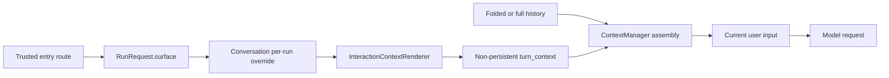

# 068 · 动态交互端上下文 - 技术方案

> Dynamic Interaction Surface Context - Technical Design

## 状态

CONFIRMED

## 1. 需求文档

→ [requirement.md](./requirement.md)

## 2. 现状与问题

桌面 AG-UI、语音 OpenAI 兼容路由和 QQ IM 路由都能在进入 Agent 前确定本轮入口，但既有运行链路只向 `Conversation` 传 `voice/text` channel。channel 表达媒介和回复形式，不能区分桌面对话与不同 IM 软件。

初版实现曾把 surface 作为动态 section 拼入首条基础 system prompt。自动化能证明值已传入，但真实 6.7 万 token 长会话回放中，模型仍沿用了历史里的旧回答。这说明 surface 是“当前回合运行时事实”，不应埋在长历史最前面的基础 prompt 中。

参考成熟 Agent harness 的分层方式：稳定行为留在 system/developer instructions；当前目录、时间、权限、入口等易变事实使用结构化、靠近当前输入的 turn context。068 因此采用独立的非持久化 turn-context 插槽。

## 3. 设计原则

1. **通道与产品端分离**：`voice/text` 是媒介维度；`desktop_chat/voice_call/im:qq` 是产品入口维度。
2. **稳定规则与动态事实分离**：基础 prompt 只解释 turn context 的语义；具体 surface 值逐次模型调用注入。
3. **每轮事实不持久化**：surface 不写 session event、历史、摘要、记忆或 run snapshot。
4. **只接受可信稳定 ID**：外部请求不能提交 prompt 正文；入口只选择工程内注册的 surface。
5. **已支持 IM 必须完整登记**：新增 adapter 必须登记 provider 映射；漏配显式失败。
6. **保留局部扩展点**：通过数据驱动 renderer 扩展新 surface，不引入通用插件框架。

## 4. 方案设计

### 4.1 Surface ID 与结构化 renderer

`agent.system_prompt.surfaces` 定义稳定 ID：

```python
InteractionSurfaceId = NewType("InteractionSurfaceId", str)

DESKTOP_CHAT_SURFACE = InteractionSurfaceId("desktop_chat")
VOICE_CALL_SURFACE = InteractionSurfaceId("voice_call")
IM_QQ_SURFACE = InteractionSurfaceId("im:qq")
```

`InteractionContextRenderer` 把受信 ID 映射为结构化属性，而不是维护每端一段行为性文案：

```xml
<interaction_context>
  <surface type="desktop_chat" />
</interaction_context>
```

```xml
<interaction_context>
  <surface type="im" provider="qq" />
</interaction_context>
```

语音使用 `type="voice_call"`。属性值统一做 XML 转义；未注册的非空 ID 抛明确错误。测试或未来入口可实例化带局部 mapping 的 renderer，新增 IM 软件只需增加 ID、属性和入口映射。

### 4.2 基础 prompt 合同

基础 `SystemPromptComposer` 不接收 surface 值。默认槽位在 `output_contract` 后加入静态 `interaction_context_contract`：

```text
... → output_contract → interaction_context_contract → channel → runtime_context
```

合同只说明：宿主可能在当前用户消息前提供可信的 `<interaction_context>`；surface 表示本轮产品入口；仅在相关时自然使用；知道入口不代表能够操作对应应用或账号。

`ChannelSection` 继续独立处理表达形式。语音回合仍通过 `channel="voice"` 获得既有短句、口语化、禁止 Markdown 等规则，surface 不复制这些内容。

### 4.3 ContextManager 的 turn-context 插槽

`ContextManager.build_messages()` 新增通用参数：

```python
turn_context: list[Message] | None = None
```

统一消息顺序为：

```text
[base system]
+ [memory context]
+ [folded/full history]
+ [current turn context]
+ [current user input]
+ [temporary trailing messages]
```

turn context 是宿主生成的可信 `role="system"` 消息，只存在于本次模型视图：

- 不进入 `Session.messages`；
- 不成为 compaction 输入；
- FIFO 截断历史时仍保留；
- prior summary 折叠后仍位于当前用户输入之前；
- 工具 continuation 每次重新生成同一个当前 run context。

`NaiveContextManager`、`FifoContextManager` 和 `SummarizingContextManager` 使用同一 `assemble_messages()` 顺序，避免入口之间产生差异。

### 4.4 每轮传递链路



- `RunRequest` 和 `AgentRuntime.submit()` 携带可选 surface。
- `Conversation.stream()`、`edit_resend_latest()`、`continue_after_tool_error()` 在 run 期间 save/set/finally restore surface override。
- `_assemble()` 每次模型调用都根据当前 override 生成 turn context。
- `dispatch_system_turn()` 不携带 surface；它没有“用户当前所在端”的语义。

### 4.5 入口映射

| 入口 | surface | channel | 备注 |
|------|---------|---------|------|
| AG-UI 普通发送 | `desktop_chat` | `text` | runtime 与 encoder fallback 都传递 |
| 桌面编辑重发、继续工具结果 | `desktop_chat` | `text` | 与主对话一致 |
| 带 voice headers 的 OpenAI 请求 | `voice_call` | `voice` | 同时保留 voice channel 行为合同 |
| 普通 OpenAI 文字请求 | `None` | `text` | 不冒充桌面对话 |
| QQ 私聊 | `im:qq` | `text` | router 从受信 `im_type` 映射 |

IM mapping 缺失代表受支持 adapter 装配不完整：在进入 LLM 前失败，并复用现有 IM 用户兜底。

### 4.6 不持久化与安全边界

surface 不写入 `session_meta`、`channel_change`、user/assistant message、compaction、memory 或 `RunSnapshot`。用户文本中的内部标签会沿用现有 untrusted marker 转义边界，不能改变由入口选择的受信 turn context。

动态上下文只表达产品入口，不推导操作系统、设备、窗口状态、附件能力或账号控制权。

## 5. 涉及文件

| 模块 | 主要改动 |
|------|----------|
| `agent/system_prompt/surfaces.py` | surface ID、结构化属性与 renderer |
| `agent/prompt_sections/interaction_context_contract.md` | 稳定 turn-context 解释合同 |
| `agent/system_prompt/composer.py` | 静态合同槽位；不再渲染具体 surface |
| `agent/context/` | 新增并保全 `turn_context` 消息插槽 |
| `agent/conversation.py` | per-run surface 管理、逐次生成 turn context、诊断日志 |
| `agent/runtime/` | `RunRequest.surface` 与 runner 透传 |
| `agent_bridge` AG-UI/meta/OpenAI/IM 路由 | 可信入口映射及 fallback 透传 |
| `agent/tests`、`agent_bridge/tests` | renderer、顺序、压缩、runtime 和入口集成回归 |

不修改 frontend、voice bridge、session 持久化格式或 memory 数据结构。

## 6. 验证设计

### 6.1 自动化

- renderer 覆盖 desktop、voice、QQ、XML 转义、未知 ID 失败和局部扩展。
- 当前 turn context 必须是当前用户输入前一条 system 消息。
- 同一 Conversation 跨 desktop、QQ、无 surface 三轮切换不串端。
- 工具 continuation、编辑重发、继续工具结果保持本 run surface。
- FIFO、prior summary 和新 compaction 都保留 turn context，但摘要正文不包含它。
- voice channel 行为只出现一次；普通 OpenAI 文字请求无动态 surface packet。
- 新 IM adapter 漏登记时不得进入 LLM。

### 6.2 真实长会话回放

使用首次失败的同一长会话发送等价问题，核对：

1. `SurfaceContextDbg` 记录 `surface=desktop_chat` 且 `turn_context=present`；
2. 上下文仍使用既有 prior summary；
3. 模型能根据当前 turn context 回答桌面对话端，而不是沿用历史旧答案。

真实调用遵守 `llm-api-confirm`，每次执行前说明调用量并取得授权。

## 7. 影响与风险

| 风险 | 对策 |
|------|------|
| turn context 被错误持久化或摘要 | 只由 `_assemble()` 生成；测试检查 session 与 summary |
| context manager 某策略遗漏新插槽 | 三种策略共享 `assemble_messages()`，全量 backend 门禁覆盖 |
| 动态事实离当前输入过远 | 固定放在裁剪/折叠后的 history 与当前 user 之间 |
| voice 身份与表达规则重复 | surface 只传结构化身份，channel 专管表达行为 |
| 新 IM adapter 漏注册 | 显式失败并阻止进入 LLM |
| 把端信息误解为操作能力 | 基础合同统一声明能力边界 |

## 8. 分诊复判

改动仍围绕单一 per-run surface 闭环，跨 agent prompt、context assembly、runtime 与 bridge 入口不可独立交付，因此 068 不拆分。

## 9. 变更记录

| 日期 | 变更内容 |
|------|----------|
| 2026-07-27 | 首次确认 channel/surface 分离、per-run 传递和支持 IM 强制登记 |
| 2026-07-28 | 真实长会话发现首条基础 system prompt 中的动态 section 会被旧历史压制；确认改为结构化、非持久化、邻近当前输入的 turn context |
