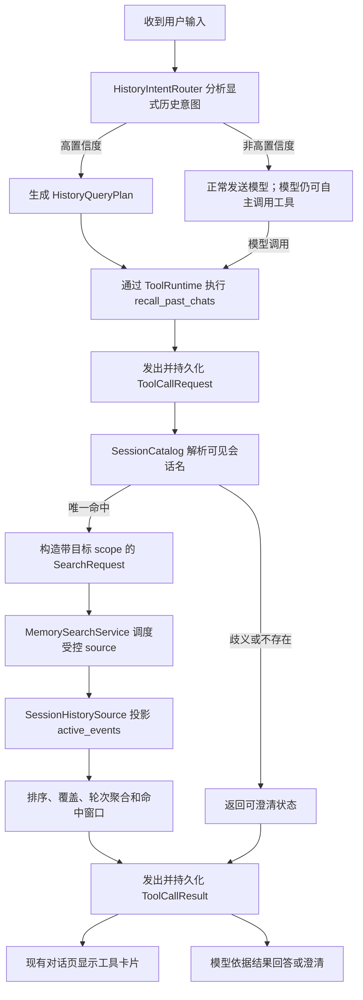

# 069 · 会话感知的历史查询与可靠召回 - 技术方案

## 状态

CONFIRMED

## 需求文档

→ [requirement.md](./requirement.md)

## 1. 现状与问题边界

### 1.1 跨会话正文扫描已经存在

`ConversationHistoryTool` 通过统一 `MemorySearchService` 调用
`SessionHistorySource`。后者会遍历 `SessionStore.list()` 中的持久化会话，
所以底层并不是“只能读取当前会话”。当前会话 id 只用于排除本轮尚未完成的事件，
不是数据访问范围。

本需求不重做一套历史存储，也不把能力改名为“跨会话工具”。它修正现有
`recall_past_chats` 从用户意图到证据结果之间的四个断点：

1. 会话展示标题位于 `SessionMetadataStore`，历史 source 只看到消息正文；
2. 模型可能在工具参数中漏掉用户原句里的会话名或时间；
3. source 扫描 raw `events`，排序又主要偏向最近消息；
4. 无命中时，其他记忆 source 仍可能提供不可归属或弱相关候选。

### 1.2 会话管理与历史搜索的依赖方向不同

`SessionManager` 负责列表、重命名、归档、删除和创建 `Conversation`，不适合作为
搜索工具的依赖。若工具反向依赖 manager，会让工具注册、conversation 创建和 session
管理形成环。

因此本需求抽出一个只读会话目录。它只组合 `SessionStore` 与
`SessionMetadataStore`，不承担任何写操作，也不复制 manager 的生命周期业务。

### 1.3 显式工具调用与自动记忆召回是两条不同链路

当前对话页根据 `ToolCallRequest / ToolCallResult` 事件展示
`recall_past_chats` 卡片。用户明确要求翻历史时，这个可见反馈属于既有产品行为。

本需求不会用隐藏的 memory prefetch 替代它。高置信度历史意图即使由确定性路由触发，
也必须经过真实工具执行链，持久化并发出正常的请求/结果事件；前端继续使用现有卡片，
无需新增历史查询 UI。

### 1.4 统一搜索仍是唯一召回编排层

会话标题解析和工具意图属于 agent 层；跨源查询、候选和融合契约属于 memory 层；
原始 session event 投影属于 agent 侧 adapter。依赖继续保持：

```text
conversation/tool -> history query plan -> MemorySearchService
                                      -> SessionHistorySource -> SessionStore
```

`memory` 不反向 import `agent.sessions`。目标会话 id 只作为已解析的内部 scope 进入
`SearchRequest`。

## 2. 设计原则

1. **可见名称是用户契约**：定位使用最终展示标题，不要求用户知道内部 id。
2. **用户原句约束优先**：会话、时间、说话方等明确约束不能被模型漏参扩大。
3. **显式查询必须显式执行**：确定性路由也走正常工具事件，保留现有卡片和证据链。
4. **目标会话是硬范围**：指定会话后，无法归属到该会话的证据一律不进入结果。
5. **当前有效分支是真相**：召回视图与用户当前看到的 history 使用同一 active projection。
6. **空结果不可填充**：多样性、语义相似和 core memory 都不能把不相关内容包装成命中。
7. **新增字段保持 additive**：旧工具调用、旧 session 文件和无指定会话查询继续可用。

## 3. 总体结构



新增和调整的内部边界：

```text
agent/src/agent/
├── sessions/
│   └── catalog.py                  # 只读会话描述与标题解析
├── history_query/
│   ├── contracts.py                # HistoryQueryPlan、解析状态
│   ├── planner.py                  # 原始输入约束提取与合并
│   └── router.py                   # 高置信度显式调用路由
├── memory_search/
│   └── session_history_source.py   # active 分支、定向 scope、排序与窗口
└── tools/builtin/conversation_history/
    ├── tool.py                     # schema、目录解析、统一搜索调用
    └── render.py                   # 状态、会话范围和轮次证据渲染
```

模块名可以在实现时按相邻代码做小范围合并，但以下职责不得合并：会话目录不写数据，
planner 不读取消息正文，memory 搜索层不解析产品展示标题。

## 4. 只读会话目录与标题解析

### 4.1 `SessionCatalog`

```python
@dataclass(frozen=True)
class SessionDescriptor:
    session_id: str
    display_title: str
    archived: bool
    updated_at: datetime | None
    channel_kind: str | None = None

class SessionCatalog:
    def list_all(self) -> tuple[SessionDescriptor, ...]: ...
    def resolve(self, title_query: str) -> SessionResolution: ...
```

`list_all()` 直接读取全部持久化 session summary，再用 `SessionMetadataStore.load_all()`
覆盖最终标题和归档状态。它不调用默认排除归档项的 `SessionManager.list()`：归档只是列表
收起，本需求需要继续可回忆。硬删除后 raw session 不存在，即使 metadata 有残留也不返回。

持久化入口必须把同一个 metadata store 注入 catalog；旧的 store-only 构造入口继续可用，
此时只能做正文搜索，不宣称支持展示标题定位。

### 4.2 标题规范化

标题与查询统一执行：

- Unicode NFKC；
- `casefold()`；
- 连续空白折叠为一个空格；
- 去除首尾空白。

不做拼音、编辑距离、同义词或联系人昵称猜测。为支持
“诗欣IM（用户在用，……）”这类长标题，额外生成一个受控的前导名称：只截取首个成对
括号 `()` / `（）` / `[]` / `【】` 之前的非空文本。不会按任意连字符或标点无限拆别名。

### 4.3 匹配顺序与歧义

对显式 `session_title` 依次尝试：

1. 完整规范化标题精确相等；
2. 前导名称精确相等；
3. 完整标题或前导名称以前缀开头；
4. 查询是完整标题或前导名称的连续子串。

在某一级只有一个候选时停止；同一级有多个候选时返回 `ambiguous`，不继续用更新时间
偷偷选一个。候选按最近更新时间排序，最多向模型返回 5 个可见标题。候选正文、内部 id、
文件名和归档字段不进入模型可见结果。

router 从用户原文自动识别标题时更保守：只接受完整标题或前导名称作为原文中的连续片段；
普通包含匹配只在模型或用户已经明确提供 `session_title` 参数后使用。

已存在的通道类型可以作为消歧过滤条件，但只消费结构化的已知通道信息；不得从 session id
字符串临时猜一套对外通道协议。

### 4.4 解析结果

```python
SessionResolutionStatus = Literal["matched", "ambiguous", "not_found"]

@dataclass(frozen=True)
class SessionResolution:
    status: SessionResolutionStatus
    matched: SessionDescriptor | None = None
    candidates: tuple[SessionDescriptor, ...] = ()
```

只有 agent 内部对象携带 session id。tool renderer 只输出查询名称、匹配后的展示标题或候选
展示标题。

## 5. `HistoryQueryPlan` 与约束保真

### 5.1 公共工具参数

`recall_past_chats` 保留现有参数并 additive 增加：

```json
{
  "session_title": "诗欣IM",
  "query": "项目排期",
  "since": "今天",
  "until": null,
  "said_by": "you | me",
  "mode": "search | summary",
  "limit": 10
}
```

- `session_title` 是用户可见名称或足够明确的片段，不接受 session id。
- `mode=search` 用于确认、找原话；`mode=summary` 用于“聊了什么”一类时间段概览。
- `query` 继续可选。指定 session 或明确时间范围时允许空 query；三者都没有时仍要求 query，
  避免无界扫描。
- 旧调用完全不传新字段时保持 020 的行为。

### 5.2 可信本轮上下文

`ToolRunContext` additive 保存本轮原始用户输入，执行前以隐藏 runtime 字段注入：

```python
@dataclass
class ToolRunContext:
    # 既有字段保持
    original_user_input: str
```

该字段不进入工具 schema，模型传入同名字段会被覆盖。planner 使用同一轮冻结的
`trusted_now / trusted_timezone` 解释“今天、昨天、上周”，避免模型参数和服务端时钟跨日。

### 5.3 合并规则

planner 分别从原始用户输入与公共 args 得到约束，按以下规则合并：

- 原文能唯一识别的会话名是硬范围；args 可以给出同一目标的更完整标题，不能换成别的会话；
- 原文明确时间范围与 args 时间范围取交集；args 漏传时补回原文范围；交集为空返回
  `invalid_constraints`；
- 原文明示“我说的 / 你说的”时补回 `said_by`；冲突时以原文为准并记录修正；
- args 的 query 可以从原文主题中收窄，但不能用完全无关主题替换；无法可靠抽取主题时保留
  args，而不靠生成式猜测改写；
- “聊了什么 / 总结一下 / 主要说了啥”确定为 summary；“有没有 / 原话 / 谁说的”确定为
  search；不明确时使用 args 或默认 search。

合并后的不可变 `HistoryQueryPlan` 是目录解析、SearchRequest 和 trace 的共同输入，避免工具、
router、评测各维护一套语义。

### 5.4 跨轮补充条件

当上一轮工具状态为 `ambiguous_session` 或 `session_not_found` 时，把不含证据正文的公开查询
计划摘要保存在工具事件 meta。下一轮只有在用户明显是在补充目标或约束时才合并：例如
“是另一个会话”“叫诗欣IM”“只看昨天”。普通新话题不继承 pending plan。

合并后保留上一轮的主题、时间和说话方，替换或补充会话条件；仍不足时再次返回澄清状态，
不会退化成无范围搜索。

## 6. 确定性显式工具路由

### 6.1 触发边界

`HistoryIntentRouter` 只处理高置信度显式历史请求：

- 明确的过去对话动作，如“翻一下、找找、之前说过、哪个会话聊过”；
- 已识别会话标题与“聊了什么、说了啥、总结、有没有提到”等组合；
- 对上一次历史查询结果补充目标、时间或主题。

以下不自动触发：

- 只讨论缓存、数据库、session 等技术概念；
- 单纯问工具能力“你能不能跨会话查”；
- 当前上下文已经直接包含答案且没有要求翻历史；
- 模糊的“你记得吗”但没有可执行主题或范围。

边界由确定性词法与 catalog 命中组合实现，不调用额外 LLM。低置信度输入继续交给当前模型，
模型仍可根据 tool description 自主调用。

### 6.2 真实且可见的调用

router 命中后，runtime 创建一次计划工具调用，通过现有工具执行器完成完整链路：

1. 生成 call id；
2. 持久化并发出 `ToolCallRequest`；
3. 执行 hooks、参数注入和真实 `ConversationHistoryTool.invoke()`；
4. 持久化并发出 `ToolCallResult`；
5. 把结果作为本轮模型证据继续生成回答。

请求/结果事件 additive 记录 `origin="deterministic_history_router"`，模型自主调用保持
`origin="model"`。这个字段仅用于诊断；两种来源都是真实执行，前端继续用同一个
`recall_past_chats` 卡片组件展示，不新增隐藏 prefetch，也不伪造一个模型选择。

若同一轮已经由 router 成功执行相同计划，临时 system context 告知模型已有历史证据；
完全相同的模型二次调用由现有无进展机制拦截或复用本轮结果，参数发生实质变化时允许重试。

### 6.3 结果后的生成行为

- `ok`：只依据返回证据回答；summary 由当前回复模型完成，不再发起额外 LLM 调用。
- `ambiguous_session`：列出返回的少量标题并询问目标。
- `session_not_found`：说明没有定位到该名称，邀请补充名称或特征。
- `no_results`：说明目标存在，但给定范围内没翻到。
- `source_error`：说明这次读取失败，可以稍后重试。

工具 description 与历史查询 system contract 同步声明：工具覆盖本机可访问的多个会话，
一次无命中不代表只能查当前会话。面向用户回答仍使用自然语言，不说 schema、索引或 id。

## 7. 搜索请求与 source 范围

### 7.1 additive 内部 scope

`SearchRequest` 增加：

```python
target_session_ids: tuple[str, ...] = ()
retrieval_goal: Literal["search", "summary"] = "search"
```

这是 agent 已解析后的内部约束，不向模型暴露。当前 `session_id` 继续表示“当前正在运行的
会话”，只服务当前轮隔离；不得复用为目标会话，避免两个语义混淆。

### 7.2 指定会话

存在 `target_session_ids` 时，tool 设置 `source_scope={"session_history"}`。本期指定会话
查询只采用 raw history adapter 产生的 utterance evidence：现有结构化 memory 没有稳定的
目标 session 归属，不能用于回答“这个会话里聊过什么”。

未来结构化 memory 若提供经过验证的 session provenance，可在后续需求中接入；本期不通过
字符串 provenance 猜归属。

### 7.3 未指定会话

普通跨会话显式查询仍可经过统一多 source 检索，但融合规则区分 automatic 与 explicit：

- automatic 保持既有 core memory 注入策略；
- explicit 只保留真正通过 keyword / dense / time 条件命中的候选；
- 没有相关性证据的 core memory 不再为了占满 top-K 无条件进入显式结果；
- 有 utterance 精确证据时优先于只有语义相似的结构化候选。

这项规则落在 `MemorySearchService`，不在 tool renderer 中事后丢弃，以便 trace 能说明候选为何
被排除。

## 8. 有效历史投影与当前轮隔离

### 8.1 使用 `active_events`

`SessionHistorySource` 从 `session.active_events` 读取用户和助手正文，不再遍历 raw
`session.events`。工具调用、persona、system、partial 和其他非对话事件继续排除。

编辑重发产生的 inactive 旧分支因此自然不可召回；读取旧 session 文件不需要迁移。

### 8.2 当前轮边界

现有 `current_turn_start_index` 是 raw events 的边界。source 先取得
`session.events[boundary:]` 的稳定事件身份集合，再投影 active events，并排除集合中的成员。
这样即使 active projection 改变顺序，也不会把本轮用户问句、过渡 assistant 文本或工具结果
召回；边界前的 active 历史仍可命中。

若旧事件缺少稳定 id，使用 session 内 raw 索引到 active projection 的现有关联信息实现，
不得直接把 raw index 当作 active index。

## 9. 候选相关性、覆盖与轮次证据

### 9.1 相关性分层

对有 query 的 utterance 使用确定性信号形成相关性层级：

1. 完整短语或连续原话命中；
2. 全部规范化词项命中；
3. 部分词项命中，按覆盖率与稀有度排序；
4. 仅语义相似候选。

同层再按时间接近度、现有 importance 和稳定事件顺序排序。时间更新不能把低层候选提升到
精确命中之前。没有任何可接受相关信号的候选不进入最终池。

### 9.2 跨会话覆盖

未指定会话时，在同一相关性层内做软多样化：第一轮每个有候选的会话至多取一个，再按全局
排序补满；进入下一相关性层之前先耗尽更强层。这样其他同样相关会话不会被当前会话数量淹没，
又不会为了“多样”强行加入较弱或无关内容。

指定会话时不应用跨会话配额。

### 9.3 对话轮次聚合

source 为每个命中构造最小相邻问答窗口，并给窗口稳定 key。重叠窗口按同一 session、相邻
event identity 合并；同一轮的用户问句和助手回答只算一组 evidence，不作为两个独立事实。

`mode=search` 优先返回命中强的窗口；`mode=summary` 在满足过滤条件的有效轮次中按时间分桶，
优先覆盖不同时间段和不同主题，再按时间正序交给模型总结。`limit` 表示最大证据轮次数，
不表示原始事件数。

summary 不调用第二个摘要模型；当前对话回复模型基于有界轮次证据生成自然总结。超出预算时
结果明确带 `truncated=true`，回答不能声称覆盖全部内容。

### 9.4 命中感知片段

长消息不再固定截取开头 200 字。对关键词查询，以首个最高质量命中为中心保留前后窗口，
并用省略标记表示被裁剪部分；无 query 的 summary 采用开头与必要结尾的有界投影。

renderer 保留 utterance 的说话方和相对时间，增加可见会话标题和查询范围，但不输出
session id、event type、raw index 或文件路径。

## 10. 工具结果协议

模型可见结果保持不可信数据包，并使用稳定状态：

```json
{
  "source_type": "past_conversation",
  "trust": "untrusted_data",
  "status": "ok | ambiguous_session | session_not_found | no_results | source_error",
  "scope": {
    "session_title": "诗欣IM（……）",
    "time": "今天",
    "mode": "summary"
  },
  "candidate_session_titles": [],
  "result_count": 3,
  "truncated": false,
  "results": []
}
```

- `ambiguous_session / session_not_found / no_results` 是可处理的业务结果，`is_error=False`；
- 参数非法和底层 source 全失败为 `is_error=True`；
- source 部分失败但仍有可靠证据时可返回 `ok`，meta 记录降级；
- 候选标题只在 ambiguity 时出现，最多 5 个；
- `results` 只在 `ok` 时包含证据。

`ToolResult.meta` 增加内部诊断：resolution status、source runs、各 session 候选/入选计数、
过滤原因、截断和 router origin。meta 不复制消息正文，也不进入面向模型的文本。

## 11. 装配与入口兼容

### 11.1 bridge / desktop / IM

`agent_bridge.assembly` 已同时持有 persistent `SessionStore` 和
`SessionMetadataStore`。装配时创建一份 `SessionCatalog`，注入默认 registry 中的
`ConversationHistoryTool`；同一 registry 被 desktop 与 IM conversation 使用，语义一致。

catalog 独立于 `SessionManager`，因此不改变现有创建顺序，也不形成依赖环。

### 11.2 CLI

持久化 CLI 从同一 user data sessions 目录创建 metadata store 与 catalog，并传给
`make_default_registry()`。只传 `SessionStore` 的测试和旧调用方继续使用兼容构造，但只有
注入 catalog 后才启用按展示标题定位。

### 11.3 无状态入口

无状态 API、fixture 或 `NullSessionStore` 不注入本机 catalog，不因 router 获得跨请求数据。
没有历史数据时返回正常 `no_results / session_not_found`，不能回落到进程上其他持久化 store。

### 11.4 工厂兼容

`make_default_registry()` 只增加可选 `session_catalog` 参数；现有 `session_store` 与
`memory_search` 参数继续支持。工具名、旧参数和注册条件不变。

## 12. Prompt 与能力陈述

工具 description 更新为：

- 能读取本机当前可访问的多个持久化会话；
- `session_title` 用于按产品展示名称限定会话；
- 有会话名、时间和说话方时全部传递；
- 歧义时使用候选澄清，无结果时不能解释成“不支持跨会话”；
- 已有 router 结果时不要用相同参数重复调用。

通用 tool usage contract 只补本工具的事实边界，不建设全局能力目录。系统仍要求只有真实
工具结果后才能说“翻了历史”；router 调用已经真实执行，因此满足该约束。

## 13. 可观测性

一次查询使用同一个 `history_query_id` 串起：

```text
intent_route -> constraint_merge -> session_resolution -> source_run
             -> candidate_filter -> fusion/diversity -> render -> generation
```

诊断字段包括：

- router 是否命中及 origin；
- 原文约束是否补回、是否发生冲突；
- resolution status 与候选数量；
- 每个 source 的状态、候选数和失败类型；
- 各 session 候选数、入选数及 quota/filter 原因；
- active/inactive/current-turn 排除数量；
- final count、truncated 和 tool result status。

日志与 trace 不记录完整用户正文、完整会话标题集合、证据正文或 session 文件路径。调试界面
需要正文时继续走既有受控 evidence inspector，不在 INFO 日志复制隐私内容。

## 14. 测试策略

### 14.1 会话目录

- 初始标题、重命名标题和长标题前导名称；
- NFKC、大小写和空白归一化；
- 精确、前缀、包含匹配优先级；
- 同级多候选歧义、候选上限和稳定排序；
- 归档可见、硬删除不可见；
- metadata 孤儿记录不产生会话。

### 14.2 planner 与 router

- “看看诗欣IM这个会话今天聊了什么”得到 session + 今天 + summary；
- 模型 args 漏掉今天时由原文补回；
- args 试图换目标或扩大时间时被原文硬约束收窄；
- capability 问句、技术 session 讨论和当前上下文问题不误触发；
- 高置信度请求产生真实 request/result 事件，origin 正确，现有卡片事件完整；
- ambiguity 后补标题仍保留原时间/主题，普通新话题不继承 pending plan；
- 同计划不重复执行，改变约束允许重试。

### 14.3 source 与融合

- 只读取 active_events，编辑重发旧分支不可命中；
- 当前轮 raw boundary 正确映射到 active projection；
- 指定目标时只返回该 session，并跳过不可归属 structured memory；
- 归档 session 可命中，删除后不可命中；
- 精确短语、全词、部分词和语义候选保持层级；
- 当前会话候选很多时，同等相关的其他会话仍进入结果；
- 无关会话不因 diversity 被强行加入；
- 长消息中后部命中时片段包含命中；
- 相邻重叠窗口去重，summary 按轮次而非事件计 limit；
- explicit 无证据时 core memory 不填充为成功。

### 14.4 工具与装配

- 五种业务状态与 is_error 语义；
- 模型可见结果无 session id、event type、路径和内部 trace；
- bridge、IM、desktop 和持久化 CLI 使用同一 catalog；
- store-only 旧构造仍能做正文检索；
- stateless/Null store 不读取本机持久化数据；
- 020、039、048 现有工具、证据与自动召回测试继续通过。

### 14.5 Agent eval

扩展 `c1-cross-session-recall.yaml`，覆盖：

1. 按展示标题和今天查询并正确总结；
2. 首次歧义后用户补充名称，继续原查询；
3. 目标存在但无结果时不编造；
4. 用户追问“不是能跨会话吗”时不说“只能查当前会话”；
5. 当前上下文已有答案时不无意义翻历史。

评测同时断言所需工具事件存在、参数约束完整，并禁止“只能查当前会话 / 无法查看其他会话”
等错误能力陈述。默认使用 fake LLM、固定 clock 和本地 fixture，不调用真实外部 LLM。

## 15. 实施顺序

1. 落 `SessionCatalog`、标题解析和生命周期单测。
2. 扩展 `SearchRequest` 与 `SessionHistorySource`，先修 active 分支、目标 scope 和当前轮隔离。
3. 修 explicit 融合、跨会话覆盖、轮次聚合和命中感知片段。
4. 扩展工具 schema、`HistoryQueryPlan`、状态 renderer 与装配入口。
5. 接入 `HistoryIntentRouter` 和真实可见工具事件，补 pending plan 与重复调用保护。
6. 更新 tool contract、trace、agent eval 和全量回归。

先把纯检索机制固定，再接确定性路由，避免“有没有调用”和“调用后查得对不对”在同一阶段
混杂定位。

## 16. 接口与迁移

- `recall_past_chats` 名称不变；`query / since / until / said_by / limit` 不变；新增参数可选。
- `SearchRequest` 只做 additive 字段扩展，旧 source 忽略或由 service 统一处理默认空 scope。
- session JSONL 不做数据迁移；active projection 直接解释现有 rewrite 事件。
- metadata schema 不变；catalog 只读复用 `display_title / archived_at`。
- tool request/result 事件仅 additive 增加 origin 与 history query meta，旧前端忽略新字段并继续
  展示现有卡片。
- 不新增第三方依赖，不预建全文索引；先基于现有本机规模验证扫描性能。

## 17. 性能边界

标题目录构建只读轻量 session summary 与 metadata，不读取每个会话正文。一次工具调用只构建
一次 catalog snapshot。

定向查询解析后只打开目标 session；未指定会话时继续扫描现有 session 集合，但在 source 阶段
尽早应用时间、speaker 和 active-event 过滤。测试增加多 session 基线，若常见本机规模下查询
出现可感知回归，再在本需求内做最小缓存；不提前引入持久化索引或向量库。

## 18. 已知限制与后续边界

- 本期标题匹配不支持拼音、错别字、语义别名或联系人昵称；歧义时必须澄清。
- 标题变化后，旧标题不是永久别名；只查询当前最终展示标题。
- structured memory 尚无可靠 session provenance，指定会话查询暂时只用原始对话证据。
- summary 是基于有界证据的当前回复，不保证在超大时间跨度内逐条覆盖；`truncated` 必须如实
  传递给生成层。
- 不改变会话列表、归档、重命名或工具卡片的视觉设计。
- 不提供跨设备、云端同步、硬删除恢复或通用产品能力目录。

## 19. 变更记录

| 日期 | 变更内容 | 影响范围 |
| --- | --- | --- |
| 2026-07-28 | 初始技术方案；确定可见工具卡片、标题解析、约束保真、有效历史与可靠空结果 | 全文 |
