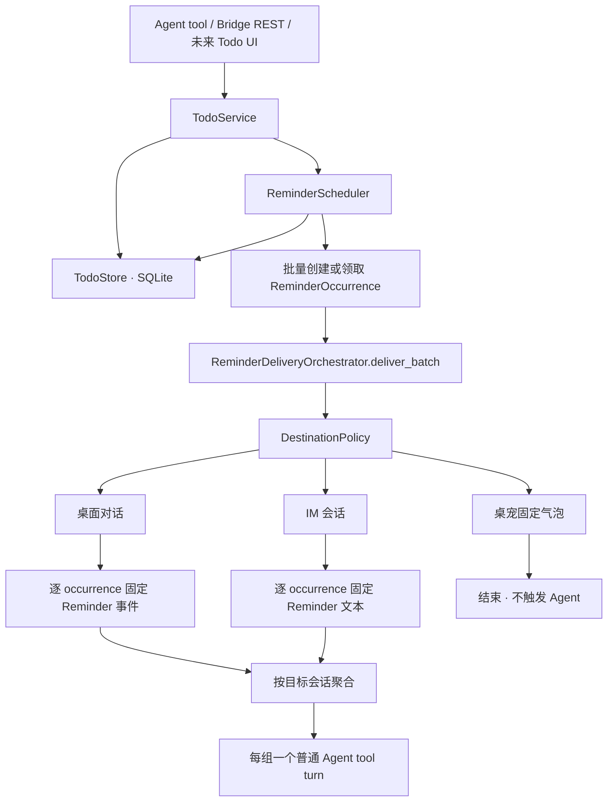
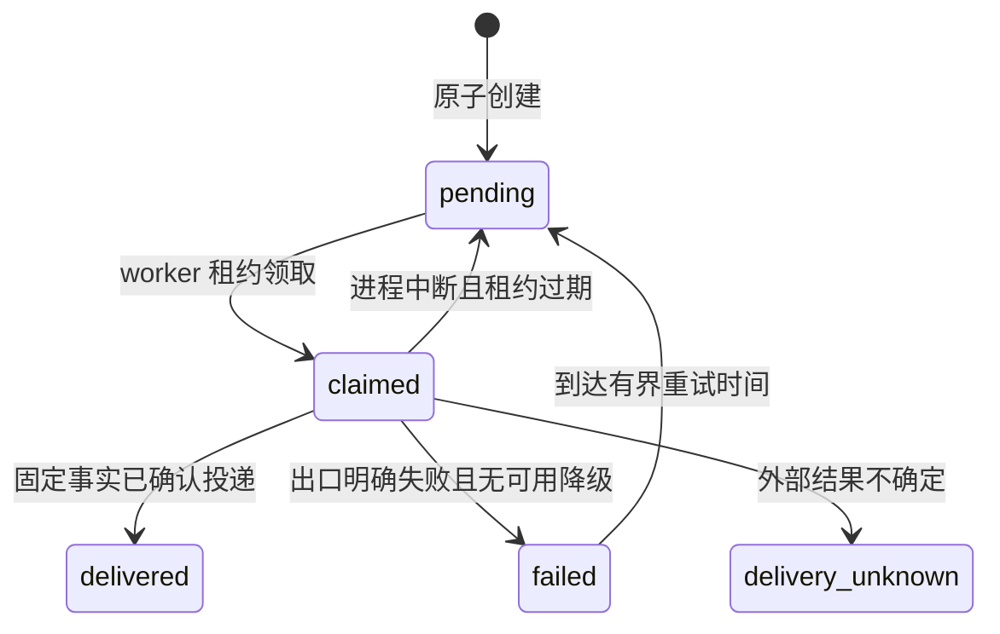

# 070 · Todo 管理与可选提醒 - 技术方案

## 状态

CONFIRMED

## 需求文档

→ [requirement.md](./requirement.md)

## 1. 现状与约束

### 1.1 Todo 不能由会话历史承担

现有 session event、长期记忆和上下文压缩都服务于对话，不具备 Todo 所需的稳定标识、
状态机、唯一约束和并发更新语义。Todo 因而使用独立持久化边界；来源会话只作为审计
信息，不能成为所有权或查询范围。

### 1.2 主动轮与后台 push 已有基础，但语义需要扩展

现有 `SystemTriggerEvent` 可以在指定 session 上启动禁用工具的系统轮，并区分
`user` 与 `memory_only` 输出。当前前端仍把用户可见 system-trigger 后的 assistant 消息
统一投影为桌宠气泡，这只适用于既有主动关怀，不能表达“写进对话”与“仅环境呈现”的
区别。

`/ag-ui/run` 的 SSE 只存在于一次前台请求期间，不能承担后台 Reminder。后台到期事件继续
通过常驻 Bridge push 和 session 同步进入桌面端；AG-UI 只保留未来把同一领域事件投影为
自定义事件或专用组件的兼容边界，本期不把它作为调度与可靠投递协议。

### 1.3 活跃状态只能做保守判断

当前跨窗口 active-chat 状态只说明用户选中了哪个 session，不包含窗口聚焦、可见性、
锁屏、休眠和系统最近输入。任何单一信号都不能证明用户仍在电脑前。本期采用“只有明确
正证据才投桌面”的策略；未知一律视为不活跃，并保留可替换的策略接口和诊断证据。

### 1.4 外部 IM 无法提供绝对 exactly-once

现有 IM outbound 接口不返回统一发送结果，个别 provider 还会在内部吞掉异常。即使补齐
receipt，网络超时也可能发生“平台已收到、客户端未收到确认”。本方案保证应用不会有意
重复发送同一个 occurrence；结果不确定时不自动重发，以避免重复提醒，但不宣称跨第三方
平台实现数学意义上的 exactly-once。

### 1.5 逐 occurrence 生成会形成提醒风暴

当前 scheduler 已经在一次 `claim_pending` 中取得整组到期 occurrence，但随后逐条调用
delivery handler。delivery orchestrator 每成功投递一条固定事实就立即提交一个独立的
`SystemTriggerEvent`；同一 session 的 run 又必须串行执行，因此多个同时到期的 Reminder
会形成多张卡片、多轮模型调用和多次近义回应。批次边界应沿用 scheduler 已经拥有的领取
结果，不再额外引入任意时间窗口或 debounce 计时。

## 2. 设计原则

1. **事实、投递和生成分层**：固定 Reminder 事实先可靠投递，Agent 回应是默认执行但可
   独立失败的增强层。
2. **一次到期一个 occurrence**：调度、路由、重启恢复和幂等都围绕稳定 occurrence id，
   不围绕一次进程内 callback。
3. **同批同会话只生成一次**：一次 scheduler claim 中实际投递到同一目标会话的一个或
   多个 occurrence 组成一个 Agent 批次；批次只启动一个正常 Agent turn。
4. **事件即输入**：Agent 接收结构化 Reminder 事件，不附加回答方式或工具选择指令；
   persona、会话上下文、普通工具能力及现有安全策略共同决定本轮行为。
5. **单一成功目的地**：策略先选目的地，再投递；只有明确失败才降级，未知结果不广播。
6. **保守 presence**：缺失、过期或矛盾信号都不能推断桌面活跃。
7. **统一领域服务**：Agent tool、Bridge API 和未来 Todo UI 复用 TodoService，不复制状态机。
8. **只实现已确认复杂度**：采用内置条件循环和结构化 recurrence，不引入通用任务框架、
   cron 或完整 Todo UI。

## 3. 总体结构



建议模块边界：

```text
agent/src/agent/
├── todos/
│   ├── models.py          # Todo、Reminder、Occurrence 领域类型
│   ├── recurrence.py      # 结构化周期校验与下一次计算
│   ├── store.py           # SQLite 事务、claim、恢复
│   ├── service.py         # 生命周期与调用方统一入口
│   └── scheduler.py       # 条件循环、到期批量 claim、错过合并
└── tools/builtin/todo_manage/

agent_bridge/src/agent_bridge/
├── reminders.py           # 固定投递、按目标会话聚合、Agent 回应编排
├── routes/todos.py
├── routes/presence.py
└── presence.py            # 桌面与 IM 快照、目的地策略输入

frontend/src-tauri/src/presence/
├── mod.rs
├── windows.rs
├── macos.rs
└── linux.rs

frontend/src/
├── pages/chat/components/ReminderCard.tsx
└── stores/sessionProjection.ts
```

## 4. 持久化模型

Todo 数据使用独立 SQLite 文件 `todos/todos.db`，路径由 `agent.paths.todos_db_path()` 统一
提供。它不进入 memory DB，也不写进仓库。SQLite 开启 foreign keys 和 WAL；所有时间戳
按 UTC ISO 8601 存储，用户时区保存 IANA name。

### 4.1 `todos`

| 字段 | 语义 |
|---|---|
| `id` | UUID，稳定主键 |
| `title` / `description` | 用户事实内容 |
| `status` | `open / completed / cancelled` |
| `created_at` / `updated_at` | UTC 时间 |
| `completed_at` / `cancelled_at` | 对应状态时间，可空 |
| `revision` | 乐观并发版本 |
| `origin_kind` / `origin_id` | 可选审计来源，不决定归属 |

### 4.2 `reminders`

| 字段 | 语义 |
|---|---|
| `id` / `todo_id` | UUID 与外键 |
| `kind` | `once / recurring` |
| `timezone` | IANA timezone |
| `schedule_json` | 规范化结构化规则 |
| `next_fire_at_utc` | 下一次调度索引，可空 |
| `status` | `active / exhausted / disabled` |
| `fire_count` / `revision` | 已生成次数与并发版本 |
| `created_at` / `updated_at` | UTC 时间 |

### 4.3 `reminder_occurrences`

| 字段 | 语义 |
|---|---|
| `id` | UUID，也是跨模块幂等键 |
| `reminder_id` / `todo_id` | 触发时关联 |
| `scheduled_at_utc` | 规则计划时间 |
| `facts_json` | 创建时冻结的用户可见事实快照 |
| `state` | `pending / claimed / delivered / delivery_unknown / failed` |
| `destination_kind` / `destination_id` | 唯一选定出口及目标 |
| `delivery_receipt` | 可选 provider/session receipt |
| `agent_response_status` | `pending / running / completed / failed / skipped` |
| `attempt_count` / `next_attempt_at` | 有界失败恢复 |
| `created_at` / `updated_at` | UTC 时间 |

数据库对 `(reminder_id, scheduled_at_utc)` 建唯一约束。`facts_json` 冻结标题、说明、规则
摘要、计划时间和当时状态，保证投递内容不会因到期后的并发编辑而漂移；是否仍允许投递
则由 claim 事务重新核对 Todo 与 Reminder 当前状态。

可选 `reminder_delivery_attempts` 只记录出口、结果分类、时间和无敏感信息诊断，不承担
业务状态真相源。

## 5. Todo 与 Reminder 状态规则

- Todo 创建为 `open`；`complete` 和 `cancel` 记录不同时间并停用所有 active Reminder。
- `reopen` 只恢复 Todo，不自动恢复旧 Reminder。调用方需明确新增或重新启用 Reminder，
  避免已过期规则意外重启。
- 修改使用 `revision` 做 compare-and-swap；版本冲突返回最新实体，不做 last-write-wins。
- 移除 Reminder 采用状态停用并保留历史；本期 API 对用户表现为移除，不做物理删除。
- 已生成的 occurrence 是审计事实，不因 Todo 后续修改或取消而删除。

## 6. 结构化 recurrence

`schedule_json` 不保存 cron 或原始 RRULE，而保存受控结构：

```json
{
  "frequency": "daily | weekly | monthly",
  "interval": 1,
  "local_time": "09:00:00",
  "weekdays": [1, 4],
  "month_days": [1, 15],
  "starts_on": "2026-07-28",
  "until_local": null,
  "max_occurrences": null,
  "fold": 0
}
```

- 一次性规则保存 `local_datetime + timezone + fold`，规范化后同时计算 UTC instant。
- weekday 使用 ISO 1–7；只有 weekly 接受 `weekdays`，只有 monthly 接受 `month_days`。
- 每月不存在的日期跳过该月，不 clamp 到月末，避免“每月 31 日”悄悄变成 28 日。
- DST 不存在的本地时刻跳过本次 occurrence 并计算下一次；重复时刻默认 `fold=0`，调用方
  已明确第二个时刻时保存 `fold=1`。
- `until_local` 是包含边界；`max_occurrences` 按实际生成 occurrence 次数计数。
- 使用现有 `dateutil` 和标准库 `zoneinfo` 做 calendar 计算，不引入独立调度库。

## 7. 调度、claim 与恢复

`ReminderScheduler` 是 Bridge lifespan 内的单实例后台组件，使用 condition + 最近
`next_fire_at_utc` 等待；TodoService 改动规则后唤醒它。每次循环在短事务中：

1. 查询到期 active Reminder；
2. 重新验证 Todo 为 open、Reminder revision 和结束条件有效；
3. 以唯一键创建 occurrence；
4. 推进 `next_fire_at_utc`、`fire_count` 和 Reminder 状态；
5. 一次 claim 取得当前所有 pending occurrence，并把不可变 tuple 作为一个调度批次交给
   delivery orchestrator。



- 一次性错过：重启后仍创建原计划时间对应的一个 occurrence。
- 周期错过：从所有已错过计划点中只为最新一个创建 occurrence，再推进到未来时间。
- `OccurrenceBatchHandler` 接收一次 claim 的完整 tuple；批次 handler 发生未处理异常时，
  scheduler 对批次内仍处于 claimed 的 occurrence 分别落失败与重试时间，不能只处理第一条。
- `claimed` 带短租约；恢复时先检查 session 中是否已经存在同 occurrence id，再决定是否
  重新投递，避免“已写 session、尚未更新数据库”造成重复。
- 明确失败采用有界退避；`delivery_unknown` 不自动重试或切换出口，避免跨出口重复。

## 8. Presence 快照与目的地策略

### 8.1 桌面快照

Tauri 统一形成并周期上报：

```text
DesktopPresenceSnapshot
  observed_at
  current_session_id?
  window_visible / window_focused / window_minimized
  os_idle_ms?
  session_state: active | locked | sleeping | unknown
  last_desktop_interaction_at?
  capabilities
```

- Windows 使用 `GetLastInputInfo`，并监听 session lock/unlock 与电源状态；复用现有
  `windows` crate，只增加所需 target feature。
- macOS 通过 CoreGraphics 系统 API取得 idle 时长，并用 workspace/session notification
  感知 sleep、wake 与 session 状态；采用 target-specific FFI，不增加跨平台运行依赖。
- Linux 本期没有得到受支持信号时返回 `unknown`，不通过启发式假装可靠。
- 前端只报告当前选中 session 和 document 可见性；窗口真实状态由 Tauri 取得。
- 快照默认每 5 秒上报，超过 15 秒视为 stale。只记录时间和状态，不采集按键、鼠标位置
  或输入内容。

桌面具备投递资格必须同时满足：快照新鲜、session 明确、窗口可见且聚焦、未最小化、
session state 为 active。`os_idle_ms` 和 `last_desktop_interaction_at` 继续用于诊断及桌面/IM
最近交互比较，但不再否决一个仍可见、聚焦且运行态正常的桌面对话。任何资格字段未知或
矛盾都不具备资格。

### 8.2 IM 与桌宠信号

IM runtime 为每个绑定保存 provider 在线状态和最后一次真实 inbound 用户活动时间。桌宠
只暴露当前 push subscriber 是否连接，不被当作用户活跃证据。

### 8.3 选择顺序

`DestinationPolicy` 是无副作用纯函数，输入冻结的 presence snapshot，输出目标和原因码：

1. 桌面合格且其最后交互不早于最近 IM inbound：当前桌面对话；
2. 否则选择在线且最近有 inbound 的 IM binding；
3. 只有一个在线 IM binding 且无历史时可选择它；多个绑定无法唯一判断时不随机选择；
4. IM 不可选但桌宠 subscriber 在线：桌宠；
5. 均不可用：保持 pending。

选定出口明确失败时，使用同一份冻结快照继续下一候选；成功或结果 unknown 后立即停止。
每次决策记录窗口信号、idle 桶、IM 可用性、信号新鲜度和原因码，不记录用户内容。

## 9. 固定事实与 Agent 回应

### 9.1 批次投递与分组

`ReminderDeliveryOrchestrator.deliver_batch(occurrences)` 在批次开始时刷新 IM presence 并冻结
一份目的地快照。每条 occurrence 仍独立执行可投递性复核、固定事实投递、receipt 和状态
更新；一个出口明确失败时，也仍按 occurrence 使用同一冻结快照降级。

固定事实投递完成后，只把实际成功进入真实会话的 occurrence 按以下 key 分组：

```text
(session_id, destination_kind, destination_id, interaction_surface)
```

同组只启动一个 Agent run。桌宠没有真实目标 session，继续逐条展示固定事实并将响应状态
标为 `skipped`；`failed`、`delivery_unknown` 或 session 事实落盘失败的 occurrence 不进入
Agent 分组。单条 occurrence 形成大小为 1 的分组，复用同一条路径。

批次使用组内 occurrence id 的稳定有序集合生成 `batch_id`，并把 `batch_id` 与
`occurrence_ids` 写入 run / system-trigger 元数据。它只负责关联和诊断，不成为新的投递
真相源，因此不新增 batch 表；每条 occurrence 继续独立承担幂等、恢复和投递状态。

### 9.2 桌面对话

session 新增 additive event type `todo_reminder`，payload 含 occurrence id、Todo/Reminder id、
冻结 facts 和计划时间。该事件本身是用户可见事实，并通过 `session_changed` push 让前端
重新投影。

前端增加 `ReminderBlock` 和原生 React `ReminderCard`。卡片只读、使用项目语义组件和
设计 token，不把模型 markdown 解析成卡片，也不在本期提供操作按钮。

同批固定事件全部完成投递后，delivery orchestrator 为该桌面 session 派发一个
`user + conversation` 的 tool-enabled system turn。system trigger 的呈现语义仍由两个
正交维度决定：

```text
output_visibility: user | memory_only
presentation: conversation | ambient | none
```

- Todo：`user + conversation`
- 既有桌宠主动关怀：`user + ambient`
- 仅记忆主动轮：`memory_only + none`

前端按 `presentation` 投影，不按 `source_kind == todo_reminder` 写特例；旧事件缺少字段时
保持既有 ambient 行为。本次不改变卡片布局或折叠策略；多条固定卡片仍可分别展示，但其后
只出现一个 Agent run 的工具过程和最终回应。

### 9.3 IM

先逐 occurrence 用确定性 formatter 发送与卡片同等关键事实；确认成功并完成批次分组后，
在该 IM binding 对应的真实 session 只派发一个 tool-enabled system turn。工具过程仍只
落目标 session，最终 Agent 文本沿既有 IM outbound 链路发送一次，不在桌面对话重复投影。

IM provider 契约新增结果：

```text
OutboundSendResult
  outcome: delivered | failed | unknown
  provider_message_id?
  error_kind?
```

provider 不再吞掉失败。`delivered` 才允许开始 Agent 回应；`failed` 可降级；`unknown`
停止自动动作并进入诊断状态。

### 9.3.1 桌宠短气泡

桌宠没有目标 session，固定事实继续按 occurrence 生成独立 push envelope。bubble webview
复用项目已安装的 Sonner：Todo Reminder 按稳定 envelope id 追加，普通 ambient 主动轮仍只
保留最新一条，因此新主动轮不会覆盖尚未关闭的 Reminder，Reminder 之间也不会互相替换。

Toaster 使用常驻、手动逐条关闭和展开栈；同屏最多显示 4 条，更多条目保留在 Sonner 队列，
关闭可见条目后继续出现。Sonner 只负责栈和交互生命周期，Zustand store 仍负责去重、保留与
替换语义。

bubble 是独立透明 Tauri window，fixed toast 不参与普通文档布局。前端用
`MutationObserver + ResizeObserver` 读取可见 toast 的目标 offset 与高度，向既有
`set_bubble_size` 上报整个栈尺寸；窗口宽度沿用 360px 上限，四周预留 16px 透明 frame
容纳阴影和关闭按钮，Rust 继续把高度 clamp 到 480px。

### 9.4 Agent 事件输入与普通工具轮

模型当前轮输入只包含批次内 `todo_reminder` 的结构化事件，不写回答方式、长度、语气、
是否逐条回应或工具选择指令。事件 payload 复用 session 固定事实的同一组字段，避免卡片、
历史状态与当前轮输入维护三份事实 schema：

```text
<system_events>
[
  {
    "type": "todo_reminder",
    "payload": {
      "occurrence_id": "...",
      "todo_id": "...",
      "reminder_id": "...",
      "title": "...",
      "description": "...",
      "scheduled_at_utc": "...",
      "scheduled_local": "...",
      "timezone": "...",
      "recurrence": "...",
      "todo_status": "open"
    }
  }
]
</system_events>
```

JSON 序列化负责引用 Todo 文本，外层标签只声明输入类型，不包含行为指令。Agent 仍使用
目标 session 的当前 persona、模型、上下文和普通 tool registry；桌面使用 text channel 与
desktop-chat surface，IM 使用所选 binding 的 IM surface 和 destination id。Todo 提醒不加
专属 tool allowlist / denylist，所有工具继续服从现有通用运行预算、安全和权限策略。

`SystemTriggerEvent` 增加 additive `tool_mode: disabled | normal`，默认 `disabled`，保证既有
bedtime、idle-reflection 和 memory-only 触发不变。`normal` 复用 Conversation 已有的完整
tool loop；现有 external-action continuation 与新入口共享内部实现，不复制 tool execution、
进度、取消或恢复逻辑。

### 9.5 Agent 回应失败边界

Agent run 提交前把组内全部 occurrence 的 `agent_response_status` 更新为 `running`；run 最终
完成、失败或取消后，再把同一结果分别回写到每条 occurrence。Agent 可以在一轮中调用零到
多个工具，但应产生一次正常的最终回应；空输出按生成失败处理，不新增 Todo 专属补写 prompt。

固定事实成功即把 occurrence 标为 delivered。模型异常、取消或进程重启不撤销投递、不重发
固定事实，也不自动补第二次生成。用户在同一 session 发起交互轮时，沿现有 scheduler 规则
抢占低优先级 Reminder run；批次状态记为失败，固定事实继续保留。桌宠没有真实目标 session，
只显示确定性事实并把 response status 标为 skipped。

## 10. Agent 工具契约

新增一个串行写工具 `todo_manage`，复用 TodoService。采用单工具 operation 便于模型发现，
同时让 Todo 与 Reminder 更新共享一致的冲突和校验结果：

```text
operation:
  create | list | get | update | complete | cancel | reopen |
  add_reminder | update_reminder | remove_reminder
```

参数保持扁平，由 operation 做二次校验。`create` 可一次携带多条 reminders；更新必须传
稳定 id，不能靠标题猜测。运行时注入可信 `now`、timezone 和来源 session，模型不能覆盖
内部字段。

一次性 schedule 接受两种互斥输入：

```json
{"kind":"once","local_datetime":"2026-08-04T09:30:00","timezone":"Asia/Shanghai"}
```

```json
{
  "kind": "once",
  "relative_delay": {"amount": 2, "unit": "minute"},
  "timezone": "Asia/Shanghai"
}
```

`relative_delay` 只支持正整数 `minute | hour | day | week`，语义是从当前可信 instant 起经过
指定时长。工具边界使用 068 每次推理提供的隐藏 `runtime_now` 计算目标 instant，再转换到
schedule 指定 IANA timezone，写回现有 `OnceSchedule(local_datetime, timezone, fold)`。
因此 Todo DB、领域模型、REST 和 scheduler 都不增加 relative schedule 类型；跨 DST 时由
目标 instant 推导 `fold`，保持真实经过时长。

同一次模型推理产出的多个 `todo_manage` 调用共享同一个隐藏 `runtime_now`。下一次工具续轮
由 068 刷新时间。`create.reminders` 用于新建 Todo 时同时建提醒；`add_reminder` 只给已有
Todo 后补提醒，不要求 Todo revision。工具 schema 不使用 provider 兼容性较差的 `oneOf`，
“绝对时间与相对时长二选一”由字段描述和运行时校验共同保证。

结果采用稳定 JSON 文本，包含实体 id、最新 revision、状态和所有规范化 Reminder 时间；
冲突、歧义、无效本地时间和不存在实体返回明确 `error_kind`。工具声明为 serial barrier，
避免同轮写操作并行破坏顺序。

## 11. Bridge API

未来 UI 与内部调用使用版本化 REST：

```text
GET    /v1/todos
POST   /v1/todos
GET    /v1/todos/{todo_id}
PATCH  /v1/todos/{todo_id}
POST   /v1/todos/{todo_id}/complete
POST   /v1/todos/{todo_id}/cancel
POST   /v1/todos/{todo_id}/reopen
POST   /v1/todos/{todo_id}/reminders
PATCH  /v1/todos/{todo_id}/reminders/{reminder_id}
DELETE /v1/todos/{todo_id}/reminders/{reminder_id}
POST   /v1/runtime/presence/desktop
GET    /v1/runtime/reminder-diagnostics
```

写接口接收 `revision` 并返回完整最新资源。DELETE 只停用 Reminder。presence endpoint 仅
接受本机 Tauri Bridge 调用，不作为远程公共状态接口；diagnostics 默认只提供最近有界记录。

## 12. 装配与生命周期

Bridge assembly 先构造 TodoStore/TodoService，再把 service 注入默认 tool registry；随后
构造 presence registry、destination policy、delivery orchestrator 和 scheduler。它们作为
BridgeRuntime 字段被 routes 和 lifespan 共享。

FastAPI startup 顺序：迁移数据库 → 恢复过期 claim → 启动 delivery worker → 启动
scheduler。shutdown 顺序反向，停止接受新 claim、唤醒并等待后台循环有界退出、关闭 store。
多进程部署不在本期范围；若检测到多个 scheduler owner，第二实例拒绝启动调度循环。

## 13. 错误与诊断

稳定错误类别至少包括：

- Todo：`not_found / revision_conflict / invalid_state / invalid_arguments`
- 时间：`missing_timezone / ambiguous_local_time / nonexistent_local_time / invalid_recurrence`
- 调度：`claim_conflict / store_unavailable / scheduler_stopped`
- 投递：`destination_unavailable / delivery_failed / delivery_unknown / session_missing`
- 生成：`agent_batch_submit_failed / agent_response_failed / agent_response_cancelled`

INFO 日志记录 batch id、occurrence id 列表、状态迁移、目的地 kind、原因码和耗时；不记录
Todo 正文、IM 消息正文或输入内容。开发诊断展示当前快照、能力缺口、stale 状态和最近
route decision，用于验证批次分组、心跳新鲜度、窗口资格与平台适配。idle 桶保留为诊断
信息，但不再直接决定 desktop eligibility。

## 14. 测试策略

### 14.1 单元测试

- Todo 生命周期、revision 冲突、完成/取消停用、reopen 不隐式恢复；
- once 与 daily/weekly/monthly、interval、until/count、月末跳过、闰年、DST gap/fold；
- once 的 absolute/relative 二选一、相对时长归一化、缺少可信时钟、同推理共享锚点及 DST 回拨；
- 任意 idle 时长不否决桌面资格；失焦、最小化、锁屏、休眠、stale/unknown 仍 fail closed；
- 桌面与 IM 时间比较、单/多 IM 无历史、桌宠与无出口、明确失败降级；
- occurrence 唯一约束、claim 租约、错过合并、取消竞态和 session reconciliation；
- scheduler 一次 claim 只调用一次 batch handler，批次异常逐条落失败；
- 同批同目标只提交一个 Agent run，不同实际目标拆组，单条复用批次路径；
- 结构化事件输入不含回答或工具指令，`tool_mode=normal` 能完成工具调用和最终回答；
- 固定 formatter、批次 Agent status 回写和 presentation 向后兼容。
- 桌宠 Reminder store 追加、ambient 替换、稳定 id 去重、逐条关闭和 Sonner 栈窗口尺寸。

所有单测注入 fake clock、fake presence、fake IM/provider 和 fake conversation，不调用真实
LLM 或外部服务。

### 14.2 集成测试

- Tool 与 REST 对同一 TodoService 产生一致状态；
- `create.reminders` 单调用创建 Todo + Reminder，旧 absolute 与 recurring 输入不回归；
- 每次模型推理只有一份临时时钟、工具续轮刷新、旧 session `model_context` 不进入模型历史；
- 重启后恢复 once，多个 recurring miss 只补最新一次；
- session 固定事件先于 Agent 消息；多个同时到期 Reminder 只产生一个 system-trigger run，
  模型失败仍保留全部卡片且不重复；
- IM delivered/failed/unknown 三种 receipt 路径和单目的地约束；
- Tauri presence 上报、Bridge stale 判定、push subscriber 和 session projection；
- Reminder 普通 tool loop 与用户交互抢占正确，既有 bedtime/idle-reflection 的
  no-tool ambient/memory-only 投影不回归。

### 14.3 真实平台 smoke

新增双端入口 `scripts/todo-presence-smoke/run.sh` 与 `run.ps1`，主体逻辑下沉 Python，并在
`scripts/README.md` 登记。本期真实平台 smoke 只要求 Windows，覆盖窗口隐藏与显示/聚焦、
上报停止跨越 15 秒 stale 边界、IM online 快照、桌面对话投递和桌宠降级。macOS 与 Linux 的现有
target-specific 实现和自动化约束继续保留，但不作为本期真实平台验收或交付门槛。

smoke 输出时间线和原因码，不输出输入内容。涉及真实 LLM 或真实外部 IM 发送的观察项，
执行前按各自授权单独确认；默认 smoke 使用 fake outbound 和 fake model。

## 15. 实施顺序

1. 落 Todo models/store/service、路径和迁移，完成生命周期及 recurrence 单测。
2. 接入 `todo_manage` 与 Bridge REST，验证多入口共享领域服务。
3. 落 scheduler、occurrence/outbox、恢复与幂等测试。
4. 落 Tauri presence adapters、Bridge 快照和纯 destination policy。
5. 接入 session `todo_reminder`、ReminderCard 与 system-trigger presentation 扩展。
6. 改造 IM receipt 契约，完成固定投递与默认 Agent 回应编排。
7. 补真实平台 smoke、诊断、全量检查和需求 AC 验证。
8. 将 scheduler handler 改为一次接收完整 claim 批次，并保留逐 occurrence 失败恢复。
9. 将 delivery 拆为逐条固定投递与按实际目标会话分组，单组只提交一个 Agent run。
10. 为 `SystemTriggerEvent` 增加默认关闭的普通工具模式，复用现有 tool loop，并以结构化
    Reminder 事件作为当前轮输入。
11. 补批次、工具调用、IM 单次回复、抢占和既有主动轮兼容测试，更新本次 progress 与 AC 证据。
12. 恢复 068 动态上下文非持久化边界；为 once schedule 增加工具侧 `relative_delay` 归一化，并补时间一致性与旧 session 兼容测试。

## 16. 接口与兼容性

- session event、system-trigger 和 push 只做 additive 扩展；旧事件缺少 presentation 时维持
  现有行为。
- `SystemTriggerEvent.tool_mode` 默认 `disabled`；未显式开启的现有调用方行为不变。
- 批次关联只增加 run / session 元数据，不迁移 Todo DB，也不改变 occurrence 的稳定 id、
  唯一约束和投递状态语义。
- 旧 session 不迁移为 Todo，模型也不自动从历史批量抽取。
- 旧 session 已有的 `model_context` 事件保留在原始 JSONL 供审计，但不再投影给模型；不执行破坏性迁移。
- `relative_delay` 只是 Agent 工具输入形态，落库和对外 Todo 详情继续返回规范化 absolute once schedule。
- Todo DB 是新用户数据，不改变 memory DB schema。
- IM outbound 调用方统一迁移到 result-returning contract；无法提供 provider receipt 的
  adapter 必须返回 unknown，不能伪造 delivered。
- AG-UI 客户端未来可把 `todo_reminder` 映射为 CustomEvent 或自定义视觉块，但领域事件、
  occurrence id 和 session 持久化保持协议真相源。

## 17. 已知限制与后续边界

- 用户让聚焦窗口保持前台后离开但设备尚未锁屏时，presence 无法可靠判断真实在场；当前
  优先避免安静阅读或等待提醒时被错误降级，后续可通过提醒确认或升级投递降低碰撞影响。
- 应用完全退出时没有 OS 唤醒；恢复后按错过规则处理。
- 外部 IM 的 ambiguous timeout 只能标为 unknown 并避免自动重发，不能保证平台级 exactly-once。
- Linux 桌面环境碎片化，本期没有可靠适配时宁可 unknown，不做不受支持的乐观推断。
- 本期无卡片操作、独立 Todo 页面、用户可配置路由或未确认后的二次升级通知。
- 批次边界只覆盖同一次 scheduler claim；分属不同 claim 的临近 Reminder 不通过时间窗口
  继续合并，避免引入不可预测等待和跨批恢复状态。
- 本期不折叠多张 Reminder 卡片，只减少同批同会话的 Agent run 数量。
- 桌宠同屏最多展开 4 条短气泡；更多提醒不会丢失，但需要关闭前面的条目后继续查看。
- 本期单进程 scheduler；未来多进程或跨设备需引入 owner lease 和用户级全局去重。

## 18. 变更记录

| 日期 | 变更内容 | 影响范围 |
|---|---|---|
| 2026-07-28 | 初始技术方案；确定独立 Todo 持久化、结构化 recurrence、occurrence/outbox、保守 presence、单目的地投递及固定事实加默认 Agent 回应 | 全文 |
| 2026-07-28 | 将本期真实平台 smoke 与交付门槛收窄为 Windows，保留其他平台兼容实现但不要求实机验收 | 真实平台 smoke、已知限制 |
| 2026-08-03 | 将同一次 claim、同一目标会话的 Reminder 合并为一个 Agent run；当前轮只提供结构化事件，开放普通工具能力且不增加 Todo 专属回答指令 | 现状、原则、调度、投递、Agent 轮、测试、兼容性 |
| 2026-08-04 | `create.reminders` 增加一次性 `relative_delay` 输入；基于 068 逐次可信时钟归一化，并恢复动态上下文不持久化与旧事件过滤 | 工具契约、测试、兼容性 |
| 2026-08-04 | 移除 idle 30 秒桌面资格门槛；桌宠 Reminder 使用 Sonner 独立堆叠/排队，并按整个栈调整透明窗口尺寸 | Presence、桌宠呈现、测试、限制 |
