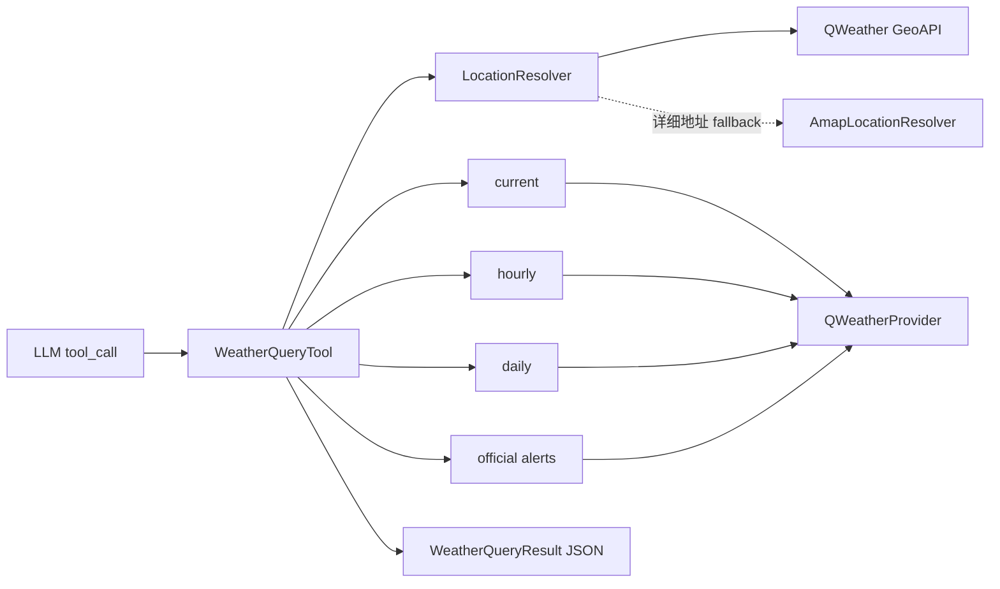
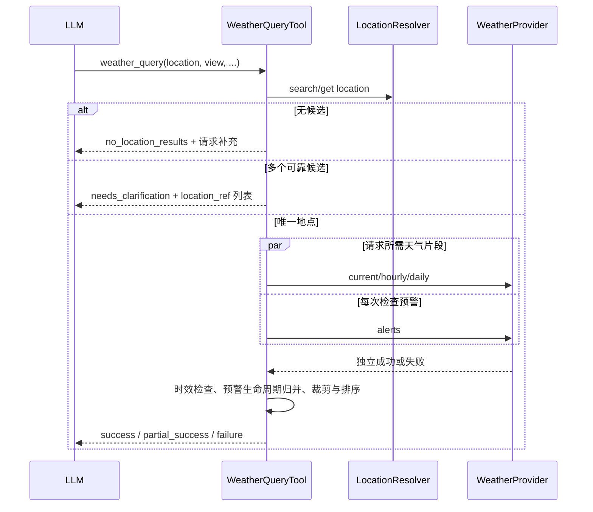

# 071 · 天气查询 - 技术方案

## 状态

CONFIRMED

## 需求文档

[requirement.md](./requirement.md)

## 1. 现状分析

### 1.1 工具运行时

现有工具链已经具备天气工具所需的通用基础：

- `agent.tools.protocol.Tool` 定义同步 `invoke()`、JSON Schema、工具描述和 `ToolResult`；
- `ToolResult.text` 承载喂回模型的结构化文本，`meta` 只用于诊断；
- `ToolRegistry` 和 `make_default_registry()` 集中负责默认工具装配；
- 065 已提供单工具超时、并发只读工具、运行预算、取消和重复失败检测；
- `tool_call_request` / `tool_call_result` 已进入会话事件，不需要新增事件类型；
- `agent/src/agent/prompt_sections/tool_usage_contract.md` 已承载跨工具的可信使用约束。

天气能力因此只需要新增一把内置只读工具和 provider，不修改 Conversation 主循环、事件 schema 或工具预算。

### 1.2 可复用的地点与凭据模式

`nearby_place_search` 已形成两项可复用经验：

1. 用户意图工具内部完成地点解析、歧义澄清和 provider 调用，不把底层步骤暴露给模型；
2. 工具始终注册，凭据缺失时由 unavailable provider 返回可恢复的配置提示。

当前 `AnchorCandidate`、`search_anchors()` 和 `get_anchor()` 仍定义在附近地点子包内，但它们表达的是通用的“文本地点 → 可靠候选 → 不透明引用”能力。天气查询也需要相同语义，并且详细地址的可选高德 fallback 会造成第二份重复实现。因此本需求把最小地点解析契约提取到 `agent.tools.location`，附近地点保留原有导出兼容，不改变其用户可见行为。

运行时凭据当前由 Tauri `runtime_config` 注册、写入系统 keyring，并按 effect 自动重启 Bridge。设置页已经按 provider 分组展示 Tavily 和高德凭据。天气凭据沿用这条链路。

### 1.3 Provider 调研结论

首期选用和风天气（QWeather）：

- 当前天气、小时预报、多日预报、GeoAPI 和官方天气预警由同一服务提供；
- 官方预警包含 ID、发布机构、事件、严重度、紧迫度、确定性、生命周期、有效时间和行动指引，能承载需求中的信任边界；
- 中国在其官方预警覆盖范围内，适合作为 agent-friend 当前的首选数据源；
- Google Weather API 当前不覆盖中国；
- Open-Meteo 适合全球数值预报，但没有满足本需求的官方天气预警接口。

和风天气当前要求使用账户专属 API Host；旧公共域名从 2026 年起逐步停用。首期采用 API Key 鉴权，避免把 Ed25519 私钥、Credential ID、Project ID 和 JWT 签名生命周期同时引入设置与运行时。provider 构造边界不绑定鉴权细节，未来可在不改变工具协议的情况下增加 JWT credential。

## 2. 方案概览

新增一把 `weather_query` 工具。模型只表达用户意图、地点和时间粒度；工具内部负责地点解析、必要天气片段选择、官方预警检查、部分成功组装和证据标记。



核心原则：

- 一把工具对应一个天气意图，不把 GeoAPI、预报和预警拆成多把模型工具；
- 任何天气 view 都检查官方预警；
- 只请求当前问题需要的天气片段；
- 天气片段与预警片段独立成功或失败；
- provider 原生枚举与文本尽量保真，未知值不导致解析失败；
- 地点无法可靠确定时先澄清，不按 rank 或候选顺序静默选择。

## 3. 模块与文件

### 3.1 新增文件

| 文件路径 | 说明 |
|---|---|
| `agent/src/agent/tools/location/__init__.py` | 导出通用地点候选、resolver 协议和组合 resolver |
| `agent/src/agent/tools/location/models.py` | `LocationCandidate` 通用地点模型 |
| `agent/src/agent/tools/location/protocol.py` | `LocationResolver` 最小协议 |
| `agent/src/agent/tools/location/composite.py` | 按顺序组合主 resolver 与可选 fallback |
| `agent/src/agent/tools/builtin/weather_query/__init__.py` | 天气工具公共导出 |
| `agent/src/agent/tools/builtin/weather_query/models.py` | provider 无关天气、预报、预警、状态与错误模型 |
| `agent/src/agent/tools/builtin/weather_query/tool.py` | 参数校验、地点澄清、片段编排、部分成功与 JSON 投影 |
| `agent/src/agent/tools/builtin/weather_query/providers/__init__.py` | provider 导出 |
| `agent/src/agent/tools/builtin/weather_query/providers/qweather.py` | 和风 GeoAPI、天气与预警 HTTP adapter |
| `agent/tests/test_weather_query_tool.py` | 工具层 fake provider 测试 |
| `agent/tests/test_qweather_provider.py` | 和风请求、解析、错误与兼容性测试 |
| `agent/tests/test_location_resolver.py` | 共享地点组合与 fallback 测试 |

### 3.2 修改文件

| 文件路径 | 改动 |
|---|---|
| `agent/src/agent/tools/builtin/nearby_place_search/models.py` | `AnchorCandidate` 改为共享 `LocationCandidate` 的兼容别名/再导出；附近地点专属类型不动 |
| `agent/src/agent/tools/builtin/nearby_place_search/providers/amap.py` | 继续实现现有附近地点 provider，同时满足共享 `LocationResolver` |
| `agent/src/agent/tools/factory.py` | 注入和风配置、组装共享地点 resolver、始终注册天气工具 |
| `agent/src/agent/tools/__init__.py` | 导出必要的天气公共类型，不扩大 provider 实现的公共面 |
| `agent/src/agent/prompt_sections/tool_usage_contract.md` | 增加实时天气必须使用天气工具、地点不得猜测、网页搜索不得伪装天气/预警的约束 |
| `agent/tests/test_tool_factory.py` | 覆盖有/无和风与高德凭据时的默认 registry |
| `frontend/src-tauri/src/runtime_config.rs` | 新增 QWeather group、API Key 与 API Host 两项 Bridge 凭据及测试 |
| `frontend/src/lib/runtime-config/index.ts` | 扩展 QWeather group 与 secret name 类型 |
| `frontend/src/lib/runtime-config/index.test.ts` | 覆盖天气凭据 mutation/effect |
| `frontend/src/pages/settings/components/RuntimeConfigPanel.tsx` | 增加“天气”设置组，复用现有 Select、RuntimeSecretList 与 SettingsGroup |
| `.env.example` | 登记 `QWEATHER_API_KEY`、`QWEATHER_API_HOST`，不填真实值 |
| `scripts/credentials/run.py` 及其现有声明/测试（若凭据 allowlist 在此维护） | 把两项天气凭据纳入既有凭据脚本，不新增脚本入口 |

设置页只新增现有组件组成的一个 provider 分组，不引入新 UI 组件或新样式 token。

## 4. 核心接口

### 4.1 通用地点解析

```python
@dataclass(frozen=True)
class LocationCandidate:
    ref: str
    name: str
    display_address: str
    administrative_area: str | None
    country: str | None
    country_code: str | None
    longitude: float
    latitude: float
    timezone: str | None


class LocationResolver(Protocol):
    name: ClassVar[str]

    def search_locations(
        self,
        *,
        query: str,
        administrative_area: str | None,
    ) -> tuple[LocationCandidate, ...]: ...

    def get_location(self, *, ref: str) -> LocationCandidate | None: ...
```

`ref` 是 provider 前缀的不透明引用，例如 `qweather:<location-id>` 或 `amap:<poi-id>`。模型只能原样复用工具返回值；工具按前缀路由到对应 resolver，不允许模型自行构造未知 ref。

`CompositeLocationResolver` 的顺序为：

1. 和风 City Lookup；
2. 和风支持的 POI Lookup；
3. 前两者无可靠候选且已配置高德时，使用高德文本地点搜索作为详细地址 fallback。

不会把不同来源的候选按 rank 混排。主 resolver 已返回候选时直接进入唯一性判断或澄清；只有无候选时才进入 fallback，避免同一地点因来源不同重复出现。

附近地点原有 `AnchorCandidate` 字段名通过兼容属性或局部转换保持，避免本需求顺手改写其工具结果与测试契约。

### 4.2 天气领域模型

核心模型采用明确字段并允许 provider 缺省可选数据：

```python
UnitSystem = Literal["metric", "imperial"]
WeatherView = Literal["overview", "current", "hourly", "daily", "alerts"]
AlertCheckStatus = Literal[
    "active",
    "no_active_alerts",
    "unsupported",
    "failed",
    "stale",
]


@dataclass(frozen=True)
class CurrentWeather:
    observed_at: datetime
    condition_text: str
    temperature: float | None
    feels_like: float | None
    humidity_percent: int | None
    precipitation: float | None
    wind_direction: str | None
    wind_speed: float | None
    wind_gust: float | None
    visibility: float | None


@dataclass(frozen=True)
class HourlyForecast:
    forecast_at: datetime
    condition_text: str
    temperature: float | None
    precipitation_probability_percent: int | None
    precipitation: float | None
    wind_speed: float | None
    wind_gust: float | None


@dataclass(frozen=True)
class DailyForecast:
    local_date: date
    day_condition_text: str | None
    night_condition_text: str | None
    temperature_min: float | None
    temperature_max: float | None
    precipitation_probability_percent: int | None
    wind_speed_max: float | None


@dataclass(frozen=True)
class WeatherAlert:
    alert_id: str
    message_type: str
    supersedes: tuple[str, ...]
    sender_name: str | None
    event_name: str
    event_code: str | None
    headline: str | None
    severity: str | None
    urgency: str | None
    certainty: str | None
    issued_at: datetime | None
    effective_at: datetime | None
    onset_at: datetime | None
    expires_at: datetime | None
    affected_area: str | None
    description: str | None
    instruction: str | None
    source_url: str | None
```

具体字段名可在实现时按项目命名风格微调，但以下语义固定：

- 时间在领域层一律解析为带时区 `datetime`；
- provider 原始严重度、紧迫度、确定性和事件 code 以字符串保存；
- CAP 核心值可用于排序，但新增或地区特有值原样保留并排在未知档，不因枚举扩展拒绝整条预警；
- 单位在工具结果顶层统一声明，数值字段不混用不同单位。

### 4.3 WeatherProvider

```python
class WeatherProvider(Protocol):
    name: ClassVar[str]

    def get_current(
        self, location: LocationCandidate, *, units: UnitSystem
    ) -> CurrentWeather: ...

    def get_hourly(
        self, location: LocationCandidate, *, hours: int, units: UnitSystem
    ) -> tuple[HourlyForecast, ...]: ...

    def get_daily(
        self, location: LocationCandidate, *, days: int, units: UnitSystem
    ) -> tuple[DailyForecast, ...]: ...

    def get_alerts(
        self, location: LocationCandidate
    ) -> AlertCheck: ...
```

分开四个稳定领域方法的目的不是复刻和风 endpoint，而是让工具能按意图取片段、并行执行和表达部分成功。未来 provider 即使底层只有一个聚合 endpoint，也可以在 adapter 内投影到相同接口。

### 4.4 工具参数

```json
{
  "type": "object",
  "properties": {
    "location": {
      "type": "string",
      "description": "用户明确提供的城市、区县、地点、地址或经纬度"
    },
    "administrative_area": {
      "type": "string",
      "description": "用户明确提供的国家、省州或城市范围，只用于缩小同名候选"
    },
    "location_ref": {
      "type": "string",
      "description": "上次澄清结果中的不透明地点引用，只能原样复用"
    },
    "view": {
      "type": "string",
      "enum": ["overview", "current", "hourly", "daily", "alerts"],
      "default": "overview"
    },
    "hours": {
      "type": "integer",
      "minimum": 1,
      "maximum": 72,
      "default": 24
    },
    "days": {
      "type": "integer",
      "minimum": 1,
      "maximum": 10,
      "default": 3
    },
    "unit_system": {
      "type": "string",
      "enum": ["metric", "imperial"],
      "default": "metric"
    }
  },
  "required": ["location"],
  "additionalProperties": false
}
```

参数语义：

| view | 请求片段 | 官方预警 |
|---|---|---|
| `overview` | 当前 + 未来 24 小时 + 未来 3 日；允许显式缩小/扩大到参数上限 | 必查 |
| `current` | 当前 | 必查 |
| `hourly` | `hours` 小时，最多 72 | 必查 |
| `daily` | `days` 日，最多 10 | 必查 |
| `alerts` | 不请求普通天气 | 查询预警本身 |

模型应按用户问题选择 view；未表达具体粒度时使用 `overview`。用户没有提供地点时不要调用工具填猜测值，先在自然语言中询问。

## 5. 工具执行流程



### 5.1 地点唯一性

沿用附近地点工具的保守规则：

- 只有一个候选时可直接使用；
- 多候选时，仅当规范化后的用户输入与候选完整名称或完整展示地址形成唯一精确匹配时自动选中；
- 其他情况返回最多 5 个候选，附 `additional_candidate_count`；
- 不按 provider rank、热度、城市中心距离或数组第一项静默选择；
- `location_ref` 失效时重新搜索并要求重新确认，不退回猜测。

坐标输入先校验经纬度范围，再由主 resolver 反查规范地点名、时区和国家信息。反查失败时不丢弃用户明确给出的合法坐标，但结果地点明确标为坐标，时区无法确定则不回答依赖当地日期边界的 daily/相对时间问题。

### 5.2 并行片段请求

地点确认后，使用标准库 `ThreadPoolExecutor` 并行请求 view 需要的天气片段与预警，最大 worker 数等于本次片段数且不超过 4。使用同一个可注入的 `httpx.Client`；结果按固定片段顺序组装，不按完成先后改变输出。

这样 overview 的 current/hourly/daily/alerts 不会串行叠加网络时延，也不改变外层 Tool Protocol 的同步接口。单个 HTTP 请求采用 provider 内较短超时，整把工具继续服从 065 的 30 秒工具超时。

### 5.3 部分成功

工具顶层状态：

- `success`：请求的普通天气片段全部成功，预警也得到可判定结果；
- `partial_success`：至少有一个用户可用片段成功，但另一个天气片段或预警失败/不可核实；
- `needs_clarification`：地点有多个候选；
- `no_location_results`：没有可靠地点候选；
- `configuration_required`、`quota_exhausted`、`rate_limited`、`temporary_failure`、`invalid_request`：没有可用结果时的失败状态。

`ToolResult.is_error` 规则：

- 澄清、无地点结果、完整成功和部分成功为 `False`，让模型能正常继续；
- 没有任何可用天气/预警片段的 provider 失败为 `True`；
- 普通天气失败但取得有效官方预警时返回 `partial_success`，优先保留安全信息；
- 预警失败但普通天气成功时返回 `partial_success`，并明确 `alert_check.status=failed`，不得说“没有预警”。

### 5.4 时效与预警生命周期

使用可注入 clock，所有判断在目标地点时区与 UTC instant 间明确转换：

- 当前天气观测时间距离本轮当前时间超过 2 小时，标为 stale，不作为最新当前天气；
- 小时/多日预报的 provider `updateTime` 超过 12 小时，片段标为 stale；
- 未来 forecast point 自身仍按其有效时间裁剪，不能用更新时间替代预报时间；
- `cancel` 消息取消其 `supersedes` 指向的预警；
- `update` 替代其 `supersedes` 指向的旧消息；
- 已明确过期的预警不进入 active 列表；
- 缺少或无法解析关键有效时间的预警不静默当作当前有效，进入 `stale`/时间不可核实状态，并保留标题与发布机构供模型谨慎提示；
- 同一 alert ID 去重，优先保留更新版本。

多条 active 预警按 CAP 核心值做保守排序：severity、urgency、certainty、发布时间。只对标准值建立排序权重；未知值保留原文并排在已知值之后，不映射成虚构的本地颜色等级。

### 5.5 预警覆盖判断

和风的“成功但零结果”本身不能区分无有效预警和地区未覆盖。provider 内维护一份隔离的、带官方文档链接与更新时间注释的受支持国家/地区代码集合：

- 目标 country code 在当前官方覆盖集合内，成功零结果 → `no_active_alerts`；
- 明确不在覆盖集合内 → `unsupported`；
- 无法可靠得到 country code，或 provider 响应不足以判断 → `failed`，不用“无预警”兜底；
- 覆盖集合只属于 QWeather adapter，不进入通用天气模型；未来换 provider 不复用该集合。

GeoAPI 响应没有可靠 ISO code 时，adapter 只对有明确证据的国家名称做 provider-local 规范化；未知名称保持未知，不靠模型或语言猜 country code。

## 6. QWeather Adapter

### 6.1 鉴权与 Host 安全

配置项：

- `QWEATHER_API_KEY`
- `QWEATHER_API_HOST`

两项都作为 `RuntimeConfigGroup::QWeather` 下的 Bridge secret 保存到 keyring，并支持同名环境变量与既有 `.env` fallback。API Host 虽不是传统密钥，但和风把账户专属 Host 作为鉴权保护的一部分，因此按敏感配置处理，不写日志、不进入诊断明文。

Host 在 provider 构造时严格校验：

- 只接受 hostname，不接受 scheme、path、query、fragment、userinfo 或显式端口；
- 必须是 `qweatherapi.com` 的合法子域，不能等于裸根域；
- 始终由代码拼为 `https://<host>`；
- 不跟随跨 host 重定向。

这既避免误配旧公共域名，也防止用户可控 base URL 变成 SSRF 入口。

API Key 只放 `X-QW-Api-Key` header，不放 query string，异常与日志不得包含 header 值。

### 6.2 Endpoint 映射

adapter 使用当前官方 API：

| 领域能力 | QWeather API |
|---|---|
| 城市/区县/坐标解析 | GeoAPI City Lookup |
| 支持的景点等 POI | GeoAPI POI Lookup |
| 当前天气 | Weather Now |
| 小时预报 | 根据请求小时数选最小覆盖档并裁剪 |
| 多日预报 | 根据请求日数选最小覆盖档并裁剪 |
| 官方预警 | Weather Alert current，经纬度查询 |

endpoint path 和档位选择集中在 adapter 内，通用模型与工具不感知版本号或 provider 路径。

### 6.3 错误映射

统一映射为：

- 凭据缺失、401/403、鉴权状态码 → `WeatherAuthenticationError`；
- 额度耗尽 → `WeatherQuotaError`；
- HTTP 429 或限流状态码 → `WeatherRateLimitError`；
- 参数或地点被 provider 拒绝 → `WeatherInvalidRequestError`；
- timeout、连接失败、5xx、非 JSON、结构异常和未分类状态 → `WeatherTemporaryError`。

业务错误由工具转为结构化 `ToolResult`；实现 bug 仍允许抛出，由通用工具运行时兜底。

### 6.4 Provider 兼容性

- 数字字段接受 provider 的字符串数值并做有限值校验；NaN/Infinity/越界值视为字段缺失，不污染整条结果；
- nullable 可选字段缺失时保持 `None`；
- 未知天气 code 使用 provider 文本，不因图标/code 新增失败；
- 未知预警事件、severity、urgency、certainty、message type 原样保留；
- attribution、官方来源 URL 与 provider 的延迟/时效声明保留在结果证据字段；
- 原始 provider payload 不写日志、不放 `meta`。

## 7. ToolResult 投影

成功或部分成功结果示意：

```json
{
  "source_type": "weather_query",
  "trust": "untrusted_data",
  "status": "partial_success",
  "location": {
    "name": "北京市东城区",
    "display_address": "中国 北京市 东城区",
    "latitude": 39.92,
    "longitude": 116.42,
    "timezone": "Asia/Shanghai"
  },
  "unit_system": "metric",
  "requested_view": "current",
  "current": {
    "observed_at": "2026-07-28T14:20:00+08:00",
    "condition": "多云",
    "temperature": 31,
    "feels_like": 34,
    "humidity_percent": 68,
    "wind_speed": 12
  },
  "alert_check": {
    "status": "failed",
    "checked_at": "2026-07-28T14:31:00+08:00",
    "message": "本次未能核实官方天气预警，不能据此判断为没有预警。",
    "alerts": []
  },
  "sources": ["QWeather"],
  "evidence_note": "天气与预警仅可引用本次返回字段；预警核实失败时不得回答为没有预警。"
}
```

投影约束：

- `overview` 最多返回 24 个小时点和 3 个日点；显式 hourly/daily 分别最多 72/10；
- 小时点只保留回答时序问题需要的紧凑字段，不重复日级信息；
- alerts 不截断关键安全信息；若 provider 返回过多条，完整保留 active 数量并按优先级返回前 10 条，增加 `additional_alert_count`，模型必须说明列表已截断；
- `meta` 只包含 provider 名、耗时、请求片段、结果数量和 alert status，不含 API Host、坐标、地点文本、天气正文或预警正文。

## 8. 默认 Registry 与配置链路

`make_default_registry()` 新增可选参数：

```python
def make_default_registry(
    session_store=None,
    *,
    ...,
    amap_webservice_key: str | None = None,
    qweather_api_key: str | None = None,
    qweather_api_host: str | None = None,
    stderr_warn: bool = True,
) -> ToolRegistry: ...
```

装配逻辑：

1. 高德 Key 可用时构造一次 `AmapNearbyPlaceProvider`，附近地点继续使用它，同时把它作为天气地点 fallback；
2. 和风 Key + Host 都可用时构造 `QWeatherProvider`，同时作为天气主 resolver 与天气 provider；
3. 和风任一项缺失时构造 `UnavailableWeatherProvider`，天气工具仍注册；
4. 只配置和风时，城市、区县、坐标和和风支持的 POI 可用；普通详细地址无法解析时请求用户补充城市；
5. 同时配置高德时，详细地址可进入高德 fallback；
6. 任何 provider 配置变化继续通过 `restartBridge` 生效。

设置页新增：

- 分组标题：`天气`
- 固定 provider：`和风天气`
- `QWeather API Key`
- `QWeather API Host`

复用现有 `RuntimeSecretList` 的隐藏值、覆盖、删除、来源和“已保存但尚未应用”行为。

## 9. Prompt 与工具描述

`weather_query.description` 必须写清：

- 当前、小时、多日天气和官方预警必须使用本工具；
- 用户没给可靠地点时先澄清，不调用时区/IP/历史聊天猜地点；
- `needs_clarification` 必须把候选交给用户并原样复用 `location_ref`；
- 普通天气 view 都已检查预警，不要另造预警结论；
- `alert_check=failed/unsupported/stale` 不能说“没有预警”；
- 预报推断与官方预警必须分开措辞；
- web search 可以补充新闻和公告原文，不能替代天气数值、时序和官方预警状态；
- 不向用户暴露 provider、API、鉴权、限流和内部错误码。

系统级 `tool_usage_contract.md` 只增加稳定的跨 provider 规则，不复制具体参数或和风字段。

## 10. 测试与验证

### 10.1 工具层

使用 fake resolver/provider 覆盖：

- overview/current/hourly/daily/alerts 的片段选择；
- 所有普通天气 view 均调用 alerts；
- 合法坐标、唯一地点、多候选、精确唯一匹配、截断候选与失效 ref；
- 不按 rank/首候选静默选择；
- 默认 24 小时/3 日与 72 小时/10 日上限；
- metric/imperial 单位投影；
- success、partial_success 和无可用片段失败；
- active/no_active/unsupported/failed/stale 五种 alert 状态；
- update/cancel/supersedes/expired/重复 ID 生命周期；
- 未知预警枚举保真和排序降级；
- 当前、预报和预警时间不可核实；
- 预警截断与 `additional_alert_count`；
- JSON 结果不含凭据或 provider 原始 payload。

### 10.2 QWeather adapter

使用 `httpx.MockTransport` 或注入 fake client 覆盖：

- API Host 合法/非法输入与 SSRF 防护；
- API Key 仅进入 header；
- GeoAPI city/POI 请求、候选解析和 ref 回查；
- current/hourly/daily/alerts endpoint、参数、档位与裁剪；
- nullable、数字字符串、未知 code、malformed JSON；
- 401/403/429/5xx、额度、限流和 provider 状态码映射；
- 支持地区零预警与不支持地区的区分；
- attribution、来源和时间解析。

### 10.3 集成与回归

- `test_tool_factory.py`：天气工具始终存在；配置完整时启用和风；缺一项时 unavailable；高德 fallback 可选；
- 共享 location 提取后，附近地点工具与高德 provider 原测试全部通过；
- Tauri runtime config 测试覆盖两项 secret、QWeather group、redaction、迁移快照与 `restartBridge`；
- TypeScript runtime-config 测试覆盖新 secret 类型和 mutation；
- 设置页通过 lint、typecheck 和现有组件约束；
- `tool_usage_contract` 相关 prompt 组合测试不退化；
- `./scripts/check` 全绿；
- 默认测试不发起真实 QWeather、Amap、Tavily 或 LLM 请求。

真实 QWeather smoke 只在用户另行授权并提供有效配置时执行；它不是默认自动化门禁。

## 11. 影响分析

### 11.1 上游与下游

- LLM 新增一把只读工具，但工具循环协议与事件类型不变；
- Bridge 重启后从既有 runtime environment 读取两项新配置；
- CLI、OpenAI bridge、AG-UI bridge 和桌面聊天都通过默认 registry 自动获得天气能力，无需各自接入；
- voice 路径若复用 Bridge 工具能力可自然使用天气工具，不修改 voice provider；
- 会话历史继续记录通用 tool call/result，memory 现有过滤规则不变；
- 设置页增加可见分组，但不增加路由、窗口或组件类型。

### 11.2 风险与控制

| 风险 | 控制 |
|---|---|
| 和风预警覆盖与字段变化 | provider-local 覆盖集合、未知枚举保真、官方来源与时效状态 |
| 零结果被误判为无预警 | 结合明确覆盖证据；无法判断时返回 failed，不乐观降级 |
| 地点语义选错 | 唯一精确匹配或用户澄清；禁止 rank/首项猜测 |
| 详细地址解析扩大耦合 | 共享最小 LocationResolver；高德仅作可选 fallback |
| overview 多请求导致延迟 | 地点确定后并行请求，且按 view 只取必要片段 |
| 用户配置恶意/错误 Host | 严格 qweatherapi.com 子域校验、强制 HTTPS、禁止 path/port/redirect |
| 预警原文过长 | 保留行动信息、限制 active 条数并标明截断，不静默丢失数量 |
| API Key 未来受限 | 鉴权封装在 QWeather adapter；未来可增加 JWT credential，不改工具协议 |
| 前端视觉回归 | 只复用现有设置组件；实现后按用户选择进行真实桌面端验收或标注用户验收 |

## 12. 实施顺序

1. 提取共享地点模型与 resolver，保持附近地点兼容并跑原测试。
2. 实现天气领域模型、错误类型和 fake 驱动的工具层测试。
3. 实现 QWeather adapter 与 HTTP 测试。
4. 接入 factory、prompt contract 和默认 registry 测试。
5. 接入 Tauri/TypeScript runtime config、设置页与凭据脚本。
6. 跑局部测试、前后端静态检查和完整 `scripts/check`。
7. 根据用户选择执行或跳过真实桌面端设置页视觉验收。
8. 如需真实 QWeather smoke，按外部 API 授权边界单独执行并记录。

## 13. 已确认设计选择

| 主题 | 选择 | 原因 |
|---|---|---|
| 首期 provider | QWeather | 中国天气与官方预警覆盖；单 provider 覆盖 Geo、预报、预警 |
| 鉴权 | API Key + 专属 API Host | 个人项目配置成本低；保留未来 JWT 扩展边界 |
| 默认 view | 当前 + 24 小时 + 3 日 + 预警 | 对自然天气问题信息完整，同时限制调用与上下文规模 |
| 预警策略 | 所有天气 view 默认检查 | 普通天气问题也不能漏掉重要官方预警 |
| 地点策略 | 不猜；和风主解析，高德可选详细地址 fallback | 保持可信性并覆盖常见城市/地点/地址输入 |
| 空气质量 | 本期不纳入 | 保持天气工具边界；通过相邻能力或新增工具扩展 |
| 部分失败 | 分片段返回 partial_success | 天气成功不掩盖预警失败，安全信息成功也不因普通天气失败被丢弃 |
| 工具运行时 | 不修改 | 复用 065 的超时、预算、并发、取消和诊断能力 |

## 14. 变更记录

| 日期 | 变更内容 | 是否需要重新实现 |
|---|---|---|
| 2026-07-28 | 初始方案确认；选用 QWeather、共享地点 resolver、按需天气片段、默认官方预警检查、部分成功和现有凭据链路 | 是 |
