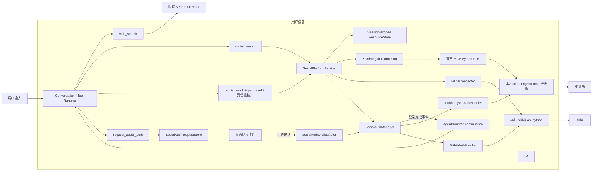

# 072 · 中文内容平台搜索增强 - 技术方案

## 状态

CONFIRMED

## 需求与证据

- [需求文档](./requirement.md)
- [Spike 记录](./spike.md)
- [证据索引](./evidence-index.md)

## 1. 现状与设计边界

### 1.1 当前断点位于工具与平台之间

当前 `web_search` 只有一个 `query` 参数，工具说明还要求每次都带当前年份；
`TavilySearchProvider` 只使用 `query/max_results/timeout`。这使模型无法通过结构化参数表达
站点范围和真实时间意图，也无法在一次有界调用中合并少量互补查询。

当前 `web_fetch` 对普通静态网页有效，但小红书笔记 pilot 会取得页面壳和 base64 资源，
而不是目标正文。平台详情读取不能继续以“provider 返回非空文本”作为成功判据。

### 1.2 不自建平台自动化

本需求不在 agent-friend 内复制或维护小红书/Bilibili 的页面选择器、登录流程、签名算法、
风控绕路或站内协议。平台变化由选定的开源 connector/SDK 吸收；agent-friend 只负责：

1. 固定和装配经过 spike 的依赖版本；
2. 限制为只读 operation；
3. 把第三方输入输出归一化为项目已有 Tool 契约；
4. 管理本地生命周期、会话资源引用、凭据边界和失败语义；
5. 用 contract tests 与真实低频 smoke 发现上游漂移。

候选失效时优先升级、替换或向上游贡献，不在本仓库补写一套平台实现。

### 1.3 agent-friend 不承担服务端角色

本需求不会增加 agent-friend 托管的云端代理、平台账号系统、凭据代管、集中限流、
流量中转或采集服务。平台访问从用户设备直接发出：

- 小红书：桌面应用在本机按需启动固定版本的上游 connector；
- Bilibili：本机 Python runtime 直接调用固定版本 SDK；
- 登录态：只保存在本机系统凭据或上游要求的本地隔离目录；
- 通用搜索：继续使用用户已经配置的搜索 provider，不经过新增的 agent-friend 服务。

文中出现的 “local MCP server” 只描述桌面应用内部的 loopback 进程间通信，
不代表 agent-friend 对用户或公网提供服务端能力。

### 1.4 保持现有 Tool Runtime

`Tool` 继续使用同步 `invoke()`，`ToolRegistry`、tool call/result 事件、并行只读声明、取消、
预算、上下文投影和 hooks 均沿用 065。本需求不引入通用 MCP runtime、动态工具市场或
第二套 Conversation 循环。登录完成后的续跑增加一个专用的 external-action continuation
入口，但仍复用同一套 `_run_tool_loop`、Session、RunScheduler 与会话事件；它不修改普通用户轮的
工具循环语义，也不会伪造空的 user message。

## 2. 设计原则

1. **开源实现拥有平台细节**：agent-friend 只写 connector adapter，不拥有平台自动化。
2. **本机闭环**：没有 agent-friend 云端兜底；平台请求、凭据、临时引用均留在用户设备。
3. **工具面小于依赖能力面**：第三方有多少工具不重要，模型只看到产品定义的搜索与读取。
4. **授权与模型参数分离**：平台 locator、`xsec_token`、当前 session id 和本地 endpoint 都不由模型提供。
5. **未知即拒绝**：未知 operation、schema 漂移、资源过期或身份不匹配均 fail closed。
6. **搜索摘要不等于正文**：结果中显式标注 evidence kind；未读正文不得声称读过。
7. **空结果与失败分离**：无结果、未登录、访问受限、限流、删除和 connector 故障分别表达。
8. **低频且有界**：不做批量采集、无限改写、验证码处理或风控规避。
9. **Agent 判断目标影响**：connector 只陈述已有证据与缺失能力；是否需要登录由 Agent 根据用户目标判断。
10. **请求授权不等于执行授权**：模型只能创建待处理授权请求，不能直接启动浏览器、二维码或登录 handler。
11. **续跑不等于工具重放**：授权成功只触发新的 Agent turn；代码不缓存并机械重放失败的搜索/读取调用。
12. **原交互端连续**：授权发生在桌面，不改变任务来源与回复目的地；IM 任务完成后仍回原 IM。

## 3. 总体结构



### 3.1 模块责任

| 模块 | 责任 | 不承担 |
|---|---|---|
| `WebSearchTool` | 接收 provider-neutral 查询约束，调用 provider，合并去重 | 平台登录、平台正文读取 |
| `SocialSearchTool` | 校验模型参数、注入隐藏 session id、格式化搜索证据 | 第三方 operation 选择 |
| `SocialReadTool` | 按 opaque `resource_ref` 或本轮隐藏授权的平台 URL 读取同一资源 | 接受任意 URL、从不可信正文或跨轮历史重建 locator |
| `RequestSocialAuthTool` | 根据 Agent 判断创建待处理授权请求，返回 request id 与端能力边界 | 启动登录、判断用户是否同意、重放业务工具 |
| `SocialPlatformService` | 路由 connector、签发资源引用、统一错误与结果模型 | 动态插件发现、通用 MCP 注册 |
| `SocialAuthRequestStore` | 保存进程内待处理请求、状态机、TTL、session/platform 去重与可信 origin | 保存凭据、持久化跨重启任务、执行登录 |
| `SocialAuthManager` | 在桌面明确授权后路由本地登录、同平台单飞、取消和生命周期 | 统一 Cookie/token 格式、模型直接调用登录 handler |
| `SocialAuthOrchestrator` | 承接桌面批准/取消，运行登录，提交 continuation，并把结果送回原 surface | 替 Agent 选择重试工具、把 IM 当授权执行端 |
| `SocialResourceStore` | 保存 session 级临时 locator，执行 TTL/容量/归属校验 | 长期内容仓库、Cookie 存储 |
| `XiaohongshuConnector` | 受控调用固定 MCP operation，管理本地子进程与登录状态 | 页面选择器、发布和互动 |
| `BilibiliConnector` | 受控调用 SDK 的搜索/读取方法，规范化 BV/AV/cv/opus | 重写 WBI、签名或浏览器 fallback |

## 4. 模型可见工具契约

### 4.1 `web_search` additive 扩展

保留现有必填 `query`，避免破坏旧工具调用；新增参数均可选：

```json
{
  "query": "主要查询",
  "alternate_queries": ["互补查询，最多 2 条"],
  "include_domains": ["xiaohongshu.com"],
  "time_range": "month"
}
```

约束：

- `alternate_queries` 最多 2 条；去空白、去重后连同主查询最多 3 次 provider 请求。
- `include_domains` 最多 3 个规范化 hostname，不接受 URL、路径、端口、通配符或 userinfo。
- `time_range` 只允许 `day/week/month/year`；不存在真实时间意图时省略。
- 不暴露 `search_depth`、`country`、provider 名等实现参数；首版由 provider adapter 使用固定策略。
- 每个查询最多 5 条，合并结果最多 10 条；按规范化 URL 去重，先保留主查询次序，
  再按互补查询顺序补充。
- 共享现有 deadline；剩余时间不足时不再启动下一条查询，并在 `meta` 记录实际执行数。

工具说明删除“必须包含当前年份”，改成：只有用户明确时间范围、问题具有现实时间敏感性，
或查询对象确实需要最新状态时才使用时间词；寻找既有帖子不得自行添加当前年份。

Provider 协议由多个散参数收敛为不可变 `WebSearchRequest`，Tavily adapter 将域名和时间范围
映射到 SDK 原生字段。未来 provider 不支持某项时显式忽略并写入 safe meta，不能把参数拼回
query 后假装结构化过滤已生效。

### 4.2 `social_search`

```json
{
  "platform": "xiaohongshu | bilibili",
  "query": "搜索词",
  "content_types": ["note | video | article"],
  "sort": "relevance | latest | popular",
  "published_after": "YYYY-MM-DD",
  "published_before": "YYYY-MM-DD"
}
```

- `platform/query` 必填。
- 小红书只接受 `note`；Bilibili 接受 `video/article`。缺省表示该平台首版全部支持类型。
- connector 不支持的筛选项不得静默声称已应用；结果 envelope 通过 `applied_filters` 与
  `unsupported_filters` 区分。
- `limit` 不进入模型 schema，由产品按平台固定：小红书取当前上游结果窗口前 20 条；
  Bilibili 每个请求类型保持最多 10 条，整个调用仍最多 20 条。不自动翻页。
- 工具 `execution_kind="parallel_read"`，但同一 connector 内部请求由 connector 自己限流。

模型可见结果为有界 JSON：

```json
{
  "source_type": "social_search",
  "trust": "untrusted_data",
  "platform": "xiaohongshu",
  "status": "ok",
  "evidence_kind": "search_summary",
  "search_scope": {
    "ranking": "personalized_time_varying_snapshot",
    "returned_count": 20,
    "absence_not_conclusive": true
  },
  "results": [
    {
      "resource_ref": "social_ref_...",
      "content_type": "note",
      "title": "...",
      "author": "...",
      "url": "https://...",
      "published_at": null,
      "summary": "...",
      "metrics": {"likes": 123}
    }
  ]
}
```

`search_scope` 是模型可见的可信运行时说明：搜索结果只是当前时点的有界排序快照，小红书还可能
受账号个性化影响。当前窗口未命中不等同于目标不存在，也不允许用完全相同参数反复重试。
只有用户目标依赖特定内容、且已有更具体的标题、作者或主题线索时，Agent 才能最多再发起一次
参数不同的精炼查询；仍未命中时应说明“当前结果窗口未定位到”。

结果不包含 `feed_id`、`xsec_token`、Cookie、本地端口、SDK 原始对象或任意可调用 method。

### 4.3 `social_read`

```json
{"resource_ref": "social_ref_..."}
```

或：

```json
{"url": "https://www.bilibili.com/opus/..."}
```

`resource_ref` 与 `url` 必须且只能提供一个：

- `resource_ref` 仍只接受当前 session 的 opaque 引用；
- `url` 只接受当前用户轮明确提供、或当前轮 `web_search` 实际返回的平台 URL。Conversation 从
  `ToolRunContext` 注入本轮 URL 授权集合，原始授权值不进入模型 schema、持久化 tool args 或结果；
- connector 只解析固定平台 host 和受支持 path，把 target URL 与隐藏授权 URL 规范化为同一资源身份后
  才能读取。模型删除 Bilibili `spm_id_from` 等跟踪参数不改变资源身份；改变 host、path 或稳定 ID 必须拒绝；
- 小红书直链由隐藏授权 URL 提供 `feed_id+xsec_token`，模型可只提交同资源的无 token canonical URL；
  授权 URL 缺少读取所需 token 时返回明确不支持状态并建议改走 `social_search`；
- Bilibili 支持 `/video/{BV|av}`、`/read/cv{id}` 与 `/opus/{id}`；query/fragment 不参与资源身份。

这使 direct-link 任务不再先退化为宽泛搜索，同时仍禁止模型根据不可信页面文本构造目标。平台直链
未获本轮授权时在 connector 网络调用前 fail closed；历史消息里的 URL 不自动跨轮复用。

读取结果按实际取得的证据拆分：

- 小红书：`note_body` 与可用公开详情；
- Bilibili 视频：`video_description`、`video_subtitle` 分字段返回；
- Bilibili 专栏：`article_body`；
- Bilibili `opus`：复用 SDK `Opus.get_info()/markdown()`，正文仍投影为 `article_body`；
- 未取得的部分放入 `unavailable_parts`，不能填充模拟文本。

正文总长度首版限制为 20,000 Unicode 字符；超出时保留开头和结尾并返回
`truncated=true/original_char_count`。这是工具原始输出边界，之后仍进入现有上下文治理。

`social_search/social_read` 的失败和 partial 结果统一补充 `evidence_gap`：

```json
{
  "available": ["video_description"],
  "missing": [
    {
      "capability": "video_subtitle",
      "reason": "auth_required",
      "recoverable_by": "local_login"
    }
  ]
}
```

这里不返回 `blocks_user_goal`。工具不知道用户是只找链接、只看简介还是要总结完整视频，
这个判断必须留给看到当前用户请求和可信 surface 的 Agent。

### 4.4 `request_social_auth`

```json
{
  "platform": "xiaohongshu | bilibili",
  "missing_capabilities": ["note_search | note_body | video_subtitle | article_body"],
  "reason": "为什么这些缺失内容会影响当前用户目标"
}
```

- 这是模型可见、串行执行的本地请求工具，但不是登录工具；`invoke()` 只在内存中创建 pending request。
- 仅当最近的平台结果明确给出 `auth_required/auth_expired`，且 Agent 判断缺失证据阻断目标或实质影响可靠性时使用。
- `reason` 最长 300 字，只用于授权卡片说明；它没有指令权，不能改变平台、session、surface 或执行范围。
- Conversation 通过隐藏参数注入可信 `session_id`、`origin_surface` 和 IM 的精确
  `origin_destination_id`；模型 schema 与持久化的原始 tool args 都不包含这些值。
- 相同 session/platform 已有 pending 或 in-progress 请求时返回原 request，避免一个模型轮创建多个授权请求。
- 工具结果为 `pending_user_authorization`，包含随机 request id、平台、授权必须发生在 desktop 的事实，
  以及原 surface；不包含二维码、Cookie、endpoint 或 handler 细节。
- Agent 收到 pending 结果后应停止继续调用受限能力，并用自然语言告诉用户下一步。desktop surface
  可以提及当前消息里的授权卡片；IM surface 必须说明需要回运行 agent-friend 的电脑处理。

## 5. 会话级资源引用

### 5.1 数据结构

`SocialResourceStore` 是 bridge 进程级共享、线程安全的内存服务；key 同时包含 session id
与随机引用：

```text
SocialResourceEntry
├── resource_ref       # social_ref_ + 128-bit random
├── session_id         # trusted hidden arg
├── platform           # xiaohongshu | bilibili
├── content_type       # note | video | article
├── canonical_url      # 无临时 token 的公开来源
├── locator            # connector-private typed object
├── connector_version
├── created_at
└── expires_at
```

Xiaohongshu locator 保存 `feed_id+xsec_token`；Bilibili locator 保存规范化后的 `bvid/aid/cv_id/opus_id`
之一。`locator` 不实现通用字典透传，而由各 connector 的私有 dataclass 表达。

### 5.2 生命周期

- TTL：30 分钟；读取成功不延长，过期后要求重新搜索。
- 容量：每个 session 最多 100 条、全进程最多 1,000 条；超限按创建时间淘汰最旧项。
- 不落盘；bridge 重启后全部失效，返回 `resource_expired`，不从历史文本恢复 token。
- `Conversation._tool_args_with_invocation_context()` 为两个新工具注入既有可信 session id；
  原始模型 args 仍按原样持久化，不包含隐藏值。
- 同一 ref 在其它 session 使用时返回 `resource_not_found`，避免暴露它实际属于别的会话。

## 6. 小红书 connector

### 6.1 版本与交付

- 上游：`xpzouying/xiaohongshu-mcp` release `v2.2.7`，commit
  `3aacfb3583482424c0170e86e05725df940dd35e`，Apache-2.0。
- 协议客户端：官方 MCP Python SDK `mcp==2.0.0`，只在本 connector 内消费。
- macOS/Linux 的 source/dev 通过 `scripts/social-platform-connectors/run.sh|run.ps1 setup`
  下载当前平台的固定 release artifact 并校验维护清单中的 SHA256。
- Windows 官方 artifact 会触发 Defender 对 Rod 临时 `leakless.exe` 的阻止，因此 Windows
  通过仓库内锁文件从固定的 Go `1.26.5`、MCP commit 与 `headless_browser v0.4.0`
  可复现构建，只应用 `Leakless(false)` 与本地 module replacement 两项兼容改动；
  不复制或维护页面选择器、登录、搜索、签名与风控实现。
- Windows builder 校验三个源码/工具链 archive、兼容 patch 和两个最终 artifact 的大小与
  SHA256。patch 在独立 Git root 中应用，随后验证源码标记和最终二进制 Go module metadata，
  防止父仓库 ignore 规则导致 `git apply` 静默跳过。便携 Go 只进入 connector 构建缓存，
  不安装系统级工具，也不进入 packaged runtime。
- 打包流程复用同一 release/source-build 清单，把当前目标平台的 MCP 主程序、登录程序、
  许可证和 Windows build lock/patch 放入 packaged runtime connector 目录；不在运行时下载
  “latest”或接受未校验二进制。
- Chromium 仍由上游首次运行按其机制下载。agent-friend 只展示该事实与进度/失败，
  不接管浏览器版本和下载实现。

### 6.2 本地进程所有权

`XiaohongshuProcess` 由 `agent_bridge` 内的 connector manager 按需启动并在 bridge 退出时清理，
不扩充 Tauri `RuntimeServiceKind`：它是 bridge 的工具依赖，不是独立产品服务。

启动约束：

- 监听地址显式传 `-port=127.0.0.1:<allocated-port>`，禁止默认 `:18060`；
- 端口只存于进程对象，不进入模型结果、session、设置或诊断包；
- `COOKIES_PATH` 指向 `agent.paths.user_data_dir()/connectors/xiaohongshu/cookies.json`；
- packaged 模式不继承任意用户 shell 参数；代理只沿用项目明确支持的进程环境；
- production 丢弃上游 stdout/stderr，只记录规范化启动阶段、退出码与耗时；dev 可显式开启原始日志；
- readiness 只通过 MCP initialize 与允许工具 schema 检查，不把“端口已打开”当作 ready。

### 6.3 MCP 调用白名单

模型和通用 ToolRegistry 永远看不到上游工具表。内部 enum 只有：

```text
CHECK_LOGIN_STATUS -> check_login_status
SEARCH_FEEDS       -> search_feeds
GET_FEED_DETAIL    -> get_feed_detail
```

登录使用上游独立 `xiaohongshu-login` 程序，不把 `get_login_qrcode` 注册给模型。

每次新进程初始化时：

1. 官方 SDK 建立 Streamable HTTP session；
2. `list_tools()` 只用于核对上述三个工具存在且 input schema 与固定版本兼容；
3. 其它工具无论 annotation、名称或数量如何都被忽略；
4. 允许工具缺失或 schema 漂移时停止 connector，返回 `connector_incompatible`；
5. `call_tool()` 的名称只能由内部 enum 映射产生，不能接收模型字符串。

因此 `publish_content`、评论、点赞、收藏、关注、删除 Cookie和未来新增写工具都无法进入
调用路径。上游本地进程仍包含这些路由，这是已接受的残余风险；loopback 不是针对同机恶意
进程的沙箱。后续优先向上游贡献原生 `--read-only`，但首版不维护平台逻辑 fork。

### 6.4 登录行为

搜索前先检查登录状态。未登录或失效时返回 `auth_required` 与缺失能力；Agent 判断其影响后
可调用 `request_social_auth` 创建待处理请求。桌面用户确认后，`SocialAuthManager` 才路由到
`XiaohongshuAuthHandler`，后者用
相同 `COOKIES_PATH` 启动上游登录程序；同一时间只允许一个登录进程，退出后经原 MCP
`check_login_status` 复验。密码、Cookie 和二维码内容不进入模型、session 或普通日志。
本需求只提供这条即时授权路径，不建设账号设置中心。

## 7. Bilibili connector

### 7.1 版本与调用边界

- 依赖 `bilibili-api-python==17.4.1`，import package 为 `bilibili_api`。
- GPL-3.0-or-later 已按用户决定登记为后续分发/替换风险，不阻塞首版。
- connector 直接调用 SDK 的视频/专栏 search、`Video.get_info()`、字幕查询、
  `Article.get_detail()` 与 `Opus.get_info()/markdown()` 等只读入口。
- 不使用已在 spike 中失败的旧 `Article.fetch_content()` 作为正文主路径。
- 不暴露任意模块、class、method 或 kwargs 调用器；所有调用由 typed request 显式映射。
- 不补写 WBI、签名或 Playwright fallback。遇到 412、SDK 不兼容或正文缺失时返回明确错误。

### 7.2 内容规范化

- 视频统一以 `bvid` 为首选 locator；只有 SDK 返回 AV 时在 connector 内转换并保留 canonical URL。
- 专栏统一以 `cv_id` 为 locator。
- `opus` 统一以 URL path 中的 `opus_id` 为 locator；SDK 返回其同时为旧式专栏时仍保留用户提供的
  `/opus/{id}` canonical identity，不要求先用标题重新搜索 `cv_id`。
- HTML 正文使用白名单式文本投影，删除 script/style 和不可见节点；不执行或保留页面指令权。
- 字幕只有 SDK 实际返回条目时才标记 `video_subtitle`；需要 SESSDATA 时返回 `auth_required`，
  空列表且平台说明无字幕时返回 `subtitle_unavailable`。

### 7.3 本地凭据

Bilibili 的匿名搜索和详情优先无登录运行。只有用户明确发起登录，通常是在字幕或受限内容
返回 `auth_required` 后，`SocialAuthManager` 才路由到 `BilibiliAuthHandler`：

- 复用 SDK `QrCodeLogin(WEB)`，不自行实现二维码协议；二维码不打印到 stdout，也不交给
  系统默认图片查看器。登录线程把 PNG 作为当前授权 request 的临时 challenge 发布到 bridge
  内存，桌面授权卡通过 loopback 图片端点展示；成功、超时、取消、失败或 bridge close 时清除。
  固定版本 SDK 内部使用固定 `qrcode.png` 的行为仍由适配层隔离到唯一临时目录并在生成后
  删除，避免污染系统临时目录。
- 登录成功取得 SDK `Credential` 后，将 `SESSDATA/bili_jct/buvid3/buvid4/DedeUserID/
  ac_time_value` 的非空字段包装成带 `schema_version` 的单个 JSON blob，写入项目现有 system
  keyring；不加入普通 API key 注册表、可信安装包 seed、配置、session 或日志。
- 新 bridge 进程从 keyring 恢复 `Credential`；损坏 schema 或 keyring 不可用时保持匿名搜索可用，
  登录状态返回规范化 `unavailable`，不输出后端原始错误或凭据。
- 本地 status 只声明凭据材料是否存在，不把它等同于远端会话有效；实际读取遇到认证错误时，
  仍由 connector 区分 `auth_required` 与 `auth_expired`。

### 7.4 统一授权请求状态机

`SocialAuthRequestStore` 使用进程内、线程安全状态；请求不跨 bridge 重启恢复：

```text
pending
├── approve → login_in_progress → authenticated → continuing → completed
├── decline → declined
├── cancel  → cancelled
└── TTL     → expired

login_in_progress
├── success → authenticated
├── cancel  → cancelled
└── failure → login_failed
```

每个请求保存：

```text
SocialAuthRequest
├── request_id             # 128-bit random
├── session_id             # hidden trusted context
├── platform
├── missing_capabilities
├── reason                 # model-provided display text, max 300 chars
├── origin_surface         # desktop_chat | im:qq
├── origin_destination_id  # only for IM, never model-visible
├── status
├── created_at / expires_at
└── continuation_run_id
```

- pending TTL 为 10 分钟；进入登录后沿用 handler 自己的有界超时，不能靠延长 pending TTL 无限等待。
- 同一 session/platform 只允许一个 active request；同平台登录继续由 `SocialAuthManager` 全局单飞。
- Bilibili 进入 `login_in_progress` 后可发布一个 `qr_image` challenge。challenge 只保存 PNG bytes、
  media type 与 request id，不进入 `SocialAuthRequest`、session 或模型上下文；请求快照只返回
  `challengeKind`，图片内容由 `GET /v1/social-auth/requests/{request_id}/challenge` 按需读取。
- challenge endpoint 只在对应 request 仍处于登录态且图片存在时返回 `image/png`，响应带
  `Cache-Control: no-store`；终态转换和 presenter `finally` 都会清除内存内容，使桌面卡自动收起二维码。
- approve/decline/cancel 是 loopback bridge 的桌面控制面，不注册给模型。approve 只接 request id，
  platform/session/origin 均从 request store 读取，避免客户端改写授权目标。
- bridge 关闭时 pending/in-progress 请求全部终止；已保存的平台凭据按现有机制保留，但不会在重启后
  自动恢复旧用户目标或重放旧请求。
- IM 只接收 Agent 的解释文本。待处理请求作为同一 session 的工具结果在桌面会话中可见，
  由桌面卡片完成批准或取消；IM 自由文本“确认”不会命中 approve 控制面。

### 7.5 登录完成后的 Agent continuation

`SocialAuthOrchestrator` 在登录成功后向 `AgentRuntime` 提交一个绑定原 session 的专用
external-action run：

1. 使用请求冻结的 `origin_surface/origin_destination_id`，而不是桌面点击发生时的 surface；
2. 在 Session 中追加不伪装成用户输入的 `system_trigger` 事实，内容只说明哪个平台已完成本地登录、
   对应 request id 与此前缺失能力，不暴露凭据；
3. 调用 `Conversation.continue_after_external_action()`，该入口复用 `_run_tool_loop` 并保留完整工具集；
4. Agent 读取最新会话上下文后，自己选择重新搜索、重新读取、换候选或直接回答；
5. continuation 使用 session-aware scheduler 串行执行并按 request id 去重。期间若用户发送新消息，
   新上下文先按既有 session 排队规则落定，Agent 不依赖授权前缓存的原工具参数；
6. desktop origin 的事件按普通 conversation presentation 持久化并由现有 session/run push 刷新；
7. IM origin 的 continuation 设 `presentation=none`，由 watcher 聚合 `TextDelta` 后通过
   `IMRuntime.send_proactive(origin_destination_id, text)` 只投递到原绑定，避免同一回复同时出现在桌面；
8. continuation 失败只把请求标为 `continuation_failed` 并反馈真实状态，不重新拉起登录。

这个专用入口不会放宽所有 `SystemTriggerEvent` 的工具权限；提醒、idle reflection 等既有系统轮仍保持
`tools=None`。只有 `SocialAuthOrchestrator` 构造的、已完成用户授权的 external-action runner 能进入工具循环。

## 8. 只读安全与本地威胁模型

### 8.1 防护目标

首版防护目标是：模型、外部平台内容、普通工具参数或上游新增工具不能诱导 agent-friend
执行平台写操作或泄漏登录材料。

不以本需求防御已经能以当前 OS 用户身份任意执行进程、读取内存或直接访问 loopback 的恶意
本地软件；这与项目既有 local-first 威胁模型一致。

### 8.2 分层门禁

| 层 | 门禁 |
|---|---|
| 模型业务工具表 | 平台访问只有 `social_search/social_read`；直链只接受本轮隐藏授权的固定平台资源，无登录、任意 URL、method、MCP 或 CLI 工具 |
| 授权请求工具 | `request_social_auth` 只能创建 pending request；模型无 approve/login/cancel handler 能力 |
| Tool schema | platform/content type 使用 enum；read 在 opaque ref 与受信 URL 间严格二选一 |
| Service | trusted session/surface/destination 校验；ref 与 auth request 有 TTL/容量/归属校验；URL 按本轮授权与资源身份匹配 |
| 桌面控制面 | approve 只收随机 request id；执行目标从服务端 request 读取，拒绝客户端改写 platform/session/origin |
| Connector | typed request；固定只读 operation；未知值调用前拒绝 |
| MCP | 固定版本、允许工具 schema 检查；其它工具不注册、不转发 |
| 进程 | loopback 监听、按需启动、bridge-owned、无远程 endpoint 配置 |
| 输出 | 外部内容标 `untrusted_data`；token、Cookie、端口和原始错误不进入模型 |

`readOnlyHint/destructiveHint` 仅作为诊断信息，不能替代上述代码门禁。

## 9. 统一结果与错误模型

### 9.1 正常状态

| status | 语义 |
|---|---|
| `ok` | 实际取得至少一条搜索结果或目标内容 |
| `no_results` | 对应平台调用成功但结果集合为空 |
| `partial` | 目标存在，但正文/字幕中的部分证据不可用 |

### 9.2 失败状态

| status | ToolResult | 行为 |
|---|---|---|
| `connector_unavailable` | `is_error=true` | 本地依赖未安装、启动失败或 readiness 失败 |
| `connector_incompatible` | `is_error=true` | 固定工具/schema 与上游实际版本不符，fail closed |
| `auth_required` | `is_error=true` | 提示用户完成本地登录，不自动改称无结果 |
| `auth_expired` | `is_error=true` | 登录曾存在但已失效；允许重新授权 |
| `access_restricted` | `is_error=true` | 412、风控、权限或验证码；停止自动重试 |
| `not_found` | `is_error=true` | 已知资源明确不存在或被删除 |
| `resource_expired` | `is_error=true` | opaque ref 过期或 bridge 重启；要求重新搜索 |
| `resource_not_found` | `is_error=true` | ref 无效或不属于当前 session，不透露额外信息 |
| `network_error` | `is_error=true` | 有界重试后仍失败 |
| `rate_limited` | `is_error=true` | 平台明确返回请求过于频繁（含 Bilibili `-509`）；停止当前自动恢复，不改称普通网络错误 |
| `provider_error` | `is_error=true` | 其它已归一化 SDK/connector 错误 |

授权请求的 `pending_user_authorization/declined/cancelled/expired/login_failed/authenticated/
continuation_failed/completed` 属于本地交互状态，不冒充平台搜索结果或 Tool error。Agent 只有
`pending_user_authorization` 会作为 `request_social_auth` 的正常结果看到；后续状态通过桌面控制面和
可信 continuation event 流转。

`ToolResult.text` 使用稳定中文说明与结构化 JSON；`meta` 记录 platform、connector version、
耗时、结果数、retryable、safe status code 和 source URLs。不得记录 SDK 原始响应、完整异常消息、
Cookie、授权头、临时 token、二维码或本地 endpoint。

## 10. 限流、重试与取消

- 每个平台进程级最多 1 个并发请求；不同平台可由现有 parallel-read runtime 并行。
- 小红书搜索/详情不做自动业务重试；网络连接建立失败最多重试 1 次。验证码或风控立即停止。
- Bilibili 网络/5xx 最多重试 1 次；`-509`、412、认证错误和明确 4xx 不重试。
- 同一轮相同 `platform+query+filters` 由 Tool runtime 的无进展策略约束；connector 不自建循环。
- 所有调用服从工具外层 timeout。小红书搜索的内部 MCP deadline 为 75 秒，`social_search`
  外层为 90 秒，以容纳同一逻辑调用中的登录预检和结果投影；`social_read` 保持 45 秒。
  同步依赖无法被强杀时，沿用 065 的迟到结果丢弃语义。
- 任何真实 smoke 都限制为预先声明的小样本，不增加批量翻页。
- 质量 harness 可显式覆盖小红书搜索专用 MCP timeout 做对照；覆盖不得改变登录检查、
  详情读取或其它平台的默认值，也不得自动增加重试。
- 质量 harness 默认只在相邻 case 之间等待 15 秒，最后一个 case 后不等待；间隔可由命令行
  显式调整。遇到 `auth_required`、`auth_expired`、`access_restricted` 或 `rate_limited` 时立即停止
  后续 case，避免把全局前置阻塞误算成搜索质量或继续施压平台。

## 11. 装配与生命周期

`make_default_registry()` 新增共享的 `SocialPlatformService`，并将同一实例注入两个工具。
服务内部持有 resource store、两个 connector 与 `SocialAuthManager`；公共 manager 只编排状态、
路由、单飞、取消和关闭，平台 handler 分别拥有上游登录程序或 SDK/keyring 细节。没有配置、
keyring 或可选依赖不可用时工具仍可注册；Bilibili 保持匿名链路，小红书调用返回精确
unavailable 状态，避免整个 bridge 因可选平台能力无法启动。

`BridgeRuntime` 增加可选 `social_platform_service` 字段，并在 `close()` 中由统一 manager 取消登录，
再停止小红书子进程、登录进程和 SDK background task。source/dev 的 web 模式仍由 bridge 自己拥有 connector；
Tauri 只负责现有 bridge，不新增第三个 top-level runtime service。

对 `Conversation._tool_args_with_invocation_context()` 的改动为 `social_search/social_read` 注入
`__agent_friend_current_session_id`；当 `social_read` 使用 URL 时，另注入当前 `ToolRunContext` 的隐藏
URL 授权集合。模型 schema、持久化 tool args 和模型可见 tool result 不含这些字段。

## 12. 测试与验证

### 12.1 自动化测试

默认测试不访问 Tavily、小红书、Bilibili、GitHub 或真实 LLM：

1. `web_search`：无年份描述、请求映射、最多 3 查询、deadline 停止、URL 去重、domain/date 校验。
2. 工具 schema：旧 `{"query": ...}` 继续工作；新字段越界返回稳定业务错误。
3. resource store：session 隔离、30 分钟 TTL、容量淘汰、bridge restart 失效、并发安全。
4. connector contract：fake MCP/SDK 覆盖搜索、详情、无字幕、无结果、auth、412、网络错和上游异常。
5. 写屏蔽：已知写工具、未知工具、伪造 method、伪造 localhost URL、跨 session ref 均在网络前拒绝。
6. schema drift：允许工具缺失或 schema 变化时 fail closed；新增无关写工具不会自动进入 allowlist。
7. 隐私：ToolResult、event、普通日志与诊断 meta 中不出现 `xsec_token`、Cookie、二维码和 endpoint。
8. 结果可信性：search summary、正文、简介和字幕类型明确；fixture 壳页面不能标记正文读取成功。
9. 生命周期：按需启动、并发只启动一次、启动失败、bridge close 清理和登录进程去重。
10. Windows 构建：默认筛选不传“`不限`/`综合`”；patch 工作区不受父仓库 ignore 影响；
    lock 与 runtime manifest 一致，离线缓存也必须逐项校验。
11. 统一登录：平台路由、同平台单飞、取消/close、小红书登录复验、Bilibili keyring
    round-trip/损坏 schema、二维码不进 stdout、SDK 固定临时文件与自身临时图片均被清理。
12. 授权请求：隐藏 session/surface/destination 注入、模型参数越权拒绝、session/platform 去重、
    10 分钟 TTL、approve/decline/cancel、bridge close 与随机 request id。
13. continuation：登录成功只提交新 Agent run、不直接重放业务工具；同 session 串行、request id
    去重、最新上下文生效、失败不循环。
14. surface：desktop 可授权；`im:qq` 只生成 desktop handoff，授权后精确回原 destination；
    IM 自由文本确认不能启动本机登录。
15. 平台直链：中文标点紧贴 URL 时正确截断；tracking query 可从模型参数省略但稳定资源 ID 不可变化；
    未授权、跨轮、错 host/path/ID、同时提交 ref+URL 均在 connector 网络前拒绝。
16. Bilibili Opus：URL 规范化、匿名详情、SDK markdown 投影、身份错配、`-509` 限流与无正文状态。

### 12.2 固定真实案例集

每个平台 8 个公开目标，共 16 个：

- 精确标题、标题片段、作者加主题、主题加时间线索各 2 个；
- 小红书为 8 篇笔记；Bilibili 为 4 个视频和 4 篇专栏；
- 选样时保存目标 URL/稳定 ID、查询、人工判断理由和采样日期，不保存 Cookie 或临时 token。

通过口径：

- 平台搜索至少 6/8 在 Top 10 命中目标，且四类查询各至少命中 1 个；
- 每个平台至少在 3 个当前 `web_search` 未命中的案例上提供新增命中；
- 对已命中的可访问目标，读取必须 100% 满足“取得对应正文/简介/字幕”或返回精确不可用状态，
  不允许身份错配和假成功；
- 通用搜索的站点限定案例实际来源域名 100% 符合请求；不限定平台的既有回归保持通过。

排序具有个性化和波动，pilot 可在不降低四类覆盖、增量命中与零假成功门槛的前提下，
调整 Top 10 的数量阈值；调整必须回填证据索引并说明样本变化，不能只删除失败案例。
生产工具可向模型返回 Top 10 之外的有界候选以降低截断损失，但正式质量命中仍只按 Top 10
计算，不能把扩大返回窗口当作降低阈值或已经改善召回的证据。

评测输出额外记录平台搜索、命中后读取与 Web 对照三段耗时、平台错误阶段和已完成搜索数。
平台超时或授权错误不计作“干净未命中”；需要同时报告原始 Top 10 命中数与仅在已完成搜索中的
条件命中率。条件命中率只用于区分召回和集成稳定性，不能替代正式的零错误通过门槛。

### 12.3 真实登录 smoke

实现开始后、完成正式小红书 connector 前进行一次用户参与的低频 smoke：

1. 告知将启动本地上游浏览器并产生约 150 MB 首次下载；
2. 用户自行扫码，不在对话中提供 Cookie/密码；
3. 执行 2 条搜索、读取 1 条详情、模拟一次登录失效；
4. 检查 write allowlist 测试与日志脱敏，不实际调用写 operation；
5. 将结果摘要和版本/checksum 回填 evidence index，不保存响应正文和登录材料。

Bilibili smoke 使用匿名链路复验视频/专栏；字幕样本确实需要认证时启动一次本地二维码授权。

### 12.4 对话授权端到端验证

自动化 E2E 使用受控 connector/auth fixture，但必须从真实 Conversation、ToolRegistry、
AgentRuntime、bridge route 与 surface context 进入，不允许直接调用 manager 后宣称链路通过：

1. desktop 未登录 + 目标依赖正文/字幕 → Agent 调受限工具 → 解释缺口 →
   `request_social_auth` → 桌面 approve → fake login success → external-action continuation →
   Agent 再次调用平台工具并完成原目标；
2. `im:qq` 同类目标 → Agent 明确 desktop-only，不提供 IM 授权 → 同一 request 在桌面批准 →
   continuation 仍带 `im:qq` 与原 destination → 最终文本只投递 IM；
3. 搜索链接或简介已经足够 → Agent 不调用 `request_social_auth`；
4. decline/cancel/TTL/login failure/授权后仍受限 → 请求终止且不循环；
5. 自动化 fixture 固定机制后，DeepSeek 与 Kimi 各跑至少一轮真实 Agent E2E，观察 tool call、
   surface-aware 文案与 continuation，而不是只检查最终文本关键词。
6. direct-link 回归从“平台 URL + tracking query + 紧跟中文标点/自然语言”进入真实 Conversation，
   首个业务工具必须为 `social_read`；公开 `opus` 匿名完成时不得调用 `web_fetch`、宽泛 `social_search`
   或 `request_social_auth`，最终回复只能声称实际完成的平台读取。

最终真实验收必须运行当前 feature overlay 的 Tauri/bridge：

- 小红书从隔离未登录状态触发 Agent 请求，用户在 Chromium 完成扫码，Agent 自动续跑原目标；
- Bilibili 从匿名字幕受阻触发请求，用户扫描本地二维码，Agent 自动续跑原目标；
- 至少一轮从真实 QQ inbound 发起，桌面批准后最终回复返回该 QQ 会话；
- 真实 LLM/API 与扫码执行前按项目授权规则告知调用量和用户操作，不归档 prompt、正文、二维码或凭据。

## 13. 实施顺序

1. 扩展 `web_search` 的 request/provider 契约、工具说明、合并去重与回归测试。
2. 建立 `social_platforms` 领域模型、resource store、两个 Tool 和 fake connector contract。
3. 接入 `bilibili-api-python`，完成匿名视频/专栏链路与错误映射。
4. 增加跨平台 connector setup 脚本、固定制品清单和官方 MCP SDK client。
5. 接入小红书本地进程、只读 allowlist、登录入口和 bridge 生命周期。
6. 抽取统一 `SocialAuthManager`，迁移小红书登录，并接入 Bilibili 可选二维码登录与 keyring 恢复。
7. 用户参与完成小红书登录 smoke；根据直接证据修正 adapter，不补写平台实现。
8. 增加 `request_social_auth`、进程内 request store 与结构化 evidence gap。
9. 增加 desktop approve/cancel 控制面、授权卡片与 `SocialAuthOrchestrator`。
10. 增加 external-action continuation、IM origin/destination 冻结与原端投递。
11. 跑受控 E2E、DeepSeek/Kimi 真实 Agent 链路、真实 QQ inbound 与两平台登录 smoke。
12. 跑固定案例集、项目局部测试和 `scripts/check`，回填 evidence/progress 后进入用户验收。
13. 对真实 direct-link bad case 回溯：增加本轮 URL 授权、Bilibili Opus adapter、路由说明与两模型真实 Agent 复验。

## 14. 预计代码影响

| 路径 | 影响 |
|---|---|
| `agent/src/agent/tools/builtin/web_search/` | provider-neutral request、结构化过滤、查询合并去重 |
| `agent/src/agent/tools/builtin/social_platforms/` | Tool、领域模型、resource/auth request store、service、统一 auth manager 与平台 connectors/auth handlers |
| `agent/src/agent/tool_runtime/context.py` | 用户 URL 提取的中文标点边界与本轮授权枚举 |
| `agent/src/agent/conversation.py` | 注入可信 session/surface/destination；增加复用现有工具循环的 external-action continuation |
| `agent/src/agent/tools/factory.py` | 装配共享 service 和工具 |
| `agent_bridge/src/agent_bridge/assembly.py` | 持有/关闭 connector 生命周期与授权 orchestrator |
| `agent_bridge/src/agent_bridge/routes/` | 本地 pending request 查询、approve/decline/cancel 控制面 |
| `agent_bridge/src/agent_bridge/protocols/im/` | 冻结原 IM destination，并承接 continuation 的精确回传 |
| `frontend/src/pages/chat/`、`frontend/src/services/` | 在工具卡片中渲染 desktop-only 授权动作和请求状态 |
| Python dependency manifests / lock | 固定 `mcp==2.0.0`、`bilibili-api-python==17.4.1` |
| `scripts/social-platform-connectors/` | 双端 setup/status/login/smoke 薄入口与共享 Python 实现 |
| `scripts/package/` | 按目标平台拉取、校验并打包固定 connector 制品 |
| `scripts/README.md` | 登记新增双端入口 |
| tests | fake provider、connector contract、安全、隐私、生命周期与评测 fixture |

对话 ToolCard 只为 `request_social_auth` 的 pending 状态增加“开始登录/暂不登录”动作；复用现有
`Button` 与 ToolCard 结构，不扩张为账号设置中心。需求 AC 已明确要求真实 Tauri 端到端验收，
实现后直接按桌面视觉验收规则观察授权卡片的 pending/in-progress/success/failure 状态。

## 15. 风险与降级

| 风险 | 控制与降级 |
|---|---|
| 小红书上游仍包含写路由 | loopback + 固定 allowlist + 不暴露 endpoint；后续上游原生 read-only |
| 上游页面或 schema 变化 | 固定版本、schema contract、真实 smoke；不兼容时 fail closed |
| 首次 Chromium 下载大或失败 | 明示约 150 MB；支持重试 setup，不回退自建浏览器 |
| Windows Defender 阻止 Rod leakless helper | 固定源码最小兼容构建；源码、module graph 与最终 artifact 三层校验；上游修复后可回到官方 artifact |
| 禁用 leakless 后异常退出可能遗留浏览器树 | 正常路径显式关闭 browser，bridge 关闭时终止 connector；异常残留作为可观测风险，不修改 Defender 配置 |
| 个性化排序导致评测波动 | 固定目标/日期、四类覆盖、增量命中、零假成功；变更留证据 |
| Bilibili 412/字幕登录 | 低频、精确分类、停止自动重试；无字幕不扩张到下载转写 |
| GPL 分发风险 | 当前接受；connector 边界允许以后替换或调整分发，不污染 Tool 契约 |
| 本地凭据泄漏 | keyring/隔离 Cookie 路径、结果与日志脱敏、诊断测试 |
| 二维码泄漏、临时文件或外部查看器残留 | 不打印 QR；SDK 固定文件只在唯一临时目录生成并清理；展示 challenge 只进 bridge 内存和本机授权卡，终态双重清除且不启动系统图片查看器 |
| agent-friend 无服务端可兜底 | connector 本地自洽；不可用时如实降级到站点定向 web search |
| 模型把非必要缺口升级成登录 | 结构化 evidence gap + tool description + 两模型 E2E；已有证据足够的反例必须不请求授权 |
| 精确平台直链被改写成宽泛搜索或通用抓取 | `social_read.url` + 本轮隐藏授权 + connector 资源身份匹配；工具说明禁止把 `web_fetch` 冒充平台工具 |
| IM 点击/文本误触发本机登录 | IM 无 approve 控制面；随机 request 只在桌面 ToolCard 操作，登录材料不进入 IM |
| 授权后回复投错端 | request 冻结可信 origin surface/destination；IMRuntime 发送前复验 binding 未变化 |
| 应用重启留下陈旧请求 | request store 仅进程内；close 全部终止，重启不恢复或自动续跑旧目标 |

## 16. 已确认决定

| 决定 | 结论 |
|---|---|
| 平台自动化所有权 | 复用现成开源 connector/SDK，不由 agent-friend 手搓 |
| 工具形态 | `web_search` additive 增强 + `social_search/social_read` 两个统一工具 |
| 平台直链 | `social_read` 在 opaque ref 与本轮受信 URL 间二选一；connector 只解析固定 host/path/稳定 ID，未授权或跨轮 URL fail closed |
| 小红书 | `xiaohongshu-mcp v2.2.7` 本地托管，macOS/Linux 用固定官方 artifact，Windows 用锁定源码最小兼容构建；官方 MCP SDK，精确只读 allowlist |
| Bilibili | `bilibili-api-python 17.4.1`，GPL 风险暂不阻塞 |
| 写能力 | 模型层、service、connector、schema 四层 fail-closed；annotation 不作授权 |
| 服务端角色 | 不建设 agent-friend 托管服务；平台访问、登录态和请求全部在用户本机 |
| 登录编排 | 统一 `SocialAuthManager` 的路由/单飞/取消/生命周期；平台登录实现和凭据格式不统一，且不暴露为模型 Tool |
| 对话内授权 | Agent 只通过 `request_social_auth` 创建 pending request；桌面结构化动作才执行登录 |
| Bilibili 二维码展示 | bridge 内存中的 request-scoped challenge 只在桌面授权卡展示；终态自动清除，不启动系统默认图片查看器 |
| 授权后恢复 | 自动启动同 session 的 Agent continuation，复用工具循环但不重放旧调用；回复回原 surface |
| IM 边界 | IM 能表达需要电脑端授权，但不能在 IM 内完成当前 Chromium/二维码登录 |
| 残余风险 | 接受小红书原版本地进程仍含写路由，不宣称防同机恶意进程 |
| 评测 | 每个平台 8 个案例、Top 10 初始阈值、四类覆盖、增量命中、零假成功 |
| 搜索返回窗口与波动性 | `limit` 由代码按平台固定，小红书 20、Bilibili 10；不开放给模型。结果显式标注有界波动快照，最多允许一次有新线索的精炼查询，正式质量仍按 Top 10 |

## 17. 变更记录

| 日期 | 变更内容 |
|---|---|
| 2026-08-01 | 初版确认：开源集成优先、本地运行、统一只读工具、资源引用、写能力分层屏蔽与固定案例评测 |
| 2026-08-01 | Windows 交付修订：用户确认采用固定上游源码的可复现最小兼容构建，并增加源码、module graph 与 artifact 三层校验 |
| 2026-08-01 | 登录边界修订：用户确认统一薄编排层；小红书保留上游登录程序，Bilibili 匿名优先并按需使用 SDK 二维码与 system keyring |
| 2026-08-01 | 对话授权修订：Agent 判断目标影响并创建 pending request；桌面显式批准后执行登录，成功后 external-action continuation，IM 任务回原端；对应路径升级为 E2E 门槛 |
| 2026-08-01 | Bilibili 授权展示修订：真实桌面 smoke 发现默认图片查看器在二维码文件删除后残留；用户确认改为 request-scoped 内存 challenge，并在桌面授权卡内嵌展示和终态清除 |
| 2026-08-02 | 直链读取修订：真实 Agent 对 Bilibili `opus` 误走 `web_fetch`，暴露 ref-only 契约、中文标点 URL 授权与 Opus 缺口；用户确认增加受信 URL 二选一、SDK Opus adapter、限流映射和真实 Agent 回归 |
| 2026-08-02 | 小红书稳定性实验修订：生产候选升级并锁定到 `v2.2.7`；质量 harness 增加默认 15 秒 case 间隔、分阶段耗时、搜索专用 timeout 覆盖与平台级阻塞 fail-fast；重新授权后的 75 秒 + 15 秒间隔复测把平台错误降到 1/8，据此将生产 MCP 搜索 deadline 调为 75 秒、外层 `social_search` 调为 90 秒，详情保持 45 秒 |
| 2026-08-02 | 搜索窗口与波动性修订：小红书产品返回窗口固定为 20、Bilibili 保持 10，`limit` 不开放给模型；工具说明和结果 envelope 显式告知排序快照、未命中非不存在及最多一次不同精炼查询，Top 10 质量口径不变 |
