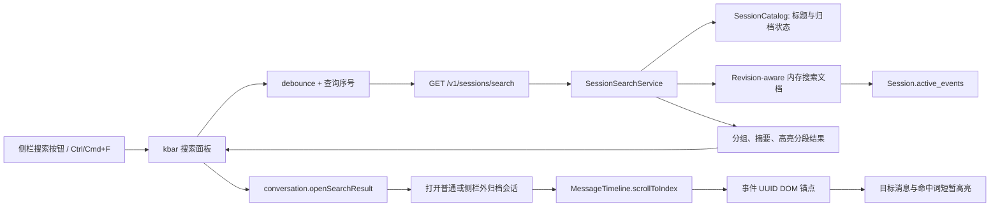

# 全局会话搜索 - 技术方案

## 状态

CONFIRMED

## 需求文档

[requirement.md](./requirement.md)

## 现状分析

### 会话数据与搜索能力

- 会话事实以 JSONL 事件流保存在 `SessionStore` 中；`Session.active_events` 已负责剔除 `turn_rewrite` 产生的失活分支。
- 会话当前展示标题和归档状态由 `SessionMetadataStore` 管理，`SessionCatalog` 能合成普通、归档会话的统一只读目录。
- `SessionManager.list(..., query=...)` 和 `GET /v1/sessions?q=` 目前只在展示标题上做匹配，不读取消息正文。
- 现有 `SessionHistorySource` 服务于 Agent 的记忆检索，会做召回排序、轮次聚合和 persona/time scope；它不等价于确定性的产品全文搜索，也不完全遵循桌面聊天页的可见性规则，本需求不复用其查询语义。
- `SessionChangeBroker` 已为会话创建、内容追加、metadata 变化、归档和删除维护单调 revision，可作为派生搜索索引的失效依据。

### 前端投影与消息定位

- `projectSessionEvents` 把 active events 投影为聊天页 `ChatMessage[]`，并处理主动轮隐藏、工具块聚合和附件展示。
- 用户消息的 `ChatMessage.id` 等于对应事件 UUID；助手文本块的 `TextBlock.mid` 等于对应 `assistant_message` 事件 UUID。
- `MessageTimeline` 使用 `@tanstack/react-virtual`，离屏消息不会持续存在于 DOM。现有实现只有滚到底部能力，没有按消息锚点滚动的公共入口。
- 打开归档会话本身可复用 `sessionsApi.get` / `conversation.openSession`，但归档会话不在普通侧栏列表中；空的归档会话会被 `HistorySidebar` 的“当前会话已不存在”保护逻辑重置，需要显式表达“侧栏外查看”状态。

### 全局搜索组件选型

- 本需求采用 `kbar` 作为应用内 Spotlight / command palette 交互实现，复用其 Provider、Portal、Positioner、Animator、Search、Results、快捷键、焦点恢复、上下键、Enter/Esc、结果选择、combobox/listbox ARIA 和结果虚拟化。
- `kbar` 当前默认通过 Fuse 对 action 再次模糊过滤和重排。产品搜索结果由后端确定，因此本需求不使用 `useMatches`：结果注册为 kbar actions，再按后端顺序从 action registry 组装 `KBarResults.items`。这只替换搜索算法，不重写通用交互机制。
- `kbar` 仍是 beta 版本，且内部结果虚拟化依赖较旧。其自身已声明支持 React 19，但 `react-virtual@2.10.4` 的 peer 范围仍停留在 React 16/17；该 warning 记录为维护风险，不单独判定运行不兼容。代码实现开始时必须完成 React 19、异步结果、快捷键、焦点和选择行为的真实兼容性门槛；任一运行关键项不通过时立即停止并与用户重新确认，不自动改用其他组件，也不开始自研替代实现。

## 方案设计

### 涉及文件

| 文件路径 | 改动类型 | 说明 |
| --- | --- | --- |
| `frontend/package.json` / `pnpm-lock.yaml` | 修改 | 固定引入通过兼容性门槛的 `kbar` 版本。 |
| `agent/src/agent/sessions/search.py` | 新增 | 搜索文档投影、内存派生索引、确定性匹配、摘要和结果排序。 |
| `agent/src/agent/sessions/changes.py` | 修改 | 提供一次读取多会话 revision 快照的只读能力，避免逐会话重复锁文件。 |
| `agent/src/agent/sessions/__init__.py` | 修改 | 导出搜索服务及其结果类型。 |
| `agent_bridge/src/agent_bridge/assembly.py` | 修改 | 进程级装配唯一的 `SessionSearchService`。 |
| `agent_bridge/src/agent_bridge/routes/meta.py` | 修改 | 增加全局会话搜索 REST 接口及输入校验。 |
| `frontend/src/types/search.ts` | 新增 | 定义搜索响应、结果和高亮分段类型。 |
| `frontend/src/services/api/sessions.ts` | 修改 | 增加搜索 API 调用。 |
| `frontend/src/pages/chat/components/GlobalConversationSearch.tsx` | 新增 | kbar 适配、查询状态、结果分组和业务结果行。 |
| `frontend/src/pages/chat/components/HistorySidebar.tsx` | 修改 | 增加搜索框式按钮，并允许明确标记的侧栏外归档会话保持打开。 |
| `frontend/src/stores/conversation.ts` | 修改 | 增加搜索结果打开、侧栏外会话和待定位锚点状态。 |
| `frontend/src/pages/chat/components/MessageList.tsx` | 修改 | 按事件锚点驱动虚拟列表、目标消息和命中词高亮。 |
| `frontend/src/styles/theme/*.css` | 修改 | 增加搜索面板、选中态和定位反馈所需的语义 token。 |
| `agent/tests/test_session_search.py` | 新增 | 覆盖搜索投影、隐藏内容、归档、缓存失效、匹配和排序。 |
| `agent_bridge/tests/test_meta_session_search_routes.py` | 新增 | 覆盖搜索接口校验、响应和错误映射。 |
| `frontend/src/pages/chat/components/*.test.ts`、`frontend/src/stores/*.test.ts` | 修改或新增 | 覆盖结果组装、消息锚点、侧栏外会话和竞态保护的纯逻辑。 |

最终实现可按邻近代码职责微调测试文件名，但不得把搜索投影、HTTP 接口和页面业务状态堆叠到同一文件。

### 数据流 / 组件结构



### 后端搜索服务

#### 职责边界

新增 `SessionSearchService`，只负责从持久化会话派生产品搜索文档并执行确定性查询：

- 依赖 `SessionStore` 读取事实事件；
- 依赖 `SessionCatalog` 获取当前展示标题、归档状态和更新时间；
- 依赖 revision 快照判断哪些会话需要重新投影；
- 不依赖 LLM、Memory、向量库、Agent runtime 或前端 DOM；
- 不修改 JSONL、metadata 或会话 revision。

BridgeRuntime 持有唯一服务实例，使同一桌面进程中的连续输入可以复用内存索引。搜索服务放在 `agent.sessions`，Bridge 只做 HTTP schema 和错误映射，不在路由内实现搜索算法。

#### 用户可见搜索投影

搜索基于 `Session.active_events`，以聊天页实际可见语义投影文档：

- `user_message.payload.content` 作为用户正文；有效附件的 `display_name` 作为附件文件名字段；
- 普通可见的 `assistant_message.payload.content` 作为助手正文；同一前端 assistant `ChatMessage` 内的多个文本块归为一个消息结果，但保留每个文本块自己的事件锚点；
- 已持久化且重新打开会显示为“回答已中断”的 partial 文本仍属于可见历史，可以搜索；尚未落盘的流式内存文本不会进入服务；
- 沿用 `projectSessionEvents` 的 `hiddenRunIds`、`pendingSkipAssistant` 和主动轮 presentation 语义，排除不会进入聊天页的助手事件；
- `system_trigger`、`tool_call_request`、`tool_call_result`、thinking/reasoning、运行时控制事件和 reminder 卡片字段不建立搜索文档；
- `turn_rewrite` 的旧分支已由 `active_events` 排除；硬删除会话不会出现在 catalog 中，并会从缓存移除。

前后端是跨语言投影，不能共享函数。实现时使用同一组历史事件 fixture 分别断言 Python 搜索投影和 TypeScript 聊天投影的可见文本与锚点，防止以后只改一侧造成隐藏内容泄漏或搜索结果无法定位。

#### 内存派生索引与失效

搜索索引是进程内缓存，不新增 SQLite/FTS 文件：

1. 首次非空查询读取 `SessionCatalog.list_all()` 与 revision 快照，懒加载所有现存会话的搜索文档；面板在此期间显示加载状态。
2. 后续查询重新读取轻量 catalog 和一次 revision 快照；只有 revision 或 summary 时间发生变化的会话才重新 `load` 和投影。
3. 重命名、归档、取消归档等 metadata 始终使用当前 catalog 值；即使内容文档未变化，返回的标题和归档标签也必须立即更新。
4. 删除会话从 catalog 消失后立即移除对应缓存；读取过程中被并发删除则跳过该会话，不让整个查询失败。
5. 服务内部使用锁保护缓存更新；HTTP 请求仍可并发，但不会同时重复构建同一批文档。

缓存只是性能优化，源数据仍是 JSONL + metadata。若兼容性实施中的合成数据验证表明冷查询已经明显阻塞桌面交互，应暂停并与用户重新评估持久化索引，而不是在本需求内未经确认升级为 SQLite/FTS 架构。

### 查询与结果协议

新增：

```http
GET /v1/sessions/search?q=<query>&message_limit=50&title_limit=10
```

约束：

- `q` 去除首尾空白后必须非空，最大 200 字符；允许单个中文或英文字符。
- `message_limit` 默认和上限均为 50；`title_limit` 默认和上限均为 10，客户端不暴露自由调大入口。
- 匹配完整查询字符串的连续片段，不拆词、不做模糊匹配；英文不区分大小写，中文按原连续文本匹配。
- 每个会话最多产生一个标题结果；每个用户可见消息最多产生一个消息结果。消息内多个字段同时命中时优先正文，其次附件名。
- 标题结果按会话 `updated_at` 倒序；消息结果按消息时间倒序，并用 session id / anchor id 作为稳定 tie-breaker。
- 服务扫描全部搜索文档并分别返回标题、消息的总命中数，但只传输有界结果。超过上限时 UI 明确显示“共 N 条，当前展示前 50 条，请继续输入缩小范围”，不静默伪装为完整列表。

响应结构：

```json
{
  "query": "keyword",
  "title_total": 1,
  "message_total": 28,
  "title_results": [
    {
      "result_id": "title:<session-id>",
      "kind": "title",
      "session_id": "<session-id>",
      "session_title": "...",
      "archived": false,
      "updated_at": "...",
      "segments": [{ "text": "...", "matched": true }]
    }
  ],
  "message_results": [
    {
      "result_id": "message:<session-id>:<message-key>",
      "kind": "message",
      "session_id": "<session-id>",
      "session_title": "...",
      "archived": true,
      "role": "assistant",
      "occurred_at": "...",
      "anchor_event_uuid": "<event-uuid>",
      "matched_field": "content",
      "segments": [
        { "text": "上下文", "matched": false },
        { "text": "keyword", "matched": true }
      ]
    }
  ]
}
```

后端直接返回原文分段而不是字符 offset，避免 Python Unicode code point 与 JavaScript UTF-16 offset 在 emoji 等文本上的切片偏差。摘要围绕首个命中窗口生成，并标记窗口内全部命中片段；前端只渲染 segments，不自行猜测后端匹配位置。

### kbar 适配与搜索面板

#### 兼容性门槛

获得代码实现授权后，第一项任务只验证并固定 `kbar`：

- 在 React 19 下正常挂载和卸载；
- `$mod+f` 能阻止 WebView 原生查找并打开面板；
- 点击侧栏按钮能调用同一个 `query.toggle()`；
- 输入法 composition 不会误触发 Enter；
- 异步替换 actions 后 active index 合法；
- 上下键、Enter、Esc、焦点进入与关闭恢复正常；
- 当前依赖组合下构建、类型检查和基础交互测试通过。

若门槛失败，停止后续产品代码实现并报告具体失败证据。`cmdk + Radix Dialog` 仅作为待讨论候选，不属于本已确认方案的自动回退授权。

`pnpm peers check` 中仅由 `react-virtual@2.10.4` 过期 peer 范围产生的 warning 不单独视为门槛失败；它必须与真实构建、挂载或交互失败共同构成不兼容证据。项目不得通过强制降级 React 来消除该 warning。

#### 组件组织

`GlobalConversationSearch` 挂在对话页范围内，使快捷键只在对话页生效：

- `KBarProvider` 配置 `toggleShortcut="$mod+f"`、动画时长和 open/close callbacks；
- `KBarPortal`、`KBarPositioner`、`KBarAnimator` 负责弹层生命周期和布局；面板容器补充明确的 dialog label / description；
- `KBarSearch` 负责真实输入框、自动聚焦和 combobox 语义；
- 搜索结果通过 `useRegisterActions` 注册，action `perform` 只调用业务打开函数；
- 不调用 `useMatches`。组件从 kbar action registry 取回 `ActionImpl`，按后端 `title_results` / `message_results` 顺序插入“对话”“消息”分组并交给 `KBarResults`；
- `KBarResults` 继续负责结果虚拟化、active index、鼠标选择和键盘执行；业务 `onRender` 只画结果行。

查询使用约 200ms debounce，并用单调请求序号或 AbortController 丢弃过期响应。关闭面板时清空本轮查询状态，不影响当前会话、流式任务或滚动位置。

#### 页面状态

- 空输入：展示搜索范围提示和 `Ctrl/Cmd+F` 快捷键说明，不发请求；
- loading：保留输入框和稳定面板尺寸，显示搜索中状态；
- results：按“对话 / 消息”分组，结果行展示标题、角色、时间、摘要及归档 Badge；
- empty：明确提示没有匹配普通或归档会话；
- error：显示可重试状态，不关闭面板、不清空用户输入；
- truncated：显示总命中数和继续输入提示，不增加第二套分页/筛选界面。

### 打开会话与定位消息

#### 会话打开

`conversation` store 增加搜索结果入口，不让页面组件拼装跨状态流程：

- 标题结果：普通会话复用 `openSession(sessionId)`；归档会话使用 `openSession(sessionId, { detached: true, remember: false })`。
- 消息结果：如果已经是当前会话，不重新请求历史，直接设置待定位锚点；否则先打开目标会话，成功后再提交锚点。
- `detachedSessionId` 表示当前会话允许不出现在普通侧栏列表。`HistorySidebar` 的 missing-session reset 遇到同一 id 时不重置；打开普通侧栏会话、新对话或目标不存在时清除该标记。
- 查看归档会话不调用 unarchive、不把归档会话临时塞进普通列表，也不记为下次启动自动恢复目标。
- 打开失败或锚点在最新 active projection 中已不存在时，使用现有 toast 给出可理解提示并清理 pending target。

#### 虚拟列表锚点

搜索结果携带匹配字段所在事件 UUID：

- 用户正文和附件名：锚点是 `user_message.uuid`；
- 助手正文：锚点是对应可见 `assistant_message.uuid`，即前端 `TextBlock.mid`；
- 前端用 `message.id === anchor` 或某个 text block `mid === anchor` 找到父 `ChatMessage` 和数组 index；
- `MessageTimeline` 在目标存在时暂停“历史加载后自动到底部”，退出 following 状态，并执行 `virtualizer.scrollToIndex(index, { align: "center" })`；
- 目标行挂载后，再在下一 animation frame 查找 `data-search-anchor` 并做一次居中校正，吸收动态高度测量误差；
- 每个搜索跳转携带单调 token。切换到其他会话或更新目标后，旧的异步定位不得覆盖新目标。

`TextBubble` 外层增加与事件 UUID 对应的非交互 DOM anchor。工具卡片不带该 anchor，因此命中词高亮不会误扫工具参数或工具结果。

#### 定位反馈与命中词高亮

- 父消息行获得短暂的语义化 target 样式，确保任何平台至少能看到定位目标；
- 在支持 `CSS.highlights` / `Highlight` 的 WebView 中，使用 TreeWalker 只遍历目标 `data-search-anchor` 内的文本节点，建立不修改 React/TDesign DOM 的 Range 高亮；
- 高亮查找与后端一致：完整查询连续匹配、英文不区分大小写；命中附件名时只在对应用户消息 anchor 内查找；
- 高亮在固定时长后或下一次搜索跳转时清理；组件卸载时删除自己注册的 highlight key，不调用全局 `CSS.highlights.clear()`，避免影响未来其他功能；
- 不支持 Custom Highlight API 时只降级命中词标记，保留虚拟列表定位和父消息高亮。该降级必须在跨平台测试中有断言或显式 feature-detection 覆盖。

## 影响分析

### 上下游影响

- SessionStore 协议不新增写方法，JSONL 格式和 metadata schema 不变化；搜索索引可随进程退出直接丢弃。
- revision store 只增加批量只读快照，不改变现有 revision 递增和发布语义。
- Bridge 新接口只服务 agent-friend 产品端，不改变 OpenAI / AG-UI 协议出口。
- `SessionManager.list(query=...)` 保持标题筛选语义，设置页的已归档搜索不被全局搜索替换或改变。
- conversation store 新增的 detached / target 状态只影响从全局搜索进入的查看流程；普通侧栏打开、自动恢复、发送消息和后台同步沿用既有路径。
- `MessageTimeline` 仍是共享受控组件；搜索 target 使用可选 props，persona editor 等其他调用方不传时行为不变。
- 不引入系统级快捷键、独立窗口或 Tauri Rust command；`Ctrl/Cmd+F` 只在对话页 WebView 内生效。

### 测试与验证

#### 自动化

- Python 单测：普通/归档标题、用户正文、助手正文、附件名、大小写、中文、摘要分段、多命中、结果上限和稳定排序。
- 可见性契约：主动轮 presentation、hidden run、tool request/result、reasoning、turn rewrite、partial 和硬删除场景。
- 缓存：冷构建、未变化复用、单 session revision 变化局部重建、rename/archive 即时反映、并发删除容忍。
- Bridge：参数边界、空 query、正常响应、存储异常到 HTTP 错误的映射。
- 前端纯逻辑：后端顺序转 kbar items 时不发生二次过滤、stale response 丢弃、归档 detached 保护、事件 UUID 到消息 index 映射、旧定位 token 失效。
- 项目门禁：实现完成后运行 `scripts/check`，确保 lint、typecheck、test 全绿。

#### 桌面视觉与交互

本需求会修改真实 Tauri 对话页 UI。代码实现完成后，先按 `frontend-visual-verification` 询问用户是否由 Agent 启动真实桌面端验收；未获确认时只跑静态和自动化检查，并把视觉验收标为用户负责。

若用户授权真实桌面验收，重点检查：

- 搜索框式按钮、宽面板在常用窗口尺寸下的布局；
- 亮/暗主题、选中态、归档 Badge、loading/empty/error/truncated 状态；
- `Ctrl/Cmd+F`、输入法、上下键、Enter、Esc 和焦点恢复；
- 当前会话离屏消息、普通跨会话和归档会话的定位；
- Markdown、代码块、附件文件名中的命中词与父消息反馈；
- 关闭面板后当前对话和正在执行的任务不受影响。

### 风险点

- **kbar 兼容性**：beta 包和旧虚拟化依赖可能与 React 19 或当前 WebView 焦点行为冲突。通过前置门槛控制；失败即停，不自动回退。
- **投影漂移**：Python 搜索可见性与 TypeScript 聊天投影分属两端。通过共享事件 fixture 的双侧契约测试固定隐藏规则和锚点。
- **冷查询延迟**：首次查询需要完整加载现存会话。采用懒构建、revision 局部失效、有界响应；若合成规模验证仍阻塞交互，暂停并重新讨论持久化索引。
- **搜索结果过多**：单字查询可能命中大量内容。扫描全语料但限制传输和渲染数量，显示总数并引导继续输入。
- **并发变化**：搜索后会话可能被改写或删除。使用 revision、请求序号、定位 token 和锚点存在性检查，失败时提示重新搜索。
- **WebView 高亮差异**：Custom Highlight API 在旧 WebView 中可能不可用。定位和整行反馈是硬保证，词级高亮使用 feature detection 渐进增强。
- **归档会话生命周期**：归档会话不在普通侧栏列表。通过 detached 状态隔离查看语义，不修改归档 metadata 或自动恢复状态。

## 变更记录

| 日期 | 变更内容 | 是否需要重新实现 |
| --- | --- | --- |
| 2026-08-05 | 首次确认：采用 kbar、revision-aware 内存全文搜索、归档侧栏外查看及虚拟列表消息定位；kbar 不兼容时停止并回到用户确认。 | 否，尚未开始实现 |
| 2026-08-05 | 根据官方仓库与社区案例修正兼容性判定：旧 `react-virtual` peer warning 单独不算运行失败，以真实 React 19 构建、挂载和交互测试为准。 | 否，兼容性门槛尚未完成 |
