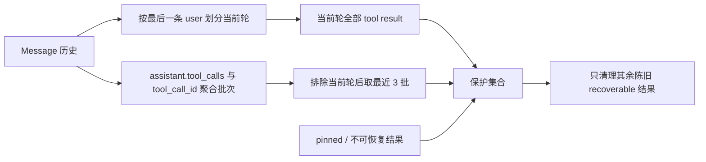

# 工具结果上下文保留策略 - 技术方案

## 状态

CONFIRMED

## 需求文档

[requirement.md](./requirement.md)

## 现状分析

`agent.context.tool_projection.project_tool_results` 已负责单条结果截断、高低水位计算、陈旧 recoverable 结果占位清理、pinned 判定和稳定 checkpoint。当前保护集合由全局最后 4 条 tool message 与最后一个 user 边界后的结果取并集，因此当前轮结果会占用历史名额，并行结果也没有批次语义。

`Session.messages` 会把同一条 assistant 后续的 `tool_call_request` 投影到 `meta["tool_calls"]`，tool result 通过 `meta["tool_call_id"]` 关联调用；这些现有信息足以在模型视图投影层恢复工具批次，无需修改事件协议或持久化格式。

## 方案设计

### 涉及文件

| 文件路径 | 改动类型 | 说明 |
| --- | --- | --- |
| `agent/src/agent/context/tool_projection.py` | 修改 | 聚合工具结果批次，独立计算当前轮与历史保护集合，并升级策略版本 |
| `agent/tests/test_tool_result_context_edit.py` | 修改 | 固定当前轮、最近历史批次、并行结果及旧数据 fallback 行为 |
| `docs/issues/040-long-session-tool-result-compaction/README.md` | 修改 | 将原 issue 指向需求 075 |

### 数据流

### 关键实现细节

- 顺序扫描消息；遇到带 `tool_calls` 的 assistant 时，把有效 call id 关联到该 assistant 消息索引。
- tool result 根据 `tool_call_id` 进入对应 assistant 批次；缺失或无法关联时以自身消息索引形成单条 fallback 批次。
- `protect_last_history_turn` 生效时，最后一条 user 之后的全部 tool result 构成当前轮保护集合。
- 从所有批次中排除当前轮结果，再按历史顺序选择最后 3 批，将批内全部结果加入保护集合。
- 最终保护集合仍与 pinned / 不可恢复判定叠加；清理候选、清理顺序、高低水位和最小批量保持不变。
- 策略版本从 1 升至 2。已有 checkpoint 继续按 UUID 应用；新 checkpoint 记录版本 2，不对原始事件做迁移。

## 影响分析

### 上下游影响

- 不改变 `Message`、session event、tool registry、恢复工具或 LLM provider 协议。
- 当前轮和近期历史保护更稳定，但保护结果数量可能多于旧策略；清理仍由高水位触发，单条上限和全局硬边界继续控制最坏体积。
- 无关联的历史 tool message 从“全局最近 4 条”调整为“最近 3 个单条批次”，属于策略版本升级的预期变化。

### 风险点

- 重复或损坏的 `tool_call_id` 可能无法可靠关联；顺序扫描使用最近出现的 assistant 关联，未关联结果单条成批，避免错误扩大保护范围。
- 最近 3 个批次可能包含多个并行结果，导致低水位无法完全达到；这是近期连贯性优先的明确取舍，单条上限和后续全局压缩继续兜底。
- 已由旧策略清理的结果不会因版本升级自动重新展开；稳定 checkpoint 和恢复入口保证兼容与可追溯。

## 变更记录

| 日期 | 变更内容 | 是否需要重新实现 |
| --- | --- | --- |
| 2026-08-05 | 首次确认：保护当前轮全部结果，并在其外按 assistant 工具批次保护最近 3 批。 | 是 |
