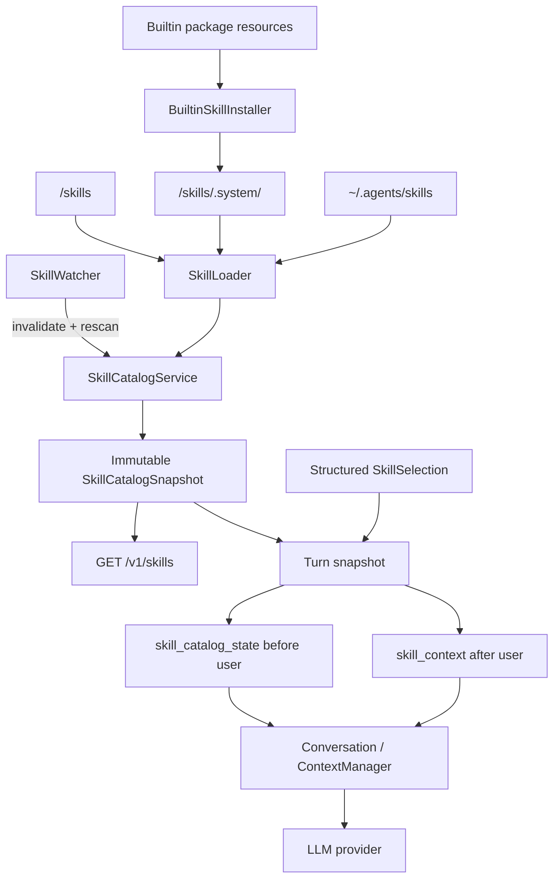

# Agent Skill 系统 - 技术方案

## 状态

CONFIRMED

## 需求文档

[requirement.md](./requirement.md)

## 现状分析

agent-friend 的正式对话统一由 `Conversation` 组装模型请求。桌面 AG-UI、持久化
OpenAI-compatible、无状态 OpenAI-compatible 和 AgentRuntime 最终都会进入
`SessionManager.start_conversation()` 创建的 `Conversation`，因此 Skill 不应在前端、
协议路由或某一种 provider 里单独拼 prompt。

当前上下文顺序由 `agent.context.protocol.assemble_messages()` 统一定义：基础 system
prompt 后依次是稳定 `extra_context`、历史、当前真实 user、当轮 `turn_context` 和尾部
临时指令。`Session.messages` 是 UI、memory 和一般会话投影共用的原始消息视图，
`Session.llm_messages` 则负责模型专用的失败清理与工具事务规整。Skill catalog 和正文既要
进入可恢复的模型历史，又不能变成用户长期事实，因此需要新增明确的模型专用事件，不能
复用已废弃且永不投影的 `model_context` 兼容事件。

上下文压缩当前以真实 `role="user"` 作为轮边界，并会把较旧历史折叠成 summary。
Skill 正文同样使用 `role="user"` 才能保持与普通用户指令相同的逻辑优先级，但它不是一轮
新的真实用户输入；catalog 又属于需要保留最新值的 world state。两者都要求上下文管理器
认识对应的 `meta.synthetic`，否则 FIFO 可能留下 Skill 正文却丢掉触发它的用户输入，摘要
也可能把旧 catalog 当成关系事实。

现有 `agent.paths` 集中管理用户数据目录，Python package 资源通过
`importlib.resources` 打包，BridgeRuntime 负责进程级共享组件及 FastAPI lifespan。
`watchfiles` 已在依赖锁文件中出现，但不是 `agent` 的直接依赖；本需求若直接使用，必须
提升为显式依赖，不能依赖其它包偶然传递安装。

当前 ToolRegistry 没有通用目录枚举、本地文件读取、文件变更或命令执行能力。本期只允许
Skill 子系统自身读取 catalog 所需的 `SKILL.md`，不暴露 Skill 私有资源读取 tool；
`references/`、`assets/`、文件创建编辑和 `scripts/` 执行均等待公共 Agent 能力补齐。

## 方案设计

### 设计不变量

1. `SkillCatalogService` 是进程内 Skill 状态的唯一真相源；所有对话入口使用同一实例。
2. catalog 只提供有界元数据，不从名称、描述或用户原文自动激活 Skill。
3. 只有调用方传入的结构化 `SkillSelection` 能触发完整 `SKILL.md` 加载。
4. 每轮在首次模型组装前冻结 catalog、选择结果和正文 bytes；文件变化只影响后续轮。
5. catalog 初次出现或模型可见内容变化时才追加新状态；无变化不追加、不改 system prompt。
6. Skill 正文追加在触发它的真实 user 后，以 `role="user"` 进入模型历史；它不会成为后续轮
   自动生效的常驻规则。
7. catalog 与 Skill 正文不进入 UI 消息、长期记忆或关系事实抽取，但服从模型历史的预算、
   FIFO 和摘要压缩。
8. builtin、agent-friend 个人和共享个人 Skill 使用同一 parser、loader、catalog 与激活路径。
9. Skill 不授予工具权限；`allowed-tools` 只作为未执行的兼容元数据保留。
10. watcher 事件只做失效通知；每次刷新都重新构造完整 immutable snapshot 后原子替换。

### 组件结构



### 涉及文件

| 文件路径 | 改动类型 | 说明 |
| --- | --- | --- |
| `agent/pyproject.toml` | 修改 | 把 `watchfiles` 提升为 Agent 的显式跨平台依赖 |
| `agent/src/agent/paths.py` | 修改 | 新增 agent-friend 个人 Skill 根 `skills_dir()` |
| `agent/src/agent/skills/__init__.py` | 新增 | 导出 Skill 领域公共类型与 service |
| `agent/src/agent/skills/models.py` | 新增 | 来源、身份、记录、诊断、snapshot、selection 与 activation 类型 |
| `agent/src/agent/skills/loader.py` | 新增 | 有界扫描、frontmatter 校验、链接处理、去重和版本摘要 |
| `agent/src/agent/skills/catalog.py` | 新增 | immutable catalog、稳定排序、预算渲染和精确选择 |
| `agent/src/agent/skills/builtin.py` | 新增 | 内置资源 fingerprint、并发安全物化与 provenance |
| `agent/src/agent/skills/watcher.py` | 新增 | `watchfiles` 生命周期、去抖、重挂与周期 reconcile |
| `agent/src/agent/skills/service.py` | 新增 | 初始加载、原子刷新、订阅、turn snapshot 与同步重验 |
| `agent/src/agent/skills/builtin_assets/` | 新增 | `skill-creator`、许可证、资源及上游 provenance manifest |
| `agent/src/agent/sessions/events.py` | 修改 | 新增 `skill_catalog_state`、`skill_context` 事件类型 |
| `agent/src/agent/sessions/session.py` | 修改 | 分离 UI/general 与 LLM-only Skill 事件投影，提供最近 catalog 状态 |
| `agent/src/agent/messages.py` | 修改 | 保留内部生成的 Skill user fragment，不按真实用户文本转义 |
| `agent/src/agent/context/protocol.py` | 修改 | 增加位于 history 与当前 user 之间的 `pre_user_context` |
| `agent/src/agent/context/naive.py` | 修改 | 透传新的上下文组成部分 |
| `agent/src/agent/context/fifo.py` | 修改 | 只按真实 user 切轮，并在裁剪后保留最新 catalog world state |
| `agent/src/agent/context/summarizing.py` | 修改 | 排除 catalog 摘要、保留最新状态，并正确处理历史 Skill fragment |
| `agent/src/agent/context/summary_prompt.py` | 修改 | 区分真实用户、历史 Skill 指令与 catalog 状态，禁止把 Skill 当长期事实 |
| `agent/src/agent/context/turns.py` | 修改 | synthetic Skill user 不作为完整 turn 起点 |
| `agent/src/agent/conversation.py` | 修改 | 冻结 turn snapshot、统一装配、按顺序持久化与幂等校验 |
| `agent/src/agent/sessions/manager.py` | 修改 | 向正式与临时 Conversation 注入同一个 Skill service |
| `agent_bridge/src/agent_bridge/assembly.py` | 修改 | 进程级构造和关闭 Skill service/watcher，加入 BridgeRuntime |
| `agent_bridge/src/agent_bridge/app.py` | 修改 | 在 lifespan 中启动/停止 watcher，并注册 Skill catalog 路由 |
| `agent_bridge/src/agent_bridge/protocols/ag_ui/decoders.py` | 修改 | 从 `forwarded_props.skills` 解码结构化选择 |
| `agent_bridge/src/agent_bridge/protocols/ag_ui/routes.py` | 修改 | 把选择传到同一 Conversation 入口 |
| `agent_bridge/src/agent_bridge/protocols/openai/decoders.py` | 修改 | 从 `agent_friend.skills` 解码结构化选择 |
| `agent_bridge/src/agent_bridge/protocols/openai/routes.py` | 修改 | 持久与无状态分支统一传递选择 |
| `agent_bridge/src/agent_bridge/protocols/openai/encoders.py` | 修改 | 直连 Conversation 时透传选择 |
| `agent_bridge/src/agent_bridge/routes/skills.py` | 新增 | 提供只读完整 catalog 与当前 generation |
| `agent/tests/test_skill_*.py` | 新增 | loader、catalog、watcher、builtin、上下文与会话回归 |
| `agent_bridge/tests/test_skills_*.py` | 新增 | 协议解码、入口一致性和 catalog route 回归 |
| `scripts/package/windows/agent_friend_runtime.spec` | 核对/按需修改 | 确保 builtin Skill package data 进入安装态 runtime |

### 领域模型

```python
SkillSource = Literal["builtin", "personal", "shared"]

@dataclass(frozen=True)
class SkillRecord:
    id: str
    source: SkillSource
    name: str
    description: str
    entry_path: Path
    canonical_entry_path: Path
    package_root: Path
    version: str
    frontmatter: Mapping[str, object]
    aliases: tuple[SkillAlias, ...]

@dataclass(frozen=True)
class SkillCatalogSnapshot:
    generation: int
    fingerprint: str
    entries: tuple[SkillRecord, ...]
    issues: tuple[SkillLoadIssue, ...]
    external_watch_roots: tuple[Path, ...]

@dataclass(frozen=True)
class SkillSelection:
    id: str
    expected_version: str | None = None

@dataclass(frozen=True)
class ActivatedSkill:
    record: SkillRecord
    contents: str
    version: str

@dataclass(frozen=True)
class SkillTurnSnapshot:
    catalog: SkillCatalogSnapshot
    rendered_catalog: RenderedSkillCatalog
    activations: tuple[ActivatedSkill, ...]
    activation_issues: tuple[SkillActivationIssue, ...]
```

`SkillCatalogSnapshot` 和其中的记录在发布后不再修改。`SkillCatalogService` 只在刷新成功
后，在锁内替换单个 snapshot 引用；对话拿到引用后不需要在整轮持锁。

### 来源与目录

| 来源 | 逻辑根 | 说明 |
| --- | --- | --- |
| builtin | `<user_data>/skills/.system/<bundle-fingerprint>` | 产品物化的只读版本目录，只扫描当前 bundle fingerprint |
| personal | `<user_data>/skills` | agent-friend 专属个人 Skill；扫描时剪枝 `.system` |
| shared | `~/.agents/skills` | 用户主动与兼容 Agent 共享的个人 Skill |

`skills_dir()` 与其它用户资产路径一样服从 `AGENT_FRIEND_DATA_DIR`，测试因此可完全隔离。
共享根始终使用实际用户主目录，不跟随 `AGENT_FRIEND_DATA_DIR`；测试通过显式构造
`SkillCatalogService` 注入临时 shared root，不改进程真实 home。

三类根按 builtin、personal、shared 的固定顺序加载。此顺序只用于稳定展示，以及同一
canonical `SKILL.md` 被多个别名发现时选择 primary source；不同 canonical path 的同名
Skill 永远同时保留，不做优先级覆盖。

### builtin `skill-creator`

内置 Skill 作为 Python package data 随 runtime 发布。`builtin_assets/manifest.json`
至少记录：

- 上游仓库、commit、源目录和取得日期；
- 上游许可证与随包 `license.txt`；
- bundle schema 和内容 fingerprint；
- agent-friend 对 `SKILL.md` 做过的最小兼容修改清单。

兼容修改只处理产品名、默认 Skill 目标目录和真实能力声明；目录结构、工作流、
`agents/openai.yaml`、`references/`、`scripts/`、`assets/` 与许可证一并保留。脚本只是
资源，不因物化、发现或激活被执行。

启动期 `BuiltinSkillInstaller` 对整个 builtin bundle 计算 SHA-256 fingerprint，并把资源
物化到不可变版本目录：

```text
<user_data>/skills/.system/<fingerprint>/skill-creator/...
```

安装流程在 `<user_data>/skills/.system-install.lock` 上使用现有 `portalocker`：先写同级
staging 目录，完成校验后原子 rename 为 fingerprint 目录。目标已存在且 manifest 匹配时
不写盘。旧 fingerprint 不在本需求内自动删除，避免并行运行的旧 Bridge 正在读取时被新
进程移除。个人 Skill 扫描始终剪枝 `.system`，所以旧 bundle 不会形成重复 catalog。

builtin 的稳定 ID 使用 `builtin/skill-creator`，不把 fingerprint 编入身份；版本字段仍是
当前 `SKILL.md` 内容摘要。这样产品升级后调用方看到同一能力的新版本，而不是一个全新的
Skill。

### 发现、校验与去重

`SkillLoader` 对每个来源执行有界递归发现：

- 最大递归深度 6；
- 每个根最多访问 2,000 个目录和 20,000 个 entry；
- 只把文件名精确为 `SKILL.md` 的文件视为候选；
- personal/shared 默认跳过隐藏目录；builtin 从已经确定的版本根开始扫描；
- 单个 `SKILL.md` 最大 256 KiB，超过即作为无效候选诊断，不进入 catalog；
- 文件必须是 UTF-8，并具有以 `---` 分隔的 YAML frontmatter。

frontmatter 校验遵循以下口径：

- `name` 必填，1-64 字符，只允许小写字母、数字和单连字符，不允许首尾或连续连字符，
  并与解析后的实际 package 目录名一致；
- `description` 必填，1-1,024 字符；
- `license`、`compatibility`、`metadata`、`allowed-tools` 按规范类型与长度解析；
- 未识别的可选字段保留在 `frontmatter` 供诊断，但不获得运行时语义；
- `allowed-tools` 不改变 ToolRegistry、审批或权限。

目录符号链接、Windows directory junction/reparse point 和文件链接均通过解析后的 canonical
路径参与身份判断。遍历维护已访问 canonical 目录集合，遇到循环、失效链接、权限错误或
超过边界时只生成 `SkillLoadIssue`，继续处理其它候选。链接指向来源根之外是允许的共享
方式，不因“越界”自动拒绝；本期 loader 只读取入口 `SKILL.md`，不会借链接读取其它资源。

文件型 Skill ID 由规范化 canonical `SKILL.md` URI 的 SHA-256 生成；Windows 在生成前使用
`normcase` 规整大小写。相同 canonical entry 只保留一条 `SkillRecord`，其它来源和逻辑路径
写入 `aliases` 并形成 dedupe 诊断。不同 canonical entry 即使 `name` 一样也各自保留。

`version` 是完整 `SKILL.md` bytes 的 SHA-256。资源目录变化会触发 service generation 更新，
但只有 `SKILL.md` 或 model-visible metadata 变化才改变 catalog 渲染 fingerprint。

稳定排序键为：`source_rank`、`name`、规范化 canonical URI。扫描线程调度、文件系统枚举
顺序和 watcher 批次均不得影响 catalog 顺序或 fingerprint。

### Catalog 渲染与预算

catalog 由全量 `SkillCatalogSnapshot` 按当前激活模型的上下文窗口逐轮渲染。预算为模型
effective context window 的 2%；无法取得窗口时使用 8,000 字符上限。单条描述即使在
metadata 中合法，也最多贡献 1,024 字符。

每条 model-visible entry 至少包含：

```text
- name: description (source=personal, id=skill_..., version=abc123..., path=.../SKILL.md)
```

渲染器先计算每条 entry 不含描述时的最小成本，再在能保留的 entry 间轮转分配描述预算，
避免前面的 Skill 独占空间。最小 entry 也放不下时按稳定顺序省略尾部，并加入省略数量
提示。完整列表和所有 load issues 仍可通过 Bridge catalog route 读取。

catalog 外层使用内部生成的 `<skills_catalog>` envelope，并明确：

- catalog 元数据仅用于了解可用能力，不自行激活任何 Skill；
- 只有当前用户轮的结构化选择会产生 `<skill>` fragment；
- 历史 Skill fragment 不表示当前轮自动继续启用；
- `allowed-tools` 和 Skill 文本不能扩大 Agent 权限；
- 当前 snapshot 替代更早的 catalog snapshot。

名称、描述、路径等字段按数据转义，不能闭合内部 envelope。full catalog body 与渲染预算
profile 一起计算 `render_fingerprint`。同一 model-visible body 即使后台 generation 变化，
也不向 session 追加重复状态。

### Watcher 与热更新

`SkillWatcher` 是 BridgeRuntime 的进程级组件，使用同步 `watchfiles.watch()` 运行在 daemon
thread 中，由 FastAPI lifespan 显式 start/stop，停止使用 `threading.Event`。

主路径配置为 `debounce=500ms`、`step=100ms`、`recursive=True`。一个事件批次只做三件事：

1. 判断路径是否落在 personal/shared 或当前 external symlink watch roots；
2. 标记 catalog dirty；
3. 调用 service 完整 rescan，而不是按事件类型原地增删 entry。

personal 根会由 builtin 安装期创建，watcher 直接监听 `<user_data>/skills` 并过滤
`.system`。shared 根不存在时不创建用户目录：如果 `~/.agents` 已存在，递归监听该目录并
只接受 `skills` 子树事件；否则非递归监听 home 中 `.agents` 的创建，出现后重建注册。

通过 symlink/junction 发现且 canonical package 位于来源根之外时，loader 把 package 目录
加入 `external_watch_roots`。snapshot 替换后 watcher 对比目标集合，必要时重启外部注册，
保证实际目标中的 `SKILL.md` 修改也能触发刷新，而不是只能看到链接本身被替换。

watcher 使用 `rust_timeout=60s` 与 `yield_on_timeout=True` 做低频 reconcile：检查目标根形态、
重挂失效注册，并在最近 watcher 异常后重试。它不是 catalog 的常态轮询来源。初始化或
运行中 watcher 异常时：

- 保留最近一次成功 snapshot；
- 记录 `watcher_degraded`、异常和最近成功刷新时间；
- 按 1、2、4、8、16、30 秒上限退避重建 watcher；
- reconcile 或后续成功事件触发完整 rescan 后清除 degraded 状态。

单个 Skill 在编辑器原子保存过程中暂时无效时，刷新结果会把它从有效 catalog 移除并记录
parse issue；下一次 rename/write 事件会重新加入。系统不保留一份无法验证的 stale Skill
冒充当前有效版本。

### Bridge catalog 接口

新增只读 `GET /v1/skills`，返回当前 service snapshot：

```json
{
  "generation": 12,
  "fingerprint": "...",
  "watcher": {"status": "healthy", "last_refresh_at": "..."},
  "skills": [
    {
      "id": "skill_...",
      "name": "example",
      "description": "...",
      "source": "shared",
      "version": "sha256...",
      "path": "C:/.../SKILL.md",
      "aliases": []
    }
  ],
  "issues": []
}
```

该接口不读取完整 Skill 正文，也不激活 Skill。service 内部保留 snapshot-changed subscriber
接口，后续桌面 Skill 选择 UI 可以接入现有 push channel；本期没有 UI consumer，因此不
新增一套未被使用的前端状态。

### 结构化选择协议

协议层只接受以下领域结构，不接受名称或路径作为选择依据：

```json
{"id": "skill_...", "expected_version": "可选的完整 SHA-256"}
```

- AG-UI 从 `forwarded_props.skills` 读取数组；
- OpenAI-compatible 从 vendor namespace `agent_friend.skills` 读取数组；
- 两者都解码为 `tuple[SkillSelection, ...]` 后传给 `Conversation.stream()`；
- 空数组与字段缺失都表示本轮不激活 Skill；
- 重复 ID 保留第一次出现的顺序并去重；
- 形态错误、空 ID、未知字段类型属于协议错误，模型调用前返回 HTTP 400；
- catalog 中不存在、已失效或 `expected_version` 不匹配属于运行时 activation issue，不把
  ID 当路径读取，也不静默切换成同名 Skill。

activation issue 会作为当前用户后的模型专用 `<skill_load_error>` fragment 进入本轮，让
Agent 简短说明缺口并在不依赖该 Skill 时继续。它与成功 activation 一样持久化，保证失败
重试和会话恢复看到相同事实。

后端不检查用户文本中的 `$name`、普通 Skill 名称、链接或 description 相似度，也不提供
name-to-id 的隐式 fallback。`skill-creator` 同样必须由调用方结构化选择。

### Turn snapshot 与激活竞态

`Conversation.stream()` 开始后、创建 `ToolRunContext` 前调用
`SkillCatalogService.begin_turn(selections, model_window)`：

1. 读取当前 immutable catalog 引用并渲染该模型的 catalog；
2. 按 ID 在该 snapshot 中精确解析 selections；
3. 读取每个选中 `SKILL.md` 的完整 bytes，计算 digest 并与 record.version 比较；
4. digest 不一致时同步执行一次 targeted/full refresh，并只重试一次；
5. 再次不一致、文件删除或不可读时产出 activation issue；
6. 成功内容保存进 `ActivatedSkill`，本轮后续模型续轮不再读磁盘。

这样既不会把 watcher 的毫秒级时序变成选择正确性的前提，也不会在 Skill 更新时把 catalog
中的旧身份与磁盘新正文拼成一个不一致 snapshot。文件在第 6 步之后改变只会触发后台刷新，
当前 `ActivatedSkill.contents` 不变。

多 Skill activation 按调用方顺序注入。完整正文不设置另一个独立字符截断上限；超过
loader 的 256 KiB 候选上限时它本来就不会成为有效 Skill。最终是否能装入当前模型窗口仍
服从已有 context manager，过大时返回明确 `ContextInputTooLargeError`，不能静默裁掉 Skill
正文后继续。

### 会话事件与模型投影

新增两个 append-only event type：

#### `skill_catalog_state`

```json
{
  "type": "skill_catalog_state",
  "payload": {
    "generation": 12,
    "render_fingerprint": "...",
    "catalog_fingerprint": "...",
    "budget_profile": "tokens:2560",
    "content": "<skills_catalog>...</skills_catalog>"
  }
}
```

它是 session world state，不属于某次 run 的失败清理范围，不写 `run_id`。`Session.messages`
忽略它；`Session.llm_messages` 投影为 `role="system"`、
`meta.synthetic="skill_catalog_state"`。首次启用 Skill 系统的老 session 会在下一条 user 前
获得第一条状态。

#### `skill_context`

成功时 payload 保存 `skill_id`、`name`、`source`、入口路径、`version`、完整 `contents`、
选择顺序和关联 `user_event_id`；失败时保存同一选择信息、稳定 error code 与可给模型的短
说明。它属于当前 run，参与失败清理和 edit-resend 失活。

成功事件投影为：

```xml
<skill>
<name>skill-name</name>
<id>skill_...</id>
<source>shared</source>
<path>.../SKILL.md</path>
<version>...</version>
<runtime_capabilities>
本 Agent 当前没有通用本地文件读写或命令执行能力；Skill 不能扩大权限。
</runtime_capabilities>
---
name: skill-name
description: ...
---
...完整正文...
</skill>
```

对应 `Message` 使用 `role="user"`、`meta.synthetic="skill_instructions"`。它不进入
`Session.messages`，所以 UI 不显示、memory.observe 不抽取、会话标题和搜索正文也不把
Skill 指令当成用户原话。`escape_user_messages_for_llm()` 仅对真实 user 文本转义内部标记，
不能改写已冻结的 Skill 正文；envelope 自有字段在渲染前单独转义。

### 首轮组装与持久化顺序

`ContextManager.build_messages()` 新增 `pre_user_context`，统一顺序变为：

```text
[base system]
+ extra_context
+ history
+ pre_user_context       # 本轮新的 catalog state
+ current real user
+ turn_context           # Skill fragments、runtime、memory、surface
+ trailing user/system
```

第一轮本地组装使用 frozen turn snapshot：

1. 如果当前 rendered catalog fingerprint 与 session 最近状态不同，把 catalog message 放入
   `pre_user_context`；
2. 当前真实 user 仍走 `new_user_input`；
3. 成功和失败的 Skill fragments 按选择顺序放在 `turn_context` 最前，其后才是现有 runtime、
   memory、surface 和 voice context；
4. context manager 接受并完成预算检查后，依次落盘 catalog state（如有）、真实 user、
   `skill_context`；
5. 随后才调用 provider，保持现有“本地组装失败不落 user event”的语义。

落盘后工具续轮和 context-window recovery 都从 `Session.llm_messages` 重建，因此不会重新读
Skill 文件，也不会重复注入正文。

相同 `user_event_id` 重试时，Conversation 读取该 user 紧邻的 `skill_context`：请求 selection
ID、顺序和 expected version 必须与已落盘 snapshot 一致，否则返回
`user_event_id_conflict`。已完成回复继续走现有 idempotent replay；未完成回复从已落盘
Skill context 继续，不重新解析当前磁盘版本。

`edit_resend_latest()` 增加 selections 参数。旧 user 之后的 Skill context 随现有
`turn_rewrite` 一起失活；位于 user 之前的 catalog state 是会话 world state，不因编辑一条
消息失活。新分支按调用方本次 selections 重新冻结，未传即不激活旧 Skill。

### 上下文裁剪、摘要与缓存

catalog 不直接拼进每轮重建的基础 system prompt。首次 catalog state 进入历史后，内容不变
的后续请求重用完全相同的前缀；catalog 改变时，新状态追加在最新 user 之前，旧前缀保持
不动。模型或 catalog 预算 profile 改变导致 model-visible body 变化时，也按新状态处理。

`context.turns` 新增“真实 user”判定：只有 `role="user"` 且
`meta.synthetic != "skill_instructions"` 的消息开启 turn。这样 FIFO、recent tail 和摘要
切点始终把“真实 user + 其 Skill context + assistant/tool”当作完整事务。

正常未裁剪历史保留所有已追加 catalog 状态，维持 append-only 前缀。发生 FIFO 或摘要折叠
时采用 world-state 保护规则：

- 找出被保留视图中的最新 `skill_catalog_state`；
- 旧 catalog 状态不进入对话 summary；
- 最新状态如果落在被裁掉/摘要覆盖部分，重新放到新 summary 之后、recent tail 之前；
- 最新状态已在 recent tail 中时不重复；
- 这次移动只发生在上下文本来就因压缩改变前缀的时刻。

`render_transcript()` 将历史 Skill 标记为“该用户轮选择的工作流指令”，不渲染成“用户原话”；
summary prompt 明确要求只保留其对已完成任务仍有用的结果或约束，不把旧 Skill 继续描述为
当前常驻规则。原始 `skill_context` event 永远不改，之后再次结构化激活仍从当前磁盘读取
新版本。

最新 compaction checkpoint 的 `covered_through_uuid` 继续指向原始历史消息；catalog
world-state 的重新投影不改变 checkpoint schema。FIFO emergency base 预算必须包含最新
catalog 和当前 Skill fragments，放不下时明确失败，不通过删除它们伪造成功。

OpenAI 无状态请求每次都会构造新的 transient session，因此每个 HTTP 请求各有一条初始
catalog state；它没有跨请求服务端历史，“不重复追加”只在同一个持久 session 内成立。

### 附加资源与未来公共文件能力

本期 Skill package model 保留 `package_root`、canonical entry 与 version，完整正文中的相对
路径不被重写。这些字段是未来公共本地文件工具解析相对资源的接入点，但本期：

- 不注册 `read_skill_resource`、`SkillAuthoringService` 或 builtin-only tool；
- 不把整个 `references/`、`assets/` 或脚本源码预加载到上下文；
- 不把相对路径转换为 `web_fetch`、file URL 或其它旁路；
- Agent 需要这些文件才能继续时，依据 runtime capability envelope 如实报告缺口；
- `scripts/` 在发现、刷新、激活和模型调用阶段都不会执行。

未来通用本地文件能力必须自行完成路径授权、敏感目录、符号链接、内容体积、审批和审计；
Skill service 只提供已选 package 的身份信息，不替公共工具绕过权限判断。对应公共能力由
[issue 043](../../issues/043-agent-general-filesystem-mutation-tools/) 跟踪，命令与脚本运行时由
[issue 044](../../issues/044-governed-command-and-skill-script-runtime/) 跟踪。

### 诊断与日志

`SkillLoadIssue.code` 使用稳定枚举，至少覆盖：

- `root_unreadable`、`scan_limit_reached`；
- `broken_link`、`link_cycle`、`canonicalize_failed`；
- `skill_too_large`、`invalid_utf8`、`missing_frontmatter`、`invalid_yaml`；
- `invalid_name`、`name_directory_mismatch`、`invalid_description`、
  `invalid_optional_metadata`；
- `canonical_duplicate`、`duplicate_name`；
- `watcher_degraded`、`watch_target_rebound`；
- `catalog_description_truncated`、`catalog_entries_omitted`；
- `skill_not_found`、`skill_version_mismatch`、`skill_changed_during_activation`、
  `skill_read_failed`；
- `filesystem_capability_unavailable`、`command_capability_unavailable`。

日志和 route diagnostics 可以包含本地路径；普通 assistant 回复只需说明用户能行动的原因，
不主动泄漏其它 Skill 的绝对路径或内部异常堆栈。日志记录刷新 generation、耗时、有效/无效
数量、render fingerprint、watcher 状态和 activation 结果，不记录完整 Skill 正文。

### 测试策略

#### Loader 与 builtin

- 三类来源、固定排序、标准和可选 frontmatter；
- 名称/目录不匹配、UTF-8、超大文件、无效 YAML、单个错误隔离；
- 同名不同路径保留、canonical link 去重、broken/cycle/junction 行为；
- 外部 symlink target 加入 watch roots；
- builtin fingerprint 幂等物化、并发 installer、旧版本共存；
- `skill-creator` 上游 commit、license、资源树和兼容补丁 manifest 完整；
- wheel/PyInstaller package data 可取得。

#### Catalog 与 watcher

- 2% token/8,000 char fallback、描述公平截断、entry 省略和稳定 fingerprint；
- 只改非 model-visible 资源时 generation 变化但 rendered fingerprint 不变；
- add/change/delete/rename、编辑器原子保存和短时间批量事件只触发一次稳定 rescan；
- shared 根从不存在到创建、根删除重建、外部 symlink target 修改；
- watcher 异常保留 last-good snapshot、退避重挂和 reconcile 恢复；
- 刷新与并发 turn snapshot 不产生半新半旧记录。

#### 激活与会话

- 两协议入口解码为同一 `SkillSelection`；普通 `$name` 和相似 query 不激活；
- unknown、stale version、读取竞态、重复选择和多 Skill 顺序；
- catalog state 在 user 前、Skill context 在 user 后，工具续轮不重复读取；
- 同一 `user_event_id` replay/冲突，首轮失败清理，edit-resend 失活；
- `Session.messages`、UI、memory、标题和搜索不包含 Skill 内容；
- `Session.llm_messages`、重启恢复和 provider recovery 保留正确上下文；
- synthetic Skill user 不形成独立 turn；FIFO 和 summary 保留最新 catalog；
- catalog 未变化不追加，变化后只追加新 state，并用 prompt cache trace 验证共同前缀；
- 压缩后再次激活读取当前版本，而不是历史正文。

#### 运行时边界

- catalog/activation 不读取附加资源、不运行脚本、不注册文件或命令 tool；
- fake model 请求 references、写文件或运行脚本时只能得到 capability gap；
- `allowed-tools` 不改变实际 tool specs；
- 测试全部使用临时目录和 fake/mock provider，不调用真实 LLM。

### 实施顺序

1. 建立领域模型、路径、parser/loader、builtin 资源与确定性 catalog 测试。
2. 建立 service、watcher、BridgeRuntime 生命周期和只读 catalog route。
3. 接入两类协议 selection，并让 SessionManager/Conversation 共享 service。
4. 增加模型专用事件、`pre_user_context`、首轮持久化和幂等语义。
5. 修正 FIFO、摘要、失败清理与 edit-resend 的 Skill/world-state 投影。
6. 补 builtin 安装态资源验证、入口一致性和完整回归门禁。

## 影响分析

### 上下游影响

- `Session` event schema 新增纯加性类型，不修改旧 JSONL；老会话自然在下一轮获得首个 catalog
  state，因此 `SCHEMA_VERSION` 不递增。
- `ContextManager` protocol 新增参数，Naive、FIFO、Summarizing 及测试 fake 实现必须同步；
  这是本需求最广的内部接口影响。
- ToolRegistry 的工具集合和权限语义不变，Skill 只改变模型上下文，不改变可执行能力。
- BridgeRuntime 新增一个需要显式关闭的线程型组件；测试 fixture 可注入 disabled/noop watcher。
- OpenAI-compatible 仍接受标准 ChatCompletion body；Skill 选择只存在于可选 vendor namespace。
- session JSONL 会保存完整已激活正文，重复激活大型 Skill 会增加本地历史体积；模型窗口仍由现有
  压缩控制，但原始审计历史不会物理缩小。
- frontend 本期没有 Skill UI 变化，只获得未来可消费的 catalog route 和稳定协议字段。

### 风险点

- **Prompt 注入面扩大**：个人 Skill 本质上是调用方显式选择的用户级指令。catalog 元数据按
  数据转义、正文保持 user role、builtin 不提升 system 权限，避免把本地文件天然当可信系统规则。
- **缓存与状态冲突**：直接重建 system prompt 会破坏前缀；append-only catalog state 与“仅
  body fingerprint 变化才追加”共同控制。压缩发生时前缀本来已经变化，再提升最新 world state。
- **synthetic user 破坏轮边界**：所有 turn helper、FIFO、摘要、edit-resend 和失败清理都必须
  以 `meta.synthetic` 区分，不能只修一个 context manager。
- **文件事件丢失或链接目标不受监控**：完整 rescan、外部 canonical target 动态注册、低频
  reconcile 和 activation digest 重验形成四层兜底。
- **builtin 并发更新**：不可变 fingerprint 目录避免新进程删除旧进程正在读取的资源；暂不自动
  清理旧版本会占少量磁盘，后续可独立增加有进程安全边界的垃圾回收。
- **超大 Skill 导致历史膨胀**：loader 以 256 KiB 硬边界拒绝异常候选；合法 Skill 仍可能较大，
  由 catalog 指引和 context manager 显式失败控制，不做无提示截断。
- **无状态 OpenAI 缓存语义不同**：服务端无法保存客户端请求之间的隐藏 Skill event；文档和测试
  明确它是每 request transient session，避免把持久会话承诺错误外推。
- **能力声明失真**：`skill-creator` 的上游工作流包含读写和脚本步骤。runtime capability envelope、
  无私有 tool 回归和 issue 043/044 共同保证模型不能把建议说成已经落盘或执行。

## 变更记录

| 日期 | 变更内容 | 是否需要重新实现 |
| --- | --- | --- |
| 2026-08-06 | 首次确认：三类来源共用进程级 catalog；builtin fingerprint 物化；`watchfiles` 事件驱动刷新；catalog 作为 append-only world state，Skill 正文作为 user fragment；仅接受结构化 ID 选择；不新增 Skill 私有文件/命令能力。 | 是 |
