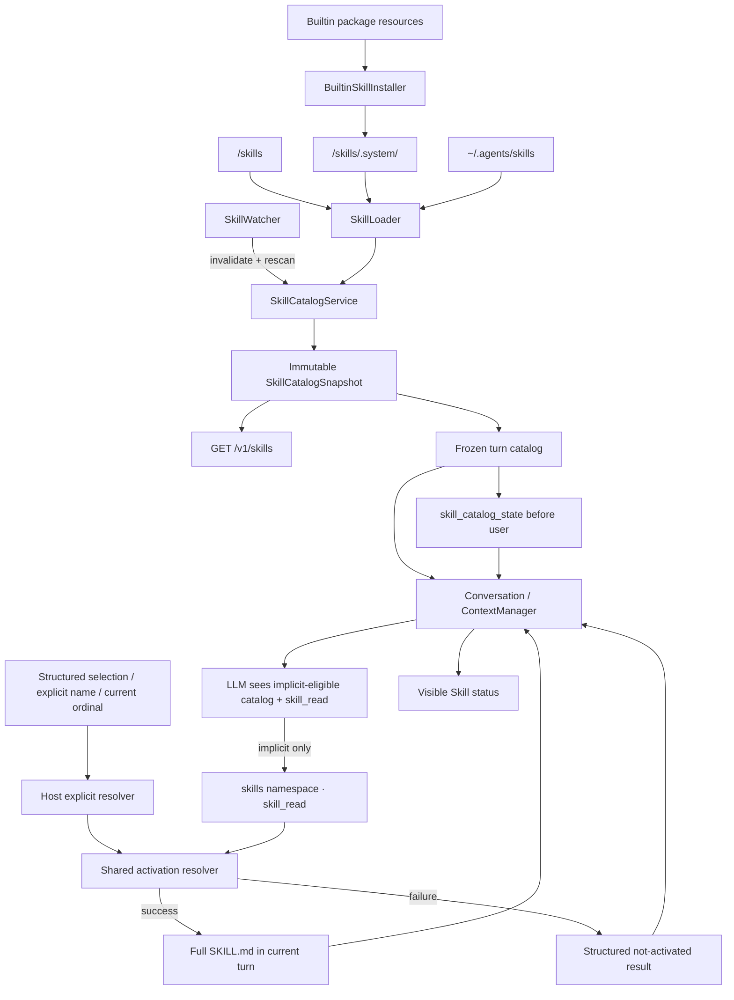

# Agent Skill 系统 - 技术方案

## 状态

CONFIRMED

## 需求文档

[requirement.md](./requirement.md)

## 现状分析

agent-friend 的正式对话统一由 `Conversation` 组装模型请求。桌面 AG-UI、持久化
OpenAI-compatible、无状态 OpenAI-compatible 和 AgentRuntime 最终都会进入
`SessionManager.start_conversation()` 创建的 `Conversation`，因此 Skill 不应在前端、
协议路由或某一种 provider 里单独拼 prompt。

当前上下文顺序由 `agent.context.protocol.assemble_messages()` 统一定义：基础 system
prompt 后依次是稳定 `extra_context`、历史、当前真实 user、当轮 `turn_context` 和尾部
临时指令。`Session.messages` 是 UI、memory 和一般会话投影共用的原始消息视图，
`Session.llm_messages` 则负责模型专用的失败清理与工具事务规整。Skill catalog 和正文既要
进入可恢复的模型历史，又不能变成用户长期事实，因此需要新增明确的模型专用事件，不能
复用已废弃且永不投影的 `model_context` 兼容事件。

上下文压缩当前以真实 `role="user"` 作为轮边界，并会把较旧历史折叠成 summary。
调用方预选的 Skill 正文继续以 synthetic `role="user"` 进入首轮；Agent 自主选择的 Skill
正文则作为 `skill_read` 的 `role="tool"` 成功结果进入工具续轮。两者都不是新的真实用户输入，
catalog 又属于需要保留最新值的 world state。上下文管理器必须同时识别 synthetic Skill
fragment 和 Skill 工具结果，否则 FIFO 或摘要可能丢掉当前轮指令，或把历史 Skill 当成
关系事实和后续轮常驻规则。

现有 `agent.paths` 集中管理用户数据目录，Python package 资源通过
`importlib.resources` 打包，BridgeRuntime 负责进程级共享组件及 FastAPI lifespan。
`watchfiles` 已在依赖锁文件中出现，但不是 `agent` 的直接依赖；本需求若直接使用，必须
提升为显式依赖，不能依赖其它包偶然传递安装。

当前 ToolRegistry 没有通用目录枚举、本地文件读取、文件变更或命令执行能力。现有 076
又只允许调用方在模型请求前选好 Skill，模型虽然看得到 catalog，却没有任何结构化入口把
自己的语义判断兑现成完整指令。这正是“声称 Skill 已激活、实际只调用普通工具”能够发生的
缺口。本次增加的 `skill_read` 只能按 catalog 稳定 ID 读取入口 `SKILL.md`；它不是任意文件
工具，也不读取 `references/`、`assets/`，不创建文件、不执行 `scripts/`。

## 方案设计

### 设计不变量

1. `SkillCatalogService` 是进程内 Skill 状态的唯一真相源；所有对话入口使用同一实例。
2. Agent 基于 catalog、当前用户输入和有效对话指代完成语义选择；后端不通过正则、关键词表
   或固定相似度规则解析用户 query。
3. Agent 的选择必须调用结构化 `skill_read` 才能成为真实激活；调用方仍可传入结构化
   `SkillSelection`，两条路径共用同一个 ID 解析、版本校验和正文读取实现。
4. 每轮在首次模型组装前冻结 catalog；调用方选择的正文同时冻结，Agent 后续调用
   `skill_read` 也只能在该 catalog snapshot 中解析，文件变化不把本轮静默切到新版本。
5. catalog 初次出现或模型可见内容变化时才追加新状态；无变化不追加、不改 system prompt。
6. Skill 正文追加在触发它的真实 user 后：调用方选择使用 synthetic `role="user"`，Agent
   选择使用正常 `assistant tool_call -> role="tool"` 事务；两者都不会成为后续轮自动生效的
   常驻规则。
7. catalog 与 Skill 正文不进入长期记忆或关系事实抽取；UI 只显示结构化激活状态，不把
   完整 `SKILL.md` 当聊天正文展示。模型历史仍服从既有预算、FIFO 和摘要压缩。
8. builtin、agent-friend 个人和共享个人 Skill 使用同一 parser、loader、catalog 与激活路径。
9. Skill 不授予工具权限；`allowed-tools` 只作为未执行的兼容元数据保留。
10. watcher 事件只做失效通知；每次刷新都重新构造完整 immutable snapshot 后原子替换。

### 组件结构



### 涉及文件

| 文件路径 | 改动类型 | 说明 |
| --- | --- | --- |
| `agent/pyproject.toml` | 修改 | 把 `watchfiles` 提升为 Agent 的显式跨平台依赖 |
| `agent/src/agent/paths.py` | 修改 | 新增 agent-friend 个人 Skill 根 `skills_dir()` |
| `agent/src/agent/skills/__init__.py` | 新增 | 导出 Skill 领域公共类型与 service |
| `agent/src/agent/skills/models.py` | 修改 | 增加隐式调用策略和 Agent 调用来源类型 |
| `agent/src/agent/skills/loader.py` | 修改 | 在既有发现基础上读取、校验 `agents/openai.yaml` 的调用策略 |
| `agent/src/agent/skills/catalog.py` | 修改 | catalog 暴露调用策略并写入 Codex 对齐的模型使用协议 |
| `agent/src/agent/skills/builtin.py` | 新增 | 内置资源 fingerprint、并发安全物化与 provenance |
| `agent/src/agent/skills/watcher.py` | 新增 | `watchfiles` 生命周期、去抖、重挂与周期 reconcile |
| `agent/src/agent/skills/service.py` | 修改 | 抽出调用方和模型工具共用的 snapshot activation resolver |
| `agent/src/agent/skills/builtin_assets/` | 新增 | `skill-creator`、许可证、资源及上游 provenance manifest |
| `agent/src/agent/tools/builtin/skills/tool.py` | 新增 | 模型可调用的 catalog-scoped `skill_read` 工具 |
| `agent/src/agent/tools/factory.py` | 修改 | 在存在 Skill service 时注册 `skill_read` |
| `agent/src/agent/conversation_events.py` | 修改 | 增加调用方预选的轻量激活状态事件 |
| `agent/src/agent/sessions/session.py` | 修改 | 保持模型专用正文投影，并为 UI 提供不含正文的状态投影 |
| `agent/src/agent/messages.py` | 修改 | 保留内部生成的 Skill user fragment，不按真实用户文本转义 |
| `agent/src/agent/context/protocol.py` | 修改 | 增加位于 history 与当前 user 之间的 `pre_user_context` |
| `agent/src/agent/context/naive.py` | 修改 | 透传新的上下文组成部分 |
| `agent/src/agent/context/fifo.py` | 修改 | 只按真实 user 切轮，并在裁剪后保留最新 catalog world state |
| `agent/src/agent/context/summarizing.py` | 修改 | 排除 catalog 摘要、保留最新状态，并正确处理历史 Skill fragment |
| `agent/src/agent/context/summary_prompt.py` | 修改 | 区分真实用户、历史 Skill 指令与 catalog 状态，禁止把 Skill 当长期事实 |
| `agent/src/agent/context/turns.py` | 修改 | synthetic Skill user 不作为完整 turn 起点 |
| `agent/src/agent/conversation.py` | 修改 | 向工具隐藏注入本轮 catalog snapshot，统一激活、状态和持久化语义 |
| `agent/src/agent/sessions/manager.py` | 修改 | 向正式与临时 Conversation 注入同一个 Skill service |
| `agent_bridge/src/agent_bridge/assembly.py` | 修改 | 进程级构造和关闭 Skill service/watcher，加入 BridgeRuntime |
| `agent_bridge/src/agent_bridge/app.py` | 修改 | 在 lifespan 中启动/停止 watcher，并注册 Skill catalog 路由 |
| `agent_bridge/src/agent_bridge/protocols/ag_ui/decoders.py` | 修改 | 从 `forwarded_props.skills` 解码结构化选择 |
| `agent_bridge/src/agent_bridge/protocols/ag_ui/routes.py` | 修改 | 把选择传到同一 Conversation 入口 |
| `agent_bridge/src/agent_bridge/protocols/openai/decoders.py` | 修改 | 从 `agent_friend.skills` 解码结构化选择 |
| `agent_bridge/src/agent_bridge/protocols/openai/routes.py` | 修改 | 持久与无状态分支统一传递选择 |
| `agent_bridge/src/agent_bridge/protocols/openai/encoders.py` | 修改 | 直连 Conversation 时透传选择 |
| `agent_bridge/src/agent_bridge/protocols/ag_ui/encoders.py` | 修改 | 把调用方预选状态编码为轻量 custom event |
| `agent_bridge/src/agent_bridge/routes/skills.py` | 新增 | 提供只读完整 catalog 与当前 generation |
| `frontend/src/types/chat.ts` | 修改 | 增加 Skill 状态块或等价的领域字段 |
| `frontend/src/stores/conversationReducer.ts` | 修改 | 投影实时 Skill 状态 |
| `frontend/src/stores/sessionProjection.ts` | 修改 | 从历史 `skill_context` / Skill 工具结果恢复同一状态 |
| `frontend/src/pages/chat/components/ToolCard.tsx` | 修改 | 复用现有卡片呈现紧凑 Skill 加载状态，不展示完整正文 |
| `agent_eval/src/agent_eval/{schema,loader,runner,judge}.py` | 修改 | 支持 fixture Skill 和激活真实性 deterministic judge |
| `agent_eval/cases/C20-*.yaml` | 新增 | 真实 bad case、语义选择隔离项与控制项 |
| `agent/tests/test_skill_*.py` | 新增 | loader、catalog、watcher、builtin、上下文与会话回归 |
| `agent_bridge/tests/test_skills_*.py` | 新增 | 协议解码、入口一致性和 catalog route 回归 |
| `scripts/package/windows/agent_friend_runtime.spec` | 核对/按需修改 | 确保 builtin Skill package data 进入安装态 runtime |

### 领域模型

```python
SkillSource = Literal["builtin", "personal", "shared"]

@dataclass(frozen=True)
class SkillRecord:
    id: str
    source: SkillSource
    name: str
    description: str
    entry_path: Path
    canonical_entry_path: Path
    package_root: Path
    version: str
    allow_implicit_invocation: bool
    frontmatter: Mapping[str, object]
    aliases: tuple[SkillAlias, ...]

@dataclass(frozen=True)
class SkillCatalogSnapshot:
    generation: int
    fingerprint: str
    entries: tuple[SkillRecord, ...]
    issues: tuple[SkillLoadIssue, ...]
    external_watch_roots: tuple[Path, ...]

@dataclass(frozen=True)
class SkillSelection:
    id: str
    expected_version: str | None = None

SkillInvocationKind = Literal["caller", "implicit"]

@dataclass(frozen=True)
class ActivatedSkill:
    record: SkillRecord
    contents: str
    version: str

@dataclass(frozen=True)
class SkillTurnSnapshot:
    catalog: SkillCatalogSnapshot
    rendered_catalog: RenderedSkillCatalog
    activations: tuple[ActivatedSkill, ...]
    activation_issues: tuple[SkillActivationIssue, ...]
```

`SkillCatalogSnapshot` 和其中的记录在发布后不再修改。`SkillCatalogService` 只在刷新成功
后，在锁内替换单个 snapshot 引用；对话拿到引用后不需要在整轮持锁。

### 来源与目录

| 来源 | 逻辑根 | 说明 |
| --- | --- | --- |
| builtin | `<user_data>/skills/.system/<bundle-fingerprint>` | 产品物化的只读版本目录，只扫描当前 bundle fingerprint |
| personal | `<user_data>/skills` | agent-friend 专属个人 Skill；扫描时剪枝 `.system` |
| shared | `~/.agents/skills` | 用户主动与兼容 Agent 共享的个人 Skill |

`skills_dir()` 与其它用户资产路径一样服从 `AGENT_FRIEND_DATA_DIR`，测试因此可完全隔离。
共享根始终使用实际用户主目录，不跟随 `AGENT_FRIEND_DATA_DIR`；测试通过显式构造
`SkillCatalogService` 注入临时 shared root，不改进程真实 home。

三类根按 builtin、personal、shared 的固定顺序加载。此顺序只用于稳定展示，以及同一
canonical `SKILL.md` 被多个别名发现时选择 primary source；不同 canonical path 的同名
Skill 永远同时保留，不做优先级覆盖。

### builtin `skill-creator`

内置 Skill 作为 Python package data 随 runtime 发布。`builtin_assets/manifest.json`
至少记录：

- 上游仓库、commit、源目录和取得日期；
- 上游许可证与随包 `license.txt`；
- bundle schema 和内容 fingerprint；
- agent-friend 对 `SKILL.md` 做过的最小兼容修改清单。

兼容修改只处理产品名、默认 Skill 目标目录和真实能力声明；目录结构、工作流、
`agents/openai.yaml`、`references/`、`scripts/`、`assets/` 与许可证一并保留。脚本只是
资源，不因物化、发现或激活被执行。

启动期 `BuiltinSkillInstaller` 对整个 builtin bundle 计算 SHA-256 fingerprint，并把资源
物化到不可变版本目录：

```text
<user_data>/skills/.system/<fingerprint>/skill-creator/...
```

安装流程在 `<user_data>/skills/.system-install.lock` 上使用现有 `portalocker`：先写同级
staging 目录，完成校验后原子 rename 为 fingerprint 目录。目标已存在且 manifest 匹配时
不写盘。旧 fingerprint 不在本需求内自动删除，避免并行运行的旧 Bridge 正在读取时被新
进程移除。个人 Skill 扫描始终剪枝 `.system`，所以旧 bundle 不会形成重复 catalog。

builtin 的稳定 ID 使用 `builtin/skill-creator`，不把 fingerprint 编入身份；版本字段仍是
当前 `SKILL.md` 内容摘要。这样产品升级后调用方看到同一能力的新版本，而不是一个全新的
Skill。

### 发现、校验与去重

`SkillLoader` 对每个来源执行有界递归发现：

- 最大递归深度 6；
- 每个根最多访问 2,000 个目录和 20,000 个 entry；
- 只把文件名精确为 `SKILL.md` 的文件视为候选；
- personal/shared 默认跳过隐藏目录；builtin 从已经确定的版本根开始扫描；
- 单个 `SKILL.md` 最大 256 KiB，超过即作为无效候选诊断，不进入 catalog；
- 文件必须是 UTF-8，并具有以 `---` 分隔的 YAML frontmatter。

frontmatter 校验遵循以下口径：

- `name` 必填，1-64 字符，只允许小写字母、数字和单连字符，不允许首尾或连续连字符，
  并与解析后的实际 package 目录名一致；
- `description` 必填，1-1,024 字符；
- `license`、`compatibility`、`metadata`、`allowed-tools` 按规范类型与长度解析；
- 未识别的可选字段保留在 `frontmatter` 供诊断，但不获得运行时语义；
- `allowed-tools` 不改变 ToolRegistry、审批或权限。

Skill package 若包含 `agents/openai.yaml`，loader 只额外读取
`policy.allow_implicit_invocation`：

- 文件不存在或 `policy` 未声明该字段时默认为 `true`；
- 字段必须是 boolean；合法的 `false` 写入 `SkillRecord.allow_implicit_invocation`；
- YAML、顶层形态或字段类型无效时保留 Skill 的显式可用性，但以 fail-safe 的 `false` 参加
  catalog，并记录 `invalid_openai_policy` 诊断，避免配置错误意外扩大隐式调用；
- `agents/openai.yaml` 的其它 interface/dependency 字段本期仍只作兼容资源，不获得运行时权限。

这个读取属于 Skill catalog 元数据解析，不向模型开放包内任意文件路径。watcher 已监测整个
package，policy 文件变化会触发完整 rescan；该 boolean 纳入 catalog fingerprint。

目录符号链接、Windows directory junction/reparse point 和文件链接均通过解析后的 canonical
路径参与身份判断。遍历维护已访问 canonical 目录集合，遇到循环、失效链接、权限错误或
超过边界时只生成 `SkillLoadIssue`，继续处理其它候选。链接指向来源根之外是允许的共享
方式，不因“越界”自动拒绝；本期 loader 只读取入口 `SKILL.md`，不会借链接读取其它资源。

文件型 Skill ID 由规范化 canonical `SKILL.md` URI 的 SHA-256 生成；Windows 在生成前使用
`normcase` 规整大小写。相同 canonical entry 只保留一条 `SkillRecord`，其它来源和逻辑路径
写入 `aliases` 并形成 dedupe 诊断。不同 canonical entry 即使 `name` 一样也各自保留。

`version` 是完整 `SKILL.md` bytes 的 SHA-256。资源目录变化会触发 service generation 更新，
但只有 `SKILL.md` 或 model-visible metadata 变化才改变 catalog 渲染 fingerprint。

稳定排序键为：`source_rank`、`name`、规范化 canonical URI。扫描线程调度、文件系统枚举
顺序和 watcher 批次均不得影响 catalog 顺序或 fingerprint。

### Catalog 渲染与预算

catalog 由全量 `SkillCatalogSnapshot` 按当前激活模型的上下文窗口逐轮渲染。固定的控制
语义（discovery 状态、历史基线边界、coverage、选择与激活协议、权限边界）必须完整保留，
不参与可变条目预算竞争。Skill entry 与 description 组成的可变区域预算为模型 effective
context window 的 2%；无法取得窗口时使用 8,000 字符上限。这样 catalog 总量始终受
“常量协议开销 + 有界条目”约束，同时不会因为增加必要控制语义而反向压缩其表达效果。
单条描述即使在 metadata 中合法，也最多贡献 1,024 字符。

每条允许隐式调用的 model-visible entry 至少包含：

```text
- name: description (source=personal, skill_id=skill_..., version=abc123...,
  allow_implicit_invocation=true)
```

渲染器先计算每条 entry 不含描述时的最小成本，再在能保留的 entry 间轮转分配描述预算，
避免前面的 Skill 独占空间。最小 entry 也放不下时按稳定顺序省略尾部，并加入省略数量
提示。完整列表和所有 load issues 仍可通过 Bridge catalog route 读取。

`allow_implicit_invocation=false` 的 Skill 不进入该 model-visible 列表，完整 catalog 仍通过
Bridge route 提供给宿主选择面。catalog 外层使用内部生成的 `<skills_catalog>` envelope，并明确：

- 结构化选择、`$skill-name`、带使用动作的精确名称和当前枚举列表序号由宿主解析并在模型前加载；
- 有效上下文指代或 `description` 匹配由 Agent 选择，且必须调用 `skill_read` 并传精确 ID；成功结果才表示隐式激活，失败结果表示未激活；
- `allow_implicit_invocation=false` 的 Skill 不进入隐式 catalog，也不能通过 `skill_read` 激活；
- 同时匹配多个 Skill 时只选择完成任务所需的最小集合，并按需要逐个读取；
- 使用前简短说明将使用哪个 Skill 及原因；读取失败时说明未激活事实并合理降级；
- 不得把 catalog 出现、历史正文或任意普通工具调用说成 Skill 已激活；
- 历史 Skill fragment 不表示当前轮自动继续启用；
- `allowed-tools` 和 Skill 文本不能扩大 Agent 权限；
- 当前 snapshot 替代更早的 catalog snapshot。

名称、描述、路径等字段按数据转义，不能闭合内部 envelope。full catalog body 与渲染预算
profile 一起计算 `render_fingerprint`。同一 model-visible body 即使后台 generation 变化，
也不向 session 追加重复状态。

### Watcher 与热更新

`SkillWatcher` 是 BridgeRuntime 的进程级组件，使用同步 `watchfiles.watch()` 运行在 daemon
thread 中，由 FastAPI lifespan 显式 start/stop，停止使用 `threading.Event`。

主路径配置为 `debounce=500ms`、`step=100ms`、`recursive=True`。一个事件批次只做三件事：

1. 判断路径是否落在 personal/shared 或当前 external symlink watch roots；
2. 标记 catalog dirty；
3. 调用 service 完整 rescan，而不是按事件类型原地增删 entry。

personal 根会由 builtin 安装期创建，watcher 直接监听 `<user_data>/skills` 并过滤
`.system`。shared 根不存在时不创建用户目录：如果 `~/.agents` 已存在，递归监听该目录并
只接受 `skills` 子树事件；否则非递归监听 home 中 `.agents` 的创建，出现后重建注册。

通过 symlink/junction 发现且 canonical package 位于来源根之外时，loader 把 package 目录
加入 `external_watch_roots`。snapshot 替换后 watcher 对比目标集合，必要时重启外部注册，
保证实际目标中的 `SKILL.md` 修改也能触发刷新，而不是只能看到链接本身被替换。

watcher 使用 `rust_timeout=60s` 与 `yield_on_timeout=True` 做低频 reconcile：检查目标根形态、
重挂失效注册，并在最近 watcher 异常后重试。它不是 catalog 的常态轮询来源。初始化或
运行中 watcher 异常时：

- 保留最近一次成功 snapshot；
- 记录 `watcher_degraded`、异常和最近成功刷新时间；
- 按 1、2、4、8、16、30 秒上限退避重建 watcher；
- reconcile 或后续成功事件触发完整 rescan 后清除 degraded 状态。

单个 Skill 在编辑器原子保存过程中暂时无效时，刷新结果会把它从有效 catalog 移除并记录
parse issue；下一次 rename/write 事件会重新加入。系统不保留一份无法验证的 stale Skill
冒充当前有效版本。

### Bridge catalog 接口

新增只读 `GET /v1/skills`，返回当前 service snapshot：

```json
{
  "generation": 12,
  "fingerprint": "...",
  "watcher": {"status": "healthy", "last_refresh_at": "..."},
  "skills": [
    {
      "id": "skill_...",
      "name": "example",
      "description": "...",
      "source": "shared",
      "version": "sha256...",
      "path": "C:/.../SKILL.md",
      "aliases": []
    }
  ],
  "issues": []
}
```

该接口不读取完整 Skill 正文，也不激活 Skill。service 内部保留 snapshot-changed subscriber
接口，后续桌面 Skill 管理或选择 UI 可以接入现有 push channel；本期只消费每轮真实激活
状态，不实现 catalog 管理、启停或选择界面。

### 调用方结构化选择与 Agent 语义选择

协议层只接受以下领域结构，不接受名称或路径作为选择依据：

```json
{"id": "skill_...", "expected_version": "可选的完整 SHA-256"}
```

- AG-UI 从 `forwarded_props.skills` 读取数组；
- OpenAI-compatible 从 vendor namespace `agent_friend.skills` 读取数组；
- 两者都解码为 `tuple[SkillSelection, ...]` 后传给 `Conversation.stream()`；
- 空数组与字段缺失都表示调用方不预先激活 Skill，Agent 仍可在本轮自行语义选择；
- 重复 ID 保留第一次出现的顺序并去重；
- 形态错误、空 ID、未知字段类型属于协议错误，模型调用前返回 HTTP 400；
- catalog 中不存在、已失效或 `expected_version` 不匹配属于运行时 activation issue，不把
  ID 当路径读取，也不静默切换成同名 Skill。

activation issue 会作为当前用户后的模型专用 `<skill_load_error>` fragment 进入本轮，让
Agent 简短说明缺口并在不依赖该 Skill 时继续。它与成功 activation 一样持久化，保证失败
重试和会话恢复看到相同事实。

宿主显式选择不取代 Agent 自主的隐式选择。宿主只解析能够确定性证明的结构化选择、
`$skill-name`、带使用动作的精确名称和最近枚举列表序号；不尝试理解普通上下文指代或
description 相似度。后两者仍由模型在隐式候选内判断。

模型选择通过普通 ToolRegistry 中的 `skill_read` 兑现。实现位于
`agent.tools.builtin.skills`，因此模型可见 capability catalog 将其归入可信 `skills`
namespace；受 OpenAI-compatible function name 约束，wire callable 保持扁平的
`skill_read`：

```json
{
  "skill_id": "skill_...",
  "reason": "一句简短的选择理由"
}
```

- `skill_read` 只能表示模型自主的隐式调用，schema 不向模型暴露调用类型字段；
- `skill_id` 必须来自本轮隐式 catalog，工具不接受名称、序号、路径或任意文件 URI；
- `reason` 只用于用户可见状态和诊断，限制为短文本，不参与 ID 解析；
- `allow_implicit_invocation=false` 时，即使伪造或猜中稳定 ID，工具仍返回结构化失败；
- 成功结果包含完整、带身份和当前轮作用域 envelope 的 `SKILL.md`；失败结果包含稳定错误码
  和“未激活”事实。ToolResult meta 同时写入不含正文的 activation 摘要，供日志和 UI 使用；
- 工具不接受 `expected_version`。它直接使用本轮冻结 record 的 version，避免要求模型抄写
  64 位摘要；调用方协议仍保留 `expected_version` 做并发控制。

tool description 与 catalog protocol 都要求：需要 Skill 时先调用，成功后再按完整指令行动；
工具未调用或失败时禁止声称已激活，也禁止把 `web_search` 等普通工具的结果归因于 Skill。

### Turn snapshot 与激活竞态

`Conversation.stream()` 开始后、创建 `ToolRunContext` 前调用
`SkillCatalogService.begin_turn(selections, model_window, semantic_activation_available)`：

1. 读取当前 immutable catalog 引用并渲染该模型的 catalog；
2. 按 ID 在该 snapshot 中精确解析 selections；
3. 读取每个选中 `SKILL.md` 的完整 bytes，计算 digest 并与 record.version 比较；
4. digest 不一致时同步执行一次 targeted/full refresh，并只重试一次；
5. 再次不一致、文件删除或不可读时产出 activation issue；
6. 成功内容保存进 `ActivatedSkill`，本轮后续模型续轮不再读磁盘。

这样既不会把 watcher 的毫秒级时序变成选择正确性的前提，也不会在 Skill 更新时把 catalog
中的旧身份与磁盘新正文拼成一个不一致 snapshot。文件在第 6 步之后改变只会触发后台刷新，
当前 `ActivatedSkill.contents` 不变。

`SkillCatalogService.activate_from_snapshot()` 承担上面第 2-6 步的共享实现。调用方 selection
在首次 provider 调用前使用它；`skill_read` 则由 `Conversation` 通过隐藏 invocation context
取得同一 `SkillCatalogSnapshot` 后调用它。隐藏值是 Python 领域对象，不出现在模型参数、
tool_call event 或 wire schema 中。

Agent 的工具调用发生在首次 provider 响应之后。此时如果目标文件 bytes 与冻结 record.version
不一致，工具返回 `skill_changed_during_turn`，不刷新为新 catalog 后偷偷重试；下一用户轮自然
取得 watcher 已发布的新 snapshot。成功正文在正常 `assistant tool_call -> role="tool"` 事务中
回喂模型，并设置 `context_retention="pinned"`，不能被 recoverable tool-result 低水位提前清空。

语音实验若显式关闭全部工具，`semantic_activation_available=false` 会让 catalog 说明本轮不能
自主读取；调用方结构化选择仍可在 provider 前加载。Agent 不应在没有工具 surface 的入口声称
完成语义激活。是否在低延迟语音路径保留本地 `skill_read` 作为唯一工具留给后续独立性能验证，
本需求不绕过现有实验开关。

多 Skill activation 按调用方顺序或模型 tool_call 顺序进入历史。完整正文不设置另一个独立字符截断上限；超过
loader 的 256 KiB 候选上限时它本来就不会成为有效 Skill。最终是否能装入当前模型窗口仍
服从已有 context manager，过大时返回明确 `ContextInputTooLargeError`，不能静默裁掉 Skill
正文后继续。

### 会话事件与模型投影

现有两个 append-only Skill event type 继续保持兼容：

#### `skill_catalog_state`

```json
{
  "type": "skill_catalog_state",
  "payload": {
    "generation": 12,
    "render_fingerprint": "...",
    "catalog_fingerprint": "...",
    "budget_profile": "tokens:2560",
    "content": "<skills_catalog>...</skills_catalog>"
  }
}
```

它是 session world state，不属于某次 run 的失败清理范围，不写 `run_id`。`Session.messages`
忽略它；`Session.llm_messages` 投影为 `role="system"`、
`meta.synthetic="skill_catalog_state"`。首次启用 Skill 系统的老 session 会在下一条 user 前
获得第一条状态。

#### `skill_context`

成功时 payload 保存 `skill_id`、`name`、`source`、入口路径、`version`、完整 `contents`、
选择顺序和关联 `user_event_id`；失败时保存同一选择信息、稳定 error code 与可给模型的短
说明。它属于当前 run，参与失败清理和 edit-resend 失活。

成功事件投影为：

```xml
<skill>
<name>skill-name</name>
<id>skill_...</id>
<source>shared</source>
<path>.../SKILL.md</path>
<version>...</version>
<runtime_capabilities>
本 Agent 当前没有通用本地文件读写或命令执行能力；Skill 不能扩大权限。
</runtime_capabilities>
---
name: skill-name
description: ...
---
...完整正文...
</skill>
```

对应 `Message` 使用 `role="user"`、`meta.synthetic="skill_instructions"`。完整正文不进入
`Session.messages`，所以 memory.observe、会话标题和搜索正文不把 Skill 指令当成用户原话。
前端历史投影只从 payload 取得 `status`、`skill_id`、`name`、`source` 和错误摘要，绝不把
`contents` / `rendered` 投影成聊天文本。`escape_user_messages_for_llm()` 仅对真实 user 文本
转义内部标记，不能改写已冻结的 Skill 正文；envelope 自有字段在渲染前单独转义。

Agent 自主选择不新增另一种持久化正文 event。`skill_read` 的 request/result 使用现有
`tool_call_request` / `tool_call_result`，成功正文自然以 `role="tool"` 恢复；result meta 的
`extra.skill_activation` 保存状态、ID、名称、来源、版本和 invocation kind，不复制正文。
失败 result 使用 `is_error=true` 和稳定 `error_kind`。旧 session 中没有这些 meta 时按普通
tool result 兼容读取。

为让调用方预选在实时桌面也可见，`Conversation` 在本地组装和 `skill_context` 持久化成功后、
首次 provider 调用前 yield 轻量 `SkillActivationStatus`。AG-UI encoder 把它编码为
`agent_friend.skill_activation` custom event；AgentRuntime push 透传同一领域事件。这个瞬态
事件不再单独落盘，因为 `skill_context` 已是恢复真相源。

前端把两条来源统一呈现为现有 assistant block 流中的紧凑 Skill 状态卡：

- `loading` / `activated` / `error` 使用现有 `StatusDot`、边框、surface 和折叠组件；
- 标题显示 `Skill · <name>`，正文只显示选择原因、来源和成功/失败摘要；
- 不展示完整 `SKILL.md`，也不把 status card 内容加入消息复制文本；
- 模型 `skill_read` 直接复用工具实时事件，`ToolCard` 对该工具做领域化标题和结果摘要；
- 历史 `skill_context` 与带 activation meta 的 tool result 恢复后必须得到同一最终状态。

这只是运行状态可视化，不提供 Skill 列表管理、选择器、启停或编辑交互。实现后按用户授权仅用
不抢占键鼠的真实 WebView/CDP DOM 与截图路径验收，不执行前台坐标点击或键盘输入。

### 首轮组装与持久化顺序

`ContextManager.build_messages()` 新增 `pre_user_context`，统一顺序变为：

```text
[base system]
+ extra_context
+ history
+ pre_user_context       # 本轮新的 catalog state
+ current real user
+ turn_context           # Skill fragments、runtime、memory、surface
+ trailing user/system
```

第一轮本地组装使用 frozen turn snapshot：

1. 如果当前 rendered catalog fingerprint 与 session 最近状态不同，把 catalog message 放入
   `pre_user_context`；
2. 当前真实 user 仍走 `new_user_input`；
3. 成功和失败的 Skill fragments 按选择顺序放在 `turn_context` 最前，其后才是现有 runtime、
   memory、surface 和 voice context；
4. context manager 接受并完成预算检查后，依次落盘 catalog state（如有）、真实 user、
   `skill_context`；
5. 随后才调用 provider，保持现有“本地组装失败不落 user event”的语义。

落盘后工具续轮和 context-window recovery 都从 `Session.llm_messages` 重建，因此不会重新读
Skill 文件，也不会重复注入正文。

没有调用方 selection 时，首轮只装配 catalog。模型若判断某个 Skill 适用，正常产生
`skill_read` tool call；工具结果落盘并回喂后才进入下一次模型 continuation。Agent 在 tool
call 前输出的简短使用说明可以作为普通 assistant segment 保留，但不能提前使用“已激活”这类
完成态措辞。工具失败时 continuation 必须基于 error result 明确说明未激活，而不是继续模拟
Skill 已执行。

相同 `user_event_id` 重试时，Conversation 读取该 user 紧邻的 `skill_context`：请求 selection
ID、顺序和 expected version 必须与已落盘 snapshot 一致，否则返回
`user_event_id_conflict`。已完成回复继续走现有 idempotent replay；未完成回复从已落盘
Skill context 继续，不重新解析当前磁盘版本。

`edit_resend_latest()` 增加 selections 参数。旧 user 之后的 Skill context 随现有
`turn_rewrite` 一起失活；位于 user 之前的 catalog state 是会话 world state，不因编辑一条
消息失活。新分支按调用方本次 selections 重新冻结；未传只表示不预激活旧 Skill，Agent 仍须
按编辑后的用户输入重新判断是否调用 `skill_read`。

### 上下文裁剪、摘要与缓存

catalog 不直接拼进每轮重建的基础 system prompt。首次 catalog state 进入历史后，内容不变
的后续请求重用完全相同的前缀；catalog 改变时，新状态追加在最新 user 之前，旧前缀保持
不动。模型或 catalog 预算 profile 改变导致 model-visible body 变化时，也按新状态处理。

`context.turns` 新增“真实 user”判定：只有 `role="user"` 且
`meta.synthetic != "skill_instructions"` 的消息开启 turn。这样 FIFO、recent tail 和摘要
切点始终把“真实 user + 其 Skill context + assistant/tool”当作完整事务。

正常未裁剪历史保留所有已追加 catalog 状态，维持 append-only 前缀。发生 FIFO 或摘要折叠
时采用 world-state 保护规则：

- 找出被保留视图中的最新 `skill_catalog_state`；
- 旧 catalog 状态不进入对话 summary；
- 最新状态如果落在被裁掉/摘要覆盖部分，重新放到新 summary 之后、recent tail 之前；
- 最新状态已在 recent tail 中时不重复；
- 这次移动只发生在上下文本来就因压缩改变前缀的时刻。

`render_transcript()` 将历史 synthetic Skill fragment 和 `skill_read` tool result 都标记为
“该用户轮选择的工作流指令”，不渲染成“用户原话”或普通外部检索证据；summary prompt
明确要求只保留其对已完成任务仍有用的结果或约束，不复制长正文，也不把旧 Skill 继续描述为
当前常驻规则。原始 `skill_context` 和 tool result event 永远不改，之后再次选择仍经当前轮
snapshot 读取当前版本。

最新 compaction checkpoint 的 `covered_through_uuid` 继续指向原始历史消息；catalog
world-state 的重新投影不改变 checkpoint schema。FIFO emergency base 预算必须包含最新
catalog，以及当前轮 synthetic Skill fragment 或 `skill_read` pinned result；放不下时明确
失败，不通过删除它们伪造成功。

OpenAI 无状态请求每次都会构造新的 transient session，因此每个 HTTP 请求各有一条初始
catalog state；它没有跨请求服务端历史，“不重复追加”只在同一个持久 session 内成立。

### 附加资源与未来公共文件能力

本期 Skill package model 保留 `package_root`、canonical entry 与 version，完整正文中的相对
路径不被重写。这些字段是未来公共本地文件工具解析相对资源的接入点，但本期：

- 不注册 `read_skill_resource`、`SkillAuthoringService` 或 builtin-only tool；
- 不把整个 `references/`、`assets/` 或脚本源码预加载到上下文；
- 不把相对路径转换为 `web_fetch`、file URL 或其它旁路；
- Agent 需要这些文件才能继续时，依据 runtime capability envelope 如实报告缺口；
- `scripts/` 在发现、刷新、激活和模型调用阶段都不会执行。

未来通用本地文件能力必须自行完成路径授权、敏感目录、符号链接、内容体积、审批和审计；
Skill service 只提供已选 package 的身份信息，不替公共工具绕过权限判断。对应公共能力由
[issue 044](../../issues/044-agent-general-filesystem-mutation-tools/) 跟踪，命令与脚本运行时由
[issue 045](../../issues/045-governed-command-and-skill-script-runtime/) 跟踪。

### 诊断与日志

`SkillLoadIssue.code` 使用稳定枚举，至少覆盖：

- `root_unreadable`、`scan_limit_reached`；
- `broken_link`、`link_cycle`、`canonicalize_failed`；
- `skill_too_large`、`invalid_utf8`、`missing_frontmatter`、`invalid_yaml`；
- `invalid_name`、`name_directory_mismatch`、`invalid_description`、
  `invalid_optional_metadata`、`invalid_openai_policy`；
- `canonical_duplicate`、`duplicate_name`；
- `watcher_degraded`、`watch_target_rebound`；
- `catalog_description_truncated`、`catalog_entries_omitted`；
- `skill_not_found`、`skill_version_mismatch`、`skill_changed_during_activation`、
  `skill_changed_during_turn`、`skill_read_failed`、`implicit_invocation_disabled`；
- `filesystem_capability_unavailable`、`command_capability_unavailable`。

日志和 route diagnostics 可以包含本地路径；普通 assistant 回复只需说明用户能行动的原因，
不主动泄漏其它 Skill 的绝对路径或内部异常堆栈。日志记录刷新 generation、耗时、有效/无效
数量、render fingerprint、watcher 状态和 activation 结果，不记录完整 Skill 正文。

### 测试策略

#### Loader 与 builtin

- 三类来源、固定排序、标准和可选 frontmatter；
- `agents/openai.yaml` 缺省 true、显式 false、无效 policy fail-safe 和热修改；
- 名称/目录不匹配、UTF-8、超大文件、无效 YAML、单个错误隔离；
- 同名不同路径保留、canonical link 去重、broken/cycle/junction 行为；
- 外部 symlink target 加入 watch roots；
- builtin fingerprint 幂等物化、并发 installer、旧版本共存；
- `skill-creator` 上游 commit、license、资源树和兼容补丁 manifest 完整；
- wheel/PyInstaller package data 可取得。

#### Catalog 与 watcher

- 固定 catalog 控制语义不受条目预算挤压；可变 entry 区域使用 2% token/8,000 char
  fallback，并覆盖描述公平截断、entry 省略、policy 标记和稳定 fingerprint；
- 只改非 model-visible 资源时 generation 变化但 rendered fingerprint 不变；
- add/change/delete/rename、编辑器原子保存和短时间批量事件只触发一次稳定 rescan；
- shared 根从不存在到创建、根删除重建、外部 symlink target 修改；
- watcher 异常保留 last-good snapshot、退避重挂和 reconcile 恢复；
- 刷新与并发 turn snapshot 不产生半新半旧记录。

#### 激活与会话

- 两协议入口仍解码为同一 `SkillSelection`，模型工具与调用方选择共用 activation resolver；
- catalog protocol 明确覆盖名称/序号、上下文指代、隐式 description 匹配、最小 Skill 集合、
  成功前不得声称激活和失败降级；后端没有 query parser 或 `$skill-name` 语法；
- `skill_read` 只接受稳定 ID、调用来源和短理由，不接受名称/路径；unknown、policy disabled、
  stale version、轮中修改、读取失败、重复选择和多 Skill 顺序均有确定性测试；
- catalog state 在 user 前、Skill context 在 user 后，工具续轮不重复读取；
- 同一 `user_event_id` replay/冲突，首轮失败清理，edit-resend 失活；
- `Session.messages`、memory、标题和搜索不包含 Skill 正文；实时与历史 UI 只显示同口径状态；
- `Session.llm_messages`、重启恢复和 provider recovery 保留正确上下文；
- synthetic Skill user 不形成独立 turn；`skill_read` result pinned；FIFO 和 summary 保留最新
  catalog、保护当前轮正文并把历史正文排除出常驻规则；
- catalog 未变化不追加，变化后只追加新 state，并用 prompt cache trace 验证共同前缀；
- 压缩后再次激活读取当前版本，而不是历史正文。

#### 运行时边界

- `skill_read` 只能读取 catalog 中的入口文件；catalog/activation 不读取附加资源、不运行
  脚本、不注册任意文件或命令 tool；
- fake model 请求 references、写文件或运行脚本时只能得到 capability gap；
- `allowed-tools` 不改变实际 tool specs；
- 测试全部使用临时目录和 fake/mock provider，不调用真实 LLM。

#### Agent eval C20

eval schema 增加最小 `fixture_skills`：每项只描述 `name`、`description`、`instructions` 和
`allow_implicit_invocation`。runner 在 case 临时目录创建标准 Skill package，启动禁用 watcher
的真实 `SkillCatalogService`，并把同一 service 同时注入 SessionManager 和 ToolRegistry。
它不是生产 session 导入器，也不新增 eval-only 激活捷径。

C20 至少包含：

1. 真实长会话锚点：历史中列出两个 Skill，query 为“你用一下 2 试试”；必须成功调用
   `skill_read`，原始“已激活”但无调用的坏回答失败；
2. 直接名称与“那个 Skill”“实验的 Skill”等可消歧指代；
3. 未点名但 description 明确匹配的隐式任务；
4. `allow_implicit_invocation=false` 的隐式负例和直接点名正例；
5. 无匹配普通请求，不得为了展示能力滥用 Skill；
6. `skill_read` 失败时允许诚实说明未激活，禁止继续宣称使用成功或把普通工具结果归因于 Skill。

judge 增加 `forbid_unsupported_skill_activation_claim`：最终文本或中间 assistant segment 出现
“已激活/已加载/通过某 Skill 查到”等完成态归因时，trace 中必须存在同一轮成功的
`skill_read`，失败调用不算证据。fixture 单测固定原始 bad、真实成功、诚实失败和普通对照
四个校准点。case 集完成 deterministic loader/judge/runner 测试后，再按 LLM API 授权规则
单独取得许可运行首次真实 C20；报告需复核每个 case 的 trace、工具参数、结果和 verdict。

### 实施顺序

1. 在现有 loader/model/catalog 上加入 `allow_implicit_invocation` 与新的模型使用协议。
2. 抽出 snapshot activation resolver，新增并注册 `skill_read`，接入 Conversation 隐藏 turn
   snapshot、持久工具事务和失败状态。
3. 扩展摘要/裁剪对 Skill tool result 的分类，并回归调用方 selection、恢复、重发与缓存。
4. 接入实时和历史 Skill 状态卡；补前端投影与组件测试。
5. 按 add-agent-eval case-group 流程加入 C20 fixture、judge、runner 支持和校准测试。
6. 运行定向测试、项目完整门禁、获准后的真实 C20，以及不抢键鼠的 desktop DOM/截图验收。

## 影响分析

### 上下游影响

- `Session` event schema 新增纯加性类型，不修改旧 JSONL；老会话自然在下一轮获得首个 catalog
  state，因此 `SCHEMA_VERSION` 不递增。
- `ContextManager` protocol 新增参数，Naive、FIFO、Summarizing 及测试 fake 实现必须同步；
  这是本需求最广的内部接口影响。
- ToolRegistry 在绑定 Skill service 的生产路径新增一个本地只读 `skill_read`；它不扩大任意文件、
  命令、网络或其它 Skill 资源权限。没有 service 的测试/工具装配保持原工具集合。
- BridgeRuntime 新增一个需要显式关闭的线程型组件；测试 fixture 可注入 disabled/noop watcher。
- OpenAI-compatible 仍接受标准 ChatCompletion body；Skill 选择只存在于可选 vendor namespace。
- session JSONL 会保存完整已激活正文，重复激活大型 Skill 会增加本地历史体积；模型窗口仍由现有
  压缩控制，但原始审计历史不会物理缩小。
- frontend 增加运行状态卡，但没有 Skill 管理、选择或编辑 UI；状态卡复用既有消息 block、
  ToolCard、StatusDot、Collapsible 和主题 token，不引入新组件库。

### 风险点

- **Prompt 注入面扩大**：个人 Skill 是用户安装、由调用方或 Agent 按语义选择的工作流指令。
  catalog 元数据按数据转义，正文只在结构化读取成功后进入当前轮，builtin 不提升 system 权限，
  避免 catalog description 或任意本地路径天然获得完整指令权。
- **模型绕过激活真实性**：prompt/tool description、结构化成功状态、用户可见卡片和 C20 judge
  四层共同约束；运行时不能从自由文本完全阻止谎称，因此必须保留行为 eval，而不能只测 tool。
- **隐式调用误触发**：catalog 提供精准 description 与 policy 标记，Agent 选择最小集合；
  `implicit=false` 在工具层拒绝声明为 implicit 的调用，语义分类偏差由正反 eval 校准。
- **缓存与状态冲突**：直接重建 system prompt 会破坏前缀；append-only catalog state 与“仅
  body fingerprint 变化才追加”共同控制。压缩发生时前缀本来已经变化，再提升最新 world state。
- **synthetic user 破坏轮边界**：所有 turn helper、FIFO、摘要、edit-resend 和失败清理都必须
  以 `meta.synthetic` 区分，不能只修一个 context manager。
- **文件事件丢失或链接目标不受监控**：完整 rescan、外部 canonical target 动态注册、低频
  reconcile 和 activation digest 重验形成四层兜底。
- **builtin 并发更新**：不可变 fingerprint 目录避免新进程删除旧进程正在读取的资源；暂不自动
  清理旧版本会占少量磁盘，后续可独立增加有进程安全边界的垃圾回收。
- **超大 Skill 导致历史膨胀**：loader 以 256 KiB 硬边界拒绝异常候选；合法 Skill 仍可能较大，
  由 catalog 指引和 context manager 显式失败控制，不做无提示截断。
- **无状态 OpenAI 缓存语义不同**：服务端无法保存客户端请求之间的隐藏 Skill event；文档和测试
  明确它是每 request transient session，避免把持久会话承诺错误外推。
- **能力声明失真**：`skill-creator` 的上游工作流包含读写和脚本步骤。runtime capability envelope、
  无私有 tool 回归和 issue 044/045 共同保证模型不能把建议说成已经落盘或执行。

## 变更记录

| 日期 | 变更内容 | 是否需要重新实现 |
| --- | --- | --- |
| 2026-08-06 | 首次确认：三类来源共用进程级 catalog；builtin fingerprint 物化；`watchfiles` 事件驱动刷新；catalog 作为 append-only world state，Skill 正文作为 user fragment；仅接受结构化 ID 选择；不新增 Skill 私有文件/命令能力。 | 是 |
| 2026-08-07 | 需求回溯后重新确认：对齐 Codex 的 catalog 语义选择 + 模型结构化读取路径；新增 `skill_read`、`allow_implicit_invocation`、真实可见状态与 C20 长会话回归，同时保持无 `$skill-name` 后端解析、无任意文件/命令旁路和稳定上下文前缀。 | 是，重新实现选择、激活、状态、摘要和 eval。 |
