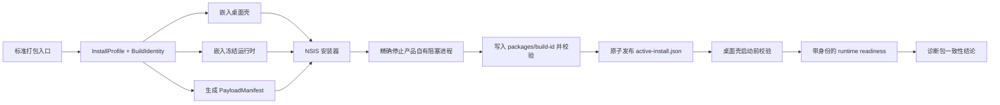
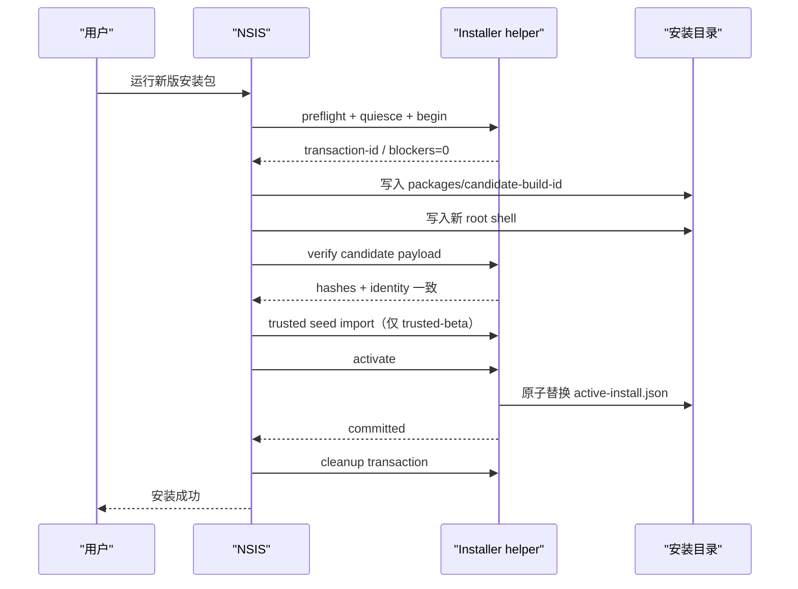

# 077 · Windows 安装升级完整性、运行时一致性与安装器本地化 · 技术方案

## 状态

CONFIRMED

## 方案摘要

本方案把 Windows 安装升级拆成四个相互校验的层次：

1. 打包阶段生成唯一的产品安装 profile、构建身份和完整 payload manifest，并把同一身份嵌入桌面壳与冻结运行时。
2. 安装阶段先停止实际阻塞本次升级的产品自有进程，再把新的外置 payload 写入 build ID 隔离目录；旧 payload 不原地覆盖。
3. 全部文件与 trusted-beta 凭据导入验证通过后，最后原子发布 `active-install.json`；桌面壳只接受与自身身份一致的 active payload 和 readiness 响应。
4. 同机高频故障注入使用独立测试产品身份，最终再在当前账户按普通用户路径完成一次真实覆盖升级；Rule、Skill 和机器报告共同约束 Coding Agent 不得弱化门禁。

正常用户仍然只需要直接运行新版安装包。版本目录、进程协调、事务恢复、身份校验和诊断信息全部由安装器与应用内部承担，不增加 VM、额外 Windows 用户、手工备份或命令行步骤。



## 当前缺口

### 固定路径原地覆盖

当前 package config 把冻结运行时映射到固定的 `$INSTDIR\runtime`。Tauri 的 NSIS 模板在安装 section 中直接复制主 executable 和所有 resources；当旧 runtime 仍映射或锁定 executable 时，复制会进入 NSIS 的 Abort / Retry / Ignore 错误路径。用户选择 Ignore 或后续步骤继续时，没有机器状态能证明壳与 runtime 来自同一构建。

### 进程检查只覆盖主壳

现有 hook 检查 `${MAINBINARYNAME}.exe` 和历史 `MainBinaryName`，没有检查 `agent-friend-runtime.exe` 及其子进程。桌面壳正常退出会回收自己持有的 `Child`，但异常退出后没有操作系统级进程组所有权，安装器也无法区分产品自有 orphan 与无关同名进程。

### readiness 只证明端口可响应

当前 supervisor 对带生命周期 token 的 readiness 只检查 `status=ready`。它没有比较桌面壳期望的 build ID、磁盘 payload 身份和实际响应 runtime 身份，因此不足以识别旧 runtime、错误进程或混装目录。

### 诊断只记录壳侧 package metadata

当前诊断包读取根资源目录中的 `package-build.json`，没有记录 active install receipt、runtime executable 内嵌身份、实际 readiness 身份或 payload 完整性结论。安装动作之后重新启动的新壳会覆盖最有区分力的现场信息。

### Tauri 默认语言与升级页不完全满足产品语义

Tauri 的多语言选择默认跟随 Windows UI language；只配置 `languages` 和 `displayLanguageSelector` 无法保证英文 Windows 首次打开安装器时默认选中简体中文。当前 Tauri 模板在更高版本安装时还可能先展示并执行旧 uninstaller，再进入项目的 `NSIS_HOOK_PREINSTALL`，因此项目 preinstall hook 不是所有升级变更之前的绝对前置点。

## 设计边界

- 保持 NSIS、`currentUser`、稳定产品 identifier、现有用户数据路径、设置路径和系统 keyring 目标不变。
- 不引入 MSIX、MSI、外部 bootstrapper、Windows Service 或长期驻留的 updater 服务。
- 不要求操作系统级全目录事务；断电等极端中断至少留下可识别 transaction，用户重新运行安装器后可以恢复或继续，不能静默启动混装版本。
- 不按进程名批量终止程序，不结束 Chrome、系统 Python、开发环境或不属于目标安装目录的进程。
- 旧版固定 `runtime` 目录只作为迁移输入，升级成功后不再成为运行时选择候选。

## D-1 · 统一安装 Profile 与构建身份

### InstallProfile

新增单一的安装 profile 模型，由 `scripts/package/` 生成并同时喂给 Tauri config、桌面壳、冻结 runtime、NSIS hook 和 smoke runner。它不是用户配置，也不能在安装后任意修改。

```json
{
  "schemaVersion": 1,
  "profileId": "production",
  "productName": "agent-friend",
  "bundleIdentifier": "com.agentfriend.desktop",
  "mainBinaryName": "agent-friend",
  "installDirName": "agent-friend",
  "registryProductName": "agent-friend",
  "autostartValueName": "agent-friend",
  "dataNamespace": "agent-friend",
  "settingsNamespace": "com.agentfriend.desktop",
  "logNamespace": "agent-friend",
  "keyringService": "agent-friend",
  "bridgePort": 8765,
  "voicePort": 8766
}
```

production profile 的公开身份和持久化 namespace 保持现状。`installer-smoke` profile 使用固定且完全不同的 product name、bundle identifier、安装目录名、注册表键、快捷方式、启动项、数据、设置、日志、keyring service 和端口。标准脚本只允许这两个受治理 profile，不接受调用者任意拼装字段。

### BuildIdentity

构建身份在开始 PyInstaller 与 Tauri 编译前生成：

```json
{
  "schemaVersion": 1,
  "productVersion": "0.1.7",
  "buildId": "20260808T000000Z-<commit>-<nonce>",
  "sourceCommit": "<full commit>",
  "dirty": false,
  "buildMode": "formal",
  "distribution": "ordinary",
  "profileId": "production"
}
```

同一份规范化 JSON：

- 通过编译期 include 嵌入桌面壳；
- 作为 PyInstaller data 嵌入 frozen executable 内部，运行时从 executable 自身解包内容读取；
- 写入 payload manifest；
- 进入最终 release manifest。

runtime 不能从 `$INSTDIR` 根目录旁读一个可被新安装器覆盖的 build ID 来声称自己的身份。桌面壳和 runtime 报告的身份必须分别来自各自 executable 的构建内容。

## D-2 · Build ID 隔离的外置 Payload

### 安装布局

```text
$INSTDIR/
├── agent-friend.exe
├── uninstall.exe
├── active-install.json
├── .install-transactions/
│   └── <transaction-id>/
│       ├── transaction.json
│       ├── previous-shell.exe
│       └── previous-active-install.json
└── packages/
    ├── <old-build-id>/
    │   └── ...
    └── <candidate-build-id>/
        ├── build-identity.json
        ├── payload-manifest.json
        ├── runtime/
        └── avatar-seed/
```

主 executable 和 uninstaller 仍保留在 Tauri/NSIS 的稳定根位置。所有可能被运行时映射、动态读取或独立校验的外置生产 payload 按 build ID 隔离，包括 frozen runtime、cloudflared、connector、memory model、avatar seed 和相应 notices / lock / inventory。

候选 payload 目录在该 build ID 第一次安装时必须不存在。正式构建不得覆盖同 build ID 目录；本地同 build ID 重试只能在现有目录已由同一 transaction 创建且 manifest 完全相同时继续。

### PayloadManifest

`payload-manifest.json` 取代“存在即可”的 runtime inventory 语义，至少包含：

- build identity 的 canonical hash；
- profile ID；
- 每个文件的相对路径、size、SHA-256 和 capability group；
- frozen runtime executable 的相对路径与 hash；
- payload manifest 自身的 schema version。

manifest 只允许相对路径，拒绝 `..`、绝对路径、重复路径、大小写折叠后冲突和 manifest 外核心文件。打包、安装 helper、桌面壳和 installed smoke 复用同一验证实现或同一组 fixture，不各写一套宽松算法。

## D-3 · 安装 Transaction 与原子激活

### 受治理的 Tauri 模板 overlay

不在仓库里手写或长期维护一份约 900 行的 Tauri installer template。打包脚本根据当前锁定的 Tauri CLI 版本获取并校验对应官方 template 的固定 SHA-256，在 build workdir 中应用小型、锚点唯一的确定性 overlay，生成临时 custom template。

overlay 只增加三类扩展点：

1. 在语言选择前允许项目设置首次默认语言；
2. 对已识别的更高版本覆盖升级跳过 Tauri 的“先运行旧 uninstaller”路径，改走项目的 in-place transaction；
3. 在安装失败与用户中止回调中调用 transaction rollback。

任一 anchor 缺失、重复、Tauri CLI 版本变化或上游 template hash 漂移时，打包直接失败，要求显式重评 overlay。生成的完整 template 不提交到仓库，也不允许 Coding Agent 在 hash 不匹配时模糊替换。

### Installer helper

新增一个只在安装器临时目录运行的 Windows Rust helper，由 NSIS 从安装包解压到 `$PLUGINSDIR`，不作为长期后台程序安装。helper 使用结构化 JSON 请求/响应，负责：

- `preflight`：校验目标 install root、profile、现有 receipt 和遗留 transaction；
- `quiesce`：通过 Windows Restart Manager 注册本次会被替换或迁移的精确文件，识别占用者并请求关闭；
- `begin`：创建 transaction，备份固定根 shell 与 active receipt，并记录允许恢复的非敏感注册表值；
- `verify`：按 manifest 对 candidate payload 做完整 hash 校验；
- `activate`：原子替换 `active-install.json`；
- `rollback`：恢复 shell、active receipt 和本次 transaction 修改的注册表值；
- `cleanup`：删除已经确认不再 active、也没有进程引用的遗留 payload 或 transaction。

helper 不接收任意递归删除路径。所有写入、恢复和清理目标必须先 canonicalize，并证明位于当前 profile 从 NSIS 解析出的 `$INSTDIR` 或 `$PLUGINSDIR` 内；production 与 installer-smoke profile 不能互相操作。

### 进程关闭顺序

1. Restart Manager 注册根 shell、active runtime executable 和旧固定 `runtime` executable。
2. 优先请求桌面壳正常关闭，让现有 lifecycle shutdown 回收 bridge、voice、cloudflared 和 connector。
3. 等待有界时间后重新枚举 blocker。
4. 对遗留 blocker，只有同时满足“Restart Manager 返回的 PID”“进程映像 canonical path 位于当前 `$INSTDIR`”“路径属于 manifest/legacy migration allowlist”时，才允许结束该 PID。
5. 任何剩余 blocker 或无法确认所有权的进程都使安装在复制核心文件前 fail closed；提示中展示组件角色和路径，不把责任归因成用户忘记关程序。

silent/passive 模式执行同样的检查，但不弹交互框，返回稳定的非零 exit code 和结构化安装日志。

### Commit 顺序



trusted credential seed 改为直接解压到 `$PLUGINSDIR`，不再先落入 `$INSTDIR` 根目录。只有 candidate payload 完整验证通过后，才调用 candidate runtime 导入；成功或失败都立即删除 seed 与 key。ordinary 包完全不进入该路径。

安装中止时：

- candidate payload 尚未 active，可以直接标记为 incomplete 并在下一次安装安全清理；
- root shell 或 receipt 已变化时，通过失败回调执行 rollback；
- 进程崩溃或断电导致回调未运行时，transaction 保留，下一次 installer preflight 先恢复或继续；
- 桌面壳发现自身 build identity 与 active receipt 不一致时拒绝启动 runtime，并给出“重新运行安装程序”的恢复入口。

## D-4 · Windows Job Object 管理运行时进程树

桌面端 supervisor 在 Windows packaged 模式创建专属 Job Object，并设置 `JOB_OBJECT_LIMIT_KILL_ON_JOB_CLOSE`。每个由桌面壳启动的 runtime、cloudflared 及后续产品自有子进程都进入该 job；Job handle 由 supervisor 持有到应用退出。

具体约束：

- child spawn 后必须立即 assign；assign 失败时终止该 child，并把 runtime 状态置为启动失败，不能退回“无 Job Object 继续运行”。
- 正常退出仍先走 authenticated shutdown，Job Object 只作为异常退出与漏网子进程的兜底。
- 不把用户外部启动的进程加入 job；source development mode 保持现有调试可见性，只对 packaged runtime 启用强约束。
- supervisor snapshot 记录 job 创建、assign 与 cleanup 状态，供 diagnostics 汇总，不记录 token 或 secret。

Windows 8 之后支持 nested jobs；目标 Windows 10/11 环境若因外部宿主 job 策略导致 assign 失败，应明确报错并停止 packaged runtime，而不是 silently weaken。

## D-5 · Active Receipt、启动校验与 Readiness 身份

### active-install.json

```json
{
  "schemaVersion": 1,
  "profileId": "production",
  "buildIdentitySha256": "<sha256>",
  "buildId": "<build-id>",
  "payloadRelativePath": "packages/<build-id>",
  "payloadManifestSha256": "<sha256>",
  "activatedAt": "<UTC ISO-8601>",
  "transactionId": "<transaction-id>"
}
```

receipt 使用 temp file + flush + atomic replace 发布。它不包含 secret、用户数据或绝对用户名路径。

### 桌面壳启动校验

packaged mode 不再用 `resource_dir/runtime` 的存在性选择 runtime，而是：

1. 读取 shell 内嵌 build identity；
2. 读取并验证 active receipt schema 和 profile；
3. 要求 receipt build identity 等于 shell identity；
4. 校验 manifest hash、runtime executable hash 和启动必需 capability group；
5. 从 receipt 的 payload 相对路径构造 runtime、model、cloudflared 和 connector 路径。

任何一步失败都返回结构化 `install_integrity_*` 错误。source development mode 继续使用 repo root，不读取 active receipt。

### Runtime readiness

bridge 与 voice 的 `/internal/lifecycle/readiness` 在原有 lifecycle token 认证下增加：

```json
{
  "status": "ready",
  "buildIdentitySha256": "<sha256>",
  "buildId": "<build-id>",
  "profileId": "production",
  "service": "bridge"
}
```

supervisor 只有在 token、HTTP 状态、service kind、profile ID、build ID 和 identity hash 全部与预期一致时进入 Ready。端口被旧 runtime 或无关服务占用时，即使返回 `status=ready` 也必须归类为 `runtime_identity_mismatch`，不能复用该服务。

## D-6 · 旧固定 Runtime 迁移

迁移只发生在 production profile 第一次安装新布局时：

- helper 识别 `$INSTDIR\runtime\python\agent-friend-runtime.exe` 为 legacy candidate；
- 用 Restart Manager 查找并关闭锁定该 executable 的旧 runtime；
- candidate payload 始终写入新 build ID 目录，不尝试覆盖 legacy runtime；
- active receipt 成功发布后，新桌面壳只从 receipt 启动；
- legacy runtime 删除失败不回滚已成功的新版本，只记录 `legacyCleanup=pending`，下次启动或升级再安全清理；
- legacy 路径永远不作为新壳的 fallback，避免“新 payload 缺失就退回旧 runtime”重新制造混装。

旧安装的用户数据、设置、keyring 与开机自启都在 install payload 之外，迁移不移动这些内容。现有 autostart capture/restore 逻辑保留，但改为使用 InstallProfile 的受治理 value name。

## D-7 · 简体中文默认的双语安装器

package config 声明 `SimpChinese`、`English` 两套 NSIS language resources，简体中文排在首位，并显示语言选择器。

由于上游默认会优先使用 Windows UI language，生成 template 的 pre-language hook 按以下规则设置 selector 初始值：

1. HKCU 已保存本产品此前的明确语言选择：使用已保存值；
2. 没有保存值：固定使用 `${LANG_SIMPCHINESE}`；
3. 所有非 silent 运行都显示 selector；已保存语言只作为预选值，不能跳过 selector；
4. 用户可在 selector 中改选 English；
5. silent 模式不显示 selector，默认 `${LANG_SIMPCHINESE}`。

Tauri 生成模板为 Modern UI 配置了语言注册表记忆；原生 `MUI_LANGDLL_DISPLAY` 在已有 `Installer Language` 时会跳过对话框。因此 overlay 必须在调用该 macro 前定义 `MUI_LANGDLL_ALWAYSSHOW`，并由 `installer-contract` 检查渲染结果。全新 smoke identity 的首次启动不足以验收这一分支；可见 UI 复验需要预置已保存的 English。

所有项目自定义文本使用成对 `LangString`，包括：

- 产品组件仍在运行；
- 无法确认 blocker 所有权；
- 安装完整性或身份校验失败；
- rollback / 重新运行安装器建议；
- trusted-beta 敏感包警告与凭据导入失败。

打包测试从 NSIS 源生成字符串 key 集合，中文与英文任一缺失、重复或存在裸英文 MessageBox 文本时 fail closed。Tauri/NSIS 自带页面继续使用其官方语言文件。

## D-8 · 诊断契约

诊断 bundle 增加兼容性 capability `install-integrity-v1`，提升 schema revision，不改变 format version。producer 新增 `install/integrity.json`，摘要结构至少包含：

- shell embedded identity；
- active receipt 与 payload manifest identity；
- runtime executable 的预期 hash；
- supervisor 最近一次 observed readiness identity；
- Job Object 创建与 assign 状态；
- legacy layout / pending cleanup / incomplete transaction 状态；
- 总体结论：`consistent`、`incomplete_install`、`shell_receipt_mismatch`、`payload_hash_mismatch`、`runtime_identity_mismatch`、`unavailable`。

诊断只输出非敏感 identity、相对路径和状态；不输出 lifecycle token、credential seed、API key、消息正文或 keyring 内容。

修改必须在同一 changeset 更新：

- `bundle-contract-v1.json`；
- Rust producer 与 contract tests；
- `inspect_bundle.py` capability handler；
- `bundle-format-v1.md`；
- consumer fixture 与 contract tests。

旧 schema bundle 缺少该 capability 时继续可读，并明确标记 `install identity evidence unavailable`，不能误报损坏或一致。

## D-9 · 无 VM 的同机隔离升级矩阵

### installer-smoke profile

标准 package runner 新增受治理的 installer smoke profile。它和 production 使用相同代码、manifest、NSIS template overlay、helper 与 transaction，只替换 InstallProfile 中明确列出的身份 namespace。

隔离矩阵运行前后都执行 collision preflight，确认测试 profile 的：

- install root；
- HKCU uninstall / manufacturer key；
- start menu / desktop shortcut；
- Run value；
- data / settings / log directory；
- keyring service；
- bridge / voice port；

均不等于 production。任一碰撞立即停止。trusted-beta smoke 只允许脚本生成的 dummy credential seed，并写入 smoke keyring service；禁止从 production `KeyringSource` 收集真实凭据。

### 测试阶段

同机验证分两层：

1. 高频隔离矩阵：用 smoke profile 构建 legacy fixed-layout baseline 与 candidate，反复执行正常升级、主壳运行中升级、orphan runtime 锁文件、Ignore/中断、identity mismatch、中英文和 silent exit code 场景。
2. 最终真实升级：隔离矩阵与全量检查通过后，在当前账户对既有 production 0.1.7 按普通用户路径运行一次 candidate installer。它不要求 VM、额外用户或手工备份。Coding Agent 执行前仍需展示当前安装、运行进程、候选 build ID 和预期影响，并取得本次操作授权。

首次验证新 transaction 实现时，执行者可以额外复制现有 install payload 作为开发安全网；这不是 installer 的用户步骤，也不作为未来每次升级的前提。真实升级只检查 keyring 配置状态与安装前后一致性，不读取或导出 secret value。

### 机器报告

upgrade smoke 生成仓库外 JSON report，包含：

- baseline/candidate installer SHA-256、版本、build ID、profile；
- `verificationInputs`：schema、共享安装行为 scope、`packageInputSha256`、输入文件数和非敏感构建环境版本；
- Windows build 与执行账户类别，不含用户名；
- 每个 scenario 的开始/结束时间、exit code、blocker 摘要和 identity 结论；
- production collision preflight；
- 是否执行最终真实升级及对应用户授权状态；
- 未执行项与 failure reason。

报告不包含 credential value、用户数据内容或日志正文。验证命令只接受 report 中的实际 build ID，不接受 Agent 手写“已通过”布尔值。

### 安装行为验证指纹

`sourceTreeSha256` 继续代表完整工作区来源，用于回答“制品由哪份源码状态构建”，文档或治理文件变化时仍会变化。它不再承担“安装行为是否变化”的判断。

`scripts/package/install_contract.py` 另行生成 `packageInputSha256`，用于回答“已验证候选与当前目标构建是否共享同一安装行为输入”。规范化输入包括会进入产品、冻结 runtime、桌面壳、安装器、版本与依赖锁、打包和 smoke 契约的仓库文件，以及 Python、Node、pnpm、Rust、Cargo、PyInstaller、Tauri CLI 和 Windows 构建环境版本；不包含 credential value，也不把 profile/distribution 的本次取值写入共享 scope。production 与 installer-smoke profile 的定义代码本身仍在输入内。

文件分类采用 fail-safe 默认值：只有明确属于需求/验收证据、Cursor/Codex 指引及 adapter、项目说明或测试的文件被排除，其他未知文件均进入指纹并被 impact 分类为 installer-sensitive。impact 输出与指纹生成调用同一分类函数，Rule、Skill 不复制路径或 hash 算法。

候选 installer 的 release manifest 先记录该指纹，build report 与 smoke report 只能从已验证 manifest 继承。运行矩阵、`installer-smoke-verify` 和 production installer 构建都会重新计算当前指纹。installer-sensitive production 构建必须显式传 `--smoke-report`；脚本先验证报告 schema、必需 scenario、候选 build ID/hash、candidate release manifest 和当前指纹，再允许复用。脚本不搜索“最近报告”，也不接受 Agent 手写 bypass。

只有文档、Rule、Skill、进度记录或测试发生变化时，完整源码身份可以变化而 `packageInputSha256` 保持不变，既有矩阵可复用。产品/安装代码、runtime、前端、依赖、版本、打包配置、smoke scenario 契约或构建环境任一变化都会使旧报告失效。trusted-beta 凭据内容变化不触发完整矩阵；敏感 seed 仍由目标构建的凭据专项检查负责，凭据值或其 hash 不进入报告。

## D-10 · Coding Agent 治理

### 机器入口

继续以 `scripts/package/run.sh|run.ps1` 为唯一入口，新增子命令而不引入裸 NSIS / Tauri 命令：

- `installer-contract`：生成并校验 profile、identity、payload manifest、template overlay 和双语字符串；
- `installer-smoke-build`：构建隔离 baseline/candidate；
- `installer-smoke`：运行同机隔离矩阵并生成 report；
- `installer-smoke-verify`：验证 report 与 candidate build ID、installer hash 和必需 scenario 匹配；
- production `installer|all --smoke-report <PATH>`：只在报告验证指纹与当前输入一致时复用候选矩阵并继续构建；
- `installed-smoke`：改为从 active receipt 定位 runtime 并验证 identity，不再固定拼 `$INSTDIR\runtime`。

复杂编排继续下沉到 `scripts/package/` Python 模块，`run.sh` / `run.ps1` 只做薄入口和参数透传。

### Rule

新增 Windows installer integrity 项目 Rule，globs 覆盖 package installer、InstallProfile、runtime supervisor、readiness identity 和 install diagnostics。Rule 只声明：

- 哪类 diff 属于 installer-sensitive；
- 不能原地覆盖 active payload、不能按名称杀进程、不能跳过 identity；
- 各影响级别对应的最小机器门禁；
- 真实 production upgrade 需要用户操作授权；
- verification gap 不能写成通过。

具体路径解析、影响分类、scenario 列表和 report 算法仍由脚本拥有，Rule 不复制实现。

### package-release Skill

更新项目 `package-release` Skill：构建前调用标准 impact/contract 输出；installer-sensitive 变更必须取得由脚本判定 `packageInputSha256` 匹配的隔离 smoke report。输入未变化时可以复用显式报告，Skill 不得自行比较 Git 状态或选择“最近报告”。需要最终真实升级时，Skill 展示脚本给出的 preflight 和影响，并停在用户授权门；不得自行用 `installed-smoke`、文件存在、source 测试或无指纹旧 report 替代。

修改 Rule/Skill 时使用统一的 skill/rule 维护流程，并在同一 changeset 运行 Codex adapter sync 与 doctor；不直接编辑生成的 `AGENTS.md` 或 `.Codex/skills`。

## D-11 · 已安装产品状态机与程序目录迁移

### 交互状态

generated NSIS template 在创建维护页前读取当前 profile 的 manufacturer key、uninstall key、`DisplayVersion`、`InstallLocation` 与旧 uninstaller。安装器只展示产品级动作，不把“是否先卸载”作为实现细节暴露给用户：

| 已安装状态 | 主操作 | 次级操作 | 禁止 |
| --- | --- | --- | --- |
| 不存在 | 安装 | 选择程序目录、取消 | 无 |
| installed < candidate | 升级到候选版本 | 更改安装位置、取消 | 另装一份、继续使用不同目标根 |
| installed = candidate | 修复/重新安装 | 更改安装位置、卸载、取消 | Add/Install 多实例语义 |
| installed > candidate | 关闭 | 无 | 覆盖、迁移、卸载、继续选择目录 |
| 登记存在但目录/版本不可验证 | 修复现有安装或清理残留后重装 | 取消 | 猜测为正常新装 |

拒绝降级的简体中文固定文案为“当前已安装的 agent-friend 是更新的版本，此安装包无法继续”；英文提供等价语义。该分支必须发生在 process quiesce、transaction 创建、candidate staging、registry/shortcut/autostart 写入之前。silent/passive 返回稳定非零 exit code，不显示对话框。

同目录升级与修复继续使用 D-3 的 transaction，不调用旧 uninstaller。更高版本升级默认使用已登记的 canonical install root；同版本修复重新校验并重写同一 build 的程序文件。

### 显式更改安装位置

只有交互式用户显式选择“更改安装位置”，或自动化调用提供受治理的 move 标志时，才允许 candidate root 与 registered root 不同。普通 `/D` 或目录页漂移不能静默触发删除旧安装；silent/passive 未显式授权 move 时 fail closed。

迁移对象只是程序安装根：固定桌面壳、`packages/<build-id>` payload、runtime/models/connectors/vendor、内置资源、active receipt、transaction 和 uninstaller。以下稳定 namespace 不参与搬迁：

- `%APPDATA%/agent-friend` 用户数据；
- `%APPDATA%/com.agentfriend.desktop` 桌面设置；
- `%LOCALAPPDATA%/agent-friend/Logs` 日志；
- Windows Credential Manager 中 `agent-friend` keyring service。

“namespace 不参与搬迁”不等于它在物理路径上一定处于程序根之外。Windows 当前默认程序根与日志父目录都可能是 `%LOCALAPPDATA%/agent-friend`；此时 `Logs` 是旧程序根的受保护子目录。helper 必须把 Rust `canonicalize()` 产生的 `\\?\C:\...` 与普通 DOS 路径按 Windows 语义归一化，在退休旧根时把 `Logs` 原子留回同一绝对路径。成功后旧路径可以作为仅含 `Logs` 的平台 namespace 容器存在，但不得含 shell、runtime、payload、active receipt 或 uninstaller，且不再有任何注册入口指向它。

迁移使用安全顺序而不是“先删旧目录再尝试安装”：

1. canonicalize 并校验 registered root 与 candidate root 不同、profile 相同且互不包含；snapshot 旧 manufacturer/uninstall/Run value、shortcut target 与 active identity。
2. 在 candidate root 创建 move transaction，写入并完整校验 candidate shell、payload、manifest 和 receipt 候选；此时注册信息仍指向旧 root。
3. 精确关闭 registered root 拥有的产品进程；无法确认或关闭时删除未激活 candidate 并保留旧安装。
4. 原子切换 manufacturer/uninstall registry、shortcut、autostart 与 active product entry 到 candidate root，再验证所有系统入口只指向新 root。
5. 删除 registered root 的程序文件；若稳定日志 namespace 嵌套于旧根，先把受保护的 `Logs` 留回原绝对路径。清理失败时不得把旧根保留成可启动的第二处安装，至少移除旧 shell/uninstaller/shortcuts 并记录 pending cleanup，由后续安装继续处理。
6. 任一 commit 前失败都删除 candidate root；commit 后失败使用 snapshot 恢复旧入口和旧安装。用户数据 namespace 始终不进入删除集合。

helper 接受显式 `--registered-root`、`--target-root` 与 move intent，并在 embedded profile、registry product name、canonical roots 和 transaction identity 全部一致后执行。NSIS 不自行复制另一套路径判断；版本状态、路径关系和 report 字段由共享 install contract 模型生成。

### 唯一安装位置门禁

成功安装后的机器断言至少包括：manufacturer key、uninstall `InstallLocation`、uninstaller、主快捷方式、desktop shortcut、Run value 和 active shell 全部指向同一 canonical production root；旧 root 不存在可启动 shell、uninstaller 或 active receipt。profile 明确不同的 `installer-smoke` 不计作 production 重复实例。

## D-12 · Stable、Trusted Beta 与 Local Test 版本渠道

源码中三处同步产品版本继续表示当前 stable release，例如 `0.1.7`。它不因每日可信内测打包而改写。`%USERPROFILE%/agent-friend-releases/channels/trusted-beta.json` 保存当前开发周期由用户显式配置的下一稳定版本，例如 `0.1.8`；该文件是本机打包渠道状态，不进入源码或安装包。

可分发 trusted-beta 在共享正式构建锁内读取全部有效 trusted-beta manifest，并分配：

```text
<target>-beta.<UTC YYYYMMDD>.<当天序号>
```

例如 `0.1.8-beta.20260808.1 < 0.1.8-beta.20260808.2 < 0.1.8`，且都高于 `0.1.7`。日期回退、非治理格式混入同一目标、目标不高于当前/latest stable，或候选不高于本机最新正式制品时 fail closed。序号只根据已校验的正式 manifest 分配，不扫描文件名，不由 Coding Agent 拼接。

构建意图与安装结果是两个维度：

| 构建意图 | 命令门禁 | 版本来源 | 分发 |
| --- | --- | --- | --- |
| stable release | 显式 `--release` | 三处同步的稳定项目版本 | 可正式交付 |
| trusted-beta | 显式 `--trusted-beta` | 已配置 target + 自动日期/序号 | 仅可信对象，敏感 |
| local-test | 显式 `--local-test` | 当前项目版本 | 不可分发 |

裸 `all` 拒绝执行。`--local-test --trusted-beta` 只验证未提交代码或凭据封装，不分配可升级 beta 版本，也不能发送给测试者。一个包在目标机器上最终属于新装、升级、同版本修复或降级拒绝，仍由 candidate SemVer 与已安装 SemVer 的关系决定。

有效 package version 写入 generated Tauri config、NSIS `${VERSION}`、release manifest、package metadata、shell/runtime build identity 和编译期 `AGENT_FRIEND_PRODUCT_VERSION`。源码 Cargo package version 仍是 stable 镜像；应用内迁移包版本比较改用上述有效产品版本。build ID 不参与任何版本优先级比较。

## 模块与文件影响

| 责任 | 主要位置 | 变更方向 |
| --- | --- | --- |
| profile / identity / manifest / template overlay | `scripts/package/` | 新增单一模型、schema、锁定 template 与机器校验 |
| stable/trusted-beta/local-test 渠道 | `scripts/package/versioning.py`、`run.py`、制品根 `channels/` | 显式意图、一次性 target 配置、自动预发布版本与正式构建锁 |
| package config 与 NSIS | `scripts/package/windows/` | 动态 hook、双语 LangString、transaction/helper 调用 |
| frozen identity | `scripts/package/runtime_entry.py`、PyInstaller spec | 嵌入身份并提供 CLI/服务读取 |
| installer helper | `frontend/src-tauri/src/bin/` 或同职责 Windows 子模块 | Restart Manager、transaction、verify/activate/rollback |
| active payload 解析 | `frontend/src-tauri/src/` | receipt/manifest 验证与 profile-aware 路径 |
| process tree | `frontend/src-tauri/src/runtime_services/` | Windows Job Object 与身份化 readiness |
| bridge / voice readiness | `agent_bridge/`、`voice_bridge/` | 返回 frozen build identity |
| 平台 namespace | `agent.paths`、Tauri paths、runtime config、autostart | production 稳定；installer-smoke 使用嵌入 profile |
| diagnostics | producer contract、Rust collector、inspect Skill | `install-integrity-v1` 同步生产与消费 |
| Agent governance | `.cursor/rules/`、`.cursor/skills/package-release/` | installer-sensitive 门禁与真实升级授权 |
| tests/docs | package tests、Rust/Python tests、`scripts/README.md` | contract、隔离矩阵与标准入口说明 |

实际实现时，若 installer helper 与 shell 共享的纯数据模型超过一个调用点，提取到 Tauri 侧小型 installer contract module；不建立通用安装框架或跨平台抽象。Windows API 只留在 Windows adapter 中。

## 失败模型

| 失败 | 对外结果 | 保留/恢复 |
| --- | --- | --- |
| blocker 无法安全关闭 | 复制前失败，当前语言提示 | 旧安装未变，可直接重试 |
| candidate 文件复制失败 | 安装失败 | candidate 未 active；rollback 固定 shell/receipt |
| manifest/hash 失败 | 安装失败，禁止 Ignore 成功 | candidate 标记 incomplete，旧 receipt 保持 |
| trusted seed 导入失败 | trusted-beta 安装失败 | seed/key 删除；不激活 candidate |
| active receipt 发布失败 | 安装失败 | 旧 receipt 与 shell rollback |
| 安装进程崩溃/断电 | 不保证当下可启动 | transaction 保留；下次 installer 先恢复/继续；壳身份不一致时拒绝 runtime |
| Job Object assign 失败 | runtime 启动失败 | child 立即回收，不降级为弱托管 |
| readiness 身份不一致 | runtime 状态失败 | 不复用端口进程，诊断记录 expected/observed |
| legacy runtime 无法清理 | 新版本可用，提示 cleanup pending | legacy 永不被选为 active；后续重试清理 |
| 已安装版本高于 candidate | 安装前拒绝，固定双语提示 | 不停止进程，不创建 transaction，不修改任何系统状态 |
| 已登记 root 与目标 root 不同但未显式 move | 安装前拒绝 | 旧安装保持，目标目录不激活 |
| 程序目录迁移在 commit 前失败 | 迁移失败，提示重试 | 删除未激活 candidate，旧安装与所有用户 namespace 保持 |
| 程序目录迁移在入口切换后清理失败 | rollback 或 cleanup pending | 不保留第二个可启动 shell/uninstaller；诊断记录旧 root cleanup 状态 |
| installer-smoke 可用磁盘不足 | 在任何安装 mutation 前拒绝启动矩阵 | 报告 available/required bytes；不生成截断 candidate，不把容量故障误判为产品回归 |
| trusted-beta target 缺失/过期、时钟回退或版本冲突 | 凭据读取与构建前拒绝 | 不生成敏感制品；保留已有正式制品与渠道配置供人工纠正 |

## 验证策略

### 确定性自动化

- InstallProfile production stability 与 smoke namespace collision tests。
- BuildIdentity canonicalization、双 executable embed fixture 与 mismatch tests。
- payload manifest 路径安全、hash、重复/大小写冲突和 tamper tests。
- active receipt 原子发布、incomplete transaction 恢复和 rollback tests。
- helper 的 Restart Manager 结果解析、PID/path 所有权检查与 unrelated process negative tests。
- supervisor Job Object adapter、assign failure、normal/abnormal cleanup tests。
- readiness expected/observed identity tests，覆盖旧 runtime 与假 ready server。
- NSIS template base hash、overlay anchor、双语 LangString 和 silent exit contract tests。
- diagnostics producer/consumer capability 对齐与旧 bundle compatibility tests。
- package profile 禁止 trusted-beta smoke 读取 production keyring 的 tests。
- installed/candidate version 状态机 tests，覆盖旧版本、同版本、新版本和无法解析版本；新版本拒绝必须发生在任何 mutation callback 前。
- registered/target canonical root 关系、显式 move intent、互相包含路径拒绝和 production 唯一安装位置 tests。
- move transaction snapshot、candidate verify、entry switch、旧 root cleanup 与每个 failure point rollback tests；断言用户数据、settings、logs 和 keyring namespace 从未进入迁移删除集合。
- Windows `\\?\` extended path 与 DOS path 等价测试；源根日志保护、目标 rollback 日志保护和仅含 `Logs` 的旧路径不构成第二程序根测试。
- installer-smoke 按真实 baseline runtime、candidate payload、installer 大小与固定安全余量做 mutation 前磁盘容量测试。
- 安装行为指纹 tests：文档/Rule/Skill/进度/测试变化保持稳定；产品代码、打包脚本、依赖/版本输入和构建环境变化会改变指纹；未知路径默认 installer-sensitive。
- smoke evidence reuse tests：旧 schema、缺指纹、候选 manifest/hash/build ID、必需 scenario 或当前指纹任一不匹配时拒绝 production 构建；显式匹配报告可复用，且不搜索最近报告。
- trusted-beta channel tests：target 必须是高于当前/latest stable 的稳定 SemVer；同日序号、跨日版本、时钟回退、非治理版本冲突和最终 stable precedence；生成的有效版本进入 Tauri config、build identity、manifest 与应用内部版本判断。

### Windows 真实安装矩阵

- smoke profile 新装、卸载与残留检查；
- legacy fixed-layout baseline → candidate；
- shell 运行中升级；
- shell 已退出但 runtime 锁定 legacy executable；
- unrelated 同名进程不被终止；
- candidate payload tamper / identity mismatch；
- 简体中文默认、切换英文、保存英文后的升级；
- `/S` 与 passive 成功/失败 exit code；
- ordinary 与 dummy trusted-beta smoke namespace；
- production 当前账户 0.1.7 → candidate 单次真实升级。
- 同 profile 目录 A → 目录 B 的程序迁移，迁移后入口一致、旧 root 无可启动残留、用户 namespace sentinel 保持原位。
- 已安装版本高于 candidate 时，交互式固定文案与 silent/passive 非零退出；安装根、进程和注册表 snapshot 前后一致。

### 项目门禁

- backend、frontend、Rust 和 diagnostics contract 的受影响局部检查；
- Windows frozen runtime build 与 capability doctor；
- 完整 NSIS local-test installer build；
- 隔离 upgrade smoke report verify；
- 最终 `scripts/check/run.*` 全量检查。

真实 production 升级只有在前置门禁全通过后才进入用户操作授权，不因当前机器没有 VM 而跳过，也不在实现过程中反复执行。

## 实施顺序

1. 建立 InstallProfile、BuildIdentity、payload manifest 与 active receipt 的纯模型和 tests。
2. 改造 package staging 为 build ID payload，并让 shell/runtime 嵌入同一身份。
3. 实现 installer helper、Restart Manager ownership 和 transaction/rollback。
4. 接入 generated Tauri template overlay、NSIS 双语与中文默认。
5. 改造 supervisor 为 receipt 驱动路径、Job Object 和身份化 readiness。
6. 完成 legacy layout 迁移、trusted-beta 临时 seed 与 inactive cleanup。
7. 同步 diagnostics producer/consumer contract。
8. 增加 installer-smoke profile、机器报告、Rule、package-release Skill 和脚本文档。
9. 跑自动化、隔离真实安装矩阵；最后单独申请当前 production 安装的一次覆盖升级授权。

## 残余风险

- NSIS 不是操作系统级事务安装器；断电发生在固定 shell 替换的极短窗口时，可能需要用户重新运行安装器恢复。identity/transaction 保证不会把这种状态误报为正常。
- Restart Manager 能发现注册资源的使用者，但第三方安全软件可能在扫描窗口短暂锁文件。此时安装 fail closed 并允许重试，不强杀无法确认所有权的进程。
- Job Object 能治理新版本启动的进程树，无法追溯已经由历史版本启动且不再占用已知资源的任意进程；legacy migration 只处理有安装路径证据的 blocker。
- smoke profile 与 production 共享代码但身份不同，不能完全替代真实产品 upgrade；因此保留最终当前账户单次覆盖升级。
- 英文 Windows 上中文默认依赖 generated template overlay；Tauri/NSIS 升级时 base hash 门禁会主动要求重评，不能静默沿用旧 patch。
- Windows 没有可靠的全盘“同产品孤儿目录”索引；唯一安装位置保证覆盖受当前 production 注册表和本安装器管理的安装。历史上被手工复制或已丢失全部注册信息的任意目录只能在发现明确路径证据时清理，不做全盘扫描。

## 变更记录

| 日期 | 变更内容 |
| --- | --- |
| 2026-08-08 | 初版确认：build ID 隔离 payload、transaction/rollback、Restart Manager、Job Object、身份化 readiness、诊断闭环、中文默认双语安装器、同账户隔离 smoke 与真实覆盖升级门禁 |
| 2026-08-08 | 回溯补充已安装产品状态机：禁止降级；旧版本升级、同版本修复；显式更改安装位置时事务化迁移程序根但保持用户数据/设置/日志/keyring namespace；成功后机器断言只有一处 production 安装 |
| 2026-08-08 | 明确交互式语言 selector 在已有历史语言时仍必须显示；历史语言只作为预选值，silent 模式保持无交互 |
| 2026-08-08 | 增加显式 stable release、自动递增 trusted-beta 与不可分发 local-test 三渠道；beta target 每周期配置一次，具体版本由正式构建锁和有效 manifest 分配 |
