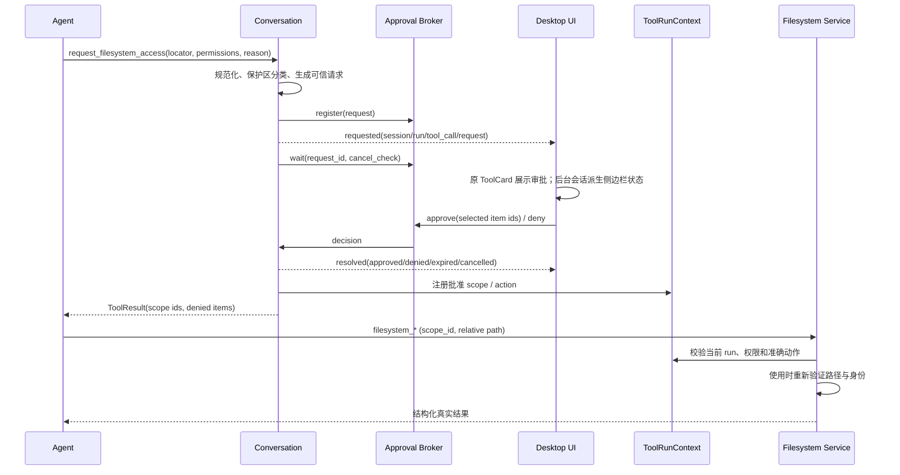
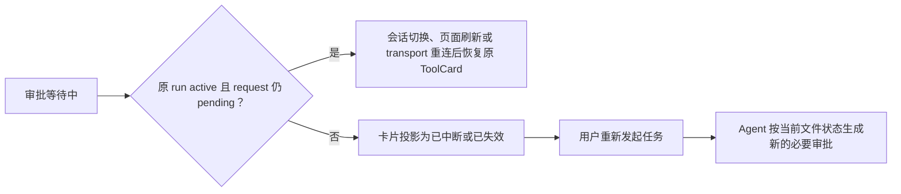

# 受治理的通用本地文件工具 - 技术方案

## 状态

CONFIRMED

## 需求文档

[requirement.md](./requirement.md)

## 设计摘要

本需求在现有同步 Tool、Conversation 工具循环、AgentRuntime 事件流和桌面 AG-UI 通道之上增加一套统一的本地文件能力。普通会话继续以零文件权限启动；Agent 先通过 `request_filesystem_access` 请求最小必要范围，桌面端展示由宿主规范化后的真实位置、权限、原因和破坏性动作，用户拒绝或仅本次允许后，原 run 在同一用户轮中继续。

文件权限不表现为 workspace 或永久设置，而是 `ToolRunContext` 内的短期 capability。后续文件工具只接受宿主签发的 `scope_id` 和 scope 内相对路径；模型给出的绝对路径不能直接驱动磁盘访问。Capability 在当前用户轮结束、取消或超时后失效。

文件查找、读取、文本变更和字节搬运由 Python Agent runtime 内的公共文件服务实现，不引入通用命令执行、不启动 Skill 私有 runner，也不要求最终用户安装 Python、Node.js、ripgrep 或其它系统工具。实现使用 Python 3.12 标准库和小型平台路径适配器，不新增第三方运行时依赖。

## 现状分析

### Tool 与用户轮

- `agent.tools.Tool` 是同步调用协议，`ToolRegistry` 负责 schema、identity 和调用分发。
- `Conversation._execute_tool_calls` 先持久化并产出 `ToolCallRequest`，再由 `ToolBatchExecutor` 执行串行工具或并行只读批次，最后持久化并产出 `ToolCallResult`。
- `ToolRunContext` 在一次用户轮开始时创建，跨该轮的模型续轮和所有工具调用复用，结束时销毁；当前已承载可信时间、URL 授权和证据 ledger，适合承载仅本次文件 capability。
- 当前 Tool 调用过程不能在工具函数内部直接向桌面端产出一个事件后继续等待，因此授权不能只做成普通阻塞工具，也不能照搬社交登录“结束原 run 后另起 continuation”的流程。

### Bridge 与桌面端

- `AgentRuntime` 在工作线程消费 `ConversationEvent`，通过线程安全队列把事件交给 AG-UI SSE，同时镜像到 push listener。
- Bridge 已有进程级共享服务、FastAPI REST side channel、run 精确取消和多会话并发基础设施。
- 前端 `conversation` store 消费 AG-UI SSE；当前文件审批实现使用窗口级 `ConfirmDialog` 并只轮询当前会话，无法表达后台会话 attention。现有系统权限页面管理的是麦克风等 OS 权限，也不适合承载每轮文件 capability。

### Skill

- `SkillTurnSnapshot` 在用户轮开始前冻结 caller-selected Skill；`skill_read` 可在工具续轮中激活 model-selected Skill。
- `SkillRecord.package_root` 已提供可信包根，但当前只把 `SKILL.md` 注入模型，并明确声明没有通用本地文件能力。
- Skill 包资源和个人 Skill authoring 需要接入同一文件服务，不能由 Skill loader 暴露私有读写旁路。

### 冻结运行时与安装边界

- Python Agent 与 Bridge 被 PyInstaller 冻结进桌面 runtime；新的用户可见文件能力属于 `package-sensitive`。
- 新主干已把安装 profile 的数据、设置、日志 namespace 通过现有环境和路径入口传入 runtime。文件保护策略应复用 `agent.paths`、Bridge 实际 settings 和 `runtime_config` 的 settings path 解析，不自行硬编码 production 路径。
- 本需求不改变安装状态机、active payload、receipt、runtime supervisor 或安装器协议，因此不进入完整 installer matrix。

## 设计原则

1. **无 capability 即无用户文件访问**：没有预选 workspace，也没有隐式主目录权限。
2. **先由宿主确定真实对象，再让用户批准**：模型提供的是请求，规范化后的路径和动作才是授权事实。
3. **定位、内容和变更分层**：search 不等于 read，read 不等于 edit，普通 edit 不等于 delete、overwrite 或 move-replace。
4. **Capability 显式绑定当前用户轮**：scope id 不可跨 turn 复用，不因同轮复用而扩大路径或操作集合。
5. **父范围不吞并保护区**：用户批准上层目录时，产品内部数据和受保护元数据仍被切出；它们需要准确目标的单独请求。
6. **产品文件可诊断地读取、不可被通用写入**：agent-friend 自有会话、记忆、设置、日志和安装内容允许显式搜索/读取，但第一版禁止通用写入。系统 keyring 不属于文件工具能力面。
7. **个人 Skill authoring 是受控写入例外**：个人和共享个人 Skill 可对准确目录显式批准创建或编辑； builtin Skill 永远不可写。
8. **失败优先于猜测**：编码、路径、链接、并发版本或授权事实不明确时返回稳定错误，不用替换字符、静默覆盖或扩大搜索兜底。
9. **审批记录不等于可执行授权**：会话可以保留请求内容与终态用于解释和审计，但只有同时绑定仍活跃 run、仍 pending broker request 和当前 turn context 的审批才可操作。
10. **关注状态与通知渠道分离**：审批域只产出结构化的会话关注状态；本期侧边栏消费该状态，未来系统通知等渠道可复用同一事实，不反向改变审批协议。

## 模块与文件影响

| 位置 | 改动类型 | 责任 |
| --- | --- | --- |
| `agent/src/agent/filesystem/` | 新增模块 | capability、授权模型、安全路径解析、搜索、文本读写、补丁和字节搬运 |
| `agent/src/agent/tools/builtin/filesystem/` | 新增工具族 | 对模型暴露稳定 schema，把调用委托给公共文件服务 |
| `agent/src/agent/tool_runtime/context.py` | 扩展 | 持有 turn-scoped capability ledger、搜索 continuation 和授权环境 |
| `agent/src/agent/tools/protocol.py` | 扩展 | 声明可选的 approval-gated tool 协议，不把 UI 逻辑写入 Tool |
| `agent/src/agent/tool_runtime/executor.py` | 小幅扩展 | 保持普通执行策略，允许 Conversation 在 approval-gated 调用处分段执行 |
| `agent/src/agent/conversation.py` | 扩展 | 产出审批事件、等待决定、处理取消，并为 Skill 注册资源 scope |
| `agent/src/agent/conversation_events.py` | 扩展 | 增加带 session/run/tool call 关联的文件审批生命周期事件 |
| `agent/src/agent/tools/factory.py` | 扩展 | 装配公共文件工具 |
| `agent/src/agent/skills/rendering.py`、`tools/builtin/skills/` | 修改 | 向已激活 Skill 提供包内只读 scope，移除过时的“无文件能力”声明 |
| `agent/src/agent/filesystem/approvals.py` | 扩展 | 进程级 pending request、等待、决定、过期和 run 清理，并产出状态变化 |
| `agent_bridge/src/agent_bridge/routes/filesystem.py` | 扩展 | 查询全部或指定会话的 pending 请求，并提交批准子集或拒绝 |
| `agent_bridge/src/agent_bridge/assembly.py`、`app.py` | 修改 | 装配 broker、文件服务和路由 |
| `agent_bridge/src/agent_bridge/protocols/ag_ui/encoders.py` | 修改 | 把审批事件编码为 AG-UI custom event |
| `agent/src/agent/runtime/listeners.py`、前端 push 类型 | 扩展 | 把后台会话的 approval lifecycle 投递到桌面关注状态 |
| `frontend/src/services/api/filesystem.ts` | 扩展 | 审批 REST 客户端与全局 pending 对账 |
| `frontend/src/stores/filesystemApprovals.ts` | 新增 | 按 session/run 管理 transient pending 请求和提交状态 |
| `frontend/src/pages/chat/components/FilesystemApprovalCard.tsx` | 新增 | 在对应工具调用位置展示审批内容、操作和历史终态 |
| `frontend/src/stores/conversation.ts`、`types/chat.ts` | 修改 | 关联 approval 与 ToolBlock，按会话派生待关注状态 |
| `frontend/src/pages/chat/components/HistorySidebar.tsx` | 修改 | 展示并导航到后台会话的“等待授权”状态 |
| `scripts/package/runtime_entry.py`、package tests | 修改 | 增加冻结 runtime 文件能力 smoke |

具体文件可在实现时按相邻模块风格微调，但不得把路径安全、授权判断或文件操作复制到各 Tool 中。

## 核心领域模型

### Capability

```text
FilesystemCapability
  id: scope_<opaque>
  run_id: 当前 run
  source: user_approval | activated_skill
  root: 已规范化的绝对根
  root_identity: 平台文件身份；新目标则记录最近存在父目录身份
  permissions: search_metadata | read_text | create | edit
  exclusions: 从父 scope 切出的保护范围
  expires_at: 本次请求最长等待/运行边界
  active: bool
```

- `scope_id` 使用不可预测随机值，并与 `ToolRunContext.run_id` 双重绑定。
- 文件工具 schema 只接受 `scope_id` 和相对路径。文件 scope 的自身路径用 `.` 表示。
- 普通目录 scope 可以覆盖后代，但不能越过 exclusions、链接或 scope 根身份变化。
- 对尚不存在的 Skill 目录或文件，capability 锚定最近存在的批准父目录、待创建的规范化相对路径和“批准时不存在”前置条件。
- `search_metadata` 只允许名称、相对路径、类型、大小、mtime 等定位元数据；`read_text` 才能读取正文或执行正文搜索。
- `create` 只允许在批准时不存在的目标处创建，不隐含覆盖。
- `edit` 允许修改已存在的准确文件或批准目录内的普通文件，但每次调用仍需内容版本前置条件。

### 破坏性动作许可

```text
DestructiveActionGrant
  id: action_<opaque>
  run_id: 当前 run
  kind: delete | overwrite | move | move_replace
  source: 已规范化准确源
  destination: 可选的已规范化准确目标
  recursive: bool
  expected_source_identity: 可选
  expected_destination_identity: 可选
  consumed: bool
```

- 删除、覆盖、移动以及移动时替换目标不能从宽泛 `edit` 推导，必须在审批请求中作为独立条目展示。
- 动作许可绑定准确路径和操作参数，并在首次成功或确定性失败后消费，防止同一批准被改造成另一项破坏性操作。
- 批量请求可含多个动作条目；用户可以取消勾选其中一部分，未批准条目不生成许可。

### 审批请求

```text
FilesystemApprovalRequest
  request_id
  run_id
  session_id
  reason
  items[]
    item_id
    display_path
    canonical_path
    permissions[]
    destructive_action?
    protected_kind?
    risk_level
  created_at
  expires_at
```

模型参数中的 reason 和 locator 属于请求线索。`canonical_path`、`protected_kind`、真实存在状态和风险等级由宿主计算，模型不能覆盖。

## 授权流程



### Approval-gated Tool 扩展

`Tool` 保持现有同步 `invoke()` 契约；另定义一个可选的 approval-gated 协议，只负责：

1. 根据公开参数和可信 turn context 生成 `PreparedApproval`，或在请求本身非法时立即返回 `ToolResult`。
2. 根据 broker decision 把批准项注册到 ledger 并生成最终 `ToolResult`。

`Conversation` 识别该协议，在普通 `ToolBatchExecutor` 外处理等待阶段。一个模型响应中的所有 `ToolCallRequest` 仍先按现有顺序产出；实际执行按调用顺序分段：普通只读段继续使用现有并行 executor，approval-gated 调用强制串行，后续普通调用在它完成后再执行。

当前模型无法在同一个响应里预知新 `scope_id`，因此典型流程是“授权工具 → 模型续轮 → 文件工具”，不会牺牲现有只读工具的并行能力。

### Broker 与取消

- Broker 是 BridgeRuntime 的进程级线程安全服务，按 `request_id` 保存有限 pending 状态。
- `request()` 在工具 executor 的工作线程内等待决定，不占用 FastAPI 事件循环；AgentRuntime 的 run cancel 通过 broker 立即结束匹配请求。
- 决定 API 校验 request、session、run、状态和 item id；重复提交相同决定幂等，冲突决定返回 409。
- run 取消、用户轮异常退出、请求超时或 bridge 关闭时，pending request 变为 expired/cancelled，等待方收到稳定失败；任何已注册 capability 随 context 销毁。
- `GET /v1/filesystem/approvals` 支持查询全部 pending，`session_id` 只用于缩小范围；前端启动、刷新或 transport 重连时以它和实时事件做全局对账，不能只轮询当前会话。
- 可操作性以 broker 中仍 pending、对应 run 仍 active 且 request 的 session/run/tool call 身份全部匹配为准。任一条件不满足时，决定 API 返回过期，不产生 capability。
- 非 desktop surface 不注册 pending 请求，直接返回 `approval_unavailable`，说明需要在桌面端继续；不会默认批准。

### 事件与审计

- 文件授权 lifecycle 由 broker 在注册请求和形成终态时直接产出 `filesystem_approval_changed` PushEnvelope；它不等待整个 Conversation turn 完成，并携带 `request_id/session_id/run_id/tool_call_id/status/version`。审批工具会同步阻塞当前工具 executor，若把 lifecycle 塞进按 turn yield 的 AG-UI ConversationEvent，事件反而要等审批结束后才可见，因此不走该通道。
- pending payload 记录规范化路径、权限、原因和危险动作；终态记录 `approved/denied/expired/cancelled`。普通 ToolResult 持久化请求结果，进程异常退出无法补写终态时由历史工具调用与 active run/pending 对账派生 `interrupted`。
- 前端把 approval 投影到匹配的 ToolBlock，不生成 assistant 正文，也不把历史卡片当成 capability。push 与 REST 对账以 `request_id` 和单调 `version` 合并，终态不得被迟到的 pending 覆盖。
- 正常完成、拒绝、超时和取消由后端产生终态。进程异常退出无法补写终态时，历史重载根据“存在未完成 ToolCall、没有匹配 active run/pending broker request”派生只读的 `interrupted` 有效状态；读取历史不得隐式恢复 run。
- 普通应用日志只记录 request id、目标数量、保护分类、路径哈希、决定和结果码，不记录文件正文、补丁正文、凭据或不必要的完整路径。
- 诊断导出使用脱敏摘要即可区分请求、批准子集、拒绝、过期、越界和实际操作结果。

### 恢复边界



- 前端页面刷新、会话切换和 SSE/push 短暂断连不销毁 BridgeRuntime；只要身份检查通过，原 request 可继续。
- 桌面运行时或 Bridge 重启会丢失当前 in-memory run、broker request 和 turn capability。会话记录仍可展示，但旧 request 永久不可操作。
- 本需求不实现 durable run checkpoint。未来若增加该能力，只有恢复同一可信执行检查点并重新验证路径身份、内容 hash 与危险动作前置条件后，才允许恢复审批；不能仅凭持久化卡片放宽本边界。

## 位置表达与标准目录

### Locator

授权工具支持两类 locator：

- `absolute_path`：Agent 已从用户输入、先前搜索结果或 Skill 工作流中知道准确位置。
- `standard_location`：`home`、`desktop`、`documents`、`downloads`。宿主按当前平台解析，模型只知道稳定名称，审批 UI 显示真实路径。

普通相对路径不能脱离已有 `scope_id` 单独申请。磁盘根、其它卷和系统目录没有隐式 locator；Agent 必须形成准确请求并获得一次新的明确授权。一次搜索没有结果不会自动扩大到用户目录以外或其它磁盘。

### 产品路径分类

保护策略由 Bridge 启动时的实际路径构造，不写死安装 profile：

- `agent.paths.user_data_dir()` 及 Bridge 实际 sessions、memory、todos、personas、attachments、IM 和 personal Skill 路径；
- `agent.paths.log_dir()`；
- `runtime_config.default_settings_path()`；
- 冻结态 `sys.executable` 所在 runtime/payload，及可识别的应用安装内容；
- builtin Skill package roots；
- shared personal Skill root；
- 任意获批目录下的 `.git`、Agent 指令、Rule、Skill 和工具配置等受保护元数据。

策略如下：

| 路径类型 | 父目录授权是否覆盖 | 准确 search/read | 通用写入 |
| --- | --- | --- | --- |
| sessions、memory、todos、personas、attachments、IM 数据 | 否 | 用户明确批准后允许 | 第一版禁止 |
| settings、logs | 否 | 用户明确批准后允许 | 第一版禁止 |
| 冻结 runtime 与安装内容 | 否 | 用户明确批准后允许 | 禁止 |
| 系统 keyring | 不属于文件能力 | 不支持 | 不支持 |
| builtin Skill package | 仅激活该 Skill 后自动只读 | 允许 | 永久禁止 |
| personal/shared personal Skill package | 激活后自动只读；否则父范围不吞并 | 明确批准或激活后允许 | 仅准确 authoring 目标可明确批准 |
| `.git` | 否 | 明确批准后允许读取 | 禁止 |
| `AGENTS.md`、Rule、Skill、工具配置等元数据 | 否 | 明确批准后允许 | 准确目标与实际动作单独批准 |

“通用写入禁止”只限制公共文件工具直接破坏产品内部状态，不影响现有 settings、persona、session、todo 等领域服务正常写入。未来自我诊断可直接使用上述显式只读能力；若以后要支持自我修复，应单独为具体领域设计写入或修复契约，而不是放宽父目录 capability。

## Skill 资源能力

### Caller-selected Skill

`SkillTurnSnapshot` 在创建 `ToolRunContext` 前已冻结。Context 创建后，对每个成功 activation：

1. 校验 `package_root` 仍对应 snapshot 中的 canonical entry；
2. 注册来源为 `activated_skill` 的只读 capability；
3. 在 model-only Skill 渲染中提供 `resource_scope_id` 和公共文件工具用法；
4. 不预读 `references/`、`assets/` 或整个目录。

### Model-selected Skill

`skill_read` 通过隐藏可信参数获得当前 turn ledger。激活成功后，由工具使用 `SkillRecord.package_root` 注册只读 capability，并把 `resource_scope_id` 写入成功结果；失败时不注册、不声称已激活。

### 写 Skill

- 激活个人 Skill 只自动授予包内 read，不自动授予 edit。
- 创建新个人 Skill 时，对准确的新目录请求 `create/edit`；宿主以 personal/shared personal Skill authoring root 为上界，确认目标不位于 `.system` 或 builtin package。
- 修改现有个人 Skill 时，对准确文件或最小包目录申请 edit；覆盖、删除或移动仍单独展示动作。
- Skill 脚本即使可读也不能执行；工具结果和运行时提示继续明确命令能力缺口。

## 安全路径解析

### 公共规则

- 拒绝空路径、NUL、非预期绝对路径、越过 root 的 `..`、Windows device/UNC 歧义和非法组件。
- 比较路径时使用平台语义：Windows 大小写不敏感并统一 extended/DOS 表示，POSIX 保持大小写敏感。
- 任一路径组件是 symlink、mount escape、Windows junction 或其它 reparse point 时默认拒绝，不跟随链接进入目标。
- 授权根、最近存在父目录和准确目标都记录平台文件身份；每次操作开始、打开后和提交前重新核对。
- 安全校验返回稳定代码，不把底层异常文本直接展示给模型或用户。

### POSIX adapter

- 打开 root directory fd，逐组件使用 `os.open(..., dir_fd=..., O_NOFOLLOW)` 和 `os.stat(..., follow_symlinks=False)`。
- 读取和变更尽量通过已验证的 directory fd 执行；比较 `st_dev/st_ino` 防止父目录在授权后被替换。
- 创建、rename、unlink 使用已验证父目录的 `dir_fd` 入口，避免重新从未受信任的字符串根开始解析。

### Windows adapter

- 使用 Python 标准库 `ctypes` 封装必要的 `CreateFileW`、`GetFileInformationByHandle` 和 `GetFinalPathNameByHandleW`。
- 以 `FILE_FLAG_OPEN_REPARSE_POINT` / `FILE_FLAG_BACKUP_SEMANTICS` 检查文件和目录，拒绝未经允许的 reparse point。
- 把 handle-derived final path 重新归一化后核对 scope，并以 volume serial/file id 识别对象变化。
- 破坏性操作在提交前再次打开父目录和目标 handle 校验；校验失败不执行删除、替换或移动。

平台 adapter 只封装路径/句柄和原子提交所需的最小 API，不建立通用 native filesystem 框架，也不引入 Rust sidecar。

## 公共工具设计

### `request_filesystem_access`

输入：reason 和一个或多个请求条目。每项指定 locator、`search_metadata/read_text/create/edit` 权限，或准确的 destructive action。

输出：

```json
{
  "status": "granted|partially_granted|denied|unavailable|expired",
  "scopes": [{"item_id": "...", "scope_id": "scope_...", "permissions": ["read_text"]}],
  "actions": [{"item_id": "...", "action_id": "action_..."}],
  "denied_item_ids": []
}
```

结果不把“已请求”表述为“已批准”。

### `filesystem_search`

- 输入 `scope_id`、模式 `name|content`、query、可选 glob、limit 和 continuation token。
- name 模式要求 `search_metadata`；匹配文件名和 scope-relative path，只返回定位元数据。
- content 模式要求 `read_text`，只扫描支持的文本编码，并限制扫描文件数、单文件字节数和总字节数。
- 使用 `os.scandir` 迭代遍历，不跟随链接；默认跳过常见缓存/构建目录但不把 ignore 规则当权限边界。
- 首次调用默认最多返回 50 项、扫描最多 50,000 个 entry；达到时间、entry 或结果上限时返回 context 内 continuation token。Continuation 只在同一 turn 和 scope 有效。
- 取消 run 会中断遍历；没有结果只返回空结果，不改变 root。

### `filesystem_list_directory`

- 要求 `search_metadata`，按稳定名称顺序返回直接子项。
- 默认 100 项、最大 500 项，使用 continuation token 分页。
- 返回 name、relative path、type、size、mtime 和是否被保护策略切出；不读取正文。

### `filesystem_stat`

- 要求 `search_metadata`。
- 返回存在状态、类型、大小、mtime、平台身份摘要、是否为文本候选和保护分类。
- 不跟随链接；链接或 reparse point 返回 `link_not_allowed`。

### `filesystem_read_text`

- 要求 `read_text`，支持按起始行和最大行数读取，默认 200 行并设总字节上限。
- `encoding=auto` 只自动接受 UTF-8、UTF-8 BOM 和带 BOM 的 UTF-16；可由 Agent 从安全 allowlist 显式指定常见编码后重试。
- 严格解码；NUL、解码失败或二进制判定返回 `unsupported_content`，不使用 replacement character 冒充成功。
- 返回 line range、是否截断、下一起始行、文件大小和整文件/版本 SHA-256。后续编辑使用该 hash 作为并发前置条件。

### `filesystem_write_text`

- create 要求 `create` 且目标在批准时不存在；replace 要求 `edit`、`expected_sha256` 和准确 `overwrite` action。
- 内容先写入同目录独占临时文件，flush/fsync 后重新验证父目录和目标身份，再以原子 replace 提交。
- 任一步失败都清理临时文件并保留原目标；成功返回目标、字节数、新 SHA-256 和 `created|replaced`。

### `filesystem_apply_patch`

- 只处理一个已存在文本文件，要求 `edit` 和 `expected_sha256`。
- 接受 `*** Begin Patch` / `*** Update File` / context hunk / `*** End Patch` 结构；新增、删除和移动仍使用独立工具。
- hunk 必须在原内容中唯一、顺序一致地精确匹配；不做模糊猜测。匹配失败、重复歧义或文件 hash 变化时整次失败。
- 在内存中生成 candidate，输出变更摘要，复用 `filesystem_write_text` 的安全提交路径。

### `filesystem_create_directory`

- 要求 `create`，逐级创建前验证最近存在父目录；已存在且为目录可作为幂等成功，存在非目录则冲突。
- 不因创建父目录而扩大 capability，所有新组件必须落在批准相对路径内。

### `filesystem_copy`

- 输入一个或多个 source/destination item；source 需要 read，destination 需要 create，覆盖还需要准确 overwrite action。
- 文件通过句柄分块复制到目标目录临时文件，提交后校验 size 和 SHA-256；二进制不解码。
- 目录递归复制不跟随链接，逐项受 scope 和保护 exclusions 约束。
- 每项独立返回结果；批量可以 `success|partial|failed`，不把部分成功写成整体成功。

### `filesystem_move`

- 每项需要准确 move action；source/destination 均绑定请求时身份。
- 同卷优先使用安全 rename；跨卷采用 copy-to-temp → verify → publish → revalidate source → delete source。
- 跨卷在 publish 后无法删除 source 时返回 partial，并明确保留了哪一侧，不谎报完成。

### `filesystem_delete`

- 每项需要准确 delete action，目录递归属性必须与批准内容一致。
- 删除前重新核对目标身份和链接状态；目录遍历不跟随链接。
- 第一版不提供回收站或恢复语义，UI 必须明确这是删除操作。

## 统一结果与错误模型

所有工具使用 `ToolResult.meta` 返回机器字段，正文提供简洁可行动说明：

| 状态/错误码 | 含义 |
| --- | --- |
| `success` | 操作全部完成并通过后置校验 |
| `partial` | 批量或跨卷操作只有部分完成，逐项结果是真相源 |
| `approval_denied` | 用户拒绝或该 item 未在批准子集中 |
| `approval_unavailable` | 当前 surface 无法承载本地审批 |
| `capability_expired` | scope 不属于当前 turn、已失效或已消费 |
| `permission_mismatch` | scope 权限或准确 action 与操作不符 |
| `path_escape` | 相对路径、final path 或父身份逃逸 scope |
| `protected_path` | 父 scope 不能覆盖保护区，需准确读取审批或该写入永久禁止 |
| `link_not_allowed` | symlink、junction 或 reparse point 被拒绝 |
| `target_changed` | 授权/读取后的路径身份或内容 hash 已变化 |
| `target_conflict` | 目标存在状态、类型或覆盖前置条件不符 |
| `unsupported_content` | 二进制、编码、体积或操作类型不支持 |
| `limit_reached` | 搜索/读取达到上限并提供 continuation |
| `internal_error` | 已清洗的内部失败；日志保留非敏感诊断 |

模型可据此缩小请求、重新读取、请求准确动作或如实报告阻塞。

## 前端交互

### 会话内授权卡片

`FilesystemApprovalCard` 挂在 `request_filesystem_access` 对应的 `ToolCard` 内，包含：

- Agent 给出的简短原因；
- 每项规范化后的真实路径；
- “查找名称”“读取内容”“创建”“编辑”等权限标签；
- 删除、覆盖、移动源和目标的醒目动作说明；
- 产品内部路径提示；
- 多项请求的选择框；
- “拒绝”和“仅本次允许”两个主要结果。

没有选中任何条目时，“仅本次允许”等价于拒绝。用户不能在 UI 中手工扩大范围，只能批准请求子集。

`pending` 与 `submitting` 状态可操作；`approved/denied/expired/cancelled/interrupted` 只显示精简结果。历史卡片不渲染可点击批准按钮。删除、覆盖和移动等危险操作在卡片内使用危险态样式，不再叠加窗口级 Dialog。

### 状态管理

- 单独的 approval store 按 request id 保存 session/run/tool call 关联、payload、`pending/submitting/approved/denied/expired/cancelled/interrupted` 状态、version 和提交错误。
- broker push 和 REST recovery 都调用同一幂等 merge；store 管理审批事实，ToolBlock 只保存或派生其展示投影，避免两份可变真相源。桌面 push 断线时先把按钮置为不可操作，重连后仅由全局 REST pending 对账恢复。
- `ToolBlock` 通过 `toolCallId` 取得匹配 approval。当前会话直接在原工具位置展示卡片；切走会话不删除 pending，返回后重新关联同一 request。
- 用户停止 run 后，匹配请求进入 cancelled；迟到的 approve 返回过期提示，不产生 capability。异常重启遗留的孤儿 requested 事件投影为 interrupted。
- 普通 `ToolResult` 仍负责把审批结果送回模型；approval lifecycle 负责用户交互和历史解释，两者共享 request/tool call 身份但职责不混用。

### 会话关注状态与渠道扩展

- approval store 按 session 派生 `needs_filesystem_approval` attention，只在存在可操作 pending 时为真；历史 interrupted/expired 不产生待处理状态。
- `HistorySidebar` 在对应会话展示可点击的“等待授权”状态。点击后调用现有 `openSession()`，并通过 `tool_call_id` 定位卡片。
- 本期不显示应用内 toast，也不调用系统通知。当前会话和后台会话使用同一 attention 事实，区别只在侧边栏是否需要提示导航。
- attention producer 输出稳定的 `attention_id/type/session_id/run_id/request_ids/status/version`，不依赖 React 组件或具体提醒渠道。未来系统通知适配器可以订阅这份状态，并自行应用用户设置、窗口前后台判断和去重，不修改 broker、审批 API 或 ToolCard。

## 多入口行为

| 入口 | 新授权请求 | 已有当前 turn capability |
| --- | --- | --- |
| Desktop AG-UI | 原 ToolCard 内审批并让原 run 继续 | 正常使用 |
| Desktop push/REST 恢复 | 对账全部 pending，恢复 ToolCard 与侧边栏关注状态 | 正常使用 |
| OpenAI-compatible | 返回 `approval_unavailable`，提示桌面端继续 | 仅限该入口本轮已经由可信宿主预授予的产品 capability；默认没有 |
| IM / system turn | 默认返回 `approval_unavailable` | activated Skill 的包内只读 capability可用；不获得用户目录权限 |

不同入口共享同一文件工具、路径安全和结果模型，不建立“无 UI 就默认允许”的例外。

## 并发与执行策略

- `filesystem_search`、`filesystem_list_directory`、`filesystem_stat` 和 `filesystem_read_text` 标记为 `parallel_read`；同一 scope 的只读调用可使用现有有界线程池。
- 授权、create、write、patch、copy、move、delete 标记为 `serial`。
- Capability ledger、search continuation 和 broker 状态使用锁保护；授权决定与 run 取消可以从不同线程到达。
- 不为文件工具另建常驻 worker pool；目录遍历和分块复制在现有 Tool executor 中运行，并定期检查取消。
- 所有大小、entry、文件数和耗时上限集中配置，测试可以注入较小阈值和 race hook，不在 Tool schema 中暴露绕过上限的无限值。

## 验证策略

### Agent 单元测试

- capability 创建、批准子集、跨 turn 失效、动作消费和权限不匹配；
- 标准位置解析、相对路径、`..`、大小写、UNC/device path；
- symlink、junction/reparse point、父目录替换和目标重命名竞态；
- 保护区从父 scope 切出、产品路径准确只读、通用写入拒绝；
- activated Skill 自动只读、personal Skill 准确 authoring、builtin 永久只读；
- 搜索分页、取消、上限、metadata/content 隔离；
- 文本编码、分段读取、hash、补丁唯一匹配、原子失败；
- 文本和二进制复制/移动 hash、批量 partial、删除准确动作。

Windows junction 和 handle identity 使用真实平台测试加可注入 adapter 契约测试；非 Windows CI 运行相同公共契约和 POSIX 链接测试。

### Conversation 与 Bridge 测试

- approval lifecycle push 在 ToolCallRequest 后、ToolResult 前出现；
- 等待期间独立 push SSE 已可消费，批准后原 run 继续；
- 拒绝、批准子集、超时、run cancel、bridge 关闭、重复/冲突决定；
- 普通只读并行批次没有回归，approval-gated 调用保持顺序；
- REST 全局/按会话 pending query、session/run/tool call 绑定、version 对账和恢复；
- run/request 失活后旧决定被拒绝，异常重启的孤儿请求只能投影为 interrupted；
- OpenAI/IM surface fail closed；
- 审计事件不包含文件正文。

### 前端测试

- push/REST 状态幂等进入 approval store，终态不被迟到 pending 覆盖；
- 原 ToolCard 展示真实路径、权限、产品路径、破坏性动作和全部终态；
- 多项批准子集、拒绝、提交失败重试、run 取消、切换会话和刷新恢复；
- 后台 pending 派生侧边栏“等待授权”，点击打开正确会话并定位卡片；当前会话和历史失活请求不产生错误 attention；
- 不出现窗口级 Dialog 或应用内 toast，普通消息投影、ToolCard、sidebar 和 streaming 状态没有回归。

### 端到端兼容样例

使用 fake LLM 和临时目录覆盖：

1. 无 workspace 普通对话；
2. 已知路径申请 read → 分段读取；
3. standard location 申请 search → 找到文件 → 对准确目标申请 read/edit → 修改并复验；
4. 产品日志目录准确只读，自有目录写入被拒绝；
5. 激活 builtin `skill-creator` → 读取包内 reference → 对新 personal Skill 目录申请 authoring → 创建/修改文本 → 脚本步骤明确报告命令能力缺口；
6. 二进制复制/移动保持 SHA-256。

### 冻结运行时

在 `scripts/package/runtime_entry.py doctor` 增加本地确定性 `capability:governed_filesystem`：

- 在临时目录构造预批准 capability；
- 通过公共文件服务实际执行 metadata search、文本读取、create、patch、二进制 copy 和 link escape 拒绝；
- 校验字节 hash、结果码和临时目录清理；
- 不访问网络、不调用真实 LLM、不等待桌面审批。

实现完成后运行：

1. 受影响的 Agent、Bridge 和前端局部测试；
2. `scripts/check/run.ps1 --stage backend`；
3. 前端类型、测试和构建门禁；
4. Windows `scripts/package/run.ps1 runtime --local-test --verification-level package-sensitive`；
5. 项目完整 `scripts/check/run.ps1`。

本需求不修改 installer-sensitive 路径，也不要求生成完整 installer。若实现中实际触及安装状态、runtime supervisor、active payload 或安装器契约，必须重新按新 diff 分类，不能沿用本方案的二级判断。

## 实施顺序

1. 建立 capability、保护区和平台路径 adapter，先用单元测试固定边界。
2. 实现搜索、stat/list/read 和文本/字节操作服务及统一错误模型。
3. 增加公共 Tool schema、turn context ledger 和 Skill 资源 scope。
4. 接入 approval-gated Conversation 流程、broker、REST、AG-UI/push 和取消。
5. 实现桌面 approval store、ToolCard 内联审批、侧边栏 attention 与失活请求投影；移除窗口级 Dialog。
6. 补跨层集成测试、skill-creator 兼容样例和 frozen capability smoke。
7. 运行 package-sensitive 与项目完整门禁，整理 AC 证据后交由用户验收。

## 风险与约束

- Windows 安全句柄适配比普通 `Path.resolve()` 成本高，但这是 junction 与路径替换边界的必要实现，不应退化为纯字符串前缀比较。
- 目录复制、跨卷移动和递归删除不是整体原子操作；通过逐项结果、临时目标、hash 和明确 partial 状态避免伪装成原子成功。
- 产品内部文件只读仍可能包含用户隐私。必须由用户对准确范围批准，并限制日志和诊断中的路径/正文暴露；“自我诊断”不是默认读取全部产品数据的理由。
- 历史消息中可能保留已经失效的 `scope_id`。Capability 的 run 绑定是唯一授权事实，历史字符串不能恢复权限。
- 持久化请求事件只能支持展示与审计。没有 durable run checkpoint 时，BridgeRuntime 重启后不得把 orphan approval 恢复为 pending；未来加入通知渠道也只能提醒仍可操作的 attention。
- 文件名和路径本身是用户数据；metadata search 也必须先授权。
- 通用文件工具不能替代领域 API。产品内部写入、命令执行、脚本运行、二进制解析和永久授权继续保持在本需求之外。

## 变更记录

| 日期 | 变更内容 | 是否需要重新实现 |
| --- | --- | --- |
| 2026-08-09 | 初版确认：零 workspace、同 turn 审批与 capability、Agent 主动搜索、公共读写工具、Skill 资源只读、个人 Skill authoring、平台路径安全和 frozen runtime smoke | 否，尚未进入实现 |
| 2026-08-09 | 根据 review 明确 agent-friend 自有文件允许准确 search/read 以支持未来自我诊断，第一版禁止通用写入；personal/shared Skill authoring 保留为显式写入例外 | 否，已纳入初版方案 |
| 2026-08-09 | 审批交互回溯：从窗口级 Dialog 改为原 ToolCard 内联审批，后台会话以侧边栏 attention 导航；attention 产生与渠道分离，本期不做应用内或系统通知；只有 active run + pending request 可恢复，失活执行保留不可操作的 interrupted/expired 历史状态 | 是，需重做前端审批投影、全局恢复与跨会话状态测试 |
| 2026-08-09 | 实施时将 approval lifecycle 固定为 broker 直接发布的独立 push envelope，并以 REST 做恢复对账；不复用按 turn yield 的 ConversationEvent，避免同步审批等待导致 requested 事件延迟到审批结束后才到达 | 否，保持已确认交互与恢复边界，只校正事件承载层 |
