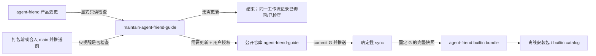
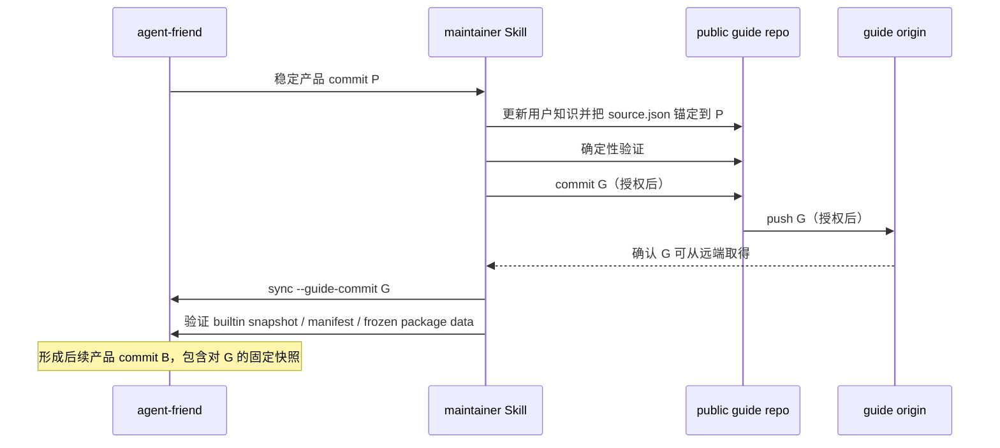

# agent-friend 专有知识 Skill 与维护工作流 - 技术方案

## 状态

CONFIRMED

## 需求文档

[requirement.md](./requirement.md)

## 现状分析

agent-friend 已有统一的 Agent Skill catalog、builtin Skill 物化、Skill 激活和包内 reference
读取能力。当前 builtin 资源包只包含 `skill-creator`，而且
`agent.skills.builtin.BuiltinSkillInstaller` 会把 package 根下除 `manifest.json` 以外的所有
文件硬编码映射到 `skill-creator/`。`SkillLoader` 也只给 `skill-creator` 分配稳定 builtin
ID；若直接加入第二个 Skill，其目录和身份都无法正确表达。因此本需求要先把 builtin bundle
从“一个 Skill 的资源目录”收敛为“包含多个直接子 Skill 的通用 bundle”，但不改变 076 已确认
的安装根、不可变 fingerprint、catalog 或激活语义。

公开知识与产品代码属于两个仓库。运行时软链接、Git submodule 或启动时在线拉取都会把安装包
可用性绑定到开发机路径、Git 状态或网络，不适合 builtin 资源。另一方面，在 agent-friend
仓库手写第二份知识又会形成双真相源。本方案因此采用“公开仓库是唯一人工编辑源，产品仓库保存
精确 commit 的生成快照”的单向同步模型；产品变更通过维护 Skill 推动公开源更新，公开源再生成
builtin，形成流程闭环，而不是文件系统层面的双向写入。

维护检查本身必须只读，但“本次检查无需更新”的结果若想跨任务持久化，就必然要写本地状态、
Git note 或仓库文件。当前需求已确认只要求同一交付工作流内去重，因此首期不引入第三份审阅
账本：跨任务基线取最近一次已发布知识记录的产品 commit；若其后若干变更曾被判定无需更新，
新任务可能再次审阅它们，但不会漏审。只有真正发布新知识时，公开元数据中的审阅锚点才前移。

## 方案总览



核心边界如下：

1. `A1m233/agent-friend-guide` 是用户知识唯一人工维护源，采用 Apache-2.0；中文为权威内容，
   Agent 按用户当前语言回答。
2. agent-friend 只保存由公开仓库某个完整 commit 生成的离线快照，不在该快照中直接改正文。
3. `agent-friend-guide` 只回答最终用户问题，不暴露代码结构、内部协议、环境变量、测试、打包或
   同步实现。
4. `maintain-agent-friend-guide` 只存在于 agent-friend 项目，负责审阅、授权门禁、发布和续跑，
   不作为产品 builtin 交付。
5. 提醒只由已有交付入口拥有：三种包由 `package-release` 提醒；合入 `main` 并推送由
   `dev-workflow` 提醒。维护 Skill 不抢占普通打包或 Git 工作流。
6. 首期不引入 Codex plugin、marketplace、submodule、运行时网络更新或后台自动检查。

## 仓库与制品拓扑

### 公开仓库

公开仓库固定使用 `https://github.com/A1m233/agent-friend-guide`。首次创建仓库属于独立的外部
写入动作，在实现阶段单独取得授权；本方案确认不等于自动创建或推送该仓库。

```text
agent-friend-guide/
├── README.md
├── LICENSE
└── skills/
    └── agent-friend-guide/
        ├── SKILL.md
        ├── license.txt
        ├── agents/
        │   └── openai.yaml
        ├── metadata/
        │   └── source.json
        └── references/
            ├── product-overview.md
            ├── getting-started.md
            ├── using-agent-friend.md
            ├── settings-reference.md
            ├── model-credentials.md
            ├── web-search-credentials.md
            ├── nearby-place-credentials.md
            ├── weather-credentials.md
            ├── voice-credentials.md
            ├── data-and-privacy.md
            └── troubleshooting.md
```

仓库根 `README.md` 只说明 Skill 用途、兼容 Agent Skills 的目录路径、安装方式、语言、许可和
贡献入口。`LICENSE` 是仓库许可原文；`license.txt` 随 Skill package 一起分发，避免只复制
子目录时丢失许可。公开仓库可以在后续增加 CI 或其它仓库级维护文件，但不得把项目内部维护
工作流塞进面向用户的 Skill package。

### agent-friend 内置快照

现有 package 资源调整为直接子 Skill 布局：

```text
agent/src/agent/skills/builtin_assets/
├── __init__.py
├── manifest.json
├── skill-creator/
│   └── ...
└── agent-friend-guide/
    └── ...                    # 由公开仓库完整 commit 生成
```

安装后的布局保持 076 的根不变：

```text
<user_data>/skills/.system/<bundle-fingerprint>/
├── manifest.json
├── skill-creator/
└── agent-friend-guide/
```

`SkillLoader` 从该根递归发现两个直接子 Skill；稳定 ID 统一为 `builtin/<name>`，因此原有
`builtin/skill-creator` 不变，新知识 Skill 为 `builtin/agent-friend-guide`。

## 公开 `agent-friend-guide` Skill

### 入口职责

`SKILL.md` 只保留四类内容：

1. 何时使用：用户询问 agent-friend 的功能、使用、设置、第三方凭据、数据隐私或排障时使用。
2. 事实边界：只陈述当前产品可验证事实；区分已可用、可选增强、实验性和尚未提供；不把历史
   requirement、exploration 或愿景当现状。
3. 回答规范：优先给用户可执行步骤，不索取或复述真实 secret；默认使用用户语言回答，字段名、
   产品名和官方控制台名保持准确。
4. reference 路由：先读完成问题所需的最小主题，跨主题问题再组合读取；禁止为了“了解全貌”
   一次加载全部 reference。

`agents/openai.yaml` 允许隐式调用，使用户直接询问 agent-friend 使用问题时可以选择该 Skill。
它只提供展示元数据和 `policy.allow_implicit_invocation: true`，不声明额外工具或权限。

### reference 总体编排

reference 按用户任务和能力类型组织，不按当前供应商组织。每种可扩展能力文件先解释用户想完成
的事情，再在文件内按“当前支持的供应商”列小节。未来增加同类供应商时只新增一个供应商小节，
不新增一个供应商命名的顶层 reference，也不改 `SKILL.md` 的能力路由。

凭据类 reference 使用统一章节模板：

1. 该能力能做什么、是否属于基础必需或可选增强；
2. 当前支持的供应商列表和能力差异；
3. 每个供应商所需字段、字段用途和缺失影响；
4. 官方申请入口与足够完成申请的步骤；
5. agent-friend 中的可见配置位置、保存与生效方式；
6. 不使用真实 API 调用时可做的配置确认；
7. 常见错误与下一步。

供应商变化只影响对应能力文件和 `settings-reference.md` 中实际可见的字段，不改变 reference
分类。一个供应商横跨多个能力时，可在多个能力文件中各写与该能力相关的最小内容并互相链接，
不得建立一个供应商大全让用户先理解供应商内部产品线。

### 各 reference 的精确职责

#### `product-overview.md`

- 用用户语言说明 agent-friend 的定位和适合解决的问题。
- 按用户可见能力概览对话、会话与附件、模型选择、长期记忆、人格、桌宠、在线工具、Skill、
  语音等当前能力。
- 统一解释“基础可用”“可选配置后可用”“实验性”“尚未提供”四类状态，列出当前限制和平台边界。
- 只链接到后续使用或配置主题；不出现技术栈、进程、bridge、内部 tool 名、事件、store、代码路径。

#### `getting-started.md`

- 首期只创建非零字节占位文档，说明完整首次使用与引导将在后续独立需求交付。
- 不提前编造安装、readiness checklist 或 onboarding 流程。
- 首期 `SKILL.md` 不把任何问题主动路由到该文件；用户询问首次配置时由现有的具体功能、设置和
  凭据 reference 组合回答。

#### `using-agent-friend.md`

- 说明用户在产品里如何完成日常操作：开始和继续对话、管理会话、添加附件、选择模型、使用记忆、
  选择或编辑人格、使用桌宠与设置、让 Agent 使用在线工具、选择或创建 Skill、授予单轮本地文件
  访问以及使用语音能力。
- 对需要额外配置的操作链接到相应能力 reference，并说明未配置时用户实际看到的降级。
- 社交平台搜索、阅读与登录等非 API Key 操作放在对应的“在线工具使用”小节，不把登录态包装成
  通用 API Key。
- 不展示内部工具 schema、事件类型、数据投影或服务进程。

#### `settings-reference.md`

- 以产品当前可见的设置分组和字段名为索引，说明每项设置的用途、必需性、影响能力、空值表现、
  保存和生效方式。
- 凭据字段只给摘要并链接到对应能力 reference，避免在多个文件复制申请流程。
- 只使用用户可见的“立即生效”“下次调用生效”“需要重新启动相关能力”等表述；不得暴露
  `restartBridge`、keyring service 名、内部 store key、兼容 alias 或环境变量。
- 对产品界面不存在的开关、测试模式或开发者配置不得给出虚构入口。

#### `model-credentials.md`

- 顶层主题是“模型服务凭据”，不是某一家模型供应商。
- 解释模型凭据对基础对话的作用、模型选择与凭据的关系，以及无有效模型凭据时的用户影响。
- 首期在“当前供应商”下分别提供 DeepSeek、Kimi 小节，覆盖官方入口、Key 申请、产品内配置、
  生效确认和常见额度/鉴权错误。
- 未来新增模型供应商时在本文件增加同级小节。

#### `web-search-credentials.md`

- 顶层主题是“网页搜索与网页内容获取凭据”。
- 说明该凭据影响哪些搜索/网页能力，以及缺少凭据时哪些能力仍可用、哪些会降级。
- 首期在“当前供应商”下提供 Tavily 小节，覆盖官方申请入口、API Key、配置位置、生效与常见错误。
- 未来搜索 provider 继续在本文件陈列，不新建 provider 命名 reference。

#### `nearby-place-credentials.md`

- 顶层主题是“附近地点与地点检索凭据”。
- 说明地点查询对天气地点解析等关联能力的用户可见影响，但不解释内部 resolver 组合。
- 首期在“当前供应商”下提供高德地图 Web 服务小节，明确 Key 类型必须匹配 Web 服务、申请入口、
  配置位置、额度/权限问题和缺失影响。
- 未来其它地点 provider 在本文件增加同级小节。

#### `weather-credentials.md`

- 顶层主题是“天气查询凭据”。
- 首期在“当前供应商”下提供和风天气小节，分别解释 API Key 与账户专属 API Host 的用途、官方
  获取位置、正确填写形态、保存生效和常见 host/鉴权/额度错误。
- 只描述用户需要识别的字段约束，不暴露 provider 校验函数或请求协议。
- 未来其它天气 provider 在本文件增加同级小节。

#### `voice-credentials.md`

- 顶层主题是“语音能力凭据”，先按用户能力区分语音输入与语音通话，再陈列当前供应商。
- 每种语音能力分别给出所需凭据组合、每个字段的用户用途、少任一字段时受影响的能力、产品内
  配置位置和生效方式，避免让用户先理解供应商的整套云产品分类。
- 首期在对应能力下说明当前火山引擎语音/RTC 服务，提供可定位控制台的官方入口和检索关键词，
  但不提供开户、实名认证、服务开通的完整截图教程。
- 不暴露内部 credential bundle 名、启动参数、WebSocket/RTC 实现、签名协议或开发环境变量。

#### `data-and-privacy.md`

- 从用户角度说明会话、记忆、人格、附件、Skill、设置、凭据、日志、模型请求和第三方在线工具
  各自处理什么数据，哪些主要在本机、哪些会发送给所选第三方服务。
- 说明 secret 的保存与遮罩边界，不承诺当前产品没有实现的安全属性。
- 说明产品当前真实存在的数据删除、重置、迁移、诊断和求助方式；只有用户需要直接操作时才给出
  平台路径，不给内部测试 override 或仓库路径。
- 明确删除或重置的影响，避免把不可逆动作写成默认排障第一步。

#### `troubleshooting.md`

- 以用户症状组织：无法对话、某项在线工具不可用、配置似乎未生效、权限或额度错误、网络失败、
  语音输入失败、语音通话失败、Skill 未出现、数据或日志求助等。
- 每个症状给由低风险到高成本的排查顺序，并链接到对应设置或能力 reference。
- 错误描述使用产品 UI 或用户能看到的现象，不使用 bridge、catalog、provider exception、内部
  error code 等实现词替代用户解释。
- 不建议用户在聊天中粘贴真实 API Key、token、cookie 或完整敏感日志。

### 不面向用户路由的来源元数据

`metadata/source.json` 是机器契约，不是用户知识 reference，`SKILL.md` 不路由到它。schema 1
包含：

```json
{
  "schema_version": 1,
  "product_repository": "https://github.com/A1m233/agent-friend",
  "reviewed_product_commit": "<40-hex product commit>",
  "reviewed_at": "<YYYY-MM-DD>",
  "product_version": "<version or unreleased>",
  "content_sha256": "<sha256 of all package files except metadata/source.json>"
}
```

`reviewed_product_commit` 必须是形成公开知识事实基线的稳定 agent-friend commit。若目标尚未对应
正式版本，`product_version` 使用明确的 `unreleased`，不能猜测下一版本号。`content_sha256`
按相对 POSIX 路径排序，依次摘要“路径、NUL、文件 bytes、NUL”，并排除 `source.json` 本身，
避免自引用。同步进 builtin 后，bundle manifest 另行记录包含 `source.json` 在内的完整快照摘要。

### 用户知识内容边界

公开 Skill package 禁止出现以下维护者实现知识：

- 源码路径、模块或类名、技术栈和内部进程；
- tool schema、bridge、catalog、事件流、store key、内部错误类型；
- 环境变量、兼容 alias、测试 fixture、打包和冻结 runtime；
- Git 分支、commit/push 操作、同步脚本、builtin manifest 或维护提醒；
- 私有诊断细节、真实凭据、凭据 hash 或可复用的敏感日志。

例外只限用户确实需要执行的公开事实，例如官方供应商链接、产品界面中的字段名、用户可操作的
数据路径以及用于识别自身产品版本的公开版本号。实现期内容审阅必须同时做“准确性检查”和
“内部细节泄漏检查”。

## 通用 builtin bundle

### 资源布局与安装器

`BuiltinSkillInstaller` 不再给资源路径补 `skill-creator/` 前缀，而是原样收集
`builtin_assets/` 下除 `__init__.py`、`__pycache__` 和 `.pyc` 外的所有文件。资源根必须有
`manifest.json`，其它直接子目录各自是合法 Skill package。

bundle fingerprint 继续对排序后的相对路径与文件 bytes 计算 SHA-256。命中已有 fingerprint
目录时，校验预期文件集合和 bytes 均精确一致；缺文件、内容不同或多出普通文件都视为 bundle
损坏，不静默复用。新物化仍使用现有锁、staging 和原子 rename，不删除旧 fingerprint。

`SkillLoader` 对任意 builtin Skill 使用 `builtin/<name>` 作为稳定 ID。personal/shared Skill
仍使用 canonical path hash，不扩大稳定 ID 规则。

### bundle manifest schema 2

`manifest.json` 从单一上游描述升级为多 Skill 清单：

```json
{
  "schema_version": 2,
  "content_fingerprint": {
    "algorithm": "sha256",
    "value": "installed immutable bundle directory name"
  },
  "skills": {
    "skill-creator": {
      "source_repository": "https://github.com/openai/codex",
      "source_commit": "<commit>",
      "source_path": "<path>",
      "license_spdx": "Apache-2.0",
      "license_file": "skill-creator/license.txt",
      "snapshot_sha256": "<sha256>"
    },
    "agent-friend-guide": {
      "source_repository": "https://github.com/A1m233/agent-friend-guide",
      "source_commit": "<guide commit G>",
      "source_path": "skills/agent-friend-guide",
      "license_spdx": "Apache-2.0",
      "license_file": "agent-friend-guide/license.txt",
      "snapshot_sha256": "<sha256 including metadata/source.json>"
    }
  }
}
```

`snapshot_sha256` 使用与公开内容摘要相同的有序路径算法，但以各 Skill 子目录为根，并包含该子目录
全部文件。manifest 本身不写入真实 bundle fingerprint，以现有描述值表示安装目录名就是完整
bundle fingerprint，避免 manifest 对自身形成循环摘要。

本需求新增 package data，属于冻结 runtime 的 package-sensitive 变更。PyInstaller 当前通过
`collect_all("agent")` 收集 package data，方案不预设必须修改 spec；实现后先核对冻结 runtime
中的两个 Skill 和 references 是否齐全，只有现有收集不能覆盖时才改 spec/hook。

## 项目内 `maintain-agent-friend-guide` Skill

### package 结构

```text
.cursor/skills/maintain-agent-friend-guide/
├── SKILL.md
├── agents/
│   └── openai.yaml
└── references/
    ├── reference-map.md
    ├── review-workflow.md
    ├── cross-repo-publish.md
    └── content-quality.md
```

该 Skill 的 description 只匹配用户明确提出的“检查/维护/更新/同步/发布
agent-friend-guide 知识”请求。`agents/openai.yaml` 设置
`policy.allow_implicit_invocation: false`。package、合入或 push 入口只负责提醒；用户回答“检查”
后才构成显式调用，不因普通“看看能否打包/合入”而自行执行维护。

`SKILL.md` 只承载阶段选择、授权门禁、最小流程和 reference 路由：

- 用户只要求检查：进入只读审阅，输出结论，不改任一仓库。
- 用户直接要求更新：仍先完成或复用同一工作流、同一产品状态的检查；若确需更新，再核对其授权
  是否覆盖内容修改、commit 和 push。
- 检查发现需更新但用户未授权：停在建议清单，不预先修改公开仓库。
- 用户授权更新：按 `P -> G -> B` 顺序执行，任何一步失败都保留已成功状态并给续跑入口。

### maintainer references

#### `reference-map.md`

- 维护“用户知识主题 -> 应核对的产品表面/事实类型 -> 公开 reference”的导航表。
- 覆盖功能与限制、可见操作、设置字段、模型/搜索/地点/天气/语音凭据、数据隐私和排障。
- 内部路径只作为维护者查找入口，不进入公开内容；路径映射是调查导航，不是机械判定规则。
- 新增 provider 时先按能力归入现有 reference；只有出现新的用户任务类型才考虑新增顶层 reference。

#### `review-workflow.md`

- 定义审阅基线、目标状态和 dirty overlay 口径。
- 定义证据顺序：实际变更与调用方、用户可见 UI/行为、测试、已确认需求，再与当前公开知识比较；
  过时 README、历史 requirement 或文件名不能单独定结论。
- 定义逐类检查清单与结果格式：目标状态、基线、结论、证据、受影响 reference、建议修改、未决项。
- 定义“无需更新”条件及同一工作流内提醒/检查去重语义。

#### `cross-repo-publish.md`

- 定义公开仓库定位、clean/scope preflight 和完整 `P -> G -> B` 发布顺序。
- 定义公开内容修改、验证、commit message、commit、push、远端确认、builtin sync、产品仓库验证与
  后续产品 commit 的授权边界。
- 定义部分完成状态识别和续跑表，不自动 amend 已推送 commit，不自动回滚远端成功，不重复发布。
- 定义初次公开仓库不存在、远端不可达、commit 不稳定、两仓库有不明 dirty 文件等阻塞处理。

#### `content-quality.md`

- 定义用户语言、状态标记、能力优先/供应商次级的编排规范。
- 定义每类凭据说明必须覆盖的字段，以及官方链接、申请步骤、配置位置、生效、降级和错误口径。
- 定义 secret 安全、内部细节禁区、跨 reference 去重和相对链接规则。
- 定义占位 `getting-started.md` 的首期边界，以及后续需求接管时应如何解除占位。

### 只读检查算法

检查由 Agent 做语义判断，脚本只提供确定性事实，不使用路径关键词直接决定是否更新：

1. 读取公开 `metadata/source.json` 的 `reviewed_product_commit` 作为 baseline；首次无公开版本时使用
   当前需求选定的初始基线并在输出中明确说明。
2. 解析当前 agent-friend `HEAD` 和工作区状态。clean 状态的目标是 `HEAD`；dirty 状态允许把
   `HEAD + tracked diff + untracked 文件` 作为只读预览目标，并生成不含文件内容的状态摘要。
3. 若 baseline 不存在、不可达或不是目标 commit 的 ancestor，不猜测范围，报告需要人工选择基线。
4. 阅读 baseline 到目标的实际 diff，并沿调用方、测试和用户可见入口核对以下变化维度：
   - 当前能力、限制或状态；
   - 用户操作与可见文案；
   - 设置字段、必需性、生效与降级；
   - provider、凭据申请和错误表现；
   - 数据去向、存储、删除、诊断和隐私；
   - 安装、兼容或其它会影响用户求助答案的边界。
5. 将事实与公开 reference 逐项比较。纯重构、测试整理、格式或等价替换可判“无需更新”，但输出
   简洁证据；有用户可见差异则列出准确 reference 和拟改事实。
6. 检查不写文件、不 commit、不 push。同一工作流记住产品状态摘要和结论，供提醒入口去重；
   新任务不依赖不可见的持久状态，必要时安全地重复审阅。

dirty overlay 可帮助尽早发现知识影响，但不能成为公开版本锚点。若决定更新，必须先让相关产品
变更形成稳定 commit `P`，重新确认 `P` 与已审阅 overlay 等价，再进入发布。

### 跨仓库发布顺序



不允许先从公开仓库未提交或未推送的工作区复制到 builtin。公开提交 `G` 是唯一跨仓库交接键。
`B` 可以与其它 agent-friend 交付变更形成同一后续 commit，但其 diff 必须包含完整生成快照和
manifest pin。若 `G` 已推送而后续失败，续跑从 `G` 开始，不删除、force-push 或自动回滚 `G`。

### 部分完成状态与续跑

维护 Skill 不创建额外事务数据库，而是从两个 Git 仓库和 bundle manifest 恢复状态：

| 已观察状态 | 续跑动作 |
| --- | --- |
| 公开内容有未提交修改 | 重新验证并确认提交范围；不得覆盖不明改动 |
| `G` 已提交但远端没有 | 经现有 push 授权推送并确认远端；不先 sync |
| `G` 已在远端、builtin 仍 pin 旧 commit | 直接以精确 `G` 执行 sync |
| builtin 已生成但未提交 | verify 后继续 agent-friend 提交范围确认 |
| manifest 已 pin `G` 且内容摘要一致 | 不重复复制或发布，只补剩余验证/提交步骤 |
| 公开 HEAD 在已发布 `G` 后又有修改 | 不猜测目标；先确认应发布新 commit 还是恢复干净范围 |
| 两仓库任一存在来源不明的 dirty 文件 | 暂停对应 commit/push，向用户列精确路径 |

## 确定性同步脚本

项目新增跨平台入口：

```text
scripts/agent-friend-guide/
├── run.py
├── run.ps1
└── run.sh
```

公开命令为：

```powershell
.\scripts\agent-friend-guide\run.ps1 status --guide-repo <path>
.\scripts\agent-friend-guide\run.ps1 verify --guide-repo <path>
.\scripts\agent-friend-guide\run.ps1 sync --guide-repo <path> --guide-commit <40-hex>
```

macOS/Linux 入口参数与语义完全一致。

### `status`

只读输出：agent-friend HEAD/dirty 状态和工作树摘要、公开 source metadata、公开仓库 HEAD、远端
可见状态、当前 builtin pin、公开/内置摘要是否一致，以及可识别的部分完成阶段。默认人类可读，
`--json` 输出稳定 schema 供测试或 Agent 续跑。任何 secret 或 diff 内容都不进入摘要。

### `verify`

只读验证：

- Skill 目录、UTF-8、frontmatter、name/目录一致性和 `agents/openai.yaml` 策略；
- `SKILL.md` 路由的 reference 存在，reference 相对链接不越出 package；
- 固定 reference 集合、非零字节 `getting-started.md` 占位和 `source.json` schema；
- `content_sha256` 与公开 package 一致；
- 必需能力/供应商章节和凭据说明模板齐全；
- builtin 模式下 manifest pin、完整 snapshot 摘要及公开源 commit 一致。

格式和摘要校验由脚本确定性完成；“是否准确反映用户可见事实、是否泄漏实现细节”仍由维护 Skill
按 `content-quality.md` 语义审阅，避免把关键词 linter 误当事实判断。

### `sync`

`sync` 是唯一允许写 builtin `agent-friend-guide/` 的入口。它必须：

1. 要求公开仓库 clean、`HEAD == --guide-commit`，且该 40 位 commit 已能从配置的远端确认；
2. 先运行公开 package 全量 verify；
3. 只从 `skills/agent-friend-guide/` 读取，拒绝 symlink、junction、越界路径和非普通文件；
4. 通过受控 staging 替换生成目录，失败时不留下半份快照；
5. 更新 bundle manifest 的公开来源 commit 和 snapshot digest，保留 `skill-creator` provenance；
6. 立即对 builtin 再运行 verify；
7. 只改生成目录和 manifest，不执行 Git add、commit 或 push。

脚本不负责创建/克隆公开仓库、不选择“最近 commit”、不自动修改公开正文，也不把运行维护 Skill
等同于 Git 授权。`scripts/README.md` 同步登记三个命令。

## 提醒集成

### 安装包构建前

在 `.cursor/skills/package-release/SKILL.md` 的实际构建阶段、执行任何 `runtime`、`installer`、
`all` 或 installer smoke 构建前增加统一提醒。查询版本、设置版本、查看/清理 workspace 不提醒。

提醒覆盖三个产品渠道：

- stable release，对应当前脚本的正式 `ordinary` release；
- `trusted-beta`；
- `local-test`，包括组合了 trusted credentials 的 local-test。

提醒文案只询问“是否先进行 agent-friend-guide 知识维护检查”。用户拒绝后立即回到原打包流程，
不降低或绕过原打包门禁。用户同意后显式调用 maintainer Skill 的检查阶段；检查判需更新时，是否
执行更新仍需单独授权。

### 合入 `main` 并推送远端前

在 `.cursor/rules/dev-workflow.mdc` 的需求合入 `main` 流程增加同类提醒。只有用户意图同时包含
“合入 `main`”和“推送远端”，或完成合入后继续要求推送 `main` 时触发；普通 feature/fix 分支
push、commit、rebase、只合入不推送均不触发此提醒。

### 同一工作流去重

package-release、dev-workflow 和 maintainer Skill 在当前任务上下文共享以下逻辑状态：

```text
reminder key = product_state_summary + delivery_action
delivery_action = package:<channel> | merge-main-and-push
```

相同 key 已经询问、已执行检查或已完成维护时不再询问。产品 `HEAD`、tracked diff 或 untracked
文件集合/内容发生实质变化后，`product_state_summary` 变化，可以重新提醒。直接提出“检查/更新
知识”的用户请求直接进入 maintainer Skill，不先制造提醒。该状态不跨 Codex/Cursor 任务持久化。

提醒属于 Agent 工作流指引，不进入产品运行时代码或打包脚本的 fail-closed 门禁；因此用户跳过
不会阻止非交互脚本或现有构建流程。

## Git 与授权边界

- 只读检查授权不包含任何文件修改、仓库创建、commit 或 push。
- “执行知识更新”授权允许修改已列出的公开知识和生成快照，但是否已同时授权 commit/push 要按
  用户原话判断；未明确覆盖时，在展示精确仓库、文件范围和验证结果后暂停确认。
- 每个仓库提交前单独核对 `git status`。发现无法确认属于本流程的文件时，列出精确路径并询问，
  不自行排除或纳入。
- 生成 commit message 时使用现有 `gen-commit-message` Skill；公开仓库和 agent-friend 使用各自
  diff 与验证证据，不用一条模糊消息覆盖两个仓库。
- push 后通过远端 ref 确认精确 `G`；不得用本地 branch 名或“最新提交”代替 pin。
- 不 force-push、不自动 amend 已推送 `G`、不自动回滚跨仓库部分成功。

## 涉及文件

### agent-friend 仓库

| 文件路径 | 改动类型 | 说明 |
| --- | --- | --- |
| `docs/requirements/079-agent-friend-guide-skill/design.md` | 新增 | 本技术方案 |
| `.cursor/skills/maintain-agent-friend-guide/` | 新增 | 显式维护 Skill 及四个 maintainer references |
| `.cursor/skills/package-release/SKILL.md` | 修改 | 三种安装包实际构建前的非阻塞提醒 |
| `.cursor/rules/dev-workflow.mdc` | 修改 | 合入 `main` 并推送远端前的非阻塞提醒 |
| `.Codex/skills/maintain-agent-friend-guide` | 生成 | 项目 adapter 创建的指向 `.cursor` 的 Skill 链接 |
| `AGENTS.md` | 生成 | 项目 adapter 更新 rule/Skill lookup 与 inline rule |
| `scripts/agent-friend-guide/run.py` | 新增 | status、verify、sync 的确定性实现 |
| `scripts/agent-friend-guide/run.ps1` | 新增 | Windows 薄入口 |
| `scripts/agent-friend-guide/run.sh` | 新增 | macOS/Linux 薄入口 |
| `scripts/README.md` | 修改 | 登记新脚本 |
| `agent/src/agent/skills/builtin.py` | 修改 | 通用多 Skill bundle 收集与精确物化校验 |
| `agent/src/agent/skills/loader.py` | 修改 | 所有 builtin Skill 的稳定 `builtin/<name>` ID |
| `agent/src/agent/skills/builtin_assets/manifest.json` | 修改 | 升级为多 Skill provenance schema 2 |
| `agent/src/agent/skills/builtin_assets/skill-creator/` | 移动 | 保留现有 builtin 内容，改为直接子 Skill |
| `agent/src/agent/skills/builtin_assets/agent-friend-guide/` | 生成 | 公开 commit `G` 的完整离线快照 |
| `agent/tests/test_skill_service.py` | 修改 | 两个 builtin、稳定 ID、manifest 和 reference 回归 |
| `agent/tests/test_skill_loader.py` | 修改 | 通用 builtin ID 行为 |
| `scripts/agent-friend-guide/test_run.py` | 新增 | status/verify/sync、摘要和失败隔离测试 |
| `scripts/package/windows/agent_friend_runtime.spec` | 核对/按需修改 | 仅在 `collect_all("agent")` 未收齐新资源时修改 |

测试文件最终可按现有邻居拆分，但不得把脚本测试塞入无关业务 package。Skill/rule 修改后运行项目
`scripts/codex-adapters/run.* sync` 与 `doctor`，以生成结果为准，不手写 `.Codex` 副本。

### 公开仓库

| 文件路径 | 改动类型 | 说明 |
| --- | --- | --- |
| `README.md` | 新增 | 安装、使用、语言、许可与贡献说明 |
| `LICENSE` | 新增 | Apache-2.0 |
| `skills/agent-friend-guide/SKILL.md` | 新增 | 用户知识入口与渐进式路由 |
| `skills/agent-friend-guide/license.txt` | 新增 | 随 Skill package 分发的许可 |
| `skills/agent-friend-guide/agents/openai.yaml` | 新增 | 展示元数据与隐式调用策略 |
| `skills/agent-friend-guide/metadata/source.json` | 新增 | 产品审阅锚点与内容摘要 |
| `skills/agent-friend-guide/references/*.md` | 新增 | 本方案确认的 11 个用户知识主题 |

## 验证方案

### 公开知识与 Skill 结构

- 用确定性 validator 校验 frontmatter、name/目录、reference 路由、相对链接、metadata schema 和
  两层摘要。
- 对 DeepSeek、Kimi、Tavily、高德 Web 服务、和风天气及火山语音/RTC 的必需章节做结构断言；
  链接与实际字段在内容审阅中逐项核对官方来源和当前产品 UI。
- 用问题样例验证最小 reference 路由：功能概览、模型 Key、网页搜索、地点、天气、语音输入、
  语音通话、数据隐私、配置未生效和常见排障不会无差别加载全部主题。
- 验证公开 Skill 从 GitHub repo/path 可被标准 Skill 安装方式识别；首期不验证 plugin 分发。
- 不使用真实用户凭据，不调用真实模型、搜索、地图、天气或语音 API。

### builtin 与同步

- 单测覆盖多 Skill 资源布局、`builtin/skill-creator` 兼容、`builtin/agent-friend-guide` 稳定 ID、
  资源 fingerprint、已有目录精确校验和并发物化。
- fixture 覆盖公开/builtin 一致、旧 pin、已推送未 sync、已 sync 未提交、dirty public repo、错误
  commit、摘要不一致、symlink/junction 和 staging 失败恢复。
- 通过现有 catalog/激活路径读取 `agent-friend-guide` 的 `SKILL.md` 和至少一个 reference，确认没有
  新权限旁路。
- 在断网或不提供公开仓库的测试环境中从 builtin 回答结构测试，证明运行时不在线拉取。

### 工作流与适配器

- 对 maintainer Skill 做正向和负向触发测试：显式检查/更新会触发，普通打包、普通 push、泛化
  “看看是否完成”不会隐式触发。
- 场景演练 package 三渠道均先提醒、拒绝后继续；merge-main-and-push 提醒，普通 feature/fix
  push 不提醒；同一工作流同一状态不重复提醒。
- 运行项目 `codex-adapters sync`、`doctor` 和 Skill/rule guidance audit，确认 Cursor 与 Codex
  adapter 无漂移、责任不重叠。

### 项目与冻结 runtime

- 运行受影响的 Agent Skill 和同步脚本测试，再运行项目完整 `scripts/check`。
- 按 package-sensitive 口径构建 frozen runtime local-test candidate，核对其中 manifest、两个
  builtin Skill、全部 references 和 license，并执行既有 runtime doctor/capability smoke。
- 本需求不改最终产品 UI，不需要桌面端视觉验收；若实现期额外修改可见界面，再按前端视觉规则
  单独确认。

## 实现顺序

1. 创建公开仓库骨架和用户知识 Skill，完成初版内容审阅与公开 metadata。
2. 在 agent-friend 中实现确定性 status/verify/sync，并用 fixture 固定公开来源契约。
3. 把 builtin bundle 泛化为多 Skill，使用精确公开 commit 生成 `agent-friend-guide` 快照。
4. 新增项目 maintainer Skill 及 references，接入 package-release 和 dev-workflow 提醒。
5. 同步/校验项目 Codex adapters，执行局部、全量和 package-sensitive 验证。
6. 分别确认两个仓库的提交与推送范围；按跨仓库部分成功状态安全收口。

## 风险与约束

- **公开知识陈旧**：提醒不是强制门禁，用户可跳过。通过稳定产品 commit 锚点、语义检查清单和
  后续重复审阅降低遗漏，不声称完全自动消除漂移。
- **供应商文档变化**：公开内容只保留官方入口和用户所需步骤；维护时重新核对官方来源，不把
  控制台截图或短期页面层级当稳定协议。
- **公开/内置分叉**：禁止手改 builtin，sync 要求公开 commit 已推送并校验双摘要；manifest 记录
  精确来源。
- **跨仓库半完成**：以公开 commit `G` 为交接键，从 Git 和 manifest 恢复，不用隐藏事务状态；
  不自动回滚远端成功。
- **检查重复**：只读“无需更新”不持久化，跨任务可能重复审阅。该代价换取无额外审阅数据库且
  不违背只读边界；若未来重复成本明显，再独立设计持久化 review ledger。
- **实现细节外泄**：公开 reference 有明确禁区，maintainer 内容与机器 metadata 不参与用户路由；
  发布前做人工语义审阅，而非只靠禁词。
- **冻结包缺资源**：新增 package data 按 package-sensitive 验证，不因源码环境可读就推断安装态
  一定可读。

## 后续演进边界

- 完整 `getting-started.md`、产品内 onboarding/readiness UI 由后续独立需求接管；届时删除占位
  语义并把该主题加入 `SKILL.md` 路由。
- 新增同类 provider 时扩展现有能力 reference；只有出现新的用户任务类型才新增顶层 reference。
- Codex plugin、marketplace、文档站、运行时在线更新和跨任务 review ledger 都需要新的需求或
  明确扩期，不在首期顺手实现。
