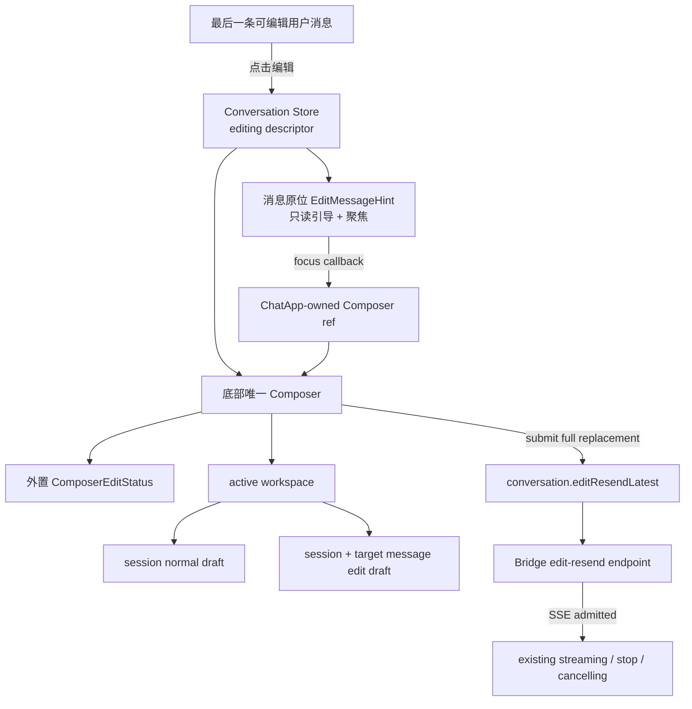
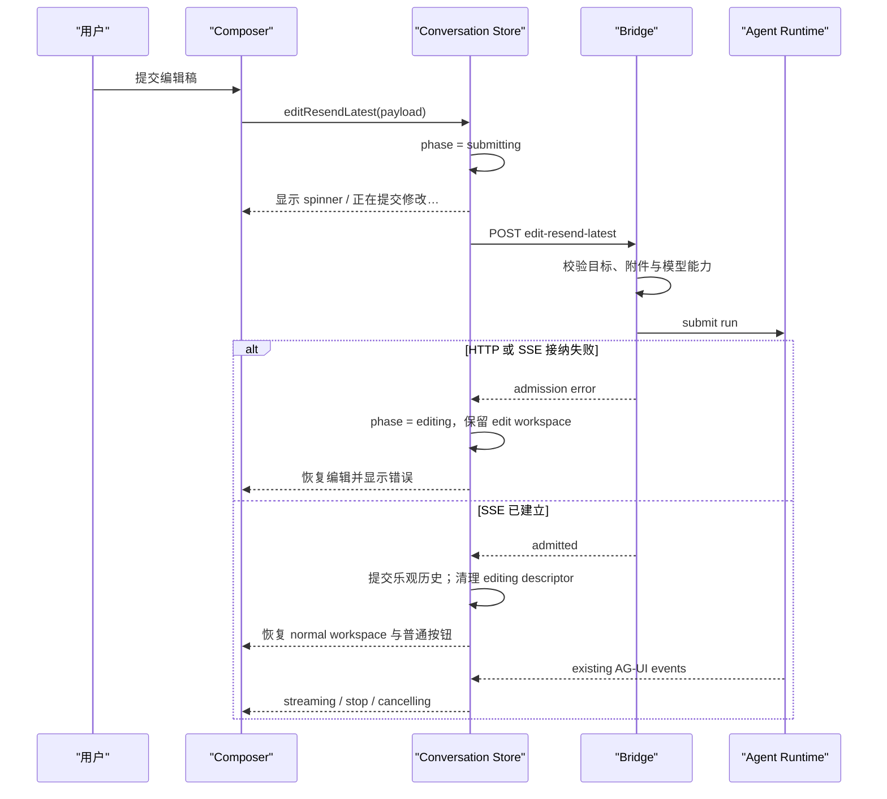

# 080 · 统一编辑 Composer - 技术方案

## 状态

CONFIRMED

## 需求文档

→ [requirement.md](./requirement.md)

## 0. 文档说明

本方案把对话页底部 Composer 收敛为普通发送与编辑重发的唯一输入源，并补齐编辑文字、原附件、新附件、模型切换与语音输入共用一套草稿能力所需的前后端契约。

方案不改变需求 035 已确认的活跃历史与重新生成语义，也不引入历史分支管理、语音通话或快捷键体系。编辑状态只负责描述“当前正在修改哪一条消息及其草稿”，一旦 Bridge 接受新的 edit-resend run，后续继续进入现有 streaming、stop 与 cancelling 状态机。

## 1. 现状分析

### 1.1 页面存在两个竞争输入源

- `MessageList.tsx` 在消息位置渲染 `EditMessageSender.tsx`，组件内部维护独立文字草稿、取消和发送按钮。
- 底部 `Composer.tsx` 同时保持可见，但模型选择器等操作因 `editingMessageId` 被禁用，形成“看得见但不能用”的假输入源。
- 内联 Sender 只支持文字；附件、模型、语音、拖放和粘贴均只存在于底部 Composer。继续扩展内联 Sender 会产生第二套输入状态与交互规则。

### 1.2 Composer 已具备绝大多数编辑能力

- `Composer.tsx` 已统一处理文字、附件选择/拖放/粘贴、上传状态、模型兼容性、语音听写和发送按钮状态。
- `ChatSenderBox.tsx` 已桥接 TDesign ChatSender 的输入、IME 和剪贴板事件，并向外转发 host ref，可作为聚焦入口。
- 编辑状态属于 Composer 上下文，但不属于 ChatSender 输入框本身。状态栏应由 Composer 在 ChatSender 外部直接渲染，避免占用输入框边框内部空间，也不需要穿透 Shadow DOM。
- `ChatApp` 同时拥有 `MessageList` 与 `Composer`，可以在页面局部持有 Composer ref 并把聚焦回调传给消息列表，不需要全局事件总线或一次性焦点状态。

### 1.3 草稿状态只表达普通输入与上传 lease

- `drafts.ts` 目前以 session workspace 保存文字和附件草稿，并通过 submission 生命周期支持普通发送失败后的恢复。
- ready 附件只表达由当前 `File` 上传得到的临时 draft lease；已发送消息中的 `ChatAttachment` 是永久 asset 引用，不能伪装成新上传的 draft。
- 编辑期间新增附件可能在用户取消、切换会话后才完成上传。若异步结果仍写回旧 workspace，会重建已取消的编辑稿或泄漏临时 lease。

### 1.4 编辑重发的接纳边界过早乐观

- `conversation.ts` 当前点击编辑发送后立即清空 `editingMessageId` 并切到 streaming，再发起 HTTP 请求。
- `stream.ts` 已能区分 HTTP/SSE 建立阶段的 `StreamAdmissionError` 与接纳后的流式错误，但编辑 store 尚未利用这条边界。
- 当 Bridge 尚未接纳请求时就退出编辑态，会让用户看到状态突然恢复、随后又报错；恢复编辑稿也容易与已乐观改写的消息列表产生竞争。

### 1.5 后端只能隐式保留全部原附件

- `EditResendLatestBody` 只接收非空 `text` 与旧内容并发校验，`Conversation.edit_resend_latest()` 固定复制目标用户消息的全部原附件。
- 普通 AG-UI send 已具备 draft lease 校验、模型附件能力校验、延迟消费与持久化能力，但 edit-resend 路由没有可表达“保留部分原附件并混入新附件”的输入协议。
- 永久 asset 与上传 draft 的信任边界不同：原附件只能从实际编辑目标中选择，新 draft 必须由 `AttachmentStore` 重新解析和校验，客户端元数据不能成为权威。

## 2. 设计原则

1. **唯一输入源**：消息列表只展示目标与引导，文字、附件、语音、模型和提交操作全部归底部 Composer。
2. **草稿按用途隔离**：普通草稿和当前编辑稿使用不同 workspace；切换显示对象不搬运或覆盖另一份草稿。
3. **接纳前可恢复**：Bridge 接受 SSE 之前不改写活跃历史、不丢编辑稿，所有阻塞都给出可见进度。
4. **接纳后沿用 run 状态机**：请求一经接受，编辑就视为已提交；后续流式错误、停止或取消不重新打开编辑器。
5. **附件身份显式**：永久 asset 与临时 draft lease 在前端状态和 wire contract 中保持可区分。
6. **服务端重建权威输入**：Bridge 校验目标消息、原附件归属、draft lease 与当前模型能力，再向 Conversation 传入最终 `AttachmentRef` 列表。
7. **局部协调，不引入全局 UI 总线**：聚焦与提示由 `ChatApp`、`MessageList` 和 `Composer` 的显式 props/ref 完成。
8. **不扩张快捷键与语音边界**：本需求不处理 `Esc` 等快捷键，也不把现有语音听写扩展为语音通话。
9. **主动停止不是失败**：用户请求停止后先等待 runtime 终态确认；确认取消时投影为可持久恢复的中性 interrupted 状态，只有真正异常才进入 error 状态。

## 3. 总体架构

### 3.1 组件与状态流



### 3.2 提交时序



## 4. 前端方案

### 4.1 消息原位提示与唯一 Composer

删除 `EditMessageSender.tsx`。`MessageList` 不再把目标用户消息替换为 Sender，而是在原消息保持只读的同时渲染页面私有的 `EditMessageHint`：

- 文案为“正在编辑这条消息，请在下方输入框修改”。
- 整体是一个轻量、可点击的语义化按钮或项目已有 Button wrapper，不放输入框、发送或取消操作。
- 点击只调用 `onFocusComposer()`，让底部 textarea 获得焦点。
- 提示跟随原消息所在的虚拟列表 item，高度变化继续由现有测量机制处理。

`ChatApp` 持有 `ComposerHandle`：

```ts
export interface ComposerHandle {
  focus(): void;
}
```

`Composer` 通过现有 ChatSender host ref 实现 `focus()`。进入新的编辑 descriptor 后，Composer 自身在完成 workspace 切换与文字回填后执行一次聚焦；原位提示复用相同 handle。焦点动作不写入 Zustand，也不新增全局 DOM selector。

### 4.2 Composer 编辑状态栏

新增页面私有 `ComposerEditStatus`，由 `Composer` 渲染为 `ChatSenderBox` 的前置兄弟节点，位于输入框边框外并紧邻输入框上方。状态条相对 ChatSender 左右内收一个小间距，与 ChatSender 正常文档流相邻、不使用负 margin 叠压；状态条只保留顶部圆角、底部使用直角，ChatSender 保持原有完整圆角，形成无缝但边界清楚的上下文层：

- 常态显示编辑说明、单行截断的目标文字摘要；目标没有文字时使用附件摘要。
- 右侧只有一个带无障碍名称的关闭按钮，关闭即取消编辑。
- `phase === "submitting"` 时显示 spinner 与“正在提交修改…”，关闭按钮和其它会改变 payload 的操作暂时禁用。
- 状态栏使用项目语义 token 与 Tailwind 类，拥有独立浅色背景、顶部圆角与轻量阴影，不使用描边强化独立卡片感；不修改 TDesign vendor CSS。
- 状态栏插入后，Composer 现有 ResizeObserver 继续向消息列表提供真实高度，消息底部 inset 不使用固定补偿值。
- 附件 dropzone 只包裹 `ChatSenderBox`；编辑状态栏位于 dropzone 外，避免拖拽反馈层遮挡状态与取消入口。

`ChatSenderBox` 不再保留 `placement: "edit"` 的行为分支；它只服务底部 Composer 和其它既有 bottom 使用方。普通模式和编辑模式共用相同的 ChatSender 结构与尺寸，编辑上下文由外层 Composer 负责。

### 4.3 编辑 descriptor 与生命周期

conversation store 将单一 `editingMessageId` 收敛为带快照的 descriptor：

```ts
interface EditingMessageDescriptor {
  sessionId: string;
  messageId: string;
  draftKey: string;
  originalText: string;
  originalAttachments: ChatAttachment[];
  phase: "editing" | "submitting";
}
```

其中 `draftKey = editDraftKey(sessionId, messageId)`，只用于定位编辑 workspace，不作为后端协议字段。

生命周期如下：

1. `beginEditingLatest(message)` 校验消息仍是当前会话最后一条可编辑 user message。
2. 首次进入时，用消息文字和原附件初始化 edit workspace；已有同 key workspace 时不重复覆盖用户修改。
3. Composer 根据 descriptor 选择 edit workspace；没有 descriptor 时选择原 session normal workspace。
4. `cancelEditing()` 丢弃 edit workspace、释放编辑期间新上传且仍持有的 draft lease、清除 descriptor；normal workspace 从未被覆盖，因此直接恢复。
5. 切换 active session 时按取消编辑处理，不在多个会话间同时保留编辑器实例；返回原会话时显示其 normal draft。
6. 请求接纳成功后，以“已消费/已交给 run”的结果移除 edit workspace，不向已接纳的新 draft 发送 release；清除 descriptor 并恢复 normal workspace。

消息摘要和并发校验使用 descriptor 的原始快照，不能随着 textarea 修改而变化。

### 4.4 草稿附件类型

扩展 `DraftAttachmentState`，使 ready 状态显式区分两类来源：

```ts
type ReadyDraftAttachment =
  | {
      status: "ready";
      source: "draft";
      localId: string;
      file: File;
      draft: AttachmentDraft;
    }
  | {
      status: "ready";
      source: "existing";
      localId: string;
      attachment: ChatAttachment;
    };
```

uploading、failed 与 expired 状态继续只适用于新选中的 `File`。Composer 使用小型纯函数统一取得附件的展示名称、MIME、大小、预览 URL、兼容性和提交引用，避免在大组件中散布来源分支。

资源规则：

- 删除 `source: "existing"` 只修改编辑稿，不调用 release，也不修改历史 asset。
- 删除 `source: "draft"` 或取消编辑时，沿用现有 release API 释放临时 draft。
- 接纳失败时不移出 workspace、不释放 draft，用户可以直接重试。
- 接纳成功后 draft 由 Bridge 的 consume 流程接管，前端只移除本地 workspace，不再 release。
- 原附件预览继续使用受限 asset content URL；客户端不重新下载再上传。

### 4.5 异步附件与语音结果隔离

所有可能迟到的写入都携带启动时的 `workspaceKey` 与本地 item/token：

- 上传完成后先执行“目标 workspace 和 local item 仍存在”的原子更新。更新失败表示用户已删除、取消或切换状态，立即 release 刚返回的 draft lease。
- 上传失败只在同一 workspace/item 仍存在时写入失败态；不重建被清理的 workspace。
- 语音听写启动时捕获当前 active workspace key。转写结果只在该 key 仍是有效 normal workspace，或仍与当前 editing descriptor 匹配时写入；否则确认并丢弃迟到结果。
- normal draft 中已经进行的上传仍绑定 normal workspace，即使用户随后进入编辑也可继续完成；它不会出现在 edit workspace 中，但取消后可正常恢复。

这套有效性判断放在 draft store 的原子 action 中，Composer 不采用“先读 store、异步后再盲写”的双阶段判断。

### 4.6 模型选择与提交可用性

移除以下编辑期限制：

- `ConversationModelSelector` 不再因 editing descriptor 显示“请先完成或取消编辑”。
- conversation store 的 `selectModel()` 不再拒绝 `phase === "editing"`。

同时补齐互斥条件：

- 模型切换事务进行中，Composer 明确禁用 edit submit；选择器沿用现有 loading 与失败反馈。
- `phase === "submitting"` 时模型、文字、附件、语音和再次提交均禁用，因为请求 payload 已固定。
- SSE 接纳后进入现有 streaming 状态，完整 run 继续冻结当时的会话模型，选择器按既有运行期规则禁用。
- 切换模型后，对 edit workspace 中 `existing` 与 `draft` 两类附件统一重新计算兼容性；不兼容附件保留展示并阻止提交。
- 取消编辑只清理草稿，不回滚已经成功切换的会话模型。

### 4.7 前端接纳边界

`editResendLatestStream()` 增加一次性的 `onAdmitted` 回调，触发点固定在：

1. `fetch` 成功返回；
2. HTTP status 为成功；
3. response body 存在且 content type 为 event stream；
4. 开始消费 SSE event 之前。

conversation store 的顺序调整为：

- 点击提交：仅把 descriptor phase 改为 `submitting`，保留消息列表和 edit workspace。
- `onAdmitted`：以编辑后的文字与最终附件集提交乐观消息投影，初始化 run/streaming 状态，清理 editing descriptor，并移除已交付的 edit workspace。
- admission error：恢复 `phase = "editing"`，保留编辑稿和目标消息，展示可重试错误。
- admission 之后的 `RUN_ERROR`、transport error、stop 或 cancelling：按既有 run 处理，不重新进入编辑态；最终继续以服务端 session 刷新校准活跃历史。

回调必须保证最多执行一次。请求在接纳前被 abort 视为 admission failure；接纳后的消费中断遵循现有 detach/cancel 策略。

### 4.8 主动停止终态与提示

停止流程拆成三个用户可感知阶段：

1. 用户点击停止后，现有 stop request 进入 `requesting`，发送按钮持续显示 spinner 与“取消中”，冲突操作保持禁用。
2. runtime 确认 `RunOutcome.CANCELLED` 后，Bridge 关闭仍打开的文本 message，并以 `RUN_FINISHED` 收尾；`result` 携带项目扩展 `{ outcome: "cancelled", reasonCode }`，不再把取消编码成 `RUN_ERROR`。
3. 前端 reducer 把上述终态投影为 assistant message 的 `interrupted` 状态。消息区域使用弱化颜色和 `role="status"` 展示“已停止回答”，不复用 danger/error 样式。

`RUN_ERROR` 继续只表示模型、网络、协议或 runtime 失败。AG-UI 标准 `outcome: { type: "interrupt" }` 表示等待人工输入的可恢复 interrupt，不适合表达用户取消，因此本需求使用向后兼容的 `result` 扩展，而不伪造 HITL interrupt。

为了让无文本取消在 session refresh 后仍可恢复，Conversation 仅在异常明确携带 runtime `explicit_request` 取消原因、本轮 user event 已落盘且 assistant 尚无文本时，落一条 `partial=true` 的空 assistant event。已有部分文本继续按现有规则落为 partial；普通模型或运行异常仍保持既有 `user_message + run_error` 事件契约，不额外制造空 assistant。LLM-only 投影仍把 partial assistant 规整为“上一轮回复已中断”，不会把半截或空回复当作待续写内容。

前端流式收尾同时处理两种竞态：若取消终态先从 SSE 到达，`RUN_FINISHED.result.outcome=cancelled` 直接标记 interrupted；若 cancel REST 先返回并 abort 本地 transport，catch 路径也标记 interrupted。后续 session refresh 以持久化 partial event 校准，两条路径都不会闪成 error 或丢失提示。

## 5. Bridge 与 Agent 方案

### 5.1 Edit-resend wire contract

`EditResendLatestBody` 扩展为：

```json
{
  "text": "修改后的内容",
  "runId": "stable-run-id",
  "expectedUserMessageId": "target-user-event-uuid",
  "expectedUserContent": "修改前文字",
  "attachments": [
    { "source": "existing", "assetId": "asset-id" },
    { "source": "draft", "draftId": "draft-id", "kind": "image" }
  ]
}
```

协议语义：

- `attachments` 缺省：兼容旧客户端，保留目标消息的全部原附件。
- `attachments: []`：显式删除全部附件。
- 数组顺序即新用户消息的附件顺序。
- `source: "existing"` 只接收 `assetId`；Bridge 必须确认它按出现次数属于实际编辑目标的原附件，禁止借编辑接口引用其它消息或任意本地 asset。
- `source: "draft"` 只接收 draft identity 与声明 kind；显示名、媒体类型、大小、hash 和最终 asset id 均由 `AttachmentStore` 提供，声明 kind 也必须与服务端记录一致。
- `text` 可以为空，但 trim 后文字与解析后的最终附件均为空时返回稳定的 400 错误。
- `expectedUserMessageId` 与 `expectedUserContent` 都参与并发保护；新客户端始终发送两者，字段暂时保持 optional 以兼容旧客户端。

### 5.2 共享附件解析与校验

从 AG-UI route 中提取 Bridge 级的附件输入解析/校验 helper，供普通 send 与 edit-resend 共用以下规则：

- 当前有效模型是否支持附件；
- 单轮数量、媒体类型和总大小限制；
- draft lease 是否存在、未过期且 kind 匹配；
- `AttachmentStore.consume_drafts()` 的线程安全、一次性与重试安全语义。

edit-resend 在共享规则之前额外完成目标相关校验：

1. 打开 session，取得最新 active user rewrite target。
2. 用 event UUID 与原文字验证目标未变化。
3. 按请求顺序把合法 `existing` 项映射为目标消息中的 `AttachmentRef`，把 `draft` 项登记为待消费 lease。
4. 对合并后的最终列表执行共享模型能力、数量、媒体类型和总大小校验。
5. runtime 接受 run 后，在 conversation runner 首次取用时以现有线程安全 helper 消费所有 draft，并按原请求顺序重建最终 `AttachmentRef[]`。

所有可在 SSE 前确定的目标、协议、lease 与能力错误都返回普通 HTTP 错误，使前端保留编辑态。runtime busy 等 submit 拒绝同样发生在返回 `StreamingResponse` 之前。已经接纳后才出现的消费竞争或运行错误使用既有 `RUN_ERROR` 收尾。

### 5.3 Conversation 替换语义

`Conversation.edit_resend_latest()` 扩展为：

```python
def edit_resend_latest(
    user_input: str,
    *,
    attachments: list[AttachmentRef] | None = None,
    expected_user_uuid: str | None = None,
    expected_user_content: str | None = None,
    ...,
) -> Iterator[ConversationEvent]:
    ...
```

- `attachments is None` 表示旧调用方的“保留全部原附件”。
- 显式 list 表示最终完整替换集，包括空 list。
- rewrite plan 同时返回并校验目标 event UUID、原文字和原附件。
- 新 user event、模型输入、上下文投影与后续持久化全部使用最终替换附件，不再从 target 隐式补回被删除的附件。
- 只有附件、文字为空的输入在最终列表已知后允许进入 Conversation；二者均为空时做领域层防御性拒绝。
- 被替换为 inactive 的旧 event 仍保留原 asset 引用，继续由现有 session asset 标记和 GC 规则保护；本需求不删除旧分支资产。

## 6. 文件改动规划

### 6.1 前端

| 文件路径 | 改动类型 | 说明 |
| --- | --- | --- |
| `frontend/src/pages/chat/App.tsx` | 修改 | 持有 Composer handle，把聚焦回调传给消息列表 |
| `frontend/src/pages/chat/components/Composer.tsx` | 修改 | 选择 active workspace、渲染编辑状态栏、统一附件/语音/模型/提交状态 |
| `frontend/src/pages/chat/components/ComposerEditStatus.tsx` | 新增 | 输入框边框外的编辑与提交状态条 |
| `frontend/src/pages/chat/components/MessageList.tsx` | 修改 | 保持原消息只读，移除内联 Sender，渲染原位提示 |
| `frontend/src/stores/conversationReducer.ts` | 修改 | 区分 cancelled `RUN_FINISHED` 与 `RUN_ERROR`，投影主动停止终态 |
| `frontend/src/pages/chat/components/EditMessageHint.tsx` | 新增 | 轻量原位说明与聚焦入口 |
| `frontend/src/pages/chat/components/EditMessageSender.tsx` | 删除 | 移除第二个输入源 |
| `frontend/src/pages/chat/components/ChatSenderBox.tsx` | 修改 | 移除 edit placement 分支，保留事件桥接与 ref |
| `frontend/src/pages/chat/components/ConversationModelSelector.tsx` | 修改 | 编辑草稿期允许切换，提交/运行期继续禁用 |
| `frontend/src/pages/chat/components/composerAttachments.ts` | 新增 | 两类 ready 附件的展示、兼容性与 wire 映射纯函数 |
| `frontend/src/stores/drafts.ts` | 修改 | edit workspace、existing asset ready 状态、清理与迟到写入保护 |
| `frontend/src/stores/drafts.test.ts` | 修改 | 固定草稿隔离、资源释放、异步竞争与恢复行为 |
| `frontend/src/stores/conversation.ts` | 修改 | editing descriptor、接纳后乐观更新、模型切换与会话清理 |
| `frontend/src/stores/conversation.test.ts` | 修改 | 固定 admission、失败恢复、模型切换和会话互斥 |
| `frontend/src/services/stream.ts` | 修改 | edit 附件协议、目标 UUID 与 `onAdmitted` 回调 |
| `frontend/src/services/stream.test.ts` | 修改 | 固定请求体、missing/empty 附件和接纳回调边界 |

若实现中的纯函数规模很小，可并入现有相邻模块，不为文件规划机械新增空壳；但不得把附件来源与资源生命周期分支继续堆回 `Composer.tsx`。

### 6.2 Bridge 与 Agent

| 文件路径 | 改动类型 | 说明 |
| --- | --- | --- |
| `agent_bridge/src/agent_bridge/routes/meta.py` | 修改 | 扩展 body、目标预检、附件解析与 edit runner 参数 |
| `agent_bridge/src/agent_bridge/attachment_inputs.py` | 新增 | 普通 send 与 edit-resend 共用的 draft/能力校验及延迟消费 helper |
| `agent_bridge/src/agent_bridge/protocols/ag_ui/routes.py` | 修改 | 复用共享 helper，保持普通发送行为不变 |
| `agent_bridge/src/agent_bridge/protocols/ag_ui/encoders.py` | 修改 | 取消以带 cancelled result 的 `RUN_FINISHED` 收尾，真实失败继续 `RUN_ERROR` |
| `agent_bridge/tests/test_meta_channel_routes.py` | 修改 | 覆盖 edit-resend 新协议、接纳失败、附件安全和 attachment-only |
| `agent_bridge/tests/test_ag_ui_decoders.py` 或相邻 route 测试 | 修改 | 确认共享校验没有改变普通 send 契约 |
| `agent/src/agent/conversation.py` | 修改 | 接收显式最终附件集与目标 UUID，统一替换上下文 |
| `agent/tests/test_conversation_edit_resend.py` | 修改 | 覆盖保留、删除、新增、混合、仅附件和并发变化 |

实际实现若发现共享 helper 更适合放在既有附件模块中，可以在不改变职责边界的前提下调整落位，并在 `progress.md` 记录偏差原因。

## 7. 测试与验收

### 7.1 自动化测试

前端至少覆盖：

- normal/edit workspace 的文字与附件互不污染，取消和接纳后恢复 normal draft。
- 原附件删除不 release，新 draft 删除/取消会 release；接纳后不重复 release。
- 上传或语音结果晚于删除、取消、会话切换时不会重建 workspace，迟到上传 lease 会被释放。
- edit submit 在 model switching、附件上传/失败/不兼容、空文字且空附件时被阻止。
- 编辑期允许模型切换；取消不回滚模型；submitting 与 streaming 仍禁用冲突操作。
- HTTP/SSE 接纳失败保留编辑稿；`onAdmitted` 只触发一次并先于首个 SSE event。
- wire contract 区分 missing、empty、existing 与 draft attachments，并携带目标 message UUID。
- 用户主动停止在 cancelled `RUN_FINISHED` 与本地 abort 两种竞态下都投影为 interrupted；真正 `RUN_ERROR` 仍投影为 error。
- MessageList 对 interrupted 使用中性“已停止回答”状态，不使用 danger/error 文案。

Bridge 与 Agent 至少覆盖：

- 缺省 attachments 继续保留全部原附件；空数组删除全部附件。
- 保留部分原附件、混入一个或多个新 draft 时顺序与持久化结果正确。
- 只有附件可以重发；文字和附件均为空被拒绝。
- existing asset 不属于实际目标、重复次数超出目标、draft 过期、kind 不符、模型不支持、数量或总大小超限均在接纳前被拒绝。
- draft consume 在 runtime 与 fallback 路径中只执行一次，并维持现有 retry-safe 行为。
- expected UUID 或 expected content 不匹配时不改写历史。
- 新 user event、LLM turn context、刷新后的 active history 使用同一最终附件集。
- runtime 主动取消发送 `RUN_FINISHED` cancelled result 而非 `RUN_ERROR`；无文本取消也持久化空 partial assistant，刷新后能恢复停止状态。

### 7.2 项目门禁与真实桌面验收

- 运行受影响的前端、Bridge 与 Agent 局部测试。
- 运行项目统一 `scripts/check` 门禁，确保 lint、typecheck 与 test 全绿。
- 按 AC-14 在真实 Tauri 桌面端执行视觉与交互验收，重点检查：常见与较宽窗口、长摘要、多附件、模型切换、提交 spinner、取消恢复、消息原位提示聚焦，以及 Composer 高度变化后的消息底部 inset/滚动按钮。
- 桌面验收必须核对 runtime lease 属于当前 worktree 与 feature branch；不得用 web 预览替代桌面端结论。
- 本需求机制验证使用 mock/fake，不需要真实 LLM API。若后续希望观察真实 provider 回复，再按单次授权单独执行。

## 8. 影响与风险控制

| 风险 | 控制方式 |
| --- | --- |
| 用户取消后，迟到上传重新生成编辑稿或泄漏 draft | workspace/item 原子有效性检查；失效结果立即 release |
| 接纳前乐观退出导致草稿丢失和 UI 跳变 | 以成功 HTTP + event-stream response 为唯一前端接纳边界 |
| 客户端借 existing asset 注入其它消息资源 | Bridge 只允许目标原附件的有序子集，并按出现次数校验 |
| 普通 send 与 edit-resend 附件限制漂移 | 提取共享 Bridge 校验与延迟消费 helper |
| 外置状态栏挤压 Composer 或遮挡消息 | 状态栏与 ChatSender 共用 Composer 外层测量，沿用现有 ResizeObserver，真实桌面覆盖长摘要/多附件 |
| 虚拟消息列表因原位提示高度改变定位错误 | 提示作为目标 item 内容，由现有测量机制重新计算 |
| 模型切换与提交交错导致模型认知错误 | switching 阻止提交；接纳后 run snapshot 冻结有效模型 |
| 主动停止复用错误事件导致红字闪现 | cancelled runtime 终态使用 `RUN_FINISHED` result 扩展；前端 interrupted 使用中性状态，`RUN_ERROR` 只保留给真实失败 |
| 无文本取消经 session refresh 丢失提示 | 已接纳 user turn 的无文本中断持久化空 partial assistant；sessionProjection 恢复 interrupted 状态 |
| 两套取消/提交入口重新出现 | 原位提示只聚焦；唯一取消位于 Composer 状态栏，唯一提交沿用 Composer 发送按钮 |
| 方案顺手扩张为通用历史编辑或快捷键体系 | 保持 latest-user 限制，不实现分支 UI、`Esc` 或其它快捷键 |

## 9. 变更记录

| 日期 | 变更内容 | 影响范围 |
| --- | --- | --- |
| 2026-08-11 | 将用户主动停止从错误语义中拆出：runtime cancelled 以带 result 扩展的 `RUN_FINISHED` 收尾，前端投影为中性 interrupted；无文本中断也持久化空 partial assistant，保证刷新后状态稳定。 | Conversation 中断落盘、AG-UI encoder、前端 reducer/消息状态、停止回归测试 |
| 2026-08-11 | 根据视觉反馈将编辑状态栏从 ChatSender `inner-header` 移至输入框边框外；状态栏左右内收、与输入框无间隙衔接但不叠压，上方状态栏移除底部圆角、输入框保持原有完整圆角；二者作为 Composer 内的兄弟节点，附件 dropzone 仅覆盖输入框。 | Composer 层级、拖拽反馈范围、AC-2/AC-14 视觉验收 |
| 2026-08-09 | 首次确认：以底部 Composer 为唯一输入源；原消息保留只读提示；`inner-header` 承载编辑状态；草稿按 normal/edit workspace 隔离；以 SSE 接纳作为退出编辑边界；附件协议区分 existing asset 与 draft lease；编辑期允许会话级模型切换和现有语音听写。 | 前端 Composer/消息列表/状态管理、Bridge edit-resend 协议、Conversation 附件替换语义与验收 |

## 文档元信息

- **创建时间**：2026-08-09
- **确认时间**：2026-08-09
- **状态**：CONFIRMED
- **下一步**：用户明确授权后进入实现阶段，创建 `progress.md` 并按本方案修改代码
