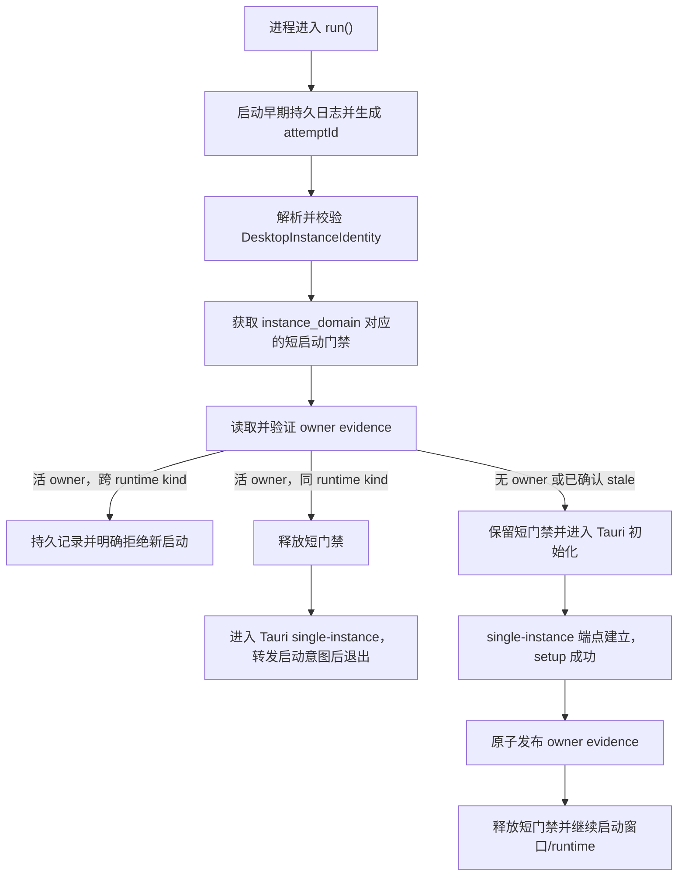

# 桌面实例身份统一治理 · 技术方案

## 状态

CONFIRMED

## 1. 方案概览

本方案把桌面实例治理拆成四个职责明确、互不竞争的层次：

1. **实例身份模型**回答“这次启动是谁、与谁共享状态、是否允许共存”。
2. **短启动门禁**串行化同一单例域的冷启动选主，封住多个进程同时初始化单例端点的竞态。
3. **Tauri single-instance**作为进程全生命周期内唯一的单例所有权与启动意图转发机制。
4. **owner evidence 与持久日志**解释仲裁结果并支持诊断，但不替代 OS/Tauri 的存活事实。

方案不新增第二套生命周期锁，不通过 executable 路径、安装目录、版本号或发行渠道派生 production 单例身份，也不把 dev runtime lease 提升为桌面单例事实源。

## 2. 实例身份模型

### 2.1 核心类型

在 Tauri 后端新增独立的实例治理模块，定义下列稳定领域类型：

```rust
enum RuntimeKind {
    Production,
    Dev,
    InstallerSmoke,
}

struct DesktopInstanceIdentity {
    runtime_kind: RuntimeKind,
    instance_domain: String,
    profile_id: String,
    tauri_identifier: String,
    build_identity: Option<BuildIdentity>,
    executable_path: PathBuf,
    install_root: Option<PathBuf>,
    worktree: Option<PathBuf>,
}
```

`instance_domain` 是单例仲裁 key，不是展示名称。首版只允许两个固定值：

| 运行态 | `instance_domain` | Tauri identifier | 共存结果 |
| --- | --- | --- | --- |
| production | `agent-friend-production` | `com.agentfriend.desktop` | 与 production/dev 互斥 |
| dev | `agent-friend-production` | `com.agentfriend.desktop` | 与 production/dev 互斥 |
| installer-smoke | `agent-friend-installer-smoke` | `com.agentfriend.desktop.installer-smoke` | 可与 production 共存，自身单实例 |

production 的 stable、trusted-beta、production local-test、版本号、构建 commit、安装目录和 executable 副本均只属于诊断属性，不参与 `instance_domain` 计算。

### 2.2 身份来源

身份从受治理的构建事实中确定：

- debug 构建固定解析为 `Dev`；标准 dev runner 额外提供 worktree、branch 和启动意图等可观测字段。
- release 构建根据嵌入的 install profile 解析为 `Production` 或 `InstallerSmoke`。
- release 构建缺少、损坏或含未知 profile 时沿用安装完整性规则 fail closed。
- 运行时 Tauri identifier 必须与解析结果预期值一致；不一致时在创建窗口和 runtime 前退出。

install profile 增加稳定的 `instanceDomain` 字段，由 Python profile 生产者、Rust 消费者和配置一致性测试共同治理。该字段只表达单例边界，不重复存储 `runtimeKind`；运行种类仍由构建模式和 `profileId` 推导。

## 3. 启动仲裁协议

### 3.1 启动顺序

桌面入口按以下固定顺序执行：



Tauri single-instance 插件继续作为 Builder 注册的第一个插件，保证第二实例不会先初始化其他插件、窗口、bridge 或 voice。

### 3.2 短启动门禁

现有 `StartupInstanceGate` 从 Windows production 常量门禁改为按 `instance_domain` 命名的跨平台门禁：

- Windows 使用当前 named mutex 路线，名称由固定产品前缀和 `instance_domain` 组成。
- macOS/Linux 使用同一协调目录下的 advisory file lock。
- 门禁对象通过 RAII 持有；setup 失败、panic 或提前返回时自动释放。
- 等待、获取、abandoned/stale 恢复和异常均写入早期持久日志。
- 门禁只覆盖选主和单例端点建立阶段，不贯穿应用生命周期。

Unix file lock 使用一个小型、Rust 1.77.2 兼容的跨平台锁库，避免自行维护 `flock`/`fcntl` 差异。Windows 仍保留 named mutex，以便准确识别 abandoned 状态并延续现有真实验证基础。

### 3.3 同身份重复启动

当 owner evidence 表明已有相同 `runtime_kind` 的活实例：

1. 新进程记录 `same-identity-forward-started` 后释放短门禁。
2. Tauri single-instance 把 argv 与 cwd 转发给主实例并结束新进程。
3. 主实例记录 `activation-received`，根据启动意图恢复、显示并聚焦目标窗口。
4. 主实例记录 `activation-handled` 或带失败原因的 `activation-failed`。

第二进程不得创建窗口、启动 bridge/voice、申请 runtime 端口或覆盖 owner evidence。

### 3.4 production/dev 跨身份冲突

production 与 dev 共享同一 `instance_domain`，但 `runtime_kind` 不同。发现活 owner 后，新启动方在进入 Tauri Builder 前拒绝：

- 不把跨身份请求伪装成成功唤醒。
- 不结束、takeover 或修改已有实例。
- dev runner 在终端显示已有 owner 的运行种类、PID、worktree/安装根和对应标准停止入口。
- GUI 安装版使用早期冲突报告器显示轻量原生消息框；报告器失败时仍必须写日志并向 stderr 输出。
- 拒绝结果使用稳定的内部 reason code，供 runner、日志和测试共同断言。

### 3.5 installer-smoke

installer-smoke 通过独立 install profile、Tauri identifier 和 `instance_domain` 进入另一套单例端点：

- production 与 installer-smoke 不争用启动门禁或 owner evidence。
- installer-smoke 内部同样执行冷启动串行化与 Tauri 意图转发。
- smoke 的日志和诊断继续使用隔离 namespace。

## 4. Owner evidence

### 4.1 存储位置与结构

新增与用户内容分离的 per-user 协调目录，由 `paths` 模块统一提供。目录不接受普通运行时环境变量重定向，防止 production 与 dev 因日志路径覆盖而失去共同视图。

每个 `instance_domain` 对应一个原子替换的 JSON 文件：

```json
{
  "schemaVersion": 1,
  "instanceDomain": "agent-friend-production",
  "runtimeKind": "dev",
  "pid": 1234,
  "processStartIdentity": "platform-specific-stable-value",
  "processSessionId": "1234-...",
  "profileId": "production",
  "tauriIdentifier": "com.agentfriend.desktop",
  "buildIdentity": {},
  "executablePath": "...",
  "installRoot": null,
  "worktree": "...",
  "publishedAt": "..."
}
```

路径在写入日志或诊断包时走现有 home redaction；owner 文件本身不得包含环境变量、命令行正文、凭证或用户内容。

### 4.2 事实边界

owner evidence 只用于归属和解释：

- 活性必须同时核对 PID 与平台进程启动标识，不能只看 PID 存在。
- 记录属于当前 schema、domain 和可识别产品进程时，才可用于同身份/跨身份判断。
- 进程不存在或 PID 已被复用时，在持有短启动门禁期间记录 stale recovery 并覆盖。
- 进程仍活但 executable/启动标识不匹配、记录损坏或归属不明时 fail closed。
- 正常退出可做 best-effort 清理；正确性不依赖退出清理成功。
- owner evidence 不对 Tauri single-instance endpoint 的存活作独立承诺，也不允许调用方仅凭删除文件绕过单例。

## 5. Dev runner 与进程树所有权

现有 dev runtime lease 保留，职责限定为：

- 防止多个 worktree 的标准 dev runner 同时管理开发进程树。
- 记录 branch、worktree、mode、端口和 runner 创建的子进程。
- 提供 `status`、`stop` 和显式 takeover。

桌面应用内的实例治理是最终防线。dev runner 在启动前读取实例治理状态用于早反馈，但不得因为预检未发现 owner 就跳过应用内仲裁。

`scripts/dev/run.* status` 增加只读实例摘要：

- 当前 desktop owner 的 runtime kind、PID、process session 和安全归属字段。
- dev lease 与 desktop owner 是否一致。
- 最近一次跨身份拒绝或 stale recovery 的 reason code 与时间。

当 runner lease 和 desktop owner 冲突时，状态输出明确标为 mixed ownership，不自动结束任何进程。

## 6. 早期日志与诊断契约

### 6.1 早期日志

`RuntimeObserver` 必须在身份解析和任何启动门禁之前初始化。每次进程启动生成独立 `attemptId`，所有实例治理事件至少包含：

- `attemptId`、`processSessionId`、PID 和时间。
- `instanceDomain`、`runtimeKind`、`profileId`、Tauri identifier。
- build identity、executable、安装根或 worktree的脱敏表示。
- `event`、稳定 `reasonCode`、仲裁阶段和结果。
- 发现 owner 时的安全 owner 摘要。

事件集合首版固定为：

- `startup-attempted`
- `identity-resolved` / `identity-rejected`
- `startup-gate-waiting` / `startup-gate-acquired` / `startup-gate-failed`
- `owner-published`
- `same-identity-forward-started`
- `activation-received` / `activation-handled` / `activation-failed`
- `cross-identity-rejected`
- `stale-owner-recovered`
- `owner-evidence-invalid`
- `startup-aborted`

现有 `tauri.log.runtime` 继续使用有界、轮转和崩溃安全写入；production/dev 即使共享日志目录，也能通过 `attemptId`、`processSessionId` 和 `runtimeKind` 分离时间线。

### 6.2 诊断包

诊断包新增兼容性 capability `desktop-instance-governance-v1`，并提升 schema revision。新增 `diagnostics/desktop-instance.json`，包含：

- 当前进程解析出的实例身份。
- 当前 domain 的 owner evidence 校验结果与安全摘要。
- dev lease 与 desktop owner 的一致性摘要（可获得时）。
- 最近有界数量的仲裁事件索引，不复制无关日志正文。

原始 `tauri.log.runtime` 仍由 bounded log collector 收集。项目内诊断解析 Skill 增加对应 handler，直接输出当前 owner、最近冲突、stale 恢复和证据缺口；旧 bundle 缺少该 capability 时保持可读。

这项结构变化必须在同一 changeset 更新：

- producer-owned machine contract。
- Rust manifest/collector 测试。
- `inspect_bundle.py` handler 与格式参考。
- Python consumer contract fixtures/tests。

## 7. 错误模型与用户反馈

实例治理使用稳定 reason code，展示文案与机器判断分离。至少包括：

| Reason code | 含义 | 行为 |
| --- | --- | --- |
| `identity_contract_invalid` | 构建身份、profile 或 Tauri identifier 不一致 | fail closed |
| `cross_identity_conflict` | production/dev 冲突 | 拒绝新启动方 |
| `owner_evidence_invalid` | owner 记录损坏或归属无法确认 | fail closed |
| `owner_process_mismatch` | PID 存活但启动标识或 executable 不匹配 | fail closed |
| `startup_gate_unavailable` | 无法建立或获取短门禁 | fail closed |
| `activation_forward_failed` | 同身份启动意图未成功交付 | 记录错误并退出新进程 |

错误反馈不得包含完整用户目录、命令行敏感参数或环境变量。原生消息框只呈现运行种类、可理解原因和标准处理方式，详细身份留在日志与诊断包中。

## 8. 模块改动

### 8.1 Tauri 后端

- 新增 `desktop_instance` 模块：身份解析、domain、owner evidence、仲裁状态机和 reason code。
- 重构 `startup_instance_gate`：按 domain、跨平台、仅覆盖启动事务。
- 调整 `lib::run`：前移 RuntimeObserver，执行 preflight 仲裁，并在 setup 发布 owner evidence。
- 扩展 single-instance callback：记录 activation、执行窗口恢复/聚焦并报告结果。
- 扩展 `paths`：提供固定 per-user 协调目录，不复用可重定向的日志路径。
- 扩展 diagnostics：生产实例治理快照与 capability。

### 8.2 安装与打包契约

- Python/Rust install profile 同步增加 `instanceDomain`。
- production 派生 profile必须保持 production domain 不变。
- installer-smoke profile 必须使用 smoke domain。
- package config 继续以 profile 的 bundle identifier 生成 Tauri identifier。
- 安装契约测试增加“允许变化字段”和“必须稳定字段”的明确断言。

### 8.3 Scripts

- dev runner 注入 worktree/branch/entry intent 等诊断字段，并增强 `status` 输出。
- 新增跨平台桌面实例矩阵 runner；主体逻辑放在 Python，`run.sh`/`run.ps1` 语义一致。
- Windows runner 执行真实 executable/installer 矩阵；其他平台执行可用的源码与进程协议检查，无法执行的安装场景明确报告 unsupported/not verified。
- 同步更新 `scripts/README.md`。

## 9. 验证设计

### 9.1 确定性单元与契约测试

- 身份解析表：debug、production、trusted-beta、local-test、installer-smoke、未知 profile。
- domain 稳定性：版本、build、路径变化不改变 production domain。
- profile/Tauri identifier/domain 一致性与 fail-closed 分支。
- owner evidence 原子写入、PID 复用、损坏记录、未知 schema、stale 恢复。
- 短启动门禁的互斥、abandoned/drop 释放和 domain 隔离。
- 日志事件必需字段、脱敏和 attempt/process session 关联。
- diagnostics producer/consumer capability 对齐与旧 bundle 兼容。
- dev lease 与 desktop owner 的一致、冲突和无状态组合。

### 9.2 进程级集成测试

使用小型测试 helper 启动真实子进程，验证：

- 多进程并发只有一个 primary。
- secondary 不创建 runtime 子进程。
- 同身份 argv/cwd 到达 primary。
- cross identity 在 Tauri/runtime 初始化前退出。
- primary 异常终止后下一进程可恢复。
- PID 存活但 start identity 不一致时不会误回收。

### 9.3 Windows 真实矩阵

完整矩阵至少覆盖：

1. 同一 production 重复和并发冷启动。
2. stable/trusted-beta/local-test/不同版本之间的 production 互斥。
3. 从非安装目录复制 production executable 后启动。
4. production → dev 与 dev → production 两种顺序。
5. production 与 installer-smoke 共存。
6. installer-smoke 自身重复和并发启动。
7. primary crash、stale owner 和 PID 复用模拟。
8. 每个场景的窗口、desktop process、bridge、voice、端口、owner evidence 和日志归属。
9. 测试结束后的进程、门禁、lease 和安装现场清理检查。

涉及真实 production 安装、覆盖升级或卸载时继续服从 Windows installer integrity 门禁，不用源码态或 installer-smoke 结果代替真实 production 结论。

### 9.4 回归门禁

- Rust/前端/脚本相关局部测试。
- `scripts/check/run.*` 全量检查。
- install contract 与 installer-smoke matrix。
- 黑屏恢复安全门、安装根、禁止降级、事务恢复和 runtime identity 既有测试。
- macOS/Linux 自动化结果与真实桌面验证缺口分别记录。

## 10. 实施顺序

1. 先增加身份模型、profile 字段和纯函数契约测试。
2. 前移早期日志并重构短启动门禁。
3. 接入 owner evidence 与启动仲裁状态机。
4. 完成 single-instance 转发、窗口唤醒和跨身份反馈。
5. 接入 dev status、诊断 capability 与消费 Skill。
6. 补齐进程级和 Windows 真实矩阵 runner。
7. 运行全量门禁与真实场景验收，再回填 requirement progress。

该顺序确保每一步都有可断言的中间契约，避免一次性同时改动启动、打包、诊断和测试而无法定位回归。

## 11. 验收条件映射

| 设计能力 | 覆盖 AC |
| --- | --- |
| 稳定 production domain + Tauri 转发 | AC-1、AC-2、AC-3、AC-6 |
| production/dev 共享 domain 与跨身份拒绝 | AC-4、AC-5、AC-6 |
| installer-smoke 独立 domain | AC-7、AC-8 |
| 短启动门禁 + owner evidence 校验 | AC-2、AC-9 |
| 早期双端日志 + diagnostics capability | AC-10、AC-11、AC-12 |
| 安装/黑屏/runtime 回归门禁 | AC-13 |
| Windows 真实矩阵 | AC-14 |
| 跨平台门禁与自动化 | AC-15 |

## 变更记录

| 日期 | 变更内容 | 影响范围 |
| --- | --- | --- |
| 2026-08-12 | 首次确认方案；采用共享状态决定单例域、Tauri single-instance 作为长期权威、短启动门禁封竞态，并补齐 owner evidence 与诊断能力。 | 新技术方案 |
