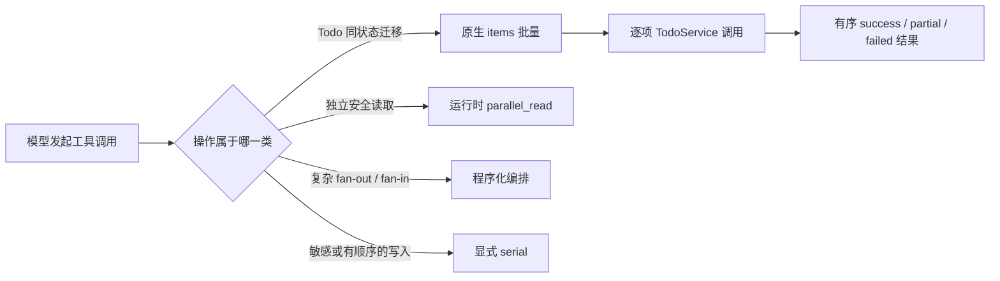

# 工具执行治理 - 技术方案

## 状态

CONFIRMED

## 需求文档

[requirement.md](./requirement.md)

## 现状分析

### Todo 多次调用

`TodoManageTool` 当前把 `create/list/get/update/complete/cancel/reopen` 和 Reminder 操作都收敛在一个 `operation` 字段下，但每次调用只能处理一个具体目标。模型面对“完成多个 Todo”时只能生成多次 `todo_manage` 调用。

工具运行时已经能把一条 assistant 消息中的工具调用分批执行，但 `todo_manage` 是串行写工具，因此这些调用必须逐个执行。更主要的成本不是 SQLite 写入，而是多条请求、完整 Todo 结果和后续模型上下文共同放大了上下文体积与压缩成本。

### Todo 事务与 revision

`TodoService.complete/cancel/reopen` 已统一经过 `TodoStore.set_todo_status`。每次状态迁移都有独立 SQLite 事务、revision 校验、Reminder 禁用和 occurrence 失效语义。

这些单项能力已经是稳定的领域边界。批量操作需要逐项成功、逐项 revision 冲突和部分成功，因此不适合再包成一个跨全部目标的数据库事务。

### 工具结果保留

`ToolRegistry.result_context_retention` 当前把未声明策略的工具默认视为 `pinned`。Conversation 在工具结果落盘时会把最终策略写入事件；如果当前 registry 没有 `recover_tool_result`，则无条件改为 `pinned`。

需求 075 已实现：

- 原始工具结果不被修改；
- 可恢复结果在高低水位之间清成稳定占位符；
- 当前用户轮和最近 3 个历史工具批次受到保护；
- 模型可使用 `recover_tool_result` 按引用恢复有限片段；
- pinned 和无法恢复的结果始终受到保护。

本需求只改变新结果的默认分类，不修改上述恢复机制或历史保护窗口。

### 执行分类遗漏

大多数外部读取工具已经声明 `parallel_read`，文件写入、授权和 Todo 写入保持 `serial`。`recall_past_chats` 与 `recover_tool_result` 是只读操作，但目前未声明执行类型，因运行时保守默认值而被串行执行。

## 方案设计

### 总体数据流



### Todo 原生批量边界

只有以下三个“对多个目标执行同一种无差异状态迁移”的 operation 改为 `items` 数组：

- `complete`
- `cancel`
- `reopen`

每个 item 只包含：

```json
{
  "todo_id": "稳定 Todo ID",
  "revision": 3
}
```

`items` 必须包含 1 至 50 项。单个状态迁移也使用长度为 1 的数组，不保留这三个 operation 的旧 flat 输入形态。

以下操作继续保持单项或查询形态：

| operation | 形态 | 原因 |
| --- | --- | --- |
| `create` | 单项 | 每个 Todo 内容与 Reminder 组合不同；当前没有稳定的批量创建证据 |
| `list` | 集合查询 | 已经是按条件读取集合的业务接口 |
| `get` | 单项 | 读取单个已知资源；多个独立读取不等于业务批量 |
| `update` | 单项 | 每个 Todo 的 patch 通常不同，不是统一状态迁移 |
| `add_reminder` | 单项 | 每个目标的 schedule 可能不同 |
| `update_reminder` | 单项 | 每个 Reminder 的 schedule、enabled 和 revision 可能不同 |
| `remove_reminder` | 单项 | 当前没有多项移除的真实高频场景，不为形式统一提前扩张 |

如果后续 trace 证明批量创建、批量读取或批量移除 Reminder 是稳定用户意图，再按同一治理原则独立扩展；本需求不预埋异构 command 数组。

### Todo 批量执行语义

`TodoManageTool` 在工具边界内完成批量编排，不新增 `TodoStore` 批量事务：

1. 先校验顶层 operation、`items` 数量、item 对象形态和重复 `todo_id`。结构无效时整次调用返回 `invalid_arguments`，且不执行任何写入。
2. 结构有效后按输入顺序调用现有 `TodoService.complete/cancel/reopen`。
3. 每个 service 调用继续拥有独立事务和 revision 校验。
4. `not_found`、`revision_conflict` 或 `invalid_state` 等领域错误只落到对应 item，后续 item 继续执行。
5. 结果顺序与输入顺序一致，调用方不依赖数据库返回顺序。

同一个 `todo_id` 在一个批次中不得重复。重复目标会造成 revision 和执行顺序歧义，因此属于批次结构错误，而不是可继续执行的逐项领域错误。

### Todo 批量结果

批量状态迁移返回紧凑结构：

```json
{
  "status": "partial",
  "operation": "complete",
  "succeeded": 1,
  "failed": 1,
  "items": [
    {
      "index": 0,
      "status": "success",
      "todo_id": "todo-1",
      "todo_status": "completed",
      "revision": 4
    },
    {
      "index": 1,
      "status": "error",
      "todo_id": "todo-2",
      "error_kind": "revision_conflict",
      "message": "资源已被其他操作修改，请读取最新状态后重试",
      "details": {
        "expected_revision": 2,
        "actual_revision": 3
      }
    }
  ]
}
```

顶层状态定义：

- 所有 item 成功：`success`，`ToolResult.is_error=False`；
- 部分成功：`partial`，`ToolResult.is_error=True`；
- 所有 item 失败：`failed`，`ToolResult.is_error=True`。

成功项不再返回 title、description、时间戳和完整 Reminder 列表，只返回模型判断后续动作所需的 ID、最新状态和 revision。错误项把 `TodoError.details` 放入模型可见结果，确保 revision 冲突可以被正确处理。

`ToolResult.meta` 记录 `operation`、`item_count`、`success_count` 和 `error_count`，用于日志和诊断，不重复注入模型正文。

### 默认 recoverable

`ToolRegistry.result_context_retention` 调整为：

1. 工具没有声明 `result_context_retention` 时返回 `recoverable`；
2. 显式声明 `recoverable` 或 `pinned` 时尊重声明；
3. 显式值无效时继续 fail-safe 为 `pinned`；
4. 单次 `ToolResult.meta["context_retention"]` 仍可覆盖类级默认；
5. Conversation 没有注册恢复工具时，最终落盘策略仍强制为 `pinned`。

内置工具不再重复声明默认的 `recoverable`。以下结果明确保持 `pinned`：

| 工具 | pinned 原因 |
| --- | --- |
| `request_filesystem_access` | 后续文件调用依赖本轮授权结果和 scope 控制证据 |
| `skill_read` | Skill 指令需要在后续执行过程中持续可见 |
| `propose_persona` | persona editor 明确把最近一次候选结果作为当前工作草稿 |

`todo_manage`、`request_social_auth` 及普通读取/写入结果默认 recoverable。状态是否发生变化不再单独决定结果是否 pinned；原始事件仍然完整保存。

### 历史事件兼容

`tool_projection.LEGACY_RECOVERABLE_TOOL_NAMES` 和缺少 retention 元数据时的保守判断保持不变。原因是旧事件产生时没有当前 registry 的明确分类，不能用新默认值重新解释历史未知工具结果。

新工具结果会在事件写入时获得明确 `context_retention`，因此新默认值不会依赖 legacy 名单。

### 内置工具分类盘点

| 工具组 | 执行方式 | 结果保留 | 多项策略 |
| --- | --- | --- | --- |
| calculate / datetime | `parallel_read` | recoverable | 独立调用并行 |
| filesystem search/list/stat/read | `parallel_read` | recoverable | 维持现状，不强制原生数组 |
| filesystem write/apply/create | `serial` | recoverable | 维持逐项授权与写入边界 |
| filesystem copy/move/delete | `serial` | recoverable | 保留现有受授权原生 batch |
| request filesystem access | `serial` | pinned | 保留现有多 scope 授权请求 |
| skill read | `serial` | pinned | 单项控制上下文 |
| web/search/social/place/weather | `parallel_read` | recoverable | 独立读取并行，不改 schema |
| request social auth | `serial` | recoverable | 单个授权请求 |
| recall past chats | `parallel_read` | recoverable | 补齐遗漏的只读分类 |
| recover tool result | `parallel_read` | recoverable | 补齐遗漏的只读分类 |
| todo manage | `serial` | recoverable | 仅状态迁移原生 batch |
| propose persona | `serial` | pinned | 单个候选控制结果 |

`recall_past_chats` 和 `recover_tool_result` 都只读取稳定存储，不修改会话、授权或用户数据；它们可以与同一 assistant 消息中的其他安全读取并行。工具结果仍按模型调用顺序落回上下文。

## 涉及文件

| 文件 | 改动 |
| --- | --- |
| `agent/src/agent/tools/builtin/todo_manage/tool.py` | 调整三个状态迁移的 schema、批量执行和紧凑结果 |
| `agent/src/agent/tools/registry.py` | 将缺省 retention 改为 recoverable |
| `agent/src/agent/tools/builtin/conversation_history/tool.py` | 声明 `parallel_read`，移除冗余 recoverable 声明 |
| `agent/src/agent/tools/builtin/tool_result_recovery/tool.py` | 声明 `parallel_read`，移除冗余 recoverable 声明 |
| `agent/src/agent/personas/editor.py` | 显式声明 serial + pinned |
| 其他显式 recoverable 内置工具 | 移除与新默认值重复的类属性，不改变行为 |
| `agent/tests/test_todo_manage_tool.py` | 覆盖 schema、单项数组、10 项成功、部分失败、结构预检和紧凑结果 |
| `agent/tests/test_tool_factory.py` | 固定内置工具执行与 retention 分类 |
| `agent/tests/test_tool_calling_integration.py` | 固定默认 recoverable 与无恢复入口自动 pin |
| `agent/tests/test_tool_result_context_edit.py` | 复用既有 075 覆盖；仅在契约需要时调整断言 |

## 测试与验证

### Todo 工具测试

- `create/get/update` 继续接受现有单项输入。
- `complete/cancel/reopen` 拒绝旧 flat 输入，并接受 1 至 50 个 items。
- 10 个 Todo 可以在一次 `invoke` 中完成，结果有序且每项 revision 正确。
- 中间项 revision 冲突时，前后有效项仍成功，顶层结果为 partial。
- 重复 ID 或 malformed item 在任何写入前被拒绝。
- 状态迁移成功项不包含 description、完整 Reminder 或无关时间字段。

### retention 测试

- 未声明策略的工具在 registry 中默认为 recoverable。
- 三个明确 pinned 工具保持 pinned。
- 显式无效策略继续 fail-safe pinned。
- 未注册 `recover_tool_result` 时，工具结果事件仍被写成 pinned。
- 已注册恢复工具时，默认 recoverable 正确落盘。
- 需求 075 已有的清理、保护窗口、原始结果保留和恢复测试继续通过。

### 执行分类测试

- `recall_past_chats` 与 `recover_tool_result` 被识别为 `parallel_read`。
- Todo 和所有写入/授权工具继续形成 serial barrier。
- 不为文件读写、Web 或 Social 增加新的数组 schema。

### 完整门禁

- 运行项目统一检查脚本。
- 不调用真实 LLM 或外部收费 API。
- 本需求不涉及前端视觉改动，不需要桌面视觉验收。

## 风险与控制

- 模型可能继续生成多个单项 complete 调用：通过工具 description 明确要求同一状态迁移合并到一次 items 调用，并用 schema 移除旧 flat 形态。
- 部分成功后盲目重试可能重复作用于成功项：成功结果返回最新 revision；重复目标在单批次内禁止，模型应只重试失败项。
- 默认 recoverable 可能误伤控制型工具：通过显式 pinned 白名单、无恢复入口自动 pin 和无效值 fail-safe 控制。
- 并行历史读取可能增加瞬时 I/O：继续受现有 `ToolBatchExecutor.max_workers` 和单工具 timeout 限制，不新增线程池。
- 删除冗余 recoverable 声明可能降低局部可见性：分类矩阵由 factory/registry 测试固定，显式属性只表达例外而非重复默认值。

## 变更记录

| 日期 | 变更内容 | 是否需要重新实现 |
| --- | --- | --- |
| 2026-08-13 | 首次确认：Todo 只批量化 complete/cancel/reopen；update、create、get 与 Reminder 操作保持单项；默认 recoverable，仅控制型结果显式 pinned。 | 是 |
