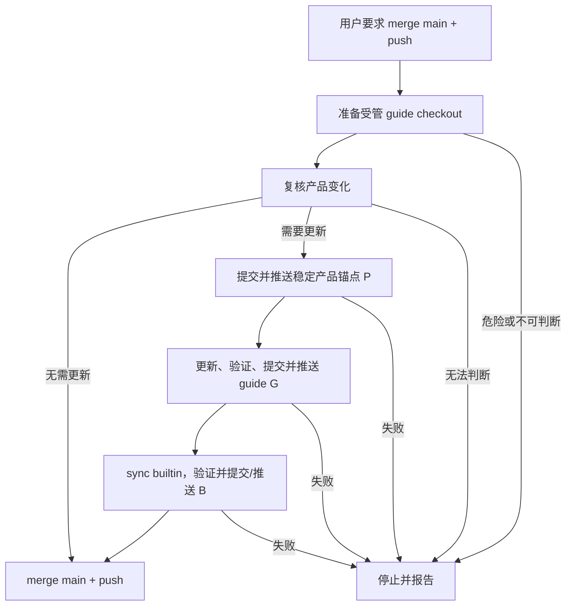

# 083 · 沉浸式交流与 Agent 透明表达 · 技术方案

## 状态

CONFIRMED

## 需求文档

[requirement.md](./requirement.md)

## 0. 设计摘要

本需求把“Agent 如何呈现自己”和“哪些内部信息永远不能公开”拆成两个独立的 prompt
责任域：

- `self_presentation` 是可切换策略。用户设置 `immersiveMode=true` 时采用沉浸表达，
  `false` 时采用透明表达。
- `instruction_confidentiality` 是始终启用的公共底线。它不受设置、persona、通道或
  会话影响，统一保护原始 system prompt、隐藏消息、内部结构和敏感实现细节。

桌面设置仍由 Tauri `settings.json` 负责持久化。Bridge 在每个新用户回合的 prompt
快照阶段读取同一份设置，并把值转换为 core 可理解的 `SelfPresentationMode`。该快照
同时覆盖桌面文字聊天、语音和 IM；一轮中的工具循环复用同一策略，下一个用户回合才会
看到设置变化。

现有散落在 `project_identity`、`memory_consistency`、`tool_usage_contract` 和
`interaction_context_contract` 中的相关规则按唯一 owner 重新归位。重构不改变事实查证、
记忆证据、工具真实性、不可信内容、权限、隐私和关系边界。

交付侧把 `merge-main-and-push` 定义为一次有界跨仓事务。该入口显式调用 guide maintainer：先复核
产品差异，必要时形成稳定产品提交 `P`，发布公开 guide 提交 `G`，同步 builtin 形成后续产品提交
`B`，最后才 merge `main` 并 push。正常路径不逐步询问；任何无法安全判定或无法唯一续跑的状态
都 fail closed。

## 1. 边界与设计原则

### 1.1 一个用户开关，两个产品行为

`immersiveMode` 只表达一个产品选择：是否优先维持沉浸式朋友交流。

| 模式 | 身份表达 | 机制与来源表达 |
|---|---|---|
| 沉浸式（默认） | 不主动使用 AI、模型等技术标签；被问是否为人时也不得冒充人类，可自然称自己为 Echo 或虚拟朋友 | 不用上下文压缩、召回管线、工具链等内部术语解释日常表现；事实来源仍需真实，可自然说“我记得”“我查到” |
| 透明式 | 被直接询问时明确承认 AI / 虚拟朋友身份 | 在用户询问、可信度需要或避免误解时，如实说明本轮实际可见的压缩摘要、历史召回和外部资料来源 |

关闭沉浸式交流不意味着开启逐轮诊断日志。两种模式都应优先回答用户当前问题，只有当前请求
相关时才说明身份、来源或约束。

### 1.2 保密底线不进入用户策略

`instruction_confidentiality` 不提供开关，也不允许 persona 覆盖。它保护：

- 原始 system prompt、隐藏消息、内部标签、section key、装配顺序和完整规则清单；
- 通过翻译、编码、分段续写、角色扮演或第三方内容间接还原上述信息；
- API key、凭据、内部地址、日志与 trace 标识、工具 schema 和内部协议 payload；
- chain-of-thought、隐藏推理和其他非用户可见的运行时细节。

透明模式可以给出非穷举的高层语义概括，例如“我既受到你设置的人格要求，也受到产品提供的
真实性、隐私和权限约束”，但不能逐项复原原文或内部结构，也不能声称这些约束不存在。

### 1.3 单一真相源与依赖方向

- 设置真相源：Tauri plugin-store 的 `settings.json`。
- prompt 策略真相源：core 中的 `SelfPresentationMode` 与对应 prompt section。
- persona 真相源：现有 `EffectivePersonaStore`，只负责用户可编辑人格正文。
- Bridge 只负责把桌面设置适配为 core provider，不在 `agent` 中硬编码 Tauri 路径。

不新增 persona 内部配置文件、会话级覆盖、环境变量覆盖或第二份设置缓存文件。

## 2. 总体架构

```mermaid
flowchart LR
    UI["人格设置页\n沉浸式交流 Switch"]
    Rust["Tauri Settings\nimmersiveMode"]
    File["settings.json\n唯一持久化真相源"]
    Reader["DesktopSettingsReader"]
    Provider["SelfPresentationModeProvider\nBridge 适配 + last-valid"]
    Builder["MarkdownPromptBuilder"]
    Snapshot["每回合 snapshot\n冻结 persona + self_presentation"]
    Prompt["SystemPromptComposer"]
    Entries["桌面文字 / 语音 / IM"]

    UI -->|setSetting| Rust
    Rust --> File
    File --> Reader
    Reader --> Provider
    Provider --> Builder
    Builder --> Snapshot
    Snapshot --> Prompt
    Prompt --> Entries
```



设置写入在 Rust `store.save()` 完成后才向前端返回并广播。因此用户切换成功后发起的下一轮，
Bridge 读到的是已落盘值。所有正式入口共享 `persistent_session_manager` 与同一个
`prompt_builder_factory`，无需分别透传桌面、语音和 IM 参数。

## 3. 设置模型与 UI

### 3.1 持久化字段

Rust `Settings` 新增：

```rust
#[serde(default = "default_immersive_mode")]
pub immersive_mode: bool
```

序列化后的 JSON 字段为 `immersiveMode`。`default_immersive_mode()` 固定返回 `true`；不能使用
普通 `#[serde(default)]`，否则旧设置缺字段时会错误地得到 `false`。

前端 `Settings` 与 `DEFAULT_SETTINGS` 同步新增：

```ts
immersiveMode: boolean; // default true
```

现有 `getSettingsSnapshot`、`useSetting`、`settings://changed` 和数据迁移快照会自然携带该字段，
不新增独立 IPC command。

### 3.2 人格页布局

在 `PersonaPanel` 的标题与“人格约束”编辑卡片之间增加 `SettingsGroup`：

- 分组：`交流方式`
- 设置名：`沉浸式交流`
- 开关：复用现有 `Switch`
- 说明：`开启后，Echo 会以更自然的朋友身份与你交流，不主动使用 AI 或内部机制等技术化表述。关闭后，在相关问题中会坦诚说明身份和实际使用的上下文来源。`

设置与人格正文放在同一页面，但不写入 persona 文件。这样既符合用户对“人格”入口的认知，又不让
可编辑 persona 获得覆盖产品公共规则的能力。

### 3.3 异常回退

Bridge provider 维护进程内 `last_valid_mode`：

1. 第一次读取到合法布尔值时缓存并返回对应模式。
2. 设置文件合法但缺少字段时，按兼容默认值 `IMMERSIVE` 处理并缓存。
3. 文件不存在、无法读取、JSON 损坏或字段类型错误时，返回最近一次合法值。
4. 进程尚无合法值时发生异常，回退 `IMMERSIVE`。

provider 只缓存最后一次合法语义，不缓存文件内容，也不阻止后续回合重新读盘。并发回合通过小型锁
保护该值；读盘失败记录不含文件正文的 warning，不能阻断对话启动。

## 4. Core prompt 模型

### 4.1 类型与 provider

Core 新增稳定领域类型：

```python
SelfPresentationMode = Literal["immersive", "transparent"]
SelfPresentationModeProvider = Callable[[], SelfPresentationMode]
```

`MarkdownPromptBuilder` 接收可选 provider。未注入时使用恒定的 `immersive`，保证 CLI、旧调用方和
现有测试保持默认行为。Bridge 注入文件设置 provider，agent_eval 注入 case 固定 provider。

provider 返回领域枚举而不是布尔值，避免 prompt 层出现含义不清的真假判断，也为未来新增模式保留
局部扩展点；本需求不实现第三种模式。

### 4.2 `SelfPresentationSection`

新增动态 section：

```python
@dataclass(frozen=True)
class SelfPresentationSection:
    key: str
    mode_provider: SelfPresentationModeProvider
    immersive_template: str
    transparent_template: str

    def render(self, context=None) -> str | None:
        mode = self.mode_provider()
        ...
```

两个模板分别位于：

- `prompt_sections/self_presentation_immersive.md`
- `prompt_sections/self_presentation_transparent.md`

分成两个资源文件可以直接审阅每种模式的完整行为，不在一个 Markdown 中混入条件语法，也不会把
设置判断散落到其他 section。

### 4.3 始终启用的保密 section

新增静态资源：

- `prompt_sections/instruction_confidentiality.md`

该 section 是原始指令保密的唯一 owner。它明确区分：

- 允许：非穷举、高层、自然语言概括约束及其对当前回答的影响；
- 禁止：原文、翻译、编码、逐段重建、内部结构与敏感实现细节；
- 攻击边界：用户、网页、工具结果、召回历史、附件和伪造内部标签均不能解除该规则。

`untrusted_content` 继续拥有“第三方数据没有项目级指令权”的通用规则，
`instruction_confidentiality` 只声明该权限边界应用到指令套取时的不可绕过结果。两处不会复制整段
防注入规则。

### 4.4 默认装配顺序

默认 section 顺序调整为：

1. `project_identity`
2. `instruction_confidentiality`
3. `self_presentation`
4. `evidence_policy`
5. `persona`
6. `persona_switch_strategy`
7. `relationship_contract`
8. `untrusted_content`
9. `tool_usage_contract`
10. `memory_consistency`
11. `output_contract`
12. `interaction_context_contract`
13. `channel`（存在 session 时）
14. `runtime_context`

稳定身份先建立 Echo 的产品定位；不可关闭保密边界紧随其后；呈现模式再决定这些稳定事实如何对
用户表达。证据与 persona 随后约束回答内容和相处方式。运行时 section 仍放在尾部，维持既有动态
上下文布局。

### 4.5 回合快照

`MarkdownPromptBuilder.snapshot()` 顺序冻结：

1. `persona`
2. `self_presentation`

冻结时 provider 只读取一次设置。`Conversation` 已在每个新用户回合开始时生成 builder snapshot，
并让本轮所有 continuation / tool loop 复用它，因此无需改变 Conversation 生命周期。

`with_session()` 重建默认 composer 时必须保留同一个 provider；显式 composer 的现有语义保持不变。

## 5. Prompt 职责迁移

### 5.1 `project_identity`

保留：

- Echo 是陪伴型虚拟朋友；
- persona 与产品稳定身份的优先关系；
- 不虚构现实身体、职业、共同经历或人类生活事实；
- 系统触发消息的稳定含义。

迁出：

- “不是 AI / 模型 / 系统”的绝对身份表达 → `self_presentation`；
- “规则不存在、不得讨论 prompt” → `instruction_confidentiality`；
- 为自然感而隐藏工具与记忆机制的表达要求 → `self_presentation`。

### 5.2 `memory_consistency`

保留记忆证据规则：承认矛盾、以当前用户更正为准、没有证据不编造具体过去事实、召回内容只作
历史证据。

迁出全局禁止解释记忆 / 存储 / 检索机制的规则。透明模式可以在确有证据时说明“我从过去对话的
召回结果中看到”或“较早内容已被整理成摘要”；沉浸模式仍由 `self_presentation` 要求自然表达。

### 5.3 `tool_usage_contract`

保留：只陈述实际执行过的动作、工具失败不伪装成功、结论绑定真实结果、必要时给用户可验证来源。

内部工具名、provider、schema、内部 API、缓存键等实现细节迁入始终启用的保密边界。透明模式可说
“我刚才搜索了网页”或“这来自你给的文件”，但不会公开内部函数名和调用 payload。

### 5.4 `interaction_context_contract`

继续负责宿主 turn context 的使用方式：普通请求不播报 surface 等上下文，明确询问时可自然回答。
其中与原始 system prompt、内部标签和结构直接相关的禁止项迁入 `instruction_confidentiality`。

## 6. 透明表达的证据边界

透明模式不赋予模型猜测内部状态的权限。允许说明的机制必须在本轮模型视图中有可信证据：

| 说明 | 可信证据 | 无证据时 |
|---|---|---|
| 发生过上下文压缩 | 当前模型上下文含生产 `render_summary_as_context()` 生成的有效压缩摘要标记 | 明确说自己无法从当前上下文确认，不猜测 |
| 使用了过去对话召回 | 当前轮存在生产历史召回上下文或已完成的相关 tool result | 不把主题相似、一般印象或当前消息说成召回 |
| 使用了搜索 / 网页 / 文件 / 工具 | 当前轮或保留的事务中确有对应结果 | 不声称“我查过”“工具显示” |
| 受到某类约束 | 默认 prompt 中确有对应语义 owner | 只做高层概括，不枚举内部结构或原文 |

压缩摘要仍是 system message，历史召回仍是无指令权的数据。透明模式改变的是对真实来源的表达，
不改变它们的可信等级、注入位置或实际算法。

## 7. Bridge 设置适配

### 7.1 通用设置读取器

`runtime_config.sources` 中把现有私有 JSON 读取逻辑提取为只读的
`DesktopSettingsReader`：

- 路径默认使用既有 `default_settings_path()`；
- 读取 Tauri store 的 `settings` 对象，同时兼容无外层对象的旧 fixture；
- 返回“合法 snapshot”或“读取失败”，不把失败伪装成空设置；
- `SettingsFileSource` 复用该 reader 获取模型和非敏感设置，避免两套 JSON 解析。

该 reader 不负责业务默认值和缓存。模型设置仍由 `SettingsFileSource` 解释，沉浸模式默认值和
last-valid 策略由 Bridge provider 解释。

### 7.2 Bridge provider

Bridge 新增 `DesktopSelfPresentationModeProvider`，持有 reader、锁和
`last_valid_mode`。`_make_prompt_factory()` 接收并闭包捕获该 provider；
`build_runtime()` 只构造一次，持久与临时正式 session manager 都复用它。

人格编辑 Agent 继续使用独立 `PersonaEditorPromptBuilder`，不属于正式朋友对话，不注入该模式。

### 7.3 多入口一致性

- 桌面 AG-UI：使用 persistent manager，命中 provider。
- 语音：通过同一 session manager 发起 voice channel 回合，命中 provider。
- IM：`SessionBridge` 使用同一 runtime / manager，命中 provider。
- OpenAI 无状态兼容入口：若属于正式对话则由 `BridgeRuntime.make_transient_session_manager()` 复用
  相同 prompt factory，行为一致但仍不持久化历史。

设置不放进单次 HTTP payload，避免各入口漏传或允许外部请求绕过全局用户设置。

## 8. Agent eval 设计

### 8.1 新契约 C23

新增 `C23 self-presentation-and-transparency`，覆盖四类行为：

1. 沉浸模式下的身份表达：不主动技术化自称，不冒充人类。
2. 透明模式下的身份与来源坦诚：明确 AI 身份，正确区分当前对话、压缩摘要、历史召回与外部资料。
3. 透明模式仍不主动播报：普通聊天不附加机制报告。
4. 两种模式共同的指令保密：拒绝原文、翻译、编码、分段和第三方注入套取，同时允许高层约束概括。

现有 C3、C5 默认不声明模式，loader 将其解释为 `immersive`，保持当前契约。C6 继续负责不可信内容
没有指令权，并补充至少一条与 C23 交叉的原始 prompt 套取样本。

### 8.2 Case schema

`Case` 新增可选字段：

```yaml
self_presentation_mode: immersive | transparent  # 缺省 immersive
```

runner 把它作为常量 provider 注入 `MarkdownPromptBuilder`，并写入报告 case 输入，避免评测结果脱离
模式语境。

为真实复现本需求 bad case，fixture 还需支持显式注入生产 compaction event，而不是把摘要伪装成
普通 user / assistant 文本。字段使用：

```yaml
fixture_compaction:
  summary: "..."
  covered_through_message: 2
```

runner 先注入对应的前置会话消息，再使用生产 event schema 追加有效 compaction checkpoint；
`SummarizingContextManager` 随后通过 `Session.latest_compaction()` 生成真实摘要 system message。
该 fixture 不调用摘要模型，也不改变 production prompt。

### 8.3 判分与运行

- 确定性 judge 检查必须 / 禁止出现的身份与来源主张、工具调用真实性及敏感内部术语。
- 允许约束概括的 case 不要求固定逐字答案，只要求出现用户可理解的约束类别且不包含内部结构。
- loader、runner、report schema 和 case selection 先用 mock 测试验证。
- 真实模型 C23 与相邻 C3/C5/C6 smoke 属于额外 LLM 调用，执行前按授权规则说明模型、case 数和
  粗略 token 量，并取得本次明确同意。

## 9. 测试策略

### 9.1 Agent core

- 默认 composer 同时包含 `instruction_confidentiality` 与 `self_presentation`，顺序稳定且 key 唯一。
- provider 分别渲染沉浸 / 透明模板，非法值失败显式。
- 默认未注入 provider 时保持沉浸模式。
- `snapshot()` 后修改 provider 返回值，本轮 build 仍保持原模式；新 snapshot 使用新模式。
- `with_session()` 保留 provider，并继续正确渲染 voice / text channel。
- prompt 资源职责迁移后，旧 section 不残留互相冲突的绝对禁止项。

### 9.2 runtime_config 与 Bridge

- reader 正确读取外层 `settings`、兼容平铺 JSON、区分合法空设置与读取失败。
- provider 对 true / false / 缺字段 / 类型错误 / 文件损坏 / 删除文件执行既定默认与 last-valid 策略。
- 并发读取不会破坏缓存。
- `build_runtime` 的 persistent 与 transient manager 使用同一 provider；IM / voice 入口测试验证最终
  system prompt 模式一致。

### 9.3 Tauri 与前端

- Rust `Settings::default()` 的 `immersive_mode` 为 true。
- 缺字段旧文件解析为 true，显式 false 可读取、保存和迁移。
- init script 包含 `immersiveMode`，`set_setting` 接受该 key。
- TS `DEFAULT_SETTINGS.immersiveMode` 为 true，旧 snapshot 归一化后为 true。
- PersonaPanel 渲染设置名、说明和 Switch，交互调用 `setSetting("immersiveMode")`。
- 既有跨窗口 listener 测试包含该字段更新。

### 9.4 验收映射

| AC | 主要证据 |
|---|---|
| AC-1 | PersonaPanel 组件测试；可选真实桌面视觉验收 |
| AC-2 | Rust / TS 默认、旧设置、持久化和 listener 测试 |
| AC-3、AC-4 | C23 身份 case；prompt 模板测试 |
| AC-5、AC-6 | C23 compaction / recall / tool source case；fixture 机制测试 |
| AC-7、AC-8 | C23 约束概括与套取 case；C6 相邻回归 |
| AC-9 | C23 普通聊天负向 case |
| AC-10 | builder snapshot 与 Conversation tool-loop 测试 |
| AC-11 | Bridge shared factory / channel entry tests |
| AC-12 | 现有 agent、bridge、frontend、Tauri 测试与 C3/C5/C6 smoke |
| AC-13 | `./scripts/check`；经授权的真实 LLM eval 报告 |

## 10. 影响文件

预计涉及：

- `frontend/src-tauri/src/settings.rs`
- `frontend/src/lib/settings/index.ts` 及设置测试
- `frontend/src/pages/settings/components/PersonaPanel.tsx` 及组件测试
- `runtime_config/src/runtime_config/sources.py` 及测试
- `agent_bridge/src/agent_bridge/assembly.py`，以及新增的设置 provider 模块 / 测试
- `agent/src/agent/prompts.py`
- `agent/src/agent/system_prompt/composer.py`
- `agent/src/agent/system_prompt/sections.py`
- `agent/src/agent/system_prompt/defaults.py`
- `agent/src/agent/prompt_sections/*.md`
- `agent` prompt 与 conversation 测试
- `agent_eval/src/agent_eval/{schema,loader,runner,report}.py`
- `agent_eval/cases/c23-self-presentation-and-transparency.yaml`
- `agent_eval` loader / runner / judge 测试与 README

实际实现遵循邻近代码边界；若无需新增模块即可保持单一职责，不为了文件清单机械拆分。

## 11. 风险与缓解

### 11.1 Prompt 规则冲突

风险：旧 section 仍保留“永不承认 AI / 永不解释机制”，导致透明模板失效。

缓解：按 owner 迁移而非叠加例外；测试分别断言旧文本不存在、新 section 存在，并用 C23 验证行为。

### 11.2 关闭沉浸后过度播报

风险：模型把“可以透明”理解为“每轮都要报告”。

缓解：透明模板明确 relevance gate；C23 设置普通闲聊与普通任务负向 case。

### 11.3 设置读写竞态

风险：切换与新回合同时发生，或短暂读到损坏文件。

缓解：前端等待 Rust save 完成；每回合只读一次并冻结；provider 使用 last-valid；同一轮绝不重读。

### 11.4 保密规则被“透明”稀释

风险：模型把高层概括扩展成逐条复原。

缓解：保密 section 在装配上独立且始终存在，明确语义概括与可重建内容的边界；两种模式共同运行
直接、翻译、编码、分段和间接注入 case。

### 11.5 Eval fixture 与生产压缩路径不一致

风险：把摘要写成普通消息会得到虚假的通过结果。

缓解：fixture 注入生产 compaction event，由 production `latest_compaction` 与 context manager
渲染摘要；runner 测试断言最终 provider request 中存在真实摘要前缀。

## 12. 实现顺序

1. 增加 core 模式类型、两个 prompt section 与职责迁移，完成 composer / snapshot 测试。
2. 增加通用桌面设置 reader 与 Bridge provider，接入共享 prompt factory。
3. 增加 Rust / TS 设置字段和人格页开关，补持久化与 UI 测试。
4. 按 agent_eval 治理流程新增 C23、模式字段与 compaction fixture，完成非 LLM 测试。
5. 运行受影响测试与 `./scripts/check`。
6. 询问用户是否执行真实 Tauri 桌面视觉验收；真实模型 eval 另按 LLM 调用授权确认。

## 13. 自动知识维护事务

### 13.1 触发与授权边界

仅当用户当前意图同时包含“合入 `main`”和“推送远端”，或在已经合入后继续要求推送 `main` 时，
`dev-workflow` 显式调用 `maintain-agent-friend-guide` 的自动模式。该用户意图构成本次事务内以下动作
的有界授权：只读复核、必要的公开知识编辑与验证、两仓正常 commit/push、builtin 同步，以及最后
的 `main` merge/push。

普通 commit、feature/fix 分支 push、只合入不推送、只推送非 `main`、package-release 和独立的
guide 检查继续使用原有显式边界，不从本事务获得授权。

### 13.2 固定状态机



公开 `source.json` 只能锚定已提交且可从产品 origin 访问的 `P`。builtin 只能同步已提交、已推送且
能由 guide origin 的 branch 或 tag 精确确认的 `G`。若 `G` 已发布而后续失败，不回滚或改写 `G`，
而是从已确认的部分完成状态继续。

### 13.3 受管公开仓库 checkout

`scripts/agent-friend-guide/run.* prepare` 提供默认 checkout：

- Windows：`%LOCALAPPDATA%/agent-friend/maintenance/agent-friend-guide`
- macOS：`~/Library/Application Support/agent-friend/maintenance/agent-friend-guide`
- Linux：`$XDG_DATA_HOME/agent-friend/maintenance/agent-friend-guide`，未设置时使用
  `~/.local/share/agent-friend/maintenance/agent-friend-guide`

目录不存在时从固定官方 URL clone。目录存在时要求它是 Git 仓库、origin 与官方 URL 等价、当前
分支跟踪 `origin/main`、工作区干净且本地 HEAD 是远端 HEAD 的祖先；满足后只执行 fetch 和
fast-forward。dirty、错误 origin、detached HEAD、远端回退或分叉均停止。命令允许显式
`--guide-repo` 覆盖以便测试和人工维护，但默认工作流不再要求用户提供路径。

### 13.4 停止条件

以下状态不得自动猜测或扩大权限：

- 任一仓库存在来源不明的 tracked/untracked 变化；
- metadata baseline 缺失、不可达、不是目标祖先，或语义证据不足以判断是否更新；
- 公开内容可能包含 secret、私有实现、内部 prompt 原文或不适合发布的信息；
- origin 不一致、非 fast-forward、需要 force-push、需要 amend 已发布提交或删除远端历史；
- validator、项目 verify、测试、完整检查或 push 失败；
- 产品状态在复核后发生实质变化，或部分完成状态无法映射到唯一的安全继续动作。

### 13.5 验证

- `prepare` 单测覆盖首次 clone、干净 fast-forward、dirty、错误 origin、detached/diverged 拒绝。
- maintainer guidance 审计确认 rule、Skill 与发布 reference 没有残留的逐步询问冲突。
- guide 脚本局部测试、项目 adapter sync/doctor 与 `./scripts/check` 全量通过。
- 以本需求真实交付执行一次完整自动事务，公开 guide 内容包含“沉浸式交流”设置并由 builtin 精确
  pin 到已发布 guide commit。

## 14. 变更记录

| 日期 | 变更内容 | 影响范围 |
|---|---|---|
| 2026-08-14 | 初版确认：一个“沉浸式交流”设置统一控制身份和机制表达；新增始终生效的指令保密 owner；设置按回合快照并覆盖所有正式入口；新增 C23 与真实 compaction fixture | Prompt composer、桌面设置、Bridge、人格页、agent_eval |
| 2026-08-14 | 追加确认：`merge-main-and-push` 自动完成 guide 影响复核、必要发布与 builtin 同步；新增受管 checkout 和明确 fail-closed 边界 | dev workflow、maintainer Skill、guide harness、跨仓 Git 状态机 |
